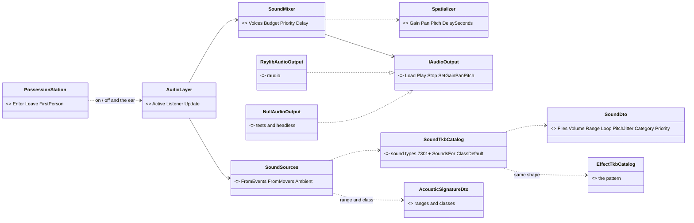
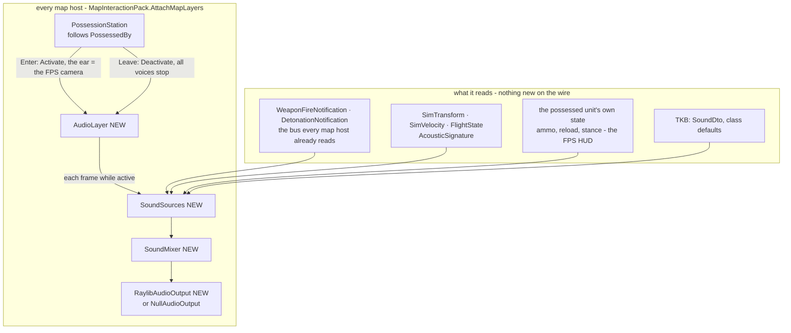
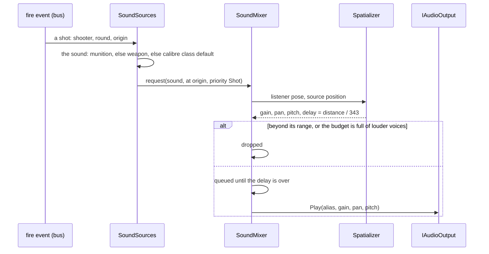
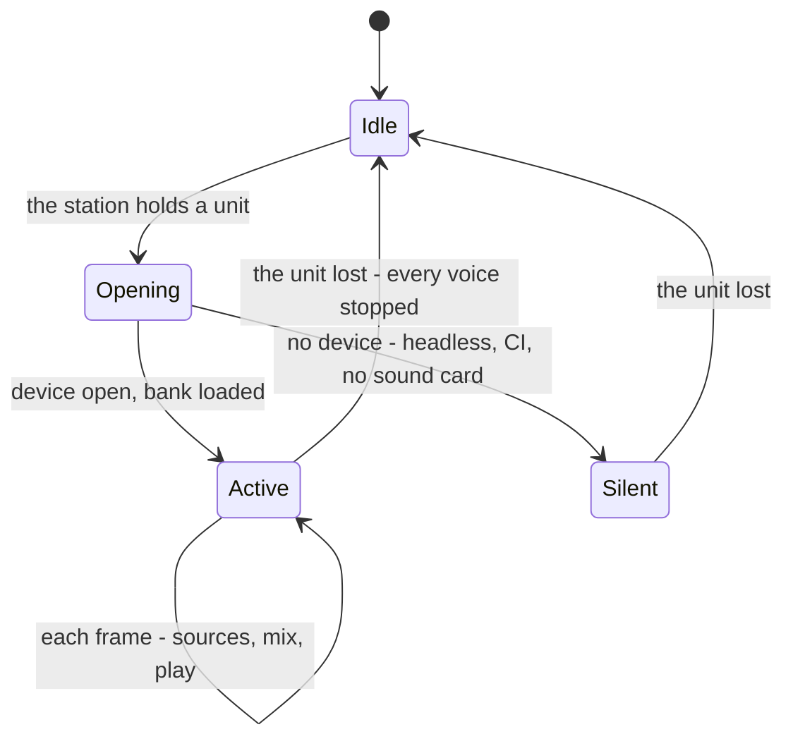

<!--STATUS
state: LIVE
updated: 2026-10-15
build-state: BUILDING — §3 APPROVED 2026-10-15 (R-1004: "Once design written pls go implementing the sounds, autonomously overnight, do as much you can without asking me"); slices A0–A3 being built
current-answer: §1 the diagrams, §3 the decisions, §4 the spatial rules, §5 the sound catalogue, §7 the slices.
stale-below: nothing.
known-rot: none.
known-conflict: none.
related-designs:
  - docs/DESIGN_Thermal_And_Acoustic_Sensing.md — OWNS what the AI HEARS (AcousticSignatureDto ranges, SoundSourceClass, SoundEmissionSystem, R-205); this file PLAYS sound to the operator and reuses those ranges and classes so the two agree (AU-4)
  - docs/DESIGN_Visual_Effects.md — OWNS the effect pattern this mirrors: effect TYPES in the TKB with their look (VE-C), the ammo → effect mapping with a calibre default (VE-D), spawned from the fire / detonation events on every map host (VE-A)
  - docs/DESIGN_Entity_Control.md — §8d OWNS FPS possession (PossessionStation, FpsCameraDriver, the HUD): the switch that turns sound on and the listener's ear
  - docs/DESIGN_Map_3D_Mode.md — OWNS the map layers this joins (MapInteractionPack.AttachMapLayers) and §7's CC0 asset-licence table, the same rule for sound files
  - docs/DESIGN_World_Query_Seam.md — WQ-E (IWorldQuery.Trace(Sound)): the occlusion slice A4 reads
  - docs/designs/hit-location/DESIGN_Body_Parts_And_Hit_Location.md — HitMarks (HL-8): where an impact sound plays (A2)
  - docs/designs/airborne/DESIGN_Airborne_Insertion.md — the rope, canopy and ejection sounds are rows of §5 when that lands
-->

# FPS audio — the sound of the scene, only while a unit is possessed

🔒 **User, `2026-10-15`:** *"we could try thinking about sound effects for the FPS mode - how to generate scene sounds only when FPS mode is
active, what sound engine to use, how to define sounds for different entity actions and effects, ambient sounds etc. i need to still run the
engine in both windows and linux … i have no sound library so some free open source would need to suffice"* → the approach *"Sounds good.
Write design please."*

## 0. INVENTORY — what exists (codebase-memory graph + grep, `2026-10-15`)

| query | total | finding |
|---|---|---|
| `search_graph` Class `.*(Audio\|Sound\|Acoustic\|Hearing).*` | 10 (prod) | ALL perception: `AcousticEmitter`, `SoundEmissionSystem`, `AcousticPerception`, `SoundContactEvent`, `AudioTargetDetected` (+ translators), `HearingGizmo` — ⛔ **nothing plays sound** |
| grep `InitAudioDevice\|LoadSound\|PlaySound\|AudioEngine\|OpenAL\|NAudio\|miniaudio` in `FDP` `Hrot` `Stride` | **0** | no playback anywhere |
| design corpus `docs/` `.dev/` (audio, sound effect, soundscape, ambient sound) | — | ⛔ **searched, no design** for playback; the sensing design (R-205) owns hearing |
| the package `raylib-cs 7.0.2` (already referenced by the map hosts) | — | ✅ `InitAudioDevice`, `LoadSound`, `LoadSoundAlias`, `SetSoundPan`, `SetSoundPitch`, `LoadMusicStream`, `AttachAudioStreamProcessor`; native runtimes `win-x64`, `win-x86`, `linux-x64` (miniaudio inside) — ⛔ no 3-D positioning |
| ⚠ `check_index_coverage` | — | not run (CLI gap) — the absences are grep-corroborated |

| the design rests on | code — how it IS | design basis |
|---|---|---|
| FPS is a station that FOLLOWS the replicated `PossessedBy`; it enters / leaves | ✅ `PossessionStation.cs:83-100` (`Enter` / `Leave`, `Bodies.FirstPerson`) | ✅ Entity Control §8d |
| every map host gets the same layers, possession included | ✅ `MapInteractionPack.cs:439-461` | ✅ Map 3-D (R-254 pack) |
| every map host hears the fire and detonation events and draws effects from them | ✅ `EffectSystems.cs` (`EffectSpawnSystem` reads `WeaponFireNotification`, `DetonationNotification`); the fire event carries the round (CE-1111) | ✅ Visual Effects VE-A |
| effect types are TKB entries with a look; the ammo → effect set has a calibre default | ✅ `EffectTkbCatalog.cs` (7101…7172, `EffectsFor`, `ClassOf`) | ✅ VE-C / VE-D |
| every type already says how far its sounds carry and their class | ✅ `SignaturesDto.cs` (`AcousticSignatureDto`: Moving / Firing / Detonation range + class), `SoundSourceClass` 0–7 | ✅ R-205 |

## 1. The diagrams

*Caption:* the only new seam is `IAudioOutput`; everything that decides WHAT is heard and HOW LOUD is pure C# above it (`SoundSources`,
`SoundMixer`, `Spatializer`) and is railed through the null output. Swapping raylib for OpenAL later (A4) replaces one class.

*Caption:* who calls it each frame — the canvas calls every layer, and `AudioLayer` returns at once unless the station holds a unit, so a host
that never possesses pays nothing and never opens the audio device. ⚠ the dead edge to say out loud: **a host with no `PossessionStation`
(none today — the pack attaches it everywhere) would never play sound.**

*Caption:* `Silent` is a real state, not an error — a machine with no sound device runs FPS exactly as before (AU-6).

## 2. What the operator should hear (the scope)

| source | from | how |
|---|---|---|
| **shots** | `WeaponFireNotification` | a near sound within ~150 m, a distant one (the boom / echo tail) beyond; an AUTOMATIC weapon plays a burst loop while it fires (the events come at the behaviour's cadence — the same reason CE-1105 draws streams) |
| **explosions** | `DetonationNotification` | by warhead size (the calibre class); the delay makes a far one seen before heard |
| **bullets passing** | the rounds the map already tracks (`ProjectileLayer`) | a crack / whiz when a round's closest approach to the ear is < 5 m |
| **impacts** | hit events, later `HitMarks` (HL-8) | thud / ricochet by what was hit |
| **movement** | `SimVelocity` + `AcousticSignature.MovingClass` | loops: footsteps, wheeled engine, tracked engine + tracks, rotor; volume and pitch from speed / `ReferenceSpeed`; a flyer at any speed (R-205's M7 rule) |
| **the possessed unit himself** | the FPS station's state | own footsteps (by gait), own shots louder and dry, reload, empty click, breathing when running or wounded |
| **doors, boarding** | the door state, embark / disembark | one-shots |
| **ambient** | the scenario: terrain, time of day | beds: wind (always), birds (day), insects (night), a town hum (built-up), and a **distant battle rumble** whose level follows the shots fired out of earshot |

## 3. Decisions — ✅ APPROVED `2026-10-15` (R-1004), as written

| # | decision | lean | rejected — one line each |
|---|---|---|---|
| **AU-1** | the audio library | **raylib's audio** (raudio = miniaudio), already in `raylib-cs 7.0.2` with Windows + Linux natives — no new dependency | OpenAL Soft (Silk.NET) — another native lib to ship; kept as A4's upgrade · FMOD / Wwise — proprietary · NAudio — Windows only · SoLoud / raw miniaudio bindings — thin, unmaintained .NET wrappers |
| **AU-2** | 3-D positioning | **ours, pure C#** (`Spatializer`): distance gain, stereo pan from the bearing to the ear, Doppler pitch, the speed-of-sound delay | relying on the library — raylib has no 3-D |
| **AU-3** | when sound exists | **only while `PossessionStation` holds a unit**: the device opens on the first Enter, every voice stops on Leave; the ear is the FPS camera | always on in 3-D — the 3-D map's free camera has no "ear"; a sound map of the battle is a later idea |
| **AU-4** | how far a sound carries | the type's **`AcousticSignatureDto` ranges** (the AI's hearing ranges) as the distance where the gain reaches ~0; the curve inside it per `SoundDto` | separate playback ranges — the operator would hear what the AI cannot, or the reverse |
| **AU-5** | how sounds are defined | the **Visual Effects pattern**: sound TYPES in the TKB (`SoundTkbCatalog`, ids 7301+, a `SoundDto` look each); a munition / weapon / type names its sounds, else the **class default** (calibre class for shots and bursts, `SoundSourceClass` for movement) — overridable per type, like HL-12's body zones | hard-coded sound names in the layer — every new weapon would need code |
| **AU-6** | no sound device (CI, headless, a server) | a `NullAudioOutput` that RECORDS what would play — the rails assert on it; FPS runs unchanged | failing to start — a missing sound card must never stop the editor |
| **AU-7** | the voice budget | **32 voices**, priority own > shot near > explosion > bullet pass > shot far > movement > ambient; one alias per playing copy (`LoadSoundAlias`), the quietest of the lowest priority dropped first | no budget — a firefight would clip and stutter |
| **AU-8** | the files | **OGG**, in `assets/audio/`, each listed in a **licence table** (file · source · licence · author); **CC0 only** (Freesound filtered to CC0, Kenney, OpenGameArt CC0) plus **procedurally generated placeholders** made by a script in the repo (noise bursts, filtered noise, hums) | Sonniss GDC bundles and BBC Sound Effects in the repo — their licences restrict redistributing the raw files / commercial use · CC-BY by default — allowed only with the table's attribution column filled |
| **AU-9** | settings | per OPERATOR, not per scenario: master, per category (weapons, explosions, vehicles, ambient, own), mute — saved with the host's user settings | in the scenario — two operators want different volumes |
| **AU-10** | the wire | **nothing new**: every input already reaches every map host | a sound event on the wire — the events and the movement are already there |

## 4. The spatial rules (`Spatializer`, pure)

| quantity | rule |
|---|---|
| distance gain | g = v · (1 − smoothstep(r₀, R, d)) · r₀ / max(d, r₀) — full inside r₀ (the `SoundDto` reference distance), falling with distance, **0 at R** (the type's audible range, AU-4) |
| pan | p = sin(bearing from the ear's forward), −1 left … +1 right; behind the ear it is folded (no front / back without HRTF — A4) |
| pitch | Doppler f' = f · c / (c + v_r) with v_r the source's speed away from the ear (c = 343 m/s), clamped ±20 %; plus the `SoundDto` jitter (±5 %) so repeats differ |
| delay | t = d / 343 s — a shot at 700 m is heard 2 s after its flash |
| near / far | a shot's near sound fades out between 120 and 180 m while its distant sound fades in |
| movement loops | one voice per audible mover, the nearest first; gain × min(1, speed / `ReferenceSpeed`); pitch 0.9 + 0.3 · speed / max |

## 5. The sound catalogue (TKB) — starting set

| id | sound type | used by | starting asset |
|---|---|---|---|
| 7301–7303 | shot near: small · medium · large calibre | the calibre class default (as VE-D) | generated, then CC0 rifle / cannon / tank-gun recordings |
| 7304–7306 | shot distant: small · medium · large | beyond 150 m | generated (low-passed, longer tail) |
| 7307 | burst loop (machine gun) | automatic mounts while firing (CE-1105's window) | generated |
| 7311–7313 | explosion: small · medium · large | the warhead size | generated, then CC0 |
| 7321 | bullet pass (crack / whiz) | a round passing within 5 m | generated |
| 7331–7332 | impact: soft · hard (ricochet) | hits | generated |
| 7341–7345 | movement loops: footsteps · wheeled engine · tracked engine · rotor · jet | `SoundSourceClass` 1, 2, 3, 7 + fixed wing | generated hums / noise, then CC0 |
| 7351–7354 | own: reload · empty click · breathing · door | the station | CC0 |
| 7361–7365 | ambient beds: wind · birds · insects · town · battle rumble | the scenario | generated wind / rumble, CC0 birds / insects |

`SoundDto`: `Files[]` (variants, one picked at random), `VolumeDb`, `ReferenceM`, `Loop`, `PitchJitter`, `Category`, `Priority`. A munition /
weapon mount / type carries an optional `SoundsDto { Shot, ShotFar, Burst, Detonation, Moving }` naming sound types — the `MunitionEffectsDto`
twin.

## 6. Settings and the operator

A small volume panel in the FPS HUD's menu (AU-9) and a mute key; the ambient bed's choice from the scenario's terrain and its time of day
(default: wind only).

## 7. Slices — all ui lane (the `SoundDto` in `Fdp.Toolkits/Tkb/Domain` beside `EffectVisualDto` is a small cross-lane addition, stated)

| slice | builds | acceptance |
|---|---|---|
| **A0** spike | `IAudioOutput`, `RaylibAudioOutput`, `NullAudioOutput`; open the device on a possess in the editor; one generated click | ★ a click is heard on the user's Windows machine and on Linux; ★ no device ⇒ `Silent`, FPS unchanged; the CI rails pass on the null output |
| **A1** shots and explosions | `AudioLayer`, `SoundMixer`, `Spatializer`, `SoundTkbCatalog` shots / explosions / burst, the generated placeholders and the script, the licence table | ★ rails: gain 0 beyond the range, louder nearer, pan sign by side, delay = d / 343, the budget drops the quietest lowest-priority voice; ★ a live firefight heard in FPS |
| **A2** the world moving | movement loops, bullet passes, impacts (then from `HitMarks`), the own-unit sounds | ★ a passing tank's engine rises and falls with the Doppler; ★ a round over the head cracks |
| **A3** ambience and settings | the ambient beds, the battle rumble, the volume panel, mute | ★ the bed changes with the scenario; settings persist per operator |
| **A4** later | occlusion through walls (WQ-E's `Trace(Sound)` ⇒ a low-pass and −dB), urban vs open reverb, front / back (HRTF) — switching `IAudioOutput` to OpenAL Soft if raudio's filters are not enough; the Stride IG reusing the same TKB sounds | measured when chosen |
