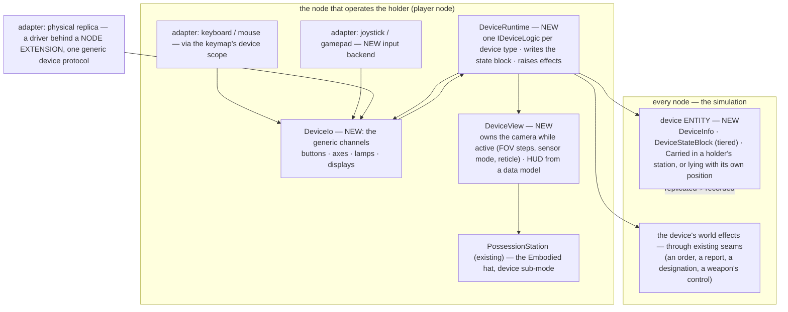
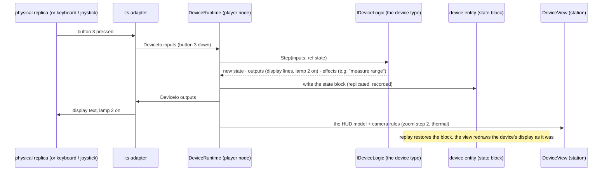

<!--STATUS
state: LIVE
updated: 2026-11-27 (rev 2 — the device runs on the BRAIN: its state is a [UnitMemory] record in its blackboard, reachable from C#, BTree / HSM and blueprints; inputs replicate as events, outputs as replicated state)
build-state: DESIGN — the framing's leans ACCEPTED by the user (2026-11-27); the shape below (§3) for the user's nod; slices in §5
current-answer: ⭐ §3a rev 2 (the brain, unit memory, the I/O wire) — it SUPERSEDES SD-2, SD-6 and the state block in §2 · §3 the other decisions · §5 the slices · §9 the open questions
stale-below: §2's `DeviceStateBlock` boxes and SD-2 / SD-6 in §3 — superseded by §3a (kept for the reasoning)
known-rot: none
known-conflict: none
related-designs:
  - ../../DESIGN_Entity_Control.md — OWNS the possession station (§8d), the pilot station (§8f), the sight / lock (§8g), zoom and binoculars (§8j, §8k), and ⭐ §8m: a portable weapon is an ENTITY that boards a person's Hands / Back station, is dropped and picked up — THIS attaches a device the same way
  - ../../UX/DESIGN_Seats_And_Hats.md — OWNS seats and hats (Embodied); THIS adds a device sub-mode inside the Embodied hat
  - ../../UX/DESIGN_Input_And_Commands.md — OWNS the one keymap and its scopes; THIS feeds device controls into it and adds axis sources
  - ../../DESIGN_Node_Features.md — OWNS node features (per node today); THIS asks for a per-station layer (later slice)
  - ../sensor-view/DESIGN_Sensor_View.md — OWNS the night / thermal views (map-wide; G-10 "tie to a unit's sight" deferred) — THIS ties a mode to the active device
  - ../../DESIGN_Player_Join.md — OWNS playable slots, deploy roles and kits; a slot's issued devices hang off it
  - ../../DESIGN_Node_Extensions.md — OWNS how an outside product joins a node; the external device driver is one
  - ../weapons/DRAFT_Weapon_Malfunctions_And_Physical_Devices.md — the earlier IDEAS (CE-4645) on physical devices; THIS is their design
  - ../weapons/DESIGN_Weapon_Systems.md — OWNS weapons as entities (stowed / deployed, manned); a device that controls a weapon talks to it there
  - ../../DESIGN_Player_HUD_And_Debrief.md — OWNS the player HUD; a device HUD draws beside it
  - ../vehicle-tactics/DESIGN_FPV_Drone.md — OWNS the FPV drone's simulation (battery, jamming, impact); the drone ground station device reads it
  - ../air-attack/DESIGN_Air_Combat.md — OWNS the fighter HUD (§4d) — the precedent for a HUD as a DATA MODEL
-->

# Simulated devices — a trainee's equipment with its own logic, displays and controls

🔒 User, `2026-11-27`: *"We are still missing the support for training with simulated military equipment like smart devices … they have their own
logic, they have buttons, they have little displays, which is usually running separately from the engine, but requires some API from the device
logic to be usable"* · *"the screen for the trainee is basically the 3D map of HROT in player mode on player node"* · *"we need to be able to somehow
define what kind of devices the trainee is given, and the trainee needs to be able to switch those devices at will"* · *"Leans accepted"* ·
*"the protocol is generic and supports buttons, displays, lamps and analog values like those coming from the joysticks and gamepads … we will then
provide drivers … and even the virtual devices which are controlled via keyboard or mouse … will have their own adapter to this generic
interface"* · *"The device might be an entity having some components describing its logic state … some kind of generic state storage component.
Where the information layout is defined by the device logic and the recording system doesn't know about it"* · *"the device entity should somehow
support being attached to a player avatar … a non-attached state … its own world position … pre-attached to a player avatar entity in the
scenario for our development and testing … creating and attaching at runtime is not slice 1, the infrastructure needs to support that"*.

⭐ **The decision in one line:** a device is an **ENTITY** — attached to its holder through the existing carried-item stations, or lying in the
world — whose logic state lives in a **generic fixed-size state block** the device type lays out (recorded as bytes); its **logic** runs where its
holder is operated and talks to the outside only through a **generic device I/O model** (buttons, axes, lamps, displays), served by **adapters**
(keyboard / mouse, joystick / gamepad, a physical replica); its **view** owns the camera and draws a HUD from a **data model**.

## 0. The proven solution

Training simulators separate a simulated device into **logic** (the device's state machine and menus), **I/O** behind a hardware-abstraction layer
(abstract buttons, axes, lamps and displays, with a driver per real or virtual panel) and **view** (the picture and the optic). The same logic then
serves a desktop trainee and a replica panel, and the recorder only needs the logic's state. ⭐ Adopted as is — each part maps onto a seam HROT
already has (§1).

## 1. INVENTORY — the queries run (`2026-11-27`)

| query / read | finding |
|---|---|
| `search_graph` `.*(Station|Hud|Hat|Seat|Sight|Binocular|Zoom|Camera|Kit|Device|Joystick|Gamepad|Input|Keymap|Feature).*` Class (351, paged) | the possession station (`PossessionStation`, `FpsCameraDriver` — `ICameraDriver`), hats (`Hat`, `HatArbiter`, `SeatHats`), the keymap (`Keymap`, `InputScope`, `KeyTrigger` Press / Hold / **Axis**, `IChordInput`), `SensorView`, `FighterHud` (a HUD data model), `NodeFeatures` |
| `search_graph` `.*(Carried|Lying|PickUp|Attach|Mount|Holder|Stow|Blob|Opaque).*` Class (112) | ⭐ the pick-up machinery (`PickUpGrantEvent`, `RoundPickUp`, `PickUpParams`) — and Entity Control §8m: a portable weapon is an entity that boards a person's **Hands / Back station** (`Embarkation.Check`), is taken / dropped (`PickUpExecutor` / `PutDownExecutor`) and lies in the world |
| grep `fixed byte` in Fdp.Core / Fdp.Toolkits | ⭐ `BlueprintBlackboard1024` / `4096`: a fixed-size memory component whose layout only its owner knows, in size TIERS — the precedent for a generic device state block |
| grep `Gamepad|Joystick|SDL_|DirectInput|XInput|HID` | ⛔ none in HROT (input is keyboard + mouse through `IInputProvider`) |
| grep `laser|rangefind|JTAC|9-line` | ⛔ no rangefinder / designator; the only "9-line" is a medevac request |
| per-station features | ⛔ node features are per NODE only |
| ⚠ `check_index_coverage` | not available through the CLI: absence claims rest on graph + grep |

What exists and is reused: the station's camera ownership and HUD layer, the binoculars / zoom / sight branches (to be turned into devices), the
sensor views, the fighter HUD model, possession of vehicles and aircraft, carried-item stations and pick-up / put-down, the one keymap, node
extensions, the control frame (HTTP / DDS).

## 2. The diagrams

### 2a. The module view — who runs what

*What the picture shows that prose hid: the device logic never sees a keyboard, a joystick or a replica — only the generic channels; the recorder
never sees the logic — only the state block; and the device itself is an ordinary entity, so carrying, dropping, picking up and late join are the
existing machinery.*

### 2b. The classes

*What the picture shows that prose hid: one interface per axis of change — a new DEVICE TYPE is one `IDeviceLogic`; a new PANEL is one
`IDeviceAdapter`; neither touches the other or the recorder.*

### 2c. The sequence — a button on a replica changes a display and the camera

## 3. Decisions (leans — for the user's nod)

| # | decision | why |
|---|---|---|
| SD-1 | ⭐ **a device is an ENTITY** of a device TKB type (`DeviceInfo` + its state block); attached to a holder by **boarding one of his carried-item stations** (Hands, Back — the §8m machinery), else **lying in the world** with its own position | the user's requirement; carrying, dropping, picking up, replication and late join already exist for portable weapons (Entity Control §8m) — reused, not rebuilt |
| SD-2 | ⭐ **the generic state block**: `DeviceStateBlock` in size TIERS (e.g. 256 / 1024 bytes), unmanaged, recorded as bytes; a header names the device type and the layout version; the LAYOUT is the device logic's (a struct it overlays) — the recorder knows nothing about it | the user's call; the `BlueprintBlackboard` tier precedent; unmanaged ⇒ no GC churn in replay (CLAUDE.md "new components") |
| SD-3 | **what the world must know is not only in the block**: effects reach the world through EXISTING seams (an order, a report, a designated point, a weapon's control); the block is the device's own memory | the AI and other nodes read typed seams, never a device's private layout |
| SD-4 | ⭐ **the generic device I/O model** — `DeviceIo`: buttons (id, down / up), axes (id, −1…1 or 0…1), lamps (id, off / on / blink), displays (id, a text grid and simple glyphs; a bitmap later) | the user's call: ONE API for every panel, real or virtual |
| SD-5 | ⭐ **adapters ("drivers")**: keyboard / mouse (through the keymap's device scope), joystick / gamepad (a NEW input backend), a physical replica (a driver in a node extension speaking one small generic protocol) | the user's call; the logic never knows which |
| SD-6 | **the logic runs on the node that operates the holder** (the player node; with a gateway seat, the server node) and writes the block there; other nodes see the replicated block | the station already runs there; one writer per block (R-4212) |
| SD-7 | **the view owns the camera while a device is active**: FOV / zoom steps, a sensor mode (eye / night / thermal — the sensor view tied to the device, Sensor View G-10), a reticle; the HUD is a **data model** (`DeviceHudModel`, the `FighterHudModel` precedent) drawn by the station — so an external client can draw it later | the station owns the camera today; a data model keeps the DPS path open |
| SD-8 | **a device sub-mode of the Embodied hat**: the active device's controls are a keymap scope above the person's own keys; one key / a device wheel switches between the devices he carries; "none" returns to the plain soldier | Seats and Hats: one hat, one camera owner |
| SD-9 | **issued devices** = the devices attached to his avatar; slice 1 pre-attaches them in the scenario; creating and attaching at run time uses the same boarding path (later) | the user's call |
| SD-10 | **per-station feature switch** (later slice): which device types a station may use — a station layer under the node features | Node Features is per node today |
| SD-11 | **the existing binoculars / zoom / sight branches** in the station become the first devices (behaviour unchanged), so there is ONE device path, not a device framework beside hard-coded branches | ruling 9 |
| SD-12 | **recording and the debrief**: the block and `DeviceInfo` are recorded; replay restores them and the view can redraw a device's display as it was | the user's call |

## 3a. ⭐ rev 2 — the device runs on the BRAIN (user, `2026-11-27`)

🔒 User: *"Could we reuse the brain blackboard components and its dynamic allocation mechanism directly, meaning the device logic will run on the
brain … make the status in the form of an allocated record in the Blackboard made available for the blueprints … majority of the logic of the
device will be for sure written in C# … if we define that the device logic runs on a brain node then only all the inputs to it and outputs from it
towards the player are replicated … I lean to events … for the output side, the status structure is probably better for late join"*.

✅ **Measured — it already exists: UNIT MEMORY** (Q87, **R-237**, `FDP/Toolkits/Fdp.Toolkits/Behavior/UnitMemory.cs`): a `[UnitMemory]` struct is
ONE slot in an entity's blackboard store, keyed by its TYPE, allocated on first touch (appended mid-tick, nothing moves), guarded by a layout
hash (a changed struct or an older recording re-initialises, never mis-reads), **recorded, not scenario-saved**, shared by every behaviour of that
entity — reached by C# (`UnitMemory.Ref<T>`), by a BTree / HSM `ref` param, and by blueprints through the **`GetShared` / `SetShared`** nodes
(R-237; present in the blueprint compiler's node set — ⚠ end-to-end on a device not yet measured).

| # | rev 2 decision (supersedes) | why |
|---|---|---|
| SD-2′ | ⭐ **the device's logic state is a `[UnitMemory]` struct per device type** (e.g. `RangefinderState`) in the DEVICE ENTITY's blackboard — ⛔ no new `DeviceStateBlock` | ruling 9: the dynamic allocation, the layout guard, the recording and the blueprint access already exist |
| SD-6′ | ⭐ **the device entity has a brain; its logic is a BEHAVIOUR** (C# first — a BTree / HSM, or a blueprint) run as its task on the brain node; it reads its inputs, writes its unit memory, raises its effects through the existing seams | the user's call; blueprints can then operate a device too |
| SD-13 | **inputs → the brain as EVENTS** (the user's lean): `DeviceButtonEvent {device, button, down}` reliable and ordered; `DeviceAxisEvent {device, axis, value}` sent on change (dead-band, ≤ a rate) with LATEST-WINS per (device, axis) | few event types cover every panel; an axis is continuous, so only its newest value matters |
| SD-14 | ⭐ **outputs → the player as REPLICATED STATE**, not events: a `DeviceOutputs` (unmanaged — lamps, the fixed text grid of each display, the HUD model's fields, the view mode: zoom step, sensor mode, reticle) written by the behaviour, sent ON CHANGE, split into a few parts (lamps · displays · view) so one change sends one part | ⭐ late join comes free (the last value is kept); ⭐ the REPLAY shows exactly what the trainee saw from the recorded outputs, without running the logic (behaviours do not run in a replay); events re-sent on join would rebuild what a kept state already is |
| SD-15 | ⭐ **look and camera motion stay LOCAL** on the player node (mouse look, smooth zoom between steps, head movement) — the brain decides the device's MODE (which zoom step, which sensor), never the per-frame view | a round trip to another node per mouse move would lag; in the editor (one process) it is all local anyway |
| SD-16 | **the brain must tick an ACTIVE device every frame** (exempt from the brain cadence, CE-2382), an idle device rarely | a button must answer within a frame or two |

⚠ What to measure first (slice 1): `GetShared` / `SetShared` on a device entity's unit memory end to end; the brain cadence exemption; the
round-trip delay player node → brain → player node on a two-process run (the editor has none).

## 4. Rejected — one line each

- **Typed components per device type** — the user's concern holds: dozens of types, each a component, descriptor and translator; the block keeps the recorder ignorant.
- **Device logic inside the station's code** (today's binoculars) — every new device would grow one class; no external panel could drive it.
- **A managed state object** — every change would allocate in replay (CLAUDE.md "new components").
- **A new `DeviceStateBlock` (rev 1)** — unit memory already is the generic, lazily allocated, recorded, blueprint-reachable record (R-237).
- **Outputs as events only** — late join and replay would need the state rebuilt from them; a kept replicated state is that state.
- **One protocol per physical device** — the user's call: drivers adapt, the logic sees one model.

## 5. Slices — each with its feature-test scenario (R-4277)

| slice | builds | scenario · what its objectives judge |
|---|---|---|
| **SD-S1** the framework + binoculars / laser rangefinder | SD-1…SD-9, SD-11, SD-12: the device entity, the state block, `DeviceIo`, the runtime, the view, the keyboard / mouse adapter, a LOOPBACK replica adapter for tests, the binoculars and a rangefinder device; devices pre-attached in the scenario | `dv-observe-and-range`: a trainee (driven over HTTP in the test) switches to the rangefinder and measures named targets — objectives: each target's measured range within the device's accuracy; the device's display shows it; a dropped device lies in the world and another trainee picks it up; replay shows the same display |
| **SD-S2** joystick / gamepad + the drone ground station | the joystick adapter; the drone operator device: the operator's body stays on the ground, a control link to the drone, HUD with battery / signal / link state from the drone's simulation | `dv-drone-operator`: the trainee flies the drone to a point and back; objectives: the HUD's battery and signal match the simulation; losing the link is shown |
| **SD-S3** the pilot station device + digital target hand-off | the pilot device: flight HUD, a structured target message (9-line) received digitally from another trainee's device and shown on the pilot's display and map | `dv-target-handoff`: one trainee sends a target message from his device, the pilot station shows it and the point on its map |
| **SD-S4** the weapon aiming unit | a device that controls a manned weapon system (optics, zoom, sensor modes, the operating procedure) — its weapon effects stay with the weapon systems design | `dv-aiming-unit`: the trainee runs the procedure and the weapon system reaches its ready state |
| **SD-S5** per-station features + run-time issue | SD-10; creating and attaching devices at run time | — |

## 6. Rules this respects

- **R-4212 parallel**: one writer per block (the holder's operating node); effects through commands / existing seams.
- **Recorded components unmanaged**: the block and `DeviceInfo` are fixed-size.
- **Hot path**: the runtime steps only the ACTIVE device of each operated holder; adapters fill reused buffers (0 B per steady frame, a rail).
- **R-4295**: the wire carries its own device types; translators convert.
- **R-4277**: every slice ships its scenario with expect rows.

## 9. Open questions — with leans

| # | question | ⭐ lean |
|---|---|---|
| Q-1 | ~~the block's tiers~~ | ⛔ superseded by SD-2′ (unit memory sizes itself) |
| Q-2 | the replica protocol's transport | a node extension listening on a local socket (JSON lines or a small binary frame), the same model as `DeviceIo`; DDS later if a replica must sit on another machine |
| Q-3 | the joystick backend | Raylib's gamepad API first (already linked); a wider HID layer only if a device needs it |
| Q-4 | which lane | **ui** builds SD-S1 (the station, the view, the keymap); the entity and the state block with **backend**, cross-lane allowed |
| Q-5 | the device wheel's key and the HUD layout | the ui lane's mockup first (R-4143: every UI design gets a mockup before it is built) |
