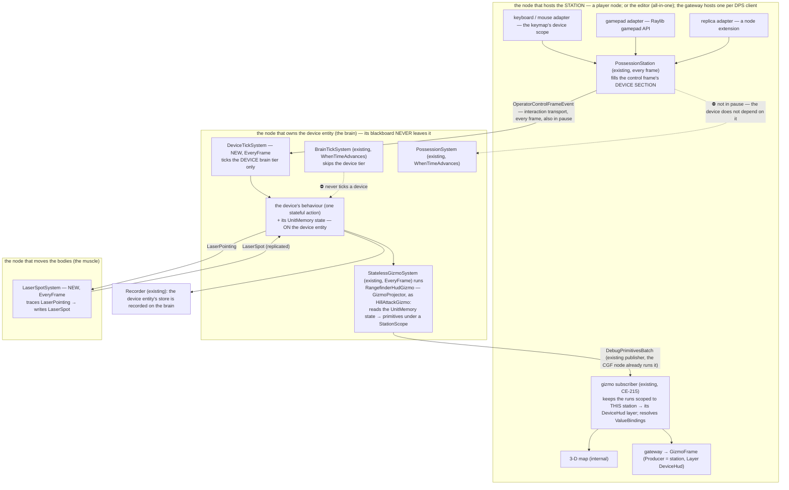
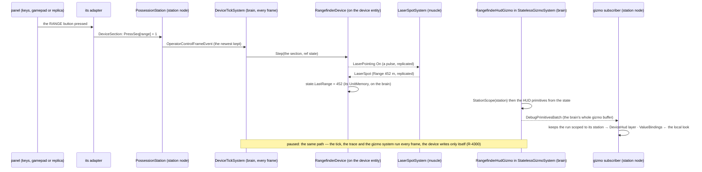
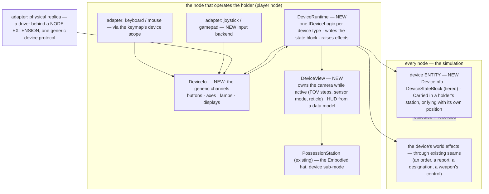
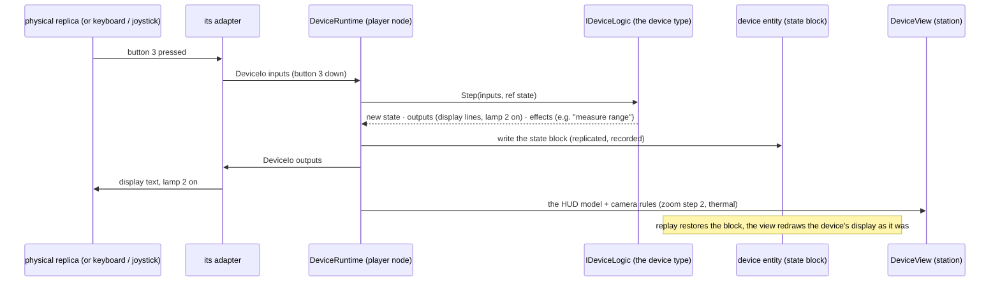

<!--STATUS
state: LIVE
updated: 2026-11-27 (§3n — the beam drawn by a LaserLayer3D on every map host, from replicated components) · 2026-11-27 (§3m — the panel outputs are a small generic DevicePanel component, not gizmos) · 2026-11-27 (§3l — the generic output encoding: primitives + PanelOutput channels + TKB channel names; change-only gizmo sending measured as NOT built) · 2026-11-27 (rev 7 — no HUD system: the HUD is a stateless projector on the brain, shipped by the existing batch under a StationScope meta-primitive, §3k) · 2026-11-27 (rev 6 — the HUD drawn on the brain, shipped as a station-keyed frame on change; the blackboard never replicated, §3j) · 2026-11-27 (rev 5 — the HUD reads the device's full [UnitMemory] state; the device store replicated, §3i) · 2026-11-27 (rev 3 — ONE generic output description (a display list + lamps + fields) drawn as screen-space gizmos and recorded; the device ticks in pause, never acting on the world) · 2026-11-27 (rev 2 — the device runs on the BRAIN: its state is a [UnitMemory] record in its blackboard, reachable from C#, BTree / HSM and blueprints; inputs replicate as events, outputs as replicated state)
build-state: DESIGN — ⛔ the second review (§3o) found 2 blocking issues; leans for the user's nod, then the diagrams are redrawn
current-answer: ⭐ §3o (the second review's leans) over §3j–§3n (the HUD drawn on the brain as a gizmo projector §3k, the panel component §3m, the beam layer §3n), §3g (the seat), §3f (measured), §5 / §5a (slices, scenarios); §2's diagrams await the §3o redraw
stale-below: §2's `DeviceStateBlock` boxes and SD-2 / SD-6 in §3 — superseded by §3a (kept for the reasoning)
known-rot: §3c (ValueBinding) is history for the HUD — D-3d · LS-3 / LS-10 / LS-16, D-1, D-1′, D-3, D-3′, D-3a are superseded in place (marked)
known-conflict: none
related-designs:
  - ../../DESIGN_Replay_Time_Axis_And_Review.md — OWNS the replay's two axes (sim time collapses a pause; the wall-clock axis keeps it) — the paused-device scenarios are judged on the wall-clock axis
  - ../../DESIGN_Unit_Intent.md — OWNS unit intent and the brain's inputs; a device is a brain of its own on the device entity
  - ../../blueprints/Architect_Question_114_Seats_On_One_Node.md — OWNS several stations on one node (StationId = node + seat index); each station draws only its own device HUD
  - ../../DESIGN_Entity_Control.md — OWNS the possession station (§8d), the pilot station (§8f), the sight / lock (§8g), zoom and binoculars (§8j, §8k), and ⭐ §8m: a portable weapon is an ENTITY that boards a person's Hands / Back station, is dropped and picked up — THIS attaches a device the same way
  - ../../UX/DESIGN_Seats_And_Hats.md — OWNS seats and hats (Embodied); THIS adds a device sub-mode inside the Embodied hat
  - ../../UX/DESIGN_Input_And_Commands.md — OWNS the one keymap and its scopes; THIS feeds device controls into it and adds axis sources
  - ../../DESIGN_Node_Features.md — OWNS node features (per node today); THIS asks for a per-station layer (later slice)
  - ../sensor-view/DESIGN_Sensor_View.md — OWNS the night / thermal views (map-wide; G-10 "tie to a unit's sight" deferred) — THIS ties a mode to the active device
  - ../../DESIGN_Player_Join.md — OWNS playable slots, deploy roles and kits; a slot's issued devices hang off it
  - ../../DESIGN_Node_Extensions.md — OWNS how an outside product joins a node; the external device driver is one
  - ../weapons/DRAFT_Weapon_Malfunctions_And_Physical_Devices.md — the earlier IDEAS (CE-4645) on physical devices; THIS is their design
  - ../weapons/DESIGN_Weapon_Systems.md — OWNS weapons as entities (stowed / deployed, manned); a device that controls a weapon talks to it there
  - ../../DESIGN_Player_HUD_And_Debrief.md — OWNS the player HUD; a device HUD draws beside it
  - ../vehicle-tactics/DESIGN_FPV_Drone.md — OWNS the FPV drone's simulation (battery, jamming, impact); the drone ground station device reads it
  - ../air-attack/DESIGN_Air_Combat.md — OWNS the fighter HUD (§4d) — the precedent for a HUD as a DATA MODEL
-->

# Simulated devices — a trainee's equipment with its own logic, displays and controls

🔒 User, `2026-11-27`: *"We are still missing the support for training with simulated military equipment like smart devices … they have their own
logic, they have buttons, they have little displays, which is usually running separately from the engine, but requires some API from the device
logic to be usable"* · *"the screen for the trainee is basically the 3D map of HROT in player mode on player node"* · *"we need to be able to somehow
define what kind of devices the trainee is given, and the trainee needs to be able to switch those devices at will"* · *"Leans accepted"* ·
*"the protocol is generic and supports buttons, displays, lamps and analog values like those coming from the joysticks and gamepads … we will then
provide drivers … and even the virtual devices which are controlled via keyboard or mouse … will have their own adapter to this generic
interface"* · *"The device might be an entity having some components describing its logic state … some kind of generic state storage component.
Where the information layout is defined by the device logic and the recording system doesn't know about it"* · *"the device entity should somehow
support being attached to a player avatar … a non-attached state … its own world position … pre-attached to a player avatar entity in the
scenario for our development and testing … creating and attaching at runtime is not slice 1, the infrastructure needs to support that"*.

⭐ **The decision in one line:** a device is an **ENTITY** — attached to its holder through the existing carried-item stations, or lying in the
world — whose logic state lives in a **generic fixed-size state block** the device type lays out (recorded as bytes); its **logic** runs where its
holder is operated and talks to the outside only through a **generic device I/O model** (buttons, axes, lamps, displays), served by **adapters**
(keyboard / mouse, joystick / gamepad, a physical replica); its **view** owns the camera and draws a HUD from a **data model**.

## 0. The proven solution

Training simulators separate a simulated device into **logic** (the device's state machine and menus), **I/O** behind a hardware-abstraction layer
(abstract buttons, axes, lamps and displays, with a driver per real or virtual panel) and **view** (the picture and the optic). The same logic then
serves a desktop trainee and a replica panel, and the recorder only needs the logic's state. ⭐ Adopted as is — each part maps onto a seam HROT
already has (§1).

## 1. INVENTORY — the queries run (`2026-11-27`)

| query / read | finding |
|---|---|
| `search_graph` `.*(Station|Hud|Hat|Seat|Sight|Binocular|Zoom|Camera|Kit|Device|Joystick|Gamepad|Input|Keymap|Feature).*` Class (351, paged) | the possession station (`PossessionStation`, `FpsCameraDriver` — `ICameraDriver`), hats (`Hat`, `HatArbiter`, `SeatHats`), the keymap (`Keymap`, `InputScope`, `KeyTrigger` Press / Hold / **Axis**, `IChordInput`), `SensorView`, `FighterHud` (a HUD data model), `NodeFeatures` |
| `search_graph` `.*(Carried|Lying|PickUp|Attach|Mount|Holder|Stow|Blob|Opaque).*` Class (112) | ⭐ the pick-up machinery (`PickUpGrantEvent`, `RoundPickUp`, `PickUpParams`) — and Entity Control §8m: a portable weapon is an entity that boards a person's **Hands / Back station** (`Embarkation.Check`), is taken / dropped (`PickUpExecutor` / `PutDownExecutor`) and lies in the world |
| grep `fixed byte` in Fdp.Core / Fdp.Toolkits | ⭐ `BlueprintBlackboard1024` / `4096`: a fixed-size memory component whose layout only its owner knows, in size TIERS — the precedent for a generic device state block |
| grep `Gamepad|Joystick|SDL_|DirectInput|XInput|HID` | ⛔ none in HROT (input is keyboard + mouse through `IInputProvider`) |
| grep `laser|rangefind|JTAC|9-line` | ⛔ no rangefinder / designator; the only "9-line" is a medevac request |
| per-station features | ⛔ node features are per NODE only |
| ⚠ `check_index_coverage` | not available through the CLI: absence claims rest on graph + grep |

What exists and is reused: the station's camera ownership and HUD layer, the binoculars / zoom / sight branches (to be turned into devices), the
sensor views, the fighter HUD model, possession of vehicles and aircraft, carried-item stations and pick-up / put-down, the one keymap, node
extensions, the control frame (HTTP / DDS).

## 2. The diagrams — ⭐ rev 4 (`2026-11-27`): the settled shape (§3a … §3h)

⚠ rev 1's diagrams (a `DeviceRuntime` on the player node, a state block, `IDeviceLogic`) are moved to `## ⛔ HISTORY` at the bottom.

### 2a. The module view — who runs what, and who calls it each frame *(rev 6, §3j)*

*What the picture shows that prose hid: the device's state is read only where it lives — the brain draws the HUD from it and ships the PICTURE,
keyed by station; the station node runs no device code at all, only the generic subscriber, so the internal map and the gateway draw one HUD by
construction. The HUD needs no new system: it is one more stateless projector on the brain, shipped by the existing batch. In the editor
configuration the projector draws into the local buffer directly. The two
dashed edges are the systems that do NOT run a device: both are `WhenTimeAdvances`.*

### 2b. The classes *(rev 6)*

```mermaid
classDiagram
  class SeatDto { <<existing, grows>> Role Station · Accepts : MountKinds plus Device · OperatedBy · StartWith }
  class WeaponSystems { <<existing, reused>> StationsOperatedBy(seat) → the devices a seat runs }
  class BehaviorState { <<existing>> plus the DEVICE brain tier }
  class DeviceTickSystem { <<NEW, EveryFrame, brain>> device tier only · Paused flag in the context }
  class RangefinderDevice { <<NEW, one class per device type>> BTreeDefinition StatefulAction(Rangefinder) · Step(input, ref state) }
  class RangefinderState { <<NEW, UnitMemory, brain only>> Mode · Menu · LastRange · everything the HUD shows }
  class RangefinderHudGizmo { <<NEW, same file>> IStatelessGizmo · GizmoProjector on the device · StationScope then the HUD }
  class StatelessGizmoSystem { <<existing, EveryFrame>> runs every GizmoProjector }
  class StationScope { <<NEW meta-primitive>> StationId — the primitives after it belong to that station }
  class DebugPrimitivesBatch { <<existing wire type>> NodeId · DebugPrimitive blob }
  class HudSubscriber { <<existing CE-215 subscriber>> keeps its station's runs → DeviceHud layer · resolves ValueBinding }
  class ValueBinding { <<meta-primitive, section 3c>> put local value X here }
  class OperatorControlFrameEvent { <<existing, grows>> plus DeviceSection: Device · Axes[4] · PressSeq[16] }
  class IDeviceAdapter { <<NEW>> Fill(ref DeviceSection) · Show(in DevicePanel) }
  class DevicePanel { <<NEW, unmanaged, replicated on change, recorded>> Revision · LampBits · BlinkBits · Values[16] · Text[4] }
  class LaserPointing { <<NEW, unmanaged>> On · Band · Direction — written by whoever points }
  class LaserSpot { <<NEW, unmanaged>> Point · Entity · Part · Range — written by the muscle }
  SeatDto ..> WeaponSystems : OperatedBy
  DeviceTickSystem --> RangefinderDevice : ticks
  DeviceTickSystem ..> BehaviorState : device tier
  RangefinderDevice --> RangefinderState : own entity only
  RangefinderDevice --> LaserPointing : writes
  RangefinderDevice ..> LaserSpot : reads
  RangefinderDevice ..> OperatorControlFrameEvent : reads DeviceSection
  StatelessGizmoSystem --> RangefinderHudGizmo : runs
  RangefinderHudGizmo ..> RangefinderState : reads
  RangefinderHudGizmo ..> WeaponSystems : which station runs it
  RangefinderHudGizmo ..> StationScope : emits
  HudSubscriber ..> DebugPrimitivesBatch : reads
  HudSubscriber ..> StationScope : filters
  HudSubscriber ..> ValueBinding : resolves
  IDeviceAdapter ..> OperatorControlFrameEvent : fills
  IDeviceAdapter ..> DevicePanel : lamps and displays
  RangefinderDevice --> DevicePanel : PanelOut, on change
```

*What the picture shows that prose hid: a new DEVICE TYPE is ONE class with three parts — the action, its `[UnitMemory]` state, its HUD drawing —
all on the brain; a new PANEL is one `IDeviceAdapter`. Nothing device-specific exists on the station node, and the blackboard never crosses the wire.*

### 2c. The sequence — a button press changes the HUD (and the same in pause) *(rev 6)*

*What the picture shows that prose hid: the range is two replicated hops (device → muscle → device) and the HUD one more (brain → station) — in
the editor configuration all of them are the same frame's systems on one node.*

## 3. Decisions (leans — for the user's nod)

| # | decision | why |
|---|---|---|
| SD-1 | ⭐ **a device is an ENTITY** of a device TKB type (`DeviceInfo` + its state block); attached to a holder by **boarding one of his carried-item stations** (Hands, Back — the §8m machinery), else **lying in the world** with its own position | the user's requirement; carrying, dropping, picking up, replication and late join already exist for portable weapons (Entity Control §8m) — reused, not rebuilt |
| SD-2 | ⭐ **the generic state block**: `DeviceStateBlock` in size TIERS (e.g. 256 / 1024 bytes), unmanaged, recorded as bytes; a header names the device type and the layout version; the LAYOUT is the device logic's (a struct it overlays) — the recorder knows nothing about it | the user's call; the `BlueprintBlackboard` tier precedent; unmanaged ⇒ no GC churn in replay (CLAUDE.md "new components") |
| SD-3 | **what the world must know is not only in the block**: effects reach the world through EXISTING seams (an order, a report, a designated point, a weapon's control); the block is the device's own memory | the AI and other nodes read typed seams, never a device's private layout |
| SD-4 | ⭐ **the generic device I/O model** — `DeviceIo`: buttons (id, down / up), axes (id, −1…1 or 0…1), lamps (id, off / on / blink), displays (id, a text grid and simple glyphs; a bitmap later) | the user's call: ONE API for every panel, real or virtual |
| SD-5 | ⭐ **adapters ("drivers")**: keyboard / mouse (through the keymap's device scope), joystick / gamepad (a NEW input backend), a physical replica (a driver in a node extension speaking one small generic protocol) | the user's call; the logic never knows which |
| SD-6 | **the logic runs on the node that operates the holder** (the player node; with a gateway seat, the server node) and writes the block there; other nodes see the replicated block | the station already runs there; one writer per block (R-4212) |
| SD-7 | **the view owns the camera while a device is active**: FOV / zoom steps, a sensor mode (eye / night / thermal — the sensor view tied to the device, Sensor View G-10), a reticle; the HUD is a **data model** (`DeviceHudModel`, the `FighterHudModel` precedent) drawn by the station — so an external client can draw it later | the station owns the camera today; a data model keeps the DPS path open |
| SD-8 | **a device sub-mode of the Embodied hat**: the active device's controls are a keymap scope above the person's own keys; one key / a device wheel switches between the devices he carries; "none" returns to the plain soldier | Seats and Hats: one hat, one camera owner |
| SD-9 | **issued devices** = the devices attached to his avatar; slice 1 pre-attaches them in the scenario; creating and attaching at run time uses the same boarding path (later) | the user's call |
| SD-10 | **per-station feature switch** (later slice): which device types a station may use — a station layer under the node features | Node Features is per node today |
| SD-11 | **the existing binoculars / zoom / sight branches** in the station become the first devices (behaviour unchanged), so there is ONE device path, not a device framework beside hard-coded branches | ruling 9 |
| SD-12 | **recording and the debrief**: the block and `DeviceInfo` are recorded; replay restores them and the view can redraw a device's display as it was | the user's call |

## 3b. ⭐ rev 3 — one generic output description, the HUD as gizmos, the device in pause (user, `2026-11-27`)

🔒 User: *"Regarding the device output, I would like this to be some kind of generic description and not specific structure per each device … the
scheme of this structure will be known by the device logic, and the device adapter"* · *"What about drawing the head-up display on the player's
station? Couldn't it be expressed by the gizmo technology, leaving the logic on the brain node on one single place?"* · *"the looking from the
device, including the zoom levels, might need to be enabled also when the simulation is paused … the brain logic of the device might need to tick
also in pause, but it needs to be very well aware that this is a paused mode and not the live. Recording system already supports recording in pause."*

✅ **Measured:** gizmo primitives already travel between nodes — the `DebugPrimitivesBatch` DDS topic, applied by
`Hrot.Network.NED/Gizmos/DebugPrimitivesIngressTranslator.cs` (latest batch per node replaces the buffer), and GizmoMap draws **screen-space**
primitives (`CoordinateSpace.Screen`, `DebugPrimitiveRenderer2D.cs:312`). ⚠ It is a DEBUG path today: per node, not per station, not recorded.
⚠ **R-3114**: *"nothing a unit's AI does takes effect on a paused frame"* — a device ticking in pause must stay inside it (SD-19).

| # | rev 3 decision (supersedes) | why |
|---|---|---|
| SD-14′ | ⭐ **ONE generic output description for every device** — `DeviceOutputs` (unmanaged, recorded): a schema id + version, then an opaque bounded payload whose LAYOUT the device logic and the adapter share (the transport and the recorder never look inside) — ⭐ its standard content is a **display list**: screen-space primitives (text, lines, rectangles, symbols, a bitmap later) in the device's own display coordinates, plus lamp values and named fields; sent on change, in a few parts | the user's call: one transport for any device; a display list is generic AND drawable by any consumer |
| SD-17 | ⭐ **the HUD on the station = that display list drawn as SCREEN-SPACE GIZMOS** by one generic `DeviceHudProjector` — no device-specific drawing code on the player node; the logic stays on the brain, in ONE place | the user's call; GizmoMap already draws screen-space primitives |
| SD-18 | **a physical replica's adapter** renders the SAME display list onto its LCD and maps the lamps to its LEDs; the keyboard adapter's on-screen panel is the gizmo HUD itself | one description, every consumer |
| SD-19 | ⭐ **local bindings**: a display-list element may name a LOCAL value the player node fills each frame — heading, pitch, the current zoom, the point under the reticle — so a compass tape or reticle follows the trainee's head without a round trip (SD-15) | a display that must move with the camera cannot wait for the brain |
| SD-20 | ⭐ **the device ticks in PAUSE, knowingly**: the device runtime runs every frame (not only when time advances), and the behaviour gets `DeviceTick.Paused`; paused, it may change only the DEVICE's own state and outputs (pages, menus, zoom step, sensor mode, reticle, a measurement shown from the frozen scene) — ⛔ never a world effect (no order, no designation, no shot: refused, or queued for the first live frame, the device's choice and shown on its display) | R-3114 holds for the world; the instructor's "observe the frozen scene" works; the recorder already records in pause |
| SD-21 | **the replay draws the HUD** from the recorded `DeviceOutputs` (behaviours do not run in a replay) — the trainee's display exactly as it was | the debrief sees what the trainee saw |
| SD-22 | **the gizmo transport becomes a production path**: per STATION addressing (the `StationId`), on change, never a debug-only buffer | ⚠ to design with ui: today's `DebugPrimitivesBatch` is per node and debug-only — reuse its primitives and renderer, give device outputs their own topic (`DeviceOutputs` above), never the debug one |

✅ SD-20 APPROVED as ruling **R-4300** (user `2026-11-27`: *"Yes, record that exception."*) — an exception to R-3114 for device-local state only.

## 3c. Local bindings — how a gizmo reads a value the player node supplies (SD-19, investigated `2026-11-27`)

🔒 User: *"the idea of providing a local value to the gizmo renderer is interesting … What would it take? How to teach the gizmo renderer to take
some external provided value, and how to encode what value, what gizmo should be reading."*

✅ **Measured — the gizmo library already has both halves:**

| precedent | where | what it proves |
|---|---|---|
| **meta-primitives** — non-visual primitives that configure the renderer (`ContextMenuBinding`, `InputCaptureBinding`, `MainMenuBinding`, `LayerControlMask`) | `GizmoMap.Contracts/Primitives/DebugPrimitiveShape.cs` (11–14) | a binding can travel as ONE more primitive in the same batch, no new channel |
| **two-pass resolve** — `SpatialAnchor` primitives are cached in pass 1 and the primitives that reference them are resolved in pass 2, in place, on the receiving client | `GizmoMap.Presentation/Rendering/DebugPrimitiveRenderer2D.cs:70-90` | the renderer already late-binds data the sender did not know |
| **interned strings** — long text and JSON travel as a `StringHash` resolved through an intern map | `GizmoTextDraw.cs:28-35`, `DebugGizmoLayer.cs:80` | a format template can travel the same way |
| the primitive is a fixed **64-byte** union (a 40-byte payload per shape) | `DebugPrimitive.cs` | a binding fits in one primitive |

⭐ **The mechanism — a `ValueBinding` meta-primitive** (a new `DebugPrimitiveShape`), evaluated in the renderer's existing two-pass resolve:

| field (in the 40-byte payload) | meaning |
|---|---|
| `ValueKey` (uint) | WHICH local value — the FNV-1a hash of a dotted name from a fixed vocabulary (below) |
| `Mode` (byte) | WHAT it does to its group: **Translate** X / Y (value × scale + offset), **Rotate**, **Scale**, **Format** (text), **ShowIf** (visible when the value is in [min, max]) |
| `GroupId` (ushort) | the primitives it moves — those of the same batch whose `SubElementId` equals it |
| `Scale`, `Offset`, `Min`, `Max` (floats) | the mapping, the clamp, the wrap (a 0–360° heading tape wraps) |
| `FormatHash` (uint) | for Format: an interned template, e.g. `"{0:000}°"` |

- **Pass 1** collects the bindings (as it collects anchors); **pass 2** asks the player node's **`ILocalValueSource`** for each key once per frame and applies
  the mode to its group — array-backed, 0 B per frame.
- **The vocabulary** is a short, documented contract the device logic picks from: `camera.heading`, `camera.pitch`, `camera.fov`, `camera.zoomStep`,
  `reticle.range` (a local ray under the reticle), `station.paused`, `time.sim`. An unknown key hides its group and logs once.
- **Who supplies values**: the possession station (camera, reticle, pause); a physical replica's adapter may add its own (an encoder on the
  device) through the same interface.
- **A compass tape** = a ruler of lines and labels in one group + a Translate-X binding on `camera.heading` with wrap 360 + a clip window —
  ⚠ a **clip rectangle** meta-primitive (scissor) is the one more piece it needs.
- **Other renderers** (the Unreal client through the gateway) implement the same small binding table with their own camera — the binding is DATA,
  not code.

**What it takes** (a ui-lane slice inside SD-S1): the new shape + payload in `GizmoMap.Contracts`; the bind step in the two-pass resolve; the clip
rectangle; `ILocalValueSource` + the vocabulary; the station as the first source; a frame rail (a fake source moves a bound group by an exact
offset; 0 B per steady frame); one sample — the rangefinder's compass tape and range readout.

## 3d. A device's laser — the beam and the spot (user, `2026-11-27`)

🔒 User: *"Sometimes we need to render the laser beam going from the device … what part will be responsible for giving or controlling the beam
renderer? And how to make sure it responds to trainees' inputs … the laser beam is a global entity which needs to be displayed by every other node
if their sensor allows for it … the hit testing … needs a raycast … a laser spot … is seen by the observation devices having a sensor capable of
seeing it … so it needs to be replicated."*

| # | decision (lean) | why |
|---|---|---|
| LS-1 | ⭐ **the emission is a recorded, replicated component on the DEVICE entity** — `LaserEmission` (unmanaged): on / off, its band, the pointing (origin on the device, direction), the **authoritative spot** (the point it hits, the entity and part it hits, or none). ⛔ not a separate beam entity | the device already carries the pose, the owner and the recording; a second entity would have to be kept in step with it every frame |
| LS-2 | ⭐ **the pointing comes from the device's own orientation**, and that comes from the trainee's input through the device I/O: the mouse look in virtual mode, an orientation sensor (an axis set) on a physical replica — the SAME path either way | one rule for every panel (SD-4); turning the real device and moving the mouse are both axes |
| LS-3 | ⛔ *superseded by LS-14 (the muscle computes it, not the brain)* ⭐ **ONE node computes the spot**: the node that runs the device's logic (the brain, rev 2) traces the beam each frame while it is on — the existing world trace (`IWorldQuery`, the sight purpose: what stops light) plus the bodies on the line — and writes the spot; sent on change (a distance and rate threshold), smoothed on the receivers | one authoritative spot that every other system reads — never N nodes disagreeing about where the light is |
| LS-4 | ⭐ **the trainee's own view is predicted locally**: on his player node the beam and spot are drawn from his LOCAL look and a local trace, so they follow the mouse with no round trip; every other node draws the replicated emission | the same split as SD-15 (look stays local); the trainee never sees his own beam lag |
| LS-5 | ⭐ **visibility is ONE shared rule** — "is this band visible to this viewer's sensor?" (eye / night vision / thermal, and later a device's own optic) — called by HROT's 3-D map, by the external IG through the gateway, and by the AI's perception | the shared look-library pattern (`Hrot.Look`, renderer-facing rules in one place) |
| LS-6 | **the spot is a replicated point other systems may READ** — an AI observer's perception (a sensor that sees the band), the after-action review; what any weapon model does with it is owned by the weapons design, not here | the device only emits; consumers read through their own designs |
| LS-7 | **recorded**: the replay draws the beam and the spot as they were | `LaserEmission` is a recorded component (SD-12) |
| LS-8 | **in pause** (R-4300): the trainee may point and see where it would fall on the frozen scene; the emission is a device-local display — ⛔ no world effect is raised from a paused frame | R-4300 |

### 3d-2. An AI vehicle's designator, and tracing in pause (user, `2026-11-27`, investigated the same day)

🔒 User: *"What if the target designator is mounted on a vehicle which is driven by the AI with no actual device, purely as a game logic? Does it
make sense to create a device entity in this case? … If it is an overkill or problematic, then the independent laser beam entity is still an
option. Also not clear if the ray-cast queries are working in pause when sim time is frozen."*

📐 Measured (graph `search_graph` `.*(Hit|Body|Spatial|Proximity)(Index|Grid|Hash|Volume).*` Class — 13; grep `laser|designat` over the toolkits —
only the squad's *designated target*, no laser code exists):

| claim | code | design basis |
|---|---|---|
| a vehicle already carries its turret, mounts and sensors as PART entities | ✅ `PartMetadata.cs:14` (parent + instance id); `PartIndex.cs:10-22` (*"a weapon mount, a turret, a sensor, a behaviour-owned sensor"*) | Q79 §0.10 (parts reuse the instance id on the wire) |
| the terrain trace is a plain synchronous query — no per-tick cache | ✅ `TerrainWorldQuery.cs:89-130` (`SightBlocked`, `Trace` read `TerrainWorld`, the doors, the clouds) | — |
| the entity ray SOLVER does not run in pause | ✅ `RaycastSolverSystem.cs:47` `[TickMode(WhenTimeAdvances)]`, request/result EVENTS | R-3114 |
| the entity grid is rebuilt only when time advances, but can be queried synchronously | ✅ `SpatialHashSystem.cs:22` `WhenTimeAdvances`; `SpatialHashGrid.QuerySegment` (`SpatialHashGrid.cs:230`), already read that way by `BallisticsSystem` | — |
| a system that must work in pause declares `EveryFrame` and stays 0 B | ✅ precedent `UnderFireSightSystem` (`UnderFireSight.cs:217`, *"a scenario load while PAUSED must still get its sight"*) | R-4300 |

| # | decision (lean) | why |
|---|---|---|
| LS-9 | ⭐ **the laser system is generic over `LaserEmission`, whoever carries it** — it does not know about devices, I/O or HUDs. A device is ONE way to set the pointing; an AI is another | one laser path (ruling 9): the spot, the replication, the visibility rule (LS-5) and the recording are the same whether a trainee or an AI lases |
| LS-10 | ⭐ **an AI vehicle's designator is a PART entity of the vehicle** (`PartMetadata`, like its sensor or weapon mount), carrying `LaserEmission` and nothing else — no `DeviceIo`, no `DeviceOutputs`, no HUD. The vehicle's AI sets its pointing (aim at the ordered target, through the part's own orientation, as a turret aims); the laser system does the rest | ✅ not overkill: parts are the existing, indexed (`PartIndex`), replicated way a vehicle carries a sub-system, so this adds ONE part per designating vehicle and no new mechanism. ⭐ The trainee's device mounted on a vehicle station is the same shape — a child entity with `LaserEmission` — so the two cases meet by construction |
| LS-11 | ⛔ **not an independent beam entity** — and ⛔ not `LaserEmission` on the vehicle entity itself | a beam entity has no pose of its own (it must copy the emitter's every frame) and a lifecycle per lase (spawn / despawn churn on the wire). On the vehicle itself it would work for one emitter, but loses the mount's own orientation and offset, and a second emitter (a sight + a designator) cannot exist — the part costs about the same and has neither problem |
| LS-12 | ⚠ *the node is the MUSCLE (LS-14)* ⭐ **tracing in pause works, with one rule**: the laser step is `[TickMode(EveryFrame)]` (it must, for LS-8); it traces the terrain with `IWorldQuery` (synchronous, ✅ works frozen) and the bodies with a SYNCHRONOUS `SpatialHashGrid.QuerySegment` + a live narrow phase — ⛔ never `RaycastRequestEvent`, whose solver does not run in pause. It writes nothing that has a world effect on a paused frame (R-3114 / R-4300): in pause it only refreshes the drawn spot | ✅ the trace reads only state that does not change while time is frozen. ⚠ The one gap: the entity grid is the last advanced tick's, so an entity MOVED or PLACED by an edit during pause is found by the beam only after the next step — said, accepted for a preview (LS-8); a rail pins the frozen-world case |
| LS-13 | an AI-driven designator does NOT lase in pause | its pointing is set by the AI, which is frozen (R-3114); the last replicated emission stays drawn. Only a trainee's device (R-4300) re-points in pause |

### 3d-3. The brain asks, the muscle traces — and the part id space (user, `2026-11-27`)

🔒 User: *"the brain might not have direct access to the terrain with raycasts … it needs to send a request to the muscle node. So do not expect
the answer coming immediately. Only the muscle node knows the current state of the terrain in details necessary for the raycasting."* · *"is
that … entity indexing working for different kind of child entities … the sensors have some index range … the devices might need different
range … the index is shared, it's not per subentity type, correct?"*

| claim | code | design basis |
|---|---|---|
| the brain node HAS the static terrain world (every ECS node loads it) | ✅ `RoleLoadRequirements.cs:33-39` (`UniversalParts`) | R-182 / R-183, `DESIGN_Terrain_World.md` §5 |
| ⭐ but hitting BODIES lives on the muscle: the ray solver and ballistics are registered by the SimHost combat module | ✅ `Hrot.SimHost/Modules/CombatModule.cs` (the only production registrar) | HL-2 (people hit by their body parts — the muscle's pose) |
| perception's contact memory is muscle-only, sent to the brain as changes | ✅ `DESIGN_Sensors_And_Doctrine.md:63, :453` | R-185 |
| the part id is ONE space per parent, shared by every kind | ✅ `PartMetadata.cs:14-17` (parent + `InstanceId`); `PartIndex` sorts a parent's parts by id, ties in entity order | Q79 §0.10 (the wire keys a part by root + descriptor + instance) |
| kinds are kept apart partly by RANGE, partly by the kind's own component | ✅ TKB sensors `1000+i` (`SensorChildFactory.cs:25`), turrets `2000+i` (`TurretParts.cs:20`); weapon mounts `0..n` (`CombatTkbTranslator.cs:122`) and behaviour EQS sensors `1..` (`EqsChildSensor.cs:129`) OVERLAP and are told apart by `WeaponMountInfo` / `EqsSensor` | — |
| ⚠ some lookups trust the range alone | ✅ `TurretParts.cs:66`, `RaycastSolverSystem.cs:371`, `TurretPoseSource.cs:45` match `InstanceId == 2000` with no kind check | ⛔ searched, none found — the ranges are convention, written nowhere |

| # | decision (lean) | why |
|---|---|---|
| LS-14 | ⭐ **the MUSCLE computes the spot; the brain only sets the pointing.** Split the component the usual intent / status way: `LaserPointing` (on / off, band, direction — written by whoever points: the trainee's device logic or the AI) and `LaserSpot` (the hit point, entity, part — written by the muscle that simulates the emitter's body, every frame it is on). ⛔ no request / reply: the muscle reads the replicated pointing and answers through the replicated spot, ONE hop late | ✅ the muscle owns the bodies and their poses (HL-2) and the combat ray path; one writer per component. ⭐ The latency is hidden where it matters: the trainee's own beam is predicted locally (LS-4); everyone else sees the spot one hop late, like any other replicated state |
| LS-15 | ⭐ **the laser step runs on the muscle `[TickMode(EveryFrame)]`**, LS-12's synchronous trace, there | the muscle is where the entity grid and the bodies are |
| LS-16 | ⭐ **devices and designators take their own part-id range: `3000+i`**, written as a named constant beside the others; and their lookups check the kind's component too (`LaserPointing` / the device component), never the id alone | ✅ ids are one space per parent; a range keeps them off the turret's `2000` that three lookups trust blindly. ⭐ Both, because the id alone is how a collision would hide |
| LS-17 | file a tracker row: **write the part-id ranges down in ONE place** (a `PartIds` table: mounts `0..`, EQS `1..` by component, sensors `1000`, turrets `2000`, devices `3000`) and give the turret lookups a kind check | ⛔ today the ranges live only in three constants and the mounts / EQS overlap is safe only because every lookup of theirs filters by component |

⚠ Not measured: whether the brain's pointing replicates to the muscle on a PAUSED frame (R-4300 needs it for a trainee re-pointing in pause). The
trainee's own view does not depend on it (LS-4, local); everyone else's does ⇒ measure in SD-S1 before building LS-8 for other viewers.

⚠ To measure first: whether the trainee's look direction already reaches the brain node in the control frame (the frame carries aim fields —
`OperatorControlFrameEvent`), and the cost of one trace per lasing device per frame on the brain node.

## 3a. ⭐ rev 2 — the device runs on the BRAIN (user, `2026-11-27`)

🔒 User: *"Could we reuse the brain blackboard components and its dynamic allocation mechanism directly, meaning the device logic will run on the
brain … make the status in the form of an allocated record in the Blackboard made available for the blueprints … majority of the logic of the
device will be for sure written in C# … if we define that the device logic runs on a brain node then only all the inputs to it and outputs from it
towards the player are replicated … I lean to events … for the output side, the status structure is probably better for late join"*.

✅ **Measured — it already exists: UNIT MEMORY** (Q87, **R-237**, `FDP/Toolkits/Fdp.Toolkits/Behavior/UnitMemory.cs`): a `[UnitMemory]` struct is
ONE slot in an entity's blackboard store, keyed by its TYPE, allocated on first touch (appended mid-tick, nothing moves), guarded by a layout
hash (a changed struct or an older recording re-initialises, never mis-reads), **recorded, not scenario-saved**, shared by every behaviour of that
entity — reached by C# (`UnitMemory.Ref<T>`), by a BTree / HSM `ref` param, and ⛔ NOT by blueprints today (the **`GetShared` / `SetShared`** nodes were removed with CE-440 — restoring them is CE-4705)
(R-237; present in the blueprint compiler's node set — ⚠ end-to-end on a device not yet measured).

| # | rev 2 decision (supersedes) | why |
|---|---|---|
| SD-2′ | ⭐ **the device's logic state is a `[UnitMemory]` struct per device type** (e.g. `RangefinderState`) in the DEVICE ENTITY's blackboard — ⛔ no new `DeviceStateBlock` | ruling 9: the dynamic allocation, the layout guard, the recording and the blueprint access already exist |
| SD-6′ | ⭐ **the device entity has a brain; its logic is a BEHAVIOUR** (C# first — a BTree / HSM, or a blueprint) run as its task on the brain node; it reads its inputs, writes its unit memory, raises its effects through the existing seams | the user's call; blueprints can then operate a device too |
| SD-13 | **inputs → the brain as EVENTS** (the user's lean): `DeviceButtonEvent {device, button, down}` reliable and ordered; `DeviceAxisEvent {device, axis, value}` sent on change (dead-band, ≤ a rate) with LATEST-WINS per (device, axis) | few event types cover every panel; an axis is continuous, so only its newest value matters |
| SD-14 | ⭐ **outputs → the player as REPLICATED STATE**, not events: a `DeviceOutputs` (unmanaged — lamps, the fixed text grid of each display, the HUD model's fields, the view mode: zoom step, sensor mode, reticle) written by the behaviour, sent ON CHANGE, split into a few parts (lamps · displays · view) so one change sends one part | ⭐ late join comes free (the last value is kept); ⭐ the REPLAY shows exactly what the trainee saw from the recorded outputs, without running the logic (behaviours do not run in a replay); events re-sent on join would rebuild what a kept state already is |
| SD-15 | ⭐ **look and camera motion stay LOCAL** on the player node (mouse look, smooth zoom between steps, head movement) — the brain decides the device's MODE (which zoom step, which sensor), never the per-frame view | a round trip to another node per mouse move would lag; in the editor (one process) it is all local anyway |
| SD-16 | **the brain must tick an ACTIVE device every frame** (exempt from the brain cadence, CE-2382), an idle device rarely | a button must answer within a frame or two |

⚠ What to measure first (slice 1): ⛔ *superseded — §3f answered these before building (D-9)*; the brain cadence exemption; the
round-trip delay player node → brain → player node on a two-process run (the editor has none).

## 3e. ⭐ The independent review (`2026-11-27`) — findings and leans

A separate session reviewed the device infrastructure (§3d's beam sections were out of its scope). Spot-verified here:
`BrainTickSystem.cs:59` is `WhenTimeAdvances` · `StatefulSlotScope.cs:18` (*"its only consumer, GetShared/SetShared, went with CE-440"*) ·
`OperatorControlFrameEvent` (`Possession.cs:83`) carries the station's axes and COUNTED presses (`ShotSeq`, `CancelSeq`, `AmmoSeq` — *"a counter,
not a level, so a click … is never lost"*) · `RecorderTickSystem` checkpointing mode: *"a paused cluster writes nothing"*.

| # | finding (severity) | lean |
|---|---|---|
| RV-1 | 🔴 nothing ticks a device in pause: the brain tick is `WhenTimeAdvances` | ⭐ a **`DeviceTickSystem`, `EveryFrame`, on the brain**: it runs ONLY device behaviours, as a per-entity phase over device entities, with a `Paused` flag in the context; on a paused frame it may write only the device's OWN unit memory and outputs (R-4300's boundary), never a request to the world. Its input ingress is every frame too. ⚠ to measure in SD-S1: that the control frame reaches the brain on a paused frame |
| RV-2 | 🔴 the UML, §5's SD-S1 and §6 describe rev 1 | ⭐ **rev 4 redraws all three diagrams** for what rev 2/3 build (the brain behaviour, the input path, `DeviceOutputs`, the projector, `ValueBinding`, `DeviceTickSystem`) and re-scopes SD-S1 — after the leans here are approved, so it is drawn once |
| RV-3 | 🟠 blueprints cannot reach unit memory today (CE-440 removed the nodes) | ⭐ slice 1's device logic is **C# / BTree** (the C# accessor exists); a unit-memory BLUEPRINT node is its own later row (restore it on the R-237 shape). R-237 gets a known-rot note |
| RV-4 | 🟠 two parent links: a carried device boards a seat (a full entity), a mounted one was a `PartMetadata` part (no network id, no lifecycle, keyed by its root) | ⭐ **a device is ALWAYS a full network entity, and is ATTACHED BY BOARDING a station** — a person's Hands / Back, or a vehicle's device station (a designator's mount is a vehicle station). ⇒ input events address it, it can be dropped / destroyed, its authority is its own. ⛔ supersedes LS-10 / LS-16; the AI vehicle's designator is a device entity boarded in the vehicle (no I/O, no HUD — LS-9 unchanged). LS-17 (write the part-id ranges down) stays as a row of its own |
| RV-5 | 🟠 `DeviceButtonEvent` / `DeviceAxisEvent` duplicate the control frame | ⭐ **extend `OperatorControlFrameEvent` with a fixed DEVICE section**: the active device's id, N axes, and per-button press COUNTERS (the frame's own `ShotSeq` pattern — so presses survive latest-wins). ⛔ no second input path. A replica panel's extra controls fill the same section through its adapter |
| RV-6 | 🟠 zoom has two owners (the station today, the device output in SD-14) | ⭐ the **device output owns the zoom STEP**; the station only smooths the camera between steps. SD-11's migration says so |
| RV-7 | 🟠 SD-17 (a local projector, no gizmo wire) vs SD-22 (gizmo DDS per station) | ⭐ **keep SD-17**; SD-22 is limited to EXTERNAL renderers (an outside IG drawing the HUD) |
| RV-8 | 🟠 several stations on one node (the editor as server) | ⭐ the projector draws only the active device of THIS view's station (keyed by `StationId`); a rail with two stations on one node |
| RV-9 | 🟠 objectives cannot read an opaque payload | ⭐ `DeviceOutputs`' FIELDS are named (a name hash → value table, unmanaged) and a checks cue reads a field by name; each slice lists its expect rows; SD-S5 gets a scenario |
| RV-10 | 🟠 paused frames are recorded only in FULL mode, and all share one sim time | ⛔ *corrected by §3f D-6 (frames are wall-clock stamped)* ⭐ say it: a debrief of a paused device change needs FULL recording; the scrubber addresses paused frames by frame, not time — ⚠ measure the replay time axis in SD-S1 before promising more |
| RV-11 | 🟠 output authority / descriptors unstated | ⭐ the outputs are **separate components** (lamps · fields · display list), each its own descriptor in the device entity's descriptor group, **owned by the node that owns the device entity** (the brain running its holder) — one writer each |
| RV-12…16 | ⚪ minors: reuse `CadenceMode` (`Cadence.cs:12`) for SD-16; typos (§3b "SD-19" → SD-20; Q-6 answered by R-4300; §6's one-writer line); unbuilt dependencies named per slice (a device Take / Drop verb, a gamepad input source, a clip-rectangle primitive); a 0 B rail for the projector and the adapters too; `FighterHud` routed through the display list in a later slice | ⭐ accept all |

⚠ Not verified by the review (carried into SD-S1's first measurements): the control frame and replication on a paused frame · whether a
device entity can carry its own `BehaviorState` / blackboard (RV-1 runs device behaviours ON the device entity) · the round-trip delay · the
bundled Raylib gamepad API · `DESIGN_Player_HUD_And_Debrief`, Sensor View G-10, Air Combat §4d not yet read for contradictions.

## 3f. ⭐ The user's answers to §3e, and the measurements made BEFORE building (`2026-11-27`)

🔒 User: *"device entity cannot be boarded like a passenger, it can be attached to it"* · *"the unit memory access from the blueprints should be
likely issued like a tracked item … keep the infrastructure supporting that option later"* · *"how the head-up display on the player node knows
how to render the outputs … we do not desire to hard-code the rendering logic on the player node stations … it makes no sense to use gizmos for
the external image generator and not for internal 3D map. It should be a unified path. The head-up display should be keyed like the seat, the
same way as clients of the DPS, and the gateway is using"* · *"The recording is stamping the records with wall clock time … So we can replay
also happening during the pauses exactly"* · *"No measurements should go to the first implementation step … needs to be done prior
implementation and should go to the design"* · *"As most of the device logic will be hard-coded in C#, what shape would it have?"* · the other
§3e leans APPROVED.

### Measured (code, `2026-11-27`)

| question | answer | evidence |
|---|---|---|
| is there an attachment of one network entity to another that is not a passenger? | ✅ **the `Station` seat role**: a weapon ENTITY is mounted on a host by occupying a seat of role `Station` (it stands at the seat's place and facing; it is no passenger — no crew, no pose); a host type's `StartWith` fills it at placement | `DESIGN_Weapon_Systems.md` §2 (`SeatDto` role `Station`, `Accepts`, `StartWith`; *"a weapon in a Station seat stands at the seat's place, facing"*); DPS `SeatRoleStation` (`DpsTypes.idl:105`). graph `.*(Attach\|Attached\|Mounted\|Carried\|Holder).*` Class — 60, no entity-to-entity attach component |
| do control frames reach the brain on a PAUSED frame? | ✅ **yes on the wire, ⛔ no consumer**: `NedReplicationModule` is `EveryFrame` with no pause gate, so the interaction ingress publishes `OperatorControlFrameEvent` every frame; its only consumer `PossessionSystem` is `WhenTimeAdvances` | `NedReplicationModule.cs:55, :719` (grep `paus` → 0); `InteractionTransport.cs:139`; `Possession.cs:197` |
| can a device entity run its OWN brain? | ✅ **yes**: the brain tick walks every entity that has an owned `BehaviorState`, by brain tier — not only units ⇒ the device's logic and its `[UnitMemory]` live ON the device entity (self-only, R-4212 — no cross-entity write) | `BrainTickSystem.cs:176` (`WithOwnedWhen<BehaviorState>`), `:229` (tiers) |
| does the recorder separate paused frames? | ✅ **yes**: every frame carries a WALL-CLOCK stamp beside sim time, so a replay can play a pause back exactly (FULL mode). ⚠ CHECKPOINTING mode still writes nothing while paused | `RecorderTickSystem.cs:153, :175` (`wallClockTicks`); `:64-66` |
| how does the gateway key a station's HUD? | ⭐ **one DDS partition per station**; a station's gizmos go out as `GizmoFrame` keyed by **`Producer` (the station's partition) + `Layer`**, a complete list of primitives per sample; the gateway runs HROT's own gizmo projectors ON the station node. ⚠ the DPS primitive is world-space only and meta primitives are not sent | SimNetGateway `DD-017` §3.2a, `DPS-Client-Guide.md` "Gizmos" |
| a gamepad source? | ✅ the bundled `Raylib-cs 7.0.2` exposes `IsGamepadAvailable`, `GetGamepadAxisMovement`, `IsGamepadButtonPressed` … ; HROT calls none yet | the package's exports |
| how is a hand-written C# behaviour shaped? | ⭐ a blackboard struct + a `[BehaviorResolver]` (params → block) + a `[BTreeDefinition]` whose tree is often ONE stateful action | `AdvanceToBehavior.cs` — `.StatefulAction(bb => bb.Advance, bb => bb.State, PostureNodes.AdvanceAndAttack)` |
| the round trip player → brain → player | ⚠ **derived, not timed**: the frame leaves on the player's next egress, is applied by the device tick on the brain's next frame, and the changed outputs leave on that frame's egress ⇒ two transport hops + at most one brain frame. ⏳ a timed number needs a live cluster run — done before SD-S1 starts, not in it | the three systems above |

### Decisions (leans)

| # | decision (lean) | why |
|---|---|---|
| D-1 | ⛔ *superseded by §3g D-1′ (attached to a seat, occupying nothing)* ⭐ **a device is ATTACHED to its holder through a `Station` seat** — the weapon-entity mechanism: a person's Hands / Back stations and a vehicle's device station are seats of role `Station` that `Accepts` the device type; `StartWith` pre-attaches it (an AI vehicle's designator). ⛔ not a passenger seat, ⛔ not a new attach component. ⛔ supersedes SD-1's "boards as a passenger" wording and LS-10 / LS-16 | ✅ one existing attachment for entities that ride on another (ruling 9); a weapon already takes exactly this path, the DPS contract already names `SeatRoleStation` |
| D-2 | ⭐ blueprint access to unit memory is **CE-4705** (its own row, later); the device's state is a `[UnitMemory]` struct, so a restored node reaches it with no device change | the option stays open by construction |
| D-3 | ⚠ *the TEMPLATE half is superseded by §3g D-3′ (the device's C# produces the primitives); the one-layer-per-station half stands* ⭐⭐ **the HUD is ONE gizmo layer per station, drawn by every renderer**: the internal 3-D map and the external IG (through `GizmoFrame`, `Producer` = the station) draw the same primitives. ⭐ **No device-specific code on the player node.** The device TYPE carries a HUD **template** (data, in its TKB type: gizmo primitives — text, lines, boxes, sprites — whose values are BOUND to the device's named output fields); the device logic on the brain writes only the FIELDS (small, replicated, recorded). ONE generic projector on the station node fills the template from the fields (and the local `ValueBinding`s, §3c) into the station's `DeviceHud` layer | ✅ the rendering is data, not code, so a new device adds a template, not a renderer; the wire carries fields, not a picture; replay and late join need only the fields (the template is static). ⛔ rejected: the brain emitting the primitives itself — the HUD's drawing would live in device C#, and the whole picture would cross the wire on every change |
| D-4 | ⭐ **the HUD layer is keyed by the station** — `StationId` on HROT's player node, the station's partition (`Producer`) on the DPS wire; a node with several stations produces one layer per station | the same key the gateway already uses (DD-017 §3.2a) |
| D-5 | ⚠ *corrected `2026-11-27` (user: "you can define the screen space or world space for any primitive")* — ✅ **HROT's primitive carries its space** (`CoordinateSpace` World · Screen · EntityLocal on every `DebugPrimitive`), so the HUD's primitives are Screen and the internal map draws them so. ⛔ **The gap is only the GATEWAY's DPS wire**: its `GizmoPrimitive` has `Shape · Points · Colour · Width · Text` and no space (`DpsTopics.cs:1033`), and `HrotGizmoHost.cs:196-214` maps every primitive as world (a Text is put on the ground) and drops meta primitives. ⇒ a SimNetGateway change: carry the space on the wire (and resolve `ValueBinding`s before sending), filed there when SD-S1 is dispatched | measured in SimNetGateway `bf2a406` |
| D-6 | ⭐ RV-10 corrected: **paused frames replay exactly** (wall-clock stamped) in FULL recording; CHECKPOINTING records nothing while paused — a debrief of paused device use needs FULL mode | `RecorderTickSystem.cs:153` |
| D-7 | ⭐ **the device runs its OWN brain on the device entity** (a device brain tier); `DeviceTickSystem` (RV-1, `EveryFrame`) ticks that tier, and it reads the control frame's device section itself (the frame reaches it in pause; `PossessionSystem` does not run then) | measured above; self-only writes, so the parallel rules hold by construction |
| D-8 | ⭐ **the C# shape: one device = one behaviour of ONE stateful action** — a `[BTreeDefinition]` tree `.StatefulAction(bb => bb.Params, bb => bb.State, DeviceNodes.Rangefinder)`; the action reads the device's control section, steps its modes (an enum in its `[UnitMemory]` state — off · standby · ranging · menu …), writes its output fields. ⭐ a device with real mode structure may be a hand-written HSM instead; the infrastructure does not care | ✅ the library already writes behaviours this way (`AdvanceToBehavior`); the tree adds nothing for a device, the one action is the device |
| D-9 | ⭐ **measurements happen BEFORE a slice, in this design** — the timed round trip is the one left (⏳ above); every other question SD-S1 carried is answered here | 🔒 user |

⚠ Rev 4 (§3e RV-2) redraws the diagrams on D-1 … D-8 once they are approved.

## 3g. ⭐ The user's second answers — the seat, the station key, the HUD on the brain (`2026-11-27`)

🔒 User: *"The same seat needs to be occupied by the player, the trainee, and the device which the trainee is operating. So the device shouldn't
take another seat."* · *"I hope the station ID is not the same as node ID, because we still need to support the mode where the editor is the
server and we connect the players via … the DPS protocol."* · *"All the changes that are coming over the gizmos are actually those that really
need to be shown … like menus or whatever indicators … the device logic is still fully suited for producing the gizmos. They do not need to be
sent when they are not changing, but every change should travel over the network … which will keep the gizmo logic and the head-up display
drawing next to each other. It doesn't need to be the logic who draws it … but it's better to keep those together."* · *"often we will run
just the editor configuration, so it will have everything locally, and the latency will be minimal."*

| # | decision (lean) | why / evidence |
|---|---|---|
| D-1′ | ⛔ *superseded by D-1″ below (reuse the weapon station, no `DeviceMount`)* ⭐ **a device is ATTACHED TO A SEAT and occupies nothing**: `DeviceMount { Entity Host; byte Seat; }` (unmanaged, recorded, replicated, written by the device's owner). The seat keeps its occupant — the trainee's avatar in a vehicle's gunner seat, and the device mounted at that same seat; a person carrying a device in his hands is the host, his Hands carry station the seat. An AI vehicle's designator is mounted at a seat with nobody in it; the host type's seat lists the devices it starts with. The device stands at the seat's place (+ the device type's offset), read from the host — a read, never a write to the host. ⛔ supersedes D-1 (a `Station` seat of its own) | 🔒 user. ✅ not a second embarkation: embarkation OCCUPIES a seat (one occupant each); this is equipment AT a seat, and several devices may hang at one (the issued devices the trainee switches between) |
| D-1″ | ⭐⭐ **REUSE the weapon station — no `DeviceMount`** (user, `2026-11-27`: *"why do we need device mount? Isn't there something like that for weapons already?"*). A vehicle's device is a full entity in a seat of role **`Station`** — a MOUNT POINT in the host type's seat list, not a crew seat — whose **`OperatedBy`** names the seat that runs it: the trainee's avatar (and the player, and the `StationId`) are in the gunner / commander seat; the device is in the Station that seat operates, exactly as the HMMWV's roof M2 (Station 4, `OperatedBy 3`) is run from gunner seat 3. `Accepts` grows a `MountKinds.Device` kind; `StartWith` pre-mounts it (the AI vehicle's designator, `OperatedBy` its crew seat or −1 = the host). A hand-held device is on the soldier's carry station (`MountKinds.Carried`, Entity Control §8m). ⭐ what a seat operates is already answered by `WeaponSystems.StationsOperatedBy` (the active device of a station = its first device there; switching = the next) | ✅ `WeaponSystemDto.cs:56` (`MountKinds`: Ground · Pintle · Door · Carried · Cargo); `WeaponSystems.cs:53, :202-211` (`OperatedBy`, `StationsOperatedBy`); `DESIGN_Weapon_Systems.md` §2 (`SeatDto` `Accepts` · `OperatedBy` · `StartWith`; the HMMWV example). ⛔ NOT the other "mount": `WeaponMountInfo` + `PartMetadata` (`CombatComponents.cs:85`, `CombatTkbTranslator.cs:122`) are derived child PARTS — CGF only, never saved, no network identity — which is why a device cannot be one (§3e RV-4) |
| D-4′ | ✅ **the station is NOT the node**: `StationId` = the node in the low 16 bits + a seat index (0 … 1024) in the high 16; the editor as the all-in-one server and the gateway's one station per connected DPS client each get their own index — and the HUD layer is keyed by it | `StationId.cs:14-29` (CE-11027, `DESIGN_Player_Join.md` §12.2, Q114, R-11011); `DeployFlowApi.cs:58` allocates `StationId.Of(node, index)` |
| D-3′ | ⭐ **the device's C# produces its HUD as gizmo primitives, beside its logic**; ⛔ supersedes D-3's template. Each device type has a logic step AND a HUD step in the same class: the logic steps the modes, then the HUD step writes the display list (`DeviceHud` — a fixed-capacity unmanaged buffer of the existing 64-byte `DebugPrimitive`, text inline, `[UnitMemory]`-adjacent on the device entity) — ⭐ ONLY when it changed (a compare, so replication — change-detected per component — sends every change and nothing else, and the recorder keeps every change). On every display — the internal 3-D map and, through the gateway's `GizmoFrame`, the external IG — ONE generic projector copies the station's active device's list into that station's `DeviceHud` layer | 🔒 user: the drawing stays next to the logic that knows what changed. ⭐ **The only player-node code is generic**: the projector, and the `ValueBinding` resolution (§3c) — a meta-primitive IN the list that says *"put local value X here"* (the look heading, the reticle under the live mouse), filled from the player node's own values each frame. ⇒ device-specific code lives in ONE place (the device's class, on the brain); the player node never changes for a new device |
| D-3a | ⚠ **the list's capacity and text**: a fixed number of primitives per device (lean 64 × 64 B = 4 KB, sent only on change); text inline in the primitive (the gizmo contract's inline mode, `DebugPrimitive.cs:11-13`), a longer label split across primitives | recorded ⇒ unmanaged (CLAUDE.md "NEW COMPONENTS"); a HUD changes on a menu step or an indicator, not every frame |
| D-9′ | ⭐ **SD-S1 is built and judged in the EDITOR configuration** (the all-in-one server, everything local); the timed cluster round trip is measured before the CLUSTER slice, not before SD-S1 | 🔒 user: the editor configuration is the common case; the latency there is one frame |

## 3h. ⭐ rev 4 — the HUD is a GIZMO PROJECTOR over a small state component (user, `2026-11-27`)

🔒 User: *"The gizmos cannot be written to a component … Component cannot be so big. How does it work for the Map Gizmos?"*

📐 Measured: map gizmos never replicate primitives. **State** is replicated and recorded; every map host turns it into primitives LOCALLY each frame
with **stateless projectors** — `[GizmoProjector(typeof(SomeComponent))]` classes implementing `IStatelessGizmo.Draw(view, entity, draw)`, found by
`GizmoReflectionRegistrar` and run by `StatelessGizmoSystem` (`EveryFrame` ⇒ also in pause). ⭐ **The gateway runs the SAME registrar and projectors on
the station node** (SimNetGateway `HrotGizmoHost.cs:134-142`), so an external client gets what HROT's map draws. A behaviour's projector already lives
beside its behaviour (`Hrot.AI.Behaviors/Gizmos/HillAttackGizmo.cs`, `[GizmoProjector(typeof(BehaviorState), typeof(SimTransform))]`). The
`DebugPrimitivesBatch` DDS topic (`DebugPrimitivesBatchPublisherSystem`) ships a node's whole buffer for diagnostics — not recorded, not a state path.

| # | decision (lean) | why |
|---|---|---|
| D-3″ | ⚠ *the HUD's SOURCE is superseded by §3i D-10 (the full `[UnitMemory]` state, not `DeviceOutputs`); the projector pattern stands* ⭐⭐ **the device writes a SMALL state component; its HUD is the device type's own stateless gizmo projector** — `DeviceOutputs` (unmanaged, ~100 B: schema · mode · lamp bits · 16 values · a revision), written only on change; `<Device>HudGizmo : IStatelessGizmo`, `[GizmoProjector(typeof(DeviceOutputs))]`, in the SAME file as the device's action. ⛔ supersedes D-3′ / D-3a (a primitive list in a component) and the template of D-3 | ✅ the map-gizmo pattern exactly; the drawing sits next to the logic in source (🔒 *"better to keep those together"*); the wire and the recording carry ~100 B per change; replay and late join redraw from the state |
| D-3b | ⭐ **one HUD on every renderer by construction** — the internal 3-D map and the gateway both run the projector through `GizmoReflectionRegistrar`; the HUD primitives are `Screen` space (the gateway's wire still drops the space — D-5) | the gateway already runs HROT's projectors per station |
| D-3c | ⭐ **the projector draws only the VIEWING station's active device**: a node-local `ViewingStation` (set by the station host — the local view on the editor or player node, the DPS client's station in the gateway) → its seat → `StationsOperatedBy` → the active device; any other device draws nothing | a HUD is per station (D-4′); the gizmo system otherwise draws every matching entity |
| D-3d | ⭐ **local values are read by the projector directly** (the station's own look and zoom), ⛔ the `ValueBinding` meta-primitive (§3c) is no longer needed for the HUD — §3c is kept as history | the projector already runs on the station node; a binding resolved there added nothing |
| D-3f | ⭐ **the HUD is one more gizmo LAYER** — a `DebugTraceLayers.DeviceHud` layer and its own projector family, exactly as the other gizmos (`GizmoProjectorAttribute`: `RequiredComponents`, `Family`; the gateway sends by layer name). Three differences, all in its visibility policy, none in the machinery: it is **on whenever the viewer operates a device** (not a debug toggle in the layer menu, not driven by selection); it draws only the **viewing station's active device** (D-3c); its primitives are **`Screen` space** | user `2026-11-27`: *"the device head-up display is then basically just a layer similarly to other gizmos"* — yes |
| D-3e | ⭐ **objectives read `DeviceOutputs` by FIELD NAME** — the device type's `DeviceDefDto` names its 16 values (`"range"`, `"battery"`) | RV-9; the HUD and the checks read the same numbers |

## 3i. ⭐ rev 5 — the HUD reads the device's FULL state, not an output component (user, `2026-11-27`)

🔒 User: *"the head-up display gizmo cannot just read the output component because the device logic state is stored in the unit memory structure. So
the gizmo … would need to read the same structure to be able to render the gizmo from the full device state … the full head-up display … can contain
enormous amount of variability. So it's not just a few fields in some output components."*

| claim | code | design basis |
|---|---|---|
| a gizmo projector can read unit memory from its read-only view | ✅ `UnitMemory.GetInView<T>(ISimulationView, Entity)` (`UnitMemory.cs:58`) | R-237 |
| unit memory lives in the entity's blackboard store (`BlueprintBlackboard256 … 16384` tiers) | ✅ `UnitMemory.cs` header (*"one slot … in the unit's blackboard store"*) | Q87 |
| ⛔ the store is NOT on the wire today: brain-owned, 0 wire refs, `NoScenario` (recorded) | ✅ `HrotOwnershipGroups.cs:41-44` (brain group); grep `BlueprintBlackboard` in `Hrot/Network` → 0 | `DESIGN_Role_Affinity_Ownership.md` §3.9 (*"ABSENT … 0 wire refs"*) |

| # | decision (lean) | why |
|---|---|---|
| D-10 | ⭐⭐ **the device's `[UnitMemory]` state struct IS what the HUD draws from** — the HUD projector reads it with `UnitMemory.GetInView<RangefinderState>(view, device)`, the same struct and accessor the action writes. ⛔ supersedes D-3″'s `DeviceOutputs` as the HUD's source | 🔒 user; one state, read where it is written and where it is drawn — the HUD can be as rich as the state |
| D-11 | ⛔ *WITHDRAWN by §3j D-15 — the blackboard is never replicated* ⭐⭐ **replicate the blackboard store of DEVICE entities** (only theirs): a descriptor for the device entity's blackboard tier, brain-owned, sent on change ⇒ the station node (and the gateway's station host, and a late joiner) holds the same state. ⭐ In the EDITOR configuration (SD-S1) nothing is needed — the store is already local | ✅ a device runs its own brain on its own entity (D-7), so its store holds only the device's state — replicating it carries nothing of any unit's brain. ⚠ unit brains' stores stay off the wire |
| D-12 | ⭐ **everything else is PROJECTED from that state on the station node, by the device type's own class**: the HUD (`<Device>HudGizmo`), the replica panel's lamps and displays (`<Device>.PanelOut(in state, ref DeviceOutputs)` — `DeviceOutputs` becomes a LOCAL, unreplicated buffer for the adapter), the scenario's `device` cue (a field of the state struct BY NAME) | ✅ one replicated thing per device; every view of it is local code next to the logic |
| D-13 | ⚠ **measured BEFORE SD-C (the cluster tier)**: that a device's store does not change bytes on a steady tick — the brain framework's own slots (the action's working state, the cadence) must not churn, or the store would be resent every frame; and the store's tier size per device type (256 / 1024 B) | the replicated cost is "one store per CHANGE" only if a steady tick writes nothing |

⚠ What changes in §2: the edge *"DeviceOutputs, written on CHANGE (replicated)"* is now *"the device's blackboard store — its `[UnitMemory]`
state (replicated on change, recorded)"*, and the projector reads the state struct (diagrams updated in place).

## 3j. ⭐ rev 6 — the HUD is drawn ON THE BRAIN; the blackboard never leaves it (user, `2026-11-27`)

🔒 User: *"what's the issue with the replication? The brain runs on the brain node, it stores unit memory and whatever in the blackboard, and it never
needs to be replicated to anywhere else because the head-up display gizmos are running on the same brain node and send the head-up display gizmo
primitives over the network. So the blackboard basically never needs to be replicated and never should be replicated over the network."*

| claim | code | design basis |
|---|---|---|
| the blackboard store is brain-owned and off the wire, by design | ✅ `HrotOwnershipGroups.cs:41-44`; 0 refs in `Hrot/Network` | `DESIGN_Role_Affinity_Ownership.md` §3.9 |
| HROT already ships primitives between nodes | ✅ `DebugPrimitivesBatch` (`FrameNumber`, `NodeId`, a `DebugPrimitive` blob) + its subscriber (CE-215, `DebugPrimitivesBatchSubscriberSystem`) — but per NODE, the whole buffer, every frame: a diagnostic stream | — |
| the gateway keys a station's gizmos by station + layer, complete frames, state QoS | ✅ SimNetGateway `GizmoFrame` (`Producer` + `Layer`) | DD-017 §3.2a |

| # | decision (lean) | why |
|---|---|---|
| D-14 | ⚠ *the special system is superseded by §3k D-21 (an ordinary projector in StatelessGizmoSystem); "drawn on the brain" stands* ⭐⭐ **the HUD is DRAWN ON THE BRAIN**: a `DeviceHudSystem` (`EveryFrame`, after the device tick) finds every device that is ACTIVE at a station (`StationsOperatedBy` → the seat → its station), calls the device type's HUD drawing over its `[UnitMemory]` state (`UnitMemory.Get`), into a per-station buffer of `DebugPrimitive`s | 🔒 user; the state is read only where it lives |
| D-15 | ⚠ *the StationHud wire type is superseded by §3k D-21/D-22 (the existing batch + a StationScope meta-primitive); "the blackboard never leaves the brain" stands* ⭐⭐ **⛔ D-11 WITHDRAWN — the blackboard is never replicated.** What crosses the wire is the PICTURE: a `StationHud` frame (the existing batch encoding — a `DebugPrimitive` blob with its intern map — plus the panel outputs), **keyed by `StationId`, state QoS (a late joiner gets the last one), published only when its hash changed** | 🔒 user; no per-frame stream, no device state off the brain |
| D-16 | ⭐ **the station node runs NO device code**: the CE-215 subscriber, keyed by station, fills THAT station's `DeviceHud` layer, which the internal 3-D map draws and the gateway forwards as `GizmoFrame` (`Producer` = the station) | 🔒 *"we do not desire to hard-code the rendering logic on the player node"* — met by construction |
| D-17 | ⭐ **local values come back as `ValueBinding` meta-primitives (§3c, ⛔ D-3d withdrawn)** — the brain's picture says *"the look heading goes here"*, the station fills it each frame, so the reticle follows the mouse with no round trip | the picture is drawn far from the local values; §3c's two-pass resolve is exactly this |
| D-18 | ⛔ *superseded by §3m D-28 (a `DevicePanel` component, not the gizmo stream)* ⭐ **the replica panel's lamps and displays ride in the same frame** (`DeviceOutputs`, filled by the device's `PanelOut` on the brain) | one message per station change |
| D-19 | ⭐ **recording and replay**: the frames are NOT recorded; the device's store IS (on the brain). Replay re-runs the same projector over the restored state, so the HUD replays exactly, paused frames included (D-6) | one source of truth, the state |
| D-20 | ⭐ **the editor configuration** (SD-S1): the brain and the station are one node — the projector draws straight into the local buffer; the wire path is SD-C's | D-9′ |

⛔ Superseded by this section: D-10's *"on the station node"* (the drawing reads the state ON THE BRAIN), D-11 (replicate the store — withdrawn),
D-12's local projection (moves to the brain), D-13 (no store on the wire, nothing to measure), D-3c's `ViewingStation` (the brain draws per station),
D-3d (bindings are back). D-3f stands: the HUD is a gizmo LAYER (`DeviceHud`) on every station display.

## 3k. ⭐ rev 7 — no HUD system: the HUD is one more stateless projector on the brain (user, `2026-11-27`)

🔒 User: *"Why is the device HUD system needed? Isn't it exactly the same like for map gizmos or the gizmos that are now already using the entity brain
components like the HillAttack gizmos? … We already have one for the HillAttack gizmos. We might need to mark the gizmos with the station ID or
something."*

| claim | code | design basis |
|---|---|---|
| the brain (CGF) node already runs the stateless projectors and publishes its gizmo buffer to remote viewers | ✅ `CgfSubsystem.cs:755-777` (the map interaction pack's projectors; `CreateGizmoPublisherSystem(_cgfGizmoBuffer, NodeId)`) | CE-215 |
| a projector already reads brain state there | ✅ `HillAttackGizmo` — `[GizmoProjector(typeof(BehaviorState), typeof(SimTransform))]` (`Hrot.AI.Behaviors/Gizmos/HillAttackGizmo.cs:22`) | — |
| the batch is per node, the whole buffer, each frame a reader exists | ✅ `DebugPrimitivesBatchPublisherSystem.cs:33-50` (`FrameNumber`, `NodeId`, the blob; skipped with no reader or an empty buffer) | — |
| a primitive has no station field; scoping is done with META-primitives | ✅ `DebugPrimitive.cs:23-27` (Shape, Space, Color, TargetView, DebugLayer — the 64 bytes are full); meta shapes 10–14 (`SpatialAnchor`, `ContextMenuBinding`, …, `LayerControlMask`) in `DebugPrimitiveShape.cs:15-19` | — |

| # | decision (lean) | why |
|---|---|---|
| D-21 | ⭐⭐ **⛔ no `DeviceHudSystem`, ⛔ no `StationHud` wire type.** A device type's HUD is a `[GizmoProjector]` class (`RangefinderHudGizmo`), run by the existing `StatelessGizmoSystem` on the brain exactly as `HillAttackGizmo` is; it reads the device's `[UnitMemory]` state (`UnitMemory.GetInView`) and draws only when the device is ACTIVE at a station (`StationsOperatedBy`). The existing `DebugPrimitivesBatch` ships it with every other gizmo. ⛔ supersedes D-14 / D-15 | 🔒 user; ruling 9 — one gizmo machinery |
| D-22 | ⭐ **mark the HUD with its station by a META-primitive `StationScope { StationId }`** (shape 16): the projector emits it, then the HUD's primitives; a run ends at the next scope or the end of the device. A station node's subscriber keeps only the runs scoped to ITS station (and every unscoped primitive, as today) into its `DeviceHud` layer; the gateway keeps its station's run for `GizmoFrame` | ✅ the 64-byte primitive has no free field; meta-primitives are how the gizmo contract already binds menus, input capture and layer masks to a target |
| D-23 | ⭐ **everything else of §3j stands**: the blackboard never leaves the brain (D-15's half); the station node runs no device code (D-16); `ValueBinding` (D-17); the panel outputs (D-18 — a second meta-primitive run in the same scope); replay re-runs the projector over the restored state (D-19); the editor draws into the local buffer (D-20) | — |
| D-24 | ⚠ **"only when it changed"**: the batch today is resent every frame a reader exists. ⭐ Lean: a GENERIC change gate in the batch publisher (skip a frame identical to the last one sent, by hash) — every gizmo gains, the HUD included. ⚠ Before building it, measure that the subscriber HOLDS the last batch while none arrives (one-frame primitives, `LifetimeSeconds 0`); if it does not, the gate needs a keep-alive. Not needed in the editor configuration (SD-S1) | one rule for all gizmos rather than a HUD special case |

## 3l. ⭐ The generic output encoding — one protocol for every device (user, `2026-11-27`)

🔒 User: *"I guess sending the gizmos only on change is already implemented, isn't it? Please explain how we encode the device outputs that are
replicated in a generic way so the same transport can be reused by different devices without changing the network protocol."*

| claim | code |
|---|---|
| ⛔ **change-only sending of PRIMITIVES is NOT built**: the publisher writes the node's whole buffer every frame while a reader exists (it skips only "no reader" and "empty buffer") | `DebugPrimitivesBatchPublisherSystem.cs:33-50`; the NED factory wraps it with a plain writer (`NedNetworkFactory.cs:351-358`) |
| ✅ change-only IS built for the TEXT: interned strings are delta-published, each hash once, as keyed instances | `DdsStringInternPublisher.cs:4-30` (*"delta-publish only newly observed entries"*) |
| the primitive is a fixed 64-byte struct; text inline (32 chars) or by intern hash | `DebugPrimitive.cs:23-152` |

⇒ D-24 stays a lean to build (a generic gate in the batch publisher), measured above as missing.

### The encoding — nothing in it names a device

| what a device outputs | carried as | generic because |
|---|---|---|
| ⭐ its HUD — any layout, any amount of variability | ordinary `DebugPrimitive`s in `Screen` space (text, lines, boxes, filled triangles, arrows), inside a `StationScope` run | the primitive vocabulary is the gizmo contract's; a device draws with it like any projector, so a new device or a new HUD layout changes the projector's CODE, never the wire |
| a value the station fills locally (the look heading, the reticle) | a `ValueBinding` meta-primitive (§3c) — *"local value N here"* | the station knows a fixed set of local values, not devices |
| long or repeated text (menus, messages) | the intern hash in the primitive + the delta-published string topic | the text table is device-agnostic |
| ⭐ a replica panel's outputs — lamps, character displays, gauges, buzzers | ⭐ NEW meta-primitive `PanelOutput { Channel : ushort, Kind : Lamp · Text · Value · Blink, Value : float · or StringHash }` (shape 17), in the same `StationScope` run | a panel is a numbered set of CHANNELS; the replica driver maps channel numbers to its hardware |
| ⭐ the inputs coming back | the control frame's `DeviceSection` — axes and press counters by CHANNEL number | the same numbering, the other direction |
| what the numbers MEAN | the device's TKB type (`DeviceDefDto`): channel names and kinds (`3 = "LASER" lamp`, `0 = "RANGE" button`) — data, read by the replica driver and the keymap | a new device adds a TKB type and its C# class; the wire and the adapters stay as they are |
| the device's STATE | ⛔ never on the wire — `[UnitMemory]` on the brain (§3j) | — |
| what other SYSTEMS must read (the laser) | the standard components `LaserPointing` / `LaserSpot` — one shape for every laser device | a capability shared by many devices is a component, not a device output |

| # | decision (lean) | why |
|---|---|---|
| D-25 | ⚠ *the panel half is superseded by §3m D-28 (the panel is a `DevicePanel` component); the HUD half stands* ⭐⭐ **the device output protocol IS the gizmo primitive stream**: HUD = screen-space primitives; panel = `PanelOutput` meta-primitives; local values = `ValueBinding`; all inside one `StationScope` run per station, shipped by `DebugPrimitivesBatch` + the interned-string topic | ✅ no device-specific type on the wire; the gateway already forwards primitives (`GizmoFrame`) |
| D-26 | ⭐ **channels are numbered; their names and kinds are TKB data** (`DeviceDefDto`) | the only per-device knowledge outside its C# class is data |
| D-27 | ⚠ **change-only sending is NOT built** (measured) — D-24's generic gate is the work; the string topic shows the pattern (send each thing once, keyed) | until it is built, a HUD costs its primitives every frame a reader exists — small (tens of 64-byte primitives), and zero in the editor configuration |

## 3m. ⭐ The PANEL outputs are NOT gizmos — a small generic component (user, `2026-11-27`)

🔒 User: *"I remember that we did the performance optimizations by not sending the whole gizmo buffer if it doesn't change … I meant how the device
output that is going to the physical replicas like the lamp state or display text … you plan to send it as part of the Visual Gizmo stream and then
somehow parse it on the … player node? It might be an elegant idea, but it requires a special handling of the Gizmo stream. It's not just rendering
stuff anymore. Is it okay?"*

| claim | code |
|---|---|
| the optimisation that exists is on the PRODUCING side: CE-1480 G5 skips the match pass and REUSES a rule's last picture when its inputs did not move | `StatelessGizmoSystem.cs:363-370` (`skipPass`), `:457-461` (`RulePicturesReused`) |
| ⛔ the WIRE still carries the whole node buffer every frame a reader exists | `DebugPrimitivesBatchPublisherSystem.cs:33-50` — ⇒ D-27 stands, stated more precisely: the picture is not recomputed, but it is resent |
| the gizmo stream is shaped for RENDERING: one buffer per node, all layers mixed, sent only while a viewer reads it, a ragged batch dropped, meta-primitives dropped by the gateway | `DebugPrimitivesBatchPublisherSystem.cs:37` (reader-aware), `DebugPrimitivesBatchSubscriberSystem.cs:30-33` (ragged ⇒ dropped), SimNetGateway `HrotGizmoHost.cs:214` (meta ⇒ dropped) |

| # | decision (lean) | why |
|---|---|---|
| D-28 | ⭐⭐ **⛔ not in the gizmo stream** — the panel's outputs are the device's **`DevicePanel` component**: generic, unmanaged, fixed-size (~200 B): `Revision · LampBits · BlinkBits · Values[16] (gauges, counters) · Text[4] (FixedString32 — a display line each)`, on the DEVICE entity, brain-owned, **replicated and recorded, written by the device's `PanelOut` only when it changed** (replication is change-detected per component ⇒ it is sent on change, for free; a late joiner gets it). The replica adapter on the station node reads the station's ACTIVE device's `DevicePanel` and drives its hardware. ⛔ supersedes D-18 and D-25's `PanelOutput` meta-primitive | 🔒 *"it's not just rendering stuff anymore"*: a lamp must reach the panel whether or not anyone renders, whatever the layer masks, LOD and selection, and the gizmo stream offers none of that. A component gives on-change, late join and recording with no new transport |
| D-29 | ⭐ **channel MEANING is data** — the device's TKB type (`DeviceDefDto`) names each lamp bit, value and text line (`lamp 3 = "LASER"`, `text 0 = "range line"`) and the input channels; the replica driver maps them to its hardware. ⭐ The WIRE is the same `DevicePanel` for every device | a new device adds a TKB type and its C# class; the protocol does not change |
| D-30 | ⭐ **the HUD stays gizmos (§3k), the panel a component (D-28)** — two consumers, two shapes, each with ONE path: rendering through the gizmo machinery, hardware state through replication | ✅ not a duplicate: the HUD is a picture of the whole state; the panel is a small fixed set of hardware channels. ⚠ if a device's HUD shows the panel's lamps too, it draws them from the same `[UnitMemory]` state |

⚠ The earlier `DeviceOutputs` (rev 4–5) WAS this shape and was dropped because the HUD needs the full state; the HUD now reads the full state on the
brain (§3j–§3k), which leaves this small component exactly what the panel needs.

## 3n. ⭐ How every 3-D map shows the beam and its spots (user, `2026-11-27`)

🔒 User: *"explain how the laser beam and its spots are made shown by all nodes who have a 3D map"* (scope: drawing only).

| claim | code |
|---|---|
| world effects are drawn by 3-D map LAYERS attached on every map host in one place, derived from replicated components (stateless: a pause freezes them, a replay jump is right) | `ProjectileLayer.cs` header (*"On every map host (`MapInteractionPack.AttachMapLayers`) … everything is derived from the round's components and the sim clock (stateless)"*); `MapInteractionPack.cs:646-649` |
| the viewer's sensor mode (off · night vision · thermal) is a per-host display setting on the same map | `SensorView.cs` (CE-1984, *"Display only — it changes nothing in the simulation"*) |

| # | decision (lean) | why |
|---|---|---|
| D-31 | ⭐ **the beam is DATA on the emitting device, never a drawing**: `LaserPointing` (on · band · origin offset · direction — written by whoever points) and `LaserSpot` (written by the muscle) — ⭐ `LaserSpot` holds a short FIXED list of spot points (lean: up to 4 — the first hit and what the trace reports beyond it), each with its point and strength, so a reflected beam is several drawn segments and glows with no change to the shape | replicated, recorded components; fixed-size (CLAUDE.md "NEW COMPONENTS") |
| D-32 | ⭐⭐ **one `LaserLayer3D` (Effects), attached by `MapInteractionPack.AttachMapLayers`** beside `ProjectileLayer` ⇒ every node with a 3-D map has it by construction (editor, player node, CGF window). Each frame it walks the emitters that are on and draws: the beam as segments from the device's muzzle point through the spot points, and a glow at each spot | the `ProjectileLayer` pattern exactly; ⛔ not a gizmo (gizmos are the diagnostic / HUD path, §3k — the beam is part of the world) |
| D-33 | ⭐ **what THIS viewer sees is decided on his node**, by the ONE shared rule (LS-5) over the laser's band and the local `SensorView` mode: an invisible band draws nothing to the naked eye and a bright line under night vision; the layer asks the rule, it never decides itself | the same answer on the map, the external IG and replay — one rule, many callers |
| D-34 | ⭐ **the trainee's OWN beam is drawn from his local look** on his node (LS-4), so it follows the mouse with no round trip; every other beam from the replicated components | no visible lag for the one who points |
| D-35 | ⭐ **pause and replay**: the layer is stateless over recorded components ⇒ a pause shows the beam where it is, a replay shows it where it was | as `ProjectileLayer` |
| D-36 | ⚠ the external IG: the gateway forwards the two components as entity data on the DPS wire (a new state topic or fields on an existing one) — a SimNetGateway row with SD-S6, not a gizmo | the IG draws the world from entity data |

## 3o. ⭐ The second independent review (backend lane, `2026-11-27`) — 2 blocking, 10 important, 3 minor; leans

Spot-verified here: `DebugPrimitiveTriage3D.cs:140-148` (the 3-D path resolves only `EntityLocal` to world) · `Embarkation.cs:187, :299` (a
station's `Accepts` is matched against `WeaponSystemParams.MountKinds` only) · `WeaponSystems.cs:202` (`StationsOperatedBy` is `private`, and gated
on the man being possessed) · `BehaviorState.BrainTier` is a blackboard SIZE class, not a schedule · `DebugPrimitivesBatchSubscriberSystem` has no
production user. Unverified by the reviewer: the gateway, the gamepad exports (both measured here in §3f), what stops brains in replay, whether a
paused frame's control frame is consumed in that frame.

| # | finding | ⭐ lean | slice |
|---|---|---|---|
| R2-1 🔴 | the 3-D map cannot draw a SCREEN-space primitive | ⭐ the 3-D triage keeps `Screen` primitives and hands them to the 2-D renderer's EXISTING screen-space drawing as an overlay pass after the 3-D layers (ONE screen-space implementation, ruling 9) | SD-S1 (ui) |
| R2-2 🔴 | a Station seat accepts only weapons; the operated-by lookup is private and possession-gated; a carried device has no lookup | ⭐ ① the mount kinds move to a small `Mountable { MountKinds, Portability }` component that `Embarkation` reads for ANY item — a weapon's TKB translator writes it too (migration, the same values); ② a PUBLIC `Stations.OperatedBy(world, host, seat, dest)` with no possession gate — the weapon caller keeps its own gate; ③ host = the person ⇒ the same call over his carry stations | SD-S1 (backend) |
| R2-3 🟠 | a device tick system would be a second brain loop; there is no "device tier" | ⭐ **ONE loop**: `BrainTickSystem` becomes `EveryFrame`; on a frame where time does not advance it ticks ONLY entities carrying `TicksInPause` (a tag a device type gets), and nothing else — R-3114 holds for every other brain; the replay gate unchanged. ⛔ withdraws `DeviceTickSystem` and the "device tier" | SD-S1 (backend) |
| R2-4 🟠 | a behaviour cannot start or switch in pause (`BehaviorIngressSystem` runs only when time advances; sessions boot paused) | ⭐ the same filter on the ingress: on a paused frame it applies requests for `TicksInPause` entities only. ⭐ A device's behaviour is fixed by its TYPE (started at creation), so switching devices never switches a behaviour | SD-S1 (backend) |
| R2-5 🟠 | nothing owns "the active device"; the brain's copy of the control frame is stale in pause | ⭐ **the STATION owns the choice**: the input frame carries `ActiveIndex` among the seat's operated devices; each device reads the newest frame ITSELF every frame and writes its own `[UnitMemory]` (`Active`, the inputs) — a self-write; the HUD draws the device whose memory says active | SD-S1 |
| R2-6 🟠 | on a cluster the control frame reaches only the node owning the possessed unit's brain | ⭐ **a device's authority follows its operator**: while a station's unit operates it, the device is owned by that unit's brain node (the existing ownership transfer); unoperated ⇒ its host's owner. Not needed in the editor | SD-C |
| R2-7 🟠 | extending `OperatorControlFrameEvent` changes its layout ⇒ old recordings throw | ⭐ **a sibling event on the SAME interaction transport**: `DeviceInputFrameEvent { Station, Seq, ActiveIndex, Axes[4], PressSeq[16] }`, sent only while a device is operated — ⛔ supersedes RV-5's "extend"; still ONE input path (the station → the transport → the brain) | SD-S1 |
| R2-8 🟠 | the editor has no station filter (two seats on one node draw both HUDs) | ⭐ the `StationScope` filter lives in the gizmo RENDERER — one place, every host (editor, player node, gateway) | SD-S1 (ui) |
| R2-9 🟠 | the cluster HUD path is not built (no player-node consumer; the ingress keeps one node's batch; `.ToArray()` per frame; a byte node id vs a 16-bit station node) | ⭐ named as SD-C's work: wire the subscriber on player nodes, keep one batch PER producer node, a pooled payload (0 B), a 16-bit producer id. ⛔ the diagrams' "existing" labels corrected | SD-C |
| R2-10 🟠 | a HUD drawn on the brain obeys that node's gizmo settings (visibility, culling, LOD) | ⭐ the HUD family's policy is FIXED in the registrar: always visible while active, `DrawsOffScreen`, no zoom LOD, its layer exempt from the node's mask | SD-S1 |
| R2-11 🟠 | the objectives cannot be machine-checked (`device` cue reads the superseded `DeviceOutputs`; unit memory unreadable by a cue; the verifier samples on sim time) | ⭐ the `device` cue reads a field of the device type's `[UnitMemory]` struct by name (`UnitMemory.GetInView` + the type's field table); the verifier also samples on PAUSED frames (the frame / wall-clock axis) for rows marked `atPausedFrame` | SD-S1 (backend) |
| R2-12 🟠 | binoculars would exist twice (`HeldItemKind.Binoculars`, the station's binocular zoom) | ⭐ SD-S1's device is **the rangefinder** — a new device, not binoculars; the existing binoculars stay as they are (no rush removal) and move into a device in a later slice — a tracker row | row |
| R2-13 ⚪ | the document contradicts itself (STATUS → §3h; §3a's blueprint claim; §6 / §9 still `DeviceOutputs` / the keyed frame) | ⭐ fixed in this commit | — |
| R2-14 ⚪ | 7 of 12 related designs had no link back; the replay time axis, unit intent and Q114 were missing; the replay-HUD scenario must name its axis | ⭐ fixed in this commit (10 back-links); `dv-replay-hud` is judged on the WALL-CLOCK axis (the sim axis collapses a pause) | — |
| R2-15 ⚪ | no HUD mockup; most S1 scenarios need the laser; `DevicePanel` has no descriptor; `CadenceMode` mis-cited | ⭐ the ui handoff's FIRST step is the mockup (R-4143); a laser-free scenario `dv-menu-and-modes` added; `DevicePanel`'s descriptor is SD-C's (the editor needs none); `CadenceMode` is in `Cadence.cs:12` | — |

⇒ **build-state back to DESIGN** until these leans are approved; then the diagrams are redrawn once more (one loop, `Mountable`, the sibling input
event, the renderer's filter).

## 4. Rejected — one line each

- **Typed components per device type** — the user's concern holds: dozens of types, each a component, descriptor and translator; the block keeps the recorder ignorant.
- **Device logic inside the station's code** (today's binoculars) — every new device would grow one class; no external panel could drive it.
- **A managed state object** — every change would allocate in replay (CLAUDE.md "new components").
- **A new `DeviceStateBlock` (rev 1)** — unit memory already is the generic, lazily allocated, recorded, blueprint-reachable record (R-237).
- **Outputs as events only** — late join and replay would need the state rebuilt from them; a kept replicated state is that state.
- **One protocol per physical device** — the user's call: drivers adapt, the logic sees one model.

## 5. Slices — ⭐ rev 4 (each with its feature-test scenarios, §5a)

| slice | builds | where judged |
|---|---|---|
| **SD-S1** the framework + the rangefinder binoculars | the device entity on a carry station and on a vehicle `Station` (`MountKinds.Device`, `StartWith`) · the device brain tier + `DeviceTickSystem` · the control frame's `DeviceSection` + the keyboard / mouse adapter (the keymap's device scope) · the rangefinder's HUD projector (`[GizmoProjector]`, on the brain, as `HillAttackGizmo`) + the `StationScope` meta-primitive and the subscriber's station filter into the `DeviceHud` layer (in the editor: the local buffer) + `ValueBinding` (§3c) · `LaserPointing` / `LaserSpot` + `LaserSpotSystem` (the spot only — no drawn beam) · switching devices at a seat · the checks grammar extensions (§5a) | the EDITOR configuration (D-9′) |
| **SD-S2** the gamepad + the drone operator station | the gamepad adapter; the drone ground-station device (battery, signal, link from the drone's simulation) | editor |
| **SD-S3** the pilot station device + a digital target message | the pilot device's HUD; a structured target message between two devices | editor |
| **SD-S4** the operator panel of a manned weapon system | a device that drives a weapon `Station` it is mounted beside (optics, zoom, sensor modes, the procedure); what the weapon does stays the weapons design's | editor |
| **SD-S5** the replica panel + run-time issue | the replica adapter as a node extension (one generic protocol) · a device issued, dropped and picked up at run time (a Take / Drop verb for a device) · per-station node features | editor |
| **SD-S6** the visible beam | the beam and spot drawn (a projector over `LaserPointing` / `LaserSpot`), the ONE visibility rule (eye · night · thermal) for the map, the IG and the AI's perception; an AI vehicle's designator (`StartWith`) pointed by its AI | editor |
| **SD-C** the cluster tier | the timed round trip measured FIRST (D-9′); late join; the nightly cluster run of every slice's scenarios; the gateway's wire carries the space (D-5) | the nightly cluster run |

## 5a. ⭐ The feature-test scenarios — the proof the concept works (R-4277)

⭐ Each scenario's `description` says **What** happens and how to **Judge** it, and `checks.json` states the same as `expect` rows. ⛔ Today the
grammar cannot drive a trainee (*"Possession is proven over HTTP, not here"* — `scenarios/showcases/player-station/checks.json`) nor read a device or a
HUD ⇒ SD-S1 EXTENDS IT (DESIGN_Scenario_Regression §3, *"a cue the grammar cannot say ⇒ extend the grammar"*):

| grammar extension | shape | what it does |
|---|---|---|
| `do: possess` | `{"at", "possess": {"who": "<unit>", "station": 1}}` | puts the scripted trainee at a station, as the HTTP possess does |
| `do: control` | `{"at", "control": {"station": 1, "press": "<button>" \| "axis": {"<name>": v}, "aim": "<unit or point>", "for": s}}` | writes the station's control frame — the device section through the SAME path an adapter fills (a scripted panel) |
| `do: pause` | `{"at", "pause": {"frames": n}}` | holds sim time for n frames while the run keeps stepping (its `do`s run in the paused frames) |
| cue `device` | `{"on": "device", "who": "<device>", "field": "range", "op", "value"}` | reads `DeviceOutputs` by the device type's field name (D-3e) |
| cue `hud` | `{"on": "hud", "station": 1, "text": ["contains", "452"]}` / `"count"` | runs the station's projectors on the frame and judges the primitives — the HUD as drawn |
| `atPausedFrame` | on an `expect` row | judges the row at the n-th paused frame (frames are wall-clock stamped — D-6) |

| scenario (slice) | What | expect rows (state, never a time) |
|---|---|---|
| `dv-menu-and-modes` (S1, laser-free) | a scripted trainee powers the device on, steps its modes and its menu | the `device` cue on `Mode` / `Menu` follows each press · the `hud` shows each mode's layout · only the active device answers (R2-15) |
| `dv-range-targets` (S1) | a scripted trainee possesses an observer holding the rangefinder, aims at three named markers at 200 / 450 / 900 m and presses RANGE at each | `device range` within the device's accuracy of each marker's distance · `hud` shows each range · the device's `LaserSpot.Entity` is the marker |
| `dv-vehicle-station` (S1) | the trainee sits in a vehicle's commander seat; the vehicle type pre-mounts the rangefinder in a `Station` operated by that seat | the device is in the Station (its `OperatedBy` = the trainee's seat) · ranging works as above · the trainee's seat holds HIM, not the device |
| `dv-switch-devices` (S1) | two devices at one seat; the trainee switches | the `hud` shows the second device's layout after the switch, the first's before · only the active device answers a press |
| `dv-paused-operation` (S1) | `do: pause` 120 frames; inside them the trainee steps the menu and ranges a marker | `atPausedFrame` rows: the device's `mode` / `menu` change while sim time is unchanged · the range is measured · ⛔ `never`: any unit moves, any shot, any order taken during the pause |
| `dv-replay-hud` (S1) | the paused run above, recorded FULL, then replayed (the H5 review check), judged on the WALL-CLOCK axis (R2-14) | the `hud` row at a paused frame gives the same text in replay as live |
| `dv-two-stations` (S1) | two trainees on ONE node (the editor as server), two stations, each with a rangefinder | each `hud` shows only ITS station's device |
| `dv-drone-operator` (S2) | the trainee flies the drone out and back with the gamepad section | `device battery` / `signal` equal the drone's simulation · the link lost ⇒ the lamp |
| `dv-target-message` (S3) | trainee A sends a target message; the pilot station shows it | the pilot device's `hud` contains the message · its map point is A's spot |
| `dv-operator-panel` (S4) | the trainee runs the panel's procedure | the weapon system reaches its ready state (its own component) |
| `dv-issue-drop-pick` (S5) | a device issued at run time, dropped, picked up by another trainee | it lies in the world after the drop · it is in the other's carry station after · his `hud` shows it |
| `dv-beam-visible` (S6) | a spot on a named target, seen by an observer with night vision and by one without | the spot is on the target · the night-vision observer's perception reports it, the other's does not |
| `dv-ai-designator` (S6) | an AI vehicle with a pre-mounted designator is ordered to designate a target | its `LaserSpot.Entity` is the target · in pause its pointing does not change |

⭐ Rails (not scenarios) for what a scenario cannot see: the adapters (a loopback replica adapter), 0 B per steady frame for the projector and the
device tick (R-2084), the parallel checks on the device tick (`HROT_PARALLEL_SIM=1` + `HROT_READ_CHECK=1`), and a frame rail of each HUD against its
mockup (R-4138 — the ui lane draws the mockup first).

## 6. Rules this respects — rev 4

- **R-4212 parallel**: a device's behaviour runs ON the device entity and writes only it; the laser spot is written only by the muscle.
- **Recorded components unmanaged**: the device's `[UnitMemory]` state (in its store, brain only — never on the wire), `LaserPointing`, `LaserSpot`; HUD primitives travel as a keyed frame on change and are never stored.
- **Hot path (R-2084)**: the device tick steps only devices; the projector draws only the viewing station's active device; both 0 B per steady frame (rails).
- **R-3114 / R-4300**: in pause a device changes only itself; world effects wait for time to advance.
- **R-4295**: the wire carries its own types; translators convert.
- **R-4277**: every slice ships the scenarios of §5a, judged by the machine.

## 9. Open questions — rev 4

| # | question | ⭐ lean |
|---|---|---|
| Q-2 | the replica protocol's transport | a node extension on a local socket, one generic frame (the `DeviceSection` in, `DeviceOutputs` out); DDS later if a replica sits on another machine |
| Q-4 | which lane | **ui** builds SD-S1's station half (adapters, keymap scope, the `DeviceHud` layer, `StationScope` and the subscriber's filter, `ValueBinding`, the rangefinder's HUD projector to the mockup); **backend** the brain half (the mount kind, the device tier, `DeviceTickSystem`, the laser spot, the grammar extensions) — cross-lane allowed |
| Q-5 | the device wheel's key and the HUD layout | the ui lane's mockup first (R-4143) |
| Q-8 | the gateway's wire (D-5, D-36) | a SimNetGateway row when SD-C is dispatched: the primitive's space on the wire; the beam's two components as entity data |
| ~~Q-1, Q-3, Q-6, Q-7~~ | answered | SD-2′ (unit memory) · §3f (Raylib gamepad) · R-4300 · §3k (the HUD is a projector; nothing stored) |

## ⛔ HISTORY — rev 1's diagrams and slices (superseded by rev 4, `2026-11-27`)

### rev 1 — the diagrams

#### 2a. The module view — who runs what

*What the picture shows that prose hid: the device logic never sees a keyboard, a joystick or a replica — only the generic channels; the recorder
never sees the logic — only the state block; and the device itself is an ordinary entity, so carrying, dropping, picking up and late join are the
existing machinery.*

#### 2b. The classes

*What the picture shows that prose hid: one interface per axis of change — a new DEVICE TYPE is one `IDeviceLogic`; a new PANEL is one
`IDeviceAdapter`; neither touches the other or the recorder.*

#### 2c. The sequence — a button on a replica changes a display and the camera

### rev 1 — §5. Slices — each with its feature-test scenario (R-4277)

| slice | builds | scenario · what its objectives judge |
|---|---|---|
| **SD-S1** the framework + binoculars / laser rangefinder | SD-1…SD-9, SD-11, SD-12: the device entity, the state block, `DeviceIo`, the runtime, the view, the keyboard / mouse adapter, a LOOPBACK replica adapter for tests, the binoculars and a rangefinder device; devices pre-attached in the scenario | `dv-observe-and-range`: a trainee (driven over HTTP in the test) switches to the rangefinder and measures named targets — objectives: each target's measured range within the device's accuracy; the device's display shows it; a dropped device lies in the world and another trainee picks it up; replay shows the same display |
| **SD-S2** joystick / gamepad + the drone ground station | the joystick adapter; the drone operator device: the operator's body stays on the ground, a control link to the drone, HUD with battery / signal / link state from the drone's simulation | `dv-drone-operator`: the trainee flies the drone to a point and back; objectives: the HUD's battery and signal match the simulation; losing the link is shown |
| **SD-S3** the pilot station device + digital target hand-off | the pilot device: flight HUD, a structured target message (9-line) received digitally from another trainee's device and shown on the pilot's display and map | `dv-target-handoff`: one trainee sends a target message from his device, the pilot station shows it and the point on its map |
| **SD-S4** the weapon aiming unit | a device that controls a manned weapon system (optics, zoom, sensor modes, the operating procedure) — its weapon effects stay with the weapon systems design | `dv-aiming-unit`: the trainee runs the procedure and the weapon system reaches its ready state |
| **SD-S5** per-station features + run-time issue | SD-10; creating and attaching devices at run time | — |

### rev 1 — §6. Rules this respects

- **R-4212 parallel**: one writer per block (the holder's operating node); effects through commands / existing seams.
- **Recorded components unmanaged**: the block and `DeviceInfo` are fixed-size.
- **Hot path**: the runtime steps only the ACTIVE device of each operated holder; adapters fill reused buffers (0 B per steady frame, a rail).
- **R-4295**: the wire carries its own device types; translators convert.
- **R-4277**: every slice ships its scenario with expect rows.

