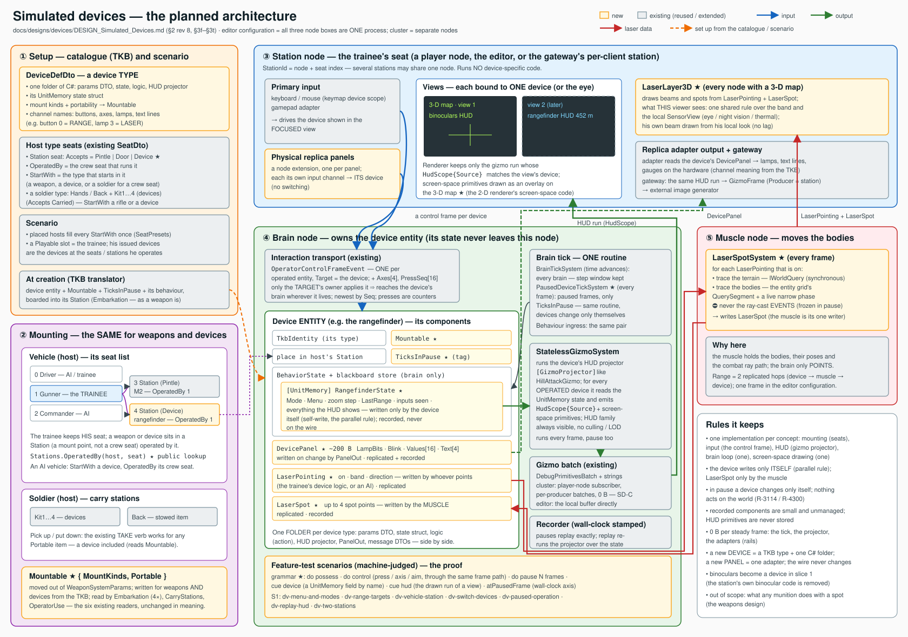
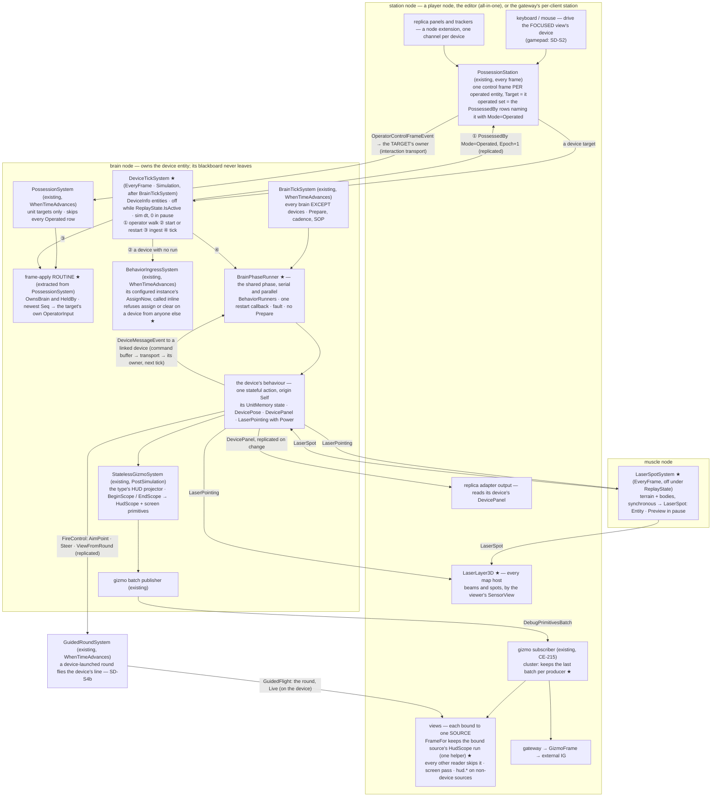
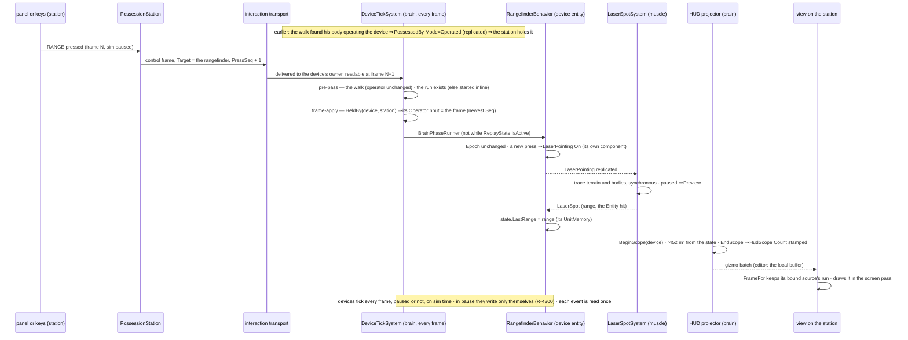
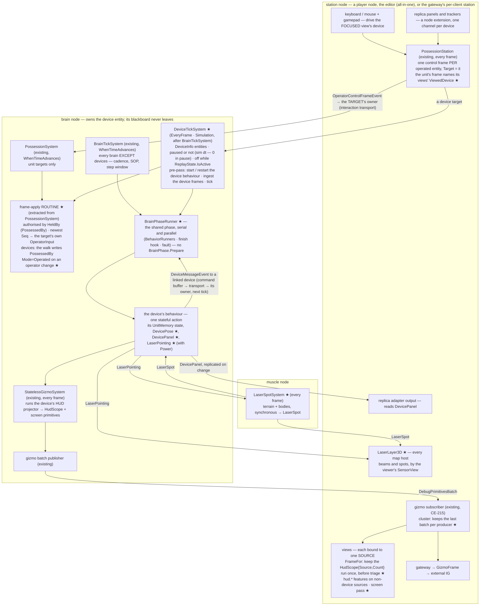
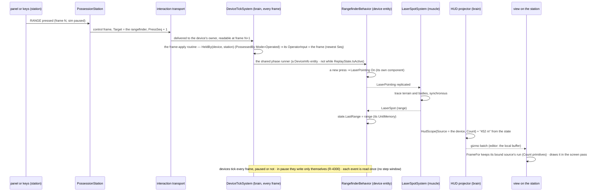
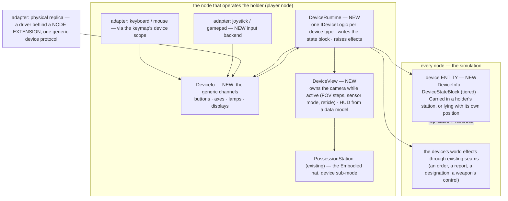
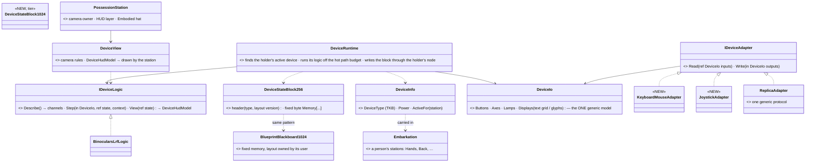
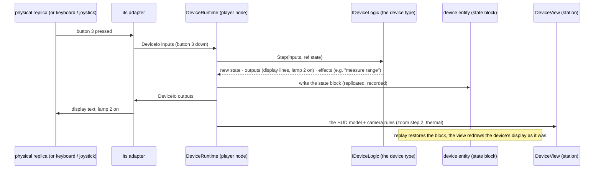

<!--STATUS
state: LIVE
updated: 2026-11-27 (waits for DESIGN_Capability_Components — built first, user) · 2026-11-27 (rev 14 consolidated — §3bb's sixth review folded in and the live design restated as ONE current part, §1–§9; no decision changed) · rev 1 … rev 14's own update lines, tables and diagrams are kept verbatim in `## ⛔ HISTORY — the decision record`
build-state: READY-TO-BUILD (user, `2026-11-27`: "yes, go ahead autonomously" — after the capability cleanup, §3.14; SD-S1 is built as S1a … S1e, §5)
current-answer: ⭐ §3.14 (what the capability cleanup already built) · ⭐ §3.13 (fire control, D-76–D-79) · ⭐ §2 (the diagrams) · ⭐ §3 (the design by area, §3.1–§3.12) · §4 (rejected) · §5 / §5a (slices, scenarios) · §6 (rules) · §9 (open questions, incl. the unresolved items)
stale-below: `## ⛔ HISTORY — the decision record` (every amendment round — §3's SD-1…SD-12, §3a … §3bb — the rev 13 diagrams, slices and scenarios) and `## ⛔ HISTORY — rev 1's diagrams and slices`: superseded by §1–§9, never quoted as current
known-rot: `ValueBinding` (D-17 / D-23, §3.6) is kept as an option and is in no slice (no device needs it yet) · `BeginScope` / `EndScope` (§3.6) may change shape after R7-13's measurement (before SD-S1's ui half)
known-conflict: ../../DESIGN_Player_HUD_And_Debrief.md §1 (every HUD element a `hud.*` feature in ONE overlay) — reconciled by R3-7 (§3.6: the station's view filter applies the `hud.*` features to non-device sources; a device's own HUD is not feature-gated); open until SD-S7 moves the overlay's parts into projectors
related-designs:
  - ../../DESIGN_Capability_Components.md — BUILT FIRST (user, `2026-11-27`): one component per capability; this design's audit rows (R3-1, R4-1, R5-5, D-73, R6-7, R7-5, R3-4, R5-4) are its inventory and shrink to nothing when it is done
  - ../../DESIGN_Unit_Camera.md — OWNS the station camera (over the shoulder to move, from the eyes to aim — UC-3); §3.6 (D-68) extends the aim rule to switch the view's source to the weapon's sight
  - ../../DESIGN_Replay_Time_Axis_And_Review.md — OWNS the replay's two axes (sim time collapses a pause; the wall-clock axis keeps it) and the `ReplayState` stop (§12l) — the paused-device scenarios are judged on the wall-clock axis
  - ../../DESIGN_Unit_Intent.md — OWNS unit intent and the brain's inputs; a device is a brain of its own on the device entity
  - ../../blueprints/Architect_Question_114_Seats_On_One_Node.md — OWNS several stations on one node (StationId = node + seat index); each VIEW draws only the HUD of the source bound to it
  - ../../DESIGN_Entity_Control.md — OWNS the possession station (§8d, `PossessedBy`), the pilot station (§8f), the sight / lock (§8g), zoom and binoculars (§8j, §8k), and ⭐ §8m: a portable weapon is an ENTITY that boards a person's carry station, is dropped and picked up — THIS attaches a device the same way (its own kit stations, a host's `Station` seat) and adds `PossessedBy Mode = Operated`
  - ../../UX/DESIGN_Seats_And_Hats.md — OWNS seats and hats (Embodied); THIS adds a device scope and bound views inside the Embodied hat
  - ../../UX/DESIGN_Input_And_Commands.md — OWNS the one keymap and its scopes; THIS feeds device controls into it and adds axis sources
  - ../../DESIGN_Node_Features.md — OWNS node features (per node today); THIS asks for a per-station layer (SD-S5)
  - ../sensor-view/DESIGN_Sensor_View.md — OWNS the night / thermal views (map-wide; G-10 "tie to a unit's sight" deferred) — THIS ties a view's mode to its source (D-71)
  - ../../DESIGN_Player_Join.md — OWNS playable slots, deploy roles and kits; a slot's issued devices hang off it
  - ../../DESIGN_Node_Extensions.md — OWNS how an outside product joins a node; the external device driver is one
  - ../weapons/DRAFT_Weapon_Malfunctions_And_Physical_Devices.md — the earlier IDEAS (CE-4645) on physical devices; THIS is their design
  - ../weapons/DESIGN_Weapon_Systems.md — OWNS weapons as entities (stowed / deployed, manned, the `Station` seat and `OperatedBy`); a device mounts the same way and a weapon may carry one
  - ../../DESIGN_Player_HUD_And_Debrief.md — OWNS the player HUD; a device HUD draws beside it
  - ../vehicle-tactics/DESIGN_FPV_Drone.md — OWNS the FPV drone's simulation (battery, jamming, impact); the drone ground station device reads it
  - ../air-attack/DESIGN_Air_Combat.md — OWNS the fighter HUD (§4d) — the precedent for a HUD as a DATA MODEL; folded into a cockpit projector in SD-S7
-->

# Simulated devices — a trainee's equipment with its own logic, displays and controls

🔒 User, `2026-11-27`: *"We are still missing the support for training with simulated military equipment like smart devices … they have their own
logic, they have buttons, they have little displays, which is usually running separately from the engine, but requires some API from the device
logic to be usable"* · *"the screen for the trainee is basically the 3D map of HROT in player mode on player node"* · *"we need to be able to somehow
define what kind of devices the trainee is given, and the trainee needs to be able to switch those devices at will"* · *"Leans accepted"* ·
*"the protocol is generic and supports buttons, displays, lamps and analog values like those coming from the joysticks and gamepads … we will then
provide drivers … and even the virtual devices which are controlled via keyboard or mouse … will have their own adapter to this generic
interface"* · *"The device might be an entity having some components describing its logic state … some kind of generic state storage component.
Where the information layout is defined by the device logic and the recording system doesn't know about it"* · *"the device entity should somehow
support being attached to a player avatar … a non-attached state … its own world position … pre-attached to a player avatar entity in the
scenario for our development and testing … creating and attaching at runtime is not slice 1, the infrastructure needs to support that"*.

⭐ **The decision in one line:** a device is an **ENTITY** — carried in a person's kit station, mounted in a host's `Station` seat, manned where it
stands, or lying in the world — whose logic is a **behaviour on its own brain** (its state a `[UnitMemory]` record that never leaves the brain
node), ticked **every frame** by `DeviceTickSystem` (paused too, on sim time); its operator is **`PossessedBy Mode = Operated`**; it takes **one
control frame per device** from any adapter (keyboard / mouse, gamepad, a replica) and gives out a replicated **`DevicePanel`**, its **pose** and its
**laser**; its **HUD** is its type's gizmo projector, scoped by **`HudScope`** and drawn only by the **view bound to it**.

## 0. The proven solution

Training simulators separate a simulated device into **logic** (the device's state machine and menus), **I/O** behind a hardware-abstraction layer
(abstract buttons, axes, lamps and displays, with a driver per real or virtual panel) and **view** (the picture and the optic). The same logic then
serves a desktop trainee and a replica panel, and the recorder only needs the logic's state. ⭐ Adopted as is — each part maps onto a seam HROT
already has (§1).

## 1. INVENTORY — the queries run (`2026-11-27`)

| query / read | finding |
|---|---|
| `search_graph` `.*(Station|Hud|Hat|Seat|Sight|Binocular|Zoom|Camera|Kit|Device|Joystick|Gamepad|Input|Keymap|Feature).*` Class (351, paged) | the possession station (`PossessionStation`, `FpsCameraDriver` — `ICameraDriver`), hats (`Hat`, `HatArbiter`, `SeatHats`), the keymap (`Keymap`, `InputScope`, `KeyTrigger` Press / Hold / **Axis**, `IChordInput`), `SensorView`, `FighterHud` (a HUD data model), `NodeFeatures` |
| `search_graph` `.*(Carried|Lying|PickUp|Attach|Mount|Holder|Stow|Blob|Opaque).*` Class (112) | ⭐ the pick-up machinery (`PickUpGrantEvent`, `RoundPickUp`, `PickUpParams`) — and Entity Control §8m: a portable weapon is an entity that boards a person's **Hands / Back station** (`Embarkation.Check`), is taken / dropped (`PickUpExecutor` / `PutDownExecutor`) and lies in the world |
| grep `fixed byte` in Fdp.Core / Fdp.Toolkits | ⭐ `BlueprintBlackboard1024` / `4096`: a fixed-size memory component whose layout only its owner knows, in size TIERS — the precedent for a generic device state block |
| grep `Gamepad|Joystick|SDL_|DirectInput|XInput|HID` | ⛔ none in HROT (input is keyboard + mouse through `IInputProvider`) |
| grep `laser|rangefind|JTAC|9-line` | ⛔ no rangefinder / designator; the only "9-line" is a medevac request |
| per-station features | ⛔ node features are per NODE only |
| ⚠ `check_index_coverage` | not available through the CLI: absence claims rest on graph + grep |
| later rounds (recorded in HISTORY §3d-2, §3f, §3x, §3y, §3aa, §3bb) | `search_graph` `.*(Hit|Body|Spatial|Proximity)(Index|Grid|Hash|Volume).*` Class (13) · `.*(Attach|Attached|Mounted|Carried|Holder).*` Class (60) · `.*(IsWeaponSystem|ControllerOf|Controlled).*` Method (in-degree 15 + 14, 18) · `.*(Laser|Designat|Rangefind|DevicePanel|DevicePose|HudScope|TicksInPause|Mountable).*` Class and `.*(Device|Kit).*` Class (no duplicate of a new type) · `.*(DeviceTick|BrainPhase|DeviceInfo|PossessedBy|Possession).*` Class (23) · `.*(DeviceTick|BrainPhaseRunner|DeviceInfo|HudScope|Mountable|LaserSpot|DevicePanel).*` Class (0 — none built) · `.*(Visibility|Policy).*` Interface (4) · `search_code` `With<BehaviorState>` (37), `With<PossessedBy>` (7 production files), `AssignNow` |

What exists and is reused: the station's camera ownership and HUD layer, the binoculars / zoom / sight branches (to be turned into devices), the
sensor views, the fighter HUD model, possession of vehicles and aircraft, carried-item stations and pick-up / put-down, the one keymap, node
extensions, the control frame (HTTP / DDS).

## 2. The diagrams — current (rev 14)

⭐ **The overview picture** — [`devices-architecture.svg`](devices-architecture.svg): setup, mounting, the station, the brain, the muscle, and the
rules (drawn for rev 13; it shows devices only — §3.6's non-device sources are SD-S7). ⚠ The SVG shows the shape; **the mermaid below is the
authority** (rev 14's R7 items — the operator walk, the restart callback, the visibility-policy key — are drawn only here).

### 2a. The module view — who runs what, and who calls it each frame

*What the picture shows that prose hid: a device never enters `BrainTickSystem` — `DeviceTickSystem` ticks it every frame, paused or not, so each
event is read ONCE; the device tick alone WRITES the `Operated` row the station then sends frames for (①), so nothing waits for a frame to go first
(R7-1), and it alone (re)starts the device's run (②), in pause too. Both tick systems share ONE phase runner (without `Prepare`) and both frame
consumers ONE frame-apply routine. Every arrow into a brain is a frame or a message addressed to its TARGET, so nothing writes another entity and the
same routing holds across nodes. In the editor configuration the three node boxes are one process.*

### 2b. The classes

```mermaid
classDiagram
  class SeatDto { <<existing, grows>> Role Station · Accepts plus Device · OperatedBy · StartWith }
  class Mountable { <<NEW, moved out of WeaponSystemParams>> MountKinds · Portable — its PRESENCE is the item gate IsMountable }
  class Stations { <<NEW public lookup — generalises WeaponSystems.Controlled>> OperatedBy host seat → the items a seat runs · per-kind operator rule }
  class FrameIngest { <<existing code, extracted>> unit or device target · OwnsBrain and HeldBy · newest Seq }
  class PossessedBy { <<existing, grows>> StationNodeId · Mode plus Operated · Epoch — two writers split by Mode }
  class OperatorInput { <<existing>> the newest frame — on the unit AND on a device · cleared on an operator change }
  class DeviceDefDto { <<NEW, TKB>> channel names · message kinds · stacking offset · the behaviour · profile with BrainTier, no DefaultBehavior }
  class DeviceInfo { <<NEW, unmanaged, recorded>> DeviceTypeId — the device marker: device tick, HUD key, not a unit }
  class BrainTickSystem { <<existing, WhenTimeAdvances>> every brain except devices · Prepare · cadence · SOP }
  class DeviceTickSystem { <<NEW, EveryFrame, Simulation after BrainTickSystem>> DeviceInfo only · operator walk · start and restart · off under ReplayState }
  class BehaviorIngressSystem { <<existing>> AssignNow on the configured instance · refuses a device's assign or clear from others }
  class BrainPhaseRunner { <<existing code, extracted>> serial + parallel phase · BehaviorRunners · one restart callback · fault · no Prepare }
  class RangefinderParams { <<NEW, params DTO>> }
  class RangefinderState { <<BUILT S1c, UnitMemory, brain only>> Mode · Power · Menu · Ranging · LastRange · request Seq · Epoch and press counts — zoom S1d, link inbox SD-S5b }
  class RangefinderBehavior { <<NEW>> resolver · BTreeDefinition · StatefulAction · origin Self }
  class RangefinderHudGizmo { <<NEW, GizmoProjector>> rule DeviceInfo + PossessedBy · screen primitives }
  class IGizmoVisibilityPolicy { <<existing>> IsEntityVisible — the device TYPE and HasAuthority of BehaviorState }
  class DevicePanel { <<BUILT S1c, unmanaged, written on change>> Revision · LampBits · BlinkBits · Values16 · Text4 }
  class DevicePose { <<NEW, unmanaged, replicated>> Orientation · Offset — written by the device only }
  class DevicePoses { <<NEW, one resolver>> World of view and device = the mount chain ∘ pose }
  class DeviceLinks { <<NEW>> Peer2 — where its messages go }
  class DeviceMessageEvent { <<NEW>> Target · From · Seq · Kind · 64 B binary or JSON }
  class OperatorControlFrameEvent { <<existing, grows>> Target · Seq · Axes4 · PressSeq16 · Orientation · Position · BodyOffset · Binoculars until SD-S5, then ViewedDevice }
  class LaserPointing { <<BUILT S1c, unmanaged>> On · Band · Power · Direction in the device frame · Seq echoed by the spot }
  class FireControl { <<NEW, unmanaged, replicated>> Ready · Target · AimPoint · LaunchSeq · Steer2 · ViewFromRound — on the device, written by it, SD-S4 / SD-S4b }
  class GuidedFlight { <<NEW, unmanaged, replicated>> Round network id · LaunchSeq · Live — on the device, written by the MUSCLE, SD-S4b }
  class FireControls { <<NEW, one resolver>> Of weapon → its fire-control device }
  FireControls ..> FireControl : finds
  GuidedFlight ..> FireControl : LaunchSeq
  class OperatorControlBehavior { <<existing>> the weapon controller's brain — fires through ITS weapon channel }
  RangefinderBehavior --> FireControl : self only (a launcher device)
  OperatorControlBehavior ..> FireControl : reads, previous frame · LaunchSeq moved and Ready
  class LaserSpot { <<BUILT S1c, unmanaged>> up to 4 points, each range, strength and the Entity hit · Preview in pause · PointingSeq — written by the muscle }
  class LaserLayer3D { <<NEW, every map host>> }
  class DebugPrimitiveBuffer { <<existing, Fdp.Diagnostics.Contracts, grown S1d-1>> BeginScope · EndScope · AppendHeld re-stamps — Count stamped at the scope's slot }
  class DebugGizmoLayer { <<existing, grows>> BoundSource + ViewFrame keep the bound source's run (S1d-1) · Screen primitives join the card pass (S1d-2) }
  class HudScope { <<BUILT S1d-1, meta-primitive, protected>> Source network id · Count — drawn only by a bound view; HudScopes is its one reader }
  SeatDto ..> Stations : OperatedBy
  Stations ..> Mountable : Accepts
  DeviceTickSystem ..> Stations : the operator walk
  DeviceTickSystem --> PossessedBy : writes Mode=Operated
  FrameIngest ..> PossessedBy : HeldBy authorises
  FrameIngest --> OperatorInput : the target's own
  DeviceTickSystem --> FrameIngest
  DeviceTickSystem ..> DeviceInfo : filter
  DeviceTickSystem --> BehaviorIngressSystem : start or restart
  BrainTickSystem --> BrainPhaseRunner
  DeviceTickSystem --> BrainPhaseRunner
  BrainPhaseRunner --> RangefinderBehavior
  RangefinderBehavior ..> OperatorInput : reads its own
  RangefinderBehavior --> RangefinderState : self only
  RangefinderBehavior --> DevicePanel : PanelOut on change
  RangefinderBehavior --> DevicePose : self only
  RangefinderBehavior --> LaserPointing : writes
  RangefinderBehavior ..> LaserSpot : reads
  RangefinderBehavior ..> DeviceMessageEvent : sends and receives
  RangefinderBehavior ..> DeviceLinks : peers
  RangefinderBehavior ..> RangefinderParams : resolved from
  RangefinderHudGizmo ..> RangefinderState : reads
  RangefinderHudGizmo ..> DeviceInfo : keyed on
  RangefinderHudGizmo ..> IGizmoVisibilityPolicy : filtered by
  RangefinderHudGizmo ..> DebugPrimitiveBuffer : drawn inside a scope
  DebugPrimitiveBuffer --> HudScope : opens and stamps
  DebugGizmoLayer ..> HudScope : filters by
  DevicePoses ..> DevicePose : reads
  DevicePoses ..> Stations : walks the mount chain
  LaserLayer3D ..> LaserPointing : reads
  LaserLayer3D ..> LaserSpot : reads
  DeviceDefDto ..> Mountable : writes at creation
  DeviceDefDto ..> DeviceInfo : adds at creation
```

*What the picture shows that prose hid: a device TYPE is the four `Rangefinder*` boxes — params, state, behaviour, HUD — in one folder (D-57);
every other box is shared by all devices. Every arrow out of the behaviour is to its OWN components or to a message; the only cross-entity reads
are `DevicePoses` walking the mount chain and the muscle's `LaserSpot`; and `PossessedBy` has exactly one writer per `Mode`.*

### 2c. The sequence — a press while PAUSED changes the HUD

*What the picture shows that prose hid: in pause the device still answers within a few frames (bus N+1, the muscle hop, the HUD); the spot it shows
is a `Preview` no other system acts on; and resuming re-reads nothing — the device tick is every-frame, so each frame's events are read exactly once.*

## 3. The design — current (rev 14)

⭐ Decision ids are the original ones, so each row traces to its round in HISTORY. Evidence is `file:line` as measured `2026-11-27`.

### 3.1 The device entity and its components

| # | decision | why / evidence |
|---|---|---|
| SD-1 | a device is an **ENTITY** of a device TKB type; it belongs to a holder in one of the ways of §3.2, or lies in the world with its own position | the user's requirement; carrying, dropping, picking up, replication and late join exist for portable weapons (Entity Control §8m) |
| SD-2′ | its logic state is a **`[UnitMemory]` struct per device type** (e.g. `RangefinderState`) in the DEVICE entity's blackboard store; ⛔ no new state block | `UnitMemory.cs` (Q87, R-237): allocated on first touch, layout-hash guarded, recorded, not scenario-saved |
| SD-6′ / D-7 | the device entity has its **own brain**; its logic is a behaviour on it, run on the node that owns the device | `BrainTickSystem.cs:176` walks every owned `BehaviorState`, not only units |
| D-8 | C# shape: one behaviour of **ONE stateful action** (`[BTreeDefinition]` `.StatefulAction(…)`), stepping a mode enum in its state; a hand-written HSM is allowed | `AdvanceToBehavior.cs` |
| D-57 | a device TYPE is one folder `Hrot.AI.Behaviors/Devices/<Device>/`: params DTO · `[UnitMemory]` state · behaviour (resolver + tree + action) · HUD projector · `PanelOut` · the message DTOs it sends (in `Devices/Contracts/`) | the library's shape (`AdvanceToBehavior.cs`, `HillAttackGizmo.cs`); logic and drawing side by side |
| SD-3 | world effects go through EXISTING seams (an order, a report, a weapon's control); the state is the device's own memory | other systems read typed seams, never a device's private layout |
| R5-8 | **`DeviceInfo { DeviceTypeId }`** — unmanaged, recorded, written once from the TKB at creation: the ONE device marker (the device tick's filter, the HUD key, the "not a unit" test) | recorded, so `dv-replay-hud` finds it; `ReplayState` (not a `NoReplay` tag) stops the tick in replay |
| R5-5 | unit queries that mean *a unit* add `Without<DeviceInfo>` — ~60 production sites read *has `BehaviorState`* that way (`GrenadeReflex.cs:372`, `MineBreadcrumbs.cs:101`, `StressSystem.cs:490`, `ProficiencyFillSystem.cs:65`, …); classified in SD-S1, with a rail that puts a device into a showcase and asserts no unit system touches it | ⚠ which sites misbehave is inferred (many also require `Health`) |
| R7-4 | the device's TKB shape: `DeviceDefDto` (channel names, message kinds, stacking offset, the behaviour) + a `BehaviorProfileDto` **with a `BrainTier`, no `DefaultBehavior`**; `BehaviorTkbTranslator` **skips the tactical block** (`EntityInfo`, ROE, channels, mission queue …) for `DeviceDefDto` types; creation writes `Mountable` and adds `DeviceInfo` | the translator adds `BehaviorState` only for a profile and stamps soldier parts with a tier; a `DefaultBehavior` would queue a second start |
| D-26 / D-29 | channel MEANING is TKB data (`DeviceDefDto`: lamp 3 = "LASER", button 0 = "RANGE"); the wire is the same for every device | a new device = a TKB type + its folder |
| D-48 | **`DevicePose { Orientation (to its mount), Offset }`** — unmanaged, replicated, recorded, written ONLY by the device's brain; ONE resolver `DevicePoses.World(view, device)` = the mount chain ∘ the pose, used by the camera, the HUD, the laser and the renderer | one answer to "where does it look" |
| R5-13 | in mouse mode the device writes `DevicePose` from the frame's `Orientation`, which the station fills from the look when no tracker is bound | — |
| D-2 / RV-3 | slice logic is C# / BTree; blueprint access to unit memory is **CE-4705** (later) — a restored node reaches the state with no device change | `GetShared` / `SetShared` went with CE-440 (`StatefulSlotScope.cs:18`) |

### 3.2 Mounting, carrying, manning — and the item gate

| # | decision | why / evidence |
|---|---|---|
| D-1″ | **mounted** on a vehicle or a weapon: a full entity in a host seat of role **`Station`** (a mount point, not a crew seat) whose `OperatedBy` names the seat that runs it; `Accepts` gains `MountKinds.Device`; `StartWith` pre-mounts it (an AI vehicle's designator) | the HMMWV roof-M2 shape (`WeaponSystems.cs:53, :202-211`; `DESIGN_Weapon_Systems.md` §2); ⛔ not `WeaponMountInfo` / `PartMetadata` (CGF-only parts, no network id — `CombatComponents.cs:85`) |
| D-63 / R5-1 | **carried**: a person type gains kit stations **`Kit1…Kit4`** (`Accepts = Device`) beside Hands / Back / Hidden — carrying devices never costs a weapon slot; built in SD-S1 | `CarryStations.cs:77-80, :96-99` take an item by `Accepts & MountKinds`; without kits a rangefinder would displace the rifle |
| D-60 | **stationary**: a device type with one operator seat (role `Gunner`) is MANNED with USE, as a tripod gun is; no separate tripod entity | `OperatorUse.cs:296-304` |
| D-62 / D-46 | **portable**: TAKEN with USE — taking IS the attachment; dropping un-boards it and it lies at its world position; the existing Take / Drop verbs | `OperatorUse.Take`; `Mountable.Portable` |
| D-61 | **stacking** = mounting one device in another device's `Station` (`Accepts Device`): it follows by being mounted | one relation; `DevicePoses.World` walks the chain |
| D-45 / R3-1 / R4-1 | **`Mountable { MountKinds, Portable }`** — unmanaged, `NoScenario`, from the TKB — MOVES out of `WeaponSystemParams`; ⭐ **`Embarkation.IsMountable(e)` = has `Mountable` is the ITEM gate.** SD-S1 classifies BOTH `IsWeaponSystem` predicates (`Embarkation.cs:324`, `WeaponSystems.cs:32`) and every direct `WeaponSystemParams` check (`CarryStations.cs:77`, `OperatorUse.cs:298`, `Carriage.cs:86, :122, :155`, `EntityBodyLayer3D.cs:1648`, `StationWeaponBehavior.cs:118`, `Charges.cs:38` — a lower bound, re-enumerated with `search_graph` + grep at dispatch): item-meaning sites read `IsMountable`, fire-meaning ones keep `IsWeaponSystem`. ⭐ **Every weapon type gets `Mountable`** (`Portable = 0` for a static one) | otherwise a device is refused a station, never offered Take / Man, and is POSSESSABLE; with every weapon `Mountable`, no weapon falls to the body branch (`OperatorUse.cs:160-162`) |
| R3-1 | `Possessability` and `EmbarkOrders` refuse a `Mountable` — *an item is manned or taken, not possessed* | `Possessability.cs:19-20`, `EmbarkOrders.cs:53` refused only a weapon |
| D-47 | the TKB DTO keeps `MountKinds` / `Portable` (the authoring shape); only the runtime component moves | `NedTkbCatalog.cs` and its JSON untouched |
| R5-12 | the operated-set walk recurses ONE level into the stations of each item it finds (carried or manned) — a panel on a manned weapon, a launcher's sight unit (SD-S4, SD-S7) | `WeaponSystems.cs:194-196` is an if / else |
| D-65 / D-67 | a weapon is NOT a device; a weapon may CARRY one (a `Station` of the weapon, `OperatedBy` its gunner / firer — the shoulder launcher's sight unit) | one concept per entity |
| D-64 | every device is drawn where it is (lying, on its tripod, mounted; a carried one only while raised) by the 3-D body layer from its type's kit — SD-S5 | `EntityBodyLayer3D.cs:56, :442, :484` |
| R5-13 | a vehicle whose 12 passenger seats are full mounts a device only in place of a seat | `PassengerBuffer.Capacity` = 12 (`InteractionComponents.cs:19`); a raise is its own row |

⇒ **The devices a trainee has** are the ones his station operates — in his kit stations, in stations his seat operates, the one he mans. All of them
run; his views choose what each shows (§3.6).

### 3.3 The operator — `PossessedBy Mode = Operated`

| # | decision | why / evidence |
|---|---|---|
| D-73 | the operator is **`PossessedBy { StationNodeId, Mode = Operated, Epoch }`** — a new `PossessionMode`, never a new component: who, the take-over counter, the clean-input reset; ⛔ no brain swap | ruling 9; a device is never possessed (R3-1), so the modes never meet on one entity; `Possession.cs:142-147, :370-384` |
| R7-1 | ⭐ `DeviceTickSystem`'s pre-pass runs the operator **WALK every frame for every `DeviceInfo` entity**: operator changed ⇒ write `PossessedBy { the station of the operator's BODY, Operated, Epoch + 1 }` and clear `OperatorInput`; no operator ⇒ remove both. The station's operated set = the replicated rows naming it with `Mode = Operated` (it computes nothing) ⇒ `TryHeld` passes unchanged | the station sends frames only for what it holds (`EntityOrders.cs:271, :283-288`) — a frame-triggered write would never start |
| R4-2 / R3-14 / R2-2 | the walk is a PUBLIC **`Stations.OperatedBy(world, host, seat, dest)`** with no possession gate — `WeaponSystems.Controlled`'s walk generalised (his carry stations, the stations his seat operates, the item he mans); the FILTER is per kind: a weapon keeps `ControllerOf` (fire facts); **a device's operator is whoever carries it, sits in its station's `OperatedBy` seat, or mans it**. `Controlled` becomes its weapon-filtered caller | `ControllerOf` returns nobody for a non-weapon (`WeaponSystems.cs:43, :52`); `StationsOperatedBy` is private and possession-gated (`:202`) |
| R5-3 | the operator's **BODY** = the station's Riding soldier first (StationClaims' rule), else the unit it holds | a station in a vehicle holds the rider AND the vehicle (`StationClaims.cs:26-27`); a rider takes no frames (`Possession.cs:258`) |
| R7-10 / R6-1 | the device walk OWNS every `Operated` row; **`PossessionSystem` skips them entirely** (`ReleaseStation`, `ReleaseDeparted`, `ReleaseOtherFps`); removing an `Operated` row publishes **no** behaviour clear. Two writers of `PossessedBy`, split by `Mode` (`PossessionSystem`: `Fps` / `Riding`; the device walk: `Operated`), recorded on the component and in `HrotOwnershipGroups` | `Release` publishes `ClearBehaviorEvent{Origin=Possession}`, which outranks every origin (`Possession.cs:311-317, :386-391`); `ReleaseOtherFps` (`EntityOrders.cs:236`) |
| D-73 / R6-7 | the ~19 readers of `PossessedBy` outside the core are classified in SD-S1 — where *a human took over this unit* is meant, `Mode != Operated` (or `Without<DeviceInfo>`). First `PossessionSystem` and `EntityOrders`; then `DriveHandOver.HeldHere` (newest `Epoch` across entities, `DriveHandOver.cs:200-206`) and `StationClaims.TrySideOf` (the side of the last held entity, `StationClaims.cs:56-64`) — both exclude `Operated` | grep, a lower bound: squad roster, debrief, briefing, deploy, `HttpControlledUnits`, `HeatSourceSystem`, `HullBreakGate`, `WeaponSystems` |
| R7-5 | the side lock for an `Operated` device is its **operator's body's** side | `SideLock = StationMode.SideOf(world)` (`EntityOrders.cs:81`) would refuse a neutral device (`TryAddress` → `WrongSide`) |
| R7-11 | the device keeps in its state the `Epoch` it last saw; a new `Epoch` ⇒ its press counters re-base (no press fires) | the station's `Seq` is per station (`PossessionStation.cs:1622, :1911`); another station's counters would fire phantom presses |

### 3.4 Input — one control frame per device

| # | decision | why / evidence |
|---|---|---|
| D-43 / D-40 / D-44 | **one `OperatorControlFrameEvent` per operated entity, targeted at it**; the event itself grows: `Seq`, `Axes4`, `PressSeq16` (press COUNTERS), `Orientation`, `Position` (with present flags), and on the unit's frame `BodyOffset`; the unit-only fields go unused in a device's frame | latest-wins and counters work per target unchanged (`Possession.cs:76-104`); the transport delivers to the target's OWNER (`InteractionTransport.cs:385`); old recordings do not matter (🔒 user) |
| D-38 / SD-5 | the keyboard / mouse fill the frame of the **FOCUSED view's device** (the keymap's device scope, inside the Embodied hat); each replica / tracker fills ITS device's frame — no switching. Adapters: keyboard / mouse (SD-S1), gamepad (SD-S2 — `Raylib-cs 7.0.2` exposes it, HROT calls none yet), a physical replica (a node extension, SD-S5) | the logic never knows which |
| D-50 / D-56 | trackers are station input channels, each bound to ONE entity: orientation and / or position → that device's frame; every device has its own channel; a mounted (stacked) device ignores its own tracker while mounted | — |
| D-51 | a body tracker fills the UNIT's frame **`BodyOffset`** (a continuous vector) over the base the player still moves; `Lean` stays the discrete posture it is | `Lean` is a side, not a displacement (`PossessionStation.cs:1858-1863`; `Possession.cs:119-121`) |
| SD-15 / RV-6 | look and camera motion stay LOCAL on the station (mouse look, smoothing between steps, on the wall clock); the device owns the zoom STEP and the sensor mode | a round trip per mouse move would lag |
| R3-5 / R7-7 | the UNIT's frame names what its views show — **`ViewedDevice`** (network id or none) — so the body's brain raises the held binoculars; it **replaces** the frame's `Binoculars` level **in SD-S1** (D-75 — the user dropped CE-1219) | `OperatorControlBehavior.cs:104-108` |

### 3.5 The device tick

| # | decision | why / evidence |
|---|---|---|
| D-72 | ⭐ **`DeviceTickSystem` (`EveryFrame`) ticks every `DeviceInfo` entity, paused or not; `BrainTickSystem` ticks none** (`Without<DeviceInfo>`); `PossessionSystem` skips device targets. Each frame: ① return while `ReplayState.IsActive`; ② the serial pre-pass — the operator walk (R7-1), then start / restart (R6-2); ③ ingest the device frames with the frame-apply routine; ④ tick the behaviours through `BrainPhaseRunner` | 🔒 user: a device reuses the brain machinery, it is not an AI. One `EveryFrame` entry ⇒ every event is read ONCE (`SystemScheduler.cs:240-270`: only `WhenTimeAdvances` systems get the step window); no AI cadence policy reaches a device |
| R3-2 | the **frame-apply ROUTINE** is extracted from `PossessionSystem` and serves both: `OwnsBrain && HeldBy`, newest `Seq` → the TARGET's own `OperatorInput` (one input component for units and devices) | `Possession.cs:257, :259` |
| D-72 / R6-3 / R7-2 | **`BrainPhaseRunner`** — the extracted shared phase: the due list, the phase job, deferred follow-ups, `Finish`, the fault end; serial AND parallel (`Parallel` off, `HROT_SERIAL_BRAINS`); inputs: the behaviour registry, **ONE restart callback** (finish, fault, relayout — devices restart inline, `BrainTickSystem` keeps its event), the terminal-dedup record per owning system. ⛔ **No `BrainPhase.Prepare`** — `BrainTickSystem` keeps calling it. Cadence, SOP slots and the dead query stay `BrainTickSystem`'s | `BrainTickSystem.cs:321-425` (~100 lines), `:323`; `Prepare` runs world-wide AI hooks — `AirArenaSystem.PrepareFrame` is a world WRITER; `RestartIfRelaidOut` restarts by an event only the time-advancing ingress reads |
| R6-2 / R7-12 | the pre-pass **OWNS the device's run**: a device with no run (new, finished, faulted, relaid out) is started from its type (`DeviceInfo.DeviceTypeId` → the behaviour its `DeviceDefDto` names) **inline, by `AssignNow` on the configured `BehaviorIngressSystem` instance passed in** (as `RuleEditSystem(_missionControlModule.Ingress)`, `CgfLogicPack.cs:339`) — in pause too. A device's run never ends: finish, fault and relayout restart it | a behaviour starts only through the ingress (`WhenTimeAdvances`, `BehaviorIngressSystem.cs:38-44`; `AssignNow` `:1135`) and sessions boot paused ⇒ no brain, frames refused (`OwnsBrain`, `Possession.cs:405`); a new service would drop the ingress's configuration (`Holds`, `TasksTakenByOrders`) |
| R7-4 | the device's run has origin **`Self`**; the ingress **refuses an assign / clear aimed at a `DeviceInfo` entity** from anyone but the device tick | an order, a mission or a reaction could otherwise replace it |
| R6-6 / R7-12 | phase **`Simulation`, after `BrainTickSystem`**, registered by `CognitiveRuntimeModule`; it takes `gateOnAuthority` like the other cognitive systems (rails that index `SimulationSystems` by position are updated) | a device reads its carrier's state of THIS tick; the HUD projector (`PostSimulation`) draws what it just wrote |
| R6-4 / R-4300 | **pause = sim time** for a device (dt = 0, `GlobalTime` frozen): anything that simulates (a battery, a timer, a drone's state) freezes. In pause a device changes only ITSELF (state, panel, pose, pointing) — ⛔ no world effect. Only observation runs on the WALL clock — input and camera / joystick smoothing — and that lives on the station; a HUD's visual blink is the projector's, by frame count | 🔒 user: *"drone battery must freeze … only observation related stuff should keep working, using wall clock time"*; R-4300 is the device-local exception to R-3114 |
| D-72 / R3-10 | read once; newest `Seq`, the press counters and the message `Seq` stay as cheap guards | — |

⭐ **S1a AS BUILT (`2026-11-27`)** — `FDP/Toolkits/Fdp.Toolkits/Behavior/Devices/DeviceTickSystem.cs` + `DeviceInfo.cs`. ⚠ **Deviation from D-72, argued:** NOT an
extracted `BrainPhaseRunner` — **`DeviceTickSystem` is a SUBCLASS of `BrainTickSystem`** with its own `[TickMode(EveryFrame)]` (the attribute is
`Inherited = false`, `SystemAttributes.cs:80`, so each type states its own mode): it runs LITERALLY the same tick code, serial and parallel, with
each instance's own records — less code than an extraction and no second loop. `BrainTickSystem` gains four hooks (`IsDeviceTick`,
`BeforeDeviceTick`, `RequestRestart`, the `Without<DeviceInfo>` / `With<DeviceInfo>` tier filter) and skips its AI-only steps on the device
instance (retiring the dead, `BrainPhase.Prepare`, the experimental cadence, the SOP slots). `DeviceInfo { DeviceType, Behavior }` (component id
219, recorded) is the marker AND names the behaviour the pre-pass starts (in pause too) and restarts after a finish; a refused start is not
retried every frame; nothing during a replay; registered by `CognitiveRuntimeModule(…, deviceIngress)` LAST, on the CGF pack's configured ingress.
Rails: `DeviceTickSystemTests` (6, incl. 0 B per steady frame). 📌 Found on the way: a lambda capturing a local in `ExecuteCore` allocated its
closure EVERY frame (32 B) — caught by the existing CE505 / CE417 0 B rails, fixed by building the queries in their own method.

⭐ **S1b-1 AS BUILT (`2026-11-27`)** — `PossessionMode.Operated = 3` (CONTROL without a body: `StationBody.IsBodyMode` is false for it, so every
body / side / briefing reader already ignores a device). `FDP/Toolkits/Fdp.Toolkits/Behavior/Devices/DeviceOperators.cs` is THE walk and the ONE
writer of a device's row: operator = its own gunner seat (manned) · the person carrying it · the occupant of the seat operating its host station;
the row names the station of that operator's BODY, else no row; a change bumps the epoch and clears the input. Run by the device tick's pre-pass every
frame (R7-1 — the station reads the replicated row; the existing `HeldBy` gate then authorises its frames). The possession core never releases an
`Operated` row (ReleaseStation, ReleaseDeparted, ReleaseKilled, ReleasePossessionEvent) and never applies its frames (the device tick will, S1b-2).
Rails: `DeviceOperatorTests` (4; the release guard red-proved).

⭐ **S1b-2 AS BUILT (`2026-11-27`)** — ⚠ **Deviation from R3-2 / R3-5, measured:** the device section is NOT added to the body's
`OperatorControlFrameEvent` / `OperatorInput` — their recorded layout hashes are PINNED so earlier recordings replay (CE-11027,
`PossessionReplicationTests`; adding a field changed them and `SchemaValidator` refuses a changed event). ⇒ ONE `DeviceControl` (4 axes, 16 press
counters, tracker orientation / position + present-flags, body offset, `Viewed`) travels in its OWN `DeviceFrameEvent` (event id 5204) into its OWN
`DeviceInput` (component id 228) on the device; the device tick ingests it every frame (the `HeldBy` gate, `Operated`, newest `Seq`); a change of
operator clears it. `ViewedDevice` on the unit frame is replaced by the device frame's `Viewed` flag — the body's brain reads its carried binoculars
device's `DeviceInput` (a cross-entity read of another phase: allowed). `PossessionSystem.ApplyFrame` is now the ONE body frame-apply routine.
Local until SD-C (the interaction transport carries no device frame yet). Rails: `DeviceOperatorTests.S1b2_…` (red-proved).

⭐ **S1b-3 AS BUILT (`2026-11-27`)** — `MountKinds.Device = 32` (no weapon declares it); four KIT stations appended to the ONE person
carrier definition `CarrierDefDto.PersonCarrier()` (seats 4–7, `Accepts = Device`, stowed) — a weapon still finds its hands / back / hidden slot
(`Accepts & Carried`), a device the first free kit (rail `PersonCarrierTests.S1b3_…`, red-proved). ⚠ Every person type's seat data changed
(8 seats) ⇒ the scenario goldens that hash a person's `CarrierSeats` / `CarrierStations` / `PassengerBuffer` move hash-only at the next nightly
(as CE-4711). `DevicePose` (component id 229) + `DevicePoses.TryWorld`: ⚠ simplified from D-48's "walks the mount chain" — the engine already
places every embarked item at its host station each frame (`EmbarkedStateSystem.cs:144-149`, WS-2, chaining through a device on a device), so the
world pose is the device's own `SimTransform` ∘ `DevicePose` (seam law).

⭐ **S1c AS BUILT (`2026-11-27`)** — the laser rangefinder. **Components** (unmanaged, recorded, `NoScenario`; `FDP/Toolkits/Fdp.Toolkits/Behavior/Devices/`):
`LaserPointing { On, Band, Power, Direction, Seq }` (id 231), `LaserSpot { Points[4] {Point, Range, Strength, Hit, Part}, Count, Preview, PointingSeq }`
(232), `DevicePanel { Revision, LampBits, BlinkBits, Values[16], Text[4] FixedString32 }` (233) + `DevicePanels.Write` (the one on-change writer,
bumps `Revision`). **`LaserSpotSystem`** (`EveryFrame`, `PostSimulation`, registered in `CombatModule` beside the round path — the SimHost's and the
editor's muscle): from `DevicePoses.TryWorld` along the pointing, terrain by `WorldQuery.Of(view).Trace(…, Fire)` (the first solid crossing, a wood's
share-stop skipped), bodies by `SpatialHashGrid.QuerySegment` + `BodyPartRay.TryHit` (the round's part test) else the collider's cylinder; never its
carrier / his ride / another device / carried gear; nearest first; `Preview` when dt = 0; off under `ReplayState`; written only on change; 0 B steady.
**The device folder** `Hrot/Subsystems/Hrot.AI.Behaviors/Devices/Rangefinder/`: `RangefinderState` (`[UnitMemory]`: mode, power, menu, ranging,
`LastRange` / `LastHit` / preview, request `Seq`, the epoch and the four press counters last seen) and `RangefinderBehavior` (`DeviceRangefinder`, one
`StatefulAction`, `NoParams`): presses = moved counters, re-based on a new `PossessedBy.Epoch` or on input appearing after none (R7-11); RANGE starts
a request (`Seq` + 1, laser on), the spot answering THAT seq gives the range (SINGLE: laser off; CONTINUOUS: on until RANGE again); MODE / MENU /
SELECT step the mode and the menu (MODE · POWER · EXIT); pointing and panel written on change; answers in pause. Rails: `LaserSpotSystemTests` (8),
`RangefinderBehaviorTests` (7, incl. end-to-end through the production registry + `DeviceTickSystem` + `LaserSpotSystem`, in pause, and 0 B).
⚠ **Deviations, argued:** ① `LaserPointing` gains a request **`Seq`** echoed by `LaserSpot.PointingSeq` — without it a device one hop from the muscle
reads the spot of its PREVIOUS emission as the answer; and it drops LS-14's "origin offset" — the origin is the device's world pose, which already
composes `DevicePose.Offset`. `Direction` is in the **device's frame** (zero = its forward +X), so a carried device never rewrites its pointing as its
carrier moves (sent on change only). ② `Preview` is per SPOT, not per point (all points come from one trace on one frame). ③ S1c writes the first
return only (`Count ≤ 1`); the four slots wait for partial obscurants (SD-S6). ④ `Hit` is this node's `Entity` — SD-C's descriptor translates it
(like `IsEmbarkedTag`), not an `EntityRef` now. ⑤ Strength is a documented stand-in, `Power / (1 + (range / 1 km)²)`; max range 10 km. ⑥ **No TKB
`DeviceDefDto` yet** (R7-4): `DeviceInfo.Behavior` already names the behaviour the device tick runs, and no translator creates a device from its type
until a scenario places one (S1e). The behaviour declares `[Behavior(Requires = DeviceInfo)]` so `BehaviorFit` offers it to no unit. Channels
(RANGE 0, MODE 1, MENU 2, SELECT 3) and panel slots are placeholders in `RangefinderChannels` / `RangefinderPanel` until the type names them (D-26).
⑦ `RangefinderState` holds no zoom step (the binoculars, S1d) and no link inbox (SD-S5b). ⑧ The device does NOT yet write `DevicePose` from the
frame's orientation (R5-13) — it needs the station's look, S1d.

### 3.6 Views and the HUD

| # | decision | why / evidence |
|---|---|---|
| D-38 / D-66 | a station has views (its 3-D map today, several side by side later); each **VIEW is bound to ONE source** — a device, the possessed unit's weapon sight, a vehicle / aircraft cockpit, or none (the plain eye); station-local UI state, never simulation | 🔒 user: several replicas run at once; the trainee picks what each map shows |
| D-21 / D-10 / D-15 / D-16 | a device type's HUD is a **`[GizmoProjector]` class** (`RangefinderHudGizmo`) run by the existing `StatelessGizmoSystem` **on the BRAIN** (as `HillAttackGizmo`), reading the type's `[UnitMemory]` state with `UnitMemory.GetInView`; the existing `DebugPrimitivesBatch` ships it. ⛔ The blackboard never leaves the brain; the station runs no device code | `CgfSubsystem.cs:755-777`; `HillAttackGizmo.cs:22`; the store is brain-owned, 0 wire refs (`HrotOwnershipGroups.cs:41-44`) |
| D-41 / R4-5 / R5-7 / R6-5 / R6-9 | the run is scoped by a meta-primitive **`HudScope { Source (network id), Count }`**, opened and closed by the SYSTEM — **`BeginScope(source)` / `EndScope()` on the `Fdp.Diagnostics.Contracts` `DebugPrimitiveBuffer`** (the one with `IsProtected` / `StoreProtectedWhenFull`): `Count` is stamped at the scope's ACTUAL slot after the projector ran (`0` when the scope was evicted or the run did not fit); a re-appended reused picture's scopes are re-stamped; an empty scope is dropped; `HudScope` is protected; the HUD layer is never refused at emit; an eviction inside a run leaves a meta shape (skipped by every drawer), counted in `DroppedCount` | the 64-byte primitive has no free field for a source (`DebugPrimitive.cs:18-27`); the buffer refuses by layer (`DebugPrimitiveBuffer.cs:82-88`) and evicts when full (`:94-106`); the other `DebugPrimitiveBuffer` (GizmoMap.Contracts) has no protection |
| R3-4 / R5-4 | ⭐ a `HudScope` run is **drawn ONLY by a view bound to its `Source`**, filtered ONCE per frame before triage (`DebugGizmoLayer.FrameFor`); every other buffer reader skips the WHOLE run through **ONE helper in `GizmoMap.Contracts`** beside the triage; `HudScope` joins every meta skip list (the 3-D triage, the 2-D renderer, Stride's `DebugPrimitiveRenderer3D`, `DebugApiService.Panels`); a rail per reader family | otherwise every unbound reader draws every HUD (the director-mode map, the CGF window, the Stride IG `StrideNodeShell.cs:232`, `GizmoViewerFrontend`, `GizmoFramePanel`, `MapSelfCheckSystem`, `TerrainLayer2D`) |
| R6-5 / R7-3 | projector keying: its **rule requires `DeviceInfo` + `PossessedBy`** (an un-operated device draws nothing); its per-entity **visibility policy** (`IGizmoVisibilityPolicy.IsEntityVisible`, supplied per projector by the registrar's resolver) tests **the device TYPE and `HasAuthority<BehaviorState>`**; it declares no G5 inputs (re-run each frame) | rules match component TYPES only (a bitmask); `BehaviorState` exists on every CGF node at ghost promotion; `StatelessGizmoSystem.cs:454` |
| R2-10 / R3-13 | the HUD family's policy is fixed in the registrar: visible while operated, `DrawsOffScreen`, no zoom LOD, exempt from the node's and the viewer's layer mask, never cut by the frame budget, never served from a held picture | `DebugGizmoLayer.cs:150-154`; CE-2402 |
| R2-1 | `Screen` primitives join the 3-D map's existing post-3-D screen pass (with the `EntityCard`s) — one screen-space drawer for both maps | `DebugGizmoLayer.cs:211-241`; `DebugPrimitiveTriage3D.cs:140-148` resolved only `EntityLocal` |
| D-3f | the HUD is a gizmo LAYER (`DebugTraceLayers.DeviceHud`) with its own projector family; on whenever a view shows a source — not a debug toggle | 🔒 *"basically just a layer"* |
| D-66 / R4-4 | a projector runs **where its data is**: a device's on the brain; a weapon sight's / cockpit's (replicated components) on the STATION only — it takes a station-only constructor service, so a brain registers none by construction | `GizmoReflectionRegistrar.RegisterAll` skips a projector whose services the host cannot supply (`reportUnserviceable`) |
| R3-7 | the station's view filter applies the station's `hud.*` features to NON-device sources' runs; a device's HUD is its own display, not feature-gated | `DESIGN_Player_HUD_And_Debrief.md:32` (R-4115) — STATUS `known-conflict` |
| D-68 / D-69 / D-70 | SD-S7: aimed with the camera at its front-most position ⇒ the view's source becomes the weapon's **SIGHT** (FOV from the type; a weapon carrying a sight DEVICE shows that device; releasing aim returns); the **cockpit** is a source (`FighterHud` folded into a projector, keeping its rail); the station's hand-drawn HUD parts migrate one source at a time, each with its rails and a frame rail against a mockup | the trigger exists (`PossessionStation.cs:62-66`, UC-3); no rush removals; R-4138 |
| D-71 | a view's day / night follows its source (`SensorView` per view, Sensor View G-10); the map-wide setting stays for the plain eye | one sensor-view rule, chosen per view |
| D-4′ | `StationId` = the node (low 16 bits) + a seat index (high 16) — the editor as server and the gateway's per-client stations each get their own | `StationId.cs:14-29`; `DeployFlowApi.cs:58` |
| D-17 / D-23 | `ValueBinding` (a meta-primitive the station fills with a local value — the look heading, the reticle; §3c in HISTORY) stays an option for a HUD that must follow the look with no round trip; in no slice yet | known-rot |
| D-20 | editor configuration: brain and station are one process — the projector draws straight into the local buffer | — |
| D-24 / D-27 | ⛔ change-only sending is NOT built (the publisher resends the node's buffer each frame a reader exists, `DebugPrimitivesBatchPublisherSystem.cs:33-50`; CE-1480 G5 only reuses the picture); lean: a GENERIC change gate in the publisher, safe once the subscriber keeps the last batch per producer (SD-C) | one rule for every gizmo |
| R7-13 | ⚠ `BeginScope` / `EndScope` assume no other producer appends mid-run (`AppendRaw` is a lock-free `Interlocked` append) — **measured before SD-S1's ui half**; if `PostSimulation` producers run concurrently in the threaded node, the scope is written per producer buffer and merged | unverified |

⭐ **S1d-1 AS BUILT (`2026-11-27`)** — the scope and the bound-view filter. `DebugPrimitiveShape.HudScope = 16` (Meta ⇒ protected, never refused by
layer, never evicted; payload `HudScopeSource` long @24, `HudScopeCount` int @32 — no free field needed). ONE reader, **`HudScopes`**
(`GizmoMap.Contracts/Primitives/HudScopes.cs`, beside the triage): `Keep(frame, boundSource, ref scratch)` (the bound run kept with its marker
removed, every other run removed whole, the frame itself when it has no scope, 0 B), `Unscoped` (bound to nothing), `After(frame, i)` (the index-loop
skip, clamped). Buffer (`Fdp.Diagnostics.Contracts`): `BeginScope(source)` returns the slot; `EndScope()` stamps the count at that slot; an empty scope
rolls the cursor back (`EmptyScopesDropped`); a protected primitive evicting a run's line leaves a meta shape inside the run (already in
`DroppedCount`); `AppendHeld(span)` re-appends a held picture re-opening each scope (used by `StatelessGizmoSystem`'s two reuse paths — CE-1480 G5 and
CE-2402 — and by `DebugPrimitivesBatchSubscriberSystem`, so a run the receiving buffer refuses or drops in part never swallows the next producer's
primitives); `ForeignAppendsInScope` counts appends from another thread while a scope is open (R7-13). Views: `DebugGizmoLayer.BoundSource`
(station-local, 0 = the plain eye) + `ViewFrame()` — every read in the layer (2-D, 3-D triage, cards, the terminal's meta and picks, `FrameFor`) goes
through it. Readers that skip runs whole: the 3-D triage (`CulledByScope` — Stride's `DebugPrimitiveRenderer3D` and every raw triage), GizmoMap's
2-D renderer (the standalone `GizmoViewerFrontend`), `GizmoFramePanel`, `DebugApiService.Panels` (the HTTP dump; S1e's `hud` cue will read a run
through a bound view), `MapSelfCheckSystem`. Pass-through, scopes kept: the batch publisher, the DDS publisher, the held pictures, the subscriber.
Not readers of the shared buffer: `TerrainLayer2D` (its own plan buffers). Rails: `HudScopesTests` (5), `DebugPrimitiveBufferLayerTests.S1d1_*` (8),
`DebugGizmoLayerGizmoTests.S1d1_*` (3), `GizmoFramePanelTests.S1d1_*`, `PrimitiveKindTests` (the table row).
⚠ **Deviations, argued:** ① a run that OVERFLOWS keeps the count of what was STORED, not 0 — a 0 would release the stored part to every reader
(R5-7 meant "the run is not trusted"; trimming it to what fit keeps it scoped). ② A scope opened on a FULL buffer is not stored (`BeginScope`
returns −1, counted in `DroppedCount`) instead of evicting a plain primitive for a count-0 marker — the run's plain primitives could not be stored
either, so the slot would buy nothing. ③ The gateway (`HrotGizmoHost`, SimNetGateway) is outside this repo — its meta drop stays an SD-C row
(D-5). ④ The ingress translator (`DebugPrimitivesIngressTranslator`, to be retired at SD-C) still appends raw. ⑤ **R7-13's threaded-node rail is
NOT built:** no rail in the repo boots the threaded node with a gizmo producer; built instead the detector (`ForeignAppendsInScope`, railed with a
second thread) that such a run reads — S1d-2, whose projector opens real scopes, asserts it is 0 in a threaded-node run.

### Mockups

🖼 **[`mockups/devices-hud.svg`](mockups/devices-hud.svg)** *(generated by `scripts/gen-devices-hud-mockup.py`; R-4138 / R-4143 — SD-S1's ui half builds the HUD projectors to it and renders each panel's frame to check fidelity)*. ⛔ Scope (R-4151): it specifies ONLY the device HUD drawn in a view bound to a device; the compass, the unit lines and the toolbar are context, drawn dashed and tagged *unchanged*; the 3-D scene is illustrative. ⚠ Every position is a proposal — the design names what the HUD shows, not where.

| panel | specifies | context (unchanged) | chosen where the design is silent |
|---|---|---|---|
| 1 binoculars | two-eyepiece frame (kept from CE-1219's overlay) · mil reticle (5-mil ticks, numbers every 10; true to today's 10° view, 1 mil = 1.48 px on the 259 px frame) · zoom step list with the current one lit · the device name | compass strip (`DrawCompass`) · unit lines (`Hud.Lines`) | the step values 5× / 7× / 10× are illustrative; the list sits in the right rim, the name bottom-centre; no range (no laser) |
| 2 rangefinder, idle | rectangular window with corner brackets · gapped reticle · name · MODE · POWER · LASER lamp off · LAST RANGE `— m` · menu line, cursor on MODE | as above | mode names SINGLE / CONTINUOUS and power LOW / HIGH are placeholders (the type's data); status top-left, lamp top-right, readout bottom-centre, menu line bottom-right |
| 3 rangefinder, ranged | lamp ON (blinks by frame count) · LAST RANGE `452 m` | as above · the red **spot**, which is a WORLD effect of `LaserLayer3D` (SD-S6, D-32), not of this HUD | SD-S1 shows the lamp and the range only; the spot is drawn as context |
| 4 menu open | popup under the status block: title, the modes, ✓ on the active one, the cursor row · the MODE chip framed | as above | the popup's place; reticle and range stay visible while it is open |
| 5 paused | the same HUD answering in pause · a **PREVIEW** tag beside a range measured in pause (R5-10, LS-13) | the toolbar's paused run controls (▶ shown) — measured: no in-view pause banner exists | the tag's look and place; the HUD adds no pause banner of its own |
| 6 switching | the `VIEW ▸ <device>` label (glyph in its colour) · the cycle strip eye · binoculars · rangefinder, selection framed | as above | all of it (the label's place, the strip shown only while switching and for how long); the wheel's key stays open (Q-5) |

### 3.7 The panel and the replica adapters

| # | decision | why / evidence |
|---|---|---|
| D-28 | **`DevicePanel { Revision · LampBits · BlinkBits · Values[16] · Text[4] (FixedString32) }`** — unmanaged, ~200 B, on the device entity, brain-owned, replicated and recorded, written by the type's `PanelOut` only on change (replication is change-detected per component ⇒ sent on change; late join for free) | a lamp must reach the panel whatever renders — the gizmo stream is reader-aware, layer-masked and drops ragged batches (`DebugPrimitivesBatchPublisherSystem.cs:37`, `DebugPrimitivesBatchSubscriberSystem.cs:30-33`; the gateway drops meta, `HrotGizmoHost.cs:214`) |
| D-29 | each replica adapter on the station reads ITS device's `DevicePanel` and maps channels to hardware by the TKB names; its inputs come back as that device's control frame (§3.4) | the same numbering both ways |
| D-30 | the HUD stays gizmos, the panel a component — two consumers, one path each; a HUD that shows the lamps draws them from the same `[UnitMemory]` state | not a duplicate: a picture of the state vs a fixed channel set |

### 3.8 The laser

| # | decision | why / evidence |
|---|---|---|
| LS-9 | the laser path is generic over `LaserPointing` / `LaserSpot`, whoever carries them — a trainee's device or an AI's | one path (ruling 9) |
| LS-14 / D-31 / D-74 | **`LaserPointing { On · Band · Power · origin offset · Direction }`** (unmanaged, replicated, recorded) — written by whoever points: the device from its own pose (LS-2), or the AI; `Power` covers its low / high modes. **`LaserSpot`** — up to 4 points (the first hit and what the trace reports beyond it), each with its point, its STRENGTH (from the power, the range and the target) and the **`Entity`** (+ part) it hit (an `EntityRef`, null on terrain), and **`Preview`** when written on a paused frame — written by the **MUSCLE** | the muscle owns the bodies and the combat ray path (HL-2; `Hrot.SimHost/Modules/CombatModule.cs`); one writer per component; no request / reply — one hop late |
| LS-15 / LS-12 | **`LaserSpotSystem`** on the muscle, `EveryFrame`: terrain by `IWorldQuery` (synchronous), bodies by a synchronous `SpatialHashGrid.QuerySegment` + a live narrow phase; ⛔ never `RaycastRequestEvent`; returns under `ReplayState.IsActive` | `TerrainWorldQuery.cs:89-130`; `SpatialHashGrid.cs:230`; `RaycastSolverSystem.cs:47` is `WhenTimeAdvances`; precedent `UnderFireSight.cs:217`. ⚠ the entity grid is the last advanced tick's: an entity edited in pause is hit only after the next step (accepted for a preview) |
| R5-10 / LS-13 | a spot written in pause is `Preview`: the device's own HUD shows it; no consumer (a seeker, perception) acts on it. An AI-pointed designator does not re-point in pause | R-4300 (`RULINGS.md:824` — no designation in pause); R-3114 |
| LS-5 / D-33 | ONE visibility rule — *is this band, at this strength, visible to this viewer's sensor?* (eye / night / thermal, later a device optic) — asked by the 3-D map, the external IG and AI perception | the shared look-library pattern (`Hrot.Look`) |
| D-32 / D-34 / D-35 | ONE **`LaserLayer3D`** (Effects), attached by `MapInteractionPack.AttachMapLayers` beside `ProjectileLayer` ⇒ on every map host: the beam as segments through the spot points, a glow per spot, stateless over the components (pause shows it frozen, replay as it was); the trainee's own beam drawn from his local look. ⛔ not a gizmo | `ProjectileLayer.cs` header; `MapInteractionPack.cs:646-649` |
| RV-4 | an AI vehicle's designator is a DEVICE entity in a vehicle `Station` (`StartWith`), with no I/O and no HUD, pointed by the vehicle's AI | a device is always a full network entity |
| LS-6 | the spot is readable by other systems (perception, the AAR); what a weapon does with it is the weapons design's | — |
| D-36 | the external IG: the gateway forwards the two components as entity data — a SimNetGateway row with SD-S6 | the IG draws the world from entity data |
| LS-17 | a tracker row of its own: write the part-id ranges down in ONE place and give the turret lookups a kind check (`TurretParts.cs:66`, `RaycastSolverSystem.cs:371`, `TurretPoseSource.cs:45`) | the ranges are convention, written nowhere |

### 3.9 Linked devices and messages

| # | decision | why / evidence |
|---|---|---|
| D-52 / D-58 / R3-10 | data between devices are **MESSAGES**: `DeviceMessageEvent { Target · From · Seq · Kind · payload }`, raised by the sender through its command buffer, delivered by the interaction transport to the target's owner, read by the receiver's own brain next tick into its `[UnitMemory]`. Two payload forms: **binary** (64 B, an unmanaged shared DTO, one arm of the interaction union) for frequent messages; **JSON** (`FdpJsonOptionsRegistry`; a managed event on its own managed topic, the `EntityBrainIntent` pattern) for rare ones. The receiver keeps the last `Seq` per peer and drops a repeat (a guard) | thread-safe by construction, deterministic, works across nodes (`ParallelEntities.cs:40, :204`); `BrainIntentMessages.cs:5-24`, `InteractionMessages.cs:262-299`; managed events are recorded (`RecorderSystem` `WriteEvents`) |
| D-53 | **`DeviceLinks { Entity Peer[2] }`** — set in the scenario or by pairing — says WHERE to send; independent of stacking | 🔒 *"stacked … but don't need to be"* |
| D-57 | message DTOs live in `Devices/Contracts/`, shared by sender and receiver; `Kind` names the DTO in both TKB types | — |

### 3.10 Binoculars — a held item AND a device

| # | decision | why / evidence |
|---|---|---|
| D-42 | the binoculars become a **DEVICE in SD-S1** (zoom steps, reticle); the station's binocular overlay and FOV branch move into its HUD projector and the branch is removed | `PossessionStation.cs:360, :488, :1681` (CE-1219); ruling 9 — one optic model |
| R3-5 | two layers, one concept each: the **HELD ITEM** (`HeldItems.BinocularsUp`) stays the body's pose and the perception factor (`VisualPerception.cs:65`) for every person, AI or trainee; the **DEVICE** is the trainee's operable optic | AI leaders keep pocket binoculars (`HeldItems.cs:45-48`, CE-1224) |
| R4-3 | carrying a binoculars device satisfies `HeldItems.Set`'s "does he carry binoculars" (pockets, leader, or the device in a kit station) | a non-leader trainee would otherwise get neither pose nor factor |
| D-63 | while a view shows a hand-held device he raises it (the held-item pose) and lowers it again | — |
| ~~R7-7~~ → **D-75** | ⛔ superseded by the user (`2026-11-27`): *"The current binoculars are not important at all. You can drop them right away"* ⇒ **SD-S1 drops CE-1219** — the frame's `Binoculars` level, the station's binocular overlay / FOV branch and the B key's raise; **`ViewedDevice` replaces `Binoculars` in SD-S1**. The trainee's binoculars are the DEVICE (pre-placed in the scenario's trainee kit in SD-S1; issued at run time from SD-S5); a possessed unit without one has no binoculars. The HELD ITEM stays for AI perception and the body pose (R3-5), raised by `ViewedDevice` | 🔒 user; no rush removal applies — the user removed it |

### 3.11 Recording, replay, cluster

| # | decision | why / evidence |
|---|---|---|
| SD-12 / D-19 | recorded: the device's `[UnitMemory]`, `DeviceInfo`, `PossessedBy`, `DevicePanel`, `DevicePose`, `LaserPointing`, `LaserSpot`. ⛔ HUD primitives are never stored — replay re-runs the projector over the restored state | one source of truth; the store is recorded (§3.12) |
| D-6 | paused frames carry a wall-clock stamp and replay exactly in FULL recording; CHECKPOINTING writes nothing while paused — a debrief of paused device use needs FULL; `dv-replay-hud` is judged on the WALL-CLOCK axis | `RecorderTickSystem.cs:153, :175, :64-66` |
| R3-3 | nothing that writes runs in replay: `DeviceTickSystem` and `LaserSpotSystem` return while `ReplayState.IsActive(world)` | `DESIGN_Replay_Time_Axis_And_Review.md` §12l; `Charges.cs:191` |
| D-43 / RV-11 | authority: a device's frames and messages go to the DEVICE's owner wherever it lives — no rule moves the device after its operator; each device component has one writer, on the node that owns the device | `InteractionTransport.cs:385` |
| R7-8 | SD-C: `DeviceInfo`, `DevicePose`, `DevicePanel` and `LaserPointing` join the **Brain** ownership group; `LaserSpot` a **muscle-owned** group by a device descriptor (a device has no kinematics descriptor); `DevicePanel` / `DevicePose` descriptors and the interaction payload's growth are SD-C's. ⭐ Policy: **a device whose brain moves restarts from its type defaults** (its `[UnitMemory]` never leaves the brain) | stated, acceptable |
| R2-9 / R3-15 / R4-6 | SD-C: the gizmo subscriber (`DebugPrimitivesBatchSubscriberSystem`) is the ONE receiver on player nodes — it keeps the last batch PER PRODUCER and re-appends it each frame, with a pooled payload (0 B) and a 16-bit producer id; the test-only `DebugPrimitivesIngressTranslator` is retired; the Stride IG (`StrideNodeShell.cs:232`) is a consumer — its gizmo rails re-run | the subscriber appends only what arrives (`:82-106`) |
| D-5 / R3-8 | SD-C: the gateway's DPS wire carries no space and drops meta primitives (`DpsTopics.cs:1033`, `HrotGizmoHost.cs:196-214`) — a SimNetGateway change; `dv-two-stations` (a gateway seat) is judged there | — |
| §3x | `field` rows with `memory` are judged on the device's BRAIN node (the editor: the one node) | the state is brain-only |
| D-9′ | SD-S1 is built and judged in the EDITOR configuration (everything local, one or two frames of latency); the cluster numbers are in §3.12 | 🔒 user: the editor configuration is the common case |

### 3.12 Measured facts

| question | answer | evidence |
|---|---|---|
| can `BrainTickSystem` become `EveryFrame`? | ⛔ no — a `WhenTimeAdvances` system reads every event since its last run (the step window); an `EveryFrame` one only the frame's ⇒ every brain would miss paused-frame events. Devices ALONE can be every-frame | `SystemScheduler.cs:240-270` (CE-3293, R-3036) |
| what stops brains in replay | the world's `ReplayState` flag — every writer returns while `ReplayState.IsActive`; ⛔ `[RunsDuringReplay]` / the ReviewGate do not exist | §12l; `Charges.cs:191` |
| is a frame read in the frame it is sent? | no — the bus is double-buffered: visible next frame | `FdpEventBus.cs:88-89, :141` |
| do control frames reach the brain on a paused frame? | ✅ on the wire (`NedReplicationModule` is `EveryFrame`, no pause gate); `PossessionSystem`, the only consumer, is `WhenTimeAdvances` | `NedReplicationModule.cs:55, :719`; `Possession.cs:197` |
| are managed events recorded? | ✅ with their type name, after the unmanaged ones | `RecorderSystem.cs` `WriteEvents` |
| how is JSON carried? | a `[DdsManaged]` topic with an unbounded string (`EntityBrainIntent`, CE-3048); the interaction union's arms are fixed unmanaged structs | `BrainIntentMessages.cs:5-24`; `InteractionMessages.cs:262-299` |
| can `Lean` become the body offset? | ⛔ no — a discrete side driving posture ⇒ a new continuous `BodyOffset` | `PossessionStation.cs:1858-1863, :1923` |
| a screen-space pass on the 3-D map? | ✅ the `EntityCard` post-3-D pass; `Screen` primitives join it | `DebugGizmoLayer.cs:211-241` |
| does the verifier sample in pause? | ⛔ no — only when relative SIM time passes the next sample ⇒ the grammar extension of §5a | `ScenarioVerification.cs:1262-1264, :1326` |
| does the batch subscriber hold the last batch? | ⛔ no — it appends only what arrives ⇒ SD-C keeps one per producer | `DebugPrimitivesBatchSubscriberSystem.cs:82-106` |
| is the device's `[UnitMemory]` recorded and restored? | ✅ every blackboard tier is `NoScenario` only (not `NoReplay`) ⇒ recorded, restored, readable by `GetInView` | `BlueprintBlackboard256.cs:21`, `…1024.cs:16`, `…4096.cs:16`, `…16384.cs:16`; `DataPolicyAttribute.cs:41, :68` |
| does the editor run two `StatelessGizmoSystem`s over one world? | ✅ no — the one constructor is `MapInteractionPack.Build` (`:193`), once per host world; the editor does not host `CgfSubsystem` | grep `new StatelessGizmoSystem`; `EditorSubsystem.cs:2655` |
| the cluster round trip | ✅ live, 4 processes, `showcases/player-station`: station → brain applied ≈ 120 ms median (88–146); input → result back on the station ≈ 230 ms (146–352) ⇒ a device button → its HUD ≈ **~150 ms**; a RANGE press (device → muscle → device → HUD) ≈ **~200–300 ms**; the look, reticle and own beam are local | HISTORY §3t (`scripts/cluster-node.sh`; CE-4708 for the split) |

### 3.13 Fire control — a device that makes a weapon fire *(user, `2026-11-27`)*

🔒 User: *"the device is connected to the launcher and the device says that the weapon should fire … shoulder-fired … on a tripod … on a vehicle
… these should be handled the same way"* · *"Yes, I agree"* (the device as the weapon's fire control, no channel) · *"How the device entity will
tell the entity who has the weapon to initiate a fire sequence? … command bus event?"* → *"yes fold it in"* (state, not an event).

| claim | code | design |
|---|---|---|
| a channel is an actuator component on the SELF entity | ✅ `ChannelKind` (`SharedAiAttributes.cs:103`); `ChannelRelease.Release(world, self, kind)` | — |
| a weapon has ONE controller (the carrier, the man in its gunner seat, the station's operating seat), who fires it through HIS weapon channel | ✅ `WeaponSystems.ControllerOf` (`:41-60`); `OperatorControlBehavior.cs:303-317` → `AimAndFireParams` | W-D |
| writing another entity needs a command; READING one is allowed (a read of a component the SAME phase writes is declared and served from the tick-start view) | — | CLAUDE.md "BEHAVIOUR CODE RUNS IN PARALLEL" (R-4212) |
| the controller already reads another entity to fire | ✅ `OperatorControlBehavior.cs:295-297` (`WeaponMountQuery.MountEntity` → `WeaponState`) | — |
| a press counter compared to the last seen is the one-shot pattern | ✅ `OperatorInput.ShotSeq` / `UseSeq` (`Possession.cs:166-171`) | — |

| # | decision | why |
|---|---|---|
| D-76 | ⭐⭐ **a device that drives a weapon is its FIRE CONTROL, never its controller and never a channel holder.** It writes, on ITSELF, **`FireControl { Ready, Target (EntityRef), AimPoint, LaunchSeq }`** — unmanaged, replicated, recorded. ⭐ The weapon's ONE controller (`ControllerOf` — possessed or AI) finds the device structurally (a device in a `Station` of its weapon, D-67, or one it operates) and, in its own brain tick, fires through ITS weapon channel when `LaunchSeq` has moved past the last it saw and `Ready` holds, at the device's `Target` / `AimPoint`; after launch it keeps reading `AimPoint` every tick (command guidance). The same for a shoulder launcher, a tripod launcher and a vehicle station — only `ControllerOf` differs | one controller per weapon kept (W-D); the device writes only itself (R-4212); ⇒ **devices use no channels** (Q-13 closed). The reader (`BrainTickSystem`) runs before the writer (`DeviceTickSystem`, R6-6) ⇒ it reads the previous frame's value — one frame of latency, no same-phase read |
| D-77 | ⭐ **state, not an event**: a launch is not one-shot — guidance follows the device's aim every frame, which must be state anyway, so the counter rides in the same component; no routing to the controller's brain node, nothing stale when the operator changes, and the counter survives a cadenced AI brain, a late join and replay. ⭐ An event stays the tool for a discrete message to an entity with no structural link (`DeviceMessageEvent`, D-52) or for CHANGING another entity | ⛔ rejected: a fire event from the device to the controller (routing, staleness, a second mechanism beside the guidance state) |
| D-78 | ⭐ **no launch in pause**: a launch is a world effect (R-4300) ⇒ while paused the device keeps `Ready = false` and does not move `LaunchSeq` (its HUD may show the press refused) — otherwise the press would fire at resume, when the controller's brain next ticks | R-4300; the pause is observation (R6-4) |
| D-79 | ⭐ **what would change it**: a weapon with NO human controller that a device fires alone — then the device is that weapon's controller (`ControllerOf` names it) and holds the weapon channel on itself | not in any slice |

#### 3.13a Steering the round in flight — the trainee guides it with the stick *(user, `2026-11-27`)*

🔒 User: *"add … the scenario where a device is able to fire a weapon, and the device allows the trainee to manually (via joystick) to steer the
projectile in flight"*.

| claim | code — how it IS | design — how it was MEANT to be |
|---|---|---|
| a guided round already steers every tick on the muscle | ✅ `GuidedRoundSystem` (`[TickMode(WhenTimeAdvances)]`, :21) over `GuidedRound` (muscle-local, `GuidedRound.cs:16-66`) | `DESIGN_Missiles_And_Ammo.md` §3 (M4) |
| `Command` guidance flies a SIGHT LINE — today the AI-perfect line, the gunner's eye → the target's middle, lost when blocked | ✅ `GuidedRoundSystem.cs:258-272`; `GuidanceKind.Command` (`MissileDto.cs:13`, "TOW-like") | M4; `DESIGN_Urban_Armour_Tactics.md:122` (SACLOS: break sight and it flies on) |
| the round already knows who guides it | ✅ `GuidedRound.Gunner` (*"a command round flies the gunner's sight line"*) | — |
| the device already publishes its aim every frame, and the controller keeps reading it after launch | ⛔ not built (`FireControl`, SD-S4) | ✅ D-76 (*"after launch it keeps reading `AimPoint` every tick (command guidance)"*) |
| a stick is a device AXIS on the device's own input | ✅ `DeviceControl.Axes[4]` → `DeviceInput` (S1b-2) | §3.4; the gamepad adapter SD-S2 |
| no MCLOS (stick-to-missile) mode exists | ⛔ searched code (`search_graph` Guidance / Guided / Steer / Mclos / Saclos, 12 classes) and `docs/`: none | ⛔ searched, none found |

| # | decision | why |
|---|---|---|
| D-80 | ⭐⭐ **the round flies the DEVICE's line, not the target's.** A round launched through a device's `FireControl` carries that device in `GuidedRound` (beside `Gunner`); a `Command` round with a device flies the line **eye → `FireControl.AimPoint`** — the crosshair the trainee holds with the stick (SACLOS by hand) — instead of eye → the target's middle. Off the target ⇒ it misses; the hit is the unchanged chain | ONE guidance path (ruling 9): only the line's far point changes; an AI gunner keeps today's line |
| D-81 | ⭐ **MCLOS — the stick steers the ROUND itself** — a second kind, `GuidanceKind.Manual`: the device writes a steer command (two axes, −1…1) into `FireControl`; the round turns by command × its turn rate in the device's frame; it never looks at the target. Same field, same reader, one more branch in `GuidedRoundSystem` | the literal reading of the request (the Malyutka class); cheap once D-80's reader exists |
| D-82 | ⭐ **the device writes only itself** (`FireControl.AimPoint` / the steer command); the MUSCLE reads it — replicated, last tick's — exactly as it reads the gunner's eye today. ⛔ the device never writes the round | the parallel rule (R-4212); one writer per component |
| D-83 | ⭐ **no steering in pause**: the round is frozen (`WhenTimeAdvances`); while paused the device keeps its guidance outputs where they were — the crosshair may move on the HUD (observation), the command it publishes does not, until time advances | R-4300 / D-78: a pause must not hand the trainee a free correction |
| ~~D-84~~ → D-88 | ⛔ superseded by the user's view toggle (`2026-11-27`): the device now KNOWS its round — the muscle writes it (D-88) | — |

🔒 User, `2026-11-27`: *"Build both steering modes, crosshair first. and add to the device the toggling the view from the missile (camera bound to
the missile in flight) and back from the shooter"* ⇒ Q-14 answered (D-80 then D-81, both in SD-S4b).

| claim | code — how it IS | design — how it was MEANT to be |
|---|---|---|
| a missile in flight EXISTS on every viewer node | ✅ the muscle replicates visible rounds as lightweight entities (`EntityMaster` + `WorldPos`, `LightweightRound`; `FireProcessingSystem.cs:418, :558`); viewers dead-reckon | ✅ `DESIGN_Visual_Effects.md` §8.5 (R-271, LR-1..4 BUILT) |
| a camera can already follow an entity on every map host | ✅ `FollowCameraDriver` (`Hrot.Presentation/Map3D/FollowCameraDriver.cs`; orbit / shoulder / eyes; `Lost` when the entity ends), installed by `MapViewModeLayer.cs:102`; `CameraSuggestion` names the source (`CameraSuggestion.cs:8-12`) | `DESIGN_Unit_Camera.md` UC-2 |
| the possession camera has a chase pose | ✅ `PossessionStation.cs:1554` (`ChaseBack`, `FlyerChaseBack`) | — |
| nothing tells the station WHICH round a device launched | ⛔ the round carries only `EntityMaster` + `WorldPos`; `GuidedRound` is muscle-local (`GuidedRound.cs:12-14`) | ⛔ searched, none |

| # | decision | why |
|---|---|---|
| D-85 | ⭐⭐ **ONE resolver finds a weapon's fire control** — `FireControls.Of(weapon)` (the device in a `Station` of the weapon, or the one its controller operates): the controller reads it to fire (D-76) and the MUSCLE reads it at launch to know which device guides the round | two readers, one walk (ruling 9) |
| D-86 | ⭐ **the round carries its device**: at launch `FireProcessingSystem` stores the resolved device on the round, in `GuidedRound` or, if its layout is pinned (Q-15), in a muscle-local component beside it; `GuidedRoundSystem`'s command branch flies eye → `FireControl.AimPoint` (D-80), the `Manual` branch turns by `FireControl.Steer` (D-81) | the muscle owns the round; the device writes only itself (D-82) |
| D-87 | ⭐⭐ **`FireControl` grows the two guidance outputs and the view request** — `AimPoint` (D-80), `Steer` (2 axes, D-81), **`ViewFromRound`** (a byte, toggled by the device's VIEW press) — all written by the device on ITSELF, replicated | one component for what the device asks of its weapon; the toggle is device state, so it works in pause and replays |
| D-88 | ⭐⭐ **the muscle writes `GuidedFlight { Round (network id), LaunchSeq, Live }` ON THE DEVICE** at launch and clears `Live` when the round ends — the same shape as `LaserSpot` (muscle-written on the device, LS-14) | the only node that knows the round tells the device's watchers which entity to follow; replicated, so every station resolves it by network id |
| D-89 | ⭐⭐ **the station's view follows the round**: a view bound to a device whose `FireControl.ViewFromRound` is set and whose `GuidedFlight.Live` round resolves on this node puts the 3-D camera on the round — the existing `FollowCameraDriver` on the round entity, at the chase pose behind it looking along its flight (`CameraSuggestion` `Follow` / `Chase`); toggled off, or the round's end (`Lost`), gives the camera back to the shooter's view. ⛔ No new camera rig | one follow camera (ruling 9); the view stays bound to the DEVICE, so its HUD stays drawn over the missile's picture |
| D-90 | ⭐ **what the stick steers in the missile's view**: crosshair mode (D-80) — the stick still moves the SHOOTER's crosshair (the missile's view is a watch; the HUD shows the crosshair's offset); manual mode (D-81) — the stick turns the missile, the natural TV-guided picture. Both from one press handling in the device | the guidance law decides, not the camera |
| D-91 | ⭐ **pause**: the toggle works in pause (observation, R6-4) — the camera can jump to the frozen round and back; steering stays frozen (D-83) | R-4300 |

### 3.14 What the capability cleanup already built *(`2026-11-27`, docs/DESIGN_Capability_Components.md C0–C4)*

🔒 User: *"once we feel that it's right and that it's easy to extend, then it's time to start implementing the whole device stuff"*. The cleanup
ran FIRST; SD-S1's audit rows below are DONE in the engine and become plain uses:

| audit row here | built as | so SD-S1 only… |
|---|---|---|
| R3-1 / R4-1 / D-45 / D-46 — the item gate, every `IsWeaponSystem` site | C1: `Mountable { MountKinds, Portable, CarrySpeedFactor }` (component id 218) + `Items.IsMountable`, 25 item sites moved; `Possessability` / `EmbarkOrders` refuse a `Mountable` | writes `Mountable` from `DeviceDefDto` (+ `MountKinds.Device`) |
| R5-5 — "has a brain" read as "a person" | C2: `People.IsPersonBody` (a stance, not an animal); the grenade reflex and stress ask it. ⚠ measured: `HeatSource.IsCrewed` (engine vehicles only) and `ProficiencyFill` (needs a side; a device has none) are NOT proxies | gives a device NO stance and NO `EntityInfo` |
| D-73 / R6-1 / R6-7 / R7-1 / R7-10 — what possession assumes | C3: `StationBody` (`Driven`, `Own`, `StationOf`, `IsBodyMode`) owns the body; `HeldHere`, `TrySideOf`, `ReleaseOtherFps`, `Possess` (behaviour only for a body mode), `ReleaseKilled`, the briefing and debrief route through it | adds `PossessionMode.Operated` and makes `IsBodyMode` exclude it — the readers already ask the right question |
| R3-4 / R5-4 / R6-9 — meta shapes skipped by per-reader lists | C4: `PrimitiveKind` in `GizmoMap.Contracts` (the one classifier; anchors protected) | adds `HudScope` as ONE line in `PrimitiveKind.ClassOfShape` (Meta) |
| the probe | `CapabilityProbeTests` — a brain that is no person, unit, weapon or body: expected list EMPTY | adds the operated-device rows when `Operated` exists |

## 4. Rejected — one line each

- **Typed components per device type** — dozens of types, each a component, descriptor and translator; the recorder must stay ignorant of layouts.
- **Device logic inside the station's code** (today's binoculars) — every new device would grow one class; no external panel could drive it.
- **A managed state object** — every change would allocate in replay (CLAUDE.md "new components").
- **A new `DeviceStateBlock` (rev 1)** — unit memory already is the generic, lazily allocated, recorded record (R-237).
- **Outputs as events only** — late join and replay would need the state rebuilt from them; a kept replicated state is that state.
- **One protocol per physical device** — the user's call: drivers adapt, the logic sees one model.
- **`DeviceButtonEvent` / `DeviceAxisEvent` (SD-13)** — they duplicate the control frame, whose press counters already survive latest-wins (RV-5).
- **A sibling `DeviceInputFrameEvent` (R2-7)** — the same concept; old recordings do not matter (D-40).
- **N device sections in one frame (D-39)** — the transport already routes one frame per target to its owner (D-43).
- **An "active device" / `ActiveIndex` (R2-5)** — several devices run at once; views choose what to show (D-38).
- **`BrainTickSystem` made `EveryFrame` (R2-3)** — the step window would lose every paused-frame event for every brain (§3t).
- **`PausedDeviceTickSystem` — one routine, two schedule entries (§3t, R5-11)** — devices were read twice at resume and shared `BrainTickSystem`'s state; one `EveryFrame` entry reads each event once (D-72).
- **`TicksInPause` (D-37)** — `NoReplay`, so absent in replay; `DeviceInfo` is the one recorded marker and `ReplayState` stops the tick (R5-8).
- **A paused `BehaviorIngressSystem` companion (R2-4)** — re-read in the step window at resume, not idempotent (R5-6).
- **The behaviour assigned at creation by the TKB translator (R5-6)** — no mechanism: sessions boot paused and a finish / fault ends the run (R6-2).
- **A shared service around `AssignNow`** — it would drop the ingress's configuration (`Holds`, `TasksTakenByOrders`); pass the instance (R7-12).
- **A `DeviceOperator` component / `StationId` + `Epoch` in `OperatorInput` (R5-2)** — `PossessedBy` already says who and since when (D-73).
- **`PossessedBy Operated` written when a frame arrives (D-73 as first written)** — the station sends frames only for what it holds; nobody goes first (R7-1).
- **A mode-aware `Release` in `PossessionSystem` (R6-1)** — still left `ReleaseStation` / `ReleaseDeparted` removing `Operated` rows; the device walk owns them all (R7-10).
- **A HUD projector keyed on `BehaviorState` as "brain-only" (R6-5)** — rules match types only and `BehaviorState` exists on every CGF node (R7-3).
- **`DeviceHudSystem` (D-14)** — it is exactly the stateless projector machinery (D-21).
- **A `StationHud` wire type / a `StationScope` keyed frame (D-15, D-22)** — the brain need not know the station's views; `HudScope { Source }` lets the view pick (D-41).
- **A `Host` property on `[GizmoProjector]` (R3-6)** — the registrar's constructor services already skip a projector per host (R4-4).
- **A source stamp in each primitive** — the 64-byte primitive has no free field on the HUD's shapes (R4-5).
- **A bare `Count` / "the run ends at the next scope" (R3-4)** — the buffer refuses and evicts, so the run breaks; the system opens and closes it (R5-7).
- **A HUD template in the TKB (D-3)** — the drawing belongs next to the logic that knows what changed (D-3′, 🔒 user).
- **A primitive list in a component (D-3′ / D-3a)** — a component cannot be that big (🔒 user, D-3″).
- **`DeviceOutputs` as the HUD's source (D-3″)** — the HUD needs the full state (D-10); the panel part became `DevicePanel` (D-28).
- **Replicating the device's blackboard (D-11)** — the HUD is drawn on the brain; the store never leaves it (D-15).
- **`PanelOutput` meta-primitives in the gizmo stream (D-25)** — the stream is for rendering; a lamp must arrive whatever renders (D-28).
- **A per-station production gizmo topic (SD-22)** — the existing batch + `HudScope` carries it (D-21, D-41).
- **A device in a person's Hands (D-1, the old SVG)** — it displaces the rifle; devices get their own kit stations (D-63, R5-1).
- **A `Station` seat of its own for a carried device / boarding as a passenger (D-1)** — the trainee, his seat and the device share one seat (🔒 user, D-1′).
- **`DeviceMount` (D-1′)** — the weapon `Station` seat with `OperatedBy` already is it (D-1″).
- **A tripod as a host with stations (D-54)** — a stationary device IS the entity, manned with USE (D-60).
- **`PoseFrom` (D-49)** — stacking is mounting; the mount chain already says it (D-61).
- **A designator as a `PartMetadata` part (LS-10 / LS-16)** — no network id, no lifecycle, keyed by its root (RV-4).
- **An independent beam entity / `LaserEmission` on the vehicle (LS-11)** — no pose of its own, spawn churn per lase; one emitter only.
- **The brain computes the spot (LS-3)** — only the muscle has the bodies and their poses (LS-14).
- **`RaycastRequestEvent` for the beam** — its solver does not run in pause (LS-12).
- **A weapon system turned into a device** — a weapon fires, a device is operated; a weapon may carry one (D-65).
- **Every slot issued a binoculars device in SD-S1 (R5-14)** — run-time issue is SD-S5, and the person type would equip every AI leader (R7-7).
- **`Lean` generalised into the body offset (D-51)** — it is a discrete side (§3t).

## 5. Slices

| slice | builds | where judged |
|---|---|---|
| **SD-S1** the framework + the BINOCULARS and the RANGEFINDER (CE-1219's station binoculars dropped, `ViewedDevice` replaces `Binoculars`, D-75) | **backend**: `Mountable` (moved out of `WeaponSystemParams`) on every weapon type + `MountKinds.Device` + the kit stations `Kit1…4`; `IsMountable` as the item gate at every site of both `IsWeaponSystem` predicates and every item-meaning direct check; `Possessability` / `EmbarkOrders` refuse a `Mountable` (§3.2) · `Stations.OperatedBy` with the device operator rule; a carried binoculars device satisfies `HeldItems` (§3.3, R4-3) · the frame-apply routine extracted; `PossessionSystem` skips device targets and `Operated` rows · `DeviceInfo` + the unit-query classification (`Without<DeviceInfo>`) and its rail · the device TKB shape (R7-4) · **`DeviceTickSystem`** (walk, start / restart via the passed ingress, ingest, tick; `Simulation` after `BrainTickSystem`; off under `ReplayState`; `gateOnAuthority`) with `BrainTickSystem` excluding devices and ONE extracted **`BrainPhaseRunner`** (restart callback, no `Prepare`) (§3.5) · `PossessedBy Mode = Operated` by the walk; the readers classified — `PossessionSystem`, `EntityOrders`, `DriveHandOver`, `StationClaims` first; the body's side; the `Epoch` re-base (§3.3) · the control frame per operated entity (`Target`, `Axes4`, `PressSeq16`, `Orientation`, `Position`, `BodyOffset`, `ViewedDevice` replacing `Binoculars`, D-75) · `DevicePose` + `DevicePoses.World` · `LaserPointing` (with `Power`) / `LaserSpot` (`Entity`, `Preview`) + `LaserSpotSystem` (the spot only) · `DevicePanel` · the two device folders · the binoculars device pre-placed in the scenario's trainee kit; CE-1219's rails in the gates · the checks grammar (§5a). **ui**: the HUD mockup FIRST (R-4143) · **R7-13's measurement** (concurrent `PostSimulation` producers) before the scope code · `Screen` primitives in the 3-D card pass · views bound to sources · `HudScope` + `BeginScope` / `EndScope` on the `Fdp.Diagnostics.Contracts` buffer (protected, empty dropped, never refused at emit) · the bound-view-only helper + `FrameFor` filter + every meta skip list · the HUD family's exemptions · the projector keying (rule + visibility policy) · the renderer-filter rail (two views, one buffer) · the keymap device scope + the keyboard / mouse adapter · the station's binocular branch removed (its overlay → the binoculars' HUD projector) | the EDITOR configuration (D-9′) |
| **SD-S2** the gamepad + the drone operator station | the gamepad adapter (`Raylib-cs`); the drone ground-station device (battery, signal, link from the drone's simulation) | editor |
| **SD-S3** the pilot station device + a digital target message | the pilot device's HUD; a structured target message between two devices | editor |
| **SD-S4** the operator panel of a manned weapon system | **`FireControl` (D-76–D-78)** — the weapon's one controller fires at the device's solution · a device mounted in a weapon's `Station` (the walk's one-level recursion, R5-12): optics, zoom, sensor modes, the procedure; what the weapon does stays the weapons design's | editor |
| **SD-S4b** steer the round in flight + the missile's view (user, `2026-11-27`) | **crosshair first, then manual (Q-14 answered)**: `FireControls.Of` the one resolver (D-85); the round carries its device (D-86); `GuidedRoundSystem`'s command branch flies eye → `FireControl.AimPoint` (D-80), then `GuidanceKind.Manual` turns by `FireControl.Steer` (D-81); `FireControl.ViewFromRound` (D-87); the muscle's `GuidedFlight` on the device (D-88); the station's view follows the round with the existing `FollowCameraDriver` and gives it back (D-89, D-90); frozen guidance, live toggle in pause (D-83, D-91). ⚠ After SD-S4 (`FireControl`); a real joystick needs SD-S2's gamepad — the scenarios script the axes | editor |
| **SD-S5b** linked devices + trackers | stacking by mounting (D-61), a stationary device manned with USE (D-60), trackers filling the frame's `Orientation` / `Position` / `BodyOffset`, `DeviceMessageEvent` (with `Seq`) + `DeviceLinks` | editor |
| **SD-S5** the replica panel + run-time issue | the replica adapter as a node extension (one generic protocol) · a device issued, dropped and picked up at run time (the existing Take / Drop verbs) · a device drawn where it lies (D-64) · per-station node features | editor |
| **SD-S6** the visible beam | `LaserLayer3D`, the ONE visibility rule (eye · night · thermal) for the map, the IG (D-36) and AI perception; an AI vehicle's designator (`StartWith`) pointed by its AI | editor |
| **SD-S7** the weapon sight and the cockpit as view sources | a launcher's sight unit drives its launcher through `FireControl` (D-76) · non-device sources (D-66), the aimed-front-most switch (D-68), weapon-sight and cockpit projectors on the STATION only (a station-only constructor service, R4-4) gated by the `hud.*` features (R3-7), `FighterHud` folded in (D-69), a launcher's sight unit as a mounted device (D-67) | editor |
| **SD-C** the cluster tier | late join; the gizmo subscriber as the ONE receiver (a batch per producer, pooled, a 16-bit producer id; the ingress translator retired; the Stride IG's gizmo rails re-run); ⭐ the ownership rows — the device components in the Brain group, `LaserSpot` muscle-owned by a device descriptor — and the brain hand-over policy (restart from type defaults) (R7-8); `DevicePanel` / `DevicePose` descriptors and the interaction payload's growth; `field` / `memory` rows judged on the device's brain node; the gateway's wire carries the space and the meta primitives (D-5); the change-only gate (D-24); `dv-two-stations`; the nightly cluster run of every slice's scenarios | the nightly cluster run |

## 5a. The feature-test scenarios — the proof the concept works (R-4277)

⭐ Each scenario's `description` says **What** happens and how to **Judge** it, and `checks.json` states the same as `expect` rows. ⛔ Today the
grammar cannot drive a trainee (*"Possession is proven over HTTP, not here"* — `scenarios/showcases/player-station/checks.json`) nor read a device or a
HUD ⇒ SD-S1 EXTENDS IT (DESIGN_Scenario_Regression §3, *"a cue the grammar cannot say ⇒ extend the grammar"*):

| grammar extension | shape | what it does |
|---|---|---|
| `do: possess` | `{"at", "possess": {"who": "<unit>", "station": 1}}` | puts the scripted trainee at a station, as the HTTP possess does |
| `do: control` | `{"at", "control": {"station": 1, "press": "<button>" \| "axis": {"<name>": v}, "aim": "<unit or point>", "for": s}}` | writes the station's control frame for the device through the SAME path an adapter fills (a scripted panel) |
| `do: view` | `{"at", "view": {"station": 1, "source": "<device or none>"}}` | binds the station's view to a source (R7-6) |
| `do: pause` | `{"at", "pause": {"frames": n}}` | holds sim time for n frames while the run keeps stepping; ⭐ the verifier **samples every paused frame** under it, so `never` rows are judged inside the pause (R7-6) |
| `atPausedFrame` on a `do` row | `{"atPausedFrame": n, "control": …}` | applies the action on the n-th paused frame — `ApplyDue` sees only relative SIM time (`ScenarioVerification.cs:1330`) |
| `atPausedFrame` on an `expect` row | — | judges the row at the n-th paused frame (frames are wall-clock stamped — D-6) |
| the `field` cue's `memory` | `{"on": "field", "who": "<device>", "memory": "RangefinderState", "field": "LastRange", "op", "value"}` | the EXISTING `field` cue (`ScenarioVerification.cs:221`) reads a field of the entity's `[UnitMemory]` struct by name (`UnitMemory.GetInView`) |
| cue `hud` | `{"on": "hud", "source": "<device or unit>", "text": ["contains", "452"]}` / `"count"` | judges the frame's PUBLISHED batch (editor: the local buffer) filtered as a view bound to `source` filters it |

⭐ Rows written `device <field>` below mean the `field` cue with `memory`.

| scenario (slice) | What | expect rows (state, never a time) |
|---|---|---|
| `dv-menu-and-modes` (S1, laser-free) | a scripted trainee powers the device on, steps its modes and its menu | `Mode` / `Menu` follow each press · the `hud` shows each mode's layout · a second, untargeted device's state does not change |
| `dv-range-targets` (S1) | a scripted trainee possesses an observer holding the rangefinder, aims at three named markers — **hittable bodies**, named in the scenario — at 200 / 450 / 900 m and presses RANGE at each | `device range` within the device's accuracy of each marker's distance · `hud` shows each range · the device's `LaserSpot.Entity` is the marker |
| `dv-vehicle-station` (S1) | the trainee sits in a vehicle's commander seat; the vehicle type pre-mounts the rangefinder in a `Station` operated by that seat | the device is in the Station (its `OperatedBy` = the trainee's seat) · ranging works as above · the trainee's seat holds HIM, not the device |
| `dv-switch-devices` (S1) | two devices at one seat (the binoculars and the rangefinder); `do: view` re-binds the view | the `hud` for the view's source shows the second device's run after the re-bind, the first's before · a press reaches only the device its frame targets · ⚠ the held-item row (*the bound binoculars ⇒ the held item is raised*) needs `ViewedDevice` — see §9 |
| `dv-paused-operation` (S1) | `do: pause` 120 frames; `do` rows `atPausedFrame` 10 / 40 step the menu and range a marker | `atPausedFrame` rows: the device's `mode` / `menu` change while sim time is unchanged · the range is measured (a `Preview` spot) · ⛔ `never` (sampled every paused frame): any unit moves, any shot, any order taken during the pause |
| `dv-replay-hud` (S1) | the paused run above, recorded FULL, then replayed (the H5 review check), judged on the WALL-CLOCK axis | the `hud` row at a paused frame gives the same text in replay as live |
| `dv-drone-operator` (S2) | the trainee flies the drone out and back with the gamepad | `device battery` / `signal` equal the drone's simulation · the link lost ⇒ the lamp |
| `dv-target-message` (S3) | trainee A sends a target message; the pilot station shows it | the pilot device's `hud` contains the message · its map point is A's spot |
| `dv-operator-panel` (S4) | the trainee runs the panel's procedure | the weapon system reaches its ready state (its own component) |
| `dv-steer-in-flight` (S4b) | a scripted trainee at a guided launcher's sight device fires at a tank CROSSING at a set speed; the crosshair starts on the tank's launch-time position and the `do: control axis` rows track the tank for the flight | `hit` on the tank by the trainee's launcher · its `Health` drops · ⛔ `never` a hit on the decoy truck parked on the launch-time line |
| `dv-steer-unsteered` (S4b, the control) | the same, the axes held at 0 | ⛔ `never` a hit on the tank — proves the stick, not the AI line, decided the first |
| `dv-steer-manual` (S4b, MCLOS) | the same crossing tank, a `Manual` missile; the axes are scripted turn commands | `hit` on the tank · the unsteered twin misses (as above) |
| `dv-steer-paused` (S4b) | `do: pause` 60 frames mid-flight with the axes swung hard | `atPausedFrame` rows: the round's position unchanged · after resume it continues from its pre-pause line (no step to the swung aim) |
| `dv-steer-view-toggle` (S4b) | mid-flight the trainee presses VIEW, steers from the missile's view, presses VIEW again; a second launch ends with the view on the round | `field` device `GuidedFlight.Live` while it flies · the station's camera suggestion is `Follow` bound to the round while toggled, the shooter after · after the round's end the camera is back on the shooter · the round still hits (steering from the missile's view works) |
| `dv-linked-pair` (S5b) | a rangefinder sends a target location to a linked second device | `device` field on the receiver's stored point, within tolerance |
| `dv-stacked-tracker` (S5b) | one scripted orientation drives two stacked devices | their world directions agree |
| `dv-issue-drop-pick` (S5) | a device issued at run time, dropped, picked up by another trainee | it lies in the world after the drop · it is in the other's kit station after · his `hud` shows it |
| `dv-beam-visible` (S6) | a spot on a named target, seen by an observer with night vision and by one without | the spot is on the target · the night-vision observer's perception reports it, the other's does not |
| `dv-ai-designator` (S6) | an AI vehicle with a pre-mounted designator is ordered to designate a target | its `LaserSpot.Entity` is the target · in pause its pointing does not change |
| `dv-weapon-sight` (S7) | aiming at the front-most camera position, then releasing | the `hud` shows the sight source's run while aimed · the previous source after release |
| `dv-cockpit-hud` (S7) | a possessed jet's view | the view shows the cockpit run |
| `dv-two-stations` (**SD-C**) | two trainees on ONE node (Q114: the second a gateway seat), each with a rangefinder | each station's view shows only ITS device's run — needs the gateway's wire (D-5); SD-S1 keeps the renderer-filter rail |

⭐ Rails (not scenarios) for what a scenario cannot see: the adapters (a loopback replica adapter), 0 B per steady frame for the projector and the
device tick (R-2084), the parallel checks on the device tick (`HROT_PARALLEL_SIM=1` + `HROT_READ_CHECK=1`), the full-buffer `HudScope` rail, one rail
per buffer-reader family (R5-4), the no-unit-system-touches-a-device rail (R5-5), and a frame rail of each HUD against its mockup (R-4138).

## 6. Rules this respects

- **R-4212 parallel**: a device's behaviour runs ON the device entity and writes only it (its `[UnitMemory]`, `DevicePanel`, `DevicePose`, `LaserPointing`); data to another device is a `DeviceMessageEvent` through the command buffer; the laser spot is written only by the muscle; the operator walk and the start / restart run in the serial pre-pass. A device that drives a weapon writes only its own `FireControl`; the weapon's controller reads it (D-76).
- **One writer per component**: `PossessedBy` has one writer per `Mode` (`PossessionSystem` for `Fps` / `Riding`, the device walk for `Operated`).
- **Recorded components unmanaged**: the device's `[UnitMemory]` (brain only — never on the wire), `DeviceInfo`, `DevicePanel`, `DevicePose`, `LaserPointing`, `LaserSpot`; HUD primitives are a projection — never stored, re-derived in replay.
- **Hot path (R-2084)**: the device tick walks only `DeviceInfo` entities; the HUD projectors draw only OPERATED devices; the view filter runs once per frame over a `Count`-bounded run; all 0 B per steady frame (rails).
- **R-3114 / R-4300**: in pause a device changes only itself, on SIM time (dt = 0 — nothing that simulates moves); only observation (input, camera / joystick smoothing) runs on the wall clock, on the station; a paused spot is a `Preview`; nothing writes while `ReplayState.IsActive`.
- **Read once**: the device tick is `EveryFrame`, so every control frame and device message is read exactly once; newest `Seq`, press counters and the message `Seq` stay as cheap guards.
- **R-4295**: the wire carries its own types; translators convert.
- **R-4277**: every slice ships the scenarios of §5a, judged by the machine.
- **Ruling 9**: one input component (`OperatorInput`) and one ingest routine for units and devices; one "who controls it" component (`PossessedBy`); one phase runner for both tick systems; one view-HUD mechanism for every source; one item gate (`IsMountable`); one operated-set walk (`Stations.OperatedBy`, a per-kind operator rule); one per-host projector mechanism (the registrar's services); one device marker (`DeviceInfo`).

## 9. Open questions

| # | question | ⭐ lean |
|---|---|---|
| Q-2 | the replica protocol's transport | a node extension on a local socket, one generic frame: in = a device's control frame (`Axes4`, `PressSeq16`, tracker pose), out = its `DevicePanel`; DDS later if a replica sits on another machine |
| Q-4 | which lane | **ui** builds SD-S1's station half (the mockup first, R7-13's measurement, the keyboard / mouse adapter, the keymap device scope, views bound to sources, `HudScope` and the `FrameFor` filter, the screen pass in 3-D, the HUD projectors to the mockup); **backend** the brain half (`Mountable` / `IsMountable`, `Stations.OperatedBy`, the ingest routine, `DeviceInfo` + `DeviceTickSystem` + `BrainPhaseRunner`, `PossessedBy Operated`, the laser spot, the grammar extensions) — cross-lane allowed |
| Q-5 | the device wheel's key and the HUD layout | the ui lane's mockup first (R-4143) |
| Q-8 | the gateway's wire (D-5, D-36) | a SimNetGateway row when SD-C is dispatched: the primitive's space and the meta primitives on the wire; the beam's two components as entity data |
| Q-9 | an AI leader's pocket binoculars stay a held item only; a trainee is ISSUED a binoculars device | ⭐ as stated — what would change it: a need for AI to use device menus |
| ~~Q-14~~ | answered by the user (`2026-11-27`): both, crosshair first (D-80 → D-81) | — |
| Q-15 | does adding a `Device` field to `GuidedRound` move a pinned layout hash? | ⭐ measure first (`GuidedRound` is muscle-local and `NoScenario`, but it may be recorded); if pinned, the device goes in a separate muscle-local component beside it (the S1b-2 lesson) |
| ~~Q-10~~ | does `LaserPointing` replicate to the muscle on a paused frame? | ✅ measured `2026-11-27`: YES — `NedReplicationModule` is `[TickMode(EveryFrame)]` (`NedReplicationModule.cs:55`; `DESIGN_Paused_And_Stepped_Execution.md` Appendix A row "NedReplicationModule … EVERY") ⇒ the muscle's every-frame `LaserSpotSystem` answers in pause, the spot marked `Preview` (D-78) |
| ~~Q-11 + Q-12~~ | answered — D-75 (the user drops the current binoculars in SD-S1) | — |
| ~~Q-13~~ | answered — D-76–D-78 (§3.13): the device is the weapon's FIRE CONTROL; devices use no channels | — |
| R7-13′ | measured `2026-11-27` (partial): `StatelessGizmoSystem` runs its projectors SERIALLY (no `Parallel`, no thread pool — grep of the system); the scheduler runs a BACKGROUND module's systems on its worker thread (`SystemScheduler.cs:23`, CE-3293 S2) — whether such a module writes the SAME buffer was not proven | ⭐ S1d adds a rail in the threaded node: a scope's run is contiguous (no foreign primitive inside); if it ever fails, the scope is written per producer and merged |
| ~~Q-1, Q-3, Q-6, Q-7~~ | answered | SD-2′ (unit memory) · §3f (Raylib gamepad) · R-4300 · §3k (the HUD is a projector; nothing stored) |

## ⛔ HISTORY — the decision record (rev 1 … rev 14)

Verbatim amendment rounds; superseded by §1–§9 above; do not quote as current.

*(The old §4 Rejected, §6 Rules and §9 Open questions are not repeated here: the new §4, §6 and §9 contain every line of them. The old §2 below is the rev 13 diagrams; the old §5 / §5a are the rev 13 slices and scenarios.)*

## 2. The diagrams — ⭐ rev 9 (`2026-11-27`): the settled shape (§3a … §3w)

⚠ rev 1's diagrams (a `DeviceRuntime` on the player node, a state block, `IDeviceLogic`) are moved to `## ⛔ HISTORY` at the bottom.

⭐ **The overview picture** — [`devices-architecture.svg`](devices-architecture.svg): setup, mounting, the station, the brain, the muscle, and the rules (redrawn for rev 11, §3y; it shows devices only — §3v's non-device sources are SD-S7; the mermaid below is the authority).

### 2a. The module view — who runs what, and who calls it each frame *(rev 12, §3k–§3z)*

*What the picture shows that prose hid (rev 12, D-72 / D-73): a device never enters `BrainTickSystem` — `DeviceTickSystem` ticks it every frame, paused or not, so each event is read ONCE; both tick systems share ONE phase runner and both frame consumers ONE frame-apply routine, authorised by `PossessedBy` (`HeldBy`). ⛔ The rest of this caption is rev 9 (history): the two brain-tick entries feed ONE routine — the measured reason for two entries is the step window
(§3t): the existing tick must keep reading every event since its last run, so the paused-frame tick is a separate EVERY-FRAME entry that only
devices pass. Every arrow into the brain is a control frame or a message addressed to its TARGET, so nothing ever writes another entity, and the
same routing works when the devices live on different nodes. In the editor configuration the three node boxes are one process.*

### 2b. The classes *(rev 12)*

```mermaid
classDiagram
  class SeatDto { <<existing, grows>> Role Station · Accepts plus Device · OperatedBy · StartWith }
  class Mountable { <<NEW, moved out of WeaponSystemParams>> MountKinds · Portable — its PRESENCE is the item gate (IsMountable) }
  class Stations { <<NEW public lookup — generalises WeaponSystems.Controlled>> OperatedBy(host, seat) → the items a seat runs }
  class FrameIngest { <<existing code, extracted>> unit or device target · HeldBy · newest Seq }
  class PossessedBy { <<existing, grows>> StationNodeId · Mode (+ Operated) · Epoch — two writers split by Mode · Release keeps an Operated behaviour }
  class OperatorInput { <<existing, grows>> the newest frame — on the unit AND on a device · StationId + Epoch, reset on an operator change }
  class DeviceDefDto { <<NEW, TKB>> channel names · message kinds · stacking offset }
  class DeviceInfo { <<NEW, unmanaged, recorded>> DeviceTypeId — the device marker: paused tick, HUD key, not a unit }
  class BrainTickSystem { <<existing, WhenTimeAdvances>> every brain except devices · cadence · SOP }
  class DeviceTickSystem { <<NEW, EveryFrame, Simulation after BrainTickSystem>> DeviceInfo only · starts / restarts the device behaviour · off under ReplayState }
  class BrainPhaseRunner { <<existing code, extracted>> serial + parallel phase · BehaviorRunners · finish hook · fault · no Prepare }
  class RangefinderParams { <<NEW, params DTO>> }
  class RangefinderState { <<NEW, UnitMemory, brain only>> Mode · Menu · zoom step · LastRange · last Seq and press counts · link inbox }
  class RangefinderBehavior { <<NEW>> resolver · BTreeDefinition · StatefulAction }
  class RangefinderHudGizmo { <<NEW, GizmoProjector>> HudScope then screen primitives }
  class DevicePanel { <<NEW, unmanaged, replicated on change>> LampBits · Blink · Values16 · Text4 }
  class DevicePose { <<NEW, unmanaged, replicated>> Orientation · Offset — written by the device only }
  class DevicePoses { <<NEW, one resolver>> World(view, device) = the mount chain ∘ pose }
  class DeviceLinks { <<NEW>> Peer2 — where its messages go }
  class DeviceMessageEvent { <<NEW>> Target · From · Seq · Kind · 64 B binary or JSON }
  class OperatorControlFrameEvent { <<existing, grows>> Target · Seq · Axes4 · PressSeq16 · Orientation · Position · BodyOffset · ViewedDevice }
  class LaserPointing { <<NEW, unmanaged>> On · Band · Power · Direction }
  class LaserSpot { <<NEW, unmanaged>> up to 4 points, each with the Entity hit · Preview in pause — written by the muscle }
  class LaserLayer3D { <<NEW, every map host>> }
  class DebugGizmoLayer { <<existing, grows>> Screen primitives join the card pass · FrameFor keeps the bound source's HudScope run }
  class HudScope { <<NEW meta-primitive>> Source network id · Count — BeginScope / EndScope · drawn only by a bound view }
  SeatDto ..> Stations : OperatedBy
  FrameIngest ..> PossessedBy : HeldBy authorises
  Stations ..> PossessedBy : the walk writes Mode=Operated
  FrameIngest --> OperatorInput : the target's own
  DeviceTickSystem --> FrameIngest
  RangefinderBehavior ..> OperatorInput : reads its own
  DebugGizmoLayer ..> HudScope : filters by
  Stations ..> Mountable : Accepts
  BrainTickSystem --> BrainPhaseRunner
  DeviceTickSystem --> BrainPhaseRunner
  DeviceTickSystem ..> DeviceInfo : filter
  RangefinderHudGizmo ..> DeviceInfo : keyed on
  BrainPhaseRunner --> RangefinderBehavior
  RangefinderBehavior --> RangefinderState : self only
  RangefinderBehavior --> DevicePanel : PanelOut on change
  RangefinderBehavior --> DevicePose : self only
  RangefinderBehavior --> LaserPointing : writes
  RangefinderBehavior ..> LaserSpot : reads
  RangefinderBehavior ..> DeviceMessageEvent : sends and receives
  RangefinderBehavior ..> DeviceLinks : peers
  RangefinderBehavior ..> RangefinderParams : resolved from
  RangefinderHudGizmo ..> RangefinderState : reads
  DevicePoses ..> DevicePose : reads
  DevicePoses ..> Stations : walks the mount chain
  LaserLayer3D ..> LaserPointing : reads
  LaserLayer3D ..> LaserSpot : reads
  DebugGizmoLayer ..> RangefinderHudGizmo : draws its run
  DeviceDefDto ..> Mountable : writes at creation
  DeviceDefDto ..> DeviceInfo : adds at creation
```

*What the picture shows that prose hid: a device TYPE is the four `Rangefinder*` boxes — params, state, behaviour, HUD — in one folder (D-57); every
other box is shared by all devices. Every arrow out of the behaviour is to its OWN components or to a message; the only cross-entity reads are
`DevicePoses` walking the mount chain and the muscle's `LaserSpot`.*

### 2c. The sequence — a press while PAUSED changes the HUD *(rev 12)*

*What the picture shows that prose hid: in pause the device still answers within a few frames (bus N+1, the muscle hop, the HUD) — and resuming
re-reads nothing: the device tick is every-frame, so each frame's events are read exactly once (D-72).*

## 3. Decisions (leans — for the user's nod)

| # | decision | why |
|---|---|---|
| SD-1 | ⭐ **a device is an ENTITY** of a device TKB type (`DeviceInfo` + its state block); attached to a holder by **boarding one of his carried-item stations** (Hands, Back — the §8m machinery), else **lying in the world** with its own position | the user's requirement; carrying, dropping, picking up, replication and late join already exist for portable weapons (Entity Control §8m) — reused, not rebuilt |
| SD-2 | ⭐ **the generic state block**: `DeviceStateBlock` in size TIERS (e.g. 256 / 1024 bytes), unmanaged, recorded as bytes; a header names the device type and the layout version; the LAYOUT is the device logic's (a struct it overlays) — the recorder knows nothing about it | the user's call; the `BlueprintBlackboard` tier precedent; unmanaged ⇒ no GC churn in replay (CLAUDE.md "new components") |
| SD-3 | **what the world must know is not only in the block**: effects reach the world through EXISTING seams (an order, a report, a designated point, a weapon's control); the block is the device's own memory | the AI and other nodes read typed seams, never a device's private layout |
| SD-4 | ⭐ **the generic device I/O model** — `DeviceIo`: buttons (id, down / up), axes (id, −1…1 or 0…1), lamps (id, off / on / blink), displays (id, a text grid and simple glyphs; a bitmap later) | the user's call: ONE API for every panel, real or virtual |
| SD-5 | ⭐ **adapters ("drivers")**: keyboard / mouse (through the keymap's device scope), joystick / gamepad (a NEW input backend), a physical replica (a driver in a node extension speaking one small generic protocol) | the user's call; the logic never knows which |
| SD-6 | **the logic runs on the node that operates the holder** (the player node; with a gateway seat, the server node) and writes the block there; other nodes see the replicated block | the station already runs there; one writer per block (R-4212) |
| SD-7 | **the view owns the camera while a device is active**: FOV / zoom steps, a sensor mode (eye / night / thermal — the sensor view tied to the device, Sensor View G-10), a reticle; the HUD is a **data model** (`DeviceHudModel`, the `FighterHudModel` precedent) drawn by the station — so an external client can draw it later | the station owns the camera today; a data model keeps the DPS path open |
| SD-8 | **a device sub-mode of the Embodied hat**: the active device's controls are a keymap scope above the person's own keys; one key / a device wheel switches between the devices he carries; "none" returns to the plain soldier | Seats and Hats: one hat, one camera owner |
| SD-9 | **issued devices** = the devices attached to his avatar; slice 1 pre-attaches them in the scenario; creating and attaching at run time uses the same boarding path (later) | the user's call |
| SD-10 | **per-station feature switch** (later slice): which device types a station may use — a station layer under the node features | Node Features is per node today |
| SD-11 | **the existing binoculars / zoom / sight branches** in the station become the first devices (behaviour unchanged), so there is ONE device path, not a device framework beside hard-coded branches | ruling 9 |
| SD-12 | **recording and the debrief**: the block and `DeviceInfo` are recorded; replay restores them and the view can redraw a device's display as it was | the user's call |

## 3b. ⭐ rev 3 — one generic output description, the HUD as gizmos, the device in pause (user, `2026-11-27`)

🔒 User: *"Regarding the device output, I would like this to be some kind of generic description and not specific structure per each device … the
scheme of this structure will be known by the device logic, and the device adapter"* · *"What about drawing the head-up display on the player's
station? Couldn't it be expressed by the gizmo technology, leaving the logic on the brain node on one single place?"* · *"the looking from the
device, including the zoom levels, might need to be enabled also when the simulation is paused … the brain logic of the device might need to tick
also in pause, but it needs to be very well aware that this is a paused mode and not the live. Recording system already supports recording in pause."*

✅ **Measured:** gizmo primitives already travel between nodes — the `DebugPrimitivesBatch` DDS topic, applied by
`Hrot.Network.NED/Gizmos/DebugPrimitivesIngressTranslator.cs` (latest batch per node replaces the buffer), and GizmoMap draws **screen-space**
primitives (`CoordinateSpace.Screen`, `DebugPrimitiveRenderer2D.cs:312`). ⚠ It is a DEBUG path today: per node, not per station, not recorded.
⚠ **R-3114**: *"nothing a unit's AI does takes effect on a paused frame"* — a device ticking in pause must stay inside it (SD-19).

| # | rev 3 decision (supersedes) | why |
|---|---|---|
| SD-14′ | ⭐ **ONE generic output description for every device** — `DeviceOutputs` (unmanaged, recorded): a schema id + version, then an opaque bounded payload whose LAYOUT the device logic and the adapter share (the transport and the recorder never look inside) — ⭐ its standard content is a **display list**: screen-space primitives (text, lines, rectangles, symbols, a bitmap later) in the device's own display coordinates, plus lamp values and named fields; sent on change, in a few parts | the user's call: one transport for any device; a display list is generic AND drawable by any consumer |
| SD-17 | ⭐ **the HUD on the station = that display list drawn as SCREEN-SPACE GIZMOS** by one generic `DeviceHudProjector` — no device-specific drawing code on the player node; the logic stays on the brain, in ONE place | the user's call; GizmoMap already draws screen-space primitives |
| SD-18 | **a physical replica's adapter** renders the SAME display list onto its LCD and maps the lamps to its LEDs; the keyboard adapter's on-screen panel is the gizmo HUD itself | one description, every consumer |
| SD-19 | ⭐ **local bindings**: a display-list element may name a LOCAL value the player node fills each frame — heading, pitch, the current zoom, the point under the reticle — so a compass tape or reticle follows the trainee's head without a round trip (SD-15) | a display that must move with the camera cannot wait for the brain |
| SD-20 | ⭐ **the device ticks in PAUSE, knowingly**: the device runtime runs every frame (not only when time advances), and the behaviour gets `DeviceTick.Paused`; paused, it may change only the DEVICE's own state and outputs (pages, menus, zoom step, sensor mode, reticle, a measurement shown from the frozen scene) — ⛔ never a world effect (no order, no designation, no shot: refused, or queued for the first live frame, the device's choice and shown on its display) | R-3114 holds for the world; the instructor's "observe the frozen scene" works; the recorder already records in pause |
| SD-21 | **the replay draws the HUD** from the recorded `DeviceOutputs` (behaviours do not run in a replay) — the trainee's display exactly as it was | the debrief sees what the trainee saw |
| SD-22 | **the gizmo transport becomes a production path**: per STATION addressing (the `StationId`), on change, never a debug-only buffer | ⚠ to design with ui: today's `DebugPrimitivesBatch` is per node and debug-only — reuse its primitives and renderer, give device outputs their own topic (`DeviceOutputs` above), never the debug one |

✅ SD-20 APPROVED as ruling **R-4300** (user `2026-11-27`: *"Yes, record that exception."*) — an exception to R-3114 for device-local state only.

## 3c. Local bindings — how a gizmo reads a value the player node supplies (SD-19, investigated `2026-11-27`)

🔒 User: *"the idea of providing a local value to the gizmo renderer is interesting … What would it take? How to teach the gizmo renderer to take
some external provided value, and how to encode what value, what gizmo should be reading."*

✅ **Measured — the gizmo library already has both halves:**

| precedent | where | what it proves |
|---|---|---|
| **meta-primitives** — non-visual primitives that configure the renderer (`ContextMenuBinding`, `InputCaptureBinding`, `MainMenuBinding`, `LayerControlMask`) | `GizmoMap.Contracts/Primitives/DebugPrimitiveShape.cs` (11–14) | a binding can travel as ONE more primitive in the same batch, no new channel |
| **two-pass resolve** — `SpatialAnchor` primitives are cached in pass 1 and the primitives that reference them are resolved in pass 2, in place, on the receiving client | `GizmoMap.Presentation/Rendering/DebugPrimitiveRenderer2D.cs:70-90` | the renderer already late-binds data the sender did not know |
| **interned strings** — long text and JSON travel as a `StringHash` resolved through an intern map | `GizmoTextDraw.cs:28-35`, `DebugGizmoLayer.cs:80` | a format template can travel the same way |
| the primitive is a fixed **64-byte** union (a 40-byte payload per shape) | `DebugPrimitive.cs` | a binding fits in one primitive |

⭐ **The mechanism — a `ValueBinding` meta-primitive** (a new `DebugPrimitiveShape`), evaluated in the renderer's existing two-pass resolve:

| field (in the 40-byte payload) | meaning |
|---|---|
| `ValueKey` (uint) | WHICH local value — the FNV-1a hash of a dotted name from a fixed vocabulary (below) |
| `Mode` (byte) | WHAT it does to its group: **Translate** X / Y (value × scale + offset), **Rotate**, **Scale**, **Format** (text), **ShowIf** (visible when the value is in [min, max]) |
| `GroupId` (ushort) | the primitives it moves — those of the same batch whose `SubElementId` equals it |
| `Scale`, `Offset`, `Min`, `Max` (floats) | the mapping, the clamp, the wrap (a 0–360° heading tape wraps) |
| `FormatHash` (uint) | for Format: an interned template, e.g. `"{0:000}°"` |

- **Pass 1** collects the bindings (as it collects anchors); **pass 2** asks the player node's **`ILocalValueSource`** for each key once per frame and applies
  the mode to its group — array-backed, 0 B per frame.
- **The vocabulary** is a short, documented contract the device logic picks from: `camera.heading`, `camera.pitch`, `camera.fov`, `camera.zoomStep`,
  `reticle.range` (a local ray under the reticle), `station.paused`, `time.sim`. An unknown key hides its group and logs once.
- **Who supplies values**: the possession station (camera, reticle, pause); a physical replica's adapter may add its own (an encoder on the
  device) through the same interface.
- **A compass tape** = a ruler of lines and labels in one group + a Translate-X binding on `camera.heading` with wrap 360 + a clip window —
  ⚠ a **clip rectangle** meta-primitive (scissor) is the one more piece it needs.
- **Other renderers** (the Unreal client through the gateway) implement the same small binding table with their own camera — the binding is DATA,
  not code.

**What it takes** (a ui-lane slice inside SD-S1): the new shape + payload in `GizmoMap.Contracts`; the bind step in the two-pass resolve; the clip
rectangle; `ILocalValueSource` + the vocabulary; the station as the first source; a frame rail (a fake source moves a bound group by an exact
offset; 0 B per steady frame); one sample — the rangefinder's compass tape and range readout.

## 3d. A device's laser — the beam and the spot (user, `2026-11-27`)

🔒 User: *"Sometimes we need to render the laser beam going from the device … what part will be responsible for giving or controlling the beam
renderer? And how to make sure it responds to trainees' inputs … the laser beam is a global entity which needs to be displayed by every other node
if their sensor allows for it … the hit testing … needs a raycast … a laser spot … is seen by the observation devices having a sensor capable of
seeing it … so it needs to be replicated."*

| # | decision (lean) | why |
|---|---|---|
| LS-1 | ⭐ **the emission is a recorded, replicated component on the DEVICE entity** — `LaserEmission` (unmanaged): on / off, its band, the pointing (origin on the device, direction), the **authoritative spot** (the point it hits, the entity and part it hits, or none). ⛔ not a separate beam entity | the device already carries the pose, the owner and the recording; a second entity would have to be kept in step with it every frame |
| LS-2 | ⭐ **the pointing comes from the device's own orientation**, and that comes from the trainee's input through the device I/O: the mouse look in virtual mode, an orientation sensor (an axis set) on a physical replica — the SAME path either way | one rule for every panel (SD-4); turning the real device and moving the mouse are both axes |
| LS-3 | ⛔ *superseded by LS-14 (the muscle computes it, not the brain)* ⭐ **ONE node computes the spot**: the node that runs the device's logic (the brain, rev 2) traces the beam each frame while it is on — the existing world trace (`IWorldQuery`, the sight purpose: what stops light) plus the bodies on the line — and writes the spot; sent on change (a distance and rate threshold), smoothed on the receivers | one authoritative spot that every other system reads — never N nodes disagreeing about where the light is |
| LS-4 | ⭐ **the trainee's own view is predicted locally**: on his player node the beam and spot are drawn from his LOCAL look and a local trace, so they follow the mouse with no round trip; every other node draws the replicated emission | the same split as SD-15 (look stays local); the trainee never sees his own beam lag |
| LS-5 | ⭐ **visibility is ONE shared rule** — "is this band visible to this viewer's sensor?" (eye / night vision / thermal, and later a device's own optic) — called by HROT's 3-D map, by the external IG through the gateway, and by the AI's perception | the shared look-library pattern (`Hrot.Look`, renderer-facing rules in one place) |
| LS-6 | **the spot is a replicated point other systems may READ** — an AI observer's perception (a sensor that sees the band), the after-action review; what any weapon model does with it is owned by the weapons design, not here | the device only emits; consumers read through their own designs |
| LS-7 | **recorded**: the replay draws the beam and the spot as they were | `LaserEmission` is a recorded component (SD-12) |
| LS-8 | **in pause** (R-4300): the trainee may point and see where it would fall on the frozen scene; the emission is a device-local display — ⛔ no world effect is raised from a paused frame | R-4300 |

### 3d-2. An AI vehicle's designator, and tracing in pause (user, `2026-11-27`, investigated the same day)

🔒 User: *"What if the target designator is mounted on a vehicle which is driven by the AI with no actual device, purely as a game logic? Does it
make sense to create a device entity in this case? … If it is an overkill or problematic, then the independent laser beam entity is still an
option. Also not clear if the ray-cast queries are working in pause when sim time is frozen."*

📐 Measured (graph `search_graph` `.*(Hit|Body|Spatial|Proximity)(Index|Grid|Hash|Volume).*` Class — 13; grep `laser|designat` over the toolkits —
only the squad's *designated target*, no laser code exists):

| claim | code | design basis |
|---|---|---|
| a vehicle already carries its turret, mounts and sensors as PART entities | ✅ `PartMetadata.cs:14` (parent + instance id); `PartIndex.cs:10-22` (*"a weapon mount, a turret, a sensor, a behaviour-owned sensor"*) | Q79 §0.10 (parts reuse the instance id on the wire) |
| the terrain trace is a plain synchronous query — no per-tick cache | ✅ `TerrainWorldQuery.cs:89-130` (`SightBlocked`, `Trace` read `TerrainWorld`, the doors, the clouds) | — |
| the entity ray SOLVER does not run in pause | ✅ `RaycastSolverSystem.cs:47` `[TickMode(WhenTimeAdvances)]`, request/result EVENTS | R-3114 |
| the entity grid is rebuilt only when time advances, but can be queried synchronously | ✅ `SpatialHashSystem.cs:22` `WhenTimeAdvances`; `SpatialHashGrid.QuerySegment` (`SpatialHashGrid.cs:230`), already read that way by `BallisticsSystem` | — |
| a system that must work in pause declares `EveryFrame` and stays 0 B | ✅ precedent `UnderFireSightSystem` (`UnderFireSight.cs:217`, *"a scenario load while PAUSED must still get its sight"*) | R-4300 |

| # | decision (lean) | why |
|---|---|---|
| LS-9 | ⭐ **the laser system is generic over `LaserEmission`, whoever carries it** — it does not know about devices, I/O or HUDs. A device is ONE way to set the pointing; an AI is another | one laser path (ruling 9): the spot, the replication, the visibility rule (LS-5) and the recording are the same whether a trainee or an AI lases |
| LS-10 | ⭐ **an AI vehicle's designator is a PART entity of the vehicle** (`PartMetadata`, like its sensor or weapon mount), carrying `LaserEmission` and nothing else — no `DeviceIo`, no `DeviceOutputs`, no HUD. The vehicle's AI sets its pointing (aim at the ordered target, through the part's own orientation, as a turret aims); the laser system does the rest | ✅ not overkill: parts are the existing, indexed (`PartIndex`), replicated way a vehicle carries a sub-system, so this adds ONE part per designating vehicle and no new mechanism. ⭐ The trainee's device mounted on a vehicle station is the same shape — a child entity with `LaserEmission` — so the two cases meet by construction |
| LS-11 | ⛔ **not an independent beam entity** — and ⛔ not `LaserEmission` on the vehicle entity itself | a beam entity has no pose of its own (it must copy the emitter's every frame) and a lifecycle per lase (spawn / despawn churn on the wire). On the vehicle itself it would work for one emitter, but loses the mount's own orientation and offset, and a second emitter (a sight + a designator) cannot exist — the part costs about the same and has neither problem |
| LS-12 | ⚠ *the node is the MUSCLE (LS-14)* ⭐ **tracing in pause works, with one rule**: the laser step is `[TickMode(EveryFrame)]` (it must, for LS-8); it traces the terrain with `IWorldQuery` (synchronous, ✅ works frozen) and the bodies with a SYNCHRONOUS `SpatialHashGrid.QuerySegment` + a live narrow phase — ⛔ never `RaycastRequestEvent`, whose solver does not run in pause. It writes nothing that has a world effect on a paused frame (R-3114 / R-4300): in pause it only refreshes the drawn spot | ✅ the trace reads only state that does not change while time is frozen. ⚠ The one gap: the entity grid is the last advanced tick's, so an entity MOVED or PLACED by an edit during pause is found by the beam only after the next step — said, accepted for a preview (LS-8); a rail pins the frozen-world case |
| LS-13 | an AI-driven designator does NOT lase in pause | its pointing is set by the AI, which is frozen (R-3114); the last replicated emission stays drawn. Only a trainee's device (R-4300) re-points in pause |

### 3d-3. The brain asks, the muscle traces — and the part id space (user, `2026-11-27`)

🔒 User: *"the brain might not have direct access to the terrain with raycasts … it needs to send a request to the muscle node. So do not expect
the answer coming immediately. Only the muscle node knows the current state of the terrain in details necessary for the raycasting."* · *"is
that … entity indexing working for different kind of child entities … the sensors have some index range … the devices might need different
range … the index is shared, it's not per subentity type, correct?"*

| claim | code | design basis |
|---|---|---|
| the brain node HAS the static terrain world (every ECS node loads it) | ✅ `RoleLoadRequirements.cs:33-39` (`UniversalParts`) | R-182 / R-183, `DESIGN_Terrain_World.md` §5 |
| ⭐ but hitting BODIES lives on the muscle: the ray solver and ballistics are registered by the SimHost combat module | ✅ `Hrot.SimHost/Modules/CombatModule.cs` (the only production registrar) | HL-2 (people hit by their body parts — the muscle's pose) |
| perception's contact memory is muscle-only, sent to the brain as changes | ✅ `DESIGN_Sensors_And_Doctrine.md:63, :453` | R-185 |
| the part id is ONE space per parent, shared by every kind | ✅ `PartMetadata.cs:14-17` (parent + `InstanceId`); `PartIndex` sorts a parent's parts by id, ties in entity order | Q79 §0.10 (the wire keys a part by root + descriptor + instance) |
| kinds are kept apart partly by RANGE, partly by the kind's own component | ✅ TKB sensors `1000+i` (`SensorChildFactory.cs:25`), turrets `2000+i` (`TurretParts.cs:20`); weapon mounts `0..n` (`CombatTkbTranslator.cs:122`) and behaviour EQS sensors `1..` (`EqsChildSensor.cs:129`) OVERLAP and are told apart by `WeaponMountInfo` / `EqsSensor` | — |
| ⚠ some lookups trust the range alone | ✅ `TurretParts.cs:66`, `RaycastSolverSystem.cs:371`, `TurretPoseSource.cs:45` match `InstanceId == 2000` with no kind check | ⛔ searched, none found — the ranges are convention, written nowhere |

| # | decision (lean) | why |
|---|---|---|
| LS-14 | ⭐ **the MUSCLE computes the spot; the brain only sets the pointing.** Split the component the usual intent / status way: `LaserPointing` (on / off, band, direction — written by whoever points: the trainee's device logic or the AI) and `LaserSpot` (the hit point, entity, part — written by the muscle that simulates the emitter's body, every frame it is on). ⛔ no request / reply: the muscle reads the replicated pointing and answers through the replicated spot, ONE hop late | ✅ the muscle owns the bodies and their poses (HL-2) and the combat ray path; one writer per component. ⭐ The latency is hidden where it matters: the trainee's own beam is predicted locally (LS-4); everyone else sees the spot one hop late, like any other replicated state |
| LS-15 | ⭐ **the laser step runs on the muscle `[TickMode(EveryFrame)]`**, LS-12's synchronous trace, there | the muscle is where the entity grid and the bodies are |
| LS-16 | ⭐ **devices and designators take their own part-id range: `3000+i`**, written as a named constant beside the others; and their lookups check the kind's component too (`LaserPointing` / the device component), never the id alone | ✅ ids are one space per parent; a range keeps them off the turret's `2000` that three lookups trust blindly. ⭐ Both, because the id alone is how a collision would hide |
| LS-17 | file a tracker row: **write the part-id ranges down in ONE place** (a `PartIds` table: mounts `0..`, EQS `1..` by component, sensors `1000`, turrets `2000`, devices `3000`) and give the turret lookups a kind check | ⛔ today the ranges live only in three constants and the mounts / EQS overlap is safe only because every lookup of theirs filters by component |

⚠ Not measured: whether the brain's pointing replicates to the muscle on a PAUSED frame (R-4300 needs it for a trainee re-pointing in pause). The
trainee's own view does not depend on it (LS-4, local); everyone else's does ⇒ measure in SD-S1 before building LS-8 for other viewers.

⚠ To measure first: whether the trainee's look direction already reaches the brain node in the control frame (the frame carries aim fields —
`OperatorControlFrameEvent`), and the cost of one trace per lasing device per frame on the brain node.

## 3a. ⭐ rev 2 — the device runs on the BRAIN (user, `2026-11-27`)

🔒 User: *"Could we reuse the brain blackboard components and its dynamic allocation mechanism directly, meaning the device logic will run on the
brain … make the status in the form of an allocated record in the Blackboard made available for the blueprints … majority of the logic of the
device will be for sure written in C# … if we define that the device logic runs on a brain node then only all the inputs to it and outputs from it
towards the player are replicated … I lean to events … for the output side, the status structure is probably better for late join"*.

✅ **Measured — it already exists: UNIT MEMORY** (Q87, **R-237**, `FDP/Toolkits/Fdp.Toolkits/Behavior/UnitMemory.cs`): a `[UnitMemory]` struct is
ONE slot in an entity's blackboard store, keyed by its TYPE, allocated on first touch (appended mid-tick, nothing moves), guarded by a layout
hash (a changed struct or an older recording re-initialises, never mis-reads), **recorded, not scenario-saved**, shared by every behaviour of that
entity — reached by C# (`UnitMemory.Ref<T>`), by a BTree / HSM `ref` param, and ⛔ NOT by blueprints today (the **`GetShared` / `SetShared`** nodes were removed with CE-440 — restoring them is CE-4705)
(R-237; present in the blueprint compiler's node set — ⚠ end-to-end on a device not yet measured).

| # | rev 2 decision (supersedes) | why |
|---|---|---|
| SD-2′ | ⭐ **the device's logic state is a `[UnitMemory]` struct per device type** (e.g. `RangefinderState`) in the DEVICE ENTITY's blackboard — ⛔ no new `DeviceStateBlock` | ruling 9: the dynamic allocation, the layout guard, the recording and the blueprint access already exist |
| SD-6′ | ⭐ **the device entity has a brain; its logic is a BEHAVIOUR** (C# first — a BTree / HSM, or a blueprint) run as its task on the brain node; it reads its inputs, writes its unit memory, raises its effects through the existing seams | the user's call; blueprints can then operate a device too |
| SD-13 | **inputs → the brain as EVENTS** (the user's lean): `DeviceButtonEvent {device, button, down}` reliable and ordered; `DeviceAxisEvent {device, axis, value}` sent on change (dead-band, ≤ a rate) with LATEST-WINS per (device, axis) | few event types cover every panel; an axis is continuous, so only its newest value matters |
| SD-14 | ⭐ **outputs → the player as REPLICATED STATE**, not events: a `DeviceOutputs` (unmanaged — lamps, the fixed text grid of each display, the HUD model's fields, the view mode: zoom step, sensor mode, reticle) written by the behaviour, sent ON CHANGE, split into a few parts (lamps · displays · view) so one change sends one part | ⭐ late join comes free (the last value is kept); ⭐ the REPLAY shows exactly what the trainee saw from the recorded outputs, without running the logic (behaviours do not run in a replay); events re-sent on join would rebuild what a kept state already is |
| SD-15 | ⭐ **look and camera motion stay LOCAL** on the player node (mouse look, smooth zoom between steps, head movement) — the brain decides the device's MODE (which zoom step, which sensor), never the per-frame view | a round trip to another node per mouse move would lag; in the editor (one process) it is all local anyway |
| SD-16 | **the brain must tick an ACTIVE device every frame** (exempt from the brain cadence, CE-2382), an idle device rarely | a button must answer within a frame or two |

⚠ What to measure first (slice 1): ⛔ *superseded — §3f answered these before building (D-9)*; the brain cadence exemption; the
round-trip delay player node → brain → player node on a two-process run (the editor has none).

## 3e. ⭐ The independent review (`2026-11-27`) — findings and leans

A separate session reviewed the device infrastructure (§3d's beam sections were out of its scope). Spot-verified here:
`BrainTickSystem.cs:59` is `WhenTimeAdvances` · `StatefulSlotScope.cs:18` (*"its only consumer, GetShared/SetShared, went with CE-440"*) ·
`OperatorControlFrameEvent` (`Possession.cs:83`) carries the station's axes and COUNTED presses (`ShotSeq`, `CancelSeq`, `AmmoSeq` — *"a counter,
not a level, so a click … is never lost"*) · `RecorderTickSystem` checkpointing mode: *"a paused cluster writes nothing"*.

| # | finding (severity) | lean |
|---|---|---|
| RV-1 | 🔴 nothing ticks a device in pause: the brain tick is `WhenTimeAdvances` | ⭐ a **`DeviceTickSystem`, `EveryFrame`, on the brain**: it runs ONLY device behaviours, as a per-entity phase over device entities, with a `Paused` flag in the context; on a paused frame it may write only the device's OWN unit memory and outputs (R-4300's boundary), never a request to the world. Its input ingress is every frame too. ⚠ to measure in SD-S1: that the control frame reaches the brain on a paused frame |
| RV-2 | 🔴 the UML, §5's SD-S1 and §6 describe rev 1 | ⭐ **rev 4 redraws all three diagrams** for what rev 2/3 build (the brain behaviour, the input path, `DeviceOutputs`, the projector, `ValueBinding`, `DeviceTickSystem`) and re-scopes SD-S1 — after the leans here are approved, so it is drawn once |
| RV-3 | 🟠 blueprints cannot reach unit memory today (CE-440 removed the nodes) | ⭐ slice 1's device logic is **C# / BTree** (the C# accessor exists); a unit-memory BLUEPRINT node is its own later row (restore it on the R-237 shape). R-237 gets a known-rot note |
| RV-4 | 🟠 two parent links: a carried device boards a seat (a full entity), a mounted one was a `PartMetadata` part (no network id, no lifecycle, keyed by its root) | ⭐ **a device is ALWAYS a full network entity, and is ATTACHED BY BOARDING a station** — a person's Hands / Back, or a vehicle's device station (a designator's mount is a vehicle station). ⇒ input events address it, it can be dropped / destroyed, its authority is its own. ⛔ supersedes LS-10 / LS-16; the AI vehicle's designator is a device entity boarded in the vehicle (no I/O, no HUD — LS-9 unchanged). LS-17 (write the part-id ranges down) stays as a row of its own |
| RV-5 | 🟠 `DeviceButtonEvent` / `DeviceAxisEvent` duplicate the control frame | ⭐ **extend `OperatorControlFrameEvent` with a fixed DEVICE section**: the active device's id, N axes, and per-button press COUNTERS (the frame's own `ShotSeq` pattern — so presses survive latest-wins). ⛔ no second input path. A replica panel's extra controls fill the same section through its adapter |
| RV-6 | 🟠 zoom has two owners (the station today, the device output in SD-14) | ⭐ the **device output owns the zoom STEP**; the station only smooths the camera between steps. SD-11's migration says so |
| RV-7 | 🟠 SD-17 (a local projector, no gizmo wire) vs SD-22 (gizmo DDS per station) | ⭐ **keep SD-17**; SD-22 is limited to EXTERNAL renderers (an outside IG drawing the HUD) |
| RV-8 | 🟠 several stations on one node (the editor as server) | ⭐ the projector draws only the active device of THIS view's station (keyed by `StationId`); a rail with two stations on one node |
| RV-9 | 🟠 objectives cannot read an opaque payload | ⭐ `DeviceOutputs`' FIELDS are named (a name hash → value table, unmanaged) and a checks cue reads a field by name; each slice lists its expect rows; SD-S5 gets a scenario |
| RV-10 | 🟠 paused frames are recorded only in FULL mode, and all share one sim time | ⛔ *corrected by §3f D-6 (frames are wall-clock stamped)* ⭐ say it: a debrief of a paused device change needs FULL recording; the scrubber addresses paused frames by frame, not time — ⚠ measure the replay time axis in SD-S1 before promising more |
| RV-11 | 🟠 output authority / descriptors unstated | ⭐ the outputs are **separate components** (lamps · fields · display list), each its own descriptor in the device entity's descriptor group, **owned by the node that owns the device entity** (the brain running its holder) — one writer each |
| RV-12…16 | ⚪ minors: reuse `CadenceMode` (`Cadence.cs:12`) for SD-16; typos (§3b "SD-19" → SD-20; Q-6 answered by R-4300; §6's one-writer line); unbuilt dependencies named per slice (a device Take / Drop verb, a gamepad input source, a clip-rectangle primitive); a 0 B rail for the projector and the adapters too; `FighterHud` routed through the display list in a later slice | ⭐ accept all |

⚠ Not verified by the review (carried into SD-S1's first measurements): the control frame and replication on a paused frame · whether a
device entity can carry its own `BehaviorState` / blackboard (RV-1 runs device behaviours ON the device entity) · the round-trip delay · the
bundled Raylib gamepad API · `DESIGN_Player_HUD_And_Debrief`, Sensor View G-10, Air Combat §4d not yet read for contradictions.

## 3f. ⭐ The user's answers to §3e, and the measurements made BEFORE building (`2026-11-27`)

🔒 User: *"device entity cannot be boarded like a passenger, it can be attached to it"* · *"the unit memory access from the blueprints should be
likely issued like a tracked item … keep the infrastructure supporting that option later"* · *"how the head-up display on the player node knows
how to render the outputs … we do not desire to hard-code the rendering logic on the player node stations … it makes no sense to use gizmos for
the external image generator and not for internal 3D map. It should be a unified path. The head-up display should be keyed like the seat, the
same way as clients of the DPS, and the gateway is using"* · *"The recording is stamping the records with wall clock time … So we can replay
also happening during the pauses exactly"* · *"No measurements should go to the first implementation step … needs to be done prior
implementation and should go to the design"* · *"As most of the device logic will be hard-coded in C#, what shape would it have?"* · the other
§3e leans APPROVED.

### Measured (code, `2026-11-27`)

| question | answer | evidence |
|---|---|---|
| is there an attachment of one network entity to another that is not a passenger? | ✅ **the `Station` seat role**: a weapon ENTITY is mounted on a host by occupying a seat of role `Station` (it stands at the seat's place and facing; it is no passenger — no crew, no pose); a host type's `StartWith` fills it at placement | `DESIGN_Weapon_Systems.md` §2 (`SeatDto` role `Station`, `Accepts`, `StartWith`; *"a weapon in a Station seat stands at the seat's place, facing"*); DPS `SeatRoleStation` (`DpsTypes.idl:105`). graph `.*(Attach\|Attached\|Mounted\|Carried\|Holder).*` Class — 60, no entity-to-entity attach component |
| do control frames reach the brain on a PAUSED frame? | ✅ **yes on the wire, ⛔ no consumer**: `NedReplicationModule` is `EveryFrame` with no pause gate, so the interaction ingress publishes `OperatorControlFrameEvent` every frame; its only consumer `PossessionSystem` is `WhenTimeAdvances` | `NedReplicationModule.cs:55, :719` (grep `paus` → 0); `InteractionTransport.cs:139`; `Possession.cs:197` |
| can a device entity run its OWN brain? | ✅ **yes**: the brain tick walks every entity that has an owned `BehaviorState`, by brain tier — not only units ⇒ the device's logic and its `[UnitMemory]` live ON the device entity (self-only, R-4212 — no cross-entity write) | `BrainTickSystem.cs:176` (`WithOwnedWhen<BehaviorState>`), `:229` (tiers) |
| does the recorder separate paused frames? | ✅ **yes**: every frame carries a WALL-CLOCK stamp beside sim time, so a replay can play a pause back exactly (FULL mode). ⚠ CHECKPOINTING mode still writes nothing while paused | `RecorderTickSystem.cs:153, :175` (`wallClockTicks`); `:64-66` |
| how does the gateway key a station's HUD? | ⭐ **one DDS partition per station**; a station's gizmos go out as `GizmoFrame` keyed by **`Producer` (the station's partition) + `Layer`**, a complete list of primitives per sample; the gateway runs HROT's own gizmo projectors ON the station node. ⚠ the DPS primitive is world-space only and meta primitives are not sent | SimNetGateway `DD-017` §3.2a, `DPS-Client-Guide.md` "Gizmos" |
| a gamepad source? | ✅ the bundled `Raylib-cs 7.0.2` exposes `IsGamepadAvailable`, `GetGamepadAxisMovement`, `IsGamepadButtonPressed` … ; HROT calls none yet | the package's exports |
| how is a hand-written C# behaviour shaped? | ⭐ a blackboard struct + a `[BehaviorResolver]` (params → block) + a `[BTreeDefinition]` whose tree is often ONE stateful action | `AdvanceToBehavior.cs` — `.StatefulAction(bb => bb.Advance, bb => bb.State, PostureNodes.AdvanceAndAttack)` |
| the round trip player → brain → player | ⚠ **derived, not timed**: the frame leaves on the player's next egress, is applied by the device tick on the brain's next frame, and the changed outputs leave on that frame's egress ⇒ two transport hops + at most one brain frame. ⏳ a timed number needs a live cluster run — done before SD-S1 starts, not in it | the three systems above |

### Decisions (leans)

| # | decision (lean) | why |
|---|---|---|
| D-1 | ⛔ *superseded by §3g D-1′ (attached to a seat, occupying nothing)* ⭐ **a device is ATTACHED to its holder through a `Station` seat** — the weapon-entity mechanism: a person's Hands / Back stations and a vehicle's device station are seats of role `Station` that `Accepts` the device type; `StartWith` pre-attaches it (an AI vehicle's designator). ⛔ not a passenger seat, ⛔ not a new attach component. ⛔ supersedes SD-1's "boards as a passenger" wording and LS-10 / LS-16 | ✅ one existing attachment for entities that ride on another (ruling 9); a weapon already takes exactly this path, the DPS contract already names `SeatRoleStation` |
| D-2 | ⭐ blueprint access to unit memory is **CE-4705** (its own row, later); the device's state is a `[UnitMemory]` struct, so a restored node reaches it with no device change | the option stays open by construction |
| D-3 | ⚠ *the TEMPLATE half is superseded by §3g D-3′ (the device's C# produces the primitives); the one-layer-per-station half stands* ⭐⭐ **the HUD is ONE gizmo layer per station, drawn by every renderer**: the internal 3-D map and the external IG (through `GizmoFrame`, `Producer` = the station) draw the same primitives. ⭐ **No device-specific code on the player node.** The device TYPE carries a HUD **template** (data, in its TKB type: gizmo primitives — text, lines, boxes, sprites — whose values are BOUND to the device's named output fields); the device logic on the brain writes only the FIELDS (small, replicated, recorded). ONE generic projector on the station node fills the template from the fields (and the local `ValueBinding`s, §3c) into the station's `DeviceHud` layer | ✅ the rendering is data, not code, so a new device adds a template, not a renderer; the wire carries fields, not a picture; replay and late join need only the fields (the template is static). ⛔ rejected: the brain emitting the primitives itself — the HUD's drawing would live in device C#, and the whole picture would cross the wire on every change |
| D-4 | ⭐ **the HUD layer is keyed by the station** — `StationId` on HROT's player node, the station's partition (`Producer`) on the DPS wire; a node with several stations produces one layer per station | the same key the gateway already uses (DD-017 §3.2a) |
| D-5 | ⚠ *corrected `2026-11-27` (user: "you can define the screen space or world space for any primitive")* — ✅ **HROT's primitive carries its space** (`CoordinateSpace` World · Screen · EntityLocal on every `DebugPrimitive`), so the HUD's primitives are Screen and the internal map draws them so. ⛔ **The gap is only the GATEWAY's DPS wire**: its `GizmoPrimitive` has `Shape · Points · Colour · Width · Text` and no space (`DpsTopics.cs:1033`), and `HrotGizmoHost.cs:196-214` maps every primitive as world (a Text is put on the ground) and drops meta primitives. ⇒ a SimNetGateway change: carry the space on the wire (and resolve `ValueBinding`s before sending), filed there when SD-S1 is dispatched | measured in SimNetGateway `bf2a406` |
| D-6 | ⭐ RV-10 corrected: **paused frames replay exactly** (wall-clock stamped) in FULL recording; CHECKPOINTING records nothing while paused — a debrief of paused device use needs FULL mode | `RecorderTickSystem.cs:153` |
| D-7 | ⭐ **the device runs its OWN brain on the device entity** (a device brain tier); `DeviceTickSystem` (RV-1, `EveryFrame`) ticks that tier, and it reads the control frame's device section itself (the frame reaches it in pause; `PossessionSystem` does not run then) | measured above; self-only writes, so the parallel rules hold by construction |
| D-8 | ⭐ **the C# shape: one device = one behaviour of ONE stateful action** — a `[BTreeDefinition]` tree `.StatefulAction(bb => bb.Params, bb => bb.State, DeviceNodes.Rangefinder)`; the action reads the device's control section, steps its modes (an enum in its `[UnitMemory]` state — off · standby · ranging · menu …), writes its output fields. ⭐ a device with real mode structure may be a hand-written HSM instead; the infrastructure does not care | ✅ the library already writes behaviours this way (`AdvanceToBehavior`); the tree adds nothing for a device, the one action is the device |
| D-9 | ⭐ **measurements happen BEFORE a slice, in this design** — the timed round trip is the one left (⏳ above); every other question SD-S1 carried is answered here | 🔒 user |

⚠ Rev 4 (§3e RV-2) redraws the diagrams on D-1 … D-8 once they are approved.

## 3g. ⭐ The user's second answers — the seat, the station key, the HUD on the brain (`2026-11-27`)

🔒 User: *"The same seat needs to be occupied by the player, the trainee, and the device which the trainee is operating. So the device shouldn't
take another seat."* · *"I hope the station ID is not the same as node ID, because we still need to support the mode where the editor is the
server and we connect the players via … the DPS protocol."* · *"All the changes that are coming over the gizmos are actually those that really
need to be shown … like menus or whatever indicators … the device logic is still fully suited for producing the gizmos. They do not need to be
sent when they are not changing, but every change should travel over the network … which will keep the gizmo logic and the head-up display
drawing next to each other. It doesn't need to be the logic who draws it … but it's better to keep those together."* · *"often we will run
just the editor configuration, so it will have everything locally, and the latency will be minimal."*

| # | decision (lean) | why / evidence |
|---|---|---|
| D-1′ | ⛔ *superseded by D-1″ below (reuse the weapon station, no `DeviceMount`)* ⭐ **a device is ATTACHED TO A SEAT and occupies nothing**: `DeviceMount { Entity Host; byte Seat; }` (unmanaged, recorded, replicated, written by the device's owner). The seat keeps its occupant — the trainee's avatar in a vehicle's gunner seat, and the device mounted at that same seat; a person carrying a device in his hands is the host, his Hands carry station the seat. An AI vehicle's designator is mounted at a seat with nobody in it; the host type's seat lists the devices it starts with. The device stands at the seat's place (+ the device type's offset), read from the host — a read, never a write to the host. ⛔ supersedes D-1 (a `Station` seat of its own) | 🔒 user. ✅ not a second embarkation: embarkation OCCUPIES a seat (one occupant each); this is equipment AT a seat, and several devices may hang at one (the issued devices the trainee switches between) |
| D-1″ | ⭐⭐ **REUSE the weapon station — no `DeviceMount`** (user, `2026-11-27`: *"why do we need device mount? Isn't there something like that for weapons already?"*). A vehicle's device is a full entity in a seat of role **`Station`** — a MOUNT POINT in the host type's seat list, not a crew seat — whose **`OperatedBy`** names the seat that runs it: the trainee's avatar (and the player, and the `StationId`) are in the gunner / commander seat; the device is in the Station that seat operates, exactly as the HMMWV's roof M2 (Station 4, `OperatedBy 3`) is run from gunner seat 3. `Accepts` grows a `MountKinds.Device` kind; `StartWith` pre-mounts it (the AI vehicle's designator, `OperatedBy` its crew seat or −1 = the host). A hand-held device is on the soldier's carry station (`MountKinds.Carried`, Entity Control §8m). ⭐ what a seat operates is already answered by `WeaponSystems.StationsOperatedBy` (the active device of a station = its first device there; switching = the next) | ✅ `WeaponSystemDto.cs:56` (`MountKinds`: Ground · Pintle · Door · Carried · Cargo); `WeaponSystems.cs:53, :202-211` (`OperatedBy`, `StationsOperatedBy`); `DESIGN_Weapon_Systems.md` §2 (`SeatDto` `Accepts` · `OperatedBy` · `StartWith`; the HMMWV example). ⛔ NOT the other "mount": `WeaponMountInfo` + `PartMetadata` (`CombatComponents.cs:85`, `CombatTkbTranslator.cs:122`) are derived child PARTS — CGF only, never saved, no network identity — which is why a device cannot be one (§3e RV-4) |
| D-4′ | ✅ **the station is NOT the node**: `StationId` = the node in the low 16 bits + a seat index (0 … 1024) in the high 16; the editor as the all-in-one server and the gateway's one station per connected DPS client each get their own index — and the HUD layer is keyed by it | `StationId.cs:14-29` (CE-11027, `DESIGN_Player_Join.md` §12.2, Q114, R-11011); `DeployFlowApi.cs:58` allocates `StationId.Of(node, index)` |
| D-3′ | ⭐ **the device's C# produces its HUD as gizmo primitives, beside its logic**; ⛔ supersedes D-3's template. Each device type has a logic step AND a HUD step in the same class: the logic steps the modes, then the HUD step writes the display list (`DeviceHud` — a fixed-capacity unmanaged buffer of the existing 64-byte `DebugPrimitive`, text inline, `[UnitMemory]`-adjacent on the device entity) — ⭐ ONLY when it changed (a compare, so replication — change-detected per component — sends every change and nothing else, and the recorder keeps every change). On every display — the internal 3-D map and, through the gateway's `GizmoFrame`, the external IG — ONE generic projector copies the station's active device's list into that station's `DeviceHud` layer | 🔒 user: the drawing stays next to the logic that knows what changed. ⭐ **The only player-node code is generic**: the projector, and the `ValueBinding` resolution (§3c) — a meta-primitive IN the list that says *"put local value X here"* (the look heading, the reticle under the live mouse), filled from the player node's own values each frame. ⇒ device-specific code lives in ONE place (the device's class, on the brain); the player node never changes for a new device |
| D-3a | ⚠ **the list's capacity and text**: a fixed number of primitives per device (lean 64 × 64 B = 4 KB, sent only on change); text inline in the primitive (the gizmo contract's inline mode, `DebugPrimitive.cs:11-13`), a longer label split across primitives | recorded ⇒ unmanaged (CLAUDE.md "NEW COMPONENTS"); a HUD changes on a menu step or an indicator, not every frame |
| D-9′ | ⭐ **SD-S1 is built and judged in the EDITOR configuration** (the all-in-one server, everything local); the timed cluster round trip is measured before the CLUSTER slice, not before SD-S1 | 🔒 user: the editor configuration is the common case; the latency there is one frame |

## 3h. ⭐ rev 4 — the HUD is a GIZMO PROJECTOR over a small state component (user, `2026-11-27`)

🔒 User: *"The gizmos cannot be written to a component … Component cannot be so big. How does it work for the Map Gizmos?"*

📐 Measured: map gizmos never replicate primitives. **State** is replicated and recorded; every map host turns it into primitives LOCALLY each frame
with **stateless projectors** — `[GizmoProjector(typeof(SomeComponent))]` classes implementing `IStatelessGizmo.Draw(view, entity, draw)`, found by
`GizmoReflectionRegistrar` and run by `StatelessGizmoSystem` (`EveryFrame` ⇒ also in pause). ⭐ **The gateway runs the SAME registrar and projectors on
the station node** (SimNetGateway `HrotGizmoHost.cs:134-142`), so an external client gets what HROT's map draws. A behaviour's projector already lives
beside its behaviour (`Hrot.AI.Behaviors/Gizmos/HillAttackGizmo.cs`, `[GizmoProjector(typeof(BehaviorState), typeof(SimTransform))]`). The
`DebugPrimitivesBatch` DDS topic (`DebugPrimitivesBatchPublisherSystem`) ships a node's whole buffer for diagnostics — not recorded, not a state path.

| # | decision (lean) | why |
|---|---|---|
| D-3″ | ⚠ *the HUD's SOURCE is superseded by §3i D-10 (the full `[UnitMemory]` state, not `DeviceOutputs`); the projector pattern stands* ⭐⭐ **the device writes a SMALL state component; its HUD is the device type's own stateless gizmo projector** — `DeviceOutputs` (unmanaged, ~100 B: schema · mode · lamp bits · 16 values · a revision), written only on change; `<Device>HudGizmo : IStatelessGizmo`, `[GizmoProjector(typeof(DeviceOutputs))]`, in the SAME file as the device's action. ⛔ supersedes D-3′ / D-3a (a primitive list in a component) and the template of D-3 | ✅ the map-gizmo pattern exactly; the drawing sits next to the logic in source (🔒 *"better to keep those together"*); the wire and the recording carry ~100 B per change; replay and late join redraw from the state |
| D-3b | ⭐ **one HUD on every renderer by construction** — the internal 3-D map and the gateway both run the projector through `GizmoReflectionRegistrar`; the HUD primitives are `Screen` space (the gateway's wire still drops the space — D-5) | the gateway already runs HROT's projectors per station |
| D-3c | ⭐ **the projector draws only the VIEWING station's active device**: a node-local `ViewingStation` (set by the station host — the local view on the editor or player node, the DPS client's station in the gateway) → its seat → `StationsOperatedBy` → the active device; any other device draws nothing | a HUD is per station (D-4′); the gizmo system otherwise draws every matching entity |
| D-3d | ⭐ **local values are read by the projector directly** (the station's own look and zoom), ⛔ the `ValueBinding` meta-primitive (§3c) is no longer needed for the HUD — §3c is kept as history | the projector already runs on the station node; a binding resolved there added nothing |
| D-3f | ⭐ **the HUD is one more gizmo LAYER** — a `DebugTraceLayers.DeviceHud` layer and its own projector family, exactly as the other gizmos (`GizmoProjectorAttribute`: `RequiredComponents`, `Family`; the gateway sends by layer name). Three differences, all in its visibility policy, none in the machinery: it is **on whenever the viewer operates a device** (not a debug toggle in the layer menu, not driven by selection); it draws only the **viewing station's active device** (D-3c); its primitives are **`Screen` space** | user `2026-11-27`: *"the device head-up display is then basically just a layer similarly to other gizmos"* — yes |
| D-3e | ⭐ **objectives read `DeviceOutputs` by FIELD NAME** — the device type's `DeviceDefDto` names its 16 values (`"range"`, `"battery"`) | RV-9; the HUD and the checks read the same numbers |

## 3i. ⭐ rev 5 — the HUD reads the device's FULL state, not an output component (user, `2026-11-27`)

🔒 User: *"the head-up display gizmo cannot just read the output component because the device logic state is stored in the unit memory structure. So
the gizmo … would need to read the same structure to be able to render the gizmo from the full device state … the full head-up display … can contain
enormous amount of variability. So it's not just a few fields in some output components."*

| claim | code | design basis |
|---|---|---|
| a gizmo projector can read unit memory from its read-only view | ✅ `UnitMemory.GetInView<T>(ISimulationView, Entity)` (`UnitMemory.cs:58`) | R-237 |
| unit memory lives in the entity's blackboard store (`BlueprintBlackboard256 … 16384` tiers) | ✅ `UnitMemory.cs` header (*"one slot … in the unit's blackboard store"*) | Q87 |
| ⛔ the store is NOT on the wire today: brain-owned, 0 wire refs, `NoScenario` (recorded) | ✅ `HrotOwnershipGroups.cs:41-44` (brain group); grep `BlueprintBlackboard` in `Hrot/Network` → 0 | `DESIGN_Role_Affinity_Ownership.md` §3.9 (*"ABSENT … 0 wire refs"*) |

| # | decision (lean) | why |
|---|---|---|
| D-10 | ⭐⭐ **the device's `[UnitMemory]` state struct IS what the HUD draws from** — the HUD projector reads it with `UnitMemory.GetInView<RangefinderState>(view, device)`, the same struct and accessor the action writes. ⛔ supersedes D-3″'s `DeviceOutputs` as the HUD's source | 🔒 user; one state, read where it is written and where it is drawn — the HUD can be as rich as the state |
| D-11 | ⛔ *WITHDRAWN by §3j D-15 — the blackboard is never replicated* ⭐⭐ **replicate the blackboard store of DEVICE entities** (only theirs): a descriptor for the device entity's blackboard tier, brain-owned, sent on change ⇒ the station node (and the gateway's station host, and a late joiner) holds the same state. ⭐ In the EDITOR configuration (SD-S1) nothing is needed — the store is already local | ✅ a device runs its own brain on its own entity (D-7), so its store holds only the device's state — replicating it carries nothing of any unit's brain. ⚠ unit brains' stores stay off the wire |
| D-12 | ⭐ **everything else is PROJECTED from that state on the station node, by the device type's own class**: the HUD (`<Device>HudGizmo`), the replica panel's lamps and displays (`<Device>.PanelOut(in state, ref DeviceOutputs)` — `DeviceOutputs` becomes a LOCAL, unreplicated buffer for the adapter), the scenario's `device` cue (a field of the state struct BY NAME) | ✅ one replicated thing per device; every view of it is local code next to the logic |
| D-13 | ⚠ **measured BEFORE SD-C (the cluster tier)**: that a device's store does not change bytes on a steady tick — the brain framework's own slots (the action's working state, the cadence) must not churn, or the store would be resent every frame; and the store's tier size per device type (256 / 1024 B) | the replicated cost is "one store per CHANGE" only if a steady tick writes nothing |

⚠ What changes in §2: the edge *"DeviceOutputs, written on CHANGE (replicated)"* is now *"the device's blackboard store — its `[UnitMemory]`
state (replicated on change, recorded)"*, and the projector reads the state struct (diagrams updated in place).

## 3j. ⭐ rev 6 — the HUD is drawn ON THE BRAIN; the blackboard never leaves it (user, `2026-11-27`)

🔒 User: *"what's the issue with the replication? The brain runs on the brain node, it stores unit memory and whatever in the blackboard, and it never
needs to be replicated to anywhere else because the head-up display gizmos are running on the same brain node and send the head-up display gizmo
primitives over the network. So the blackboard basically never needs to be replicated and never should be replicated over the network."*

| claim | code | design basis |
|---|---|---|
| the blackboard store is brain-owned and off the wire, by design | ✅ `HrotOwnershipGroups.cs:41-44`; 0 refs in `Hrot/Network` | `DESIGN_Role_Affinity_Ownership.md` §3.9 |
| HROT already ships primitives between nodes | ✅ `DebugPrimitivesBatch` (`FrameNumber`, `NodeId`, a `DebugPrimitive` blob) + its subscriber (CE-215, `DebugPrimitivesBatchSubscriberSystem`) — but per NODE, the whole buffer, every frame: a diagnostic stream | — |
| the gateway keys a station's gizmos by station + layer, complete frames, state QoS | ✅ SimNetGateway `GizmoFrame` (`Producer` + `Layer`) | DD-017 §3.2a |

| # | decision (lean) | why |
|---|---|---|
| D-14 | ⚠ *the special system is superseded by §3k D-21 (an ordinary projector in StatelessGizmoSystem); "drawn on the brain" stands* ⭐⭐ **the HUD is DRAWN ON THE BRAIN**: a `DeviceHudSystem` (`EveryFrame`, after the device tick) finds every device that is ACTIVE at a station (`StationsOperatedBy` → the seat → its station), calls the device type's HUD drawing over its `[UnitMemory]` state (`UnitMemory.Get`), into a per-station buffer of `DebugPrimitive`s | 🔒 user; the state is read only where it lives |
| D-15 | ⚠ *the StationHud wire type is superseded by §3k D-21/D-22 (the existing batch + a StationScope meta-primitive); "the blackboard never leaves the brain" stands* ⭐⭐ **⛔ D-11 WITHDRAWN — the blackboard is never replicated.** What crosses the wire is the PICTURE: a `StationHud` frame (the existing batch encoding — a `DebugPrimitive` blob with its intern map — plus the panel outputs), **keyed by `StationId`, state QoS (a late joiner gets the last one), published only when its hash changed** | 🔒 user; no per-frame stream, no device state off the brain |
| D-16 | ⭐ **the station node runs NO device code**: the CE-215 subscriber, keyed by station, fills THAT station's `DeviceHud` layer, which the internal 3-D map draws and the gateway forwards as `GizmoFrame` (`Producer` = the station) | 🔒 *"we do not desire to hard-code the rendering logic on the player node"* — met by construction |
| D-17 | ⭐ **local values come back as `ValueBinding` meta-primitives (§3c, ⛔ D-3d withdrawn)** — the brain's picture says *"the look heading goes here"*, the station fills it each frame, so the reticle follows the mouse with no round trip | the picture is drawn far from the local values; §3c's two-pass resolve is exactly this |
| D-18 | ⛔ *superseded by §3m D-28 (a `DevicePanel` component, not the gizmo stream)* ⭐ **the replica panel's lamps and displays ride in the same frame** (`DeviceOutputs`, filled by the device's `PanelOut` on the brain) | one message per station change |
| D-19 | ⭐ **recording and replay**: the frames are NOT recorded; the device's store IS (on the brain). Replay re-runs the same projector over the restored state, so the HUD replays exactly, paused frames included (D-6) | one source of truth, the state |
| D-20 | ⭐ **the editor configuration** (SD-S1): the brain and the station are one node — the projector draws straight into the local buffer; the wire path is SD-C's | D-9′ |

⛔ Superseded by this section: D-10's *"on the station node"* (the drawing reads the state ON THE BRAIN), D-11 (replicate the store — withdrawn),
D-12's local projection (moves to the brain), D-13 (no store on the wire, nothing to measure), D-3c's `ViewingStation` (the brain draws per station),
D-3d (bindings are back). D-3f stands: the HUD is a gizmo LAYER (`DeviceHud`) on every station display.

## 3k. ⭐ rev 7 — no HUD system: the HUD is one more stateless projector on the brain (user, `2026-11-27`)

🔒 User: *"Why is the device HUD system needed? Isn't it exactly the same like for map gizmos or the gizmos that are now already using the entity brain
components like the HillAttack gizmos? … We already have one for the HillAttack gizmos. We might need to mark the gizmos with the station ID or
something."*

| claim | code | design basis |
|---|---|---|
| the brain (CGF) node already runs the stateless projectors and publishes its gizmo buffer to remote viewers | ✅ `CgfSubsystem.cs:755-777` (the map interaction pack's projectors; `CreateGizmoPublisherSystem(_cgfGizmoBuffer, NodeId)`) | CE-215 |
| a projector already reads brain state there | ✅ `HillAttackGizmo` — `[GizmoProjector(typeof(BehaviorState), typeof(SimTransform))]` (`Hrot.AI.Behaviors/Gizmos/HillAttackGizmo.cs:22`) | — |
| the batch is per node, the whole buffer, each frame a reader exists | ✅ `DebugPrimitivesBatchPublisherSystem.cs:33-50` (`FrameNumber`, `NodeId`, the blob; skipped with no reader or an empty buffer) | — |
| a primitive has no station field; scoping is done with META-primitives | ✅ `DebugPrimitive.cs:23-27` (Shape, Space, Color, TargetView, DebugLayer — the 64 bytes are full); meta shapes 10–14 (`SpatialAnchor`, `ContextMenuBinding`, …, `LayerControlMask`) in `DebugPrimitiveShape.cs:15-19` | — |

| # | decision (lean) | why |
|---|---|---|
| D-21 | ⭐⭐ **⛔ no `DeviceHudSystem`, ⛔ no `StationHud` wire type.** A device type's HUD is a `[GizmoProjector]` class (`RangefinderHudGizmo`), run by the existing `StatelessGizmoSystem` on the brain exactly as `HillAttackGizmo` is; it reads the device's `[UnitMemory]` state (`UnitMemory.GetInView`) and draws only when the device is ACTIVE at a station (`StationsOperatedBy`). The existing `DebugPrimitivesBatch` ships it with every other gizmo. ⛔ supersedes D-14 / D-15 | 🔒 user; ruling 9 — one gizmo machinery |
| D-22 | ⭐ **mark the HUD with its station by a META-primitive `StationScope { StationId }`** (shape 16): the projector emits it, then the HUD's primitives; a run ends at the next scope or the end of the device. A station node's subscriber keeps only the runs scoped to ITS station (and every unscoped primitive, as today) into its `DeviceHud` layer; the gateway keeps its station's run for `GizmoFrame` | ✅ the 64-byte primitive has no free field; meta-primitives are how the gizmo contract already binds menus, input capture and layer masks to a target |
| D-23 | ⭐ **everything else of §3j stands**: the blackboard never leaves the brain (D-15's half); the station node runs no device code (D-16); `ValueBinding` (D-17); the panel outputs (D-18 — a second meta-primitive run in the same scope); replay re-runs the projector over the restored state (D-19); the editor draws into the local buffer (D-20) | — |
| D-24 | ⚠ **"only when it changed"**: the batch today is resent every frame a reader exists. ⭐ Lean: a GENERIC change gate in the batch publisher (skip a frame identical to the last one sent, by hash) — every gizmo gains, the HUD included. ⚠ Before building it, measure that the subscriber HOLDS the last batch while none arrives (one-frame primitives, `LifetimeSeconds 0`); if it does not, the gate needs a keep-alive. Not needed in the editor configuration (SD-S1) | one rule for all gizmos rather than a HUD special case |

## 3l. ⭐ The generic output encoding — one protocol for every device (user, `2026-11-27`)

🔒 User: *"I guess sending the gizmos only on change is already implemented, isn't it? Please explain how we encode the device outputs that are
replicated in a generic way so the same transport can be reused by different devices without changing the network protocol."*

| claim | code |
|---|---|
| ⛔ **change-only sending of PRIMITIVES is NOT built**: the publisher writes the node's whole buffer every frame while a reader exists (it skips only "no reader" and "empty buffer") | `DebugPrimitivesBatchPublisherSystem.cs:33-50`; the NED factory wraps it with a plain writer (`NedNetworkFactory.cs:351-358`) |
| ✅ change-only IS built for the TEXT: interned strings are delta-published, each hash once, as keyed instances | `DdsStringInternPublisher.cs:4-30` (*"delta-publish only newly observed entries"*) |
| the primitive is a fixed 64-byte struct; text inline (32 chars) or by intern hash | `DebugPrimitive.cs:23-152` |

⇒ D-24 stays a lean to build (a generic gate in the batch publisher), measured above as missing.

### The encoding — nothing in it names a device

| what a device outputs | carried as | generic because |
|---|---|---|
| ⭐ its HUD — any layout, any amount of variability | ordinary `DebugPrimitive`s in `Screen` space (text, lines, boxes, filled triangles, arrows), inside a `StationScope` run | the primitive vocabulary is the gizmo contract's; a device draws with it like any projector, so a new device or a new HUD layout changes the projector's CODE, never the wire |
| a value the station fills locally (the look heading, the reticle) | a `ValueBinding` meta-primitive (§3c) — *"local value N here"* | the station knows a fixed set of local values, not devices |
| long or repeated text (menus, messages) | the intern hash in the primitive + the delta-published string topic | the text table is device-agnostic |
| ⭐ a replica panel's outputs — lamps, character displays, gauges, buzzers | ⭐ NEW meta-primitive `PanelOutput { Channel : ushort, Kind : Lamp · Text · Value · Blink, Value : float · or StringHash }` (shape 17), in the same `StationScope` run | a panel is a numbered set of CHANNELS; the replica driver maps channel numbers to its hardware |
| ⭐ the inputs coming back | the control frame's `DeviceSection` — axes and press counters by CHANNEL number | the same numbering, the other direction |
| what the numbers MEAN | the device's TKB type (`DeviceDefDto`): channel names and kinds (`3 = "LASER" lamp`, `0 = "RANGE" button`) — data, read by the replica driver and the keymap | a new device adds a TKB type and its C# class; the wire and the adapters stay as they are |
| the device's STATE | ⛔ never on the wire — `[UnitMemory]` on the brain (§3j) | — |
| what other SYSTEMS must read (the laser) | the standard components `LaserPointing` / `LaserSpot` — one shape for every laser device | a capability shared by many devices is a component, not a device output |

| # | decision (lean) | why |
|---|---|---|
| D-25 | ⚠ *the panel half is superseded by §3m D-28 (the panel is a `DevicePanel` component); the HUD half stands* ⭐⭐ **the device output protocol IS the gizmo primitive stream**: HUD = screen-space primitives; panel = `PanelOutput` meta-primitives; local values = `ValueBinding`; all inside one `StationScope` run per station, shipped by `DebugPrimitivesBatch` + the interned-string topic | ✅ no device-specific type on the wire; the gateway already forwards primitives (`GizmoFrame`) |
| D-26 | ⭐ **channels are numbered; their names and kinds are TKB data** (`DeviceDefDto`) | the only per-device knowledge outside its C# class is data |
| D-27 | ⚠ **change-only sending is NOT built** (measured) — D-24's generic gate is the work; the string topic shows the pattern (send each thing once, keyed) | until it is built, a HUD costs its primitives every frame a reader exists — small (tens of 64-byte primitives), and zero in the editor configuration |

## 3m. ⭐ The PANEL outputs are NOT gizmos — a small generic component (user, `2026-11-27`)

🔒 User: *"I remember that we did the performance optimizations by not sending the whole gizmo buffer if it doesn't change … I meant how the device
output that is going to the physical replicas like the lamp state or display text … you plan to send it as part of the Visual Gizmo stream and then
somehow parse it on the … player node? It might be an elegant idea, but it requires a special handling of the Gizmo stream. It's not just rendering
stuff anymore. Is it okay?"*

| claim | code |
|---|---|
| the optimisation that exists is on the PRODUCING side: CE-1480 G5 skips the match pass and REUSES a rule's last picture when its inputs did not move | `StatelessGizmoSystem.cs:363-370` (`skipPass`), `:457-461` (`RulePicturesReused`) |
| ⛔ the WIRE still carries the whole node buffer every frame a reader exists | `DebugPrimitivesBatchPublisherSystem.cs:33-50` — ⇒ D-27 stands, stated more precisely: the picture is not recomputed, but it is resent |
| the gizmo stream is shaped for RENDERING: one buffer per node, all layers mixed, sent only while a viewer reads it, a ragged batch dropped, meta-primitives dropped by the gateway | `DebugPrimitivesBatchPublisherSystem.cs:37` (reader-aware), `DebugPrimitivesBatchSubscriberSystem.cs:30-33` (ragged ⇒ dropped), SimNetGateway `HrotGizmoHost.cs:214` (meta ⇒ dropped) |

| # | decision (lean) | why |
|---|---|---|
| D-28 | ⭐⭐ **⛔ not in the gizmo stream** — the panel's outputs are the device's **`DevicePanel` component**: generic, unmanaged, fixed-size (~200 B): `Revision · LampBits · BlinkBits · Values[16] (gauges, counters) · Text[4] (FixedString32 — a display line each)`, on the DEVICE entity, brain-owned, **replicated and recorded, written by the device's `PanelOut` only when it changed** (replication is change-detected per component ⇒ it is sent on change, for free; a late joiner gets it). The replica adapter on the station node reads the station's ACTIVE device's `DevicePanel` and drives its hardware. ⛔ supersedes D-18 and D-25's `PanelOutput` meta-primitive | 🔒 *"it's not just rendering stuff anymore"*: a lamp must reach the panel whether or not anyone renders, whatever the layer masks, LOD and selection, and the gizmo stream offers none of that. A component gives on-change, late join and recording with no new transport |
| D-29 | ⭐ **channel MEANING is data** — the device's TKB type (`DeviceDefDto`) names each lamp bit, value and text line (`lamp 3 = "LASER"`, `text 0 = "range line"`) and the input channels; the replica driver maps them to its hardware. ⭐ The WIRE is the same `DevicePanel` for every device | a new device adds a TKB type and its C# class; the protocol does not change |
| D-30 | ⭐ **the HUD stays gizmos (§3k), the panel a component (D-28)** — two consumers, two shapes, each with ONE path: rendering through the gizmo machinery, hardware state through replication | ✅ not a duplicate: the HUD is a picture of the whole state; the panel is a small fixed set of hardware channels. ⚠ if a device's HUD shows the panel's lamps too, it draws them from the same `[UnitMemory]` state |

⚠ The earlier `DeviceOutputs` (rev 4–5) WAS this shape and was dropped because the HUD needs the full state; the HUD now reads the full state on the
brain (§3j–§3k), which leaves this small component exactly what the panel needs.

## 3n. ⭐ How every 3-D map shows the beam and its spots (user, `2026-11-27`)

🔒 User: *"explain how the laser beam and its spots are made shown by all nodes who have a 3D map"* (scope: drawing only).

| claim | code |
|---|---|
| world effects are drawn by 3-D map LAYERS attached on every map host in one place, derived from replicated components (stateless: a pause freezes them, a replay jump is right) | `ProjectileLayer.cs` header (*"On every map host (`MapInteractionPack.AttachMapLayers`) … everything is derived from the round's components and the sim clock (stateless)"*); `MapInteractionPack.cs:646-649` |
| the viewer's sensor mode (off · night vision · thermal) is a per-host display setting on the same map | `SensorView.cs` (CE-1984, *"Display only — it changes nothing in the simulation"*) |

| # | decision (lean) | why |
|---|---|---|
| D-31 | ⭐ **the beam is DATA on the emitting device, never a drawing**: `LaserPointing` (on · band · origin offset · direction — written by whoever points) and `LaserSpot` (written by the muscle) — ⭐ `LaserSpot` holds a short FIXED list of spot points (lean: up to 4 — the first hit and what the trace reports beyond it), each with its point and strength, so a reflected beam is several drawn segments and glows with no change to the shape | replicated, recorded components; fixed-size (CLAUDE.md "NEW COMPONENTS") |
| D-32 | ⭐⭐ **one `LaserLayer3D` (Effects), attached by `MapInteractionPack.AttachMapLayers`** beside `ProjectileLayer` ⇒ every node with a 3-D map has it by construction (editor, player node, CGF window). Each frame it walks the emitters that are on and draws: the beam as segments from the device's muzzle point through the spot points, and a glow at each spot | the `ProjectileLayer` pattern exactly; ⛔ not a gizmo (gizmos are the diagnostic / HUD path, §3k — the beam is part of the world) |
| D-33 | ⭐ **what THIS viewer sees is decided on his node**, by the ONE shared rule (LS-5) over the laser's band and the local `SensorView` mode: an invisible band draws nothing to the naked eye and a bright line under night vision; the layer asks the rule, it never decides itself | the same answer on the map, the external IG and replay — one rule, many callers |
| D-34 | ⭐ **the trainee's OWN beam is drawn from his local look** on his node (LS-4), so it follows the mouse with no round trip; every other beam from the replicated components | no visible lag for the one who points |
| D-35 | ⭐ **pause and replay**: the layer is stateless over recorded components ⇒ a pause shows the beam where it is, a replay shows it where it was | as `ProjectileLayer` |
| D-36 | ⚠ the external IG: the gateway forwards the two components as entity data on the DPS wire (a new state topic or fields on an existing one) — a SimNetGateway row with SD-S6, not a gizmo | the IG draws the world from entity data |

## 3o. ⭐ The second independent review (backend lane, `2026-11-27`) — 2 blocking, 10 important, 3 minor; leans

Spot-verified here: `DebugPrimitiveTriage3D.cs:140-148` (the 3-D path resolves only `EntityLocal` to world) · `Embarkation.cs:187, :299` (a
station's `Accepts` is matched against `WeaponSystemParams.MountKinds` only) · `WeaponSystems.cs:202` (`StationsOperatedBy` is `private`, and gated
on the man being possessed) · `BehaviorState.BrainTier` is a blackboard SIZE class, not a schedule · `DebugPrimitivesBatchSubscriberSystem` has no
production user. Unverified by the reviewer: the gateway, the gamepad exports (both measured here in §3f), what stops brains in replay, whether a
paused frame's control frame is consumed in that frame.

| # | finding | ⭐ lean | slice |
|---|---|---|---|
| R2-1 🔴 | the 3-D map cannot draw a SCREEN-space primitive | ⭐ the 3-D triage keeps `Screen` primitives and hands them to the 2-D renderer's EXISTING screen-space drawing as an overlay pass after the 3-D layers (ONE screen-space implementation, ruling 9) | SD-S1 (ui) |
| R2-2 🔴 | a Station seat accepts only weapons; the operated-by lookup is private and possession-gated; a carried device has no lookup | ⭐ ① the mount kinds move to a small `Mountable { MountKinds, Portability }` component that `Embarkation` reads for ANY item — a weapon's TKB translator writes it too (migration, the same values); ② a PUBLIC `Stations.OperatedBy(world, host, seat, dest)` with no possession gate — the weapon caller keeps its own gate; ③ host = the person ⇒ the same call over his carry stations | SD-S1 (backend) |
| R2-3 🟠 | a device tick system would be a second brain loop; there is no "device tier" | ⛔ *the EveryFrame flip is WITHDRAWN by §3t (it breaks the step window); one tick ROUTINE, two schedule entries* ⭐ **ONE loop**: `BrainTickSystem` becomes `EveryFrame`; on a frame where time does not advance it ticks ONLY entities carrying `TicksInPause` (a tag a device type gets), and nothing else — R-3114 holds for every other brain; the replay gate unchanged. ⛔ withdraws `DeviceTickSystem` and the "device tier" | SD-S1 (backend) |
| R2-4 🟠 | a behaviour cannot start or switch in pause (`BehaviorIngressSystem` runs only when time advances; sessions boot paused) | ⭐ the same filter on the ingress: on a paused frame it applies requests for `TicksInPause` entities only. ⭐ A device's behaviour is fixed by its TYPE (started at creation), so switching devices never switches a behaviour | SD-S1 (backend) |
| R2-5 🟠 | nothing owns "the active device"; the brain's copy of the control frame is stale in pause | ⭐ **the STATION owns the choice**: the input frame carries `ActiveIndex` among the seat's operated devices; each device reads the newest frame ITSELF every frame and writes its own `[UnitMemory]` (`Active`, the inputs) — a self-write; the HUD draws the device whose memory says active | SD-S1 |
| R2-6 🟠 | on a cluster the control frame reaches only the node owning the possessed unit's brain | ⛔ *dissolved by §3q D-43: a device's frame targets the device, and the transport delivers it to the device's owner* ⭐ **a device's authority follows its operator**: while a station's unit operates it, the device is owned by that unit's brain node (the existing ownership transfer); unoperated ⇒ its host's owner. Not needed in the editor | SD-C |
| R2-7 🟠 | extending `OperatorControlFrameEvent` changes its layout ⇒ old recordings throw | ⭐ **a sibling event on the SAME interaction transport**: `DeviceInputFrameEvent { Station, Seq, ActiveIndex, Axes[4], PressSeq[16] }`, sent only while a device is operated — ⛔ supersedes RV-5's "extend"; still ONE input path (the station → the transport → the brain) | SD-S1 |
| R2-8 🟠 | the editor has no station filter (two seats on one node draw both HUDs) | ⭐ the `StationScope` filter lives in the gizmo RENDERER — one place, every host (editor, player node, gateway) | SD-S1 (ui) |
| R2-9 🟠 | the cluster HUD path is not built (no player-node consumer; the ingress keeps one node's batch; `.ToArray()` per frame; a byte node id vs a 16-bit station node) | ⭐ named as SD-C's work: wire the subscriber on player nodes, keep one batch PER producer node, a pooled payload (0 B), a 16-bit producer id. ⛔ the diagrams' "existing" labels corrected | SD-C |
| R2-10 🟠 | a HUD drawn on the brain obeys that node's gizmo settings (visibility, culling, LOD) | ⭐ the HUD family's policy is FIXED in the registrar: always visible while active, `DrawsOffScreen`, no zoom LOD, its layer exempt from the node's mask | SD-S1 |
| R2-11 🟠 | the objectives cannot be machine-checked (`device` cue reads the superseded `DeviceOutputs`; unit memory unreadable by a cue; the verifier samples on sim time) | ⭐ the `device` cue reads a field of the device type's `[UnitMemory]` struct by name (`UnitMemory.GetInView` + the type's field table); the verifier also samples on PAUSED frames (the frame / wall-clock axis) for rows marked `atPausedFrame` | SD-S1 (backend) |
| R2-12 🟠 | binoculars would exist twice (`HeldItemKind.Binoculars`, the station's binocular zoom) | ⭐ SD-S1's device is **the rangefinder** — a new device, not binoculars; the existing binoculars stay as they are (no rush removal) and move into a device in a later slice — a tracker row | row |
| R2-13 ⚪ | the document contradicts itself (STATUS → §3h; §3a's blueprint claim; §6 / §9 still `DeviceOutputs` / the keyed frame) | ⭐ fixed in this commit | — |
| R2-14 ⚪ | 7 of 12 related designs had no link back; the replay time axis, unit intent and Q114 were missing; the replay-HUD scenario must name its axis | ⭐ fixed in this commit (10 back-links); `dv-replay-hud` is judged on the WALL-CLOCK axis (the sim axis collapses a pause) | — |
| R2-15 ⚪ | no HUD mockup; most S1 scenarios need the laser; `DevicePanel` has no descriptor; `CadenceMode` mis-cited | ⭐ the ui handoff's FIRST step is the mockup (R-4143); a laser-free scenario `dv-menu-and-modes` added; `DevicePanel`'s descriptor is SD-C's (the editor needs none); `CadenceMode` is in `Cadence.cs:12` | — |

⇒ **build-state back to DESIGN** until these leans are approved; then the diagrams are redrawn once more (one loop, `Mountable`, the sibling input
event, the renderer's filter).

## 3p. ⭐ The user's answers to §3o (`2026-11-27`)

🔒 User: *"how will we tag entities with TicksInPause - special tag component?"* · *"a trainee can have multiple physically replicated devices
active at the same time; so the 'active' flag is wrong name, we select what device to show on the single 3d map/camera we have on the station (and
even then in the future we would like to have multiple 3d maps in parallel, each handling different observation device), all belonging to the same
trainee, shown next to each other, the focused one controlled from player's primary input channels keyboard/mouse (physical replicas have their own
input channel each, no switching needed here)."* · *"Old recordings are of no issue. no need of separate DeviceInputFrameEvent … we still want to
unify rather then duplicate if it is same concept"* · *"I am not aware of any existing working binocular so no problem if we convert it into device
right away to unify implementations"* · the other §3o leans: no objection raised.

| # | decision (lean) | why / evidence |
|---|---|---|
| D-37 | ⭐ **`TicksInPause` is a tag COMPONENT** (unmanaged, one byte — the codebase's tags carry a field, e.g. `IsEmbarkedTag`), added at creation by the device type's TKB translator; `NoScenario \| NoReplay` (derived from the type, rebuilt on load). On a paused frame `BrainTickSystem` (and the behaviour ingress) run ONE extra query, `owned BehaviorState + TicksInPause` — zero work when no device exists | a component query is the cheapest filter the scheduler has; a flag inside `BehaviorState` would mean walking every brain to find the few devices |
| D-38 | ⭐⭐ **no "active" device: EVERY operated device runs all the time.** What the trainee chooses is which device a **VIEW** shows. A station has one view today (its 3-D map) and may have several side by side later; each view is bound to ONE device (or none = the plain eye) — station-local UI state, never simulation | 🔒 user; several replicas operate at once |
| D-39 | ⛔ *the N-sections-in-one-frame shape is superseded by §3q D-43 (one frame per device)* ⭐ **inputs are addressed to a DEVICE, not chosen by a flag**: the control frame carries up to N device sections (lean N = 4), each `{ Device (network id), Axes[4], PressSeq[16] }`. The primary keyboard / mouse section is addressed to the FOCUSED view's device; each replica's own input channel fills a section addressed to ITS device — no switching. A device reads the section addressed to it | one frame, one ordering, one transport for the whole station |
| D-40 | ⭐ **extend `OperatorControlFrameEvent` itself** (the sections above) — ⛔ R2-7's sibling event withdrawn: old recordings do not matter, and it is the same concept | 🔒 user |
| D-41 | ⭐ **the HUD is scoped to its DEVICE**: the brain draws the HUD of every OPERATED device (only those), each run opened by a `HudScope { Device }` meta-primitive (⛔ replaces `StationScope`); a VIEW's renderer keeps the run of the device bound to it — in one place for every host (R2-8). Several views ⇒ several devices' HUDs, side by side | the brain need not know the station's views; the view picks |
| D-42 | ⭐⭐ **the binoculars become a device in SD-S1** (⛔ CE-4707's "later" withdrawn). Measured: the station draws a binocular overlay and narrows the FOV (`PossessionStation.cs:360, :488, :1681` — CE-1219), and the frame carries a `Binoculars` field; the HELD-ITEM pose and its perception effect (`HeldItems.BinocularsUp`, `VisualPerception`) stay: the holder's own brain raises them when one of his views shows the binoculars device. ⇒ SD-S1 builds TWO devices — the **binoculars** (zoom steps, reticle; the station's overlay moves into its HUD projector) and the **rangefinder** — and the station's own binocular branch is removed | 🔒 user; ruling 9 — one optic model |

⛔ Superseded here: R2-5 (*"the station owns the choice … `ActiveIndex`"*) → D-38/D-39 · R2-7 → D-40 · D-22 / R2-8's `StationScope` → D-41's
`HudScope` (the renderer-side filter of R2-8 stands) · CE-4707's deferral → D-42.

## 3q. ⭐ Per-device input events, and what `Mountable` changes (user, `2026-11-27`)

🔒 User: *"if inputs are events, why combining multiple devices into one frame event, can't we split by device, each device getting own event
instance?"* · *"who will read/use the 'Mountable' component? What changes it introduces in existing code?"*

### Inputs — one event instance per device

| claim | code |
|---|---|
| the interaction transport sends an event to every node and **only the TARGET's owner applies it** | `InteractionTransport.cs:385` (*"only the target's owner applies it"*); the control frame's target is `e.Unit` (`:141`) |
| the brain keeps the NEWEST frame by `Seq` (latest-wins), and presses are COUNTERS so none is lost | `Possession.cs:76-104` (`Seq`, `ShotSeq` — *"a counter, not a level"*) |

| # | decision (lean) | why |
|---|---|---|
| D-43 | ⭐⭐ **one `OperatorControlFrameEvent` instance PER OPERATED ENTITY, targeted at it**: the unit's frame targets the unit (as today); each device's frame targets the DEVICE, carrying its `Seq` and the generic block the type gains: `Axes[4]` and `PressSeq[16]`. The keyboard / mouse fill the frame of the focused view's device; each replica fills its own device's frame. ⛔ supersedes D-39's N sections in one frame | ✅ latest-wins and the press counters work per target unchanged; ⭐ **R2-6 disappears**: the transport delivers a device's frame to the DEVICE's owner, wherever it lives — no ownership rule needed |
| D-44 | the unit-specific fields of the frame (motion axes, stance, shot) are simply unused in a device's frame | one type for one concept — *"a station's frame of controls for the entity it operates"* |

### `Mountable` — who reads it, and the change

📐 Measured — the mount kinds and the portability live in `WeaponSystemParams` (`WeaponSystemComponents.cs:19-39`, `NoScenario`, written from the
TKB `WeaponSystemDto`), and **six places** read them:

| reader | what it asks |
|---|---|
| `Embarkation.cs:185` | is a static weapon (or a vehicle out of the fight) boardable |
| `Embarkation.cs:187` | the first free station that accepts these mount kinds |
| `Embarkation.cs:213` | is this a portable weapon (for carrying) |
| `Embarkation.cs:299` | does this station accept the item |
| `CarryStations.cs:78` | may the item move to that carry station |
| `OperatorUse.cs:299` | a PORTABLE item lying alone is TAKEN (the pick-up verb), a static one is manned |

| # | decision (lean) | why |
|---|---|---|
| D-45 | ⭐ **`Mountable { MountKinds, Portable }`** (unmanaged, `NoScenario`, written from the TKB like `WeaponSystemParams`) — the TWO fields MOVE out of `WeaponSystemParams` into it. A weapon type gets it from its `WeaponSystemDto` (the same values ⇒ behaviour unchanged), a device type from its `DeviceDefDto`. The six readers above read `Mountable` instead | ✅ one source of "how this item mounts" for weapons and devices; the change is mechanical (six reads, one writer per type), done with the Roslyn rename/move where it applies |
| D-46 | ⭐ **a gain for free**: `OperatorUse` (the TAKE verb) and the carry-station moves then work for a portable DEVICE too — the pick-up of SD-S5 needs no new verb | the readers ask about mounting, never about being a weapon |
| D-47 | ⚠ `NedTkbCatalog.cs` builds weapon types with `MountKinds` / `Portable` on the DTO — the DTO keeps its fields (the authoring shape), only the RUNTIME component moves | the catalogue and its JSON are untouched |

## 3r. ⭐ Linked devices, trackers, and data between devices (user, `2026-11-27`)

🔒 User: *"Sometimes we need to link devices … the binocular with a rangefinder … can send the target location to the laser target designator …
two devices working more or less independently. They might be mounted as stacked on the same tripod, but don't need to be. If they are mounted on the
same tripod, we detect the … orientation … for one of the devices only, and the other one automatically gets the same … the devices take inputs from
some kind of orientation tracker … also position tracker if the device is physically movable in the training area, which might also move the trainee
avatar relatively to his base position and affect the viewpoint … the avatar's base position can be moved by the player as usual … share one tracker
across two devices … the other device is just getting the same information by linking to the other device, not by linking to the same tracker … the
device might receive or send some information from the other linked device … they might be calculated by different threads at the same time, so
their communication needs to be somehow safe."*

| claim | code | design basis |
|---|---|---|
| inside a per-entity parallel phase, a write to ANOTHER entity goes through a command / a follow-up (`BatchContext.Later`), played after the phase; a read of another entity that the same phase writes is DECLARED and served from the tick-start view | `ParallelEntities.cs:40, :204` (`BatchContext.Later`) | `DESIGN_Parallel_Simulation.md` §18.5–§18.8; CLAUDE.md "BEHAVIOUR CODE RUNS IN PARALLEL" |
| a station already sends a body offset of the operator in its frame — the lean | `Possession.cs:121, :174, :266` (`Lean`, CE-1212) | Entity Control §8j |
| the interaction transport delivers an event to its TARGET's owner, wherever it lives | `InteractionTransport.cs:385` | §3q |

| # | decision (lean) | why |
|---|---|---|
| D-48 | ⭐⭐ **a device has a POSE component**: `DevicePose { Orientation (relative to its mount), Offset (from its mount point) }` — unmanaged, replicated, recorded, written ONLY by the device's own brain (from the mouse look, a gamepad, or a tracker). ⭐ ONE function `DevicePoses.World(view, device)` = the mount point (host + station place) ∘ the pose — used by the views' camera, the HUD, the laser's direction, the renderer | where the device looks must be readable by other nodes and systems; one resolver so they all agree |
| D-49 | ⛔ *WITHDRAWN by §3u D-61 — stacking is mounting one device on another; no separate link* ⭐⭐ **a rigid link — `PoseFrom { Entity Source }`** on the FOLLOWING device (B, stacked on A's tripod): `DevicePoses.World(B)` = A's world pose ∘ B's fixed stacking offset (from its type / its station). B has NO tracker and copies nothing — its pose is RESOLVED through A at the moment it is read | 🔒 *"linking to the other device, not … to the same tracker"*; no copy ⇒ no lag, no second writer, nothing to keep in step. ⚠ inside B's own brain step, reading A's pose is a DECLARED cross-entity read (the tick-start view — one tick behind, deterministic); every reader outside the phase (camera, renderer, muscle) reads it current |
| D-50 | ⭐ **trackers are input channels of the station**, bound to ONE entity each in the station's setup: an ORIENTATION tracker and / or a POSITION tracker → a device's control frame (the frame gains `Orientation` (quaternion) and `Position` (vector) with "present" flags); the device's brain turns them into its `DevicePose` | the same path as every other input (§3q): one frame per target, addressed to the device |
| D-51 | ⚠ *§3t: `Lean` is a discrete side, so the frame gains a continuous `BodyOffset`; `Lean` stays* ⭐ **a body tracker moves the AVATAR relative to his base**: bound to the trainee's unit, it fills the UNIT's frame with a body offset; the unit's brain keeps it as an offset over the BASE position, which the player still moves by ordinary locomotion — the viewpoint and the held / mounted devices follow (they hang off the avatar's stations). ⚠ to measure before building: generalise the existing `Lean` (an eye offset the frame already carries) into this offset, rather than add a second one | one notion of "the body is displaced from its base"; ⛔ not a teleport of the base |
| D-52 | ⭐⭐ **data between devices are MESSAGES, never shared memory**: `DeviceMessageEvent { Target, From, Kind, a small fixed payload }` (e.g. *"target location"* = a point + a time), raised by the sender's brain through its command buffer (played after the phase), carried by the interaction transport to the TARGET's owner, and read by the receiver's OWN brain on its next tick into its own `[UnitMemory]`. The payload's meaning is the pair of device types' contract (`Kind` named in their TKB types) | ✅ thread-safe by construction: nobody writes another entity, the receiver applies it itself, the order is the batch's (deterministic); it works the same when the two devices live on different nodes; ⛔ never a device reading the other's `[UnitMemory]` (brain-local, and a cross-entity read of mutable state) |
| D-53 | ⭐ **a DATA link is just an address**: `DeviceLinks { Entity Peer[2] }` on a device (set in the scenario, or by the trainee pairing them) tells its logic WHERE to send; ⭐ the rigid link (D-49) and the data link are independent — two stacked devices need not exchange data, and two linked ones need not be stacked | 🔒 *"might be mounted as stacked … but don't need to be"* |
| D-54 | ⛔ *superseded by §3u D-60 / D-61 — a tripod device is the entity itself (manned with USE); stacking is mounting* ⭐ **a tripod is a host with stations** (a ground host type with one or two `Station` seats accepting `Device`) — the same mounting as a vehicle (§3q); stacking = two stations on one tripod, the upper device `PoseFrom` the lower | one mounting model |
| D-55 | ⭐ **scenarios** (§5a, a later slice): `dv-linked-pair` — a rangefinder sends a target location to a second device (`device` cue on the receiver's stored point, within tolerance); `dv-stacked-tracker` — one scripted orientation drives both stacked devices (their world directions agree) | R-4277 |

## 3s. ⭐ The user's refinements to §3r (`2026-11-27`)

🔒 User: *"agreed."* · *"usually devices have their own tracker input channel each, just the slave one is not using it when stack-linked to its master."* ·
*"'One C# class per device type' — shouldn't there be actually multiple? blackboard working state dto, device behavior (logic) action, gizmo
projector …"* · *"DeviceMessageEvent might even have a json formatted payload, not expected to be sent frequently, using shared Dto both devices are
using to serialize/deserialize. Or a fixed byte buffer payload with the unmanaged shared DTO for frequent events."*

| claim | code |
|---|---|
| a library behaviour is already several types: a blackboard struct, a resolver from its params DTO, a `[BTreeDefinition]` tree, its action node; its gizmo is a separate `[GizmoProjector]` class in `Gizmos/` | `AdvanceToBehavior.cs` (`AdvanceToBlackboard`, `[BehaviorResolver]`, `[BTreeDefinition]`); `Hrot.AI.Behaviors/Gizmos/HillAttackGizmo.cs` |
| the event bus takes MANAGED events too, and the command buffer can publish one | `IEventBus.cs:8` (`PublishManaged<T>`); `EntityCommandBuffer.cs:26` (`PublishManagedEvent`) |
| the interaction transport's wire payload is a UNION, one arm per kind | the generated `InteractionPayload` (`Hrot.NED.Messages`) |

| # | decision (lean) | why |
|---|---|---|
| D-56 | ⭐ **every device has its OWN tracker channel**; a device that is `PoseFrom` another (stacked) IGNORES its own tracker while the link holds, and uses it again when unlinked. ⛔ amends D-49 / D-50 | 🔒 user |
| D-57 | ⭐ **a device TYPE is a small set of types, in ONE folder** (`Hrot.AI.Behaviors/Devices/<Device>/`): ① its params DTO (TKB / scenario), ② its `[UnitMemory]` state struct, ③ its behaviour (resolver + `[BTreeDefinition]` + the action node — the logic), ④ its HUD projector (`[GizmoProjector]`), ⑤ its `PanelOut` (state → `DevicePanel`), ⑥ the message DTOs it SENDS (in a shared `Devices/Contracts/` folder, because the receiver uses the same DTO). ⛔ supersedes "one C# class per device type" (§2b, §3k, the overview picture) — the point stands: they live side by side, and nothing else changes for a new device | the library's own shape; one folder keeps logic and drawing together |
| D-58 | ⭐ **`DeviceMessageEvent` has TWO payload forms, one event concept**: ① **binary** — a fixed byte buffer (lean 64 B) holding an UNMANAGED shared DTO, for frequent messages (unmanaged event, allocation-free); ② **JSON** — the shared DTO serialised with the one shared JSON options (`FdpJsonOptionsRegistry`), for rare, richer messages (a MANAGED event, `PublishManaged`). Both carry `Target · From · Kind`, ride the SAME interaction kind on the wire (a union arm: bytes or a bounded string), and are applied by the receiver's own brain next tick | 🔒 user; ✅ the bus and the command buffer already carry managed events; the `Kind` names the DTO in both device types' TKB entries |
| D-59 | ⚠ **to measure before SD-S5b**: that a managed event is recorded and replayed like an unmanaged one (a debrief must show the message), and the wire's string bound for the JSON arm | the JSON form must not be the one thing replay cannot show |

## 3t. ⭐ Measured BEFORE building — every open question of §3e–§3s (`2026-11-27`)

🔒 User: *"measure what is still unclear, do not leave the measurements to the build phase"*.

| question | answer | evidence |
|---|---|---|
| ⭐⭐ can `BrainTickSystem` simply become `EveryFrame` (R2-3)? | ⛔ **NO.** A `WhenTimeAdvances` system runs inside a STEP WINDOW: on its run it reads *"every event since its own last run"*; an `EveryFrame` system reads only the frame's events. Flipping the brain tick would make every brain MISS events published on paused frames — an order given while paused would be lost at resume | `SystemScheduler.cs:240-270` (THE GATE, CE-3293, R-3036 rules 2 and 5: `stepOnly` ⇒ `OpenStepWindow`) |
| ⇒ the brain loop shape | ⭐ **ONE tick routine, TWO schedule entries**: `BrainTickSystem` stays `WhenTimeAdvances` (every brain, devices included, on advancing frames — its step window intact); a small `PausedDeviceTickSystem` (`EveryFrame`) does nothing on an advancing frame and, on a paused one, calls the SAME per-entity tick routine for `owned BehaviorState + TicksInPause` only. ⇒ ⛔ R2-3's "make it EveryFrame" WITHDRAWN; the duplicate-loop concern holds because the CODE is one. A device's inputs are idempotent (newest frame by `Seq`, press COUNTERS compared to the last seen), so the advancing tick re-reading paused-frame frames is harmless. The same pair for `BehaviorIngressSystem` (`WhenTimeAdvances`, `BehaviorIngressSystem.cs:42`) | measured above |
| what stops brains in replay | ⛔ *the ReviewGate / `[RunsDuringReplay]` was a SUPERSEDED lean (§12i) and does not exist in code* ⭐ **the world's `ReplayState` flag** (§12l, as built): every world writer returns while `ReplayState.IsActive(world)` ⇒ `PausedDeviceTickSystem` and the paused ingest do the same (§3w R3-3) | `DESIGN_Replay_Time_Axis_And_Review.md` §12l; `Charges.cs:191` |
| is a control frame sent on a frame read in THAT frame? | no — the bus is double-buffered: an event *"will be visible in the next frame (after SwapBuffers)"* ⇒ a press reaches the device one frame later in the editor | `FdpEventBus.cs:88-89, :141` |
| are MANAGED events recorded (D-59)? | ✅ yes — the recorder writes the managed streams with their type name for re-creation, after the unmanaged ones | `RecorderSystem.cs` `WriteEvents` (*"MANAGED EVENTS — written with type name for auto-recreation"*) |
| how is JSON carried on the wire (D-58)? | ✅ precedent: `EntityBrainIntent` — a `[DdsManaged]` topic with an unbounded `string IntentJson` (CE-3048). The interaction UNION's arms are fixed unmanaged payload structs ⇒ ⭐ the BINARY form rides the interaction union (one arm, a 64-byte buffer); the JSON form is its own managed topic on the `EntityBrainIntent` pattern (reliable, volatile — an event, not a state), both published on the bus as `DeviceMessageEvent` | `BrainIntentMessages.cs:5-24`; `InteractionMessages.cs:262-299` |
| can the existing `Lean` be generalised into the body-tracker offset (D-51)? | ⛔ no — `Lean` is a DISCRETE side (`LeanSide`: none / left / right) driving a posture and the shoulder side, not a displacement ⇒ ⭐ the frame gains a continuous `BodyOffset` (vector); `Lean` stays the posture it is | `PossessionStation.cs:1858-1863, :1923`; `Possession.cs:119-121` |
| does the 3-D map have a screen-space pass to reuse (R2-1)? | ✅ yes — the gizmo layer collects `EntityCard` primitives in its 3-D pass (`Renderer3D.Cards`) and draws them in SCREEN space after it (`EntityCardRenderer`); ⭐ `Screen` primitives join that same post-3-D pass (the 2-D renderer's screen drawing), so there is one screen-space drawer for both maps | `DebugGizmoLayer.cs:211-241` |
| does the verifier sample in pause (R2-11)? | ⛔ no — `Observe` runs every frame but samples only when the RELATIVE SIM TIME passes the next sample time ⇒ a paused frame never samples. ⭐ Rows marked `atPausedFrame` force a sample on the paused frames they name (by frame count) | `ScenarioVerification.cs:1262-1264, :1326` |
| does the batch subscriber hold the last batch when none arrives (D-24)? | ⛔ no — it appends only what arrives; nothing is redrawn without a new batch ⇒ ⭐ the cluster fix (R2-9) keeps the LAST batch PER PRODUCER and re-appends it each frame; with that, a change-only gate in the publisher is safe | `DebugPrimitivesBatchSubscriberSystem.cs:82-106` |
| the cluster round trip (D-9′) | ✅ **measured live, `2026-11-27`** — 4 processes (orchestrator, CGF brain, SimHost muscle, player station), `showcases/player-station` (~600 entities), Debug build, 4-core VM, headless nodes capped at 240 Hz; possession + a walk control frame (12 trials, ±30 ms polling): **station → brain applied ≈ 120 ms median (88–146)** — ~7 CGF frames, the CGF node at ~58 Hz, the cause not split (CE-4708) · brain → the applied seq on the other nodes +15–25 ms · **station input → the result visible back on the station ≈ 230 ms median (146–352)**. ⇒ ⭐ for a device in a cluster: a button → its HUD change ≈ the input hop (~120 ms) + one replication back (~20 ms) ≈ **~150 ms**; a RANGE press (device → muscle → device → HUD) ≈ **~200–300 ms**. The trainee's own look, reticle and beam are local (LS-4, D-17) and do not wait for it. In the EDITOR configuration (SD-S1) it is one or two frames | the subagent's run (`scripts/cluster-node.sh`; `POST /entities/{id}/control`; polling `/entities/{id}` on every node) |

## 3u. ⭐ Devices, avatars and USE — the attachment model in plain terms (user, `2026-11-27`)

🔒 User: *"you mentioned the tripod is just a host with one or two Station seats … i do not understand. the devices are entities. player avatar is an
entity. devices can be assigned to a player (player can use them - can cycle them on his single 3d map) and attached to player's avatar (attached
devices moves with the player base position/orientation plus the BodyOffset …)"* · *"what if a device is stationary? player can go close and press
'Use' … 'possess' the device in similar way how player possess a vehicle or a weapon system."* · *"what if a device represents a weapon system …
does it lead to treating any weapon system as a device?"* · *"what if a device is portable and pickable? will picking it establish the attachment?"* ·
*"could the unpicked (unattached) devices be rendered on their world locations?"* · *"how many devices can be picked? how is it different from
picking a weapon?"*

| claim | code |
|---|---|
| USE on a lone weapon: a PORTABLE one is **Taken** into the man's first open carry station; a STATIC one (a tripod gun) is **Manned** — he boards its own Gunner seat | `OperatorUse.cs:296-304` (CE-1207 PK-2, U-5) |
| a person has THREE carry stations: Hands (fired from), Back (stowed, seen), Hidden (concealed) | `CarryStations.cs` (CE-3233, B-11) |
| a weapon entity lying alone, carried or deployed is DRAWN by the 3-D body layer from its type | `EntityBodyLayer3D.cs:56, :442, :484` (CE-1087) |

**The model — three ways a device belongs to a trainee, all existing mechanisms:**

| situation | how (existing mechanism) | the device's world pose |
|---|---|---|
| ⭐ **carried** — binoculars, a rangefinder, a radio | it is IN one of his carry stations (Take = boarding his station); it moves with him | his base position / orientation **+ his `BodyOffset`** ∘ the station's place ∘ its own `DevicePose` (its tracker) |
| ⭐ **stationary** — a device on its own tripod, a fixed console | it is an entity with its OWN operator seat; **USE ⇒ "Man"** — he boards that seat exactly as he mans a tripod gun, and from then on his station operates it | where it stands ∘ its `DevicePose` |
| ⭐ **mounted on a vehicle / a weapon** | it is in a `Station` of the host, `OperatedBy` the crew seat he sits in (the §3q model) | the host ∘ the station ∘ its `DevicePose` |

⇒ **"assigned to a player"** = the devices his station OPERATES: those in his own carry stations + those in stations his seat operates + the one he
mans. All of them run; his VIEWS choose which one each shows (§3p) and he cycles them on his single 3-D map.

| # | decision (lean) | why |
|---|---|---|
| D-60 | ⭐ **a stationary device is MANNED with USE, as a static weapon is**: its type carries one operator seat (role `Gunner`, the existing `Man` verb); manning it makes it operated by his station. ⛔ supersedes D-54's "a tripod is a host with stations" — a tripod device IS the entity; no separate tripod | 🔒 user; ✅ `OperatorUse` already offers Man for a static item |
| D-61 | ⭐ **stacking = MOUNTING one device on another**: a device type may declare a `Station` (Accepts `Device`); the upper device sits in it, so its world pose is the lower one's ∘ the station ∘ its own pose — it follows the lower device BY BEING MOUNTED, and ignores its own tracker while mounted (D-56). ⛔ `PoseFrom` (D-49) is WITHDRAWN as a separate link — mounting already says it | one relation, not two; the pose rule of §3r stays (`DevicePoses.World` walks the mount chain) |
| D-62 | ⭐ **a PORTABLE device is TAKEN with USE, as a portable weapon is — and taking it IS the attachment** (it boards his carry station; dropping un-boards it, and it lies at its world position) | ✅ `OperatorUse.Take`; `Mountable.Portable` (§3q) makes the verb work for devices with no new code |
| D-63 | ⭐ **devices get their OWN carry stations, so carrying them never costs the weapon slots**: a person type gains device stations (lean: 4 — `Kit1…Kit4`, `Accepts = Device`) beside Hands / Back / Hidden. **Difference from a weapon:** a weapon goes to Hands (fired) or Back / Hidden (stowed); a device goes to a kit station and is OPERATED through a view; while a view shows a hand-held device he raises it (the held-item pose, as binoculars today) and lowers it again | ✅ the same stations / `Accepts` data — a soldier carrying binoculars, a rangefinder and a radio keeps his rifle |
| D-64 | ⭐ **every device is drawn at its world location** by the 3-D body layer from its type's look (a kit, as a weapon system's): lying, on its tripod, mounted; a carried one is drawn in his hands only while raised | ✅ the weapon-system drawing path, extended with a device kit |
| D-65 | ⭐ **a weapon system is NOT turned into a device.** A weapon whose operation needs a richer panel gets a DEVICE MOUNTED on it (a `Station` of the weapon, `OperatedBy` its gunner seat — the operator panel of SD-S4); the weapon keeps its own logic and effects, the device adds the panel, its HUD and its logic | ✅ one concept per entity: a weapon fires, a device is operated; ⚠ nothing stops one entity carrying both a weapon's components and a device behaviour later, but it is not the default |

## 3v. ⭐ One VIEW-HUD mechanism for devices AND possession — the sight unit, the weapon sight, the cockpit (user, `2026-11-27`)

🔒 User: *"what about a missile launcher unit (having its own eyepiece and HUD) which is portable and shoulder fired, acting as a device (having
buttons to switch day/night view etc, maybe various menus...)?"* · *"we do not have yet any specific HUD for usual weapons showing a view over their
sights … this HUD is pretty similar to the device HUD. I do not say that every weapon should become a device … But some others like the shoulder fire
sophisticated missile launcher might need one."* · *"when its over-the-shoulder-camera is in its front-most position and the weapon is in aimed
position, maybe we could render the 'weapon HUD' (view through the weapon sights, or some kind of cockpit view if we possess an aircraft..) Not sure
whether this non-device 'possession' HUD makes sense."* (Scope here: the VIEW and its HUD only — what a weapon does stays the weapons design's.)

| claim | code |
|---|---|
| the station already switches the camera when AIMING: over the shoulder to move, **from the eyes to aim (RMB)** — on by default | `PossessionStation.cs:62-66` (CE-1201 §8p OS-1, CE-1293 UC-3) |
| the possession HUD exists today as HAND-DRAWN station code: the crosshair spread and shock, the binocular overlay, the fire-mode lines; the aircraft has its own `FighterHud` model | `PossessionStation.cs:359-360, :488, :943`; `FighterHud.cs` |
| a gizmo projector reads ANY component it names, on every map host where the data is (the gateway too) | `[GizmoProjector(...)]`, `GizmoReflectionRegistrar` (§3k) |

| # | decision (lean) | why |
|---|---|---|
| D-66 | ⭐⭐ **a VIEW shows a SOURCE, and every source draws its HUD the same way**: a source is any entity the station operates — **a device**, **the possessed unit's weapon sight**, **a vehicle / aircraft cockpit**, or none (the plain eye). Each source type may have a HUD projector (`[GizmoProjector]`, opened by `HudScope { Source }`, screen-space primitives, the same renderer filter and screen pass). ⭐ The projector runs WHERE ITS DATA IS: a device's (its state is brain-only `[UnitMemory]`) on the brain; a weapon sight's or a cockpit's (replicated components: ammo, fire mode, speed, altitude) on any map host, the station's own included | 🔒 *"pretty similar to the device HUD"* — one mechanism, not a device HUD beside a possession HUD (ruling 9) |
| D-67 | ⭐ **a weapon is not a device; a weapon may CARRY one**: the shoulder-fired launcher's sight unit (eyepiece, day / night, menus) is a DEVICE MOUNTED on the launcher (a `Station` of the weapon, `OperatedBy` its firer) — carried with it (the launcher in his Hands carries its mounted device), operated through his view, with its own HUD, state and buttons. A plain rifle has no device: its view is the plain WEAPON SIGHT source (D-68) | D-65 kept; 🔒 *"likely not the one that is kind of default part of the entity"* |
| D-68 | ⭐ **the weapon-sight view for ordinary weapons**: the existing aim rule (aim ⇒ from the eyes, UC-3) is extended — **aimed with the camera at its front-most position ⇒ the view's source becomes the weapon's SIGHT**: the camera at the sight, its FOV from the weapon type (iron sight · optic), its HUD projector (reticle, rounds, fire mode); a weapon carrying a sight DEVICE ⇒ the view shows that device instead. Releasing aim returns to the previous source | ✅ the trigger exists; only the source behind it is new |
| D-69 | ⭐ **the cockpit is a source too**: a possessed aircraft or vehicle's view (first person at the pilot / driver seat) uses its type's HUD projector — ⭐ `FighterHud`'s model and drawing move into one (§3e RV-16), keeping its rail | the second HUD model disappears |
| D-70 | ⭐ **migration, not rush removal**: the station's hand-drawn HUD parts move into projectors one source at a time — the binoculars in SD-S1 (D-42), the weapon sight and the cockpit in a later slice (**SD-S7**, below) — each keeping its rails and its frame rail against a mockup | CLAUDE.md "no rush removals"; R-4138 fidelity |
| D-71 | ⭐ **day / night of a view follows its source**: a device or a sight with a sensor mode sets THAT view's `SensorView` mode (Sensor View G-10, *"tie to a unit's sight"*, deferred there) — the map-wide setting stays for the plain eye | one sensor-view rule, chosen per view |

| slice | builds | scenario |
|---|---|---|
| **SD-S7** the weapon sight and the cockpit as sources | the source model of D-66 for non-device sources; the aimed-front-most switch (D-68); weapon-sight HUD projectors (iron sight, optic); `FighterHud` → a cockpit projector (D-69); the station's hand-drawn reticle moved; a launcher's sight unit as a mounted device (D-67) | `dv-weapon-sight` — aiming at the front-most camera shows the sight source's HUD (`hud` cue), releasing returns; `dv-cockpit-hud` — a possessed jet's view shows the cockpit run |

## 3w. ⭐ The third independent review (backend lane, `2026-11-27`) — 2 blocking, 8 important, 5 minor; leans applied (rev 9)

🔒 User: *"pls try to apply the review results to the design"*. The leans below are folded into §2, §3t, §5, §5a, §6 and §9 in this commit;
build-state is DESIGN until the user nods on them.

Spot-verified here (backend, the same day): `Embarkation.IsWeaponSystem` = *has `WeaponSystemParams`* (`Embarkation.cs:324`), read at
`:143, :178, :181, :212, :296, :304, :512, :535, :569` · `OperatorUse.cs:160, :210` · `Possessability.cs:19-20` refuses a WEAPON only ·
`EmbarkOrders.cs:53` · `Possession.cs:257` (a frame is applied only by the brain's owner AND when the unit is held by the sending station) ·
`[RunsDuringReplay]` does not exist in code (`grep`: 0 hits); the as-built gate is `ReplayState.IsActive` (`DESIGN_Replay_Time_Axis_And_Review.md`
§12l; e.g. `Charges.cs:191`) · `DebugPrimitiveTriage3D.cs:123-130` skips meta shapes by an explicit list · `ScenarioVerification.cs:1324-1334`
(`Observe` / `ApplyDue` take the RELATIVE SIM time) · `DESIGN_Player_HUD_And_Debrief.md:32` (every HUD element is a `hud.*` feature in ONE overlay)
· `WeaponSystems.Controlled` (`WeaponSystems.cs:176`). ⚠ the reviewer ran no `search_graph` queries; `check_index_coverage` is unavailable.

| # | finding | ⭐ lean (applied) | slice |
|---|---|---|---|
| R3-1 🔴 | the real gate for mounting / taking / manning is *"has `WeaponSystemParams`"* (`Embarkation.IsWeaponSystem`, 9 sites; `OperatorUse` 2; `WeaponSystems`), not the two fields D-45 moves — so a device is refused a station, never offered Take / Man, and (worse) is POSSESSABLE (`Possessability` refuses only a weapon) and orderable to embark as a passenger (`EmbarkOrders:53`) | ⭐ **`Embarkation.IsMountable(e)` = has `Mountable`** becomes the ITEM gate (*"an item, not a man"*); each `IsWeaponSystem` site is classified in SD-S1 — the item-meaning ones read `IsMountable` (boarding, carrying, the stretcher / passenger-count tests, `OperatorUse`'s Take / Man branch), the fire-meaning ones keep `IsWeaponSystem` (`ControllerOf`, the fire paths). `Possessability` and `EmbarkOrders` refuse a `Mountable` (*"an item is manned or taken, not possessed"*). ⛔ amends D-45 (*"six reads"* → the whole gate) and D-46 (*"no new verb"* stays true; the gate change is the cost) | SD-S1 (backend) — ⚠ amended by §3x R4-1 |
| R3-2 🔴 | nothing receives or authorises a DEVICE's control frame: `PossessionSystem` applies a frame only for a unit HELD by the sending station (`Possession.cs:257`), only when time advances, into the unit's `OperatorInput`; the transport only routes | ⭐ **one ingest routine, two schedule entries** (the §3t pattern): the frame-apply code of `PossessionSystem` is extracted into a routine that also serves a device — target = a device ⇒ **authorised when the device is in the set the sending station operates** (`Stations.OperatedBy` over the station's held unit, R3-14), newest by `Seq` ⇒ written into the DEVICE's own `OperatorInput` (⛔ no `DeviceInput` beside it — one input component, ruling 9). The paused-frame companion (`EveryFrame`, `TicksInPause` targets only) runs it in pause; the brain's owner only | SD-S1 (backend) |
| R3-3 🟠 | §3t's replay stop is superseded: `[RunsDuringReplay]` / the ReviewGate were replaced by the world's `ReplayState` flag | ⭐ `PausedDeviceTickSystem` and the paused ingest return when `ReplayState.IsActive(world)`, as the combat systems do — a paused replay never overwrites the restored state. §3t's row corrected | SD-S1 |
| R3-4 🟠 | a `HudScope` run *"ends at the next scope"* — undetectable in a buffer; the next producer's primitives would join it; every consumer skips meta shapes by its OWN list, so a new shape would be drawn as geometry | ⭐ **`HudScope { Source, Count }`** — the run is the next `Count` primitives; the view filter runs ONCE per frame before triage (`DebugGizmoLayer.FrameFor`); `HudScope` is added to EVERY meta skip list (the 3-D triage, the 2-D renderer, Stride's `DebugPrimitiveRenderer3D`, `DebugApiService.Panels`) with a rail that a meta shape is never drawn | SD-S1 (ui) — ⚠ amended by §3x R4-5 |
| R3-5 🟠 | the binoculars (D-42, D-63): every leader has POCKET binoculars as a held item (`HeldItems.cs:45-48`, CE-1224) raised from the frame's `Binoculars` level (`OperatorControlBehavior.cs:104-108`) and read by AI perception (`VisualPerception.cs:65`); D-38 keeps the view binding station-local, yet the holder's brain must know when to raise them | ⭐ **two layers, one concept each**: the HELD ITEM stays the body's pose and the perception factor for every person, AI or trainee; the binoculars DEVICE is the trainee's operable optic (zoom steps, reticle, HUD). ⭐ the UNIT's frame carries `ViewedDevice` (network id, or none) — the station's view binding reaches the brain through the existing frame, and the brain raises the held item while it names a binoculars device. ⛔ the frame's `Binoculars` level is replaced by it (one path). A trainee slot is ISSUED a binoculars device; an AI leader keeps only the held item | SD-S1 — ⚠ amended by §3x R4-3 |
| R3-6 🟠 | a weapon-sight or cockpit projector running *"on any map host"* (D-66) draws its run twice on a cluster (the brain's published copy + the station's local one) | ⭐ **each projector family names ONE host role**: device HUDs run on the BRAIN only (their data is brain-only); weapon-sight and cockpit HUDs run on the STATION only (a NEW `Host` property on `[GizmoProjector]` — today it has `RequiredComponents` and `Family` — so the brain's registrar skips them). ⛔ amends D-66's *"any map host"* | SD-S7 — ⚠ the `Host` property withdrawn by §3x R4-4 |
| R3-7 🟠 | an undeclared conflict with the Player HUD design: every possession-HUD element is a `hud.*` Node Feature in ONE overlay (`DESIGN_Player_HUD_And_Debrief.md:32`, R-4115); a brain-side projector cannot see the station's features | ⭐ the **view filter on the station applies the station's `hud.*` features** to the runs of NON-device sources (weapon sight, cockpit — e.g. `hud.crosshair`); a DEVICE's HUD is that device's own display and is not feature-gated (D-3f). ⭐ declared in STATUS `known-conflict` until SD-S7 moves the overlay's parts into projectors | SD-S7 |
| R3-8 🟠 | `dv-two-stations` cannot run in SD-S1's editor: the second station is a GATEWAY seat (Q114 F), whose wire drops screen / meta primitives (D-5, SD-C) and which has no view binding | ⭐ moved to **SD-C** (judged in the nightly cluster run); SD-S1 keeps the renderer filter's RAIL (two views, two bound devices, one buffer) | SD-C |
| R3-9 🟠 | the grammar cannot check §5a: the `device` cue still says `DeviceOutputs`; `do` rows are scheduled on relative SIM time (`ScenarioVerification.cs:1330`), so steps inside a pause cannot be scripted; the `hud` cue *"runs the station's projectors"* though they run on the brain; two scenarios judge an *"active device"* D-38 removed | ⭐ ① the **`field` cue** gains `memory: <UnitMemory type>` (reads the device's `[UnitMemory]` field by name — one cue, not a new `device` cue); ② `do` rows accept **`atPausedFrame: n`** like `expect` rows (the verifier counts paused frames); ③ the **`hud` cue judges the published batch** (in the editor: the local buffer) filtered as a view bound to `source` would filter it; ④ *"only the active device answers"* → *"only the device the frame targets answers"*; `dv-menu-and-modes` cites R3-9 | SD-S1 (backend) |
| R3-10 🟠 | a device MESSAGE raised on a paused frame is read by the paused tick and again by the advancing tick's step window at resume (`SystemScheduler.cs:240-270`) — §3t argued idempotence only for control frames | ⭐ `DeviceMessageEvent` gains `Seq` (per sender); the receiver keeps the last applied `Seq` per peer in its `[UnitMemory]` and drops a repeat — the control frame's rule, applied to messages | SD-S5b |
| R3-11 ⚪ | the document contradicts itself (STATUS omits §3u / §3v and points at removed boxes; `known-rot` vs D-17 / D-23 on ValueBinding; §6 / §9 still describe the keyed frame, `DeviceOutputs`, `StationScope`, `DeviceTickSystem`; the SVG put a device in Hands; `HudScope{Device}` vs `{Source}`) | ⭐ fixed in this commit: STATUS rewritten; §6 / §9 rewritten to rev 9; the SVG shows Kit1…4 for devices and `HudScope{Source}` | — |
| R3-12 ⚪ | five back-links still said *"a recorded state block"*; the Player HUD design said *"station-scoped gizmo layer"* | ⭐ fixed in this commit (all six) | — |
| R3-13 ⚪ | the HUD can still vanish on the DRAWING side (the viewer's layer mask, `DebugGizmoLayer.cs:150-154`) and on the brain (the gizmo frame budget, a held older picture — CE-2402) | ⭐ R2-10's fixed policy extended: the HUD family is exempt from the viewer's layer mask, never cut by the budget, and never served from a held picture | SD-S1 |
| R3-14 ⚪ | `WeaponSystems.Controlled` (`:176`) already walks the three ways a unit operates something (stations, carried, manned) | ⭐ `Stations.OperatedBy` IS that walk generalised to `Mountable` items; `Controlled` becomes its weapon-filtered caller — one walk | SD-S1 (backend) — ⚠ amended by §3x R4-2 |
| R3-15 ⚪ | no HUD mockup; `TicksInPause` (`NoReplay`) has no named rebuild after a restore; `DevicePose`'s descriptor and the payload growth are not in SD-C; two gizmo receivers (`DebugPrimitivesIngressTranslator` — tests only; `DebugPrimitivesBatchSubscriberSystem` — no production user) | ⭐ the mockup stays the ui handoff's FIRST step; `TicksInPause` is re-added by the device type's TKB translator on load and on a restore (it is derived — the existing translator pass); `DevicePose`'s descriptor and the interaction payload's growth join SD-C; ⭐ **the subscriber is the ONE receiver** (it already appends per frame; R2-9 makes it keep a batch per producer) and the ingress translator is retired in SD-C | SD-C — ⚠ the subscriber HAS a production user, §3x R4-6 |

⛔ Superseded here: §3t's *"ReviewGate / `[RunsDuringReplay]`"* row → R3-3 · D-45's *"six readers"* → R3-1 · D-66's *"any map host"* → R3-6 · the
`device` cue and the *"active device"* expect rows of §5a → R3-9 · `dv-two-stations` in SD-S1 → SD-C (R3-8) · the frame's `Binoculars` level → the
frame's `ViewedDevice` (R3-5).

## 3x. ⭐ rev 10 — the coordinator's check of §3w against the code (`2026-11-27`) — 6 amendments

🔒 User: *"i meant if the changes are ok from the architectural point of view, if in the HROT game the changes would work as written"* · *"yes fold
them in"*. ⭐ §3w's direction holds (R3-1's possession hole, R3-2's frame gate and R3-3's `ReplayState` are confirmed: `Possessability.cs:19-20`,
`EmbarkOrders.cs:53`, `Possession.cs:257`, `Charges.cs:191`). Six of its leans would not work AS WRITTEN; each is amended here. ⭐ Measured with grep and
reads, confirmed by `search_graph(name_pattern=".*(IsWeaponSystem|ControllerOf|Controlled).*", label=Method)`: TWO `IsWeaponSystem` methods, in-degree
14 (`WeaponSystems`) + 15 (`Embarkation`) ≈ the ~30 grep sites; `Controlled` in-degree 18. ⚠ `check_index_coverage` is unavailable and the graph does
not model the direct `HasComponent<WeaponSystemParams>` checks (grep only) — R4-1's list is a lower bound, re-enumerated at dispatch.

| # | amends | what the code says | ⭐ lean (applied) | slice |
|---|---|---|---|---|
| R4-1 | R3-1 (the item gate) | the "is it a weapon" question is asked through **TWO** predicates (`Embarkation.IsWeaponSystem` `:324` and `WeaponSystems.IsWeaponSystem` `WeaponSystems.cs:32`, ~30 call sites) **and ~10 direct `WeaponSystemParams` checks** that bypass both — among them `CarryStations.cs:77` (a station's `Accepts` vs the item's `MountKinds` — the gate D-63's kit stations depend on), `OperatorUse.cs:298` (Take vs Man), `Carriage.cs:86, :122, :155` (how a carried / manned item is DRAWN — D-64), `EntityBodyLayer3D.cs:1648`, `StationWeaponBehavior.cs:118`, `Charges.cs:38`. And `OperatorUse.cs:160-162`: a thing that is not a weapon but has `Health` falls to the BODY branch | ⭐ SD-S1's classification covers **both predicates and every direct check** (the backend brief lists them by `file:line`, re-enumerated with `search_graph` + grep at dispatch); ⭐ **every weapon type gets `Mountable`** (also a static one with no mount kinds — `Portable = 0`), so moving an item-meaning site to `IsMountable` never turns a weapon into a body | SD-S1 (backend) |
| R4-2 | R3-14, R3-2 (the operated set) | `WeaponSystems.Controlled` keeps an item only when `ControllerOf(item) == unit`, and `ControllerOf` returns nobody for a non-weapon (`:43`) and, for a CARRIED weapon, the carrier only when `FireWhileCarried` (`:52`) ⇒ generalised as written, a carried device is never operated and every device frame is refused | ⭐ **one walk, two operator rules**: `Stations.OperatedBy` shares the WALK (his carry stations, the stations his seat operates, the item he mans); the FILTER is per kind — a weapon keeps `ControllerOf` (fire facts: `FireWhileCarried`, `NeedsOperator`, the possessed-gunner rule); **a device's operator is whoever carries it, sits in its station's `OperatedBy` seat, or mans it** — no fire conditions | SD-S1 (backend) |
| R4-3 | R3-5 (binoculars) | `HeldItems.cs:45-48` lets a man raise binoculars only when he LEADS or his type's pockets list them ⇒ a non-leader trainee ISSUED a binoculars device gets neither the pose nor the perception factor (`VisualPerception.cs:65`) | ⭐ **carrying a binoculars device satisfies that check** (the one writer `HeldItems.Set` asks "does he carry binoculars" — pockets, leader, or a binoculars device in his carry stations); the held item stays the only perception path (one concept) | SD-S1 (backend) |
| R4-4 | R3-6 (one host per HUD family) | `GizmoReflectionRegistrar.RegisterAll` already varies per HOST: a `visibilityPolicy` resolver (*"policy varies per HOST and per PROJECTOR, which neither an attribute … nor an interface member can express"*) and constructor `services` — a projector whose services the host cannot supply is skipped and reported (`reportUnserviceable`) | ⭐ **no new `Host` property** — a station-only projector (weapon sight, cockpit) takes a station-only service in its constructor (the station's view binding), so a brain registers none BY CONSTRUCTION (seam law; ruling 9) | SD-S7 |
| R4-5 | R3-4 (the HUD run) | the 64-byte primitive has no free field for a source on the HUD's shapes (`DebugPrimitive.cs:18-27`; `GizmoTypeId` at offset 60 is free only for `Box2D` / `StructInspector` / `ContextMenuBinding`, which is why `StampGizmoTypeId` skips the rest — `DebugPrimitiveBuffer.cs:240-262`; `Text` fills 32-63) ⇒ the scope STAYS a meta-primitive (D-21 / D-22). But the buffer can break a `Count` run: it REFUSES a primitive on an inactive layer at emit (`RefusedByLayer`, CE-1071, `:82-88`), and when full a protected primitive EVICTS the newest plain one (`StoreProtectedWhenFull`, `:94-106`) | ⭐ `HudScope { Source, Count }` kept, made robust: ① `HudScope` joins **`IsProtected`** (never refused, never dropped); ② the HUD family's layer is **never refused at emit** (R3-13's mask exemption applies in the buffer too, not only in the drawer); ③ **`Count` is stamped after the projector ran**, mark-then-range like `MoveDefaultLayer` / `StampGizmoTypeId` (`fromIndex` → the buffer's `Count`, capped at capacity) — so it is what actually got in; ④ an eviction inside a run puts a META shape there, which every drawer skips (R3-4's skip lists) — the run stays well-formed and only a HUD element is lost, counted in `DroppedCount` (a rail asserts 0 for the HUD in a steady frame) | SD-S1 (ui) |
| R4-6 | R3-15 (the one receiver) | ⛔ *"`DebugPrimitivesBatchSubscriberSystem` — no production user"* is wrong: the Stride IG uses it (`StrideNodeShell.cs:232`). The ingress translator IS test-only (no production constructor) | ⭐ the lean stands, stronger (the subscriber already serves a product); ⚠ R2-9's change (keep the last batch PER PRODUCER, re-append each frame) changes what the IG draws ⇒ SD-C names the **Stride IG** as a consumer and runs its gizmo rails | SD-C |

⚠ And one consequence of §6 (the device's `[UnitMemory]` is brain-only): the `field` cue's `memory` (R3-9) reads where the brain is — in the editor
(SD-S1) that is the one node; the nightly cluster run (SD-C) judges such rows on the device's brain node.

⛔ Superseded here: R3-1's site list (→ R4-1) · R3-14's *"`Controlled` becomes its weapon-filtered caller"* without a device operator rule (→ R4-2) ·
R3-6's new `Host` property (→ R4-4) · R3-4's unconditional `Count` (→ R4-5) · R3-15's *"no production user"* (→ R4-6).

## 3y. ⭐ rev 11 — the fourth independent review (coordinator lane, `2026-11-27`) — 3 blocking, 6 important, 5 minor; leans applied

🔒 User: *"pls run an independent review focusing on gaps and flaws of this designs"* · *"yes fold them in, redraw svg, go ahead"*. A read-only
reviewer given the design and the code, not the coordinator's findings. The coordinator re-checked the top claims: `MountKinds` has no `Device`
(`WeaponSystemDto.cs:56-68`); `Possess` gives a fresh `PossessedBy.Epoch` and clears the input (`Possession.cs:372-375`), a device has neither;
`StationClaims.cs:26-27` (a station holds its Riding soldier AND the vehicle it drives). Graph: `search_graph(".*(Laser|Designat|Rangefind|DevicePanel|
DevicePose|HudScope|TicksInPause|Mountable).*", Class)` and `(".*(Device|Kit).*", Class)` — no existing class duplicates the new ones; `search_code("With<BehaviorState>",
200)` — 37. ⚠ `check_index_coverage` is unavailable; R5-5 / R5-6 are partly inferred (marked).

| # | finding | ⭐ lean (applied) | slice |
|---|---|---|---|
| R5-1 🔴 | **SD-S1 needs D-63's kit stations, scheduled in SD-S5b.** A person's carry station takes an item only by `Accepts & MountKinds` (`CarryStations.cs:77-80`); Hands / Back are found by `Accepts & Carried` (`:96-99`) ⇒ without `Kit1…4` an S1 rangefinder displaces the rifle; `dv-range-targets`, `dv-switch-devices`, R4-3 break. D-64 (a device drawn where it is) is in no slice | ⭐ **D-63 (the kit stations + `MountKinds.Device`) moves into SD-S1**; D-64 joins SD-S5 (drop / pick up is when a device first lies in the world) | SD-S1, SD-S5 |
| R5-2 🔴 | **a new operator's frames are dropped.** The ingest skips `f.Seq <= stored Seq` (`Possession.cs:259`); only `Possess` / `Release` reset `OperatorInput` (`:373` *"the new station starts clean"*, `:389`); the station's `Seq` is per station (`PossessionStation.cs:1622, :1911`) ⇒ after a drop + pick-up, a player-node restart or another station, every frame is refused and the press counters fire phantom presses | ⭐ a device's `OperatorInput` carries the sending **`StationId` + an operator `Epoch`**; the ingest **resets it when the operator changes** (take, drop, man, unman, a station that differs) — the `PossessedBy.Epoch` rule (`:372`) applied to devices; a reset re-bases the press counters (no press fires on the first frame) | SD-S1 (backend) |
| R5-3 🔴 | **a station in a vehicle holds TWO units** (`StationClaims.cs:26-27`: the Riding soldier and the vehicle it drives); a rider takes no frames (`Possession.cs:258`) ⇒ the unit frame and `ViewedDevice` target the vehicle, the man's brain never raises his binoculars, and the operated-set walk must start from the man's `IsEmbarkedTag` (`WeaponSystems.cs:194-196`) | ⭐ authorisation and `ViewedDevice` use the station's **BODY** — its Riding soldier first (StationClaims' rule), else the unit it holds; `ViewedDevice` is delivered to the body even while it rides (the only frame field a rider takes) | SD-S1 (backend) |
| R5-4 🟠 | **every view with no bound source draws every HUD.** R3-4 skips only the `HudScope` shape, so its run's Screen primitives are drawn by every other buffer reader (`ReaderFrame()` / `GetFrame()`: the editor map in director mode, the CGF window, the Stride IG `StrideNodeShell.cs:232`, `GizmoViewerFrontend`, `GizmoFramePanel`, `DebugApiService.Panels`, `MapSelfCheckSystem`, `TerrainLayer2D`) | ⭐ ONE helper in `GizmoMap.Contracts` (beside the triage): a `HudScope` run is drawn **only by a view bound to its `Source`**; every other reader skips the WHOLE run; a rail per reader family | SD-S1 (ui) |
| R5-5 🟠 | **a device brain looks like a unit.** ~60 production queries read *"has `BehaviorState`"* as *"is a unit"* (`GrenadeReflex.cs:372`, `MineBreadcrumbs.cs:101`, `StressSystem.cs:490`, `ProficiencyFillSystem.cs:65`, `NodeBreakpointEvaluator`, `HillAttackGizmo`, the `BrainIntentTranslators` egress …); §3f checked only `BrainTickSystem.cs:176`. ⚠ which misbehave is inferred (many also require `Health`) | ⭐ the recorded marker **`DeviceInfo`** (R5-8) is the device test; SD-S1 classifies those sites (`Without<DeviceInfo>` where *unit* is meant) and a rail puts a device into a showcase and asserts no unit system touches it | SD-S1 (backend) |
| R5-6 🟠 | **the behaviour ingress's paused companion is not idempotent**: `BehaviorIngressSystem` is `WhenTimeAdvances` (`:42`) and re-reads the paused frames' events in its step window (`SystemScheduler.cs:240-270`) ⇒ an assign applied in pause is applied again at resume (⚠ the restart is inferred, not traced) | ⭐ **no paused ingress companion**: a device's behaviour is assigned SERIALLY at creation by its TKB translator, never by an event; a device changes behaviour only on an advancing frame. ⛔ withdraws §3t's *"the same pair for `BehaviorIngressSystem`"* | SD-S1 |
| R5-7 🟠 | **R4-5's `Count` stamping is underspecified**: a projector receives only an `IDebugDrawBuilder` (`StatelessGizmoSystem.cs:498`); a `HudScope` arriving when the buffer is FULL is stored in an earlier evicted slot (`StoreProtectedWhenFull`, `DebugPrimitiveBuffer.cs:94-106`), so *"the next `Count`"* would be another producer's; held / reused pictures re-append old counts (`:459`, `:507`); `Source` must be a NETWORK id (the batch crosses nodes) | ⭐ the SYSTEM, not the projector, opens and closes the run: **`BeginScope(source)` / `EndScope()` on the buffer**, recording the scope's ACTUAL slot and stamping `Count` there (`0` when the scope was evicted or the run did not fit); a reused picture's scopes are re-stamped when re-appended; `Source` = the network id; a full-buffer rail | SD-S1 (ui) |
| R5-8 🟠 | **the HUD projector's key is never named**: `TicksInPause` is `NoReplay` (absent in replay ⇒ `dv-replay-hud` draws nothing); `BehaviorState` probes every brain's store; G5 reuse (`:447-461`) would serve an old HUD if the blackboard store is not a declared input | ⭐ **`DeviceInfo { DeviceTypeId }`** — unmanaged, RECORDED, written once from the TKB at creation: the projector's required component, the device test of R5-5, and the paused-tick filter. ⭐ it **REPLACES `TicksInPause`** (one marker, ruling 9): the tag was `NoReplay` only so a paused replay would not tick — `ReplayState` now does that (R3-3) — so R3-15's *"re-added on restore"* disappears with it. The HUD projector declares no G5 inputs (re-run each frame) | SD-S1 |
| R5-9 🟠 | **§5 / §5a contradict §3n**: SD-S6 said *"a projector over `LaserPointing` / `LaserSpot`"* where D-32 says *"⛔ not a gizmo — `LaserLayer3D`"*; D-31 / §2b give a spot as points + strength, yet `dv-range-targets` / `dv-ai-designator` judge `LaserSpot.Entity` | ⭐ SD-S6 builds **`LaserLayer3D`**; each spot point carries the **`Entity` (+ part) it hit** (an `EntityRef`, null on terrain) | SD-S1 (the field), SD-S6 |
| R5-10 ⚪ | a laser switched on in pause is a world effect under R-4300 (`RULINGS.md:824`, no designation in pause), yet `LaserPointing` replicates and `LaserSpot` is rewritten on paused frames; `LaserSpotSystem` has no replay stop | ⭐ a spot written on a paused frame is flagged **`Preview`** (the device's own HUD shows it; no consumer — a seeker, perception — acts on it); `LaserSpotSystem` returns under `ReplayState.IsActive` | SD-S1 |
| R5-11 ⚪ | "one routine, two entries" shares state: the per-entity routine uses `BrainTickSystem`'s own fields (the terminal-event latch, cadence readers, `BrainJob{System=this}` `:366`); the companion skips `ChannelArbitration`, `CognitiveInterrupt`, `CognitiveCleanup` (all `WhenTimeAdvances`) | ⭐ `PausedDeviceTickSystem` calls the routine **on the `BrainTickSystem` instance** (it holds a reference), never a copy; **device behaviours use no channels** (a validator rule on a device type's tree) | SD-S1 |
| R5-12 ⚪ | R4-2's walk misses devices mounted on a MANNED weapon (`Controlled`'s manned branch is an if / else, `WeaponSystems.cs:194-196`) ⇒ SD-S4's panel and D-67's sight unit (man → launcher → device) are never found | ⭐ the walk recurses ONE level into the stations of each item it finds (carried or manned) | SD-S4, SD-S7 |
| R5-13 ⚪ | text rot: §5 *"`MountKinds.Device` on every weapon"* (R4-1 meant `Mountable`); SD-S5's *"a Take / Drop verb"* vs D-46 / D-62 (no new verb); the SVG (the `device` cue, `dv-two-stations` in S1, *"six readers"*, kits accepting `Carried`); `PassengerBuffer.Capacity` = 12 (`InteractionComponents.cs:19`) and the UH-60 uses all 12; mouse look → `DevicePose` undefined | ⭐ fixed in §5; SVG redrawn to rev 11; a vehicle type whose 12 seats are full mounts a device only in place of a seat (stated; a capacity raise is its own row if needed); in mouse mode the device's brain writes `DevicePose` from the frame's `Orientation`, which the station fills from the look when no tracker is bound | — |
| R5-14 ⚪ | dropping the frame's `Binoculars` in SD-S1 regresses CE-1219 (`OperatorControlBehavior.cs:104-108`): a possessed leader with no issued device loses the B key | ⭐ **every trainee slot is issued a binoculars device** when its type carries binoculars (pockets or leader, `HeldItems.cs:45-48`) — B shows that device; SD-S1's gates name CE-1219's rails | SD-S1 |

⛔ Superseded here: `TicksInPause` (→ `DeviceInfo`, R5-8) · §3t's paused companion for `BehaviorIngressSystem` (→ R5-6) · R4-5's bare `Count` stamp
(→ `BeginScope` / `EndScope`, R5-7) · D-63's slice (SD-S5b → SD-S1) · SD-S6's beam *"projector"* (→ `LaserLayer3D`).

## 3z. ⭐ rev 12 — a DEVICE TICK of its own, `PossessedBy` for the operator, the laser's power (user, `2026-11-27`)

🔒 User: *"wouldn't it be easier if we introduce a DeviceTickSystem that ticks the device brains always, as devices are not exactly entities with
autonomous game ai brain, they use brain just as a an infrastructure reusal for their device logic? … Could we share some of the code from
BrainTickSystem"* · *"how DeviceOperator differs from PossessedBy? … wouldn't one component suffice for both"* · *"yes fold them in and update the
svg. add just Power to the laser"*.

| claim | code | design |
|---|---|---|
| making ALL brains `EveryFrame` would lose events published on paused frames — devices ALONE can be: an `EveryFrame` system reads each frame's events exactly once | ✅ `SystemScheduler.cs:240-270` (the step window opens only for `WhenTimeAdvances`) | §3t row 1 |
| the behaviour EXECUTION is already shared; what `BrainTickSystem` adds is AI machinery | ✅ `BehaviorRunners.For(tier).Tick(...)` (`BrainTickSystem.cs:260, :400`); cadence + history readers, the experimental soldier cadence (would make a device periodic), SOP slots, the dead query (`:199-282, :428-580`) | DESIGN_Evaluation_Cost_And_Cadence |
| the duplicated part is the parallel-phase scaffolding and the finish / fault handling (~100 lines) | ✅ `RunParallel` / `BrainJob` / `AfterPhase` / `Finish` (`:321-425`) | DESIGN_Parallel_Simulation §18 |
| `PossessedBy { StationNodeId, Mode, Epoch }` already carries who, the take-over counter and the clean-input reset; the brain SWAP is done by `Possess`, not by the component | ✅ `Possession.cs:142-147, :370-384` | Entity Control §8d |
| the existing frame gate would authorise a device unchanged; the component already replicates and is recorded | ✅ `Possession.cs:257` (`OwnsBrain && HeldBy`); `dtPossessedBy` (`AllDescriptors.cs:84`) + its ingress translator | — |
| ~19 files outside the possession core read `PossessedBy` as *"a human controls this unit"* | ✅ grep (a lower bound): squad roster, debrief, briefing, deploy, `DriveHandOver` (13), `HttpControlledUnits`, `StationClaims`, `HeatSourceSystem`, `HullBreakGate`, `WeaponSystems` | ⛔ not yet classified |

| # | decision (lean) | why |
|---|---|---|
| D-72 | ⭐⭐ **`DeviceTickSystem` (`EveryFrame`) ticks every device, paused or not, and `BrainTickSystem` ticks no device** (`Without<DeviceInfo>`). Each frame: ① return while `ReplayState.IsActive`; ② ingest the control frames that target a device (the frame-apply routine `PossessionSystem` uses for units — `PossessionSystem` skips device targets); ③ run the device behaviours as a per-entity parallel phase. ⭐ The shared code is ONE extraction: **`BrainPhaseRunner`** — the due list, the phase job, the deferred follow-ups, `Finish` and the fault end — used by both systems; cadence, SOP slots and the dead query stay `BrainTickSystem`'s | 🔒 user: a device is logic that REUSES the brain machinery, not an AI. ⭐ one entry per device ⇒ every event is read ONCE: the resume double-read is gone, and with it R3-10's message `Seq` de-duplication as a NEED (kept as a cheap guard), R5-6's ingress concern and R5-11's *"same instance"* rule; no AI cadence policy can reach a device |
| D-73 | ⭐⭐ **the device's operator is `PossessedBy` with `Mode = Operated`** (a new `PossessionMode`), never a new component. The device ingest WRITES it when the operator changes — the station's BODY (R5-3) takes it, mans it, or sits in the seat that operates its station (the `Stations.OperatedBy` walk decides) — bumping `Epoch` and clearing `OperatorInput`, exactly as `Possess` does, but ⛔ assigning NO behaviour (no brain swap). A device frame is then authorised by the EXISTING `OwnsBrain && HeldBy` gate. ⭐ The ~19 readers are classified in SD-S1: where *"a human took over this unit"* is meant, `Mode != Operated` (or `Without<DeviceInfo>`) — ⭐⭐ `StationClaims` first (a station's held set and its side never count devices) | ruling 9: one *"who controls this entity, since when"* component; a device is never possessed (R3-1), so the two never meet on one entity. ⛔ withdraws R5-2's `StationId` + `Epoch` in `OperatorInput` (it would duplicate `PossessedBy`) — `OperatorInput` stays identical for units and devices |
| D-74 | ⭐ **`LaserPointing` gains `Power`** (the output level the device sets, its modes — low / high — included); the muscle derives each spot's strength from the power, the range and the target; the ONE visibility rule (LS-5) reads that strength, so the map, the IG and AI perception agree on how bright a spot is | 🔒 user (*"add just Power"* — no pulse code) |

⛔ Superseded here: `PausedDeviceTickSystem` and §3t's *"ONE tick routine, TWO schedule entries"* for devices (→ D-72; §3t's measurement stands — it
is why `BrainTickSystem` stays `WhenTimeAdvances`) · R5-11 (→ D-72) · R5-2's fields in `OperatorInput` (→ D-73) · R3-2 / R5-3's walk-based frame
authorisation (→ the walk WRITES `PossessedBy`, `HeldBy` authorises, D-73).

## 3aa. ⭐ rev 13 — the fifth independent review (coordinator lane, `2026-11-27`) — 2 blocking, 4 important, 3 minor; leans applied

🔒 User: *"run another independent review of the design"* · *"fold those in, fix svg, make measurements"* · on the pause clock: *"this is exactly
what we want. drone battery must freeze as the drone is not flying. paused mode is useful just for observation (turning camera) without changing
anything in the scene. only observation related stuff should keep working, using wall clock time (for user input processing and camera/joystick
acceleration/deceleration smoothing the wall clock time is anyway the right one)"*.

The coordinator re-checked the blocking findings: `ReleaseStation` walks every `With<PossessedBy>` the node owns and `Release` publishes
`ClearBehaviorEvent{Origin=Possession}` (`Possession.cs:311-317, :386-391`); `ReleaseOtherFps` (`EntityOrders.cs:236`); `BehaviorIngressSystem`
is `WhenTimeAdvances` (`:38-44`) with `AssignNow` an instance method (`:1135`); `BrainPhase.PrepareToolkitFrame` (`BrainPhase.cs:91-97`).
Reviewer's graph: `search_graph(".*(DeviceTick|BrainPhase|DeviceInfo|PossessedBy|Possession).*", Class)` — 23, none of the new types exists;
`search_code("With<PossessedBy>", 100)` — 7 production files (= grep).

**Measured here (the reviewer's two "could not verify"):**

| question | answer | evidence |
|---|---|---|
| is the device's `[UnitMemory]` recorded and restored in replay (`dv-replay-hud`)? | ✅ yes — every blackboard-store tier is `NoScenario` only (not `NoReplay`) ⇒ recorded, restored, and readable by the projector through `UnitMemory.GetInView` | `BlueprintBlackboard256.cs:21`, `…1024.cs:16`, `…4096.cs:16`, `…16384.cs:16`; `DataPolicyAttribute.cs:41, :68` |
| does the editor run TWO `StatelessGizmoSystem`s over one world (the HUD drawn twice)? | ✅ no — the one production constructor is `MapInteractionPack.Build` (`MapInteractionPack.cs:193`), built ONCE per host world; the editor builds its own (`EditorSubsystem.cs:2655`) and does not host `CgfSubsystem` (grep: comments only). In a cluster each host builds one over ITS world ⇒ R5-5's fix below (a brain-only key) keeps the projector off hosts without the state | grep `new StatelessGizmoSystem`, `MapInteractionPack.Build` (5 hosts) |

| # | finding | ⭐ lean (applied) | slice |
|---|---|---|---|
| R6-1 🔴 | **the possession core releases an `Operated` device and kills its behaviour**: `ReleaseStation` / `ReleaseDeparted` walk every `PossessedBy` the node owns; `Release` publishes `ClearBehaviorEvent{Origin=Possession}`, which outranks every origin; `ReleaseOtherFps` releases every other held entity when the station possesses a unit. D-73's audit was of readers OUTSIDE the core | ⭐ **`Release` is mode-aware**: for `Operated` it removes `PossessedBy` and `OperatorInput` and publishes **no** behaviour clear; `ReleaseOtherFps` skips `Operated` (the operator walk owns that row). `PossessedBy` has **two writers split by `Mode`** (`PossessionSystem` for `Fps` / `Riding`, the device ingest for `Operated`) — recorded on the component and in `HrotOwnershipGroups`. SD-S1's audit starts with `PossessionSystem` and `EntityOrders` | SD-S1 (backend) |
| R6-2 🔴 | **"the behaviour is set at creation" has no mechanism**: a behaviour starts only through `BehaviorIngressSystem` (`WhenTimeAdvances`); sessions boot paused ⇒ no device brain until the first advancing frame (`OwnsBrain` needs `BehaviorState`, `Possession.cs:405`) — frames refused, no HUD. A finish, a fault (`Finish` → `BehaviorIngressSystem.Clear`) or a relayout (`RestartIfRelaidOut`) ends the run and nothing restarts it | ⭐ **`DeviceTickSystem`'s serial pre-pass owns the device's behaviour**: a device with no run (new, finished, faulted, relaid-out) is started from its TYPE (`DeviceInfo.DeviceTypeId` → the behaviour its `DeviceDefDto` names) through the ingress's start code made callable (`AssignNow` behind a shared service, not an event) — in pause too. ⛔ a device's run never ends: finish, fault and relayout RESTART it. ⛔ withdraws R5-6's *"assigned by the TKB translator"* | SD-S1 (backend) |
| R6-3 🟠 | the `BrainPhaseRunner` extraction leaves out `BrainPhase.Prepare` (`BrainTickSystem.cs:323`): world-wide frame hooks — `DecisionCadence`, `PartIndex`, `DroneJamming`, `AirArenaSystem.PrepareFrame` (*"the stalemate clock"*, a world WRITER) | ⭐ **the runner excludes `Prepare`** — `BrainTickSystem` keeps calling it; devices get none (a device reads no AI index). The runner's inputs, stated: the behaviour registry, a finish hook (devices: restart, R6-2), the terminal-dedup record per owning system, the serial AND the parallel paths (`Parallel` off, `HROT_SERIAL_BRAINS`) | SD-S1 (backend) |
| R6-4 🟠 | no time base for a device in pause: dt = 0 and `GlobalTime` is frozen | ⭐ **INTENDED** (🔒 user): pause is for OBSERVATION; a device's logic runs on SIM time, so anything that simulates (a battery, a timer, a drone's state) freezes with the world. Only observation runs on the WALL clock — input processing and camera / joystick smoothing — and that already lives on the STATION (the camera's and the adapters' code); the device receives the already-smoothed pose in its frame (`Orientation`) and needs no clock of its own. A HUD's purely visual animation (a blink) is the projector's, drawn by frame count | — |
| R6-5 🟠 | the HUD scope is per (projector × device): a projector keyed on `DeviceInfo` matches EVERY device type ⇒ N projectors × M devices give empty or wrong runs with duplicate sources | ⭐ a HUD projector is **keyed per device TYPE** (its rule matches `DeviceInfo.DeviceTypeId` of its type) **and on a brain-only component** (`BehaviorState`, as `HillAttackGizmo` keys) so a host without the device's state matches nothing; `EndScope` drops a scope that emitted nothing | SD-S1 (ui) |
| R6-6 🟠 | `DeviceTickSystem`'s phase and order are unspecified (`PossessionSystem`: `Input`, before the behaviour ingress; `BrainTickSystem`: `Simulation`, by array position in `CognitiveRuntimeModule`; `StatelessGizmoSystem`: `PostSimulation`) | ⭐ **`Simulation` phase, after `BrainTickSystem`, registered by `CognitiveRuntimeModule`** — so a device reads its carrier's state of THIS tick (a Take, the held item) and the HUD projector (`PostSimulation`) draws the state the device just wrote | SD-S1 (backend) |
| R6-7 ⚪ | two `PossessedBy` readers that break: `DriveHandOver.HeldHere` picks the newest `Epoch` across entities (`DriveHandOver.cs:200-206`) — a re-taken device outranks the man; `StationClaims.TrySideOf` takes the side of the last non-riding held entity (`StationClaims.cs:56-64`) — a neutral device flips the side | ⭐ both exclude `Mode == Operated` — named FIRST in D-73's classification, after the core (R6-1) | SD-S1 (backend) |
| R6-8 ⚪ | the SVG disagreed with the doc: *"brain loop (one)"*; *"Kit … StartWith a rifle"*; *"behaviour (set here)"* | ⭐ fixed in this commit | — |
| R6-9 ⚪ | two `DebugPrimitiveBuffer` classes share a namespace (`FDP/Diagnostics/Fdp.Diagnostics.Contracts/` — with `IsProtected` / `StoreProtectedWhenFull`; `FDP/ExtDeps/GizmoMap/GizmoMap.Contracts/Primitives/` — without) | ⭐ `BeginScope` / `EndScope` go on the **`Fdp.Diagnostics.Contracts`** buffer (the one the map writes and that protects / evicts); R5-4's "draw only by a bound view" helper sits beside the triage in `GizmoMap.Contracts` and is called by every reader | SD-S1 (ui) |

⛔ Superseded here: R5-6's *"assigned at creation by the TKB translator"* (→ R6-2) · D-73's audit scope (→ the core first, R6-1, R6-7) · D-72's
runner contents (→ R6-3).

## 3bb. ⭐ rev 14 — the sixth independent review (coordinator lane, `2026-11-27`) — 2 blocking, 6 important, 5 minor; leans applied

🔒 User: *"run another independent review of the design"* · *"Yes both"* (fold in, then consolidate). The coordinator re-checked: `Control` →
`TryHeld` refuses an entity the station does not hold (`EntityOrders.cs:271, :283-288`); every order is locked to the seat's side
(`SideLock = StationMode.SideOf(world)`, `:81`); a per-entity visibility policy exists (`IGizmoVisibilityPolicy.IsEntityVisible`,
`StatelessGizmoSystem.cs:454`). Reviewer's graph: `search_graph(".*(DeviceTick|BrainPhaseRunner|DeviceInfo|HudScope|Mountable|LaserSpot|DevicePanel).*",
Class)` → 0 (none built); `(".*(Visibility|Policy).*", Interface)` → 4; `search_code("AssignNow", 50)`.

| # | finding | ⭐ lean (applied) | slice |
|---|---|---|---|
| R7-1 🔴 | **nobody goes first**: the station sends a control frame only for an entity it HOLDS (`TryHeld`), and D-73 wrote `PossessedBy Operated` only when a frame arrived ⇒ no frame, no row, never operated | ⭐ **`DeviceTickSystem`'s pre-pass runs the operator WALK every frame for every `DeviceInfo` entity** and owns every `Operated` row: it writes `PossessedBy { the station of the operator's BODY, Operated, Epoch+1 }` when the operator changes and removes it when there is none. ⭐ The station's operated set = the replicated `PossessedBy` rows naming it with `Mode = Operated` (it computes nothing) ⇒ `TryHeld` passes unchanged | SD-S1 |
| R7-2 🔴 | the runner inherits `RestartIfRelaidOut`, which restarts by an EVENT only the time-advancing ingress reads ⇒ in pause: cleared, restarted by the pre-pass, and restarted AGAIN at resume by the stale event | ⭐ `BrainPhaseRunner` takes ONE **restart callback** for finish, fault and relayout: devices restart inline through the ingress's `AssignNow`; `BrainTickSystem` keeps today's event | SD-S1 |
| R7-3 🟠 | the HUD key cannot work: projector rules match component TYPES only (a bitmask), and `BehaviorState` is not brain-only (the TKB translators run on every CGF node at ghost promotion) | ⭐ the existing per-entity **visibility policy** (`IsEntityVisible`, supplied per projector by the registrar's resolver) tests **the device TYPE and `HasAuthority<BehaviorState>`**; the rule requires `DeviceInfo` + `PossessedBy` (an un-operated device draws nothing) | SD-S1 (ui) |
| R7-4 🟠 | the device's TKB shape is unstated; `BehaviorTkbTranslator` adds `BehaviorState` only for a `BehaviorProfileDto`, and with a `BrainTier` it stamps the soldier parts (`EntityInfo`, ROE, channels, mission queue …); a `DefaultBehavior` queues a second start; any order / mission / reaction can replace the device's run | ⭐ a device type carries a `BehaviorProfileDto` **with a `BrainTier`, no `DefaultBehavior`**, and the translator **skips the tactical block for `DeviceDefDto` types**; the device run's origin is **`Self`**; the ingress **refuses assign / clear aimed at a `DeviceInfo` entity** from anyone but the device tick | SD-S1 (backend) |
| R7-5 🟠 | the side lock refuses every frame to a device of another side or none (`EntityOrders` `SideLock`, `TryAddress` → `WrongSide`) | ⭐ for a `PossessedBy Operated` device the side test is its **operator's body's** side | SD-S1 |
| R7-6 🟠 | three S1 scenarios cannot pass: the `never` rows of `dv-paused-operation` are vacuous (the verifier samples on sim time); `dv-switch-devices` has no verb to bind a view; `dv-range-targets`' markers may not be hittable (⚠ inferred) | ⭐ the verifier **samples every paused frame under `do: pause`**; a **`do: view { station, source }`** row; the range markers are **hittable bodies** (named in the scenario) | SD-S1 |
| R7-7 🟠 | SD-S1 cannot *"issue every slot a binoculars device"* — run-time issue is SD-S5, and putting it on the person type equips every AI leader (against Q-9) | ⭐ **SD-S1 keeps the frame's `Binoculars` level** (CE-1219 unchanged); SD-S1's binoculars device is pre-placed in the scenario's trainee kit; `ViewedDevice` REPLACES `Binoculars` in SD-S5 with run-time issue | SD-S1, SD-S5 |
| R7-8 🟠 | SD-C lacks the ownership of the device's components (`DeviceInfo`, `DevicePose`, `DevicePanel`, `LaserPointing` — no group; `LaserSpot` has no muscle owner — a device has no kinematics descriptor) and a policy on brain hand-over (the `[UnitMemory]` never leaves the brain) | ⭐ SD-C row: the device components join the **Brain** group, `LaserSpot` a **muscle-owned** group by a device descriptor; ⭐ policy: **a device whose brain moves restarts from its type defaults** (stated, acceptable) | SD-C |
| R7-9 ⚪ | §5 still said *"assigned at creation (R5-6)"*; the gamepad adapter in both SD-S1 and SD-S2 | ⭐ fixed (consolidated §5); the gamepad adapter is SD-S2 | — |
| R7-10 ⚪ | *"two writers split by Mode"* was not true: `ReleaseStation` / `ReleaseDeparted` still remove `Operated` rows | ⭐ **the device walk owns every `Operated` row; `PossessionSystem` skips them entirely** (release, departure, `ReleaseOtherFps`) | SD-S1 |
| R7-11 ⚪ | re-basing the press counters after an operator change was lost with R5-2 | ⭐ the device behaviour keeps the `Epoch` it last saw in its state; a new `Epoch` ⇒ the press counters re-base (no press fires) | SD-S1 |
| R7-12 ⚪ | *"`AssignNow` behind a shared service"* duplicates a precedent and would drop the ingress's configuration (`Holds`, `TasksTakenByOrders`) | ⭐ the configured ingress INSTANCE is passed in, as `RuleEditSystem(_missionControlModule.Ingress)` (`CgfLogicPack.cs:339`); `DeviceTickSystem` takes `gateOnAuthority` like the other cognitive systems (rails index `SimulationSystems` by position — update them) | SD-S1 |
| R7-13 ⚪ | `BeginScope` / `EndScope` assume no other producer appends mid-run (`AppendRaw` is a lock-free `Interlocked` append) — whether producers run concurrently in the threaded node is unverified | ⭐ to MEASURE before SD-S1's ui half: if any `PostSimulation` producer runs concurrently, the scope is written per producer buffer and merged | SD-S1 (ui) |

## 5. Slices — ⭐ rev 13 (each with its feature-test scenarios, §5a)

| slice | builds | where judged |
|---|---|---|
| **SD-S1** the framework + the BINOCULARS and the RANGEFINDER | backend: `Mountable` (moved out of `WeaponSystemParams`) + `MountKinds.Device` + the kit carry stations `Kit1…4` (D-63, moved here by R5-1) · `Mountable` on EVERY weapon type (R4-1) + **`IsMountable` as the item gate** at every site of BOTH `IsWeaponSystem` predicates and every direct `WeaponSystemParams` check that means *an item* (classified, R3-1 / R4-1), `Possessability` / `EmbarkOrders` refusing a `Mountable` · the public `Stations.OperatedBy` (generalising `WeaponSystems.Controlled`'s walk, with a device operator rule beside `ControllerOf`, R3-14 / R4-2) · a carried binoculars device satisfies `HeldItems`' binoculars check (R4-3) · the frame-ingest ROUTINE extracted from `PossessionSystem` (unit or device target, R3-2) · `DeviceInfo` (recorded; the device marker, R5-8) + **`DeviceTickSystem`** (every frame, `Simulation` after `BrainTickSystem`: start / restart the device behaviour in its pre-pass, ingest the device frames, tick on sim time; off under `ReplayState`) with `BrainTickSystem` excluding devices and ONE extracted `BrainPhaseRunner` without `Prepare` (D-72, R6-2, R6-3, R6-6) · the device's behaviour assigned at creation, no paused ingress (R5-6) · `PossessedBy` `Mode = Operated` written on an operator change (epoch bump, clean input, no brain swap); `Release` / `ReleaseOtherFps` mode-aware; the readers classified — `PossessionSystem`, `EntityOrders`, `DriveHandOver`, `StationClaims` first (D-73, R6-1, R6-7) · the station's BODY authorises (R5-3) · the unit-query classification (`Without<DeviceInfo>`, R5-5) · every slot whose type carries binoculars issued a binoculars device; CE-1219's rails in the gates (R5-14) · the control frame per operated entity (`Target`, `Axes4`, `PressSeq16`, `Orientation`, `Position`, `BodyOffset`, `ViewedDevice` replacing `Binoculars`, R3-5) · `DevicePose` + `DevicePoses.World` · `LaserPointing` (with `Power`, D-74) / `LaserSpot` (each point with its `Entity`; `Preview` in pause; off under `ReplayState`, R5-9 / R5-10) + `LaserSpotSystem` (the spot only) · `DevicePanel` · the two device folders (params, state, behaviour, HUD projector) · the checks grammar (§5a: possess, control, pause, the `field` cue's `memory`, the `hud` cue on the published batch, `atPausedFrame` on `expect` AND `do` rows) — ui: the HUD mockup FIRST (R-4143) · `Screen` primitives in the 3-D card pass · views bound to sources + `HudScope { Source, Count }` (protected; opened / closed by `BeginScope` / `EndScope` on the `Fdp.Diagnostics.Contracts` buffer, an empty scope dropped, R5-7 / R6-5 / R6-9; projectors keyed per device type + `BehaviorState`; the HUD layer never refused at emit, R4-5) — drawn ONLY by a view bound to its source, every other reader skips the run (one helper, R5-4) — filtered once in `DebugGizmoLayer.FrameFor`, in every meta skip list (R3-4) · the HUD family exempt from the viewer's mask, the budget and the held picture (R3-13) · the renderer-filter rail (two views, one buffer) · the keymap device scope + the gamepad adapter · the station's binocular branch removed (its overlay → the binoculars' HUD projector) | the EDITOR configuration (D-9′) |
| **SD-S2** the gamepad + the drone operator station | the gamepad adapter; the drone ground-station device (battery, signal, link from the drone's simulation) | editor |
| **SD-S3** the pilot station device + a digital target message | the pilot device's HUD; a structured target message between two devices | editor |
| **SD-S4** the operator panel of a manned weapon system | a device that drives a weapon `Station` it is mounted beside (the walk recurses into a manned weapon's stations, R5-12) (optics, zoom, sensor modes, the procedure); what the weapon does stays the weapons design's | editor |
| **SD-S5b** linked devices + trackers (§3r, §3u) | stacking by mounting a device on a device (D-61), a stationary device manned with USE (D-60), trackers as frame inputs, the continuous `BodyOffset` (`Lean` stays, §3t), `DeviceMessageEvent` (with `Seq`, R3-10) + `DeviceLinks` | editor |
| **SD-S5** the replica panel + run-time issue | the replica adapter as a node extension (one generic protocol) · a device issued, dropped and picked up at run time (the existing Take / Drop verbs, D-46 / D-62) · a device drawn where it lies (D-64, R5-1) · per-station node features | editor |
| **SD-S6** the visible beam | the beam and spot drawn by `LaserLayer3D` (D-32, R5-9), the ONE visibility rule (eye · night · thermal) for the map, the IG and the AI's perception; an AI vehicle's designator (`StartWith`) pointed by its AI | editor |
| **SD-S7** the weapon sight and the cockpit as view sources (§3v) | the source model for non-device sources (D-66), the aimed-front-most switch (D-68), weapon-sight and cockpit HUD projectors running on the STATION only (a station-only constructor service — the registrar skips them on a brain, R3-6 / R4-4) and gated by the `hud.*` features in the view filter (R3-7), `FighterHud` folded in (D-69), a launcher's sight unit as a mounted device (D-67) | editor |
| **SD-C** the cluster tier | the timed round trip measured FIRST (D-9′); late join; the gizmo subscriber as the ONE receiver on player nodes, a batch per producer, a pooled payload, a 16-bit producer id (R2-9; the ingress translator retired, R3-15; the Stride IG's gizmo rails re-run — it uses the subscriber, R4-6); `field`/`memory` rows judged on the device's brain node; `DevicePanel` / `DevicePose` descriptors and the interaction payload's growth; the gateway's wire carries the space and the meta primitives (D-5); `dv-two-stations` (R3-8); the nightly cluster run of every slice's scenarios | the nightly cluster run |

## 5a. ⭐ The feature-test scenarios — the proof the concept works (R-4277)

⭐ Each scenario's `description` says **What** happens and how to **Judge** it, and `checks.json` states the same as `expect` rows. ⛔ Today the
grammar cannot drive a trainee (*"Possession is proven over HTTP, not here"* — `scenarios/showcases/player-station/checks.json`) nor read a device or a
HUD ⇒ SD-S1 EXTENDS IT (DESIGN_Scenario_Regression §3, *"a cue the grammar cannot say ⇒ extend the grammar"*):

| grammar extension | shape | what it does |
|---|---|---|
| `do: possess` | `{"at", "possess": {"who": "<unit>", "station": 1}}` | puts the scripted trainee at a station, as the HTTP possess does |
| `do: control` | `{"at", "control": {"station": 1, "press": "<button>" \| "axis": {"<name>": v}, "aim": "<unit or point>", "for": s}}` | writes the station's control frame — the device section through the SAME path an adapter fills (a scripted panel) |
| `do: pause` | `{"at", "pause": {"frames": n}}` | holds sim time for n frames while the run keeps stepping |
| `atPausedFrame` on a `do` row | `{"atPausedFrame": n, "control": …}` | applies the action on the n-th paused frame — the verifier counts paused frames, because `ApplyDue` sees only relative SIM time (`ScenarioVerification.cs:1330`, R3-9) |
| the `field` cue's `memory` | `{"on": "field", "who": "<device>", "memory": "RangefinderState", "field": "LastRange", "op", "value"}` | ⭐ the EXISTING `field` cue (`ScenarioVerification.cs:221`) reads a field of the entity's `[UnitMemory]` struct by name (`UnitMemory.GetInView`) — no separate `device` cue (R3-9) |
| cue `hud` | `{"on": "hud", "source": "<device or unit>", "text": ["contains", "452"]}` / `"count"` | judges the frame's PUBLISHED batch (editor: the local buffer) filtered as a view bound to `source` filters it — the run the view would draw (R3-9) |
| `atPausedFrame` | on an `expect` row | judges the row at the n-th paused frame (frames are wall-clock stamped — D-6) |

⭐ The cue rows below written `device <field>` mean the `field` cue with `memory` above.

| scenario (slice) | What | expect rows (state, never a time) |
|---|---|---|
| `dv-menu-and-modes` (S1, laser-free) | a scripted trainee powers the device on, steps its modes and its menu | `Mode` / `Menu` (the `field` cue's `memory`) follow each press · the `hud` shows each mode's layout · a second, untargeted device's state does not change (R3-9) |
| `dv-range-targets` (S1) | a scripted trainee possesses an observer holding the rangefinder, aims at three named markers at 200 / 450 / 900 m and presses RANGE at each | `device range` within the device's accuracy of each marker's distance · `hud` shows each range · the device's `LaserSpot.Entity` is the marker |
| `dv-vehicle-station` (S1) | the trainee sits in a vehicle's commander seat; the vehicle type pre-mounts the rangefinder in a `Station` operated by that seat | the device is in the Station (its `OperatedBy` = the trainee's seat) · ranging works as above · the trainee's seat holds HIM, not the device |
| `dv-switch-devices` (S1) | two devices at one seat (the binoculars and the rangefinder); the trainee re-binds his view | the `hud` for the view's source shows the second device's run after the re-bind, the first's before · a press reaches only the device its frame targets · the unit's frame names the bound binoculars ⇒ the held item is raised (R3-5) |
| `dv-paused-operation` (S1) | `do: pause` 120 frames; `do` rows `atPausedFrame` 10 / 40 step the menu and range a marker | `atPausedFrame` rows: the device's `mode` / `menu` change while sim time is unchanged · the range is measured · ⛔ `never`: any unit moves, any shot, any order taken during the pause |
| `dv-replay-hud` (S1) | the paused run above, recorded FULL, then replayed (the H5 review check), judged on the WALL-CLOCK axis (R2-14) | the `hud` row at a paused frame gives the same text in replay as live |
| `dv-two-stations` (**SD-C**, R3-8) | two trainees on ONE node (Q114: the second is a gateway seat), two stations, each with a rangefinder | each station's view shows only ITS device's run — needs the gateway's wire (D-5), so it is judged in the cluster run; SD-S1 keeps the renderer-filter rail |
| `dv-drone-operator` (S2) | the trainee flies the drone out and back with the gamepad section | `device battery` / `signal` equal the drone's simulation · the link lost ⇒ the lamp |
| `dv-target-message` (S3) | trainee A sends a target message; the pilot station shows it | the pilot device's `hud` contains the message · its map point is A's spot |
| `dv-operator-panel` (S4) | the trainee runs the panel's procedure | the weapon system reaches its ready state (its own component) |
| `dv-issue-drop-pick` (S5) | a device issued at run time, dropped, picked up by another trainee | it lies in the world after the drop · it is in the other's carry station after · his `hud` shows it |
| `dv-beam-visible` (S6) | a spot on a named target, seen by an observer with night vision and by one without | the spot is on the target · the night-vision observer's perception reports it, the other's does not |
| `dv-ai-designator` (S6) | an AI vehicle with a pre-mounted designator is ordered to designate a target | its `LaserSpot.Entity` is the target · in pause its pointing does not change |

⭐ Rails (not scenarios) for what a scenario cannot see: the adapters (a loopback replica adapter), 0 B per steady frame for the projector and the
device tick (R-2084), the parallel checks on the device tick (`HROT_PARALLEL_SIM=1` + `HROT_READ_CHECK=1`), and a frame rail of each HUD against its
mockup (R-4138 — the ui lane draws the mockup first).

## ⛔ HISTORY — rev 1's diagrams and slices (superseded by rev 4, `2026-11-27`)

### rev 1 — the diagrams

#### 2a. The module view — who runs what

*What the picture shows that prose hid: the device logic never sees a keyboard, a joystick or a replica — only the generic channels; the recorder
never sees the logic — only the state block; and the device itself is an ordinary entity, so carrying, dropping, picking up and late join are the
existing machinery.*

#### 2b. The classes

*What the picture shows that prose hid: one interface per axis of change — a new DEVICE TYPE is one `IDeviceLogic`; a new PANEL is one
`IDeviceAdapter`; neither touches the other or the recorder.*

#### 2c. The sequence — a button on a replica changes a display and the camera

### rev 1 — §5. Slices — each with its feature-test scenario (R-4277)

| slice | builds | scenario · what its objectives judge |
|---|---|---|
| **SD-S1** the framework + binoculars / laser rangefinder | SD-1…SD-9, SD-11, SD-12: the device entity, the state block, `DeviceIo`, the runtime, the view, the keyboard / mouse adapter, a LOOPBACK replica adapter for tests, the binoculars and a rangefinder device; devices pre-attached in the scenario | `dv-observe-and-range`: a trainee (driven over HTTP in the test) switches to the rangefinder and measures named targets — objectives: each target's measured range within the device's accuracy; the device's display shows it; a dropped device lies in the world and another trainee picks it up; replay shows the same display |
| **SD-S2** joystick / gamepad + the drone ground station | the joystick adapter; the drone operator device: the operator's body stays on the ground, a control link to the drone, HUD with battery / signal / link state from the drone's simulation | `dv-drone-operator`: the trainee flies the drone to a point and back; objectives: the HUD's battery and signal match the simulation; losing the link is shown |
| **SD-S3** the pilot station device + digital target hand-off | the pilot device: flight HUD, a structured target message (9-line) received digitally from another trainee's device and shown on the pilot's display and map | `dv-target-handoff`: one trainee sends a target message from his device, the pilot station shows it and the point on its map |
| **SD-S4** the weapon aiming unit | a device that controls a manned weapon system (optics, zoom, sensor modes, the operating procedure) — its weapon effects stay with the weapon systems design | `dv-aiming-unit`: the trainee runs the procedure and the weapon system reaches its ready state |
| **SD-S5** per-station features + run-time issue | SD-10; creating and attaching devices at run time | — |

### rev 1 — §6. Rules this respects

- **R-4212 parallel**: one writer per block (the holder's operating node); effects through commands / existing seams.
- **Recorded components unmanaged**: the block and `DeviceInfo` are fixed-size.
- **Hot path**: the runtime steps only the ACTIVE device of each operated holder; adapters fill reused buffers (0 B per steady frame, a rail).
- **R-4295**: the wire carries its own device types; translators convert.
- **R-4277**: every slice ships its scenario with expect rows.
