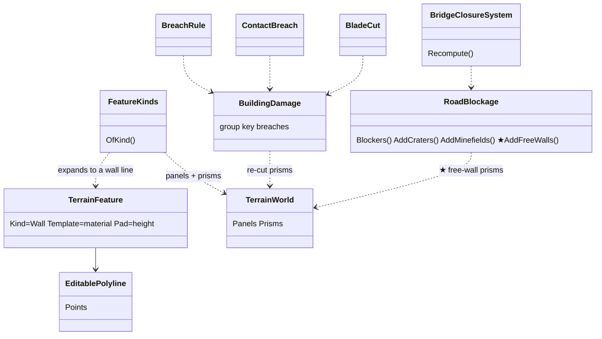
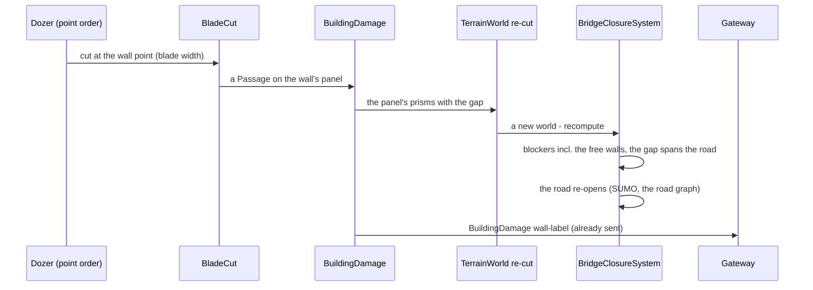
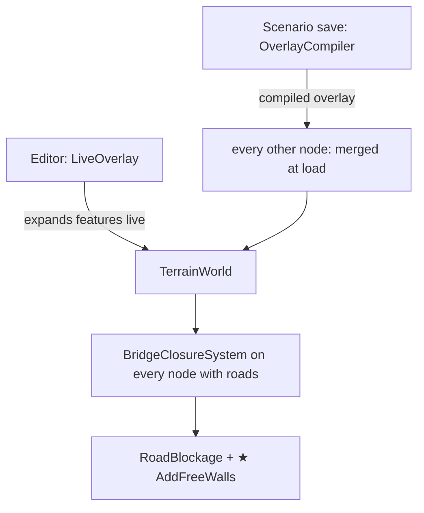

<!--STATUS
state: LIVE
build-state: DESIGN (rev 2 — leans for the user's approval in §5; the independent review in §8)
updated: 2026-11-27 (rev 2: a placed wall is a terrain-feature WALL; rev 1's segment design is HISTORY)
current-answer: §2 the decision · §3 the UML · §5 decisions with leans · §6 acceptance · §7 claim table · §8 the review of rev 2
stale-below: ⛔ HISTORY (rev 1, segments) — must NOT be quoted as the design
known-rot: none
known-conflict: DESIGN_City_Battle_Showcase.md D-6 ("removal mandatory, even as disappearing") — still true for every non-wall obstacle; a WALL is breached in part (R-11022) · DESIGN_Terrain_Editor_UX.md TE-5 / R-4264 (drawn sandbag walls and jersey barriers are obstacle ENTITIES) — rev 2 proposes them as feature walls (D-1, the user's call)
related-designs:
  - DESIGN_Vehicle_Breaching.md — OWNS contact breaching of walls (ram, push, the dozer's blade, B-D3 / B-D11, D-1: one record for buildings and free walls); used unchanged
  - DESIGN_Terrain_Import_UTM.md §8 — OWNS the breach rule (BreachRule, breaches.json, Passage vs Hole); used unchanged
  - DESIGN_Terrain_Authoring.md §18 — OWNS terrain features (TerrainFeature kind Wall, the overlay compile, the live overlay); a placed wall IS one
  - docs/DESIGN_Ground_Patches_And_Road_Blockage.md — OWNS road closure (RoadBlockage, P-2); this adds free walls to its blockers
  - DESIGN_Terrain_Editor_UX.md §5 TE-5 — OWNS the obstacle tool (R-4264); D-1 changes what its wall types make
  - DESIGN_Peek_And_Fire.md §9.9 — OWNS obstacle destruction (CE-6003); unchanged for the non-wall obstacles
  - designs/group-maneuvers/DESIGN_City_Battle_Showcase.md D-6 — OWNS the roadblock drill; its roadblock content per D-4
  - SimNetGateway docs/design/DD-035 (Obstacle topic) and Unreal's TerrainFeature ask — the client side; a TerrainFeature topic is a separate gateway design (D-6)
-->
# Breachable walls — a placed wall is a terrain-feature WALL, breached in part like every other wall

🔒 **R-11022, user `2026-11-27`:** *"A wall is always breached. Only in part. Never the whole wall disappears."* · on rev 1's review: *"write a design
first and run an independent review if it will work as we expect"*.

## 1. INVENTORY — the queries run (`2026-11-27`)

| query | total | found |
|---|---|---|
| `search_graph name_pattern ".*Breach.*" label Class` | 17 | `BuildingDamage.WallBreach`, `BreachRule`, `BreachTable`, `ContactBreach(+Event, Table)`, the wire (`DdsWallBreach`, `ContactBreachTranslators`), behaviours — the ONE wall-breach mechanism (buildings + free walls, Vehicle Breaching D-1) |
| `… ".*Obstacle.*" label Class` | 25 | `StaticObstacle`, `ObstacleShape`, `ObstacleDamage`, `ObstacleRemovalSystem`, `StaticObstacleBakeSystem`, `ObstacleRowOptions`, `ClearObstacleBehavior` … |
| `… ".*WallGroup.*"` / `.*BladeCut.*` | 1 / 5 | `WallGroups` (buildings + free-wall lines); `BladeCut` (the dozer's cut of a wall at a point) |
| grep `RoadBlockage` | 1 caller | `BridgeClosureSystem.Recompute` (`:212`) — blockers: obstacle entities, craters, marked minefields |
| grep `TerrainFeature.Wall` | expansion | `FeatureKinds.OfKind` (`FeatureKinds.cs:34-35`): a `wall` line part, material = `Template`, height = `Pad`, label `<entity guid>/0` |
| grep `LiveOverlay` | 1 holder | the editor's bake (`EditorNodeBootstrapper.cs:396`); other hosts get the COMPILED overlay (`StorageProcessManager.CompileTerrainOverlay`, at save) |
| `git grep TerrainFeature / 8818 -- macros` | 0 | ⚠ no macro carries a terrain feature today |

⚠ `check_index_coverage` is not available through the CLI — the absence claims rest on the graph plus grep.

## 2. The decision

⭐ **A placed wall — a sandbag wall, a barrier line — is a terrain feature of kind `Wall`** (a polyline, material `sandbags` / `concrete`, its height),
not an obstacle entity. It is expanded into free-wall PANELS like any authored or imported wall, so **every existing wall breach applies unchanged**:

| what breaches it | the existing path | the gap |
|---|---|---|
| a charge, a shell, a bomb | `AreaEffectSystem.BreachWalls` → `BreachRule` (scaled distance, the material's resistance) | by the charge; ⭐ a cut to the ground on a low wall is a Passage (CE-4599, `BreachRule.Classify`) |
| a tank ramming / pushing | `ContactBreach` (B-D3: sandbags are a small barrier a heavy armoured hull drives through) | hull-wide (`CutAlong(… hull.Width + 2·CutMarginM)`) |
| the bulldozer | the point order's blade cut (B-4, `BladeCut`) | blade-wide |

The record is `BuildingDamage` of the wall's group (keyed by the feature's stable label, remapped by key across loads and re-sorts); the gateway
already sends it (`BuildingDamage`, `wall:<label>`). ⭐ **The whole wall never disappears** — by construction: walls are only ever breached.

What is ADDED (each small, each in an existing place):

| # | addition | where |
|---|---|---|
| A-1 | ⭐ **road closure counts free walls**: the world's free-wall prisms (after the breach re-cut) join the blockers; recomputed when the world changes (a bake, a breach) | `RoadBlockage` (a new `AddFreeWalls(TerrainWorld, …)`), `BridgeClosureSystem.Recompute` |
| A-2 | the obstacle tool's **wall types draw a feature wall** (a line), not N entities (D-1) | the terrain editor's obstacle tool (TE-5) |
| A-3 | the roadblock content: a barrier line becomes a feature wall (D-4) | `scenarios/showcases/city-battle/features/roadblock-blast`, `macros/city-battle/roadblock` (per D-4) |
| A-4 | Unreal draws the wall: the scenario's terrain features on DPS (D-6) | the gateway (its own design) |

## 3. UML

### 3a. Classes — existing (plain) and added (★)

*What the picture shows that prose hides:* the only new arrow is road closure reading the wall prisms; every breach arrow already exists.

### 3b. A dozer cuts a sandbag wall across a road

### 3c. Who runs it

*Caption:* a node that has not been given the compiled overlay (a scenario never saved since its walls were drawn) has no wall — true for every
feature today (§7 row ②).

## 4. Rejected alternatives (one line each)

- **Segments** (rev 1): a dozer and a ram open ONE segment, orders name one entity, ids are wall-clock, placement leaves seams — rebuilding for obstacle
  rows what feature walls already do (review §HISTORY).
- **Obstacle walls as panels in `BuildingDamage`**: a dynamic panel set in a record indexed by panel; the key remap exists, but a feature wall already
  IS that, with authoring, save and the overlay solved.
- **One wall entity with a gap list**: a second breach mechanism (ruling 9).

## 5. Decisions — leans for the user's approval

| # | question | ⭐ lean | why / what would change it |
|---|---|---|---|
| **D-1** | what the obstacle tool's *sandbag wall* and *jersey barrier* make | ⭐ a **feature wall** line (material `sandbags` / `concrete`, height 1.0 / 0.8 m, the types' sizes); the single 3 m PIECE stays placeable as an obstacle entity (a lone piece, removed whole, as today) | ⚠ it changes R-4264 for these two types (drawn ⇒ a wall, not entities) — the user's call. Keeping both ⇒ a drawn row of pieces still vanishes piece by piece |
| **D-2** | road closure | ⭐ every FREE wall of the world (`Building == -1`), not only the overlay's | the rule is geometric (a wall across a road's full width); a base wall across a road is as closed |
| **D-3** | wall thickness | ⭐ the material's (sandbags 0.6 m via the feature's thickness, set by the tool) | ⚠ `FeatureKinds` passes thickness 0 for `Wall` (= the parser's default) — to set |
| **D-4** | the roadblock content | ⭐ `roadblock-blast`'s 6 × 1 × 1 m concrete barrier across the gate → a concrete feature wall; the city-battle macro's MG-nest sandbags (cover, off the road) → feature walls ONLY if macros can carry features (⚠ none does today — §8 to check) | the gate barrier is a barrier line (R-11022); MG-nest cover is a wall too |
| **D-5** | which non-wall obstacles stay entities | ⭐ car, concrete block (a lone 2 m block), crate, barrels, booth, wreck — removed whole (D-6 of the city battle) | they are objects, not walls |
| **D-6** | how Unreal sees the wall | ⭐ the scenario's terrain features on DPS — Unreal's open ask — as a gateway design of its own; the wall's label = the breach record's key, so the existing `BuildingDamage wall:<label>` cuts the drawn wall | without it Unreal sees the gaps of a wall it does not draw |

## 6. Acceptance — scenarios (R-4277)

| scenario | expect rows (`checks.json`) |
|---|---|
| ⭐ **`va-dozer-breach-wall`** (new, `demos/navigation-and-terrain/`, Unreal ask 4) — a 12 m sandbag feature wall across a road; a dozer on a point order; a car beyond | the wall gets a Passage at the cut (a `BuildingDamage` breach on its label); **the wall's other panels stand**; the dozer passes the wall line; the road was CLOSED before (a SUMO car stops) and OPENS after (the car passes) |
| `roadblock-blast` (D-4) | the charge breaches the concrete wall at the gate in part; the street opens for infantry; the rest of the wall stands |
| a tank rams a sandbag wall | a hull-wide Passage; the rest stands |

Rails: `RoadBlockage.AddFreeWalls` (a wall across a road closes it; a breach spanning the road's width re-opens it; a breach narrower than the road
keeps it closed); the closure recomputes on a breach (a new world instance).

## 7. Claim table

| the design rests on | code — how it IS | design basis — how it was MEANT |
|---|---|---|
| a wall feature expands to a free-wall line of its material and height | ✅ `FeatureKinds.cs:34-35` | ✅ Terrain Authoring §18 |
| free walls are breached in part by blast, ram, push and the blade | ✅ `BreachRule`, `ContactBreach` `:241, 308-320`, `BladeCut` | ✅ Vehicle Breaching D-1, B-D3, B-D7, B-4 |
| a low wall cut to the ground is passable | ✅ `BreachRule.Classify` (CE-4599) | ✅ Vehicle Breaching V-6 |
| feature-wall breach records survive loads / re-sorts by key | ✅ `RemapDamageEntities` (`TerrainResidency.cs:687-700`), `BuildingDamageSave.cs:85-161` (from rev 1's review) | ✅ CE-4427 R-4, CE-4599 |
| road closure does not count walls today | ✅ `RoadBlockage.cs:23-31`, `BridgeClosureSystem.cs:212-214` | ✅ Road Blockage P-2 (obstacles, craters, minefields) |
| a breach makes a NEW world whose free-wall prisms have the gap (what A-1 would read) | ⛔ **not measured** — sight and fire read breaches at QUERY time (B-D8); whether the prisms are re-cut, and when, decides how A-1 reads a gap | — ⇒ §8 to verify |
| the closure recomputes when the world changes | ⚠ it recomputes on the obstacle signature, craters, minefields, decks, and re-judges the collapse table on a new world (`BridgeClosureSystem.cs:150-200`) — ⛔ a breach's new world alone does not set `changed` today | — ⇒ A-1 must add that trigger |
| every node bakes the feature wall | ⚠ the editor live; others from the compiled overlay (at save) | ✅ Terrain Authoring §18c / O-8 |
| sandbags breach easily, concrete hard | ✅ `materials.json`: sandbags 100, concrete 1500 mm RHA / m | — |
| the gateway already sends free-wall breaches | ✅ `BuildingDamage` with `wall:<label>` (Unreal's roadblocks note §"Also") | ✅ DD-030 / T-075 |

## 8. Independent review of rev 2

*(pending — a fresh agent checks this design against the code; its findings are folded here)*

## ⛔ HISTORY — rev 1 (segments), withdrawn `2026-11-27`

Rev 1 made a wall a ROW of 1.5 m obstacle entities, each removed when destroyed. Its independent review found two blockers — a dozer and a ram open
only ONE segment (`ClearObstacleBehavior.cs:148-152`, `ContactBreach.cs:255, 421-427`) and the referenced review section was missing — and seven
important findings: the segment-Health rule was false (`ObstacleDamage.BlastDamage` ignores size), the content premise was wrong (the macro's
sandbags are MG cover; `roadblock-blast` holds a concrete barrier), the row tool spaces boxes and leaves bend wedges, `PlacementGroup` is not
replicated and its id is the wall clock, orders name one entity. It also showed that authored feature walls already breach in part — which rev 2 builds on.
