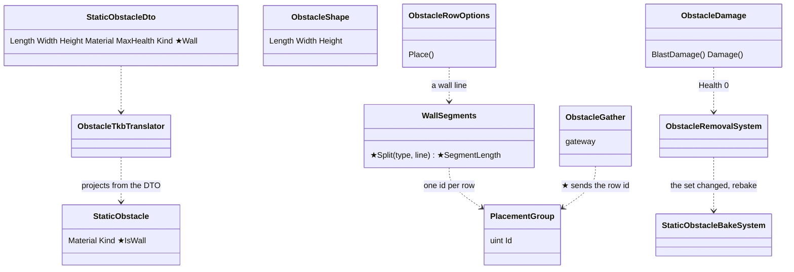
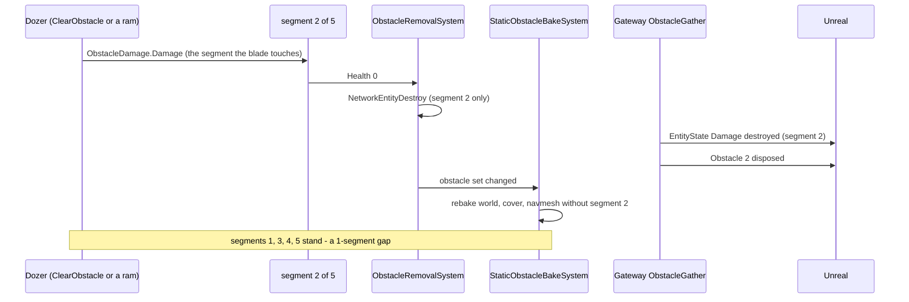
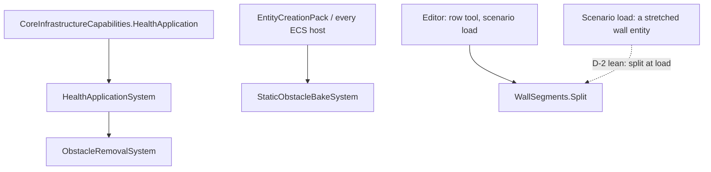

<!--STATUS
state: LIVE
build-state: DESIGN — ⛔ NOT READY: the independent review (§9) found two blockers; §10 asks the user which way
updated: 2026-11-27 (first version, unreal-ig)
current-answer: §2 the decision · §3 the UML · §5 decisions with leans · §6 acceptance · §9 the review
stale-below: nothing
known-rot: none
known-conflict: DESIGN_City_Battle_Showcase.md D-6 ("removal mandatory, even as disappearing") — still true for every non-wall obstacle; for a WALL, R-11022 makes the removal per SEGMENT, never of the whole wall
related-designs:
  - DESIGN_Terrain_Editor_UX.md §5 TE-5 — OWNS the obstacle ROW tool (a drawn line = N obstacle entities, one PlacementGroup, R-4264 / R-5041); this makes a wall ALWAYS such a row
  - DESIGN_Peek_And_Fire.md §9 / §9.9 — OWNS the static obstacle as terrain (the prism bake) and its destruction (ObstacleDamage, ObstacleRemovalSystem, CE-6003); unchanged, applied per segment
  - DESIGN_Vehicle_Breaching.md — OWNS contact breaching (ram, blade, push; ContactBreach) and the terrain-wall breach record (BuildingDamage, D-1); this does NOT add obstacle walls to that record (rejected alternative A, §4)
  - designs/group-maneuvers/DESIGN_City_Battle_Showcase.md D-6 — OWNS the roadblock drill (breach + bypass, removal); its macro's stretched sandbag walls become rows here
  - designs/engineering/DESIGN_Bridge_Laying.md — OWNS the WalkableDeck obstacle kind; a deck is not a wall
  - SimNetGateway docs/design/DD-035 — OWNS the Obstacle topic and the destroyed-before-dispose rule the gateway sends
-->
# Breachable obstacle walls — a wall is a ROW of segments, breached in part, never removed whole

🔒 **R-11022, user `2026-11-27`:** *"we do not want to remove the whole wall, it's a nonsense. A wall is always breached. Only in part. Never the whole
wall disappears."* · on how: *"maybe we could build the breachable obstacle walls from individual segments as individual entities to be removed when
breached, as another obstacles?"*

## 1. INVENTORY — the queries run (`2026-11-27`, unreal-ig, graph indexed this session)

| query | total | found |
|---|---|---|
| `search_graph name_pattern ".*Breach.*" label Class` | 17 | the terrain-wall breach (`BuildingDamage.WallBreach`, `BreachRule`, `BreachTable`), contact (`ContactBreach`, `ContactBreachEvent`, `ContactBreachTable`), the wire (`DdsWallBreach`, `ContactBreachTranslators`), behaviours (`BreachDoorBehavior`, minefield breach) — ⇒ none breaches an OBSTACLE in part |
| `… ".*Obstacle.*" label Class` | 25 | `StaticObstacle`, `ObstacleShape`, `TerrainObstacles` (`PrismOf`), `StaticObstacleBakeSystem`, `ObstacleDamage`, `ObstacleRemovalSystem`, `ObstacleTkbTranslator`, `ObstacleRowOptions` (the row tool), `ClearObstacleBehavior`, `WreckObstacleSystem` (+ unrelated SUMO / ORCA obstacles) |
| `… ".*BladeCut.*" label Class` | 5 | `BladeCut` (terrain walls / trunks at a point) and its wire |
| `… ".*WallGroup.*" label Class` | 1 | `WallGroups` (buildings + free-wall lines of the BASE terrain) |
| grep `PlacementGroup` | 1 component | `Fdp.Toolkit.Terrain.PlacementGroup { uint Id }`, id 309, saved (CE-5008) |
| content scan: obstacles in `scenarios/` + `macros/` | 240 + the macro | ⭐ sandbag walls (8807) appear ONLY in `macros/city-battle/roadblock` — two stretched to **4 m** (type 3 m); concrete blocks stretched to 6 m (type 2 m) there and in `roadblock-blast`; jersey barriers (8821): none; no obstacle carries a `PlacementGroup` |

⚠ `check_index_coverage` is not available through the CLI — the absence claims rest on the graph plus grep.

## 2. The decision

⭐ **A wall obstacle is never ONE entity: it is a ROW of segment entities** (the row tool's own result, R-4264), each an ordinary destructible
obstacle. A blast, a ram, a blade or a push destroys the SEGMENTS it reaches; each is removed as any obstacle is (CE-6003), and the rest of the row
stands ⇒ **a gap**. Nothing new decides a breach: the existing per-obstacle damage already falls off with distance (`ObstacleDamage.BlastDamage`)
and the contact paths already hit the obstacle they touch.

What changes is only WHERE a wall can be one entity:

| | today | after |
|---|---|---|
| a wall type (sandbag wall, jersey barrier) longer than one segment | ⛔ one stretched entity (`ObstacleShape.Length` > the type's) — removed whole | ⭐ a ROW of segments of the type's length, one `PlacementGroup` |
| the row tool | already makes rows | unchanged |
| a stretched wall in content (the city-battle roadblock macro) | 4 m sandbag walls | converted to rows (2 × 2 m, or the segment length §5 D-3 sets) |
| a non-wall obstacle (car, block, crate, barrels, booth, wreck) | one entity, removed whole | unchanged (City Battle D-6 stands for them) |
| the gateway | an `Obstacle` per entity; a removed one is disposed | unchanged shape + the destroyed state before the dispose (Unreal ask 1) + the `PlacementGroup` id (so a client draws a row as one wall) |

## 3. UML

### 3a. Classes — what exists (white) and what is added (★)

*What the picture shows that prose could hide:* the only new behaviour is a SPLIT at authoring / load (`WallSegments`) and a flag on the type; the damage,
removal and bake boxes are untouched — a breach is just several removals.

### 3b. A dozer meets a sandbag wall row

### 3c. Who runs it — every host that runs the obstacle systems already

*Caption:* nothing new runs per frame. The split runs at authoring and, for old content, once at load (D-2).

## 4. Rejected alternatives (one line each)

- **A — bake a placed wall as wall PANELS and reuse the terrain-wall breach record (`BuildingDamage`).** `BuildingDamage` stores the group index and GLOBAL
  panel indices (`BuildingDamage.cs` `Building`, `Panel[]`), stable only because the base panels are never reordered (`StaticObstacles.cs:168`); obstacle
  panels come and go at run time, so recorded / replicated / saved / replayed breaches would point at the wrong panel unless every reader resolved them
  by key — a change to every damage reader and to replay, for one obstacle type.
- **B′ — one wall entity with its own list of gaps, baked as the solid pieces between them.** A second breach mechanism beside the terrain one (ruling 9),
  a new component, a new wire field and a new bake path — where a row of segments needs none of them.

## 5. Decisions — leans for the user's approval

| # | question | ⭐ lean | why / what would change it |
|---|---|---|---|
| **D-1** | which types are WALLS | ⭐ a TKB flag `Wall` on `StaticObstacleDto`: **sandbag wall (8807) and jersey barrier (8821)**; every other obstacle stays one object | a car, a crate, a booth is one thing that breaks as a whole; sandbags and barriers are laid as lines |
| **D-2** | a stretched wall entity (Length > the type's) | ⭐ **never authored** (the editor's stretch of a wall makes a row) **and split at load** for old content — once, into a row with a new `PlacementGroup`; the content converted and re-saved | a split at load keeps every old scenario working; converting the content makes the saved file what runs |
| **D-3** | the segment length | ⭐ **1.5 m for both** (half the type's 3 m box; height / width unchanged) | the gap a blade or a hull makes is 3–4 m: 1.5 m segments give a 3 m gap from two segments, a 3 m segment a 3 or 6 m gap. Costs 2× the entities (a 12 m wall = 8). ⚠ The user's call: 3 m keeps today's type size and count |
| **D-4** | Health per segment | ⭐ the type's `MaxHealth` × segment length ÷ type length (sandbags 300 per 3 m ⇒ 150 per 1.5 m) | a charge that breached 3 m of wall before breaches the same 3 m now |
| **D-5** | what a client is told | ⭐ ① the gateway's destroyed-before-dispose rule, verified on obstacles (Unreal measured a rammed barrel vanish with no destroyed state — the mechanism is not measured yet); ② `PlacementGroup.Id` appended to the gateway's `Obstacle` topic; ③ the obstacle's kind (Unreal ask 2) appended as an enum | ① and ② make a breach look like a breach and a row draw as one wall; ③ spares the client a list of HROT type ids |
| **D-6** | partial HEIGHT holes, a gap narrower than a segment | ⛔ not in v1 | sandbags and barriers are low; a segment is the smallest gap |

## 6. Acceptance — scenarios (R-4277)

| scenario | expect rows (`checks.json`) |
|---|---|
| ⭐ **`va-dozer-breach-roadblock`** (new, `demos/navigation-and-terrain/`, Unreal ask 4) — a dozer on order breaches a 12 m sandbag wall row across a road; a jersey barrier row and a concrete block beside it | the segments in the blade's path end (≥ 1, ≤ 3); **the other segments of the row stand at the end**; the dozer passes the wall line; the concrete block stands (not on the path) |
| `roadblock-blast` / the city-battle roadblock | a charge at the sandbag wall ends the segments within its reach and **not the whole row**; the street opens for infantry |
| a tank rams a row | the segments its hull meets end; the rest stand |

Rails: `WallSegments.Split` (a 12 m line at 1.5 m ⇒ 8 segments end to end, one group id, the Health share); the load-time split of a stretched wall; the
gateway's destroyed state before the dispose for an obstacle; `PlacementGroup` on the `Obstacle` topic.

## 7. Claim table

| the design rests on | code — how it IS | design basis — how it was MEANT |
|---|---|---|
| a drawn row is N obstacle entities with one group id | ✅ `ObstacleRow.cs` (CE-5008), `PlacementGroup.cs` | ✅ R-4264, R-5041, Terrain Editor UX §5 TE-5 |
| each obstacle is damaged and removed on its own | ✅ `ObstacleDamage`, `ObstacleRemovalSystem.cs:41-46` | ✅ Peek and Fire §9.9, CE-6003 |
| a blast's damage falls off per obstacle with its distance | ✅ `AreaEffectSystem.cs:333` → `ObstacleDamage.BlastDamage(kg, d)` | ✅ `ObstacleDamage` header (the scaled-distance form of the breach rule) |
| a ram crushes the obstacle it touches | ✅ `ContactBreach.cs:419-427` — ONE obstacle per contact (`p.ObstacleIndex`) | ⚠ a hull wider than a segment touches two: measured in the acceptance, not before (§9) |
| the dozer clears ONE ordered obstacle | ✅ `ClearObstacleBehavior.cs` (`p.Obstacle`, push per tick) | ⚠ an order naming a ROW clears one segment — §9 asks whether the order should name the row's segment on the dozer's path |
| the gateway sends a destroyed state before the dispose | ⚠ DD-035 says so for decks and obstacles; ⛔ Unreal measured a barrel with none | ⛔ not measured why — D-5 ① |
| sandbag walls exist only in the city-battle macro | ✅ content scan §1 | — |

## 9. Independent review (`2026-11-27`, a fresh agent with the code, not this design's reasoning) — ⭐ the findings, as checked

Verdict: *"building a wall as a row of segment entities is sound and fits R-4264 and the one-mechanism rule … but not ready to build."*

| # | severity | finding (evidence) | consequence for this design |
|---|---|---|---|
| R-1 | ⛔ blocker | a dozer and a ram open ONE segment: `ClearObstacleBehavior.Clear` targets one entity and succeeds when it is gone (`:148-152`); `ContactBreach` crushes one obstacle per contact, and its per-hull grace holds ONE key (`:164, 194, 255-256, 421-427`) — whereas a TERRAIN wall is cut blade- or hull-wide (`CutAlong(… hull.Width + 2·CutMarginM)`, `:241, 308-320`) | the claim *"the contact paths already open a usable gap"* is false; a cut-width rule over the row's segments and a row- or point-level dozer order would be needed |
| R-2 | ⛔ blocker | this file had no §9 although §5 / §7 pointed at it | fixed by this section |
| R-3 | important | D-4 is false: `ObstacleDamage.BlastDamage` depends on kg and distance only (`ObstacleDamage.cs:36-43`), so halving Health WIDENS the gap | segment Health must be derived from the gap wanted at a charge, and railed |
| R-4 | important | the content premise is wrong: the macro's two 4 m sandbag walls are MG-nest cover 14 m off the road; `roadblock-blast` holds a 6 × 1 × 1 m CONCRETE barrier, which R-11022's "barrier line" arguably covers | D-1 and the acceptance rows must be redone |
| R-5 | important | the row tool spaces boxes (`Gap` default 1.5 m, `ObstacleRow.cs:48, 57`) and leaves wedges / overlaps at bends (`LinePlaces.cs:27-37`) | a continuous wall needs a new placement with bend handling and seam / bend rails for sight and the navmesh |
| R-6 | important | `PlacementGroup` has no wire descriptor, so the gateway cannot see it | a new descriptor (and whether ghost promotion waits for it) |
| R-7 | important | `PlacementGroup.NewId()` is the WALL CLOCK (✅ verified, `PlacementGroup.cs:18-27`): a load-time split differs per load and per node; roadblock members are transient macro members (`MacroTypes.cs:51-62`) | deterministic ids from the source key; the macro's local keys and bindings for N segments |
| R-8 | important | orders name ONE entity (`ClearObstacleOrder.Obstacle`, the City Battle company call) | a row / point order shape; a row index in the serial pre-pass (D-26) |
| R-9 | minor | removals within the bake's 0.5 s quiet period coalesce (`StaticObstacleBake.cs:60, 75-81, 223-227`); each bake rebuilds the world + the whole cover database; O(N) per-frame signature and gateway gather | negligible at today's counts; say it |
| R-10 | minor | alternative A's rejection was overstated: a KEY-based remap already exists (`RemapDamageEntities`, `TerrainResidency.cs:687-700`; `BuildingDamageSave.cs:85-161`), and authored terrain-feature `Wall` lines (`TerrainBlock.cs:37`, kind 2) ARE already breached in part | ⭐ see §10 — this opens a third option |

Not verified by the review: bake times, navmesh / sight leaks through a seam, how `checks.json` resolves a name shared by segments, the dozer's width, why
Unreal saw no destroyed state, whether terrain-block walls reach cluster nodes outside the editor.

## 10. ⭐ What the review changes — a third option, for the user

R-10 shows that a breachable wall ALREADY EXISTS as authored content: a scenario terrain feature of kind **Wall** (a polyline, `EditablePolyline`;
label `<entity guid>/<i>`) is expanded into wall PANELS of the scenario's overlay, so blasts (`BreachRule`), rams, pushes and the dozer's blade-wide
POINT cut (B-4) breach it in part through `BuildingDamage`, and the key remap keeps its records right across loads and re-sorts. ⇒ the segment
approach would rebuild, for obstacle rows, what feature walls already do (R-1, R-5, R-8 are all solved there).

| option | reuse | what is missing |
|---|---|---|
| **segments** (§2) | removal, bake | R-1, R-3, R-5 … R-8: a cut-width rule, a row order, continuous placement, a wire descriptor, deterministic ids |
| ⭐ **feature walls** — a sandbag wall / a barrier line is drawn as a terrain-feature WALL with that material and height | the whole terrain-wall breach (blast, ram, push, blade point cut), the key remap, the gateway's `BuildingDamage wall:<label>` | ① **to measure**: does a feature wall block road traffic (SUMO) and routes like an obstacle entity (R-4264's reason for entities); does every node bake it (the overlay); ② the WALL ITSELF does not reach Unreal yet — Unreal's open `TerrainFeature` ask ([NOTE_UnrealIg_To_UiIntegration_Scenario_Terrain_Features.md](../../blueprints/batches/NOTE_UnrealIg_To_UiIntegration_Scenario_Terrain_Features.md)) has to be answered either way; ③ the city-battle macro's walls / barriers become feature walls (macros already carry features: kind 9 / 10 / 16 in the bl-* and Stechovice scenarios) |

⭐ Lean (pending ① measured): **feature walls** — one breach mechanism for every wall, built-in, authored or placed; the segment approach is withdrawn
if ① holds. R-4264 (drawn obstacles are entities) stays true for the non-wall obstacles.

