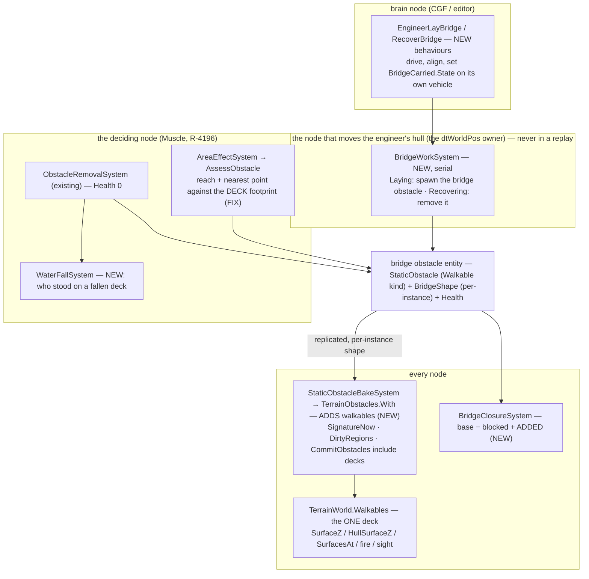
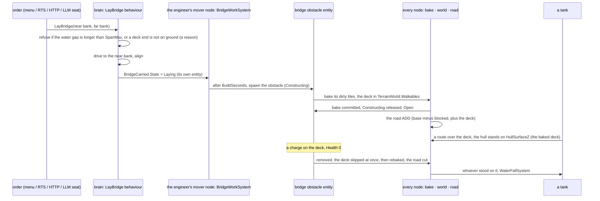
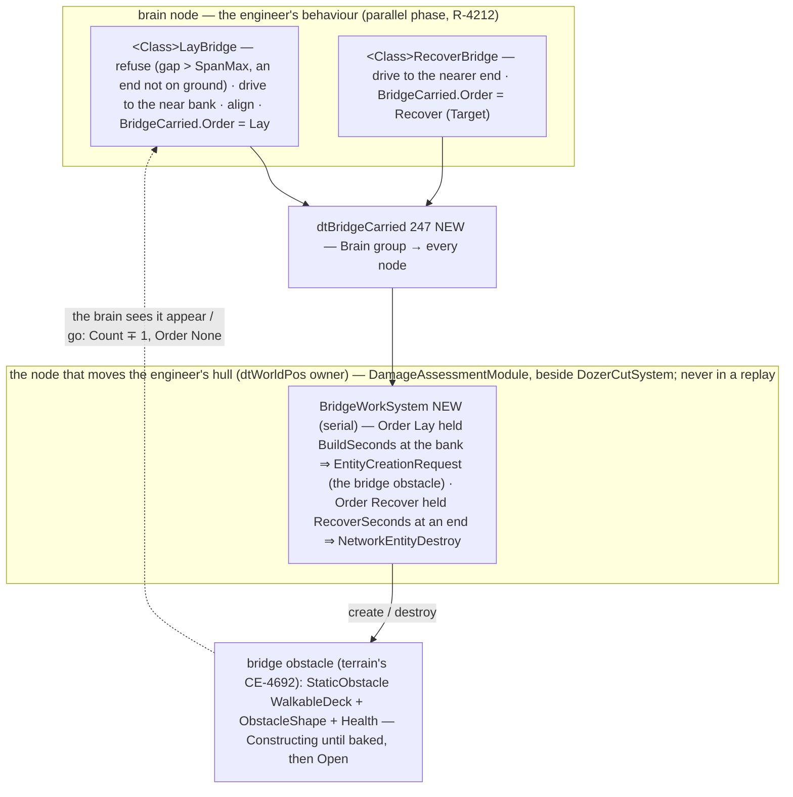
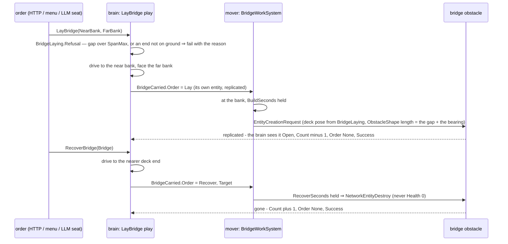

<!--STATUS
state: LIVE
updated: 2026-11-25 (rev 5 — §12f BL-S3/S4 AS-BUILT by backend, CE-4693; rev 4 — §12 BL-S3/S4 designed by backend; rev 3 — BL-S1/S2 AS-BUILT by terrain, CE-4692: §2b redrawn, §11 the deviations; rev 2 — the independent review folded)
build-state: BUILT — BL-S1/S2 by terrain (CE-4692, §11); BL-S3/S4 by backend (CE-4693, §12f) — every bl-* scenario passes
current-answer: §2 the diagrams (§2b AS-BUILT) · §3 the decisions · §5 the slices with their checks · §9 the open questions · §10 the review · §11 what BL-S1/S2 built and where it deviates · §12 BL-S3/S4 the engineer (backend's design) · §12f what it built
stale-below: the ⛔ HISTORY section at the bottom (rev 1: a separate LaidBridge entity + a side surface table)
known-rot: none
known-conflict: none
related-designs:
  - ../../DESIGN_Peek_And_Fire.md — OWNS the static obstacle (§9, P-7a, R-243: an entity that is TERRAIN on every node, held Constructing until baked); THIS adds a WALKABLE kind
  - ../../DESIGN_Terrain_Authoring.md — OWNS the authored Bridge feature (§8: the deck shape, the "rubble still carries units" case) and the bridge roads (§18k-2/3/4); THIS lifts the deck shape below the JSON and adds a run-time road ADD
  - ../../PLAN_Dynamic_Terrain.md — OWNS the run-time terrain changes and the obstacle bake (P-7a)
  - ../../DESIGN_Ground_Patches_And_Road_Blockage.md — OWNS the one road-edit step (§9.9 CE-4590, §9.11 CE-4591) the bridge's road add and cut go through
  - ../../DESIGN_World_Query_Seam.md — OWNS IWorldQuery (SurfaceZ / HullSurfaceZ / SurfacesAt): the baked deck is answered there with no new table
  - ../../DESIGN_Vehicle_Breaching.md — OWNS the engineer pattern (§7.6 the bulldozer: the brain marks, the node that moves the hull writes)
  - ../minefields/DESIGN_Minefields.md — OWNS the other engineer task (§3f the lane)
  - ../../DESIGN_Orders_Params_Entity_Classes.md — OWNS orders (§8, §9); THIS adds LayBridge / RecoverBridge and a two-point pick
  - ../vehicle-appearance/DESIGN_Vehicle_Appearance_State.md — OWNS what a renderer is told about a vehicle; THIS adds bridge carried / laid
  - ../../DESIGN_Terrain_Import_UTM.md — §8 P3-a/b the per-tile navmesh versions that re-plan stale paths
-->

# Bridge laying — an engineer lays a bridge over a river; it can be crossed, recovered and destroyed

🔒 User, `2026-11-25`: *"bridge layer vehicle to be instructed to create a bridge over a river, temporary, removable and destroyable. HROT
entities need to be able to cross the river (sumo not necessary if not easy)"* · *"the vehicle was just a way to have someone to order to create
a bridge; no problem if it lays long ponton bridge for wider rivers"* · *"how will we let the navigation to find the path if we do NOT change the
navmesh? How will be allow vehicles to find out there is a solid floor"* · *"yes, write the design. and run an independent review"*.

⭐ **The decision in one line:** a laid bridge is a **static obstacle of a new WALKABLE kind** — an entity that every node bakes into its own
terrain, exactly as sandbags and roadblocks are today, except that its shape is a deck with ramps you stand on instead of a box you stand behind.
**ONE deck**, in the baked world: the navmesh, the floor (`SurfaceZ` / `HullSurfaceZ`), sight and fire all read it from there. The engineer
vehicle is just whom you order.

## 0. The proven solution, and how ours maps to it

Armies cross gaps two ways: an **assault bridge** launched from a vehicle (a short span, laid in minutes, under fire, recovered from either end)
and a **floating bridge** (bays joined into a long span, tens of minutes, at a prepared site). Both are one object that appears, has a load class,
can be destroyed and can be taken away ⇒ one obstacle kind, per-type TKB values (span, width, deck height, build / recover time, load class).
⚠ The real figures are to verify before they become TKB values (§9 Q-6). Engines model such an object as dynamic navigation geometry that the
navmesh is rebuilt around (tile rebuild) — which is what HROT's obstacle bake already does.

## 1. INVENTORY — the queries run (`2026-11-25`)

| query | total | what it says |
|---|---|---|
| `search_graph ".*(Bridge|River|Water|Ford|Crater|Breach|Overlay|OffMesh|NavRebuild|Bake).*"` Class | 175 | `BridgeClosureSystem`, `BridgeRoads`, `StaticObstacleBakeSystem`, `NavTileCache`, the damage records |
| `search_graph ".*(Engineer|Bulldozer|Clear|Obstacle|Breach|Lane|Bridge|Damage|Destroy).*"` Class | 313 | `ClearObstacleBehavior`, `ClearLaneBehavior`, `DozerCutSystem`, `ObstacleDamage`, `ObstacleRemovalSystem` — no bridge layer |
| ⭐ (review) `search_graph ".*(Walkable|StaticObstacle|LiveOverlay|TerrainWorldMerge|ViewTableCache|ObstacleRemoval|DozerCut).*"` Class | 20 | ⭐ **the static-obstacle pipeline** (`StaticObstacles.cs:9-38`) — the seam rev 1 missed |
| grep `AVLB|pontoon|bridge.lay|laid bridge|gap crossing` over `docs/` + `.dev/` | 0 | no earlier design |
| grep `HullSurfaceZ|SurfaceZ(|GroundHeightAt(` in motion / CarKinem | — | vehicles stand on `HullSurfaceZ`, men on `SurfaceZ` (`CarKinematicsSystem.cs:879`, `HullClearance.cs:138,174,264`); direct `GroundHeightAt` only on fence and air paths |
| grep `InWater|drown` in motion / combat | 0 | ⛔ no water model |
| ⚠ `check_index_coverage` | — | not available through the CLI: absence claims rest on graph + grep |

## 2. The diagrams

### 2a. The module view

*What the picture shows that prose hid: no new entity pipeline and no side table — the bridge rides the static obstacle's existing path (an entity
that is terrain on every node, held Constructing until its bake commits, removed at Health 0); the new code is the WALKABLE kind in the bake,
the deck-footprint damage reach, the road ADD and the water fall.*
⚠ The Replay Browser and display nodes run no bake (P-7a known gap): there the bridge is drawn but is not a surface or a path.

### 2b. The classes — ⭐ AS-BUILT (BL-S1/S2, CE-4692; the rev-2 drawing's `BridgeShape` is SUPERSEDED by `ObstacleShape`, §11)

```mermaid
classDiagram
  class StaticObstacle { <<existing>> Material · Kind (Solid|WalkableDeck) NEW }
  class ObstacleKind { <<NEW enum>> Solid · WalkableDeck }
  class ObstacleShape { <<existing, [PerInstanceValue]>> Length = span between the deck ends · Width · Height = deck above the bank }
  class StaticObstacleDto { <<existing TKB>> NEW Kind · types 8825 assault span, 8826 floating span }
  class Health { <<existing>> }
  class DeckGeometry { <<NEW, lifted from FeatureKinds.Bridge>> Build(A, B, width, deckHeight, rampLength) · Ends · RampLengthFor · Bounds }
  class TerrainWorldParser { <<existing>> NEW GroundRelativeWalkable · Buried (TH-K, one rule) }
  class TerrainObstacles { <<existing>> NEW DeckOf · WalkableKey · With(..., decks) }
  class TerrainWalkable { <<existing>> NEW Obstacle · DrawnByEntity }
  class TerrainWorld { <<existing>> NEW DeckGone · OnDeck · DeckUnder · SurfaceZ / HullSurfaceZ / SurfacesAt (…, doors) }
  class DeckTable { <<NEW, per view>> Standing(obstacle) }
  class DoorStates { <<existing>> NEW Decks }
  class StaticObstacleBakeSystem { <<existing>> CollectPrisms(…, decks) · signature mixes Kind }
  class TerrainResidency { <<existing>> BakeObstacles(…, decks) · DeckDirt · commit keeps the decks }
  class BridgeRoads { <<existing>> NEW Plan(bridges, firstSegment, NearestNode) · NearestNodeOf }
  class RoadNetworkEdit { <<existing>> NEW Edited(base, drop, added) }
  class BridgeClosureSystem { <<existing>> base − blocked + added · DeckSignature }
  class RoadBlockage { <<existing>> a deck is never a blocker }
  class IWorldQuery { <<existing seam>> NEW OnDeck }
  class HullClearance { <<existing>> the kerb: no drop off a deck }
  class AreaEffectSystem { <<existing>> NEW ReachPoint (the deck footprint) · nearest point ON the deck }
  class WaterFallSystem { <<NEW>> who stood on the falling span → DamageAssessedEvent }
  StaticObstacle --> ObstacleKind
  StaticObstacle -- ObstacleShape
  StaticObstacle -- Health
  StaticObstacleDto ..> StaticObstacle : ObstacleTkbTranslator
  TerrainObstacles ..> DeckGeometry
  TerrainObstacles ..> TerrainWorldParser
  StaticObstacleBakeSystem --> TerrainObstacles
  StaticObstacleBakeSystem --> TerrainResidency
  TerrainResidency --> TerrainWorld : With(decks)
  TerrainWorld o-- TerrainWalkable
  DoorStates o-- DeckTable
  TerrainWorld ..> DoorStates : DeckGone
  IWorldQuery <|.. TerrainWorldQuery
  TerrainWorldQuery ..> TerrainWorld
  HullClearance ..> IWorldQuery : OnDeck
  BridgeClosureSystem ..> BridgeRoads
  BridgeClosureSystem ..> RoadNetworkEdit
  BridgeClosureSystem ..> RoadBlockage
  FeatureKinds ..> DeckGeometry : the authored bridge
  AreaEffectSystem ..> ObstacleShape
  WaterFallSystem ..> TerrainWorld : DeckUnder
```

*What the picture shows that prose hid: there is still ONE deck — `DeckGeometry` feeds both the authored bridge's features and the laid bridge's walkables, and the
parser's ground-relative rule makes both — and no new component carries the bridge's size: `ObstacleShape` already was the per-instance, replicated, saved size of a
static obstacle. The only new runtime state is the per-view `DeckTable` (which decks still stand), and the only new system is `WaterFallSystem`.*

### 2c. The sequence — lay, cross, fall

## 3. Decisions (leans — for the user's nod, §9)

| # | decision | why |
|---|---|---|
| BL-1 | ⭐ **the laid bridge is a STATIC OBSTACLE of a new WALKABLE kind** (`StaticObstacle.Kind`), with a per-instance `BridgeShape` and `Health` | the existing pipeline already makes an entity terrain on every node, holds it Constructing until baked (R-243), ignores its own collider, removes it at Health 0 (`ObstacleRemovalSystem`, with replay rails) — review ② |
| BL-2 | ⭐ **ONE deck, in the baked world** (`TerrainWorld.Walkables`): navmesh, floor, sight and fire read it there; ⛔ no side table | a second copy disagrees with the first for 0.5–2 s at every change — review ① (BLOCKER) |
| BL-3 | **a fall is immediate**: at removal the deck is SKIPPED at query time (as a felled trunk is, CE-4603, `TerrainWorld.cs:772`) until the rebake commits; Open only after the bake commits | no window where the floor and the navmesh disagree in the dangerous direction — review ① |
| BL-4 | ⭐ **one deck geometry, lifted from `FeatureKinds` below the JSON** (corners + the buried ramp foot), with deck height and ramp length (from the rise, ≤ 20°) as parameters; the authoring compile and the bake both call it | ruling 9; the floating bridge needs a low deck and the parser's 20° limit — review ⑥ |
| BL-5 | **the bake**: `TerrainObstacles.With` ADDS walkables; `BakeObstacles` takes them; `SignatureNow`, `DirtyRegions` and `CommitObstacles` include them | otherwise the incremental bake reuses old tiles — review ③ |
| BL-6 | **the deck joins the banks** — ✅ measured already: `FeatureKindsTests.ABridge_IsTheOnlyCrossing_ForMenAndGroundVehicles…` (`:123`) bakes a run-time world and finds a path over the deck and none after the fall; the per-tile input is ground + prisms + walkables in one gather (`TerrainWorldMesh.cs:127-141`) | rev 1's Q-1 answered — the new rail is the INCREMENTAL bake (dirty rectangles), not a full build — review ③ |
| BL-7 | **the road**: `BridgeClosureSystem` keeps base and added apart — `base − blocked + added`; its own change test for the bridge set; bridges exempt from the blocker walk; the ends snap by `BridgeRoads.Plan` over the RUN-TIME network | the step rebuilds from base and would lose an add, and would treat the bridge obstacle as a blocker — review ⑦ |
| BL-8 | **damage**: `AreaEffectSystem` measures reach and the nearest point against the DECK footprint (not the entity centre); the obstacle blast law; bullets never | a charge on a 26 m span's end, or anywhere on a pontoon, is culled today — review ④ |
| BL-9 | **the water**: a `WaterFallSystem` on the deciding node: a man on a fallen deck is out of the fight, a vehicle destroyed, through `DamageAssessedEvent` (R-171); a fallen laid bridge leaves NO rubble | there is no water model — the river bed would carry them on; the authored bridge's rubble already carries units across (Authoring §8) — review ⑤, ⑩ |
| BL-10 | **the engineer**: the brain sets `BridgeCarried.State` on its own vehicle (R-4212); `BridgeWorkSystem` runs on the node that moves its hull, never in a replay (the `DozerCutSystem` precedent); `BridgeCarried` has its own descriptor | the precedent, and the brain and the mover may be different nodes — review ⑪ |
| BL-11 | **orders**: `[Order]` `LayBridge {NearBank, FarBank}` / `RecoverBridge {Bridge}` with a two-point pick; refused with a reason when the water gap exceeds the span or a deck end is not on ground | real orders; never a bridge into the river |
| BL-12 | **the deck edges**: `HullClearance` treats a drop of more than its climb as a block on a deck (a kerb in effect) | avoidance would push a 3.6 m hull off a 4 m deck — review ⑩ |
| BL-13 | **drawn once**: a walkable gets a drawn-by-entity flag (like prisms, CE-4656), so the terrain mesh does not draw the deck the renderer draws | review ⑪ |
| BL-14 | **why a laid bridge AND the authored Bridge feature**: the authored one is permanent terrain (destroyable, never removed or owned); a laid one is owned, built over time, recoverable — a necessary difference, sharing the ONE deck geometry | ruling 9 asks the reason — review ⑨ |
| BL-15 | **SUMO out of v1** | SUMO cannot add an edge at run time |
| BL-16 | **load class later**: one class "takes everything" in v1 | §9 Q-5 |

## 4. Rejected — one line each

- **A separate bridge entity + a side surface table (rev 1)** — two decks that disagree for up to 2 s at every change; the static obstacle already is the pipeline.
- **A terrain record like a crater** — no Health, no targeting, its own save section.
- **The editor's live overlay on every node** — editor-only by design.
- **Recast off-mesh links for vehicles** — jumping men only, no width, no floor.
- **A second deck shape for laid bridges** — ruling 9.

## 5. Slices — each with its scenarios and their expect rows (R-4277)

| slice | builds | scenario · its `checks.json` expect rows (sketch) |
|---|---|---|
| **BL-S1** the walkable obstacle | `StaticObstacle.Kind`, `BridgeShape`, the lifted `DeckGeometry`, the bake ADD (signature, dirty regions, commit), the TKB types, the road ADD; a scenario-placed laid bridge | `bl-placed-bridge`: a squad and a tank ordered across a river — rows: the tank reaches the far bank; the squad reaches it; ⭐ the same order with the bridge absent: neither does (a path-exists cue, never a time) |
| **BL-S2** destroy | deck-footprint reach, the immediate skip, `WaterFallSystem`, no rubble, the road cut | `bl-blow-the-bridge`: a charge on the deck — rows: the bridge is gone; a tank on it is destroyed; a tank ordered across afterwards does not reach the far bank |
| **BL-S3** the engineer | the engineer types, `BridgeCarried` (+ descriptor), the orders, the behaviours, `BridgeWorkSystem`, the gap refusal, the kerb | `bl-assault-crossing`: an engineer lays under smoke, a platoon crosses — rows: the bridge Open; every squad across · `bl-recover`: the bridge gone and the river a barrier again · `bl-too-wide`: the order refused with its reason, no bridge |
| **BL-S4** floating | the floating type (low deck, long span) | `bl-floating-bridge`: a wide river crossed |
| later | SUMO edges, load classes, the IG's laying animation, a re-plan when a bridge opens (§9 Q-8) | — |

⚠ The bake is paced by the wall clock (R-244): every check keys on the bridge's STATE and on path existence, never on a time.

## 6. Rules this respects

- **R-4212**: the brain writes only its own vehicle; one serial system on one node writes the bridge.
- **Recorded components are unmanaged**: `BridgeShape`, `BridgeCarried` fixed-size; the shape a `[PerInstanceValue]` so every node bakes the same deck.
- **Hot path**: the bake runs on a change, off-thread; the query's skip of a fallen deck is a set lookup (0 B); `SurfacesAt` already allocates (unchanged).
- **R-4277**: every slice ships its scenarios with expect rows.
- **R-4295**: the wire carries its own types for `BridgeShape` / `BridgeCarried`; translators convert.

## 9. Decisions — ✅ APPROVED `2026-11-25` (R-4299: *"leans approved"*)

| # | question | ⭐ lean |
|---|---|---|
| Q-2 | which lane | **terrain** builds BL-S1/S2 (the bake, the world, the road); BL-S3's behaviours with **backend**, cross-lane allowed |
| Q-3 | a man or vehicle on a falling bridge | BL-9: a man out of the fight, a vehicle destroyed — nothing swims in v1 |
| Q-4 | what can damage it | explosives by the blast law (charges, artillery, bombs through the same law); AT rounds later |
| Q-5 | load class in v1 | later |
| Q-6 | real figures (span, width, times, class) for an assault and a floating bridge | from open sources, recorded in the TKB with the source, before BL-S3 |
| Q-7 | the two-point pick on the map | the ui lane's gesture; HTTP and the LLM commander's seat take two named places / points from the start |
| Q-8 | a unit already on a detour when a bridge opens does not re-plan (only paths through changed tiles do; a failed request is not retried) | v1: accepted, said in the scenarios; later a "the network gained a crossing" signal re-asks blocked routes |

*(rev 1's Q-1 — does a run-time deck join the banks — is answered: BL-6.)*

## 10. The independent review (`2026-11-25`) — each finding and what it changed

| # | severity | finding | disposition |
|---|---|---|---|
| ① | BLOCKER | the deck twice (a side table AND the bake) — they disagree for 0.5–2 s at every change; the table cannot remove a baked surface | ✅ adopted — BL-2, BL-3 |
| ② | MAJOR | the static-obstacle pipeline was missed; it already is the entity-that-is-terrain path | ✅ adopted — BL-1 |
| ③ | MAJOR | rev 1's Q-1 is already answered (`FeatureKindsTests:123`); the real work — `With` adding walkables, the bake signature, the dirty regions, the commit — was not drawn | ✅ adopted — BL-5, BL-6, §2b |
| ④ | MAJOR | damage is culled by the entity CENTRE and measured to a box | ✅ adopted — BL-8 |
| ⑤ | MAJOR | no water model; a unit on a fallen deck lands on the river bed and moves on | ✅ adopted — BL-9, `WaterFallSystem`, BL-S2 rows |
| ⑥ | MAJOR | the deck shape is fixed (1.5 m, 6 m ramps, ≤ 20°) and emitted as JSON; no water level for a floating deck | ✅ adopted — BL-4 (lifted below the JSON, height and ramp as parameters) |
| ⑦ | MAJOR | the road step rebuilds from base and would lose an add; would treat the bridge as a blocker | ✅ adopted — BL-7 |
| ⑧ | MINOR | the bake is wall-clock paced; detoured units never re-plan | ✅ adopted — checks key on state and paths (§5); Q-8 |
| ⑨ | MINOR | BL-15 duplicated the authored bridge without a reason | ✅ adopted — BL-14 states the necessary difference |
| ⑩ | MINOR | hull avoidance can push a hull off the deck; rubble can carry units across | ✅ adopted — BL-12, BL-9 (no rubble) |
| ⑪ | MINOR | table caching, `SurfacesAt` allocates, drawn twice, `BridgeCarried` needs a descriptor, the work system's node and replay | ✅ adopted — BL-13, BL-10, §6 (the table is gone with ①) |
| ⑫ | MINOR | the scenarios had no expect rows | ✅ adopted — §5 |

✅ **What held** (verified by the review): vehicles and men take their height from `IWorldQuery`; water is cut from the ground mesh and impassable;
`BridgeClosureSystem` is the one road-edit step; `ObstacleDamage.BlastDamage` exists; the obstacle bake runs on every node; no earlier design.

## 11. AS-BUILT — BL-S1 / BL-S2 (terrain, CE-4692, `2026-11-25`)

| # | built | where | deviation from rev 2, and why |
|---|---|---|---|
| BL-1 | `StaticObstacle.Kind`, `ObstacleKind`, `StaticObstacleDto.Kind`, TKB 8825 / 8826 (placeholder figures: 18 m × 4 m × 1.2 m and 60 m × 4.5 m × 0.6 m, 600 hp — the 8 kg charge drops a span) | `StaticObstacles.cs`, `ObstacleTkbTranslator.cs`, `NedTkbCatalog.RegisterBridges` | ⭐ **no `BridgeShape`**: `ObstacleShape` (Length = the span between the deck ends, centred on the entity along its heading; Height = the deck above the bank) — it already is `[PerInstanceValue]`, replicated (`EntityObstacleShape`) and saved; a second size component with its own descriptor and translator would be a duplicate (ruling 9). A deck gets **no `PhysicsCollider`** (a mover crosses it) |
| BL-4 | `DeckGeometry` (deck + two ramps, ground-relative corners); `TerrainWorldParser.GroundRelativeWalkable` / `Buried` (TH-K, one rule) | `DeckGeometry.cs`, `FeatureKinds.Bridge`, `TerrainObstacles.DeckOf` | ramp length from the rise at the authored 1 : 4 (`RampLengthFor`) |
| BL-4a | ⭐ `TerrainObstacles.DeckParts(position, yaw, shape)` — the ONE rule from an obstacle to its deck + ramps (the clamps + `Ends` + `Build`), extracted from `DeckOf` so the terrain and the SimNetGateway's DPS `Deck` topic (DD-035, T-083) share it | `StaticObstacles.cs` | unreal-ig `2026-11-26`, cross-lane; behaviour bit-identical (rail `FeatureKindsTests.DeckParts_IsWhatDeckOfFeedsTheWalkables_…`) |
| BL-5 | decks collected beside the prisms; `With(…, decks)` appends them; `BakeObstacles(…, decks)`; `DeckDirt` (old and new place); the commit keeps them; the signature mixes `Kind` | `StaticObstacleBake.cs`, `TerrainResidency.cs` | decks are baked on EVERY node (like craters), not only a damage-baking one |
| BL-3 | `TerrainWalkable.Obstacle`; per-view `DeckTable` (standing = Active or Constructing) on `DoorStates.Decks`; `TerrainWorld.DeckGone` skips a fallen deck in `SurfaceZ` / `HullSurfaceZ` / `SurfacesAt` (the view's overloads, used by `TerrainWorldQuery`) and the sight / fire loops | `DeckTable.cs`, `TerrainWorld.cs`, `TerrainObjects.cs` | — |
| BL-7 | `BridgeClosureSystem` publishes `Edited(base, blocked, added)`; added = an Active deck's ends snapped by `BridgeRoads.Plan` over the run-time nodes (`NearestNodeOf`); its own `DeckSignature`; `RoadBlockage.Blockers` skips decks | `BridgeClosureSystem.cs`, `BridgeRoads.cs`, `RoadNetworkEdit.cs`, `RoadBlockage.cs` | the ends snapped are the DECK ends (the authored bridge's rule) |
| BL-8 | `AreaEffectSystem.ReachPoint` (the deck's nearest point for the reach cull); the deck's nearest point's height is the deck SURFACE | `AreaEffectSystem.cs` | — |
| BL-9 | `WaterFallSystem` (the deck's Health owner, the frame its Health reaches 0, before the removal; the SLAB only — a ramp runs onto the bank); no rubble (the obstacle is just removed) | `WaterFallSystem.cs`, `CoreInfrastructureCapabilities` | — |
| BL-12 | `IWorldQuery.OnDeck`; `HullClearance.Enters` refuses a DROP of more than a step off a standing deck, only when the point leaves every deck's plan footprint; ⭐ `IWorldQuery.HullPointZ` — a hull POINT inside a standing deck (slab or ramp) is ON it | `IWorldQuery.cs`, `TerrainWorld.OnDeck` / `DeckSurfaceAt`, `HullClearance.cs` | 📐 found by `bl-placed-bridge` (live): a tank's front corner 0.75 m up the ramp was read with the hull centre's height as the hint (out of the step reach) ⇒ "the ground", its trace ran through the ramp, and the tank was held at the ramp's foot (FailedBlocked). A vehicle is never UNDER a deck, so a hull point inside one rests on it. ⭐ **CE-4694 ② (`2026-11-25`) — and the AUTHORED bridge's deck too:** 📐 found live on stechovice-battle, a tank held at an authored bridge's ramp foot (FailedBlocked) — `TerrainWorld.IsDeck` = a laid deck OR a part of a STRUCTURE building (`TerrainBuilding.Structure`, set by the parser for O-2 structures); rail `FeatureKindsTests.CE4694_*`. ⚠ **And the site must be clear:** 📐 the same tank was then still held at the east ramp's SOUTH edge — an OSM house (`w422408687`) stood on the ramp's north half, leaving the vehicle mesh a ~1 m strip (a navmesh dump across the foot). A deck placed over a base building is not warned about (CE-5059); the scenario removes the house with a base edit (`DESIGN_Terrain_Base_Edits.md` D-2) |
| BL-13 | `TerrainWalkable.DrawnByEntity`, skipped by the drawn mesh (never by the navmesh soup) | `TerrainWorldMesh*.cs` | the bridge types are cultural features (DIS kind 5): the TERRAIN draws their deck |

Rails: `FeatureKindsTests.CE4692_TheAuthoredBridge_AndALaidDeck_AreTheOneDeckGeometry` · `StaticObstacleBakeTests.CE4692_ALaidBridge_IsBakedIncrementally_…` ·
`BridgeClosureTests.CE4692_ALaidBridge_IsRoadWhileItStandsOpen_…` · `ObstacleDamageTests.CE4692_AChargeAtTheSpansFarEnd_DropsIt_…`. Scenarios: `bl-placed-bridge`,
`bl-placed-bridge-absent` (the handoff's "second variant" — the runner has no variants), `bl-blow-the-bridge` (`scripts/bridge_laying_scenarios.py`).

## 12. BL-S3 / BL-S4 — the engineer: design (backend, CE-4693, `2026-11-25`; `build-state: READY-TO-BUILD`)

⭐ The handoff's frame is kept; three details decided here, each against a measured precedent:
① **one writer per component** — the handoff's `BridgeCarried` held both the brain's order and the mover's progress / count. The brain and the
mover may be two nodes (BL-10), and a replicated component has ONE owner, so: the BRAIN writes `BridgeCarried` (what it is told to do and how many
spans it carries); the MOVER keeps its progress in its own system (the `DozerCutSystem` precedent, `BladeCut.cs:57`) and its RESULT is the bridge
obstacle itself — spawned through the ONE creation request (the `WreckObstacleSystem` precedent, `WreckObstacleSystem.cs:94`) and recovered through
the ONE network destroy (`NetworkEntityDestroy.Request`, as `ObstacleRemovalSystem`), ⛔ never Health 0 — Health 0 is a demolition and drops whoever
stands on the deck into the river (`WaterFallSystem`). The brain sees the result (the obstacle appears / is gone) and updates its own count.
② **the engineer's figures live on the ENGINEER** (`BridgeLayerDto`: the bridge type it carries, how many, the longest gap, build and recover
seconds, the source) — the span's own size stays terrain's `StaticObstacleDto` (8825 / 8826), its figures replaced by the sourced ones (Q-6).
③ **the orders are kinds** (`OrderKind.LayBridge` 17, `RecoverBridge` 18 — measured free on every lane), fulfilled by `<Class><Order>` plays
(`AssaultBridgeLayerLayBridge` …, the routing rule, Orders §1 O1–O2).

### 12a. The module view — who runs what, each frame

*What the picture shows that prose hid: the brain never writes the bridge and the mover never writes `BridgeCarried` — each side reads the other's
result, so two nodes never write one component; and the mover's system is reached every frame because `DamageAssessmentModule` already runs on the
node that moves hulls (the dozer's).*

### 12b. The classes

```mermaid
classDiagram
  class BridgeCarried { <<NEW unmanaged, recorded, Brain group, id 292>> byte Count · byte Order (None Lay Recover) · long BridgeType · WorldPoint NearBank · WorldPoint FarBank · EntityRef Target · byte Refusal · float GapM }
  class BridgeLayerDto { <<NEW TKB descriptor, on the engineer>> BridgeType · Carried · SpanMaxM · BuildSeconds · RecoverSeconds · Source }
  class EntityBridgeCarried { <<NEW wire descriptor dtBridgeCarried 247>> }
  class BridgeCarriedTranslators { <<NEW egress + ingress, the RamOrder pair>> }
  class BridgeWorkSystem { <<NEW serial, mover node>> progress per hull (own state) }
  class LayBridgeOrder { <<NEW [Order LayBridge]>> PointLink NearBank · PointLink FarBank }
  class RecoverBridgeOrder { <<NEW [Order RecoverBridge]>> EntityLink Bridge (optional) }
  class BridgeLaying { <<NEW static>> Plan(terrain, near, far) LaidDeckPlan · RecoverStand · OpenBridgeAt · Say(refusal) }
  class DozerCutSystem { <<existing precedent>> }
  class WreckObstacleSystem { <<existing precedent: EntityCreationRequest>> }
  class ObstacleRemovalSystem { <<existing precedent: NetworkEntityDestroy>> }
  class StaticObstacleDto { <<existing, terrain's>> 8825 / 8826 — sourced figures (Q-6) }
  BridgeCarried ..> EntityBridgeCarried : translators
  BridgeLayerDto ..> StaticObstacleDto : BridgeType
  BridgeWorkSystem ..> BridgeCarried : reads
  BridgeWorkSystem ..> BridgeLayerDto : seconds
  LayBridgeOrder ..> BridgeLaying : refusal
  BridgeWorkSystem ..> BridgeLaying : the deck pose
```

*What the picture shows that prose hid: the only new runtime component is `BridgeCarried`; the bridge's size and existence are terrain's obstacle,
and `BridgeLaying` is the one place the deck's pose and the refusal are computed — the order's refusal and the mover's spawn cannot disagree.*

### 12c. The sequence — lay and recover

### 12d. The figures (Q-6) — sourced where a source exists, said where not

| | assault (8825) — M104 Wolverine | floating (8826) — Improved Ribbon Bridge |
|---|---|---|
| deck length / gap | 26 m bridge, a 24 m gap ([FAS](https://man.fas.org/dod-101/sys/land/wolverine.htm), [Wikipedia](https://en.wikipedia.org/wiki/M104_Wolverine)) | per bay 6.9 m (22 ft 8.5 in, [militarymachine.com](https://militarymachine.com/improved-ribbon-bridge)); ⚠ the longest gap 100 m (14 bays + 2 ramp bays) — an ESTIMATE |
| width | 4 m (FAS) | ⚠ roadway 4.5 m — UNSOURCED (the bay unfolds to 8.1 m; the roadway is narrower) |
| launch / recover | ≤ 5 min / ≤ 10 min ([SlashGear](https://www.slashgear.com/1600839/army-m104-wolverine-bridgelayer), one source) | ⚠ 20 min / 20 min — UNSOURCED estimates |
| load class | MLC 70 (Wikipedia, FAS) — recorded, not used (BL-16) | ⚠ not found |

### 12e. Decisions taken here (no user question — engineering, each with its reason)

| # | decision | why |
|---|---|---|
| BL-17 | `BridgeCarried` is the BRAIN's only; the mover's progress is its own; the bridge obstacle is the mover's result | one writer per replicated component (R-4212, the ownership groups) |
| BL-18 | recovery = the ONE network destroy, never Health 0 | Health 0 is a demolition (`WaterFallSystem`) |
| BL-19 | `BridgeLayerDto` on the engineer; the span's size stays terrain's `StaticObstacleDto` | the engineer's capability vs the object's size — two owners, no copy |
| BL-20 | a laid span's `ObstacleShape.Length` = the bank-to-bank gap + the deck's ramp reach, capped at the type's | the obstacle is per-instance already (§11); a floating bridge is as long as its river |
| BL-21 | no progress on the wire in v1 — a renderer reads `Order` (laying / recovering) and `Count` (carried) | progress is the mover's; a renderer-facing progress is a later mover-owned field (said) |

### 12f. AS-BUILT — where the build went beyond / differs from §12a–§12e (backend, `2026-11-25`, `caea57450`)

| # | as built | why (measured) |
|---|---|---|
| 1 | ⭐ `BridgeCarried` also carries **`Refusal`** (`BridgeRefusal`: `GapTooWide` · `NearBankInWater` · `FarBankInWater` · `NoWater` · `DeckEndInWater` · `NoSpanCarried` · `NotItsBridge`; zero = `NotRefused`) and **`GapM`** — written by the brain with the order | BL-11's *"refused with a reason"* needs a reason a scenario row and a renderer can read: there is no general play-failure reason channel (searched: none). ⚠ The zero is not `None`: the DDS IDL puts this enum's members in one scope with `BridgeOrder`'s (`idlc`: *"Declaration 'None' collides"*) |
| 2 | ⭐ `BridgeLayerTkbTranslator` adds `BridgeCarried {Count = Carried, BridgeType}` at creation | the brain only SETS it (never a structural change in the parallel phase, D-31) |
| 3 | ⭐ `RecoverBridgeOrder.Bridge` is OPTIONAL — none ⇒ the nearest OPEN bridge of the type the engineer carries, within 300 m (resolved once, serially) | a bridge laid during the run has no authored name, so a scenario rule or an LLM commander could not name it |
| 4 | the plan type is `LaidDeckPlan` (`BridgeLaying.Plan`), not `BridgePlan` | `BridgePlan` is `BridgeRoads`'s record already |
| 5 | the deck: centred on the water gap ALONG the line, `Length = min(type length, gap + 2 × bearing)`, bearing = `max(1 m, (type length − SpanMax) / 2)` (1 m for both types) | BL-20; the stand is on the same line, short of the near ramp's foot (ramp = `DeckGeometry.RampLengthFor(height)` + half the hull + 2 m), reached through an approach point 10 m behind it so the hull ends aligned |
| 6 | the brain counts the span off when an **ACTIVE** (baked, open) deck of its type stands within 3 m of the plan's centre | a Constructing deck is not in the simulation yet (R-243) |
| 7 | the mover plans ONCE per order (cached), works only while the hull is within 6 m of its stand, and keeps its progress per hull | the stand check is the safety net for: ⚠ an INTERRUPTED play leaves `Order` set (a BTree action has no abort hook) — the mover then does nothing unless the hull still stands there, and the next bridge order overwrites it |
| 8 | ⚠ after laying, the engineer STAYS at its stand (on the deck's line, before the ramp) — a scenario moves it aside before the crossing | moving off is the order-giver's call (a commander may keep it there to recover); said in every `bl-*` scenario |
| 9 | ⭐ **a laid deck's ramp is at least 4.8 m** (`DeckGeometry.MinRampLength`; the 1 : 4 slope above that) — ⚠ cross-lane edit in terrain's code (CE-4696, user *"fix yourself"*) | 📐 measured (`StaticObstacleBakeTests.CE4696_*`): every 0.6 m deck (the floating span) at 1 : 4 had a 2.4 m ramp and **no vehicle path** (the vehicle layer's 1.8 m agent radius); 0.9 m and 1.2 m decks did, at any width; ≥ 4.8 m ramps all carry. A real ribbon bridge's ramp bay is ~6.9 m (§12d). The authored bridge keeps its own 6 m ramp |
| 10 | ⭐ **nothing on the ground wades into a river from dry ground** (a man, an animal, a hull — nothing here floats) (`CarKinematicsSystem.FinishMove`, the ledge rule's shape) over **ONE water index** (`TerrainWater`: the ground mesh's private bins and the bridge plan route to it) — ⚠ cross-lane (CE-4695) | 📐 measured live (`bl-assault-crossing`): crowded off the ramp at ground level, a rifleman's next path point lay on the deck 1.2 m above him; he slid along the deck's side (x pinned at its edge) over the river bed — no water model (Q-3) meant only the navmesh kept a man out of a river |
| 11 | ⭐ **a walker within 0.35 m OUTSIDE a laid deck / ramp stands on it when it is within his step** (`TerrainWorld.DeckEdgeMargin`, a deck-only pass beside the spatial index) — ⚠ cross-lane (CE-4695) | 📐 measured live (`bl-placed-bridge`, `bl-assault-crossing`): men's paths ran on the ramp's raw edge (x = 78.000 — the ramp's side joins the ground near its foot, so nothing erodes it) and a hair outside the triangles their floor was the ground: they walked BESIDE the ramp and the deck (terrain's own `bl-placed-bridge` squad met its deadline that way) |
| 12 | ⭐ **once its bridge is open the layer BACKS OFF THE APPROACH** — reversing 20 m back and 10 m aside, out of the deck's line (`BridgeLayingBehaviors.ClearApproach`) | 📐 measured: the floating transporter (6.6 m wheelbase, ~15.6 m turn) facing the river 13.5 m ahead could not turn away forwards and blocked the column; backed off only 8 m aside, a tank passing it swung off the line and the deck's 0.4 m of slack each side held it (CE-4697) |
| 13 | ⚠ **a hull cannot yet line up onto a narrow deck from an angle** (CE-4697, open) — the scenarios form a column on the bridge's axis and send it one at a time once the approach is clear | 📐 measured live: from 16 m off the axis an M1 stops at the ramp's top, `FailedBlocked`; on the axis it crosses the 72 m floating deck in 30 s |

---

## ⛔ HISTORY — rev 1 (`2026-11-25`, superseded the same day by the review)

Rev 1 made the laid bridge a NEW entity type (`LaidBridge`) and put its deck in a NEW per-view `LaidBridgeTable` under the world query, beside
the bake. The review showed the deck would exist twice and disagree at every change, and that the static obstacle is already the entity-is-terrain
pipeline. ⛔ Do not quote rev 1's BL-1/BL-4/BL-11 or its `LaidBridgeTable`.
