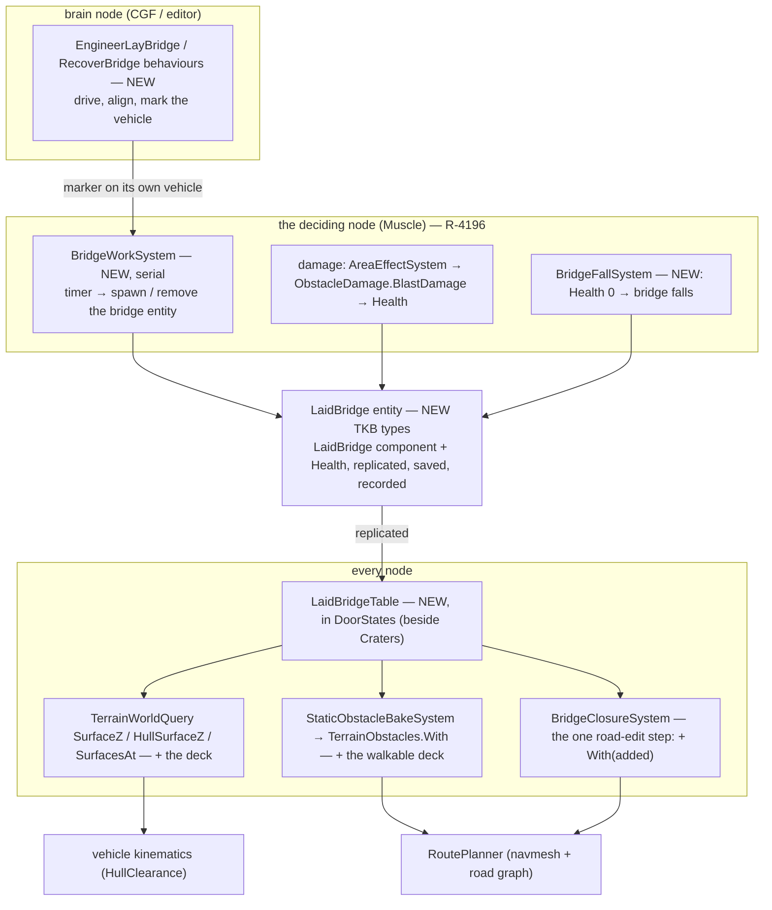
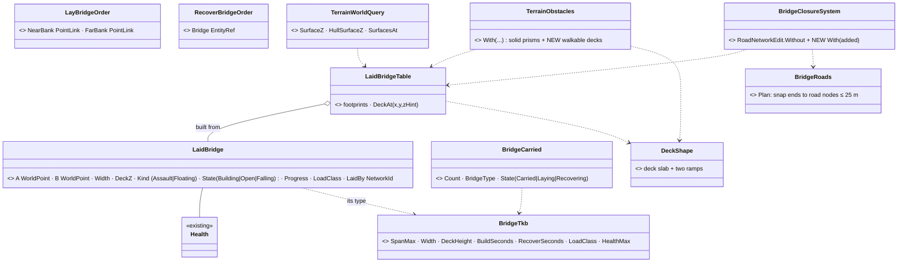

<!--STATUS
state: LIVE
updated: 2026-11-25
build-state: DESIGN — leans for the user (§9); an independent review is folded in §10
current-answer: §2 the diagrams · §3 the decisions · §9 the open questions with leans · §10 the review
stale-below: nothing
known-rot: none
known-conflict: none
related-designs:
  - ../../DESIGN_Terrain_Authoring.md — OWNS the authored Bridge feature (§8: deck slab + 6 m ramps, FeatureKinds) and the bridge roads (§18k-2 BridgeRoads, §18k-3 BridgeClosureSystem, §18k-4 the SUMO net); THIS reuses the deck shape and adds a run-time road ADD to the one road-edit step
  - ../../PLAN_Dynamic_Terrain.md — OWNS the run-time terrain changes (craters, breaches, trees, the obstacle bake P-7a); THIS adds a walkable contribution to that bake
  - ../../DESIGN_Ground_Patches_And_Road_Blockage.md — OWNS the road blockage step (§9.9 CE-4590, §9.11 CE-4591) the bridge's road add and cut go through
  - ../../DESIGN_World_Query_Seam.md — OWNS IWorldQuery (SurfaceZ / HullSurfaceZ / SurfacesAt); THIS adds the laid bridges as one more dynamic table under it
  - ../../DESIGN_Vehicle_Breaching.md — OWNS the engineer pattern (§7.6 the bulldozer: the brain marks, the Muscle writes); THIS follows it
  - ../minefields/DESIGN_Minefields.md — OWNS the other engineer task (§3f the lane, MF-9/10) and the place-knowledge save (§3d)
  - ../../DESIGN_Orders_Params_Entity_Classes.md — OWNS orders (§8 the receiver's resolution, §9 the routes and gestures); THIS adds LayBridge / RecoverBridge and a two-point pick
  - ../vehicle-appearance/DESIGN_Vehicle_Appearance_State.md — OWNS what a renderer is told about a vehicle (§6a openings); THIS adds the bridge carried / laid state
  - ../../DESIGN_Terrain_Import_UTM.md — §8 P3-a/b the per-tile navmesh versions that re-plan stale paths
-->

# Bridge laying — an engineer lays a bridge over a river; it can be crossed, recovered and destroyed

🔒 User, `2026-11-25`: *"bridge layer vehicle to be instructed to create a bridge over a river, temporary, removable and destroyable. HROT
entities need to be able to cross the river (sumo not necessary if not easy)"* · *"the vehicle was just a way to have someone to order to create
a bridge; no problem if it lays long ponton bridge for wider rivers"* · *"how will we let the navigation to find the path if we do NOT change the
navmesh? How will be allow vehicles to find out there is a solid floor"* · *"yes, write the design. and run an independent review"*.

⭐ **The decision in one line:** a laid bridge is an **ENTITY** (health, owner, saved, replicated, replayed like any entity); from it, the world
gets a **walkable deck** in the navmesh bake, a **surface** in the world query, and a **road segment** in the road graph — each through the seam
that already carries craters, breaches and roadblocks. The engineer vehicle is just whom you order.

## 0. The proven solution, and how ours maps to it

Armies cross gaps two ways: an **assault bridge** launched from a vehicle (AVLB-type, a short span of about 20–26 m, laid in minutes, under
fire, recovered from either end) and a **floating bridge** (ribbon / pontoon bays joined into a long span, tens of minutes, at a prepared site).
Both are one object that appears, carries a load class, can be destroyed, and can be taken away. ⇒ one entity type with per-type TKB values
(span, width, deck height, build time, recover time, load class) covers both; the "who" is an engineer vehicle with an order.
⚠ The real figures are to verify before they become TKB values (§9 Q-6).

## 1. INVENTORY — the queries run (`2026-11-25`)

| query | total | what it says |
|---|---|---|
| `search_graph name_pattern=".*(Bridge|River|Water|Ford|Crater|Breach|Overlay|OffMesh|NavRebuild|Bake).*" label=Class` | 175 (88 read) | `BridgeClosureSystem`, `BridgeRoads`, `BridgeNetBuilder`, `StaticObstacleBakeSystem`, `NavTileCache`, the crater / tree / building damage records |
| `search_graph name_pattern=".*(Engineer|Bulldozer|Clear|Obstacle|Breach|Lane|Bridge|Damage|Destroy).*" label=Class` | 313 | `ClearObstacleBehavior`, `ClearLaneBehavior`, `DozerCutSystem`, `ObstacleDamage`, `ObstacleRemovalSystem`, `BuildingDamage*` — no bridge layer, no AVLB, no pontoon |
| grep `AVLB|pontoon|bridge.lay` over `docs/` + `.dev/` | 0 relevant | ⛔ no earlier design |
| grep `HullSurfaceZ|\.SurfaceZ(` in motion / navigation | 12 call sites | ⭐ vehicle kinematics stand on `IWorldQuery.HullSurfaceZ` (`CarKinem/Controllers/HullClearance.cs:138,174,264`); roads and destinations on `SurfaceZ` |
| read `TerrainWorldQuery.cs`, `TerrainObjects.cs` (`DoorStates`) | — | the query layers per-view dynamic tables (craters, damage, trees, knowledge) over the static terrain |
| ⚠ `check_index_coverage` | — | not available through the CLI: the absence claims (no bridge layer, no run-time road add) rest on graph + grep |

## 2. The diagrams

### 2a. The module view — who runs what, on which node



*What the picture shows that prose hid: the brain never writes the world (R-4212) — it marks its own vehicle; ONE node writes the bridge entity;
EVERY node derives the same three things from it (surface, navmesh, road), so a late joiner or a replay gets them by construction.*
⚠ The Replay Browser and display nodes run no bake today (P-7a known gap): there the bridge is drawn and is a surface, but has no navmesh.

### 2b. The classes



*What the picture shows that prose hid: ONE deck shape (the authored bridge's, lifted to share — never a second shape-builder), read by both
the bake and the query; the road add goes through the ONE road-edit step that today only removes.*

### 2c. The sequence — lay, cross, fall

```mermaid
sequenceDiagram
  participant O as order (menu / RTS / HTTP / LLM seat)
  participant B as brain: LayBridge behaviour
  participant M as Muscle: BridgeWorkSystem
  participant E as LaidBridge entity
  participant N as every node: table → query, bake, road
  participant V as a tank
  O->>B: LayBridge(near bank, far bank)
  B->>B: refuse if the gap over water > SpanMax (a reason)
  B->>B: drive to the near bank, align
  B->>M: BridgeCarried.State = Laying (its own entity)
  M->>E: spawn, State Building, Progress 0 → 1 over BuildSeconds
  E->>N: State Open
  N->>N: table + deck surface · bake dirty tiles (≈ 0.2–2 s) · road With(added)
  V->>N: route: navmesh across the deck / road over it; hull stands on HullSurfaceZ = deck
  Note over E: explosives → Health 0
  E->>N: State Falling → removed
  N->>N: table − · rebake · road cut · stale paths re-plan
```

## 3. Decisions (leans — for the user's nod, §9)

| # | decision | why |
|---|---|---|
| BL-1 | ⭐ **the laid bridge is an ENTITY** with `Health`, owned by the deciding node | targeting, damage, save, replication, replay and late join come with entities; a terrain record would need each built again |
| BL-2 | ⭐ **one deck shape** — the authored bridge's (`FeatureKinds.cs:232-259`), lifted to a shared function used by the authoring compile, the bake and the query | ruling 9: never a second implementation |
| BL-3 | **the navmesh**: the obstacle bake gains WALKABLE contributions (deck + ramps) beside its solid prisms; only the dirty tiles rebake; stale paths re-plan by the tile versions | the existing seam (P-7a); ⚠ the run-time join of deck to banks is UNMEASURED (§9 Q-1) |
| BL-4 | **the floor**: `LaidBridgeTable` in `DoorStates`; `TerrainWorldQuery.SurfaceZ / HullSurfaceZ / SurfacesAt` answer the deck inside its footprint near deck height | vehicles stand on `HullSurfaceZ`, men on `SurfaceZ`; sight, fire and drones ask the same query |
| BL-5 | **the road**: `BridgeClosureSystem` gains `With(added)`; the ends snap by `BridgeRoads.Plan` (≤ 25 m to a road node) | the ONE road-edit step; a bridge with no road nearby is navmesh-only |
| BL-6 | **SUMO out of v1** | SUMO cannot add an edge at run time; later: pre-built closed edges at likely sites, opened |
| BL-7 | **the engineer pattern**: the brain sets `BridgeCarried.State` on its own vehicle; the Muscle's `BridgeWorkSystem` spawns / removes the entity | R-4212 (write only your own entity) and the bulldozer / mine-clearer precedent |
| BL-8 | **real `[Order]`s** `LayBridge` / `RecoverBridge` with a NEW two-point pick (near bank → far bank) | the first engineer tasks offered as orders (ClearObstacle / ClearLane are behaviour names only) |
| BL-9 | **refuse a gap longer than the type's span**, measured over the water polygons along the line; refuse a bank where no deck end stands on ground | a reason the order route returns, never a bridge into the river |
| BL-10 | **damage**: the obstacle blast law (`ObstacleDamage.BlastDamage`, explosives by kg and distance); bullets never | the existing law; ⚠ heavy HE and AT rounds: §9 Q-4 |
| BL-11 | **the fall**: Health 0 ⇒ `Falling` for a short beat ⇒ removed; a vehicle or man on it then has water under him | ⚠ what happens to him: §9 Q-3 |
| BL-12 | **recovery**: the engineer at either end, over `RecoverSeconds`; the entity removed, `BridgeCarried.Count` back | the doctrine's "recover from either end" |
| BL-13 | **load class** on the bridge and a weight class on the vehicle: a too-heavy vehicle is refused the deck (a navmesh area flag / road access) | ⚠ v1 or later: §9 Q-5 |
| BL-14 | **appearance**: `BridgeCarried` and `LaidBridge.State/Progress` go to renderers (the look library) | the external IG draws the bridge being laid |
| BL-15 | **authoring**: a scenario may place a `LaidBridge` entity already Open; it saves as an entity | no new save section |

## 4. Rejected — one line each

- **A terrain record like a crater** — it needs its own record, save section and targeting; the entity has them.
- **The editor's live overlay on every node** — editor-only by design and a whole-overlay rebuild per bridge.
- **Recast off-mesh links for vehicles** — used only for jumping men; no width, no surface for the hull.
- **A second deck shape for laid bridges** — two shapes for one concept drift (ruling 9).
- **SUMO road edges in v1** — no run-time edge add in SUMO; not needed for HROT's own units.

## 5. Slices

| slice | builds | done when (scenario checks) |
|---|---|---|
| **BL-S1** the bridge itself | `LaidBridge` + TKB types, `LaidBridgeTable`, the shared deck shape, the query's deck, the walkable bake, the road add; a scenario-placed bridge | `bl-placed-bridge`: a squad and a tank cross a river on an authored laid bridge and fail to cross without it |
| **BL-S2** destroy | the blast damage, the fall, the road cut, the rebake | `bl-blow-the-bridge`: a demolition charge drops it; a tank ordered across re-plans or stops at the bank |
| **BL-S3** the engineer | the engineer types, `BridgeCarried`, `LayBridge` / `RecoverBridge` orders and behaviours, the two-point pick, the gap refusal | `bl-assault-crossing`: an engineer lays an assault bridge under smoke, a platoon crosses; `bl-recover`: it is taken back and the river is a barrier again; `bl-too-wide`: refused with a reason |
| **BL-S4** floating bridge | the floating type (long span, deck near water) | `bl-floating-bridge`: a wide river crossed |
| later | SUMO edges, load classes, appearance in the IG | — |

## 6. Rules this respects

- **R-4212 parallel**: the brain writes only its own vehicle; one serial Muscle system writes the bridge.
- **Recorded components are unmanaged**: `LaidBridge` and `BridgeCarried` are fixed-size.
- **Hot path**: the table is rebuilt on a bridge change, never per frame; the query's deck test is a footprint check (0 B).
- **R-4277**: every slice ships its scenarios with machine checks.
- **R-4295**: the wire carries its own bridge types; translators convert.

## 9. Open questions — with leans

| # | question | ⭐ lean |
|---|---|---|
| Q-1 | ⚠ does a deck baked at RUN TIME join the banks in Recast as the compiled authored bridge does? | measure FIRST in BL-S1 (a rail: a path exists bank to bank after the bake); if not, the bake must take the deck as input geometry of the same tile set as the banks |
| Q-2 | which lane | terrain (the bake, the query, the road) builds BL-S1/S2; BL-S3's behaviours with backend, cross-lane allowed |
| Q-3 | a man or vehicle on a falling bridge | v1: he falls with it — a man into the water is out of the fight, a vehicle is destroyed; nothing swims |
| Q-4 | what can damage it | explosives by the blast law; heavy HE (artillery, bombs) through the same law; AT rounds later |
| Q-5 | load class in v1? | later — one class "takes everything" in v1 |
| Q-6 | the real figures (span, width, times, class) of an assault and a floating bridge | from open sources, recorded in the TKB with the source, before BL-S3 |
| Q-7 | the two-point pick on the map | the ui lane's gesture; HTTP and the LLM commander's seat take two named places / points from the start |

## 10. Independent review

*(to be folded in — `2026-11-25`)*
