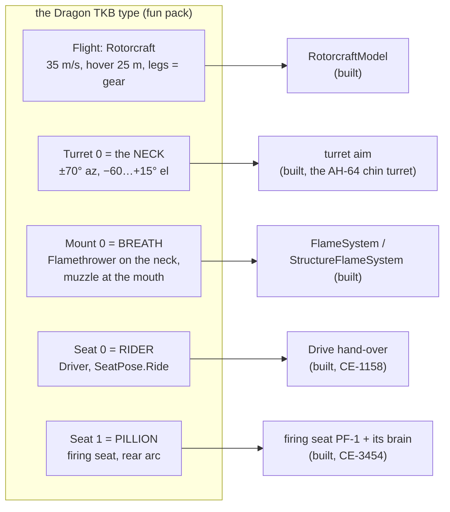
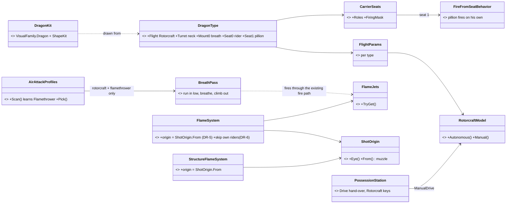
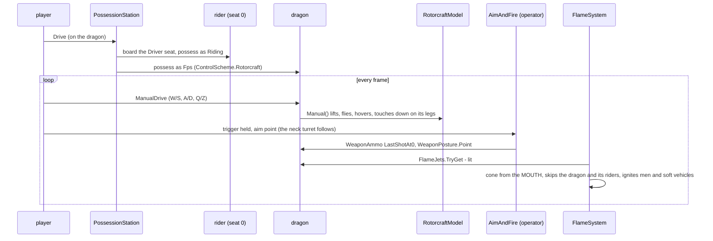
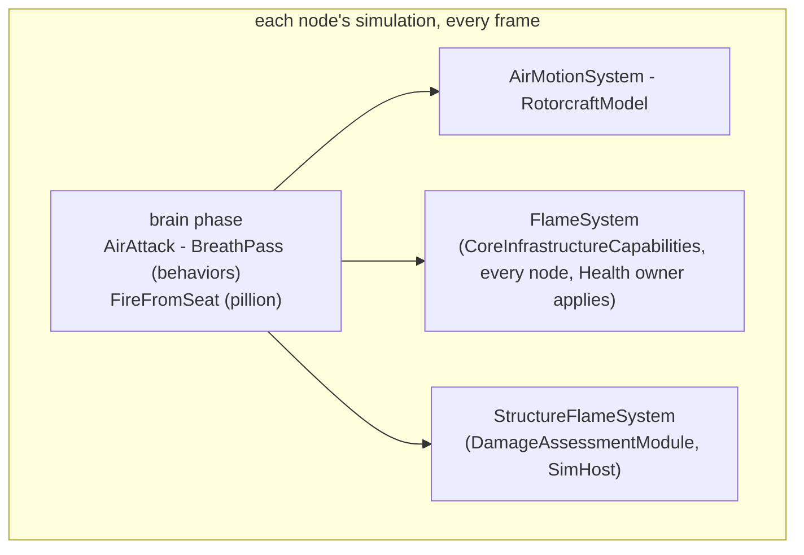
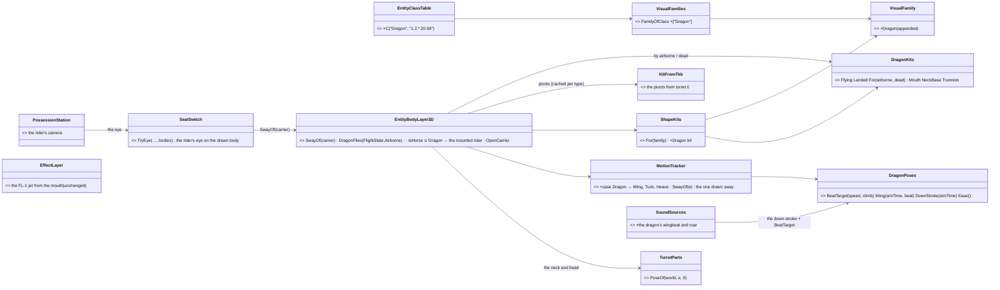
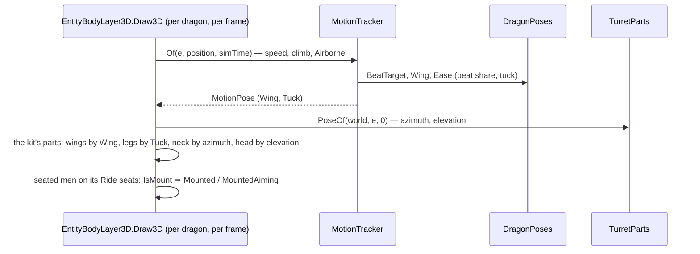

<!--STATUS
state: LIVE — ✅ APPROVED 2026-11-19 (R-3112); nothing built — D-1 next; DR-8 (the attack pattern) to be DESIGNED (CE-3490)
updated: 2026-11-19
build-state: BUILDING — ✅ D-1 BUILT (§7); ✅ D-2's breath attack BUILT (CE-3490, DESIGN_Breath_Attack §7); ✅ D-4 the look BUILT (ui, §8); READY-TO-BUILD D-3, D-5
current-answer: §0 the picture · §2 decisions DR-1…DR-12 (approved R-3112) · §3 UML · §5 slices and scenarios · §7 D-1 as built · §8 the look (ui, D-4)
stale-below: none
known-rot: none
known-conflict: CE-4634's row says "the bird model scaled up" — this design leans to the ROTORCRAFT model instead (DR-1, the user's "a helicopter in disguise"); the row is updated with it
related-designs:
  - ../air-attack/DESIGN_Breath_Attack.md — OWNS the dragon's autonomous attack (DR-8 → BA-1…BA-10, CE-3490); D-2 builds it
  - BACKLOG_Fun_Ideas.md — F-11, the wish this designs (CE-4634: zeppelins and dragons, rideable); the zeppelin stays there
  - ../weapons/DESIGN_Flame_Weapons.md — OWNS the flame (FlameJets, FlameCone, Ignition, FlameSystem, StructureFlameSystem); the breath is its F-11 carrier — this design adds only where the jet LEAVES (DR-5) and the carrier's riders (DR-6)
  - ../air-attack/DESIGN_Air_Operations.md — OWNS the helicopter: RotorcraftModel (§5b take-off / route / landing, §6b the manual hover), the air orders and attack profiles (§9c–§9i) — the dragon is one more rotorcraft; this adds one profile (DR-8)
  - ../vehicle-tactics/DESIGN_Motorcycle.md — OWNS the firing seat (PF-1…PF-3) and riding pillion as a player (PL-2, PL-3) — the dragon's pillion is that seat
  - ../animals/DESIGN_Animals.md — OWNS riding (AN-8: a mount is a carrier with a SeatPose.Ride rider seat; the Drive hand-over) and the bird (BirdFlightModel, not used here — DR-1)
  - ../motion-models/DESIGN_Motion_Domains.md — MD-D one ManualDrive for every domain; MD-H the rotorcraft model
  - ../vehicle-appearance/DESIGN_Vehicle_Appearance_State.md — §7 the look library the breath's effect and the dragon's family go through (ui)
-->
# DESIGN — the dragon: a helicopter in disguise that breathes fire *(backend, `2026-11-19`, CE-4634)*

> 🔒 **User, verbatim:** *"an entity that can fly and land, pretty much something like a helicopter, and can be possessed, and the player could be
> sitting on it in a similar way how the dragons in the Games of Thrones series. So the dragon should be similar size and should fire flames … it's
> basically just a helicopter in disguise with dragon breath weapon, including the autonomous behaviors."* · *"having a passenger seat like on a
> motorcycle so that the passenger can fire … his own weapon independently on the dragon."*
> 🔒 **User, `2026-11-19` (R-3112):** *"Dragon approved."* · *"record a task that we need to design the attack pattern for the dragon and helicopter
> with dragon breath for autonomous attack."* ⇒ DR-8 below is a STARTING POINT, not the decision: the autonomous breath attack (dragon and a flame
> helicopter alike) gets its own design first — [CE-3490](../../blueprints/Blueprint_Issues_Tracker.md). The UI lane has the look:
> [NOTE_Backend_To_Ui_Dragon_Visuals.md](../../blueprints/batches/NOTE_Backend_To_Ui_Dragon_Visuals.md).

## 0. The picture

*What the picture shows that prose hid:* every box under the type is an existing mechanism. The dragon is DATA — one TKB type — plus four small
gaps (§1): where the breath leaves, the riders inside their own breath, an attack run at breath range, and the look.

## 1. INVENTORY — what exists *(measured `2026-11-19`)*

Queries run: `search_graph name_pattern=.*Rotorcraft.* / .*Heli.* / .*Bird.* / .*Rider.* / .*Possess.*` (label Class; totals 2 / 8 / 3 / 9 / 24,
`has_more:false`), plus grep over `docs/` and `.dev/` for *dragon*, *rotorcraft*, *helicopter*, *pillion*. ⚠ `check_index_coverage` is not available
through the CLI, so the absence claims below rest on graph + grep.

| piece | exists | where |
|---|---|---|
| hover / fly / take off / LAND on gear, autonomous and manual | ✅ | `RotorcraftModel.cs:48-158` (route Ground waypoint lands, `TouchDown :332`; manual: `Vertical > 0` lifts, descending on gear touches down `:153`) |
| a rotorcraft type: flight params, turret, mounts, health, armour, brain | ✅ | `NedTkbCatalog.DefineAttackHelicopter :1869-1926` (AH-64, TKB 406: chin turret ±110°, mount on `TurretIndex 0`) |
| possessing a rotorcraft (W/S fly, A/D turn, Q/Z up/down, 1-4 pick mount, fire) | ✅ | `PossessionStation.cs:1102, :1512` (`ControlScheme.Rotorcraft`); `AimAndFireExecutor.OperatorFire :349` |
| the rider: *Drive* boards the Driver seat, rides him (`Riding`), then possesses the mount as `Fps` | ✅ any carrier | `PossessionStation.StepHandOver :325-360` — keyed on `SeatRole.Driver`, not on horses |
| a firing seat: its man keeps `CanShoot`, fires his own weapon inside the seat's arc; the AI rule; the player riding it (*Board*) | ✅ | Motorcycle §9 PF-1…PF-3, `CarrierStations.FiringMask`, `FireFromSeatBehavior`; PL-2 out-of-arc HUD `PossessionStation.cs:944-960` |
| air orders: Move, Strike, Attack, ArmedSearch, route with holds | ✅ | `AirOrderBehaviors.cs`, `AirAttackBehaviors.cs`, `AirArmedSearchBehavior.cs` |
| the flame: a jet off the burst record, cone, ignition, buildings | ✅ | `FlameJets.TryGet`, `FlameSystem`, `StructureFlameSystem` (FL-1…FL-4) |
| an aircraft never catches fire | ✅ by construction | `Ignition.Of :58` — `IsAircraft ⇒ Kind.None` |
| ⛔ the jet leaves the MOUTH | ⛔ it leaves the body's EYE | `FlameSystem :63` reads `ShotOrigin.Eye` (body centre + eye height) — 10 m behind a dragon's mouth |
| ⛔ a carrier's riders kept out of its own jet | ⛔ only `target == thrower` | `FlameSystem :66` |
| ⛔ an AI attack with a flame-only rotorcraft | ⛔ no profile | `AirAttackProfiles.Scan :244-250` sees bombs, rockets, guns — never `Flamethrower` ⇒ `Pick` returns null ⇒ the attack order fails |
| ⛔ a dragon look | ⛔ | `VisualFamily` / `ShapeKit.For :861` / `MotionTracker`; the rider is drawn seated only on a horse (`EntityBodyLayer3D.cs:1469`) |
| a player's held trigger lighting a FLAME on a possessed body | ⚠ unmeasured | the operator path is per-category (`WeaponBrainProfiles.For`); FL-1 / FL-2 were proved on the AI path only ⇒ slice D-1 measures it first |

## 2. Decisions — each with a lean *(for the user's approval)*

| # | question | ⭐ lean | rejected — the one fact that killed it |
|---|---|---|---|
| **DR-1** | the flight model | ⭐ **`LocomotionClass.Rotorcraft`, `RotorcraftModel` unchanged** — per-type `FlightParams`: 35 m/s, climb 8, turn 60°/s, accel 5, hover 25 m; four leg contacts are its gear, so it lands and takes off as a helicopter does | `BirdFlightModel` (CE-4634's first idea) — it cannot hover, has no manual mode (`:109` a deliberate no-op), and lands only by snapping onto a point. A new `Dragon` class — every rotorcraft branch (possession scheme, attack profiles, radar, motion) would need it added (one-implementation rule) |
| **DR-2** | it is an AIRCRAFT to the rest of the world | ⭐ **yes** — radar and air defence see it (a ZU-23 or a SAM engages a dragon: the fun is real), it is heard; and `Ignition.Of` makes it **fireproof** by construction (GoT dragons are) | a creature class outside air defence — loses the fun and needs its own branch everywhere |
| **DR-3** | size | ⭐ **GoT's grown dragon**: body 20 m nose to tail, wingspan 26 m, standing 6 m; health 1 500, armour 10 mm front / 6 mm sides (rifle fire does little, a 23 mm gun or a missile hurts) | — |
| **DR-4** | the breath | ⭐ **mount 0, a `Flamethrower` on TURRET 0 — the NECK** (±70° azimuth, −60…+15° elevation), its muzzle at the mouth; its fuel a TKB munition *dragon fire*: range 50 m, half-angle 9°, intensity 1, burns 60 s; a 600-shot pool (≈ 60 s of breath) | a fixed forward breath — the neck turret is the AH-64 chin turret already, and lets him breathe on what is under him while hovering |
| **DR-5** | where the jet leaves | ⭐ **the muzzle, when the type places one** — `FlameSystem` / `StructureFlameSystem` read `ShotOrigin.From` (the mouth) instead of `ShotOrigin.Eye`; the sight line from there. ⭐ The flame tank's nozzle gains the same | keep the eye — the cone would start 10 m inside the dragon |
| **DR-6** | riders and their own breath | ⭐ **a carrier's embarked men are never in its own jet** (one line beside `target == thrower`) | rely on geometry — true today, but a rider leaning into a neck-down breath is one turret pose away from burning |
| **DR-7** | the seats | ⭐ **seat 0 RIDER** — `SeatRole.Driver`, `SeatPose.Ride`, at the base of the neck; he steers and his hand is the breath (the dragon's mount), NOT a firing seat. **Seat 1 PILLION** — a firing seat (PF-1) behind him, arc 100…260° (both flanks and the rear), its man fires his own weapon, AI or player | rider fires his own rifle too (as on a horse, R-4269) — ⏸ v2: one man cannot aim a neck and a rifle; the pillion is the gun |
| **DR-8** | the AI attack — ⭐ **DESIGNED in [DESIGN_Breath_Attack.md](../air-attack/DESIGN_Breath_Attack.md) (CE-3490): a strafing `BreathPass` + a `BreathHover` for buildings** — the lean below was its starting point | ⭐ **a new profile `BreathPass`** for a rotorcraft whose only weapon is a flamethrower: run in at 15 m above ground, slow to 8 m/s inside 60 m, the neck tracks the target, breathe while it is in the cone (the existing fire path), pass over and climb out to 60 m; repeat while men are seen. `Scan` learns `Flamethrower`; `Pick` returns it | RunningFire — it runs in at 60 m above ground, out of a 50 m breath |
| **DR-9** | its brain | ⭐ **the attack helicopter's brain** — `AirPlatformMove`, `AirPlatformAttack` / `Strike` (→ `BreathPass`), `AirArmedSearch` (hunt an area), a route with a Ground waypoint to LAND (perch); the dragon is its own crew like the AH-64 — it flies with no rider | a dragon-only behaviour tree — the air behaviours already do every verb the user named |
| **DR-10** | the player | ⭐ **three ways, all built mechanisms**: ① *Drive* — boards the rider seat, flies it with the helicopter keys, the fire key breathes; ② *Board* the pillion — fires his own weapon in the arc while the AI (or another player) flies (PL-2 / PL-3); ③ possess the dragon directly (no man) — the same keys | — |
| **DR-11** | the look *(ui lane)* | ⭐ **`VisualFamily.Dragon` + a `ShapeKit`** of box parts (body, neck on the turret's pose, head, tail, legs, two wings on flap pivots); wing beat ≈ 1 Hz in climb / slow flight, glide at speed, folded when landed; the rider drawn seated for any `SeatPose.Ride` carrier (no longer horse-only); the breath's effect is the flame look already built. ⭐ A mockup first (R-4143), ui's | a skeletal mesh — the engine draws procedural part kits only |
| **DR-12** | where it lives | ⭐ **the fun pack (R-4281)**: the type in `FunTkbCatalog`, scenarios in `scenarios/fun/dragons/`; every engine change above (DR-5, DR-6, DR-8, the ridden-pose generalisation) is shared engine code | — |

⭐ **The proven solution for this problem class:** games build a rideable flying creature as a VEHICLE with a creature's skin — a hover-capable flight
controller, a seat for the pilot, a weapon on a turreted head, gunner seats. ⭐ We adopt it because every part already exists here as a vehicle part.

## 3. UML

*What it shows:* three NEW boxes (the type, one profile, the kit) and two edits to built ones (`Scan`/`Pick`, the flame's origin and riders);
nothing else is touched.

*What it shows:* the player's breath reaches the flame through the SAME operator fire path as a helicopter's gun — ⚠ the one step not yet measured
for a flame (slice D-1 opens with it).

*What it shows:* every system the dragon needs is already registered on every host that runs the flame and the helicopter today; nothing new is
scheduled, so nothing can be unreachable on a host.

## 4. The numbers

| | dragon | AH-64 (for scale) |
|---|---|---|
| length / span | 20 m / 26 m wings | 17.7 m / 14.6 m rotor |
| top speed · climb · turn | 35 m/s · 8 m/s · 60°/s | 80 · 12 · 40 |
| hover height (autonomous) | 25 m | 30 m |
| health · armour | 1 500 · 10 / 6 mm | 800 · 8 / 6 mm |
| weapon | the breath, 50 m, 9° half-angle, ~60 s pool | gun + 38 rockets |
| heard | a beast's roar + wingbeat, 1.5 km (the flame roar exists) — its own `AcousticSignatureDto` (a wingbeat moving class, a `Roar` class), so the rotor fallback never applies; the sounds themselves are ui's (the NOTE) | rotor, 3 km |

## 5. Slices and scenarios *(each scenario = checks.json `expect` rows + a golden, R-4277)*

| slice | lane | builds | scenario — what it proves |
|---|---|---|---|
| **D-1** the beast | backend | ⚠ first: measure the operator trigger on a flame (fix the path if dark); the type (DR-1…DR-4, DR-7); DR-5 the mouth; DR-6 the riders; the sound | `dr-dragon-flight` — takes off, flies a route, LANDS on its Ground waypoint, takes off again (`Airborne` 1 → 0 → 1) · `dr-dragon-breath` — a `FireAtPoint` order: the men in the cone burn, the man behind a brick wall does not, the pillion rider is never burnt by his own dragon, a hostile flamer cannot burn the dragon |
| **D-2** the hunt | ✅ exp/agg-backend `2026-11-19` (R-8012) — DR-8 the breath attack BUILT ([DESIGN_Breath_Attack.md](../air-attack/DESIGN_Breath_Attack.md) §7; `dr-dragon-attack` / `-village` / `-holds` pass); DR-9 the brain's verbs still open | ⏸ after CE-3490's design: DR-8 the breath attack; DR-9 the brain's verbs | `dr-dragon-attack` — `AirPlatformAttack` on a squad in the open: the dragon runs in, burns it, climbs out; a squad 200 m off untouched · `dr-dragon-village` — a timber house set alight by the breath (FL-4), a brick one never |
| **D-3** the gunner | behaviors | the pillion's arc on a flyer (`InStationArc` from a moving, tilting body) | `dr-pillion-fires` — the dragon overflies an enemy squad on a route; its AI pillion opens fire inside his arc only; the rider never fires |
| **D-4** the look | ui | DR-11, mockup first | rails on the kit (wing pose by speed, folded when landed, rider seated) |
| **D-5** air defence *(fun)* | behaviors | none expected — DR-2 | `dr-shoot-the-dragon` — a ZU-23 engages a dragon flying past (it is an aircraft), it is hurt and lands or falls |

⭐ The player cases (*Drive* and fly, *Board* the pillion and fire) are rails in D-1 / D-3 — a scenario has no player.

## 6. What would change the leans

- **DR-1** flips to a bird-derived model only if the user wants dragon-like *gliding* physics (stall, dive speed) over helicopter handling.
- **DR-7**: if the user wants the RIDER to fire a weapon of his own too (a lance, a crossbow), the rider seat becomes a firing seat and the breath
  moves to a second trigger key — an input change on the possession station, ui's.
- **DR-2**: if dragons should be invisible to radar (a creature, not a machine), that is one exception in the radar's target filter.

## 7. D-1 as built *(backend, `2026-11-19`; where it differs from the plan above, ⭐ this wins)*

| piece | as built |
|---|---|
| the type | `TkbEntityTypes.Dragon` = **411** (the aircraft block, free on every lane), `FunTkbCatalog.DefineDragon` with the vehicle builder (R-4281: fun content in the fun catalogue): `LocomotionClass.Rotorcraft`, `FlightParamsDto` 35 m/s · climb 8 · turn 60°/s · hover 25 m · accel 5; a 20 × 26 × 6 m body with four LEG contacts (wheel kind) at −3 m; DIS **1.2.0.20.99** (`FunTkbCatalog.DragonDisSubcategory`: the attack-helicopter class for the air orders, 99 tells the look it is a dragon); health 1 500, armour 10 / 6 / 6 / 6 mm; radar 20 m² |
| the breath | mount 0 `Flamethrower` on TURRET 0 (the neck: pivot 5 m ahead, 4 m to the head, ±70°, −60…+15°), muzzle 1.5 m past the head; 600 shots at 10 a second; its fuel `MunitionTkbCatalog.TkbDragonFire` **6072** ("dragon fire": 50 m, 9°, intensity 1, burns 60 s) |
| the seats | `FunTkbCatalog.DragonSeats`: seat 0 Driver, `SeatPose.Ride` (3 m ahead, 2.4 m up — not a firing seat); seat 1 Passenger, `SeatPose.Ride`, a firing seat 100…260° |
| the sound | `SoundSourceClass.Roar` = **10** (new, appended): its moving sound at 1.5 km; its fire the flame's (`Flame`, 300 m). The hearing gizmo draws it red (ui's file, one line) |
| DR-5 the mouth | `FlameJets.Origin` — `ShotOrigin.From` (the muzzle when the type places one, else the eye); read by `FlameSystem` and `StructureFlameSystem`. ⚠ the flame TANK's jet now starts at its nozzle too (its scenarios re-run, §7 gates) |
| DR-6 the riders | `FlameJets.RidesOn` (the man's `IsEmbarkedTag.VehicleEntity` is the thrower) ⇒ skipped by `FlameSystem` |
| the player's breath | ✅ measured by reading: the operator path (`AimAndFireExecutor.OperatorFire`) goes through the SAME `TurretPath` / `ShootAtPoint` as the AI's `FireAtPoint`, which lights the jet in `dr-dragon-breath` and lit the flame tank's in `fl-clear-the-bunker`; ⏳ a possessed-dragon rail is D-3's (the player cases) |
| ⚠ found | `LineOfFire.NeutralInFlame` (the AI's Protocol III hold) measures from the body's centre in 2-D — ~9 m short on a dragon; left to CE-3490 (the AI attack's design), noted there |
| ⭐ found by the parallel checks | `dr-dragon-breath` under `HROT_READ_CHECK=1` THREW: the threat phase (`ThreatEvaluationSystem`) reads a remembered AIRCRAFT's `FlightState` (`AirContacts.IsAir` → `FlightGround.OnTheGround`) undeclared — ⚠ true of ANY aircraft a ground unit remembers (the AH-64, a drone), latent because no air scenario had run under the read check. ✅ `FlightState` declared as the phase's stable read (only the motion model writes it, never inside the phase); both dragon scenarios then pass under the checks with the same golden |
| the catalogue | `EntityTypeCatalogTests.CE2138_*` (ui's file) gains 411 — listed as family `AttackHelicopter` until ui's `VisualFamily.Dragon` (the NOTE) — and the four earlier backend types it lacked since they were added (117 flame tank, 215 thermal observer, 410 napalm A-10, 2022 flamethrower soldier): purely additive |
| rails | `FlameSystemTests.CE4634_TheJetLeavesTheMuzzle_*`, `CE4634_ACarriersOwnRider_*` (each red-proved: the origin back at the eye ⇒ red; the riders' test dropped ⇒ red) · `DragonTkbTests` ×3 (the type, the breath, the seats + sound) |
| scenarios | ✅ `scenarios/fun/dragons/dr-dragon-flight` — lifts off 0.25 s, lands on the meadow 25 s (on its legs), takes off again 33 s, reaches the last point 51 s · ✅ `dr-dragon-breath` — both field men burn at 1 s, Field Man 1 dies at 10 s, the bystander, the pillion and the dragon itself (a hostile flamer on its flank) are never hurt |

## 8. The look *(ui, D-4 — DR-11; CE-4634; NOTE_Backend_To_Ui_Dragon_Visuals.md; build-state: BUILT for the 3-D look — K, W, L, R, D; S (sound) and M (2-D symbol) are the next slice)*

📄 **Mockup (the acceptance spec, R-4138):** [`docs/UX/dragon-look.svg`](../../UX/dragon-look.svg) — `python3 scripts/gen-dragon-mockup.py`.

### 8.1 INVENTORY *(measured `2026-11-19`)*

Queries: `search_graph name_pattern=".*(VisualFamily|ShapeKit|BirdKit|HorseKit|AnimalPose|WingPose|Flap|RidePose|SeatPose|MotionTracker|RotorKit|HelicopterKit).*"` → 7
(`VisualFamily`, `ShapeKit` / `ShapeKits`, `AnimalPoses` + `Flap`, `MotionTracker`, `SeatPose`) · grep `VisualFamily.AttackHelicopter`, `SeatPose.Ride`, `IsHorse`,
`TwinEngineFighter`. ⚠ Index coverage cannot be checked through the CLI.

| piece | exists as | ⭐ the dragon reuses it as |
|---|---|---|
| the family key | `EntityClassTable` (DIS class per chain) → `VisualFamilies.FamilyOfClass`; 📌 the MiG-29: class `TwinEngineFighter` = `1.2.*.1.200` | class **`Dragon`** = `1.2.*.20.99` (backend's DIS, §7) → `VisualFamily.Dragon` (appended) |
| box-part kits | `ShapeKit(KitPart[], KitPivots)`, `ShapeKits.For(family)` · roles `Turret` (azimuth) / `Gun` (elevation) — the AH-64's chin gun | the NECK on `Turret`, the HEAD + jaw on `Gun`: turret 0's pose (`TurretParts.PoseOf`) |
| wings | `PartRole.WingLeft/Right`, flapped about `SwingPivot` by `MotionPose.Wing` (the bird's 6.5 Hz `AnimalPoses.Flap`) | the same roles; the dragon's OWN beat (§8.2 W) |
| legs | `PartRole.QuadFront/Hind*` swung by `QuadrupedGaits.LegAngle` + `MotionPose.Tuck` | planted landed, tucked in flight |
| the seated rider | `SeatPose.Ride`: a HORSE gives the mounted pose (`BlockFigure.Mounted` / `MountedAiming`, `EntityBodyLayer3D.cs:1332`, `IsHorse`); any other Ride carrier the motorcycle's `Riding` | **`IsMount`** = horse or dragon → the mounted pose; the motorcycle unchanged |
| the breath | the FL-1 flame jet (`EffectLayer.ResolveStateInto` U-1, from `MuzzleOf`) | unchanged — backend's DR-5 put the muzzle at the mouth |
| airborne / speed | `MotionTracker` (speed, climb), the flight state's `Airborne` | the wing and leg poses |
| sounds | `SoundSources` (the rotor fallback for `Rotorcraft`, `:383`), `SoundSynth` | the dragon's own (§8.2 S) |

### 8.2 Decisions *(⭐ leans — DR-11 approved R-3112; these are its details)*

| # | decision | why · rejected |
|---|---|---|
| **K-1** | ⭐ `VisualFamily.Dragon` keyed by a DIS CLASS (`Dragon`, `1.2.*.20.99`), appended to the enum | the one classifier (R-279) · ⛔ a type-id check in the layer |
| **K-2** | ⭐ **as built: TWO kits** (`DragonKits.Flying` / `.Landed`, `Map3D/DragonKits.cs`) of boxes in METRES on the TKB's numbers, in its 20 × 26 × 6 m box: body + belly + hump + saddle, the NECK (a new `PartRole.Neck`), head + jaw + horns (`Gun`), two tail boxes + a spade, four legs (Quad roles), two wings (Wing roles) spread — or folded along the flanks in the landed kit | the engine draws part kits only · ⛔ a mesh. ⛔ SUPERSEDED: *one kit, the neck a `Turret`* — `KitFromTkb` re-centres every `Turret` part ONTO the pivot (a neck reaches from the shoulders to the head), so the neck is its own role that only YAWS with turret 0; and a 12 m wing cannot fold by a rotation about the body's axis (it stabs the ground) — the perched bird's second-kit precedent |
| **W** | ⭐ the wing angle: BEAT ±33° at **1 Hz** while climbing (> 1 m/s) or slow (< 10 m/s) airborne; GLIDE +6° still at speed; FOLDED when landed (as built: the landed KIT, not a −80° rotation — K-2); a smooth 1 s blend between them; the phase on sim time × the sim's pace (paused ⇒ still, a replay draws the same) | DR-11 · ⛔ the bird's 6.5 Hz |
| **H** | ⭐ **the BOB** *(user, `2026-11-19`: "Helicopters are stable when in the air, but birds they oscillate vertically as they move their wings … the passengers and the view from the dragon moves up and down in sync … The motion model will keep constant altitude, just the visual model")*: while it beats, the drawn body rises and sinks ±0.4 m OPPOSITE the wings (`DragonPoses.Heave` — they sweep down and lift it); it fades with the beat into a glide and is 0 on the ground. ⭐ ONE owner — `MotionTracker.SwayOf(carrier)` (the motorcycle's bank folded in) — read by the drawn body, its seated riders and the rider's camera eye (`SeatSwitch.TryEye(…, bodies, …)`), so the three cannot drift apart | ⛔ in the motion model (the sim stays level, R-4277 scenarios unchanged) · ⛔ a camera-only shake (the view would bob against a steady dragon). ⚠ the possessed motorcyclist's eye now also moves with the bike's bank (it sat on the unbanked seat before) |
| **L** | ⭐ legs planted (0) when `Airborne = 0`, tucked back 70° (the quadruped's `Tuck`) in flight | DR-11 |
| **R** | ⭐ as built: `IsHorse` answers horse OR dragon (⛔ not renamed — a rename goes through Roslyn and buys nothing here), and `OpenCarrier` is true for the dragon (its possessed rider still sees it under him) — gives the mounted pose to any `SeatPose.Ride` seat on it; the pillion's firing seat aims as on a horse (`MountedAiming`) | 🔒 user: *"a passenger seat like on a motorcycle"* — but astride a neck, legs round it, is the horse's pose · ⛔ the motorcycle's upright pose on a neck |
| **D** | ⭐ dead: the body as it fell, wings spread flat (0°), legs folded, no fire (DR: fireproof) — as built: the flying kit with `MotionPose.Still with { Tuck = 1 }`, never the burnt-out wreck colour, the neck not aimed | — |
| **C** | ⭐ as built: dark red — the TKB's own `#7A1F1F` wins (the default colour is the same red); the mockup's green body is superseded | the TKB is the truth |
| **M** | ⭐ the 2-D symbol: FontAwesome `dragon` (U+F6D5) in the unit's colour, in the card's icon cell | the fun pack's style · ⛔ the helicopter glyph |
| **S** | ⭐ sounds by `SoundSources` from sim state: the wingbeat whoosh on each down-stroke (the W phase), the roar on the breath's start / take-off / a Health drop / seeded in flight, the dying roar; synthesized placeholders (`SoundSynth`) until a file is named | the note · ⛔ the rotor fallback |
| **S as built** *(`2026-11-19`, user: "Those sounds as in the design")* | ⭐ `SoundSources.Dragons` — a type whose own acoustic MOVING class is `Roar` (the TKB says so; never a type id): a **whoosh** (`DragonWhoosh` 7358, 400 m) at each down-stroke start of `DragonPoses`' sim-time beat, only while `DragonPoses.BeatTarget` says it beats (the look's own rule — the drawn blend is visual only); a **roar** (`DragonRoar` 7359, the TKB's 1.5 km) on take-off, a `Health` drop, a new breath (`FlameJets` burst) and a closed-form count in flight (about every 20 s, phase from its id), never two inside 3 s; a **dying roar** (`DragonDeathRoar` 7360) once. Synthesized placeholders (`SoundSynthesizer.DragonWhoosh` / `BeastRoar`) until a file is named. Its moving loop: none (the `Roar` class names no loop — gliding is silent, as the note asks: wind only) | ⛔ a roar LOOP · ⛔ the rotor fallback |

### 8.3 UML

*What the picture shows that prose hid:* nothing new draws the dragon — it is one more family through the same classifier, kit table, motion tracker and articulation the
AH-64 and the horse use; the only new code is the dragon's pose curves (one pure class both the look and the sound read, so a whoosh lands on the drawn down-stroke).

### 8.4 How it is judged *(R-4277; frame rails under `xvfb-run -a`)*

| rail | asserts |
|---|---|
| D-KIT | on its feet in the box, 26 m span spread / ~4 m folded, the kit's pivots = `KitFromTkb`'s, the snout at the TKB mouth |
| D-POSE | the neck yaws about its base with the aim, the head also nods, the body never turns |
| D-WINGS | `DragonPoses` + `MotionTracker`: beats at 1 Hz slow / climbing, glides still at speed, no wing landed (legs walk), tucked in flight, frozen when paused; 0 B |
| D-HEAVE | the bob: ±`HeaveM` opposite the wing stroke, steady gliding, none landed, held when paused, 0 B; in the frame rail the rider's eye on the drawn body minus the sim seat = the dragon's drawn bob |
| AUDIO | `AudioTests.Dragon`: a whoosh per down-stroke while beating (on the stroke), none gliding / landed, no rotor; roars on take-off / hit / breath, the 3 s quiet window, one death roar; ~5 idle roars in 100 s aloft, none landed; the clips audible, whoosh < roar < death |
| D-BREATH | the drawn mouth = `Muzzle.Posed` (the jet's origin) within 0.35 m over a grid of every aim the TKB allows |
| D-FAMILY | type 411 classifies as `VisualFamily.Dragon`, its kit is the dragon's (not the AH-64's) |
| D-FRAME | `DragonModelRail` — the mockup's states on a real frame (`dragon-*.png` to `HROT_RAIL_SHOTS`): landed with rider + pillion astride, bare landed, breathing (neck turned, head down), flying (two beat phases differ), gliding (still), dead |
| D-ALLOC | 0 B per steady frame with a dragon in view |
| scenario | backend's `dr-dragon-flight` / `dr-dragon-breath` (the sim) — the look adds no sim state |

