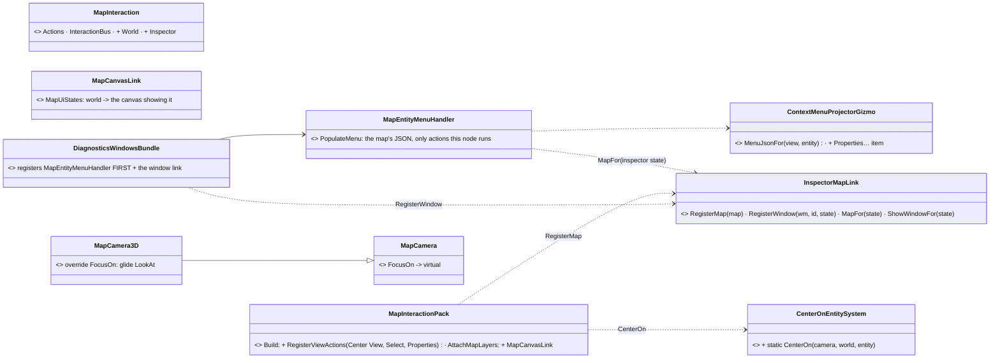
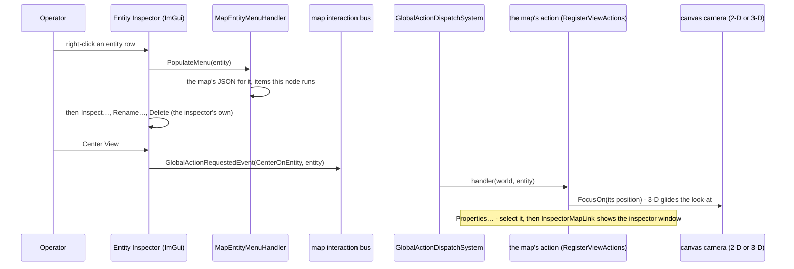
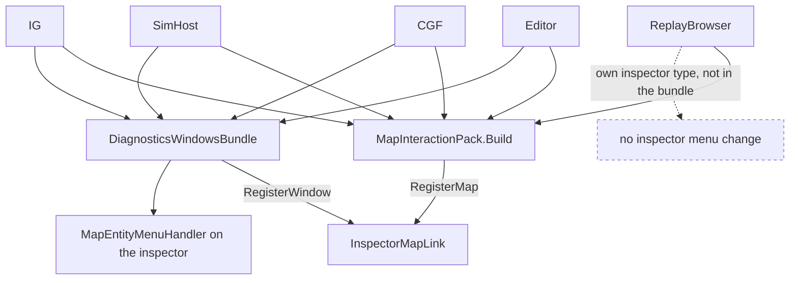
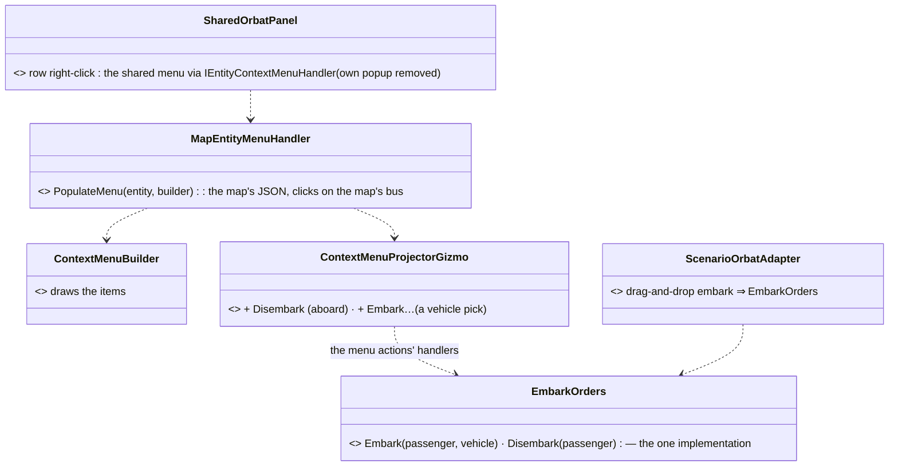
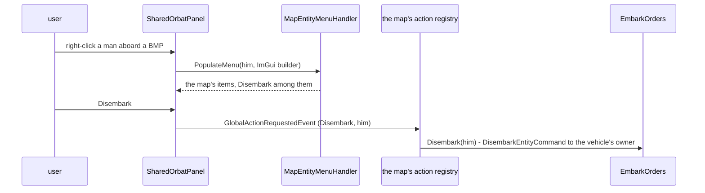
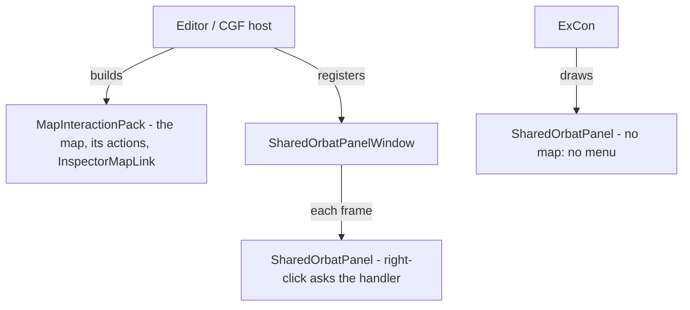
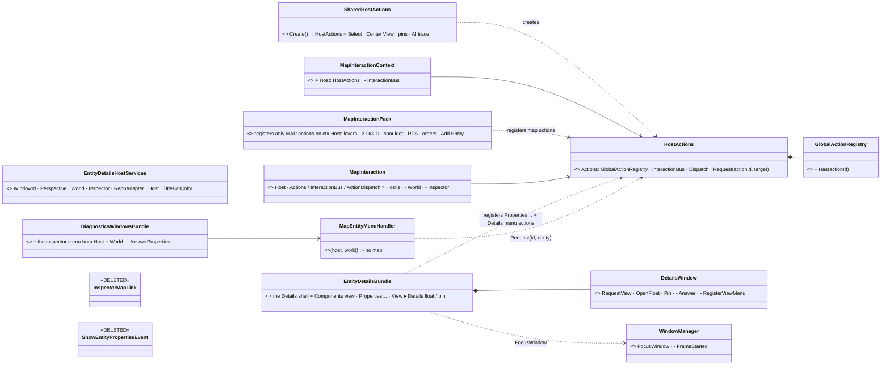
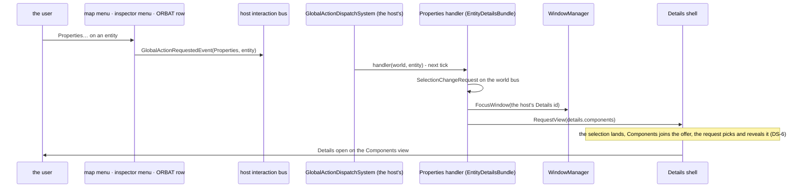
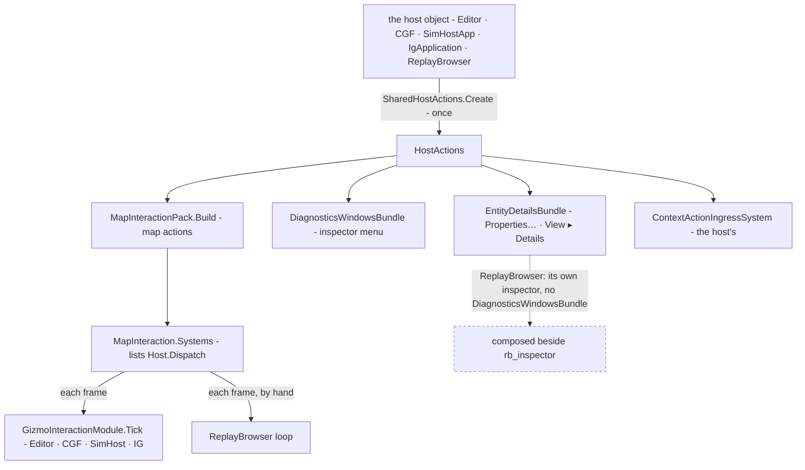

<!--STATUS
state: LIVE
updated: 2026-10-23 (§11.4 CE-1271 / CE-1272 fixes) · 2026-10-22 (§12 CE-1150 — host actions off the map; Properties… opens the Details panel on every ECS host)
current-answer: §1-§3 — the hit-test → interned JSON → popup path, which is what SimHost and the Editor
  run today for both canvas and entity right-click. ⭐ §10 (CE-1134 / CE-1135, 2026-10-16) — the ENTITY INSPECTOR's
  menu as built: the map's entity menu heads it on every host; Center View / Select / Properties… on every map host.
stale-below: §5.4 "the Inspector keeps JsonEntityContextMenuHandler, reading ContextMenuState" — SUPERSEDED by §10.
  §10 IM-4 (InspectorMapLink) and IM-5's Properties… half — SUPERSEDED by §12 (CE-1150).
known-rot: ⚠ The ENTITY menu projects items nothing handles. 📐 Measured 2026-09-12 (CE-259bi):
  ContextMenuProjectorGizmo.cs:46 offers "Move Here" (GlobalActionIds.MoveHere), "Engage" and "Stop" on a
  healthy unit, and NO host registers a handler for any of the three — so they are inert. ⚠ Note :60
  disables "Move Here" with a tooltip for a DEGRADED unit, which is what a deliberately unavailable item
  looks like ⇒ the healthy one is meant to work.
related-designs:
  - ../../blueprints/DESIGN_Details_Panel_View_Switching.md — the Details shell §8 (tabs / stacked, RequestView); §12 here opens it from Properties… on every host
  - global-action-system-design.md — §5.3 / §5.6: one registry per host, populated at the composition root (§12 HA-1)
  - ../../DESIGN_Subsystem_Composition_Unification.md — §5c.7 DiagnosticsWindowsBundle: registers the inspector window and, since §10 here, the map menu on it
  - ../../DESIGN_Map_3D_Mode.md — the 3-D camera Center View moves (§10: MapCamera3D.FocusOn)
  - ../../DESIGN_Add_Entity_Picker.md — adds the "Add Entity" item to the empty-map menu and the clicked point (CanvasContextMenuState.AnchorWorld) that §5.6 lacks
  - ../brain-death/BD1-DESIGN.md — owns the ROUTING RULE behind "Move Here" (brain-active ⇒ mission,
    brain-dead ⇒ direct muscle command). Its §2 put that rule on the raw right-click gesture THIS design
    now owns, so the rule is currently unhomed — see its known-rot.
-->

# Canvas & Entity Context Menus — Design Document

## 1. Context

The terminal supports right-click context menus on two surfaces:

1. Networked entities on the 2D map and in the Entity Inspector panel.
2. Empty map-space ("canvas") on the 2D map.

The entity flow already follows a clean preemptive projection pipeline. The empty-space flow does not — it currently uses a `GizmoContextMenuRequestedEvent` that bridges the raw input layer to the application shells' ImGui rendering loops. This document specifies the target architecture that eliminates that hack and unifies both flows under a single source of truth.

## 2. Problem with the Current Empty-Space Flow

`DebugGizmoLayer` is a domain-ignorant 2D projection and hit-testing surface. When the operator right-clicks an entity, it finds a pre-projected `ContextMenuBinding` primitive in the gizmo frame, resolves the JSON via the `StringInternMap`, and hands it to `ContextMenuAdapter` — zero round-trips, zero domain knowledge in the layer.

Empty space has no entity, therefore no binding. The current implementation short-circuits: `DebugGizmoLayer` packages the screen position and a pick token into `GizmoContextMenuRequestedEvent`, publishes it onto the interaction bus, and the application shells (`IgApplication`, `EditorSubsystem`, `CgfSubsystem`, `SimHostVisualization`) read it during their `Update` phase, stash deferred state in fields like `_pendingContextMenuEntity` and `_openContextMenuThisFrame`, and trigger hardcoded `ImGui.OpenPopup` calls during `DrawUI` via `SharedContextMenuPopulator`.

This is a hack for four concrete reasons:

- **Presentation coordinates leak into a semantic event bus.** `Vector2 ScreenPos` rides alongside the `PickToken` on a bus that is supposed to carry domain intents.
- **The UI talks to itself through the bus.** Both the publisher (`DebugGizmoLayer`) and the consumers (application shells) live in the presentation tier. The interaction bus is being used as a glorified callback delegate to bridge two halves of the UI.
- **Detached deferred state.** Because ImGui demands popup calls happen during the render phase, shells stash booleans in `Update` and read them in `DrawUI`. This split state machine is fragile and easy to desync.
- **Hardcoded fallback menus.** The fallback path reaches into `SharedContextMenuPopulator.PopulateEmptyMapMenu` and builds C# ImGui menus inline, completely outside the data-driven JSON pipeline that entities use.

The architectural defense for the hack is that `DebugGizmoLayer` stays ignorant of ImGui and domain logic. That goal is correct; the chosen mechanism is wrong.

## 3. Goals

- **One pipeline, one pattern.** Entities and empty space resolve through identical preemptive projection.
- **Single Source of Truth in the ECS domain.** Both the 2D map and the Entity Inspector consume the same per-entity / per-canvas menu definition through their own adapters; neither knows about the other.
- **Zero-latency UI.** No network round-trip and no event-bus relay between right-click and popup. Hit-test → JSON → popup.
- **Zero per-frame allocations on the hot path.** JSON is rebuilt only when domain state changes; the `StringInternMap` deduplicates strings via FNV-1a hashing.
- **Strict layer purity.** `DebugGizmoLayer` performs only spatial intersection. Gizmos do not know about ImGui. The Entity Inspector does not know about gizmos.
- **Eradicate `GizmoContextMenuRequestedEvent`.** The event, its registration, the shell read loops, and all hardcoded shell popups are deleted.

## 4. Architecture Overview

```
ECS Domain (SSOT)                   Adapters (Presentation)         Surfaces
─────────────────                   ────────────────────────        ────────
ContextMenuState (per entity)  ──►  JsonEntityContextMenuHandler ─► Entity Inspector (ImGui)
                               └──► EntityContextMenuGizmo ──┐
                                                              ├──►  DebugGizmoLayer ─► ContextMenuAdapter
CanvasContextMenuState         ───► CanvasContextMenuGizmo ──┘       (2D map ImGui popup)
  (managed singleton)
```

Domain systems running in `SystemPhase.Simulation` evaluate the world and write the menu JSON into ECS state. From there, two independent adapters serve two independent surfaces. Neither adapter touches the other surface's code, and neither surface knows the other exists.

The action return path is a single channel: when any surface fires a menu item, `GizmoMenuActionEvent` carries an integer `ActionId` over DDS; on the backend it becomes a `ContextActionTriggered` event consumed by domain dispatch systems.

## 5. Components

### 5.1 SSOT — ECS State

**`ContextMenuState`** *(existing, unchanged)* — managed component attached per entity. Holds `MenuJson : string`. Already populated by existing entity menu generation.

**`CanvasContextMenuState`** *(new)* — managed singleton. Holds `MenuJson : string`. Path: `Hrot/Engine/Hrot.IG/Components/CanvasContextMenuState.cs`.

```csharp
namespace Hrot.IG.Components
{
    /// <summary>
    /// Managed singleton acting as the Single Source of Truth for the
    /// empty-map-space context menu.
    /// </summary>
    public sealed class CanvasContextMenuState
    {
        public string MenuJson { get; set; } = string.Empty;
    }
}
```

### 5.2 Domain Update Systems

The entity menu update system already exists and is not changed.

**`CanvasMenuUpdateSystem`** *(new)* — runs in `SystemPhase.Simulation`, evaluates domain rules, serializes the JSON, and writes it into `CanvasContextMenuState`. The system caches its serialized JSON internally and only rebuilds when the relevant state hash changes. The exact same JSON written every frame is fine: the `StringInternMap`'s FNV-1a hash deduplicates and only allocates on a true cache miss.

For the initial cut, the canvas menu contains a single item: **Measurement Tool**, dispatched via the existing `GlobalActionIds.Measure` global action. Subsystem-specific items (e.g. *Place Entity* for the editor) can be added later without changing the architecture.

```csharp
[UpdateInPhase(SystemPhase.Simulation)]
public sealed class CanvasMenuUpdateSystem : IEcsModuleSystem
{
    private string _cachedJson = string.Empty;

    public void Execute(ISimulationView view, float deltaTime)
    {
        var repo = (EntityRepository)view;

        if (string.IsNullOrEmpty(_cachedJson))
        {
            var items = new List<ContextMenuItemDto>
            {
                new() { Id = GlobalActionIds.Measure, Label = "Measurement Tool", Icon = "measure" }
            };
            _cachedJson = JsonSerializer.Serialize(items, Options);
        }

        repo.SetSingletonManaged(new CanvasContextMenuState { MenuJson = _cachedJson });
    }
}
```

The system is registered in each subsystem's composition root (`EditorSubsystem`, `IgApplication`, `CgfSubsystem`) so each subsystem can install its own variant if needed.

### 5.3 Projection Gizmos (Adapters for the 2D Map)

These are the only adapters that bridge ECS state to the gizmo buffer. They are pure read-only, allocation-free per-frame projectors. They have **no knowledge of ImGui**, no domain logic, no JSON construction — they read state and emit `ContextMenuBinding` meta-primitives.

**`EntityContextMenuGizmo`** — `[GizmoProjector(typeof(NetworkIdentity), typeof(ContextMenuState))]`, runs per entity, projects a binding keyed by `NetworkIdentity.Value`.

**`CanvasContextMenuGizmo`** — `[GizmoProjector]`, global stateless, projects a single binding keyed by the well-known canvas anchor `CanvasAnchorId = -1L`.

```csharp
[GizmoProjector]
public sealed class CanvasContextMenuGizmo : IGlobalStatelessGizmo
{
    public const long CanvasAnchorId = -1L;

    public void Draw(ISimulationView view, IDebugDrawBuilder draw)
    {
        if (!view.HasSingletonManaged<CanvasContextMenuState>()) return;
        var state = view.GetSingletonManaged<CanvasContextMenuState>();
        if (string.IsNullOrEmpty(state.MenuJson)) return;
        draw.DrawContextMenuBinding(CanvasAnchorId, state.MenuJson);
    }
}
```

### 5.4 Entity Inspector Adapter

> ⛔ **SUPERSEDED `2026-10-16` by §10.** 📐 Measured: `ContextMenuState` is written on the IG alone (its `ContextMenuSystem`, from the
> received bindings), and only the Editor registered `JsonEntityContextMenuHandler` — so on every host the inspector's map items were
> missing, and each host hand-rolled its own "Center on entity" / "Select entity". The text below is the original intent; §10 is how it
> is met.

The Entity Inspector keeps its existing `JsonEntityContextMenuHandler`, which reads `ContextMenuState.MenuJson` directly off the entity and walks the JSON to build the ImGui tree. It does **not** read from the gizmo buffer. This is deliberate — the gizmo buffer is a transient, write-only projection surface; using it as a read source for application UI panels would couple domain state to the graphics pipeline and reverse the unidirectional flow.

Both surfaces consume the same `ContextMenuState.MenuJson`, so the menus are identical by construction.

### 5.5 Hit-Testing in `DebugGizmoLayer`

`HandleRightClick` resolves the click to an entity network ID, an anchor index, or — as a fallback for empty space — `CanvasContextMenuGizmo.CanvasAnchorId`. It then performs a single dictionary lookup against the bindings collected from the current frame, resolves the JSON via `_buffer.InternMap.TryResolve`, and schedules the popup via `ContextMenuAdapter`.

```csharp
private bool HandleRightClick(Vector2 worldPos)
{
    var frame = _buffer!.GetFrame();
    var menuBindings = new Dictionary<long, uint>();
    foreach (ref readonly var prim in frame)
        if (prim.Shape == DebugPrimitiveShape.ContextMenuBinding)
            menuBindings[prim.InspNetworkId] = prim.StringHash;

    var best = FindTopmostInteractivePrimitive(worldPos);
    long entityId = best?.InspNetworkId
                  ?? best?.AnchorIndex
                  ?? CanvasContextMenuGizmo.CanvasAnchorId;

    if (entityId != 0 && menuBindings.TryGetValue(entityId, out uint menuHash))
    {
        string? json = _buffer!.InternMap.TryResolve(menuHash);
        if (json != null)
        {
            _contextMenuAdapter.Schedule(entityId, json);
            return true;
        }
    }
    return false;
}
```

There is no fallback event emission. There is no presentation-tier branching for "entity vs empty space". The empty-space case is just the entity case with `entityId = -1L`.

### 5.6 Action Dispatch Flow

When the operator clicks a menu item on either surface, the popup adapter publishes `GizmoMenuActionEvent` carrying the integer `ActionId`. This event egresses over DDS and is unpacked on the backend as `ContextActionTriggered`. `ContextActionIngressSystem` resolves the network ID through `NetworkEntityMap`; for the canvas (`-1L`), the lookup misses and `Entity.Null` is forwarded to `GlobalActionDispatchSystem`, which routes canvas-level actions like the Measurement Tool to handlers expecting an empty target. No special-casing of the canvas exists in the dispatch layer.

## 6. Removal of the Hack

The following deletions are part of this change:

- **Delete** `GizmoContextMenuRequestedEvent` from `Fdp.Toolkit.Diagnostics.Gizmos.Events.GizmoInteractionEvents`.
- **Delete** the `_interactionBus.Register<GizmoContextMenuRequestedEvent>()` line in `GizmoInteractionModule.cs`.
- **Delete** the `_interactionBus.Read<GizmoContextMenuRequestedEvent>()` loops in `EditorSubsystem.Update`, `IgApplication.Update`, `CgfSubsystem.Update`, and `SimHostVisualization.Update`.
- **Delete** the deferred state fields (`_pendingContextMenuEntity`, `_openContextMenuThisFrame`) in those shells.
- **Delete** the hardcoded ImGui popup blocks `##editor_map_ctx`, `##ig_map_ctx`, `##cgf_map_ctx`, `##simhost_map_ctx` in their respective `DrawUI` methods.
- **Delete** the empty-map-space populator entry point in `SharedContextMenuPopulator` once no shell calls it.

After removal, no presentation code emits or consumes that event, and no shell renders a hardcoded fallback menu.

## 7. Composition Roots

Each subsystem registers `CanvasMenuUpdateSystem` as a global system and lets the Roslyn analyzer auto-register the gizmo via `[GizmoProjector]`:

```csharp
// In EditorSubsystem.Initialize (and IgApplication, CgfSubsystem similarly)
_kernel.RegisterGlobalSystem(new CanvasMenuUpdateSystem());
// CanvasContextMenuGizmo and EntityContextMenuGizmo are picked up automatically
// by the [GizmoProjector] analyzer registration.
```

Subsystem-specific menu content (e.g. editor-only items) is achieved by giving each subsystem its own variant of `CanvasMenuUpdateSystem`, not by injecting providers into the gizmo. The gizmo stays universal.

## 8. Why This Holds Together

- **One pattern.** Entities and canvas resolve through the same hit-test → binding → JSON → popup path.
- **Inspector and Map cannot diverge.** They read the same `ContextMenuState.MenuJson` (entities) or the same `CanvasContextMenuState.MenuJson` (canvas). There is no second source.
- **Gizmo buffer is write-only for adapters.** The Inspector does not read it; the gizmo does not feed the Inspector. This was a tempting shortcut and is explicitly rejected — the gizmo buffer is a transient projection of ECS state, not a data source for application panels.
- **Layers stay pure.** `DebugGizmoLayer` does only spatial work. Projection gizmos do only state-read + binding-emit. The Inspector handler does only ImGui tree construction. Domain systems own all business rules.
- **No reactive request-response over the bus.** All UI rendering is driven by state that already exists in the frame; the action bus only carries semantic intents in one direction.

## 9. Open Items

- **Subsystem-specific canvas menu content.** Initial cut is Measurement Tool only. When IG, Editor, and CGF need divergent menus, each provides its own `CanvasMenuUpdateSystem` variant; the architecture does not change.
- **Dynamic canvas menu states.** When `CanvasMenuUpdateSystem` needs to react to runtime state (e.g. disable Measurement Tool while a rubber-band is active), it adds a state-hash check around the JSON rebuild — same caching pattern as entity menu generation. No new components required.
- **Multi-entity selection menus.** Out of scope here; the Inspector's `PopulateMenu(IReadOnlyCollection<Entity>, ...)` overload remains unimplemented for the binding-based path until requirements are pinned down.

## 10. AS-BUILT — the inspector's menu IS the map's entity menu; Center View, Select and Properties… on every map host (`CE-1134`, `CE-1135`, `2026-10-16`, ui)

🔒 User, `2026-10-16`: *"whenever the entity component inspector window is and can show the right click menu on the entity, then it should
get the menu that is usually drawn on 2D map and on 3D map as well, and just extend it with the items that the component inspector itself
needs. This is especially useful if we want to center the map, either 2D or 3D, on a selected entity without looking for it on the map."*
⭐ That is §3's goal (*"both the 2D map and the Entity Inspector consume the same per-entity menu definition"*) — the code had drifted from it.

**INVENTORY** (grep; ⚠ the codebase-memory server was disconnected this session, so no `search_graph` inventory — the five map hosts and
the four inspector hosts were enumerated by grep on `AttachMapLayers(` / `MapInteractionPack.Build(` / `new DiagnosticsHostServices(` /
`RegisterContextMenuHandler(`):

| measured `2026-10-16` | where |
|---|---|
| the map's entity menu is computed, not stored: `ContextMenuProjectorGizmo.MenuJsonFor(view, entity)` | `Hrot.Common/Diagnostics/Gizmos/ContextMenuProjectorGizmo.cs` |
| `ContextMenuState` is written only on the IG (`ContextMenuSystem`) | `Hrot.IG/Systems/ContextMenuSystem.cs` |
| only the Editor registered `JsonEntityContextMenuHandler` (reads `ContextMenuState`) ⇒ it added nothing there | `EditorSubsystem.cs` |
| IG, CGF, SimHost each hand-rolled "Center on entity" + "Select entity"; the Editor its own Center / Rotate / Edit / AI trace | the four hosts |
| 🔴 the map menu's **Center View** had a handler only on the Editor and the ReplayBrowser, **Select** only on the Editor — dead on CGF, SimHost, IG | `actionRegistry.Register(...)` grep |
| 🔴 **Center View did nothing in 3-D**: `MapCamera.FocusOn` sets the 2-D target, which `MapCamera3D` never reads | `MapCamera.cs:302` |
| `GlobalActionIds.Properties = 12` existed (ExCon offers it) with no handler anywhere | `GlobalActionIds.cs` |







*What the pictures show that prose hid: the inspector menu adds no second action path — a click is the same `GlobalActionRequestedEvent` the
map's terminal path ends in, run by the same registry; and the ReplayBrowser gets the map actions (it builds the pack) but not the inspector
menu, because its inspector is a different type outside the bundle.*

| decision | rule |
|---|---|
| **IM-1 the source** | `MenuJsonFor(world, entity)` — what THIS node's map binds for it. No network id / dead ⇒ no menu. ⛔ Not `ContextMenuState`: it lives in `Hrot.IG`, which the shared assembly cannot reference, and it is written on the IG alone |
| **IM-2 only what runs here** | an item whose action id has no handler in the map's registry is left out (a submenu with none, too); separators never lead or double |
| **IM-3 order** | the map's items first, then the inspector's own (Inspect…, and per host: Rename… · Delete · Mark Target · Edit overlay · Rotate on CGF) |
| **IM-4 the join** ⛔ **SUPERSEDED by §12 (CE-1150, built `2026-10-22`): the inspector menu takes the host's actions and world; `InspectorMapLink` is deleted.** ⚠ *`2026-10-22`: its "Properties… shows the inspector window" half is GONE (`R-1024` — the inspector answers a request; `ShowWindowFor` deleted); the inspector-menu half (`MapFor`) stays until* ⚠ *to be superseded by [CE-1150](../../blueprints/Blueprint_Issues_Tracker.md) (user, 2026-10-16): host actions independent of the map; Properties… handled where the window manager is* | ⭐ by the inspector STATE both the pack (`MapInteractionContext.Inspector`) and the bundle (`InspectorState`) are given — the same object on all four hosts. ⛔ Not a constructor argument: CGF, SimHost and the IG do not keep their window manager, and the pack and the bundle are built at different moments |
| **IM-5 view actions** ⚠ *§12: Center View and Select are `SharedHostActions`' (every host); Properties… is the Details bundle's (opens the Details panel on every ECS host)* | Center View (`RegisterLocal` — a relayed click never moves this node's camera), Select (`Register`, the one selection request), Properties… (`RegisterLocal`: select, then focus the inspector window) — once, in the pack, for every map host · ⚠ **`2026-10-22` (`R-1024`): Properties… now only REQUESTS — select + `ShowEntityPropertiesEvent`; the answering window shows itself (the Editor: the Details panel's Components view; CGF / SimHost / IG: the inspector)** — [Details design §8 DS-7](../../blueprints/DESIGN_Details_Panel_View_Switching.md) |
| **IM-6 3-D** | `MapCamera.FocusOn` is virtual; `MapCamera3D` glides its look-at to the point (ground height from the terrain), yaw / pitch / distance kept; ignored while a first-person driver owns the camera |

**Rejected — one line each:** *a constructor argument on `DiagnosticsHostServices`* — three hosts hold no window manager and build the map
after the windows; *keeping `JsonEntityContextMenuHandler`* — it read a component only the IG writes; *showing dead items in the
inspector* — the map's menu shows some (Rotate on CGF, known-rot above), the inspector need not copy that.

**As-built** — matches the diagrams. Deleted as duplicates: the Editor's `JsonEntityContextMenuHandler` and its Center / Rotate / Edit /
AI-trace items, IG / CGF / SimHost "Center on entity" + "Select entity", CGF `PublishForEntity`, SimHost `CenterCameraOnEntity`, the Editor's
and the ReplayBrowser's own Center View / Select handlers. Rails `MapEntityMenuHandlerTests` (re-homing the deleted handler's rails).
⚠ Not yet seen in the GUI.

## 11. DESIGN — the ORBAT tree's menu IS the map's entity menu; Embark / Disembark join it (`CE-1230`, `2026-10-20`, ui) — build-state: BUILT (R-1015; ✅ OM-1…OM-5 APPROVED `2026-10-21`, R-1019; as-built §11.4)

🔒 User, `2026-10-20`: *"the contex menu in orbat tree panel should be the same as when right clicked on entity in 2d map or 3d map. not
duplicated, but shared and unified. the embark/disembark command should go to the shared menu."* (`R-1015`)

🔒 User, `2026-10-21`: *"Approved"* (OM-1…OM-5, R-1019)

### 11.1 INVENTORY *(`2026-10-20`; codebase-memory CLI `search_graph` `.*ContextMenu.*`, `.*Orbat.*`, `.*MenuHandler.*`; grep `RequestDisembark|RequestEmbark|IContextMenuBuilder`)*

| surface | where | today |
|---|---|---|
| the map's entity menu (2-D, 3-D) | `ContextMenuProjectorGizmo.MenuJsonFor` → the gizmo menu JSON | orders, Designate, Possess, Center / Select / Properties, Rotate, pins — ⛔ no Embark / Disembark |
| the entity inspector's menu | `MapEntityMenuHandler` (`Hrot.Presentation/Menus`) via `InspectorMapLink` (§10) | ⭐ the SAME JSON re-served through `IContextMenuBuilder`, a click = `GlobalActionRequestedEvent` on the map's bus — the prior art |
| the ORBAT row | `SharedOrbatPanel.cs:141` | its own ImGui popup, ONE item "Disembark" → `IOrbatController.RequestDisembark` |
| embark / disembark | `ScenarioOrbatAdapter.RequestEmbark / RequestDisembark` (`:182`, `:196`) — `EmbarkEntityCommand` / `DisembarkEntityCommand` on the bus; ExCon's `ExConOrbatAdapter` (`:147`, `:159`) — a logged no-op | embark is ORBAT drag-and-drop only |
| hosts with the ORBAT window | `EditorSubsystem.cs:4991`, `CgfSubsystem.cs:1874` (`SharedOrbatPanelWindow`); ExCon's `ExConMock` draws the panel itself | Editor and CGF have a map (`MapInteractionPack`); ExCon has none |

### 11.2 Claim table

| the leans rest on | code — how it IS | design — how it was MEANT |
|---|---|---|
| one menu can be re-served to a non-map surface | ✅ `MapEntityMenuHandler.PopulateMenu` | ✅ §10 (CE-1134) |
| the ORBAT row knows its entity | ✅ `node.EntityId` (the network id the adapters resolve, `_indexCache`) | ✅ `IOrbatController` doc: *"the network entity ID"* |
| embark / disembark are one bus command each | ✅ `ScenarioOrbatAdapter.cs:188`, :205 | ✅ Entity Interactions §7.3 (I-2a, the vehicle's owner applies it) |
| the menu JSON is cached per flag set | ✅ `ContextMenuProjectorGizmo.UnitMenus` | ⭐ an item that depends on the entity (aboard or not) is a flag, as Possess's |


*What the picture shows that prose hid:* the ORBAT gets no menu of its own at all — it borrows the inspector's route, and both embark
paths (menu and drag-and-drop) end in one helper.


*What the picture shows that prose hid:* a click from the tree and a click on the map are the same event on the same bus.


*What the picture shows that prose hid:* ExCon has no map, so it has no entity menu to share — its ORBAT row gets none (its Disembark was a
logged no-op).

### 11.3 Decisions — ⏸ leans for the user

| id | decision | ⭐ lean | rejected — one line each |
|---|---|---|---|
| **OM-1** | how the tree gets the menu | ⭐ `SharedOrbatPanel` takes an optional `IEntityContextMenuHandler` and draws its items with the FDP ImGui `ContextMenuBuilder`; the window passes the host's `MapEntityMenuHandler` (found by the inspector state, as §10) | a copy of the JSON walk in the panel — the duplicate R-1015 forbids |
| **OM-2** | Disembark | ⭐ a map menu item **Disembark**, shown on an entity that is aboard (a menu flag, like Possess's); its handler publishes `DisembarkEntityCommand` through `EmbarkOrders` | only in the tree — the map would still lack it |
| **OM-3** | Embark | ⭐ **Embark…** takes a VEHICLE pick on the map (the pick flow Engage already uses), then `EmbarkEntityCommand`; drag-and-drop in the tree stays and goes through the same `EmbarkOrders` | a submenu of nearby vehicles — the menu JSON is cached per flag set, a per-entity list defeats it |
| **OM-4** | the tree's own popup and `IOrbatController.RequestDisembark` | ⭐ removed (the panel's popup) / kept only for ExCon's adapter until ExCon embarks over DDS | keeping both — two menus |
| **OM-5** | ExCon | ⭐ no row menu (no map, nothing to share); said in the window | a fake menu with ExCon's no-op |

### 11.4 AS-BUILT (`2026-10-21`, ui) — build-state: BUILT

| design said | built | why / note |
|---|---|---|
| OM-1 | ✅ `SharedOrbatPanel.RowMenu` (a `MapEntityMenuHandler`) + `MapEntityMenuHandler.PopulateMenuFor(networkId, builder)` drawn with the FDP ImGui `ContextMenuBuilder`; the Editor and CGF set it from their inspector state | a host rail (`TheScenarioWindowsAreSharedTests.EveryMapHostGivesTheOrbatRowTheMapsMenu`) holds the silent-default rule |
| OM-2 / OM-3 | ✅ `GlobalActionIds.Disembark` (26) on a unit aboard, `Embark` (25) — *"Embark…"* — on a unit that is neither aboard, a vehicle nor a weapon (`EmbarkOrders.CanOffer`); a menu-cache flag (32 / 64); handlers in `MenuOrders` (LOCAL, only where a pick exists): Disembark at once, Embark… an entity pick then `EmbarkOrders.Embark` | the items sit in the common part of the menu (not only on a live map with orders) — the tree is also an authoring tool |
| one implementation | ✅ `Hrot.Common.Orders.EmbarkOrders` (`Embark`, `Disembark`, `IsAboard`, `CanOffer`); `ScenarioOrbatAdapter.RequestEmbark / RequestDisembark` route through it | `IOrbatController.RequestDisembark` kept (ExCon's adapter, a logged no-op, implements it; OM-4) — no caller in the panel any more |
| OM-4 / OM-5 | ✅ the panel's own "Disembark" popup removed; ExCon sets no `RowMenu` ⇒ no row menu | |
| ⛔ **as-built defect, FIXED `2026-10-23` (CE-1271)** | ⚠ the menu came up EMPTY on the Editor: the scenario adapter's row id is the entity INDEX (`ScenarioOrbatAdapter`, `EntityId: idx`, by design for its controller calls), and `PopulateMenuFor` looked it up as a NETWORK id ⇒ a miss. ⭐ `OrbatNodeViewModel.NetworkId` added (scenario: `NetworkIdentity.Value`; ExCon: its own id); the panel passes it; `EntityId` documented as the adapter's own key. The OM-1 host rail checked that a `RowMenu` was SET, not that it resolved a row | rail `AdapterTests.CE1271_ARow_CarriesTheNetworkId_TheMenuLooksUp` (red-proved) |
| ⛔ **CE-1272, same day** | a collapsed commander showed its subordinates: the scenario adapter expanded EVERY node while no node was in the expanded set; the shortcut is gone, the tree starts collapsed (as ExCon's) | rail `AdapterTests.CE1272_ACollapsedCommander_HidesItsSubordinates` (red-proved) |

📐 **Rails:** `MenuOrdersTests.CE1230_*`, `TheScenarioWindowsAreSharedTests.EveryMapHostGivesTheOrbatRowTheMapsMenu`.


⭐ **`2026-10-25` (ui, `CE-1350`, `CE-1346`) — the ORBAT rows beyond the menu.** A destroyed unit (`CombatLife.IsDestroyed`) carries
`OrbatNodeViewModel.IsDestroyed` and its name is drawn dark red (tooltip "Destroyed"); a double-click runs the map's Center View on it
(`IOrbatController.CenterOn` → `CenterOnEntitySystem.CenterOn` on the world's canvas — the menu action's own function; a host with no map
ignores it); a click while the map waits for an entity pick answers the pick (Tool Model §4.16). ⚠ ExCon's ORBAT builds its rows from
the wire and does not mark the destroyed yet. Rail `EditorOrbatAdapterTests.CE1350_*`.

## 12. DESIGN — HOST ACTIONS are the host's, not the map's; "Properties…" opens the Details panel on every ECS host (`CE-1150`, `2026-10-22`, ui) — build-state: BUILT (steps ①–⑤ ✅ approved by the user `2026-10-22`; HA-4 and HA-8 ✅ approved the same day; as-built §12.1)

🔒 User, `2026-10-16` (CE-1150): *"'Properties...' should be just an UI action that is handled in action handler, it should not need any
reference to any window … same goes with any menu item in the context menu, why would it need a map??"* · `2026-10-22`: *"the details panel
is not something just the editor has, it is shared and unified across hosts and the "properties..." click should show it on every ECS host.
the part "or the entity inspector on CGF, SimHost and IG." is wrong."* · *"Windows themselves should not answer, they should have no idea
there is any "Properties..." menu or some global ui actions. the global action handler should open the detail panel."* · *"the proposed
steps look ok."* ⇒ ⛔ SUPERSEDES §10 IM-4 / IM-5's Properties half and `R-1024`'s first wording (a request event the window answers).

**INVENTORY** (`2026-10-22`; read-only sweep of `docs/` + `.dev/` + the five hosts; grep `MapInteractionPack.Build(` ·
`new DiagnosticsHostServices(` · `new DetailsWindow(` · `GlobalMenu.Register` · `TryGetHandler(`; ⚠ index coverage cannot be checked through
the CLI): five map hosts (Editor `EditorSubsystem.cs:2045`, CGF `CgfSubsystem.cs:1311`, SimHost `SimHostApp.cs:394`, IG `IgApplication.cs:800`,
ReplayBrowser `ReplayBrowserSubsystem.cs:198`), five diagnostics-bundle hosts (the four + Stride mode 2 `StrideNodeShell.cs:688`; the
ReplayBrowser has its own `rb_inspector`); `DetailsWindow`s: Editor `scenario_details` + `ai_details_{btree,hsm,blueprint}`, CGF the three
`ai_details_*` only, SimHost / IG / Stride / ReplayBrowser none; `GlobalMenu.RegisterItem` from a WINDOW: `DetailsWindow.RegisterViewMenu`
alone (`:853-866`); a handler run outside the dispatch system: IG `IgApplication.cs:2650` alone.

| the build rests on | code — how it is | design basis — how it was meant to be |
|---|---|---|
| the registry, its dispatch and the bus are built INSIDE the map pack | ✅ `MapInteractionPack.cs:108-113`, `:309-310` (*"built here so ALL map hosts get them"* — a fix for per-host copies) | ✅ global-action-system-design §5.3 *"The registry instance is per-subsystem"*, §5.6 *"Each subsystem populates the registry at startup"* (the composition root) |
| every host builds its map ONCE per host instance ⇒ a host-lifetime registry never sees a second registration | ✅ Editor / CGF / ReplayBrowser in `Initialize`, SimHost in `OnLoad` (`SimHostApp.cs:314`), IG in the bootstrapper callback (once per boot) | ⛔ searched, none found |
| the window loop and the kernel tick run on ONE thread ⇒ a handler may open a window | ✅ `LocalWindowController` composes and ticks in one loop; `new Thread` only in `ConsoleCommandService.cs:81` | ⛔ searched, none found |
| the Details panel with the Components view exists on the Editor only | ✅ `EditorSubsystem.cs:3442`; CGF `CgfSubsystem.cs:2167-2173` (AI perspectives only) | ✅ user `2026-09-17` (Details §8): *"there is a detail panel on each host"* · ⚠ `Q47` *"focus on the editor host only"* was "for now" — overruled `2026-10-22` |
| the shared shell is reachable from every host | ✅ Editor direct (`Hrot.Editor.csproj:21`); CGF / ReplayBrowser through the AI editors; SimHost / IG not yet — no cycle (AiShared references no host) | ✅ Details §1 *"rename when the first non-editor host needs the Shell"* — this is that host; ⏳ the rename stays a follow-up |
| the Components view needs only the FDP inspector panel + a session, both on every bundle host | ✅ `EntityInspectorPanel.DrawComponentsFor` (`EntityInspectorPanel.cs:780`), `DiagnosticsHostServices.Inspector` / `.RepoAdapter` | ✅ Details §6 L6.3 (it BORROWS the host's wired panel) |
| `ScenarioComponentsViewDescriptor` can live in AiShared | ✅ its usings are Fdp.* + AiShared (`ScenarioComponentsView.cs:1-7`); AiShared references Presentation (`AiShared.csproj:37`) | ✅ Details §1 known-rot (*"do not reference each other"* is stale) |
| every host's selection is the world's `SelectionState`, which the shell's entity source reads | ✅ `MapInteractionPack.cs:262` (`EcsSelectionState`), `WorldEntitySelectionSource.cs:55-88` | ✅ `DESIGN_Editor_Entity_Selection_Source.md` §3 (R-122) |
| the inspector's menu needs only the world, the registry and the bus — not the map | ✅ `MapEntityMenuHandler.cs:41-110` | ✅ §10 IM-1 / IM-2 |
| the main-menu action items reach the registry through the same ingress | ✅ `GizmoMenuActionEvent` → `ContextActionIngressSystem.cs:75` | ✅ global-action-system-design §5.5 |







*What the pictures show that prose hid: nothing a window does is reached from an action except through the window manager and the shell's
public `RequestView` — the handler lives in the bundle that BUILT the window, so the window holds no subscription, no event, no menu entry;
and the registry outlives the map, but its scheduling still rides the map's system list (`MapInteraction.Systems`), which every ECS host has —
a map-less host would schedule `Host.Dispatch` itself.*

| decision | rule |
|---|---|
| **HA-1 host actions** | `HostActions` (`Hrot.Common.Interactions`): the registry, the interaction bus (`InteractionEventRegistry.RegisterAll` over it), the dispatch system, `Request(actionId, target)` (publishes `GlobalActionRequestedEvent`). ONE per host instance, made by the host object — never by a map or a window |
| **HA-2 shared actions off the map** | `SharedHostActions.Create()` (`Hrot.Presentation`) registers Select, Center View, the pins and the AI-trace toggles; the pack registers on `ctx.Host` only what needs the map — the layer panel, View ▸ 2-D / 3-D, over-the-shoulder, RTS, the orders (the map's pick service) and Add Entity (the map's placement tool). `MapInteractionContext.Host` is optional for a test (the pack makes one) and PASSED by every host (R-67) |
| **HA-3 Properties…** | registered (`RegisterLocal`) by `EntityDetailsBundle` — the composition that holds the window manager and builds the Details window. Handler: the selection request, `FocusWindow(detailsId)`, `RequestView("details.components")`. ⛔ No event, no per-frame hook, no window code that knows of actions or menus |
| **HA-4 Details on every ECS host** | `EntityDetailsBundle` (AiShared) builds `PerspectiveWorkspace` + `DetailsWindow` + the Components view (moved to AiShared, same name and namespace — a move, not a rename) and contributes the shell's own view; composed by the Editor (`scenario_details`, then adds its Environment / Zones / Mission / EntityAi views on the returned workspace), CGF (`cgf_details`, Scenario), SimHost (`simhost_details`), IG (`ig_details`), Stride mode 2 (`stride_details`) and the ReplayBrowser (`rb_details`). SimHost and IG gain the AiShared reference |
| **HA-5 the inspector without the map** | `MapEntityMenuHandler(host, world)`; `DiagnosticsHostServices` gains `Host` and `World`; the ORBAT row menu likewise. Deleted: `InspectorMapLink`, `MapInteraction.World` / `.Inspector`, `ShowEntityPropertiesEvent`, `WindowManager.FrameStarted`, `DetailsWindow.Answer`, `DiagnosticsWindowsBundle.AnswerProperties`, `DiagnosticsHostServices.AnswersProperties` |
| **HA-6 the IG's relayed menu** | `IgApplication` REQUESTS (`Host.Request`) an id the registry has — the dispatch system runs it, as every other click (`GlobalActionRegistry.Has`) |
| **HA-7 View ▸ Details** | the two items (Float / Pin current view) are registered by `EntityDetailsBundle` and REQUEST `FloatDetailsView` / `PinDetailsView`; the handlers act on the current perspective's Details. `DetailsWindow.RegisterViewMenu` deleted; the labels and enabled state stay (computed by the bundle from the shell's public `CurrentDescriptor`) |
| ⛔ **HA-7 SUPERSEDED `2026-10-25` (CE-1334)** | 🔒 user: *"View → Details is useless if this is nothing better than the icon, so pls remove"* — the two items and their two actions are deleted; float and pin are the Details panel's tab-bar icons only |
| **HA-8 shell items stay** ⚠ *narrows step ⑤* | the window manager's *Settings ▸ UI Scale & Fonts…* and the runner's *Settings ▸ Layout* items are the SHELL's, not a window's, and live in FDP / the runner, which cannot see Hrot's action ids ⇒ unchanged |

**Rejected — one line each:** *the request event a window answers (`R-1024` as first built)* — the user: windows must not know of actions;
*the pack keeps the registry and is handed the windows* — CGF / SimHost / IG keep no window manager when they build the map, and the map is
built before the windows; *the Details bundle in `Hrot.Presentation`* — AiShared references Presentation, so it would be a cycle; *one
registry per map build* — no host builds its map twice (row 2), and a map-owned registry is what made actions map-bound; *the orders and Add
Entity off the pack* — their handlers drive the map's pick and placement tools (registered on the host's registry, no longer owned by the map);
*the inspector as the Properties target on CGF / SimHost / IG* — the user: the Details panel, on every ECS host.

### 12.1 AS-BUILT (`2026-10-22`, ui) — build-state: BUILT

🔒 User, on this design: *"H4 is ok, "pulling editors assemblies" into those hosts costs nothing."* · *"HA 8 accepted."* · on Float / Pin:
*"ok that they become actions."* — the panel's own float / pin buttons stay the panel's controls (they act on its own views, no menu); the
View ▸ Details items moved to the bundle.

| decision | as built | deviation |
|---|---|---|
| HA-1 | `Hrot.Common.Interactions.HostActions` (+ `GlobalActionRegistry.Has`); one per host object: `EditorSubsystem.HostActions`, `CgfSubsystem.HostActions`, `SimHostApp.HostActions`, `IgApplication.HostActions`, `ReplayBrowserSubsystem.HostActions` | — |
| HA-2 | `Hrot.ScenarioEditor.Map.SharedHostActions.Create()`; `MapInteractionContext.Host` (replaces `InteractionBus`); `MapInteraction.Host` | — |
| HA-3 | `EntityDetailsBundle.RegisterProperties` | — |
| HA-4 | `EntityDetailsBundle` + `EntityDetailsHostServices` (AiShared): Editor `scenario_details` (adds Environment / Zones / Mission / Entity AI on `Workspace`), CGF `cgf_details` (Scenario), SimHost `simhost_details`, IG `ig_details`, ReplayBrowser `rb_details` (run state Replay), Stride mode 2 `stride_details` | ⚠ **Stride mode 2: the panel, no actions** — it composes no map, so nothing would run a request; its startup warning says so (CE-253 / 254 family) |
| HA-5 | `MapEntityMenuHandler(host, world)`; `DiagnosticsHostServices.Host` / `.World` (required); ORBAT `RowMenu` likewise | — |
| HA-6 | `IgApplication` relayed menu → `HostActions.Request` when `Actions.Has(id)` | — |
| HA-7 | `EntityDetailsBundle.RegisterViewMenu` — the two `GlobalMenu` items REQUEST `FloatDetailsView` (257) / `PinDetailsView` (258); their handlers act on `ActiveDetails(wm)` | — |
| HA-8 | unchanged | — |

Moved: `ScenarioComponentsView` → `Hrot.Editor.AiShared/Shell/` (same name and namespace); AiShared gains `InternalsVisibleTo
Hrot.Blueprints.Tests` (its dump rail came with it). Deleted as §12 says. Cross-lane: FDP `WindowManager` (`FrameStarted` removed),
`Hrot.Common`, the Stride shell.

📐 **Rails** — `MapEntityMenuHandlerTests.CE1150_TheInspectorMenu_NeedsNoMap` (no map built; the menu offers and requests) ·
`.CE1150_TheMapRegistersOnTheHostsActions` · `TheDetailsPanelHonoursARequestForAViewTests.CE1150_Properties_IsAHostAction_ThatOpensTheDetailsPanelOnItsComponentsView`
(✅ red-proved: the handler without `FocusWindow` ⇒ red) · `.CE1150_TheBundle_BuildsThePanelWithTheComponentsView_AndWithoutActionsRegistersNone` ·
`TheFloatAndPinEntryPointsAreReachableTests` re-homed (a shell registers no menu item; a click is a request the dispatch runs) ·
`TheScenarioWindowsAreSharedTests.EveryEcsHostComposesTheSharedDetailsPanel` (six hosts) + `.TheMapIsHandedTheHostsActions`.
**Gates** (`--no-build` after building the test projects): Presentation.Tests 824 / 0 failed · AiShared.Tests 2127 / 0 · Editor.Tests 534 / 0 ·
Blueprints.Tests 4232 / 0 (⚠ it first needed `dotnet restore` — its assets predated the backend's `Hrot.EcsNode` move, the stale-restore
trap; nothing to do with this change). ⚠ Not yet seen in the GUI.

