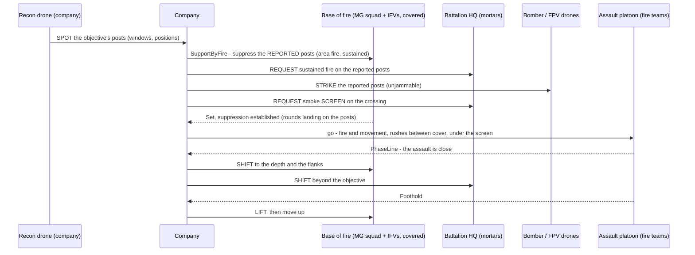
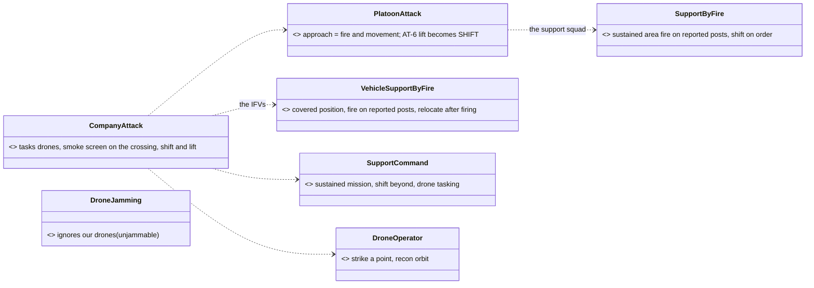
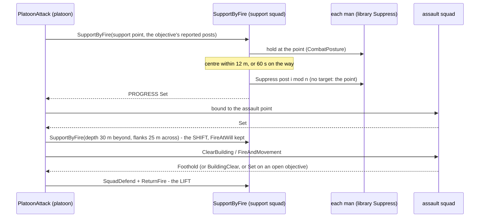
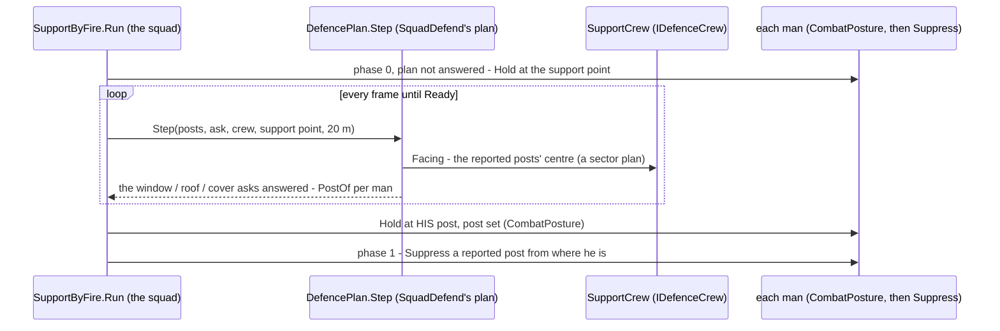
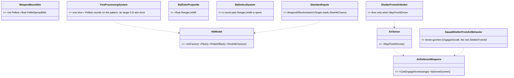

<!--STATUS
state: LIVE
build-state: BUILDING — A-1…A-10 APPROVED (user 2026-11-15: "Approved" — R-4254); slices AU-1…AU-7 — AU-1, AU-2, AU-4, AU-5, AU-7 BUILT, AU-3 BUILT incl. A-9 (§9, R-2121)
updated: 2026-11-15 (first version — coordinator)
current-answer: the whole file — §1 the request · §2 measured · §3 the proven solution, modern · §4 the diagrams · §5 decisions · §6 slices · §7 acceptance · §8 design docs checked · §9 as built
stale-below: nothing
known-rot: none
known-conflict: DESIGN_Defend_And_Attack_Position.md AT-6 (the lift = ReturnFire at the assault's start) — A-3 replaces it with a SHIFT; DA-11 (lift at Foothold) is kept
related-designs:
  - DESIGN_Defend_And_Attack_Position.md — OWNS the attack's doctrine and the built `PlatoonAttack` (DA-9…DA-19, §8f AT-1…AT-13); this design REVISES AT-4 / AT-5 / AT-6 and builds DA-11 / DA-12's open halves (crossing smoke, shift fire)
  - DESIGN_City_Battle_Showcase.md — §6a the company attack (tempo, base of fire 250 m) this revises (A-5, A-6); §6b mortar smoke; §11 C-5 vehicles over the dismounted squad
  - DESIGN_Squad_Tactics.md — §7.6 the squad drills (bounding before contact, fire and movement in contact) A-7 relies on
  - DESIGN_Command_Chain_Battalion_Test.md — the scenario whose base variant fails here (CE-2436); its §4a as built; the test of this design
  - ../air-attack/DESIGN_FPV_Drone.md — §5 the drones (FPV, bomber, recon) A-6 tasks
  - ../../DESIGN_Indirect_Fire.md — OWNS mortars, smoke, danger close (FM-5) A-5 changes
-->

# DESIGN — the assault across ground under fire, as a modern force does it *(CE-2436)*

## 1. The request

🔒 User, `2026-11-15`: *"design CE-2436. You are the military expert here. I assume the infantry should be supported by armored vehicles and some
suppressive fire or something."* · *"take into consideration the modern weapons. So stuff like suicide drones and effective anti-tank missiles.
Don't be stuck in the last century"* · *"jamming is no longer effective because the drones are controlled by optical wire"* · *"We do not need to go
into details like how far the drone can go … let's consider drones be unjammable."*

**The failure (CE-2436, the live runs):** Blue's assault platoon bounds 113 m in ≈ 170 s (≈ 0.66 m/s) under the line's fire, is RED from 153 s and
never takes Objective 1; its own support sits 120 m back, the company's base of fire 250 m back.

## 2. Measured *(2026-11-15; three read-only sweeps, the decisive claims re-read ✔)*

| measured | where |
|---|---|
| ✔ **the base of fire goes nearly QUIET as the assault moves** — the lift sets the support to ReturnFire at the assault's start | `PlatoonAttackBehavior.cs:398-404` (AT-6) |
| ✔ **the base of fire only fights what it SEES** — the support runs `SquadDefend` (Watch posts); it has no suppressive area-fire order (`FireAtPoint` is used only by mortars, blind bursts, smoke) | `SquadDefendBehavior.cs:444-460`; `SquadManeuverRunner.cs:48-50` |
| ✔ **no automatic weapons**: Blue's "MachineGunner" is a role label on a rifleman type (one rifle + a pistol) | `scripts/gen-chain-scenarios.py:75`, `UrbanCombatTkbCatalog.cs:248-260` |
| **the IFVs do nothing for the attack**: no commander, no order — `PlatoonAttack` / `CompanyAttack` have zero vehicle references; vehicles fight only defensively (`VehicleFightFromCover` in a convoy ambush) | `gen-chain-scenarios.py:155-157`; `PlatoonConvoyBehavior.cs:255-286` |
| **indirect fire is one burst**: preparatory HE 3 rounds a gun at the assault's start, smoke at ½ deadline ON THE OBJECTIVE (it blinds the own base of fire); no observer adjusts; nothing shifts or lifts | `CompanyBehaviors.cs:192-198, :283-288, :310-318`; `IndirectFireBehaviors.cs:36, :202` |
| **the approach bounds** (`BoundingOverwatch`, a pre-contact drill) instead of the in-contact `FireAndMovement` rushes (15 m at 4 m/s) | `PlatoonAttackBehavior.cs:538-541`; `FireAndMovementBehavior.cs:211-215`; Squad Tactics §7.6.3 |
| no smoke grenade in an approach or assault (only in break contact) | `SquadContactBehaviors.cs:239-247` |
| suppression is REAL when fire lands within 3 m: σ × 2 for 5 s, no peek for 3 s, stress +0.08 per near miss; three rounds at a man in 10 s ⇒ his post untenable | `CombatConstants.cs:84`, `HitModel.cs:24-25, :55-56`, `PeekAndFireNodes.cs:210`, `StressSystem.cs:26`, `SquadSenseChanges.cs:30-31` |
| infantry never shoots at drones (only a turret MG / autocannon or a SAM is air-capable; rifles explicitly not), it takes cover; ✔ a drone dies from one hit (bomber drone health 10) | `AirDefenceWeapons.CanEngageAir` (`:22-42`); CE-7029 |
| the jammer downs ANY drone of another side in its bubble | `Motion/DroneJamming.cs:67` |
| the company cannot task drones (CE-7003's drone half not built) | City Battle §11 |

## 3. The proven solution — as a modern force fights

The classic sequence still holds — **find, fix, suppress, obscure, assault, then shift the fire** — but the modern battlefield changes WHO does each:

| | what changed | so |
|---|---|---|
| FIND | the battlefield is transparent — reconnaissance drones over the objective | a recon drone watches the objective and its reports ARE the target list (posts, windows) |
| SUPPRESS | drones and precise fires replaced mass; anti-tank missiles and FPV drones kill vehicles that show themselves | bomber / FPV drones strike reported positions; mortars fire SUSTAINED on reported points; automatic weapons and IFV cannons fire from COVERED positions at stand-off and RELOCATE after firing — ⛔ vehicles never lead across open ground |
| OBSCURE | smoke still beats the eye and the gun | smoke as a SCREEN on the crossing (between the objective and the assault's route), never on the objective (it blinds the own fire) |
| ASSAULT | massed assaults die; small groups survive | fire-team groups RUSH across the open between cover while the suppression is ON; they never walk 113 m |
| SHIFT | fratricide as the assault closes | fire shifts to the depth and the flanks as the assault closes — never simply stops; lifts only at the foothold |
| PROTECT | drones are unjammable (user ruling) | protection is physical: cover, concealment, dispersion, moving under the screen |

## 4. Diagrams

### 4.1 The assault, step by step

*What it shows that the as-built attack lacks: the assault moves only WHILE the defenders are suppressed, and the fire never stops when it moves —
it shifts; the reports from the recon drone and the platoons pace every step (R-4251 R-D10: cause, never the clock).*

### 4.2 What changes

*What it shows: two new plays (a squad and a vehicle version of support by fire) and extensions of the plays that exist — no new command
mechanism; the drones are tasked through the operator that already exists.*

## 5. Decisions — ✅ APPROVED (user, `2026-11-15`: *"Approved"* — R-4254)

| # | decision | ⭐ lean | rejected |
|---|---|---|---|
| **A-1** | suppressive fire | a NEW squad play **`SupportByFire`**: each man fires SUSTAINED area fire (`FireAtPoint`) at the REPORTED posts (the squad's picture: windows, positions), whether or not he sees a man; ammunition-paced; automatic weapons first | the base of fire fighting only what it sees (measured: it rarely sees men in windows at 120–250 m) |
| **A-2** | automatic weapons | squads carry REAL automatic weapons — the generator and the squad templates use the existing automatic rifleman / machine gunner types where the role says so | role labels on riflemen (measured) |
| **A-3** | the lift (AT-6) | ⭐ **SHIFT, not stop**: at the assault's PhaseLine report the base of fire shifts to the objective's depth and flanks; mortars shift beyond the objective; LIFT only at the Foothold (DA-11) | ReturnFire at the assault's start (the defect) |
| **A-4** | vehicles | ⭐ a NEW vehicle play **`VehicleSupportByFire`**: the IFVs take covered positions at stand-off, fire their cannons at the reported posts, and RELOCATE after each engagement (modern anti-tank missiles and drones); ⛔ never lead across the open; carrying the assault to a covered dismount point is a later step | armour leading the infantry (last century — the user) |
| **A-5** | indirect fire | the company requests a SUSTAINED mission on the reported posts for the approach (rounds over time, not one burst), a smoke SCREEN on the crossing (between the objective and the assault route), and the shift beyond at the PhaseLine | one HE burst and smoke on the objective (measured: it blinds the own base of fire) |
| **A-6** | drones | the company keeps a recon drone over the objective (its reports are the target list) and tasks its bomber / FPV drones on the reported posts during the approach — the drone half of CE-7003; ⭐ drones are UNJAMMABLE (user ruling): the jammer no longer downs them | no drones in the attack |
| **A-7** | the approach | ⭐ in contact the assault moves by **fire and movement** (rushes between cover, its own half covering) — bounding only before contact; smoke grenades thrown at an open crossing (DA-12's open half) | bounding under fire (measured 0.66 m/s) |
| **A-8** | when the assault goes | when the base of fire reports Set AND suppression is ESTABLISHED: rounds landing on the reported posts for N s (near misses / hits recorded on them) and the drone strike in — a cause, not a clock | the support's Set alone |
| **A-9** | the stand-offs | the platoon's base of fire 120 m stays; the company's 250 m becomes a covered position chosen by the cover query within the weapon's effective range of the posts (not a fixed number) | fixed distances regardless of cover |
| **A-10** ⚠ *(revised `2026-11-15`, user: "the infantry has to shoot at the drones because they have basically no other way of defense. Maybe one of them could have a shotgun")* | counter-drone | ⭐ **infantry SHOOTS at drones**: ✔ measured — a drone dies from ONE hit (the bomber drone's health is 10, a rifle round does 25, `NedTkbCatalog.cs:1387`), so the problem is HITTING a small fast target, not killing it. **A-10a** a SHOTGUN weapon (new catalog type): N pellets per shot drawn from a wide pattern through the existing ballistics — a high chance on a small target inside ~40 m, useless beyond ~60 m; carried as a second weapon by ONE man per squad (the anti-drone role). **A-10b** a "can engage a DRONE" rule beside today's "can engage AIRCRAFT" (✔ measured: only a turret MG / autocannon or a SAM counts today, rifles explicitly not — `AirDefenceWeapons.cs:42-49`): the shotgun, the MG and rifles at short range may fire at a drone; the hit chance comes from the existing hit model (the drone's small size and speed). **A-10c** the squad's air-threat row (CE-7029, today: take cover) becomes: the anti-drone man and the MG ENGAGE, the rest take cover; within the last ~20 m everyone fires | infantry that only takes cover (no defence at all) · cable range / jamming (the user: irrelevant on our terrains) |

## 6. Slices

| slice | builds | design basis |
|---|---|---|
| **AU-1** | A-2 the automatic weapons (data) + A-1 `SupportByFire` + A-3 the shift | DAAP DA-9, DA-11, AT-4, AT-6 |
| **AU-2** | A-7 fire and movement on the approach + crossing smoke grenades + A-8 the suppression gate | Squad Tactics §7.6, DA-12 |
| **AU-3** | A-5 sustained fire, the screen, the shift beyond + A-9 the covered base of fire | Indirect Fire, City Battle §6a / §6b |
| **AU-4** | A-4 `VehicleSupportByFire` | City Battle §11 C-5 |
| **AU-5** | A-6 the drones in the attack (recon over the objective, strikes on reported posts, unjammable) | FPV Drone §5, CE-7003 |
| **AU-7** | A-10 the counter-drone: the shotgun (pellets), "can engage a drone", the squad's air-threat row engages | City Battle §11 R-1d (CE-7029), FPV Drone §5 |
| **AU-6** | the test: `cc-battalion` base passes three times (CE-4615's acceptance), with the chain arrows plus "suppression established before the assault moved" | Battalion Test §5 |

## 7. Acceptance

1. A rail per new play: `SupportByFire` puts rounds within 3 m of a reported post it cannot see; it shifts on order; `VehicleSupportByFire` fires from cover and relocates.
2. The assault moves only after "suppression established" is recorded, and the base of fire is STILL firing (shifted) when the assault reaches the PhaseLine.
3. `cc-battalion` base: Objective 1 taken in three runs out of three; the platoon's SITREP better than today's RED from 153 s (measured in the report).
   ⭐ **"Taken" (R-4265, user `2026-11-16`):** the assault platoon's PROGRESS PhaseLine report **OR** Blue holding Objective 1 for 30 s (≥ 4 men in the
   35 m block, no enemy — R-2119). 📌 Met by live runs #18, #19, #20 (`STATUS_Behaviors_Assault_Under_Fire.md` §0); #19 held without a report (the
   office still being cleared), #20 reported and moved on to Objective 2 (no hold).
4. The parallel checks (`HROT_PARALLEL_SIM=1` + `HROT_READ_CHECK=1`), the stepped hash on `cc-battalion`, 0 B per steady frame.

## 8. Design docs checked

Defend and Attack Position §1 (SOSRA), DA-9…DA-19, §8f AT-1…AT-13 — applies (the attack as built; A-1, A-3, A-7 revise it) · Platoon Attack Defend
Clear §4 (Lift / ShiftFire states) — applies (A-3 builds its shift) · Squad Tactics §7.6 — applies (A-7) · City Battle §3a, §6a, §6b, §11 C-5 —
applies (A-4, A-5, A-9) · Command Chain Battalion Test §4a — applies (the evidence) · FPV Drone §5 — applies (A-6) · Indirect Fire FM-5 — applies
(danger close, A-5) · Urban Armour Tactics (infantry cooperation "later") — does not settle it · AQ96 Movement Under Fire C3 — applies (cover from the
base of fire is stamped only by fire and movement — A-7).

## 9. As built *(behaviors, `2026-11-15`)*

### 9.1 AU-1 — automatic weapons, `SupportByFire`, the shift *(R-2106, lane decision — for the user's review)*

*What it shows that the as-built AT-6 did not: the base of fire is ON the posts the whole approach and is still firing (shifted) while the
assault crosses; it stops only once the assault holds a foothold.*

| piece | as built | where |
|---|---|---|
| A-2 | the generator's `MachineGunner` role carries a real automatic weapon: Blue the M249 automatic rifleman (TKB 207), Red the PKM gunner (208) — one per squad | `scripts/gen-chain-scenarios.py` `squad()` |
| A-1 | `SupportByFire` (new squad commander play, `Library/Combat`): hold at the point; then man `i` suppresses reported post `i mod n` through the library `Suppress` at the point (no target ⇒ `FireAtPoint`, seen or not); SET once firing; a member is re-ordered only when dirty or his order no longer stands (R-2084) | `SupportByFireBehavior.cs`, `SupportByFireParamsJsonDto` |
| A-1 posts | `PlatoonAttack.ObjectivePosts`: fresh picture elements within 25 m of the current objective (≤ 4); none ⇒ the objective itself | `PlatoonAttackBehavior.cs` |
| A-3 shift | at `EnterAssault` (replacing AT-6's ReturnFire): elements beyond the objective in the attack's area, then its depth (30 m beyond, away from the start) and two flanks (25 m across) | `ShiftPosts` |
| DA-11 lift | after the orders each tick: the assault's FOOTHOLD / BuildingClear / Set ⇒ the support `SquadDefend` + ReturnFire | `Lift` |
| sector | the base of fire keeps its sector on the objective (DA-27) under `SupportByFire` too | `KeepAttack` |

**Rails:** `CE2436_SupportByFire_HoldsAtThePoint_ThenEveryManFiresOnAReportedPost_ReportsSet_AndShiftsOnOrder` (new) · `CE2277_AnOpenObjective_…`
(the shift, FireAtWill kept) · `CE2277_AnAreaWithABuilding…` (the lift at the foothold) · `CE2277_WithItsSop…`, `CE2346_…`, `CE2284_…` (the
support's order is now `SupportByFire`). **R-2106 numbers:** arrival 12 m / 60 s, post match 25 m, shift depth 30 m, flanks 25 m, ≤ 4 posts —
would change with a live run showing the posts off the windows, or the arrival too strict for a covered position.

#### 9.1a `CE-4667` (D-7, user-approved `2026-11-18`) — the base of fire's two exits *(behaviors, `2026-11-19`; build-state: BUILT)*

📌 Measured on real-1: Blue Squad 2 kept `Suppress` for 434 s with every man "out of ammo" and every contact at hp 0. The play's one exit was the
platoon's lift, which never came. The platoon's lift is unchanged; `SupportByFire.Run` gains two exits of its own:

| exit | when | then |
|---|---|---|
| **(a)** a man is empty | his rounds are gone (`StaffComposerSystem.RoundsOf` = 0 of a counted weapon) | he holds with return fire where he is (`CombatPosture`); the rest keep firing |
| **(b)** the posts are down | for `TargetsDownSeconds` (10 s), every post that has KNOWN contacts within `PostLiveMetres` (25 m) has none still in the fight (`SquadContacts.IsEnemy`) | every man holds where he is; PROGRESS `TargetsDown` (appended to `ProgressKind`) goes to the platoon; one of them back in the fight ⇒ the fire resumes |

⚠ A post with NO known contact near it keeps the blind fire: AU-1's premise (a base of fire rarely sees a man in a window) is unchanged.
⇒ the stop needs the men there to be known DOWN, never merely unseen. Rails: `SquadManeuverTests.CE4667_*` (SupportByFire suite).

#### 9.1b D-11 B (CE-4666, user-approved `2026-11-19`) — the base of fire takes POSTS from the squad's own plan *(behaviors, BUILT)*

⭐⭐ **`CE-8319` (`2026-11-24`, the as-built — the diagram above is the D-11 B first cut):** ① the plan starts only ONCE THE SQUAD IS AT THE POINT
(its men's centre within 20 m) — `DefencePlan.Step` asks its window / roof / cover searches round the crew's first live man, so planned from where the
squad STOOD it posted every man in the house it was leaving; ② on the way each man heads for his own spot on a line across the line of fire at the point
(5 m apart), never one shared point; ③ it opens fire (phase 1) once its men are ON THEIR POSTS, not when its centre nears the point — phase 1 orders
every man to Suppress where he stands, so the fire began before the posts were reached; the 60 s timeout stays the fallback; ④ a squad ALREADY at the
point when ordered (its own position, a SHIFT) fires at once, as before. 📐 Why: live `village-street-mg-flank` — support point (411,245), every man
posted where he stood at (372,272–278): 150 m from the gun, across the street, 0 hits in 207 rounds; the gun fell to the assault's rifles.
Rail `SquadManeuverTests.D11B_*` (spots on the line, no search while away), red-proved; the CE-2436 / CE-4667 rails occupy their posts first (`OnPosts`). ⑤ **2-D points go on the GROUND**: an order's point has Z 0 — on village-street (ground ≈ 176 m) the men's moves to their spots aimed under the ground and never started, and the Suppress rounds at the reported post flew 176 m under the gun (220 of 262 "expired"); the spots take the world's stand height (`IWorldQuery.TryStandAt`), and a round at a reported point is grounded and then aimed by THE blind aim (`SuppressNodes.AimAtReported` → `AimPoint.BlindAt`, CE-8315: through the building's opening). ⑥ the post plan looks **40 m** round the support point (was 20): the point lies on the axis, often in a street, with the nearest houses 25–30 m off. 📐 After ①–⑥ on `village-street-mg-flank`: the gun engages at 10 s and is answered at once, the assault flanks south and silences the gunner at 95 s, the house is cleared by 240 s, Blue loses nobody. Rail `SuppressNodesTests.CE8319_*` (the grounded aim), red-proved.

*What the picture shows that prose hid:* no second planner — the base of fire is a defence crew whose sector is its targets; the ONE change
to the plan is that the crew, not the engagement area, says where the posts face (`IDefenceCrew.Facing`; a defence's crew still answers
its engagement area — unchanged).

| piece | as built |
|---|---|
| ⛔ was | §9.1: phase 0 held EVERY man at `p.Position` ⇒ bunched by construction (📌 `pc-corridor-fight`: Blue Squad 2 failed "never bunches" at 30 s, in the open) |
| the plan | `SupportByFireState.Plan` / `Ask` / `Planned`: `DefencePlan.Step` over `SupportCrew` (the roster as `Run` indexes it; facing the reported posts' centre), radius `PostSearchMetres` 20 m |
| the men | phase 0: to HIS post (`MemberPost` set, `SquadDefendPlay.PostRadius`) once planned, else the support point; phase 1 unchanged — `Suppress` from where he stands, which is now his post |
| rail | `SquadManeuverTests.D11B_TheBaseOfFire_TakesPostsFromTheSquadsOwnPlan_NotOnePoint` (red-proved) |

### 9.2 AU-2 — the approach in contact, the crossing smoke, suppression established *(R-2107, lane decision — for the user's review)*

| piece | as built | where |
|---|---|---|
| A-7 approach | `PlatoonAttack` sets `Contact` when the objective's posts come from REPORTED elements; then the assault closes to its assault point by `FireAndMovement` (rushes between cover, its other half covering); with nothing reported it still bounds (pre-contact). The reserve keeps bounding behind | `PlatoonAttackBehavior.OrderFor`, `Rush` |
| A-7 crossing smoke | `FireAndMovement`: before the first rush ONE covering man who carries smoke and is Regular+ throws a smoke grenade 15 m (at most half-way) toward the threat — the objective when no contact is pooled; once a run; back to covering after `SmokeSeconds` — `BreakContactPlay`'s rule and helpers (`Smoker`, `SmokePoint`), ⛔ no second smoke model | `FireAndMovementBehavior.OrderFor` / `Update` |
| A-8 established | `SupportByFire` reports SET only when suppression is ESTABLISHED: firing ≥ 15 s AND the squad's carried rounds fell by ≥ 3 a man in the fight since firing began (`StaffComposerSystem.RoundsOf`; a squad with no counted weapon: the time alone). The platoon's `SupportSet` reads it, so the assault moves only under established fire. ⚠ "the drone strike in" (A-8's second half) waits for AU-5 | `SupportByFireBehavior.Established` |

**Rails:** `CE2436_SupportByFire_SuppressionIsEstablished_OnlyWhenRoundsWereSpent_NotByTheClockAlone` ·
`CE2436_FireAndMovement_OneCoveringManThrowsCrossingSmokeTowardTheThreat_OnceBeforeTheFirstRush` ·
`CE2436_PlatoonAttack_BeforeContactTheAssaultBounds_InContactItClosesByFireAndMovement` · the AU-1 rail's SET now after establishment ·
`CE2277` ×3, `CE2346`, `CE2284` updated (the approach in contact is `FireAndMovement`). **R-2107 numbers:** 15 s / 3 rounds a man; the
smoke once per fire-and-movement run — would change with a live run where the support's Set comes too late for the deadline, or where one
grenade does not cover the crossing.

### 9.3 AU-3 — the sustained mission, the screen, the shift beyond, the company's base of fire *(R-2108, lane decision — for the user's review)*

| piece | as built | where |
|---|---|---|
| A-5 sustained | a FireSupport REQUEST's `Count` is its rounds per gun (a byte the wire already carries) → the picture's `PendingRequest.Rounds` → `SupportCommand`'s battery strike `StrikeOrder.Rounds` (above 1 a sustained mission; else the battery's default 3) | `StaffSystems` (fold), `CommandComponents`, `SupportCommandBehavior` |
| A-5 on the posts | `CompanyAttack.EnterAssault` asks **8** rounds a gun of HE on the CENTRE of the reported posts (fresh elements within 40 m of the objective; none ⇒ the objective) — replacing R-2100's 3-round burst on the objective | `CompanyBehaviors.PostsCentre` |
| A-5 the screen | the half-deadline smoke (CE-7025) lands **50 m from the objective toward where the company came from** — on the crossing, ⛔ never on the objective (📌 it blinded the own base of fire) | `ScreenPoint` |
| A-5 shift beyond | objective k taken (`NextObjective`) ⇒ a sustained HE request on objective k + 1; the last one taken asks nothing | `NextObjective` |
| A-1 company | the company's base of fire is `PlatoonSupportByFire`: every squad `SupportByFire` on the company's posts (≤ 4 fresh elements near the objective), spread 20 m across the line of fire; the platoon reports SET once every live squad has (= each squad's suppression established) | `PlatoonSupportByFireBehavior`, `CompanyAttack.SupportByFire` |
| ⭐ A-9 covered position *(as built `2026-11-16`, R-2121)* | during Support the company asks a world survey (`WorldSurveyChildSensor`, 100 m round the fixed 250 m point); `CoverChoice.Pick` takes the ENTERABLE building 120–450 m from the objective inside the ±30° arc of the objective→fixed-point line, nearest the fixed point, and moves the base of fire there (its slot re-ordered). No building, no reply in 5 s ⇒ the fixed point stands. ⚠ Distance bounds stay the weapon's effective range (450 m), not a cover-to-posts line-of-sight test — that is the next refinement if a live run puts the base of fire behind a wall it cannot shoot through | `CompanyBehaviors.Cover` (:282), `CoverChoice.Pick` (:1005) |
| ⛔ HISTORY (A-9 row before `2026-11-16`) | *NOT BUILT — the base of fire still stands at the fixed 250 m* | — |

**Rails:** `CE2436_CompanyAttack_SustainedFireOnThePosts_TheSmokeScreensTheCrossing_TheFireShiftsBeyond` · `CE2436_ASustainedRequest_IsFiredAsASustainedMission`
· `CE2436_PlatoonSupportByFire_EverySquadFiresOnThePosts_Spread_SetWhenAllAre` · `CE7023` ×2, `CE7005` updated (the base of fire's order). Six mutants red. · A-9: `CE2436_A9_TheBaseOfFire_TakesTheCoveredBuildingOnTheLine_NotTheOneOffIt_NorASolidOne` (mutant: never finds ⇒ red).

### 9.4 AU-4 — the vehicles support by fire; the SOPs spare a base of fire; A-6's unjammable rule *(R-2109, lane decision — for the user's review)*

| piece | as built | where |
|---|---|---|
| A-4 the play | `VehicleSupportByFire` (MilitaryApc) = a sequence: drive to the stand-off point (`MoveToLocation`, 8 m), then the exposure cycle `VehicleFightFromCover` with **Scoot, one exposure a position** — hide, out front-first, fire, RELOCATE to a new hide after every engagement. ⭐ **BLIND FIRE as built `2026-11-16` (R-2124):** while its own sensors give it no threat (`EqsTacticsNodes.TopAim` false) and the company gave it the REPORTED posts' centre (`VehicleSupportByFireParamsJsonDto.Posts`, from `CompanyBehaviors.PostsOf`, ⭐ given ONLY in the Support phase — from the assault on, our own men are on them: lifted, as the base of fire lifts), it fires a 5-round cannon burst (`FireAtPoint`, mount 0) on them every 15 s and keeps supporting; a threat of its own hands the gun back to the cycle (a burst always ends first). 📌 Before, the cycle with nothing in sight returned Success at once and the IFV's support ENDED. ⛔ HISTORY: *"blind cannon fire on REPORTED points is not built"* | `VehicleFightFromCoverBehavior.cs` (`VehicleSupportByFireBehavior.FightOrBlindFire`) |
| A-4 the company | a subordinate that is a VEHICLE (`Locomotions.IsVehicle`, the one rule) gets the role `Vehicle`, never assault / support / reserve (the platoons take those in order); it is ordered `VehicleSupportByFire` **35 m to the side of the base of fire's point**, on its line, never toward the objective — and stays back at the consolidation and the abort; `AllSet` does not wait for a vehicle's Set | `CompanyBehaviors` (`PlanAttack`, `VehicleSupport`, `AllSet`) |
| A-4 data | `cc-battalion`'s IFVs are the company's (they had no commander — R-2096 — and did nothing for the attack) | `scripts/gen-chain-scenarios.py` |
| 🔴 defect found live | the SOPs spared a DEFENCE but not a BASE OF FIRE: the platoon SOP's `PlatoonHold` paused the company's `PlatoonSupportByFire` 16 s after it began, ordered its squads to hold, and it never fired again (probe). ⭐ `PlatoonDefendBehavior.NotDefending` / `SquadDefendBehavior.NotDefending` now also answer false while the unit's current order (running or paused) is `SupportByFire` / `PlatoonSupportByFire` (`SupportByFireBehavior.Supporting`) — its fire IS the answer to the contact | `SupportByFireBehavior.Supporting` |
| A-6 unjammable | `DroneJamming.DronesUnjammable = true` (FDP lane, said): `Jammed` answers false — no jammer downs a drone (the user's ruling); the jammer bubbles stay built and read (⛔ no removal); `CE7014` keeps proving the jammer with the switch off and adds the unjammable case | `Motion/DroneJamming.cs` |

**Rails:** `CE2436_CompanyAttack_AVehicleSupportsByFireFromTheBaseOfFiresLine_NeverAssaults` · `CE2436_AU4_AVehicleThatSeesNothing_FiresBurstsOnTheReportedPosts` (posts / none) · `CE2436_TheSops_DoNotPauseABaseOfFire_OnAContact` ·
`CE7014_…` (three cases). **R-2109:** the vehicles 35 m beside the base of fire, scoot after every exposure; a base of fire spared by the SOPs as
a defence is — would change with a live run where 35 m puts the IFVs in the open, or where a base of fire should break off on a contact.

### 9.5 AU-7 — the infantry against drones: the shotgun, "can engage a drone", the drone gunners *(R-2110, lane decision — for the user's review)*

*What the picture shows that the prose hid: no new hit path and no new reaction — the shotgun is data on the ordinary mount, its pellets are
ordinary rounds, and the shot and the AI's estimate read ONE function family (`HitModel`), as AQ85 F already required.*

| piece | as built | where |
|---|---|---|
| ✔ measured first | the hit model spread rounds ACROSS only (`HitModel.Rotate`, about the vertical) and the lead at an aircraft is exact (`TargetLead`) — so a rifle at a hovering drone 30 m off hit ~97 % a round: there was no "hard to hit" for a shotgun to solve, and the claim "infantry never shoots at drones" was only the SOP row's gate (`CanEngageAir`): `ShelterFromAir` already fired whatever the weapon brain picked | `HitModel.cs`, `ShelterFromAirNodes.cs` |
| A-10 aim at the air (R-2110) | a round at a target in the AIR gets an elevation error too (the second stream, `RangeSequence`) and σ × `1 + speed / 10 m/s` (a hovering drone ×1, a 30 m/s one ×4) — the shot (`FireProcessingSystem`) and the estimate (`WeaponEffectivenessVsTarget`) alike; a ground target is unchanged | `HitModel.AirFactor`, `.Pitch` |
| A-10a the shotgun | `WeaponMountDto.Pellets` / `PelletSpreadMils` (appended): one shot = N rounds, pellet i at `PelletOffset(k, N, i)` × the pattern around the man's aim, each SPENT past the mount's range (`BallisticProjectile.RangeLimitM`, `BallisticsSystem`). The anti-drone SHOTGUN: 12 pellets, 15 mils, 60 m, 12 a pellet (a drone's 10 hp; a man's armour stops it), on the anti-drone rifleman (NEW types 212 Blue / 213 Red, M4 + shotgun) — one a squad in the chain scenarios. ⚠ its munition is the 5.56 ball's stand-in (look and report a rifle's) | `NedTkbCatalog.AntiDroneShotgun`, `gen-chain-scenarios.py` |
| A-10a the numbers | one shot at a drone crossing at 30 m/s: shotgun **> 0.4** at 30 m, nothing past 60 m; a rifle round **< 0.1** (the estimate's `HitModel.ShotHitChance`) | rail |
| A-10b can engage a drone | `AirDefenceWeapons.CanEngageDrone(range)`: a shotgun within its range, an MG / autocannon (within its range), anything `CanEngageAir` counts, any small arm inside **20 m**; `ShelterFromAir` fires only when it may (`AirSense.MayFireAtDrone`; a unit with no weapon data is left to the weapon brain, as before) | `AirDefenceWeapons.cs` |
| A-10c the squad | `SquadShelterFromAir` sends its DRONE GUNNERS (`IsDroneGunner`: a shotgun or an MG on the man) `EngageAircraft` — they stand and fire — and every other man `ShelterFromAir` (cover; he fires once it is inside 20 m) | `SquadShelterFromAirBehavior.cs` |

**Rails:** `AirDefenceNodesTests.CE2436_AU7_*` (three) · `ShelterFromAirNodesTests.CE2436_ARifleman_HoldsFireAtADistantDrone_FiresOnceItIsClose` ·
`FireProcessingSystemTests.CE2436_AShotgun_FiresTwelvePelletsOverItsPattern_ADroneAt30mIsMet_At80mNot` ·
`BallisticsSystemTests.CE2436_APellet_IsSpentPastItsRange_ARoundWithNoLimitFliesOn` · `SquadManeuverTests.CE2436_AU7_UnderADrone_…`.
**R-2110** would change with a live run where a drone is never downed (the speed factor too wide) or always (too narrow).

### 9.6 AU-5 — the company's drone team *(R-2111, lane decision — for the user's review)*

| piece | as built | where |
|---|---|---|
| A-6 the team | a company subordinate whose roster holds a DRONE (`Locomotions.IsAircraft`) takes the role `Drones` (never a platoon role) and is ordered the NEW squad play `DroneTeam { Watch, Strike }`: in the support and assault phases watch the objective, strike the posts the base of fire was ordered on (`PostsOf`; the objective while none is reported); at the consolidation / abort watch only (no strike on our own ground); `AllSet` skips it | `CompanyBehaviors` (`PlanAttack`, `DroneTask`) |
| A-6 the play | `DroneTeam` orders each UNARMED drone `DroneRecon` over the watch point (its sightings merge into the team's pool → the staff SPOT → the company's picture: the recon drone's reports ARE the target list) and the operator `DroneOperator` with the ARMED drones on the strike point (CE-7026's one-in-the-air rule, unchanged). ⚠ the recon drone is flown on the TEAM's order, not through the operator (one operator, one task — lane decision) | `DroneTeamBehavior.cs` |
| A-6 data | `cc-battalion`: a Blue drone team under the company — an operator, a recon quadcopter (407), two bomber quadcopters (408), landed behind the assembly | `gen-chain-scenarios.py` |
| A-8 the drone half | ⛔ NOT a gate: a drone may be shot down or late, and a cause that never comes would stall the assault (R-2111); the Set stays "suppression established" (AU-2) | — |

**Rails:** `CE2436_AU5_CompanyAttack_TheDroneTeamWatchesTheObjective_AndStrikesThePosts` · `CE2436_AU5_TheDroneTeam_SendsTheReconDroneToWatch_AndTheOperatorToStrike`.

### 9.7 AU-6 — what the base runs taught *(R-2112, lane decision — for the user's review)*

| finding (live) | fix | where |
|---|---|---|
| run #5: the assault squad reached 45 m, went Black at the building while the reserve was out on a casevac, and AT-10 aborted the platoon beside an intact base of fire (Red's line down to 1–2 men a platoon) | the base of fire relieves a lost assault when no reserve is free (Defend & Attack AT-10, as built) | `PlatoonAttackBehavior.FreeRelief` |
| runs #4, #5: Red's outpost reacted `SquadShelterFromAir` at t = 0 to Blue's drones PARKED on the ground (they read `Airborne` 1, the translator's default, until a flying order runs their model) — so it never withdrew (arrow ①) | an aircraft on the ground (put down, or within 1 m of the ground and still) is no air contact | `FlightGround.OnTheGround`, `AirContacts.IsAir` |

**Rails:** `CE2436_ABlackAssaultWithNoReserve_TheBaseOfFireTakesItOver` (and CE2277 / CE7015's aborts now need the base of fire Black too) ·
`FlightGroundTests.CE2436_AParkedDrone_IsNoAirContact_OneInTheAirIs`.
