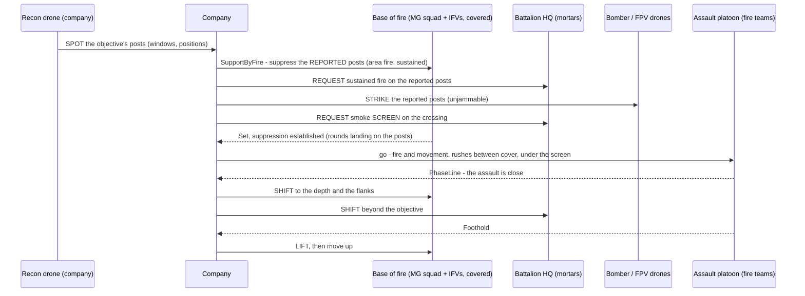
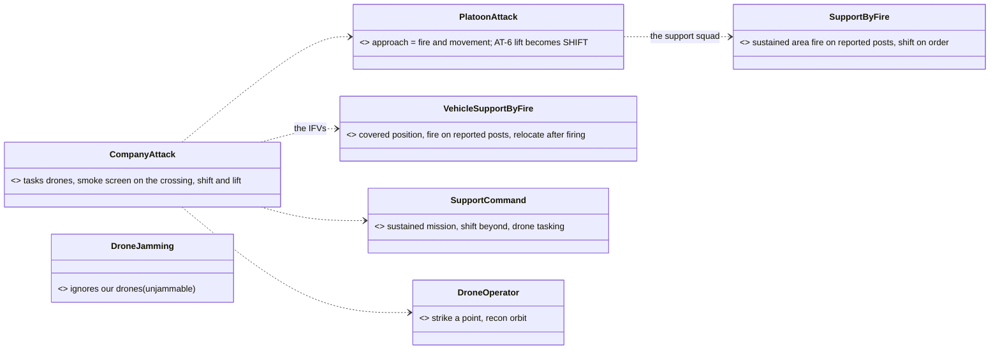
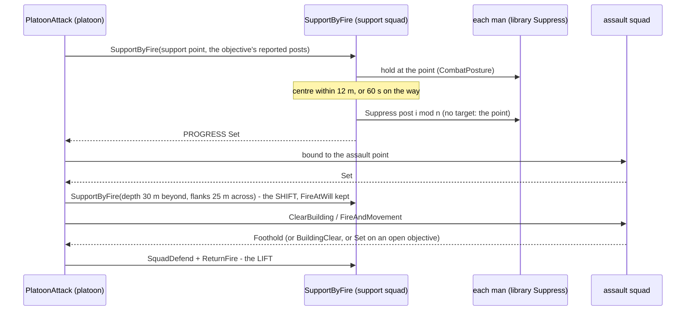

<!--STATUS
state: LIVE
build-state: BUILDING — A-1…A-10 APPROVED (user 2026-11-15: "Approved" — R-4254); slices AU-1…AU-7 — AU-1 BUILT (§9)
updated: 2026-11-15 (first version — coordinator)
current-answer: the whole file — §1 the request · §2 measured · §3 the proven solution, modern · §4 the diagrams · §5 decisions · §6 slices · §7 acceptance · §8 design docs checked · §9 as built
stale-below: nothing
known-rot: none
known-conflict: DESIGN_Defend_And_Attack_Position.md AT-6 (the lift = ReturnFire at the assault's start) — A-3 replaces it with a SHIFT; DA-11 (lift at Foothold) is kept
related-designs:
  - DESIGN_Defend_And_Attack_Position.md — OWNS the attack's doctrine and the built `PlatoonAttack` (DA-9…DA-19, §8f AT-1…AT-13); this design REVISES AT-4 / AT-5 / AT-6 and builds DA-11 / DA-12's open halves (crossing smoke, shift fire)
  - DESIGN_City_Battle_Showcase.md — §6a the company attack (tempo, base of fire 250 m) this revises (A-5, A-6); §6b mortar smoke; §11 C-5 vehicles over the dismounted squad
  - DESIGN_Squad_Tactics.md — §7.6 the squad drills (bounding before contact, fire and movement in contact) A-7 relies on
  - DESIGN_Command_Chain_Battalion_Test.md — the scenario whose base variant fails here (CE-2436); its §4a as built; the test of this design
  - ../air-attack/DESIGN_FPV_Drone.md — §5 the drones (FPV, bomber, recon) A-6 tasks
  - ../../DESIGN_Indirect_Fire.md — OWNS mortars, smoke, danger close (FM-5) A-5 changes
-->

# DESIGN — the assault across ground under fire, as a modern force does it *(CE-2436)*

## 1. The request

🔒 User, `2026-11-15`: *"design CE-2436. You are the military expert here. I assume the infantry should be supported by armored vehicles and some
suppressive fire or something."* · *"take into consideration the modern weapons. So stuff like suicide drones and effective anti-tank missiles.
Don't be stuck in the last century"* · *"jamming is no longer effective because the drones are controlled by optical wire"* · *"We do not need to go
into details like how far the drone can go … let's consider drones be unjammable."*

**The failure (CE-2436, the live runs):** Blue's assault platoon bounds 113 m in ≈ 170 s (≈ 0.66 m/s) under the line's fire, is RED from 153 s and
never takes Objective 1; its own support sits 120 m back, the company's base of fire 250 m back.

## 2. Measured *(2026-11-15; three read-only sweeps, the decisive claims re-read ✔)*

| measured | where |
|---|---|
| ✔ **the base of fire goes nearly QUIET as the assault moves** — the lift sets the support to ReturnFire at the assault's start | `PlatoonAttackBehavior.cs:398-404` (AT-6) |
| ✔ **the base of fire only fights what it SEES** — the support runs `SquadDefend` (Watch posts); it has no suppressive area-fire order (`FireAtPoint` is used only by mortars, blind bursts, smoke) | `SquadDefendBehavior.cs:444-460`; `SquadManeuverRunner.cs:48-50` |
| ✔ **no automatic weapons**: Blue's "MachineGunner" is a role label on a rifleman type (one rifle + a pistol) | `scripts/gen-chain-scenarios.py:75`, `UrbanCombatTkbCatalog.cs:248-260` |
| **the IFVs do nothing for the attack**: no commander, no order — `PlatoonAttack` / `CompanyAttack` have zero vehicle references; vehicles fight only defensively (`VehicleFightFromCover` in a convoy ambush) | `gen-chain-scenarios.py:155-157`; `PlatoonConvoyBehavior.cs:255-286` |
| **indirect fire is one burst**: preparatory HE 3 rounds a gun at the assault's start, smoke at ½ deadline ON THE OBJECTIVE (it blinds the own base of fire); no observer adjusts; nothing shifts or lifts | `CompanyBehaviors.cs:192-198, :283-288, :310-318`; `IndirectFireBehaviors.cs:36, :202` |
| **the approach bounds** (`BoundingOverwatch`, a pre-contact drill) instead of the in-contact `FireAndMovement` rushes (15 m at 4 m/s) | `PlatoonAttackBehavior.cs:538-541`; `FireAndMovementBehavior.cs:211-215`; Squad Tactics §7.6.3 |
| no smoke grenade in an approach or assault (only in break contact) | `SquadContactBehaviors.cs:239-247` |
| suppression is REAL when fire lands within 3 m: σ × 2 for 5 s, no peek for 3 s, stress +0.08 per near miss; three rounds at a man in 10 s ⇒ his post untenable | `CombatConstants.cs:84`, `HitModel.cs:24-25, :55-56`, `PeekAndFireNodes.cs:210`, `StressSystem.cs:26`, `SquadSenseChanges.cs:30-31` |
| infantry never shoots at drones (only a turret MG / autocannon or a SAM is air-capable; rifles explicitly not), it takes cover; ✔ a drone dies from one hit (bomber drone health 10) | `AirDefenceWeapons.CanEngageAir` (`:22-42`); CE-7029 |
| the jammer downs ANY drone of another side in its bubble | `Motion/DroneJamming.cs:67` |
| the company cannot task drones (CE-7003's drone half not built) | City Battle §11 |

## 3. The proven solution — as a modern force fights

The classic sequence still holds — **find, fix, suppress, obscure, assault, then shift the fire** — but the modern battlefield changes WHO does each:

| | what changed | so |
|---|---|---|
| FIND | the battlefield is transparent — reconnaissance drones over the objective | a recon drone watches the objective and its reports ARE the target list (posts, windows) |
| SUPPRESS | drones and precise fires replaced mass; anti-tank missiles and FPV drones kill vehicles that show themselves | bomber / FPV drones strike reported positions; mortars fire SUSTAINED on reported points; automatic weapons and IFV cannons fire from COVERED positions at stand-off and RELOCATE after firing — ⛔ vehicles never lead across open ground |
| OBSCURE | smoke still beats the eye and the gun | smoke as a SCREEN on the crossing (between the objective and the assault's route), never on the objective (it blinds the own fire) |
| ASSAULT | massed assaults die; small groups survive | fire-team groups RUSH across the open between cover while the suppression is ON; they never walk 113 m |
| SHIFT | fratricide as the assault closes | fire shifts to the depth and the flanks as the assault closes — never simply stops; lifts only at the foothold |
| PROTECT | drones are unjammable (user ruling) | protection is physical: cover, concealment, dispersion, moving under the screen |

## 4. Diagrams

### 4.1 The assault, step by step

*What it shows that the as-built attack lacks: the assault moves only WHILE the defenders are suppressed, and the fire never stops when it moves —
it shifts; the reports from the recon drone and the platoons pace every step (R-4251 R-D10: cause, never the clock).*

### 4.2 What changes

*What it shows: two new plays (a squad and a vehicle version of support by fire) and extensions of the plays that exist — no new command
mechanism; the drones are tasked through the operator that already exists.*

## 5. Decisions — ✅ APPROVED (user, `2026-11-15`: *"Approved"* — R-4254)

| # | decision | ⭐ lean | rejected |
|---|---|---|---|
| **A-1** | suppressive fire | a NEW squad play **`SupportByFire`**: each man fires SUSTAINED area fire (`FireAtPoint`) at the REPORTED posts (the squad's picture: windows, positions), whether or not he sees a man; ammunition-paced; automatic weapons first | the base of fire fighting only what it sees (measured: it rarely sees men in windows at 120–250 m) |
| **A-2** | automatic weapons | squads carry REAL automatic weapons — the generator and the squad templates use the existing automatic rifleman / machine gunner types where the role says so | role labels on riflemen (measured) |
| **A-3** | the lift (AT-6) | ⭐ **SHIFT, not stop**: at the assault's PhaseLine report the base of fire shifts to the objective's depth and flanks; mortars shift beyond the objective; LIFT only at the Foothold (DA-11) | ReturnFire at the assault's start (the defect) |
| **A-4** | vehicles | ⭐ a NEW vehicle play **`VehicleSupportByFire`**: the IFVs take covered positions at stand-off, fire their cannons at the reported posts, and RELOCATE after each engagement (modern anti-tank missiles and drones); ⛔ never lead across the open; carrying the assault to a covered dismount point is a later step | armour leading the infantry (last century — the user) |
| **A-5** | indirect fire | the company requests a SUSTAINED mission on the reported posts for the approach (rounds over time, not one burst), a smoke SCREEN on the crossing (between the objective and the assault route), and the shift beyond at the PhaseLine | one HE burst and smoke on the objective (measured: it blinds the own base of fire) |
| **A-6** | drones | the company keeps a recon drone over the objective (its reports are the target list) and tasks its bomber / FPV drones on the reported posts during the approach — the drone half of CE-7003; ⭐ drones are UNJAMMABLE (user ruling): the jammer no longer downs them | no drones in the attack |
| **A-7** | the approach | ⭐ in contact the assault moves by **fire and movement** (rushes between cover, its own half covering) — bounding only before contact; smoke grenades thrown at an open crossing (DA-12's open half) | bounding under fire (measured 0.66 m/s) |
| **A-8** | when the assault goes | when the base of fire reports Set AND suppression is ESTABLISHED: rounds landing on the reported posts for N s (near misses / hits recorded on them) and the drone strike in — a cause, not a clock | the support's Set alone |
| **A-9** | the stand-offs | the platoon's base of fire 120 m stays; the company's 250 m becomes a covered position chosen by the cover query within the weapon's effective range of the posts (not a fixed number) | fixed distances regardless of cover |
| **A-10** ⚠ *(revised `2026-11-15`, user: "the infantry has to shoot at the drones because they have basically no other way of defense. Maybe one of them could have a shotgun")* | counter-drone | ⭐ **infantry SHOOTS at drones**: ✔ measured — a drone dies from ONE hit (the bomber drone's health is 10, a rifle round does 25, `NedTkbCatalog.cs:1387`), so the problem is HITTING a small fast target, not killing it. **A-10a** a SHOTGUN weapon (new catalog type): N pellets per shot drawn from a wide pattern through the existing ballistics — a high chance on a small target inside ~40 m, useless beyond ~60 m; carried as a second weapon by ONE man per squad (the anti-drone role). **A-10b** a "can engage a DRONE" rule beside today's "can engage AIRCRAFT" (✔ measured: only a turret MG / autocannon or a SAM counts today, rifles explicitly not — `AirDefenceWeapons.cs:42-49`): the shotgun, the MG and rifles at short range may fire at a drone; the hit chance comes from the existing hit model (the drone's small size and speed). **A-10c** the squad's air-threat row (CE-7029, today: take cover) becomes: the anti-drone man and the MG ENGAGE, the rest take cover; within the last ~20 m everyone fires | infantry that only takes cover (no defence at all) · cable range / jamming (the user: irrelevant on our terrains) |

## 6. Slices

| slice | builds | design basis |
|---|---|---|
| **AU-1** | A-2 the automatic weapons (data) + A-1 `SupportByFire` + A-3 the shift | DAAP DA-9, DA-11, AT-4, AT-6 |
| **AU-2** | A-7 fire and movement on the approach + crossing smoke grenades + A-8 the suppression gate | Squad Tactics §7.6, DA-12 |
| **AU-3** | A-5 sustained fire, the screen, the shift beyond + A-9 the covered base of fire | Indirect Fire, City Battle §6a / §6b |
| **AU-4** | A-4 `VehicleSupportByFire` | City Battle §11 C-5 |
| **AU-5** | A-6 the drones in the attack (recon over the objective, strikes on reported posts, unjammable) | FPV Drone §5, CE-7003 |
| **AU-7** | A-10 the counter-drone: the shotgun (pellets), "can engage a drone", the squad's air-threat row engages | City Battle §11 R-1d (CE-7029), FPV Drone §5 |
| **AU-6** | the test: `cc-battalion` base passes three times (CE-4615's acceptance), with the chain arrows plus "suppression established before the assault moved" | Battalion Test §5 |

## 7. Acceptance

1. A rail per new play: `SupportByFire` puts rounds within 3 m of a reported post it cannot see; it shifts on order; `VehicleSupportByFire` fires from cover and relocates.
2. The assault moves only after "suppression established" is recorded, and the base of fire is STILL firing (shifted) when the assault reaches the PhaseLine.
3. `cc-battalion` base: Objective 1 taken in three runs out of three; the platoon's SITREP better than today's RED from 153 s (measured in the report).
4. The parallel checks (`HROT_PARALLEL_SIM=1` + `HROT_READ_CHECK=1`), the stepped hash on `cc-battalion`, 0 B per steady frame.

## 8. Design docs checked

Defend and Attack Position §1 (SOSRA), DA-9…DA-19, §8f AT-1…AT-13 — applies (the attack as built; A-1, A-3, A-7 revise it) · Platoon Attack Defend
Clear §4 (Lift / ShiftFire states) — applies (A-3 builds its shift) · Squad Tactics §7.6 — applies (A-7) · City Battle §3a, §6a, §6b, §11 C-5 —
applies (A-4, A-5, A-9) · Command Chain Battalion Test §4a — applies (the evidence) · FPV Drone §5 — applies (A-6) · Indirect Fire FM-5 — applies
(danger close, A-5) · Urban Armour Tactics (infantry cooperation "later") — does not settle it · AQ96 Movement Under Fire C3 — applies (cover from the
base of fire is stamped only by fire and movement — A-7).

## 9. As built *(behaviors, `2026-11-15`)*

### 9.1 AU-1 — automatic weapons, `SupportByFire`, the shift *(R-2106, lane decision — for the user's review)*

*What it shows that the as-built AT-6 did not: the base of fire is ON the posts the whole approach and is still firing (shifted) while the
assault crosses; it stops only once the assault holds a foothold.*

| piece | as built | where |
|---|---|---|
| A-2 | the generator's `MachineGunner` role carries a real automatic weapon: Blue the M249 automatic rifleman (TKB 207), Red the PKM gunner (208) — one per squad | `scripts/gen-chain-scenarios.py` `squad()` |
| A-1 | `SupportByFire` (new squad commander play, `Library/Combat`): hold at the point; then man `i` suppresses reported post `i mod n` through the library `Suppress` at the point (no target ⇒ `FireAtPoint`, seen or not); SET once firing; a member is re-ordered only when dirty or his order no longer stands (R-2084) | `SupportByFireBehavior.cs`, `SupportByFireParamsJsonDto` |
| A-1 posts | `PlatoonAttack.ObjectivePosts`: fresh picture elements within 25 m of the current objective (≤ 4); none ⇒ the objective itself | `PlatoonAttackBehavior.cs` |
| A-3 shift | at `EnterAssault` (replacing AT-6's ReturnFire): elements beyond the objective in the attack's area, then its depth (30 m beyond, away from the start) and two flanks (25 m across) | `ShiftPosts` |
| DA-11 lift | after the orders each tick: the assault's FOOTHOLD / BuildingClear / Set ⇒ the support `SquadDefend` + ReturnFire | `Lift` |
| sector | the base of fire keeps its sector on the objective (DA-27) under `SupportByFire` too | `KeepAttack` |

**Rails:** `CE2436_SupportByFire_HoldsAtThePoint_ThenEveryManFiresOnAReportedPost_ReportsSet_AndShiftsOnOrder` (new) · `CE2277_AnOpenObjective_…`
(the shift, FireAtWill kept) · `CE2277_AnAreaWithABuilding…` (the lift at the foothold) · `CE2277_WithItsSop…`, `CE2346_…`, `CE2284_…` (the
support's order is now `SupportByFire`). **R-2106 numbers:** arrival 12 m / 60 s, post match 25 m, shift depth 30 m, flanks 25 m, ≤ 4 posts —
would change with a live run showing the posts off the windows, or the arrival too strict for a covered position.

