<!--STATUS
state: LIVE
updated: 2026-10-19 (SL-0 built, §7.0; BC-1 built, §7.1a)
build-state: READY-TO-BUILD — CB-1…CB-18 APPROVED 2026-10-18 (R-2030, R-2031); slice SL-0 ✅ BUILT 2026-10-19 (§7.0); BC-1 ✅ BUILT 2026-10-19 on the BuildingSurvey (§7.1a — not live yet, the CQB house is BR-1) · §5b report life and ageing: CB-31…CB-35 ✅ APPROVED 2026-10-18 (R-2039); CB-36 ✅ APPROVED (R-2040); §5c report concept ✅ APPROVED (R-2040), CB-41 superseded by CB-43; §5d CB-42…CB-47 ✅ approved as a CONCEPT (R-2041), detailed in docs/designs/group-maneuvers/DESIGN_Command_Chain_Example.md (CB-33 and CB-42 revised there: CC-1, CC-2)
current-answer: §3–§5 the diagrams (platoon level) · §5a monitoring (lean, for review) · §6 decisions (approved) · §6a casualties and edge cases · §7 slices (§7.1a BC-1 as built) · §7a building blocks (the whole list) · §8 demos (designed, the CQB house picture) — §1 doctrine, §2 measured ground
stale-below: nothing.
known-rot: ⛔ 2026-10-18 R-2037 — BR-1's "a read-only query seam the brains can call (like the door queries)" is overturned: the room graph is DERIVED by the survey sensor on the muscle from the building's current geometry — never authored or terrain-provided (R-2038) — and reaches the brain as a BuildingSurvey answer (docs/blueprints/batches/NOTE_Behaviors_To_Backend_Geometry_On_The_Muscle.md). (the first draft's one-squad "support team outside" CB-2 and squad-held room state CB-9 are SUPERSEDED — §⛔ HISTORY)
known-conflict: none — IsolateAndClear (CB-17/CB-18, PL-1) IS the ClearBuilding preset of AttackPositionPlay (docs/designs/group-maneuvers/DESIGN_Defend_And_Attack_Position.md §10, R-2035); the clearing stays its own order.
related-designs:
  - docs/designs/group-maneuvers/DESIGN_Platoon_Attack_Defend_Clear.md — the platoon attack HSM whose Clear phase runs ClearBuildingPlay; NoFire per cleared room by the staff (PC-5)
  - docs/designs/group-maneuvers/DESIGN_Command_Chain_Example.md — the first concrete form of §5b–§5d: CC-1 revises CB-33 (elements into a CommandPicture component), CC-2 revises CB-42 (requirements by their own event, the ROE pattern)
  - docs/blueprints/batches/NOTE_Behaviors_To_Backend_Report_Ageing.md — the BR-3 amendment §5b needs (ObservedAt, Seq, the Status kind)
  - docs/DESIGN_Sensors_And_Doctrine.md — G10: the Reported modality §5b's reported contacts use (CB-33); OWNS TargetMemory's decay and forgetting
  - docs/designs/group-maneuvers/DESIGN_Squad_Tactics.md — OWNS the squad runner (`SquadManeuverRunner`, `ISquadPlay`) and every built drill; this is one more play on it (kind 5, the existing `StackAndRoomEntryManeuver` stub)
  - docs/designs/group-maneuvers/Squad_Coordination_Design_v1_1.md — §8.6 stack-and-room-entry: the original roles-and-sectors spec this design gives geometry
  - docs/DESIGN_Building_Interiors.md — (backend) OWNS buildings, panels, doors, the navmesh through doorways and the planned room/portal graph; its slice B-8 "room entry" IS this design
  - docs/DESIGN_Civilians_And_Crowd_Control.md — OWNS the civilian HSM and the armed-people rules (§5h AW-15…AW-24, CH-1) this design obeys indoors; CB-7's Comply state extends its §5e
  - docs/DESIGN_Operations_Behaviour_Catalogue.md — names the scenario (SQD-5 room clearing, SQD-6 house search, SQD-8/9 defend / attack building) and the missing pieces (room graph, room state, `FindRoomStack`)
  - docs/designs/look-direction/DESIGN_Look_Direction_And_FOV.md — (backend LD-1/LD-2) OWNS where a man looks; CB-4's sectors point the eyes once it lands
  - docs/DESIGN_Entity_Interactions.md — OWNS how a door command reaches the door's owner (OpenDoor / Breach)
  - docs/DESIGN_Orders_Params_Entity_Classes.md — R-2003: a sector is an area entity; the order on the wire is complete
  - docs/OVERVIEW_Behaviour_Building_Blocks.md — the machinery map (§9 squads: a new drill is an ISquadPlay, not a new node)
  - docs/DESIGN_Temperament_And_Stress.md — OWNS combatants' temperament (Nerve and Resolve added to AQ89's CombatTemperament beside RiskAcceptance and Obedience) and live stress; CB-28's Resolve lives there; the defenders' temperaments drive ts-house-defenders
  - docs/designs/group-maneuvers/DESIGN_Defend_And_Attack_Position.md — the ATTACK in front of this clearing and the DEFENCE it meets (proficiency tiers, posts, snipers); proposes (DA-9) that IsolateAndClear becomes the later phases of its AttackPosition play
-->

# Building clearing — a squad clears a house, kills the armed, spares and controls the rest *(behaviors, `2026-10-18`)*

🔒 User, `2026-10-18`: *"I would like to add behaviors needed for military clearing houses where there might be armed insurgents inside
the rooms (need to be eliminated) while letting the civilians be, this is squad group behavior needing thorough design and knowledge of
real world military doctrines."*

🔒 User, `2026-10-18`, on the review: *"Platoon layer is what we need to exercise so the behaviors are created from that point of view already."* ·
*"Refusing civilians should be let be even if they protest, shout and insult unless they attack, then non lethal melee should be used (weapon butt hits for example for a soldier having other means) to stun them."* ·
*"Reuse knock down."* · *"Reports need to be networkable, nothing hidden inside single brain only."* ·
*"Search is likely an interaction channel, needing also some posture so ui can render an animation"* · *"Also civilians lying down covering their heads with their hands if frightened or ordered to comply."* ·
*"the mission us not always to kill"* · *"Also stun/flasglh grenades thrown to room"*

**The decision in one line (approved, R-2030 / R-2031):** a **platoon** play **`IsolateAndClear`** — the support squad isolates the
building, the assault squad clears it with the squad play **`ClearBuilding`** (its entry fire team clears by Battle Drill 6 while the
security fire team holds the foothold, and the two swap rooms), the reserve squad follows and relieves — on the existing runner, firing
under the rules already built (status combatants are shot, neutrals never, armed civilians only on their act), **controlling**
non-combatants (a civilian `Comply` state) and answering only an ATTACK with a rifle-butt knock-down. What a squad learns reaches the
platoon only as **typed reports on the wire** (3 s a hop, sent by the squad leader). First: the squad layer one echelon up (SL-0), and
backend's room graph.

## 1. Doctrine — what real forces do *(the basis; US Army Battle Drill 6 "Enter and Clear a Room", FM 3-21.8 / ATP 3-21.8; urban operations FM 3-06 / ATP 3-06.11; USMC MCWP 3-35.3)*

| phase | what is done | why |
|---|---|---|
| **isolate** | the support element seals the building — covers the exits and windows from outside, the assault element moves in | no one escapes or reinforces; the assault team is not shot in the back |
| **foothold** | enter at the best point (a door, a window, the roof — top-down is preferred because gravity and grenades favour the attacker), make the first room safe | the entry room is the base for everything after |
| **stack** | the team lines up on ONE side of the door, against the wall, #1 nearest the door; weapons alternate high/low and cover the danger areas | the doorway is the **fatal funnel** — nobody stands in it |
| **breach** | open it, force it (mechanical, ballistic, explosive) — or it is open | the door must not stop the entry halfway |
| **(grenade)** | **high intensity:** a fragmentation grenade before entry into a room thought to hold enemy and no non-combatants · **precision** (non-combatants likely, restrictive ROE): no fragmentation; a stun grenade, or none | precision is the default whenever civilians may be present |
| **enter** | #1 goes through and turns toward the open side (or the corner), #2 the opposite way, #3 opposite #2, #4 opposite #3 — each along the wall to his **point of domination** (≈ 1 m off the wall, a third into the room); a small room takes two | speed, surprise, violence of action — and four sectors that cover the whole room without crossing |
| **dominate** | each man clears his **sector** (the half / quarter of the room in front of him, never across a teammate) | no fratricide; every corner is covered |
| **engage** | **positive identification** before fire: hostile intent or a hostile act, or a combatant by status; controlled pairs | civilians and surrendering enemy are not targets |
| **control** | non-combatants are shouted at ("get down", "show me your hands"), put down, searched, held; a surrendering enemy is disarmed and detained | a hidden weapon is found on the search, not by a bullet |
| **clear** | each man calls "clear" (or "clear, one down", "clear, two civilians"); the team leader reports "room clear"; the room is **marked** | the squad knows which rooms are done |
| **next** | the team leader picks the next room (nearest uncleared, by the door that is covered), the team re-stacks; hallways and stairwells are danger areas cleared like rooms | the building is cleared in one continuous sweep, nothing left behind |
| **consolidate** | when the building is clear: casualties treated, non-combatants and detainees gathered and guarded, the building reported clear | the building can be handed over |

## 2. INVENTORY — what exists *(2026-10-18; three read-only sweeps, codebase-memory CLI `search_graph` (`.*Maneuver.*`, `.*(Room|Portal|Stair|Interior|Breach|Storey).*`, `.*Door.*`) + grep, and the design corpus; `check_index_coverage` NOT run — CLI only)*

| need | exists | where | missing |
|---|---|---|---|
| squad runner | ✅ `SquadManeuverRunner.Tick<TPlay,TParams>`, `ISquadPlay`, `MemberOrder` (Hold · AdvanceTo · Watch · Suppress · FireAtPoint · Stay …), gates, element partition, timeouts | `Brains/SquadManeuverRunner.cs:296`, `:333`; `Squad/Primitives/ElementPartitionPrimitive.cs:31`, `SquadGates.cs:31` | — |
| the stack drill | ⚠ a stub: `StackAndRoomEntryManeuver` (kind 5) — phases Stacking → Entering → Cleared, roles PointMan · BreachCover · Secondary ×2, **no geometry, no play** | `Squad/Maneuvers/StackAndRoomEntryManeuver.cs:24-73` | the play |
| buildings | ✅ wall panels with openings, storeys, stairs as ramps; `InsideTest` (which building) | `Terrain/TerrainBuildings.cs:35,69`; `Spatial/Eqs/EnterableShelter.cs:82` | ⛔ **no room, no portal graph, no "which room am I in"** — designed only (Building Interiors §198, B-8) |
| doors | ✅ door entities, `DoorState`, Open · Close · Lock · Unlock · **Breach (3 s)**, `MoveToDoor` / `OperateDoor` nodes, the mover opens a closed door, locked = a wall to the path | `Terrain/DoorCommands.cs:10,35`; `Terrain/DoorNodes.cs:60,109`; `CarKinem/Systems/DoorPassageSystem.cs:31` | — |
| walking inside | ✅ doorway polygons, multi-storey navmesh, stairs | `Navigation.Recast/NavDoorways.cs:16`; rail `RecastNavmeshFactoryTests.cs:100` | — |
| sight / fire inside | ✅ through openings, a closed door is opaque, penetration per panel | `Terrain/TerrainWorld.cs:418,535` | hearing ignores walls (`AcousticPerception.cs:21`) |
| interior EQS | ✅ window firing positions, cover per storey | `StarterTemplates.cs:32` | ⛔ stack positions, points of domination, next room |
| facing / sectors | ⛔ vision is 360°; "no facing control exists" | Squad Tactics §7.7.6; Look Direction LD-1…LD-3 (DESIGN) | a sector of responsibility |
| whom to shoot | ✅ the gate: `HoldNeutral` → `HoldSurrender` → `HoldConduct` (CH-1) → … → `HoldNeutralOnLine` (AW-20); `Armament.Judge` by status / known / conduct; indoors everything visible is identified (pistol 60 m by day) | `Combat/Executors/AimAndFireExecutor.cs:585-620`; `Combat/Armament.cs:265` | — (no new firing rule needed) |
| insurgents | ✅ type 2003 (status combatant, rifle + RPG); the covert insurgent (a civilian with a hidden pistol, draws, aims ⇒ Hostile) | `UrbanCombatTkbCatalog.cs:281`; Civilians §5h.7 | a room defender's posture |
| civilians indoors | ⚠ only violence frightens them: Alarmed crouches, Panic flees 20 m (through the soldiers), Inside stands then vanishes | `Brains/CivilianBehavior.cs:211-260`; `CivilianFearSystem.cs` | ⛔ **no reaction to soldiers, no compliance, no detain, no search** (Civilians §5h :1168, :1260) |
| grenades | ✅ `FireAtPoint` throws; fragments stopped by walls; **stun** (`WarheadKind.Stun` → `StunnedUntil`) | `Combat/Systems/AreaEffectSystem.cs:34,221` | ⛔ no military behaviour or the gate reads stun; indoor blast under-modelled (W-7v2) |
| shared squad memory | ✅ contacts pool, known combatants, claims (`CoverClaim`) | `SquadPerceptionMergeSystem.cs:32`; `KnownCombatants.cs:85`; `CoverClaim.cs:20` | room state (cleared / held) |
| test buildings | ✅ `house-2f` (10 × 8 m, 2 storeys, inner wall + hall door, front / back doors, stairs) placed twice in `bt-range` | `Recipes/Terrain/bt-range/buildings/house-2f.building.json` | ⭐ built by UI-3 (`CE-1188`): the CQB house `Recipes/Buildings/cqb-house.building.json`, placed in `bt-range` at (40, 100) — [DESIGN_Building_Interiors](../../DESIGN_Building_Interiors.md) §3g.1 |
| a commander under a commander | ⚠ allowed (`UnitHierarchySystem` checks roster capacity only) but **never exercised** — 0 of the 20 shipped scenarios with a commander nest one | `Hrot.Common/Systems/UnitHierarchySystem.cs:112-160`; scenario sweep 2026-10-18 | a rail that runs it (SL-0) |
| the platoon knowing what its squads know | ⛔ the merge reads each member's own `TargetMemory`; a squad unit has none ⇒ a platoon's pool stays empty | `SquadPerceptionMergeSystem.cs:51` | the report step (CB-15) |
| the platoon hearing "under fire" / "a man down" | ⛔ both edges come from a member's Hit / `Health`; a squad unit has neither | `SquadCoordinationSystem.cs:73-74`, `SquadSensing.cs:131` | the report step |
| a wiped-out squad | ⛔ a unit has no `Health` ⇒ `Injury.IsInTheFight` is true with every man dead ⇒ the runner keeps ordering it; the platoon centroid counts it | `SquadManeuverRunner.cs:268`, `Injury.cs:65`, `UnitCentroidSystem.cs:33` | "combat effective" (SL-0) |
| a member down mid-drill | ✅ he gets no order; `SquadMemberDown` on the commander. ⚠ `BasicSquadSop` answers it with casualty care, which would pause a clearing mid-room | `SquadSensing.cs:126-143`; `BasicSquadSop.btree.json:612` | the play keeps its own casualties (§6a) |
| a report on the wire | ✅ the event-topic precedent: `BehaviorFaultReport` (origin node publishes once, every node takes it in) | `Hrot.Network.NED/BehaviorFaultMessages.cs`; `Translators/BehaviorFaultTranslators.cs` | the `SquadReport` topic (backend BR-3) |
| radio / comms | ⛔ none; Sensors G10 keeps a "Reported" modality open | `DESIGN_Sensors_And_Doctrine.md` G10 (searched `docs/`, `.dev/`; graph name pattern Radio / Comms / Communication: 0 classes) | the report step is its one seam |
| melee answer by a soldier | ⛔ only the rioter, the police line and the baton charge call `Melee.Strike` (Blunt, 3 s knock-down, 5 damage) | `Combat/Melee.cs:16-52` | the butt-stroke (CB-7) |
| HTTP: raw bus events | ⚠ `GET /events?type=` reads ONE ring of **500 events of every type** (`DiagnosticEventHistoryService.Capacity`), oldest overwritten — a firefight's shots and sensor events evict a report within seconds; payloads carry node-local `Entity` ids, not network ids | `Fdp.Core/Diagnostics/DiagnosticEventHistoryService.cs:16`; `DebugApiService.cs:837` | a report log of its own |
| HTTP: a log of one kind of event | ✅ the precedent: `ShotLog` (a ring per node, network ids at read time) served by `GET /combat/shots?last=&shooter=&target=` | `DebugApi/CombatReport.cs:17`; `DebugApiHost.cs:746` | — |
| HTTP: a squad's state | ✅ `GET /entities/{id}/squad`: members, assignments, contacts, the drill trace (`SquadDrillTrace`: phases, events, member orders) | `DebugApiService.Squad.cs:19-120`; `DebugApiHost.cs:1194` | the platoon's picture and the room record |
| an infantry PLATOON unit type | ⛔ only `Unit_InfantrySquad` (302, 1 leader + 9 riflemen, body-less, runs the squad SOP); platoons exist for tanks only (301, 303) | `MapDefinitions/TkbEntityTypes.cs:145-149`; `Tkb/BdcTkbCatalog.cs:734-750` | `Unit_InfantryPlatoon` (SL-0) |

## 3. Classes

*What the picture shows that prose hid:* the platoon never reads a squad's memory — it knows only what arrives as a `SquadReport`, and
the report is a wire event, so every node sees the same picture (R-2031); room progress lives with the PLATOON, so swapping the clearing
squad loses nothing; and the firing gate is still untouched — a soldier indoors obeys exactly the rules he obeys outside.

## 4. Sequences

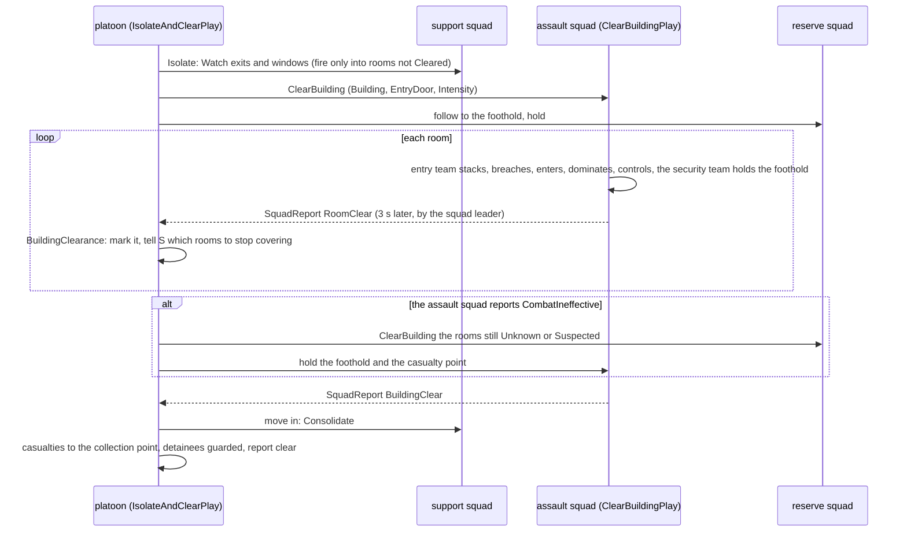
*What the picture shows that prose hid:* the platoon acts on REPORTS — three seconds stale — and the relief of a broken squad is
just the same `ClearBuilding` order to another squad over a record the platoon already holds.

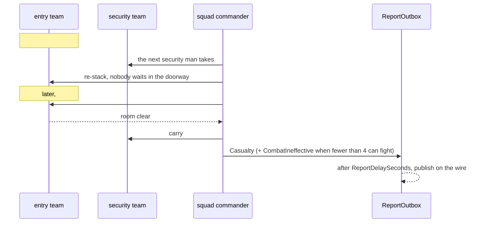
*What the picture shows that prose hid:* a casualty never stops a room — the room is finished first, the casualty moved after; the
squad's own `SquadMemberDown` reaction (casualty care) is held off while the play runs, and the platoon learns of it only by report.

## 5. Modules — who runs it each frame

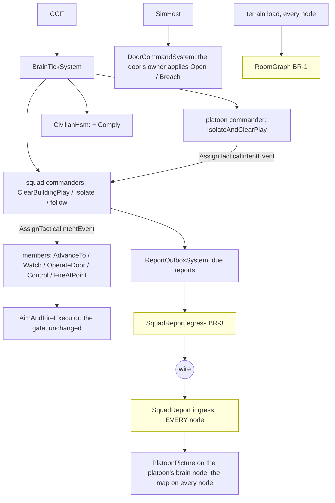
*Caption:* the yellow boxes are backend's; a report leaves the squad's node through the same event-topic path as a behaviour fault
(`BehaviorFaultReport`) and EVERY node takes it in — the platoon's brain builds its picture from it, the map can draw room marks
from it, a replay records it; nothing the platoon decides on is held in one brain only.

## 5a. Monitoring — reading the reports over HTTP *(lean, for review)*

**Decision (lean):** a **`SquadReportLog`** ring on every node — the `ShotLog` precedent — written by the report ingress (and by the
sender for its own reports), served by **`GET /squad/reports`**; and the platoon's **picture and room record** added to the existing
`GET /entities/{id}/squad`. ⭐ Because the reports are on the wire (R-2031), **every node's log holds the same reports** — the live check
asks CGF, SimHost and IG and compares them, which is the proof that nothing is hidden in one brain.

| route | answers |
|---|---|
| `GET /squad/reports?unit=&to=&kind=&since=&last=` | each report: `seq` · `kind` · `from` / `to` (network ids + names) · `subject` (network id) · `room` (id + name) · `position` · `count` · `sentAt` · `receivedAt` (⇒ the delay is visible) · `originNode` |
| `GET /entities/{platoon}/squad` *(extended)* | + `picture`: per squad its last report kind, age, men in the fight, combat effective · + `clearance`: per room `Unknown / Suspected / Cleared / Blocked`, cleared by whom and when, the people held there |
| `GET /entities/{squad}/squad` *(unchanged shape)* | the drill trace already shows `ClearBuilding`'s phases, events and member orders (Stack · Breach · Enter · Dominate · Control · Clear) |

Rejected: **`GET /events?type=SquadReportNotification` alone** — the 500-event ring of every type evicts a report in seconds of a
fight, and its payloads hold local entity ids · **a report component on the commander** — a component holds the last one, not the
history, and would be the brain-local state R-2031 rules out.
*(Owner: behaviors, in `CE-2263` — the debug API has taken squad routes from this lane before, `/entities/{id}/squad` O-a.)*

## 5b. A report's life — who makes it, how it travels, how the brain reads it, and how it ages *(✅ CB-31…CB-35 approved 2026-10-18, R-2039)*

🔒 User, `2026-10-18`: *"how the reports from subordinates work, who generates them, how they are transported to the brain, how brain
reads them, if they are buffered somewhere Or can age, so the brain doesn't act on old no longer valid ones"*.

**What §3–§5a already fix (R-2031, CB-15):** a squad's knowledge reaches its platoon ONLY as typed `SquadReport`s, sent by the squad
leader in the fight after `ReportDelaySeconds` (3 s), as an EVENT topic every node takes in (the `BehaviorFaultReport` precedent), logged
on every node (`SquadReportLog`, `GET /squad/reports`). ⛔ **What they did NOT fix:** when a report stops being true. Measured
neighbours: a soldier's own memory already ages — threat scores decay 0.1 / s and an untracked entry is forgotten below 0.5
(`PerceptionConstants.cs:44, 74`; `ThreatEvaluationSystem.cs:16-26`); the sensors design keeps open a *"Reported"* modality that feeds
that same memory (Sensors & Doctrine G10).

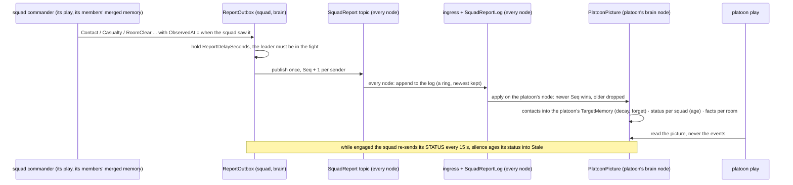
**Who holds what — one rule at EVERY level** *(✅ CB-36 approved 2026-10-18, R-2040; replaces the level table first written for CB-33)*

🔒 User, `2026-10-18`: *"Shouldn't the memory be hierarchical, like commander at each level having its own memory and sending reports up
the chain? What if there are three levels of command? … That doesn't sound like a sustainable model."*

**Measured today:** a soldier has a `TargetMemory`; a body-less squad commander has only `SquadCognitiveState.Contacts`, a pool
REBUILT from its members' memories at each merge (`SquadPerceptionMergeSystem.cs:38-72`) — so it cannot keep what its members forgot,
nor take in a report; a commander whose members are commanders gets an empty pool (they hold no `TargetMemory`).

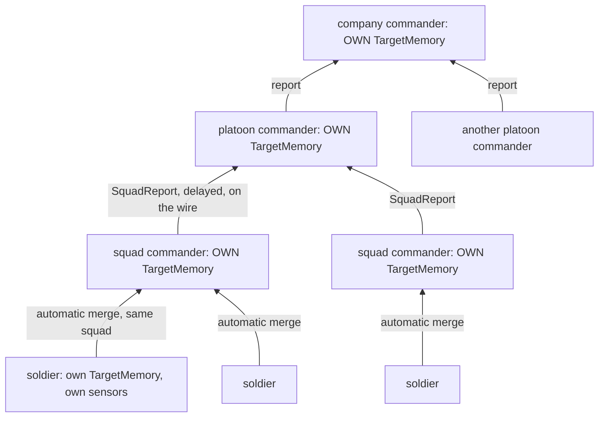
*What the picture shows that prose hid:* every commander knows only what its OWN direct subordinates gave it; nothing skips a level. The
company never sees a soldier; it sees what its platoons reported, which is what their squads reported, which is what their men saw —
three levels or ten, the same two rules.

| rule | ⭐ lean |
|---|---|
| **every commander has its own `TargetMemory`** | the same component a soldier has, at every level; it ages by the existing decay / forget (which already runs on every holder, body-less too, `ThreatEvaluationSystem.cs:81-82`) |
| **from bodied members: automatic** | a commander's memory takes in its SOLDIER members' memories automatically (today's merge — the squad hears its own men) |
| **from commander members: only reports** | ⛔ the automatic merge NEVER reads a subordinate COMMANDER's memory — otherwise the top would become omniscient by the back door; a subordinate commander is heard only through its `SquadReport`s (CB-15) |
| **a report is made from the sender's own memory** | a commander reports what IT knows (its memory), so a platoon's report to its company carries what its squads reported plus what its own bodied members (if any) saw |
| **the pool is a view of the commander's memory** | `SquadCognitiveState.Contacts` is built from the commander's own memory, so every existing pool reader (top contact, fire distribution, the runner) works at any level unchanged |
| **nothing flows down automatically** | a commander passes knowledge down only explicitly — a designated target in an order (exists), or a later "intel" report downward; never an automatic copy |
| **the topic is level-free** | `SquadReport` already carries `FromUnit` / `ToUnit`; any commander reports to its own superior through it |

| id | decision | ⭐ lean | rejected — one line each |
|---|---|---|---|
| **CB-36** | knowledge across the command levels | the table above: every commander owns a `TargetMemory`; soldiers feed it automatically, subordinate commanders only by report; reports go to the direct superior only, made from the sender's own memory; the pool is a view of it | the squad's rebuilt-only pool: it forgets what its men forgot and cannot take a report · the top commander merging everyone below: omniscient and unbounded · merging a subordinate commander's memory automatically: reports become decoration |

*What the picture shows that prose hid:* the brain never reads a report as an event — events last one frame. It reads the **picture**,
the buffer the reports are folded into, and the picture is where ageing happens. Three kinds of content age three different ways.

| content | kinds | buffered in | ages how | ⇒ the brain must not act on it when |
|---|---|---|---|---|
| **contacts** | `Contact`, `UnderFire` (its source), `SniperContact` | ⭐ a `TargetMemory` on the PLATOON commander, as a *Reported* entry (G10): position + error radius + `ObservedAt` | the **existing** decay and forget (0.1 / s, forgotten below 0.5 unless re-reported); a later report on the same subject refreshes it; `Contact` with `Count = 0` (lost / destroyed) clears it | it was forgotten — and every reader (`TopContact`, the threat ranking, the axis choice) already weighs a faded entry less |
| **status** | ⭐ a new `Status` kind (men in the fight, combat effective, ammo low, phase) + `CombatIneffective` | `PlatoonPicture`, one row per squad | **age = now − ObservedAt**; `Fresh` < 2 heartbeats (30 s while engaged), then `Stale`, then `Silent` after 60 s — silence is itself information (§6a: *"the platoon sees the silence as the squad's status age"*) | it is `Stale` or `Silent`: the play treats the squad as unknown (no new tasks that rely on it; Regular+ sends the reserve's leader to check) |
| **facts** | `RoomClear`, `RoomBlocked`, `BuildingClear`, `Detained`, `Foothold` | `BuildingClearance` / the picture | **do not decay** — durable until CONTRADICTED: a later `Contact` or `UnderFire` located in a Cleared room sets it back to `Suspected` | it was contradicted |

| id | decision | ⭐ lean | rejected — one line each |
|---|---|---|---|
| **CB-31** | the report's time | every report carries **`ObservedAt`** (when the squad saw it) beside `SentAt`; age is measured from `ObservedAt`, so the 3 s delay and the wire are counted in it | age from `SentAt`: a report held 3 s looks 3 s fresher than it is |
| **CB-32** | order and duplicates | a **`Seq`** per sender; for contacts and status the picture keeps the newest by `ObservedAt` and drops an older one that arrives late; facts are idempotent (a second `RoomClear` changes nothing) | trusting arrival order: the wire does not promise it across nodes |
| **CB-33** | reported contacts | they enter a **`TargetMemory` on the platoon commander** as a *Reported* entry (the G10 modality) with the reporter's error radius, and age by the existing decay / forget (measured: the decay runs on EVERY entity holding a `TargetMemory`, a body-less one too — `ThreatEvaluationSystem.cs:81-82`); ⭐ generalised to every level by **CB-36** below | a separate contact list in the picture: a second memory with its own forgetting rules, and no existing reader could use it |
| **CB-34** | status heartbeat | while engaged a squad re-sends **`Status` every 15 s** and at once on a change (a man down, effective lost); `Fresh` / `Stale` / `Silent` by age; not engaged: on change only | status only on change: a squad that went silent (all dead, radio-less) would look fine forever |
| **CB-35** | where the picture lives and how it survives | on the platoon's brain node, **rebuildable**: on an ownership handover or a late join the new owner replays its own node's `SquadReportLog` (every node holds the same log) and the heartbeat refreshes status within one period | replicate the picture as a component: a second copy of state the reports already carry (R-2031's rule is that the REPORTS are on the wire) |

⚠ **Changes to BR-3** (the `SquadReport` topic, backend, unstarted — `git merge-base` checked): the fields gain `ObservedAt` and `Seq`,
the kinds gain `Status` (with men in the fight, effective, ammo-low, phase in `Count` and a small flags field). Sent as
[`NOTE_Behaviors_To_Backend_Report_Ageing.md`](../../blueprints/batches/NOTE_Behaviors_To_Backend_Report_Ageing.md).

## 5c. What is reported up, what each level needs, and who processes it *(✅ concept approved 2026-10-18, R-2040; CB-41 superseded by CB-43 §5d; details in §5d)*

🔒 User, `2026-10-18`: *"Higher level commanders are usually not interested in the lowest details. What kind of report could the squad
commander report up, What kind of knowledge the platoon level commander actually needs … How this report processing will be
implemented … Note that different behaviors might need different reports and different kind of processing them."* · *"Use your real
world knowledge of doctrines and tactics and command"*.

**Doctrine** *(US Army FM 6-0 / ATP 6-0.5 command post and reporting, ATP 3-21.8 platoon and squad, the standard report formats)*:

| idea | what real forces do |
|---|---|
| **the commander says what he needs** | **CCIR** — the commander's critical information requirements: **PIR** (about the enemy: *"any machine gun on the objective"*, *"enemy reinforcing from the north"*) and **FFIR** (about own forces: *"a squad below 70 % strength"*, *"crossing phase line BLUE"*). Subordinates report those **at once**, everything else by routine or by exception |
| **standard formats, so a report is short** | **contact report** (*"contact, north, 200 m, two riflemen in the window, returning fire"*) · **SALUTE spot report** (Size, Activity, Location, Unit, Time, Equipment) · **SITREP** (where we are, what we do, our status) · **LACE / ACE** (liquids, ammunition, casualties, equipment — after contact and on consolidation) · **phase reports** (*SET* in position, phase line crossed, foothold, objective secure) · **requests** (CASEVAC 9-line, fire support, resupply, reinforcement, permission) |
| **one level up sees ELEMENTS, not men** | a squad reports *"enemy fire team, building C first floor, one MG"*, not seven contacts; the platoon reports *"enemy squad in buildings C and D"* to its company. Each level summarises for the next |
| **status as a colour** | combat power GREEN ≥ 85 % · AMBER 70–84 % · RED 50–69 % · BLACK < 50 % (combat ineffective); the same for ammunition |

**What the platoon commander needs to coordinate** *(what its plays actually read)*:

| play | about the enemy (PIR) | about own squads (FFIR) |
|---|---|---|
| `AttackPosition` / `AttackBuilding` | enemy elements by building / face / storey, their size and heavy weapons (MG, sniper, AT) — to pick the axis and the support-by-fire targets; reinforcement approaching | each squad's position, phase (SET, phase line, foothold, room / building clear), combat power and ammo colour — to time shift / lift fire and commit the reserve; requests |
| `DefendPosition` | enemy elements approaching or inside the engagement area, enemy outside a sector (flank) | posts manned (SET), combat power per sector, displacing — to reinforce or fall back |
| `UrbanMovement` | contact and its building | position on the route, crossings done, combat power |

**The report vocabulary (CB-37):**

| report | from → to | sent when | carries | the receiver folds it into |
|---|---|---|---|---|
| **CONTACT** | squad → platoon | the first shot or first sighting of a NEW element | direction · distance · element ref · own action | the element memory + an edge (urgent) |
| **SPOT** (SALUTE) | squad → platoon | an element is new, changes size / equipment / activity, moves > 25 m, or is lost | **S** count + size class (individual · team · squad · platoon) · **A** firing · moving · static · withdrawing · surrendering · **L** point + radius (+ building / storey from a PointSurvey) · **U** combatant class · **T** `ObservedAt` · **E** MG · sniper · AT · vehicle | the element memory |
| **SITREP** | squad → platoon | every 15 s engaged, 60 s otherwise, at once on a change (CB-34's `Status`) | position · task · phase · combat power colour · ammo colour | the status table (Fresh / Stale / Silent, CB-34) |
| **LACE** | squad → platoon | after contact and on consolidation, or when a colour changes | ammo · casualties (WIA / KIA count) · key equipment lost (MG, AT) | the status table |
| **PROGRESS** | squad → platoon | the play reaches it | SET · phase line · foothold · room clear · building clear · objective secure · displacing | the progress record / `BuildingClearance` (facts, CB-31…35) |
| **REQUEST** | squad → platoon | the play needs it | an id · CASEVAC · fire support at a location · resupply · reinforcement · permission | the inbox; answered by an ORDER down that cites the id |
| *behaviour-defined* | any | the play sends it | a registered payload | the inbox only (CB-41) |

**Aggregation (CB-38).** The sender summarises, never the receiver: a squad's **staff** clusters its contact pool into **elements**
(contacts within 15 m, or in the same building and storey once a PointSurvey places them), each with a count, a size class and
equipment flags, and reports elements. The platoon's memory holds **elements, not individuals**, and when it reports to a company it
clusters again, more coarsely (50 m, a building block). The same code at every level, with a radius that grows per level.

```mermaid
classDiagram
  direction LR
  class StaffComposer { <<NEW system, every commander, brain>> CONTACT and SPOT from its memory · SITREP heartbeat · LACE on change · ElementClusterer }
  class ReportOutbox { <<designed RP-1>> delay · leader in the fight }
  class SquadReportTopic { <<backend BR-3>> header + standard fields: KindId, Subtype, SPOT fields, Building + Position (no payload, CB-43) }
  class StaffInbox { <<NEW system, every commander, brain>> fold standard kinds · keep the last N per kind · raise ReportReceived }
  class ElementMemory { <<the commander's own memory, CB-36>> enemy elements, aged }
  class StatusTable { <<CB-34>> per subordinate: position, phase, colours, age }
  class InformationRequirements { <<NEW, in the ORDER>> PIR and FFIR: kinds + triggers + rate }
  class ReportKindRegistry { <<NEW>> standard kinds 1-99 · behaviour kinds 100+ with a payload DTO }
  class PlayNodes { <<NEW nodes, BTree HSM blueprint>> SendReport · ReadReports · WaitForReport · AnswerRequest }
  class SensorChangedEvent { <<existing 1-17, + ReportReceived>> }
  StaffComposer ..> InformationRequirements : what my superior asked for
  StaffComposer --> ReportOutbox
  PlayNodes --> ReportOutbox : task reports, custom kinds
  ReportOutbox --> SquadReportTopic
  SquadReportTopic --> StaffInbox : on the addressee's brain node
  StaffInbox --> ElementMemory
  StaffInbox --> StatusTable
  StaffInbox ..> SensorChangedEvent : ReportReceived
  PlayNodes ..> StaffInbox : ReadReports, WaitForReport
  ReportKindRegistry ..> StaffInbox : how to fold a kind
```
*What the picture shows that prose hid:* the report work is split exactly like EQS. The **staff** is generic engine systems doing the
same job for every play: composing standard reports, folding them, ageing. The **play** decides only three things: what it asks its
subordinates to report (the requirements in its orders), which task reports and custom kinds it sends, and how it reacts. No play
parses reports by hand, and no play is stuck with reports it never asked for.

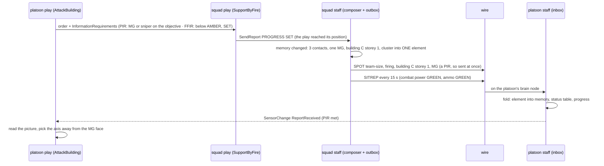
*What the picture shows that prose hid:* the platoon play never sees the squad's three contacts — it sees one element, at once because
it ASKED for machine guns, and it is woken by an edge, not by polling.

| id | decision | ⭐ lean | rejected — one line each |
|---|---|---|---|
| **CB-37** | what is reported | the doctrinal set: **CONTACT · SPOT (SALUTE) · SITREP · LACE · PROGRESS · REQUEST**, plus behaviour-defined kinds; status as GREEN / AMBER / RED / BLACK | free-form reports: every receiving play would need its own parser · forwarding raw contacts: the platoon would hold every soldier's sighting, which is what CB-36 rejects |
| **CB-38** | the level of detail | the **sender summarises into elements** (15 m or same building and storey at squad level; coarser per level); the receiver's memory holds elements | the receiver aggregating: it would need the raw contacts, sent upward |
| **CB-39** | where the processing runs | ⭐ **generic "staff" ECS systems on each commander's brain node** (Squad toolkit, behaviors): a composer (standard reports from memory and state, under the requirements) and an inbox (fold the standard kinds, keep the last N per kind, age, raise `SensorChange.ReportReceived` 18). ⛔ **Not a backend service** — backend owns only the wire (BR-3); ⛔ **not per-play code** for the standard kinds | each play composing and parsing its own reports: the same SALUTE code in every play · a central service: it would hold every commander's knowledge in one place, against R-2031 |
| **CB-40** | different plays need different reports | **information requirements in the ORDER** (CCIR): each play declares defaults (its PIR / FFIR: which kinds, which triggers, which rate) and sends them down with its order; the subordinate's staff reports those at once and the rest by routine | every subordinate reporting everything: noise and wire load for nothing · the receiver filtering: the sender still pays for it |
| **CB-41** | custom reports | a **report kind registry**: standard kinds 1–99 folded by the staff; behaviour kinds 100+ declare a small payload DTO (in the one DTO registry, Orders F9) and are **inbox-only** — the play reads them with `ReadReports` / `WaitForReport`; a REQUEST is answered by an order that cites its id (`AnswerRequest`) | a new topic per behaviour: the wire would grow with every play |

⚠ **The §3 `ReportKind` list maps onto this set** (it stays the clearing's vocabulary, now as kinds of the doctrinal reports): `Contact` → CONTACT / SPOT · `UnderFire` → CONTACT + SITREP · `Casualty` → LACE · `RoomClear`, `RoomBlocked`, `BuildingClear`, `Detained` → PROGRESS · `CombatIneffective` → SITREP BLACK.

⚠ **Changes to BR-3 again** (still unstarted): the header gains `KindId` (ushort, the registry) and a small `Payload` (≤ 64 bytes); the
SPOT fields (size class, activity, equipment flags) ride in the standard fields; CB-34's `Status` is the SITREP. Folded into
[`NOTE_Behaviors_To_Backend_Report_Ageing.md`](../../blueprints/batches/NOTE_Behaviors_To_Backend_Report_Ageing.md) (re-stamped).

## 5d. Inside a commander — how requests arrive, who reads the reports, and how a report changes a decision *(⭐ leans CB-42…CB-47, 2026-10-18)*

🔒 User, `2026-10-18`: *"CB36 approved. Report concept apptoved, solution details needed. It is still not clear to me How the requests for
reports are communicated … what part of the commander entity is reading and processing these reports? … Commander might need some kinf of
report processing 'brain' running on top of his decision tree. Is that the standard operation procedure feature we are having, or do we
need something else? … there is probably some closed set of all kinds of possible reports … Maybe this is the real use case for the
hierarchical setup, that one behavior on top is using a sub-behavior as its own node, or maybe some parallel regions in hierarchical state
machine or something? and maybe with commender's SOP on the very top?"*

**What a commander entity already runs** *(measured)*:

| layer | built | where |
|---|---|---|
| **SOP slot** — always ticking, woken at once by a `SensorChangedEvent` on the unit | ✅ | `BrainTickSystem.TickSopSlots` (`BrainTickSystem.cs:220-246`); body-less commanders run one (`BasicSquadSop` on the squad entity) |
| **task slot** — ONE task; a **reaction** started by the SOP pauses it and it resumes in place after | ✅ | `BehaviorIngressSystem.cs:258-265, 459-485` (R-199, `CE-2081`) |
| **HSM parallel regions** — every region ticks each frame | ✅ | `StateFlags.IsParallel` (`HsmKernelCore.cs:303-305`); rail ⑥ |
| **polled transitions with guards** — re-checked while a state runs | ✅ | `CE-381` / `CE-382` |
| **a state or a node hosts another behaviour of any tier** | ✅ | E5 (HSM hosts a BTree), E6 (BTree hosts BTree), S5a / S5d (any tier hosted, blueprint `Run Behaviour`) |
| **`SensorChangedEvent`** carries `Unit`, `Sensor`, `Target` (entities) + the change | ✅ | `SensorChangedEvent.cs:78-90` |

⇒ ⭐ **No new "brain" is needed.** The layering the user describes — SOP on top, the play below, sub-behaviours and parallel regions
inside it — **already exists**. What is missing is the layer UNDER all of them: the staff, which turns reports into the commander's
senses.

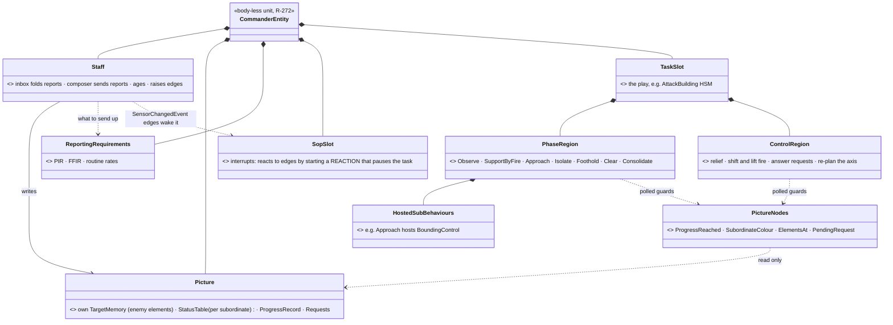
*What the picture shows that prose hid:* reports never reach a behaviour directly. The staff turns them into the commander's
**picture** — exactly as perception turns rays into a soldier's memory — and every behaviour layer reads that picture: the SOP through
edges (for interrupts), the play through guards (for its own plan). The superior's REQUEST for reports is just a component the staff
reads.

**How a report changes a decision — three routes, by how big the change is:**

| the report means | route | example |
|---|---|---|
| **the plan moves on** | a **polled guard** on the play's phase region | `ProgressReached(assault squad, Foothold)` ⇒ Foothold → Clear; every `RoomClear` + `BuildingClear` ⇒ Consolidate |
| **adjust inside the plan** | a guard in the play's **parallel control region**, the phase keeps running | SITREP `BLACK` from the assault squad ⇒ order the reserve to relieve it · PIR met: an MG on the entry face ⇒ re-run the axis choice · `PhaseLine 30 m` ⇒ order the SBF to shift fire · a CASEVAC REQUEST ⇒ answer it with an order |
| **drop the plan for something else** | an **SOP reaction** (pauses the task, it resumes after) | `FiredOnFromStructure` while on `UrbanMovement` ⇒ `ReactToFireFromBuilding` (§11 of Defend_And_Attack); a subordinate `Silent` for 60 s ⇒ a check-in reaction |

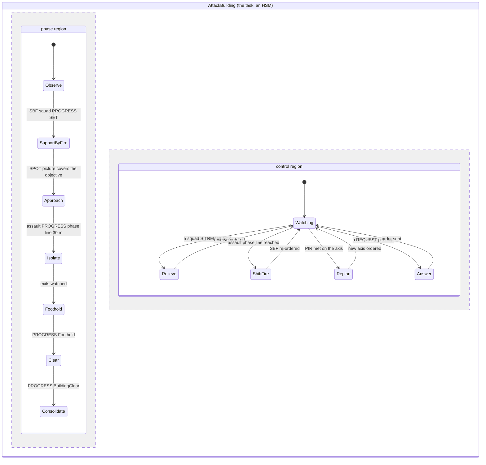
*What the picture shows that prose hid:* the commander does NOT have to choose between following its plan and listening to reports. The
phase region advances the plan; the control region, ticking in parallel, adjusts it. Both read the same picture. Only a report that
should abandon the plan goes through the SOP.

**How the superior's requests travel (CB-42):** they are NOT a new event. They are a field of the **order** — every play's params DTO
carries one common `InformationRequirements` block (PIR: element kinds, equipment, area; FFIR: colours, phases; routine rates). The
behaviour ingress (the one gate) stamps it into a **`ReportingRequirements` component** on the subordinate commander when it admits
the order, and clears it when the order ends. The subordinate's staff reads that component. Changing only the requirements mid-task is
a small order-update event that the same ingress applies without restarting the task. The order is already on the wire, so the
requirements cross nodes with it.

**The closed set (CB-43, replaces CB-41's registered payloads):**

| kind | subtypes (closed enums, extended only in code) |
|---|---|
| CONTACT | — |
| SPOT | size class · activity · equipment flags |
| SITREP | colours (strength, ammo) · phase |
| LACE | ammo · WIA · KIA · equipment lost |
| PROGRESS | Set · PhaseLine · Foothold · RoomClear · RoomBlocked · BuildingClear · ObjectiveSecure · Detained · Displacing · FallingBack |
| REQUEST | Casevac · FireSupport · Resupply · Reinforce · Permission |

| id | decision | ⭐ lean | rejected — one line each |
|---|---|---|---|
| **CB-42** | how requests for reports travel | in the ORDER (a common `InformationRequirements` block in every play's params), stamped by the ingress into `ReportingRequirements` on the subordinate; a requirements-only update event changes it without restarting the task | a separate request event: two messages that can disagree about one task · requirements read from the running task's params by the staff: the generic staff would have to know every play's DTO |
| **CB-43** | the report kinds | **a closed set**: the six kinds with closed subtype enums (table above); a new subtype is a code change; ⛔ no behaviour-registered payloads | registered payload kinds (CB-41 as first written): an open vocabulary nobody can read generically |
| **CB-44** | who reads the reports | **the staff** (engine systems, always on, under every behaviour): folds them into the picture, raises edges. Behaviours read only the picture | each behaviour reading the inbox: the same folding in every play, and a report missed while a different state runs |
| **CB-45** | how reports reach decisions | three routes: polled guards on the play's **phase region** (the plan moves on) · guards in a **parallel control region** (adjust the plan) · an **SOP reaction** (drop the plan for another, resume after) | everything through the SOP: every adjustment would pause the plan · everything inside the play: a play could not be interrupted by something it never anticipated |
| **CB-46** | the picture nodes | one set of shared C# guards, conditions and utility inputs, usable from BTree, HSM and blueprint alike: `ProgressReached(unit, kind)` · `SubordinateColour(unit)` · `SubordinateFresh(unit)` · `ElementsAt(area, size, equipment)` · `PendingRequest(kind)` · `PirMet(index)`; plus actions `SendReport(kind, subtype, …)`, `AnswerRequest(id, order)` | a node per play: the same questions answered differently |
| **CB-47** | the commander's own reports up | the staff composes the standard ones (SPOT from its memory, SITREP, LACE) under ITS superior's requirements; the play sends PROGRESS and REQUESTs with `SendReport` at its decision points | the play composing everything: every play would re-implement SALUTE |

⚠ **BR-3 again:** CB-43 drops the free `Payload`; a report carries `KindId` + `Subtype` + the fixed fields. The amendment note is
re-stamped.

#### BR-3 as built *(backend, `CE-3250`, `2026-10-18` — cross-lane fold by backend; the report-ageing note's fields all in)*

| piece | as built | where |
|---|---|---|
| the local event | ⭐ `SquadReportNotification` (managed; the Command Chain §3 box of that name) — the ENVELOPE `FromUnit`, `ToUnit`, `Subject`, `Building` (−1 none; a room is a point inside it), `SentAt`, `OriginNodeId` (0 = raised on this node) around behaviors' **`CommandReport`** (`CE-2291`: `Kind` `ReportKind` 1–6, `Subtype` `ProgressKind` / `RequestKind`, `At`, `Radius`, `Count`, `Size`, `Activity`, `Equipment`, `Strength`, `Ammo`, `Wia`, `Kia`, `Phase`, `ObservedAt`, `Seq`, `Synthetic`) — ONE report vocabulary for the outbox, the notification and the wire | `FDP/Toolkits/Fdp.Toolkits/Squad/Command/SquadReportNotification.cs` |
| the wire | event topic `"SquadReport"` (`dtSquadReport` 146): the envelope with units / subject as network ids + `CommandReport`'s fields one for one | `Hrot.Network.NED/SquadReportMessages.cs` |
| egress | sends the reports raised HERE (`OriginNodeId` 0; an arrived one is never re-sent); a unit or subject with no network id ⇒ refused, `RefusedCount` | `SquadReportEgressTranslator` |
| ingress | raises `SquadReportNotification` on every other node (own sample skipped), units as that node's entities (null when not known yet); an unknown kind still arrives, `UnknownKindCount` | `SquadReportIngressTranslator` |
| installed | ⭐ BOTH in `SharedTranslatorPack` (every node — a synthetic report over HTTP may be raised on any node; R-3015) | — |
| replay | recorded and played back like every managed bus event (no `NoReplay`) | rail `CE3250_ReplayRecordsAReport_AndPlaysItBack` |
| ⛔ not here | the sender (`ReportOutbox` / staff, `CE-2293`), the log + `GET /squad/reports` (§5a) | behaviors |

⛔ **SUPERSEDED the same day, at backend's merge of behaviors' `CE-2291` CC-A:** the first build carried its own `SquadReportEvent`
with its own enums (`ReportKindId`, `ProgressSubtype`, `SpotSize`, `ReportColour` …) — a second copy of `CommandReport`'s closed set.
Rebased onto `CommandReport` before it was pushed; ⚠ dropped with it: `RequestId` (a REQUEST is named by its sender + `Seq`, as
`PendingRequest` already does).

## 6. Decisions *(✅ APPROVED 2026-10-18 — R-2030 … R-2033)*

| id | decision | ✅ ruled | rejected — one line each |
|---|---|---|---|
| **CB-1** | where rooms come from | **backend derives a room graph at load from the wall panels** (rooms per storey, portals with their two rooms, corners, `RoomOf`) — ONE producer for clearing, sound v2 and blast W-7v2 | rooms authored per template: a second copy of the walls · a flood-fill in behaviors: every reader re-derives it |
| **CB-2** | the shape *(revised on review)* | ⭐ **a PLATOON**: the **support squad** isolates (Watch exits and windows from outside), the **assault squad** clears, the **reserve squad** follows to the foothold and relieves; inside the assault squad the **entry fire team** clears and the **security fire team** holds the foothold and hallway, guards the held, and takes the next room (they swap). A squad given `ClearBuilding` alone (no platoon) keeps both fire teams inside | ⛔ SUPERSEDED: one squad's second team isolating from outside — four men cannot seal a house AND clear it |
| **CB-3** | entry | **Battle Drill 6**: stack on one side, #1 nearest; points of domination; **two-man entry** under 12 m² or with 2–3 men | fixed "#1 left": wrong at a corner door · all to the centre: a crossfire |
| **CB-4** | sectors | **a TARGET filter now, the eyes later** (LD-1); before the gate, never instead | wait for LD-1 · none: two men fire across each other |
| **CB-5** | whom to shoot | **no new firing rule** — the gate's status / conduct / hands-up / neutral-in-line holds already are doctrine's PID | a CQB "shoot anyone armed": breaks AW-21 |
| **CB-6** | grenades | **Precision** (default): no fragmentation; a stun grenade only into a Suspected room · **HighIntensity**: fragmentation into a Suspected room with no non-combatant known — and never with a friend within the munition's lethal radius of the aim point | always one: kills the civilians · never: loses the high-intensity case |
| **CB-7** | the civilians *(ruled on review)* | **control**: a soldier covers and orders down; the civilian HSM's **`Comply`** (hands up, kneel, stay; wins over Panic while controlled). 🔒 **One who REFUSES is let be — even protesting, shouting, insulting — and only watched. One who ATTACKS gets a rifle-butt strike: `Melee.Strike`, the existing 3 s knock-down (reused, no new stun); then he is ordered down again; a second attack ⇒ detained.** A covert insurgent who draws commits his act (AW-16) | ignore them · shoot the non-compliant: not doctrine, breaks CH-1 · a new stun effect: the knock-down already gives the window |
| **CB-8** | the search | 3 s per complying person after "room clear"; a Hidden weapon ⇒ laid down, **detained** (out of the fight); none ⇒ **held** in place; v1 no escort | escort everyone: a drill of its own · no search: the covert one is never found |
| **CB-9** | room state *(revised on review)* | **`BuildingClearance` on the CLEARING ECHELON's commander** — the platoon when there is one (a relieving squad continues it), else the squad; built from `RoomClear` / `RoomBlocked` reports, so every node can rebuild it (R-2031) | ⛔ SUPERSEDED: brain-local on the squad — a relief would start over, and it hides state in one brain |
| **CB-10** | room order | nearest uncleared room by a portal from a Cleared one; hallways and stairs are rooms; bottom-up, `Entry: Roof` flips it | top-down always · a pre-planned route |
| **CB-11** | doors | **#1 is the breacher**: Open (1 s), locked ⇒ Breach (3 s); a door that cannot be opened or breached ⇒ the room **Blocked**, skipped, reported | a separate breacher · explosive breach (later) |
| **CB-12** | contact from an uncleared room | **limited penetration**: no entry under fire through the doorway; fire from beside it; enter after 3 s quiet — ⚙ refined by CB-22: the doorway is pied (`SliceThePie`) before entry | enter under fire · abort the building |
| **CB-13** | v2 | top-down by default · explosive breach · escort to a collection point · mouse-holing · two clearing squads on two floors | — *(swapping fire teams moved INTO v1 — CB-2)* |
| **CB-14** | the defenders | no new insurgent behaviour: `CombatPosture` in a room; the covert insurgent reuses B3 | a barricade behaviour now |
| **CB-15** | knowledge up the chain *(ruled on review)* | ⭐ **inside a squad: automatic, as today. Squad → platoon: typed `SquadReport`s** (Contact · UnderFire · Casualty · RoomClear · RoomBlocked · BuildingClear · CombatIneffective · Detained), sent by the **squad leader in the fight** after **`ReportDelaySeconds` (default 3 s, on the unit's type)**; silent during the leader-down lull. 🔒 **On the wire — every node takes it in, nothing hidden in one brain** (R-2031). The one seam a radio model (range, jamming, G10's Reported modality) plugs into later | automatic at the platoon: an omniscient reserve commit · a full radio net now: no reader needs it |
| **CB-16** | a squad as a member *(found measuring)* | **combat effective**: a unit member is in the fight while ≥ `MinEffective` (default 4, or half its roster) of its men are; the runner's `Live(i)` and the centroid read it | the unit's own `Health`: a squad has none, and a sum would hide a wiped-out team |
| **CB-17** | casualties | the room is finished first; §6a | stop the room for a casualty: the doorway is the fatal funnel |
| **CB-18** | the isolating squad's fire | it fires only into rooms not Cleared, and stops as rooms are reported clear (doctrine's "shift fire"); ⚠ the friend-in-the-line hold is backend's B-15 (open) — until it lands the support squad watches and fires only at an exit or a window of a room the platoon holds as Unknown | free fire at the building: fratricide through a window |
| **CB-19** | search, detain, restrain *(ruled 2026-10-18, R-2032)* | **interaction kinds** on `EntityInteractionRequest` (R-221): the soldier asks, the civilian's OWNER applies — **Search** (3 s: a Hidden weapon becomes visible, laid down), **Detain** (the replicated `Detained` flag), **Restrain** (hands tied) — so it works across nodes and every node sees the result | a brain-local timer: the result hidden in one brain · a direct write: the soldier's node may not own the civilian |
| **CB-20** | what ui draws *(R-2032)* | new **gesture** values on the replicated gesture byte: `Searching` (the searcher), `HandsOnHead` (complying, searched), `Restrained` (hands behind the back), `CoverHead` (fear); kneeling = the existing Crouched stance | a pose component per activity: a second channel beside the gesture ui would merge |
| **CB-21** | leaning *(R-2032)* | a replicated **`Lean` body state** (None · Left · Right): the eye point shifts ≈ 0.4 m sideways (he sees round the corner), his hit silhouette shrinks to what is exposed, ui draws the tilt; the weapon leads — `Aimed` while leaning; the eyes' direction is LD-1's | a stance value: stance is height, a man leans crouched too · no lean: corners taken fully exposed |
| **CB-22** | corners *(R-2032)* | **`SliceThePie`**: small steps on an arc outside a corner or a doorway, leaning, weapon first, until the space beyond is seen — always at hallway corners, junctions and stairs; at a doorway **under contact** (replaces CB-12's "fire from beside the door": pie the room, then enter); otherwise rooms keep Battle Drill 6's fast entry | pie every room: doctrine wants speed at the stack · never pie: the corners |
| **CB-23** | escort *(R-2032)* | v2 — but its pose is fixed now: a `Restrained` man walking beside a soldier who holds him (a "led" mode, the person-carrier pattern) | build it now: no demo needs it yet |
| **CB-24** | the civilians' poses *(ruled 2026-10-18, R-2032)* | **Cower** (frightened, no shelter): **Prone + `CoverHead`** (was Crouched) · **Comply** (ordered down): **Prone + `HandsOnHead`** · searched: stays Prone + `HandsOnHead`, the searcher Crouched + `Searching` · detained: Prone or kneeling + `Restrained`. ⭐ **`ThreatDanger.ShowsHandsUp` counts `HandsUp`, `HandsOnHead`, `Restrained` — never `CoverHead`**: covering the head is fear, not surrender | one "head" gesture: a frightened Hostile would read as surrendering · Cower kept crouched: people under fire drop flat |
| **CB-25** | the objective *(ruled 2026-10-18, R-2033)* | one order setting **`Objective: Eliminate \| Arrest`** + an optional **`CaptureTarget`** (named people to take alive), on `IsolateAndClear` and `ClearBuilding`; police (SecurityForce) units default to Arrest, soldiers to Eliminate — the same drill, a setting | a separate police drill: the whole play twice |
| **CB-26** | Arrest's force *(R-2033)* | **everyone is judged by conduct** (AW-21's path, insurgents included) and the escalation ladder (§5k) reaches status combatants: **challenge** ⇒ complies: control, search, restrain, detain · refuses or resists without aiming: **non-lethal** (the butt / baton knock-down now; taser / spray when G5 lands) · aims or fires: **lethal** (self-defence, built). A `CaptureTarget`: non-lethal preferred even armed; lethal only to save a teammate | Arrest = never fire: police fire when a life is threatened |
| **CB-27** | shouting *(R-2033)* | **speech is data** — G1's targeted, replicated `Utterance` (`CE-2249`, backend's component): Challenge · commands Down / Freeze / HandsUp / DropIt / ComeOut · Announce at the door · team calls Clear / ManDown. The TARGET's brain reads the commands addressed to him. A prerequisite of Arrest; Eliminate works without it (`Gesture.Warning`). ⭐ The ladder's brain-local `WarningLog` becomes a reader of utterances — R-2031 | shouting as ui decoration only: nobody could answer it |
| **CB-28** | the challenged answer *(R-2033)* | a civilian: Comply or refuse (CB-24) · an insurgent: a new **`SurrenderDecision`** — challenged AND covered by ≥ 2 guns ⇒ he surrenders if his **`Resolve`** allows (the existing `Surrender` behaviour, now Prone + `HandsOnHead`; a fanatic, Resolve 1, never), else fights or flees | no decision: an insurgent never gives up, an Arrest ends in a firefight |
| **CB-29** | capture and delivery *(R-2033)* | restrain ⇒ **escort** (CB-23, v1 for Arrest) ⇒ board a vehicle (the Embark / LoadCasualty pattern) ⇒ move to the delivery point ⇒ hand over; the mission succeeds when he is **delivered alive** | leave him in place: the capture mission never ends |
| **CB-30** | stun grenades *(R-2033; widens CB-6)* | **Arrest:** a flashbang before EVERY room not Cleared · **Eliminate + Precision:** a stun into a Suspected room, and always a stun (never fragmentation) when non-combatants are known · **Eliminate + HighIntensity:** fragmentation into a Suspected room with none known, a stun when one is. The drill **"bang out"**: #1 opens, #2 throws, the stack waits OUT of the doorway behind the wall for the bang (≈ 1.5 s fuze), enters within 1 s on it — the window is up to 8 s (the existing stun grenade 6037: 8 m, 8 s, scaled by falloff and walls, `AreaEffectSystem.cs:221`). No throw when a friend would get more than 0.5 s of stun at his position (the same falloff and barrier) | before every room always: wasted under Eliminate · never in Arrest: it is the police's main tool against having to shoot |

## 6a. Casualties and edge cases *(approved)*

| case | behaviour |
|---|---|
| a man hit BEFORE entry | the entry stops; the next security man fills his place; re-stack — nobody stands in the doorway |
| a man hit INSIDE | the others widen their sectors, finish the room; then the security team carries him to the casualty point (the R-2012 medic, the existing carry) |
| the squad's `SquadMemberDown` reaction | held off while `ClearBuilding` runs (the play owns its casualties) |
| the entry team down to one man in the fight | the fire teams swap roles |
| fewer than `MinEffective` can fight | `CombatIneffective` report ⇒ the platoon sends the reserve to `ClearBuilding` what is left; the remnant holds the foothold and the casualty point |
| the squad leader falls | the existing succession and its 6 s lull (no reports in it); the team leader inside finishes the room |
| an insurgent raises his hands / is incapacitated | not shot (the existing gate); searched, detained (`Detained` report) |
| a civilian refuses | let be, watched — never forced, never shot for it (CB-7) |
| a civilian attacks | rifle-butt knock-down (`Melee.Strike`), ordered down again; a second attack ⇒ detained |
| a covert insurgent draws during the search | the covering man fires — the conduct rule frees him (AW-16) |
| fire from a room already Cleared | it goes back to Suspected; the security team engages; cleared again |
| an insurgent runs out | the support squad engages him (a combatant by status); a fleeing civilian is only controlled |
| a friend within the grenade's lethal radius of the aim point | no grenade |
| a door that cannot be opened or breached | the room Blocked, skipped, `RoomBlocked` report; the platoon decides (explosive breach later) |
| the report sender is down | nothing goes up until succession; the platoon sees the silence as the squad's status age |

## 7. Slices *(owners; behaviors ids `CE-2257`…`CE-2261`, `CE-2262`…`CE-2264`)*

| order | slice | owner | what | needs |
|---|---|---|---|---|
| 1 | **SL-0** `CE-2262` | behaviors | **the squad layer one echelon up**: `CombatEffective` (CB-16) read by `Live(i)` and the centroid; the `Unit_InfantryPlatoon` composite type (three squads, body-less, runs the commander SOP); a rail that runs a platoon ordering a squad commander a drill (`SquadMarch`) on a nested-hierarchy scenario — the first time one is exercised | — |
| 2 | **RP-1** `CE-2263` | behaviors | **the report step** (CB-15): `SquadReport` + `ReportKind`, `ReportOutbox` (delay, leader in the fight, silent in the lull), `PlatoonPicture` taken in from the wire; Contact / UnderFire / Casualty / CombatIneffective first; the monitoring (§5a: `SquadReportLog`, `GET /squad/reports`, the platoon's picture on `/entities/{id}/squad`) | backend BR-3 |
| 3 | **BC-1** `CE-2257` | behaviors | one room, one squad: `RoomEntryPlan` + entry / security fire teams, Stack · Breach · Enter · Dominate · Clear, `SectorFilter`; demo `bc-room-clear` | BR-1 |
| 4 | **BC-2** `CE-2258` | behaviors | civilians: `Control`, `Comply`, search, held / detained, the refusal rule and the butt-stroke (CB-7); demo `bc-room-civilians` | BC-1 |
| 5 | **BC-3** `CE-2259` | behaviors | the building, one squad: `BuildingClearance`, next room, hallways, stairs, the fire teams swapping, RoomClear / RoomBlocked reports; demo `bc-house-clear` | BC-1, RP-1 |
| 6 | **PL-1** `CE-2264` | behaviors | **the platoon** `IsolateAndClear`: isolate (CB-18), foothold, clear, relieve on `CombatIneffective`, consolidate; `BuildingClearance` on the platoon; demo `bc-platoon-house` | BC-3, SL-0, RP-1 |
| 7 | **BC-4** `CE-2260` | behaviors | grenades by `Intensity` (CB-6); demo `bc-house-high-intensity` | BC-3, BR-2 |
| 8 | **BC-5** `CE-2261` | behaviors | contact and casualties (CB-12, §6a); demo `bc-house-defended` | BC-3 |
| 0 | **CP-1** `CE-2265` | behaviors | the civilians' poses (CB-24): Cower Prone + `CoverHead`; the four gesture values; `ShowsHandsUp` counts HandsOnHead / Restrained, never CoverHead — buildable now | — |
| — | **BR-1** … **BR-5** | backend | the room graph + a CQB test house · stun holds every class · the `SquadReport` topic · the Search / Detain / Restrain interactions · the `Lean` body state | [handoff 1](../../blueprints/batches/HANDOFF_Behaviors_To_Backend_Building_Clearing.md) (BR-1, BR-2) · [handoff 2](../../blueprints/batches/HANDOFF_Behaviors_To_Backend_Building_Clearing_Reports.md) (BR-3) · [handoff 3](../../blueprints/batches/HANDOFF_Behaviors_To_Backend_Building_Clearing_Interactions.md) (BR-4, BR-5) |

### 7.0 As built — SL-0 *(`CE-2262`, 2026-10-19)*

| piece | as built | where |
|---|---|---|
| combat effective (CB-16) | `CombatEffective.IsInTheFight(view, member)`: a soldier by `Injury.IsInTheFight`; a UNIT (`UnitEntity`) while ≥ `MinEffective(n)` = min(4, ⌈n/2⌉) of its roster members are, recursively (a platoon counts its squads, ≤ 6 levels). ⚠ Two edges decided while building: a unit with **no** `UnitRoster` is taken as in the fight (nothing to judge by — what the existing unit-member rails build); a roster that **emptied** (its men destroyed, `UnitHierarchySystem` drops them) is out of it | `FDP/Toolkits/Fdp.Toolkits/Squad/CombatEffective.cs` |
| the runner | `SquadPlayContext.Live(i)` reads `CombatEffective` ⇒ a wiped-out squad gets no order and holds no bound | `SquadManeuverRunner.cs` |
| the centre | `UnitCentroidSystem` counts a unit member only while it is combat effective (a soldier member: alive, as before) | `UnitCentroidSystem.cs` |
| the platoon type | `Unit_InfantryPlatoon` **305**: infantry arm, platoon echelon, roster 3 × `Unit_InfantrySquad`, a brain, ⚠ **no default SOP yet** (`BasicPlatoonSop` is CC-D, `CE-2294`) | `TkbEntityTypes.cs`, `BdcTkbCatalog.cs`, `BehaviorCatalog.cs` (Commander list) |
| the nested run | ✅ the existing runner already orders a UNIT member with an ORDER (`CE-2141`): a platoon marching its squads sends each `Order.Move` / `Order.Hold`, and each squad resolves it by its own class (`InfantrySquadMove` → its own `SquadMarch`). Nothing new was needed for that | rail `SquadManeuverTests.CE2262_…`; demo `sl0-platoon-march` |

Rails: `SquadCoordinationSystemTests.CE2262_*` (the rule, an emptied roster, the platoon's centre) · `SquadManeuverTests.CE2262_*` (a
platoon marching three squads orders the two effective ones and not the wiped one) · `NedTkbBuilderCombatTests.CE2262_*` (the type).
Demo `sl0-platoon-march` (test-town, ids 5001–5022): ① the platoon runs `SquadMarch` · ② Alpha and Bravo fulfil its order their own
way · ③ Charlie (every man dead) is given nothing · ④ the men reach the objective area · ⑤ the platoon stands with its effective squads.

### 7.1 BC-1 in detail — one room, one squad *(`CE-2257`, behaviors, 2026-10-19 — Urban Battle §5 step 3's first slice; build-state: BUILT (§7.1a) — leans CB-48…CB-56, built under the user's "go ahead autonomously")*

📐 **Measured first (INVENTORY, 2026-10-19 — reads of `StackAndRoomEntryManeuver` (the stub: phases Stacking · Entering · Cleared ·
Aborted, roles PointMan · BreachCover · Secondary, no play; only a role-matrix test uses it), `DoorNodes` (`MoveToDoor`,
`OperateDoor` keyed by a door's terrain-object key), `OpenDoorExecutor` (a locked door REFUSES Open ⇒ Failure; Breach forces it),
`SquadManeuverRunner.Issue` (Hold · Watch go to `CombatPosture` with the post and the `MemberArc` sector), the `WorldSurvey`
BuildingSurvey answer (rooms with corners and storey; portals with `RoomA`/`RoomB`, `DoorState` — ⛔ **no door key**), and
`ProgressKind.RoomClear` / `RoomBlocked` in the closed report set):** everything the drill needs exists except the play, the plan,
one member order, and the door's key on the portal.

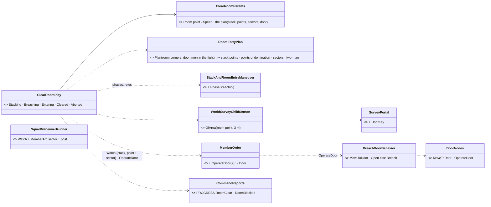
*What the picture shows that prose hid:* the entry itself is no new behaviour — a man "enters" by the existing `Watch` order to his
point of domination with the existing sector road; the only new member behaviour is the door, and it is built from the door nodes.

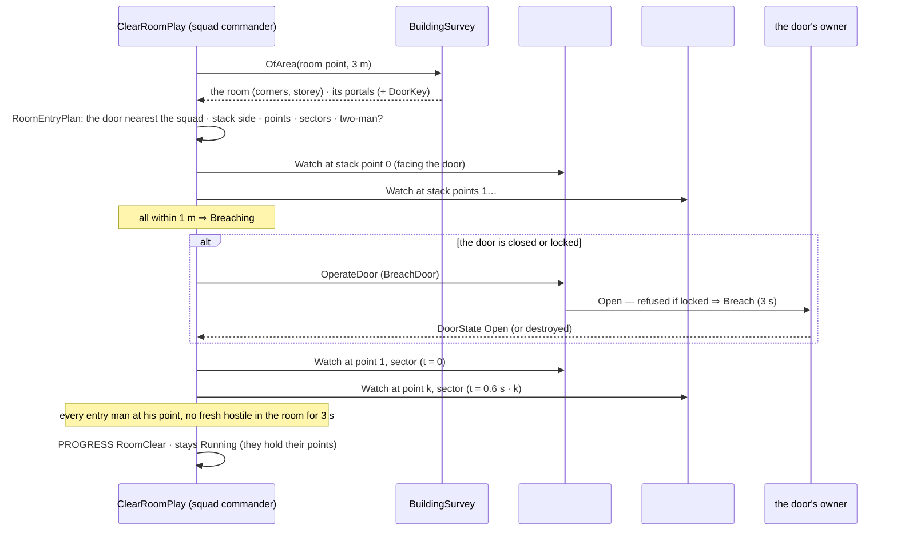
*What the picture shows that prose hid:* the door is the only step that waits on another node — everything else is the squad's own
orders, re-issued as the phase moves.

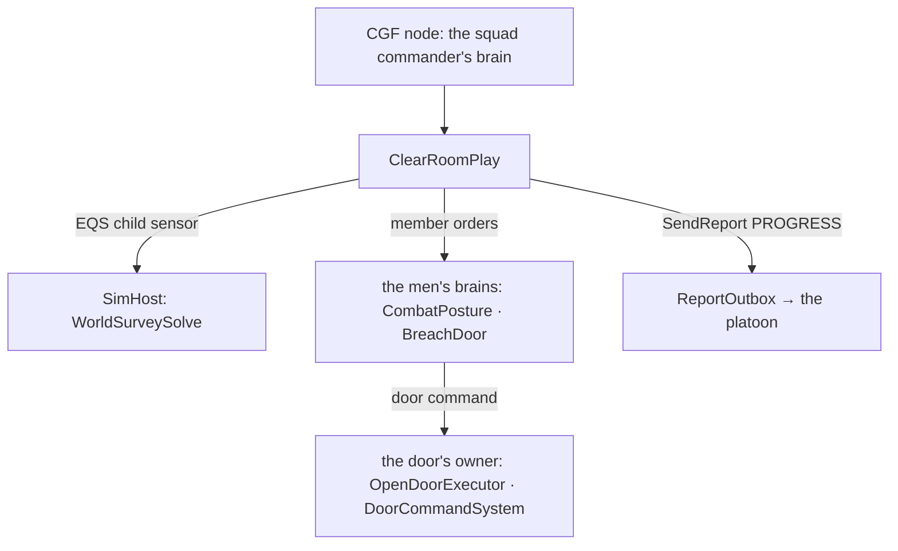
*What the picture shows that prose hid:* no new system — the survey road, the member-order road, the door-command road and the report
road all exist.

| id | decision (⭐ lean) | rejected — one line each |
|---|---|---|
| **CB-48** | **the order**: `ClearRoom {Room: a point inside it, Speed}` — one squad clears ONE room; BC-3's `ClearBuilding` sequences it room by room | a building order now: the room drill must stand first |
| **CB-49** | **room and door from the survey**: `OfArea(point, 3 m)` ⇒ the room whose quad holds the point at its storey; the door = its portal (door or gap) nearest the squad's centre; none ⇒ PROGRESS RoomBlocked, the play fails | an authored door: the order would need to know the house · the room nearest the point: the wrong storey |
| **CB-50** | **the stack** (CB-3): on the side of the door with LESS room behind the wall (so #1 flows to the open side), outside the room, 0.6 m off the wall, #1 0.6 m past the jamb, 0.8 m apart | always left: wrong at a corner door · in front of the door: the fatal funnel |
| **CB-51** | **points of domination**: a third into the room, 1 m off the side walls — #1 the open side, #2 the stack side, #3 / #4 halfway in on the same sides; **two-man** under 12 m² or with fewer than 3 men in the fight (the rest hold the stack, covering the doorway) | every man to the centre: a crossfire · four men into a closet |
| **CB-52** | **sectors** (CB-4): #1 / #2 the far half of their side (±50°), #3 / #4 the room's middle (±45°) — a Superior `MemberArc`, the existing road | sectors the eyes must turn to: LD-1 is the eyes, this is the target filter |
| **CB-53** | **the breach** (CB-11): the door entity's live `DoorState` on the brain's node — open ⇒ no breach; closed ⇒ #1 `OperateDoor` = the library `BreachDoor` (walk to it, Open, and when refused — locked — Breach, 3 s); it fails ⇒ RoomBlocked, the play fails | the survey's door state: an answer can be seconds old · a separate breacher: #1 is the breacher (CB-11) |
| **CB-54** | **the flow**: #k is sent 0.6 s after #k−1 | all at once: four men in the doorway at the same instant |
| **CB-55** | **room clear**: every entry man within 1.2 m of his point AND no fresh (≤ 3 s) pooled hostile inside the room's quad at its storey, for 3 s ⇒ PROGRESS **RoomClear**; ~~the play succeeds~~ ⚠ **as built the play stays Running in Cleared** (§7.1a), the men hold their points until the next order | clear on arrival: a man in the corner is never looked at · a timer: the hostile still standing |
| **CB-56** | ⚠ **cross-lane (backend's `WorldSurveySolve` / `SurveyPortal`)**: a door portal carries its door's terrain-object key (`DoorKey`) — the brain commands the door by it | a door found by position on the brain: the brain reads no geometry (R-2037) |

**Slices.** BC-1 is one slice: the plan (pure rails), the play (`SquadManeuverTests.CE2257_*`), `BreachDoor`, the key on the portal
(`WorldSurveySolveTests`). ⛔ Not in it: grenades (BC-4), civilians (BC-2), contact at the doorway (BC-5), the next room (BC-3), a
live demo (`bc-room-clear` follows the slice).

#### 7.1a As built *(2026-10-19)*

| piece | as built | where |
|---|---|---|
| the order | `ClearRoom {Room, Speed}` (default 2 m/s), a curated Commander behaviour; one `StatefulAction` on the runner | `ClearRoomBehavior.cs`, `ClearRoomParamsJsonDto.cs` |
| the play | `ClearRoomPlay` on kind 5: Stacking → **Breaching** (new phase 4) → Entering → Cleared; Abort from each ⇒ Aborted | `ClearRoomBehavior.cs`, `StackAndRoomEntryManeuver.cs`, `SquadDrillNames.cs` |
| the plan | `RoomEntryPlan.Plan(corners, floorZ, door, width, inFight)` as CB-50…CB-52 — "the room's middle" for #3 / #4 is a point on the room's centre line 85 % deep (one at their own depth turned #4 side-on, measured by the plan rail); the stack order = the live men in roster order, the leader (slot 0) moved LAST when more men are in the fight than go in (he stays out and directs) | `RoomEntryPlan.cs` |
| the door | `MemberOrderKind.OperateDoor` (9) + `MemberOrder.Door` ⇒ the library `BreachDoor` = `Sequence(MoveToDoor, Selector(Open, Breach))`; the play reads the door entity's live `DoorState` (Open or Destroyed = open); a gap needs no breach | `SquadManeuverRunner.cs`, `BreachDoorBehavior.cs` |
| the key (CB-56) | `SurveyPortal.DoorKey` filled from `world.Doors[p.Door].Key` (⚠ cross-lane, backend's survey files) | `WorldSurveyModel.cs`, `WorldSurveySolve.cs` |
| the reports | PROGRESS `RoomClear` once in Cleared; `RoomBlocked` on no answer (5 s), no room or portal, or a door shut 12 s after the breach began | `ReportQueue.Enqueue` |

⚠ **Two deviations from the table above, both decided while building:**
- **CB-55 — the play does NOT succeed when the room is clear; it stays Running in Cleared.** `SquadManeuverRunner.End` releases the
  play and withdraws every member order when a play returns Success, so a succeeding play would leave the men without their points.
  Running keeps them on their points with their sectors until the next order (BC-3's `ClearBuilding` will move them on).
- **CB-55 — no freshness filter of its own.** A hostile counts while the squad's pool holds it (named, alive, not out of the fight,
  inside the quad at its storey). The pool is rebuilt from the men's target memory, which forgets on its own clock, so a remembered
  enemy keeps the room uncleared (the safer error).

Rails: `SquadManeuverTests.CE2257_BC1_*` (the pure plan · the drill through the brain: the stack on the door, not the nearer window,
the breach order with its key, the 0.6 s flow, the sectors, no RoomClear with an enemy in the room, RoomClear and holding · a small
room: two go in, the leader stays out · RoomBlocked on no answer or a door that stays shut) · `WorldSurveySolveTests.CE2257_BC1_*`
(the key). ⛔ Not run live yet (`bc-room-clear` waits on a CQB test house, BR-1).

## 7a. Building blocks — the whole list *(2026-10-18; ✅ reuse as is · ⚙ extend · 🆕 new; measured where marked)*

### Engine and wire *(backend)*
| block | kind | what | slice |
|---|---|---|---|
| `RoomGraph` + `RoomOf` + the CQB house | 🆕 | rooms, portals (doors, gaps, stairs) with their two rooms, corners, area; the §8 house in `bt-range` (⭐ the HOUSE is built — UI-3, `CE-1188`; BR-1 keeps the room graph) | BR-1 |
| stun holds every class | ✅ **BUILT** (backend `CE-3255`, 2026-10-19) | `Effects.IsStunned` holds both places a round leaves — `AimAndFireExecutor.HoldOf` (first: whatever the target) and `FireAtPointExecutor` (the AI's) — as `ActionReason.HoldStunned` (posture Ready, amber "hold: stunned"), and `CarKinematicsSystem` stands a stunned PERSON still (path and progress kept, like a blocked one). Rails `AimAndFireExecutorTests.CE3255_*`, `CarKinematicsSystemTests.CE3255_*` | BR-2 |
| `SquadReport` topic | 🆕 | the event topic on the `BehaviorFaultReport` precedent | BR-3 |
| interactions `Search` · `Detain` · `Restrain` | ✅ **BUILT** (backend `CE-3256`, 2026-10-19; as-built [Entity Interactions §7.6](../../DESIGN_Entity_Interactions.md)) | ⚠ **ONE kind, not three:** `EInteractionKind.Custody` (13) carries a `CustodyVerb` (`Search · Detain · Restrain · ReleaseCustody`) from `CustodyRules.Ask` to the node owning the man's `dtCustody` (148, Brain); `CustodySystem` applies it — Search 3 s within 1.5 m of a complying man (hands up / restrained), aborted if the soldier leaves or he stops complying, then every CONCEALED thing he carries is put down at his feet; Detain / Restrain set the replicated `Custody` flags (Restrain also on a detained man); Release clears. In custody ⇒ out of the fight on every node (`ThreatDanger.IsOutOfTheFight`); restrained ⇒ `ActionReason.HoldRestrained`. Rails `CustodyTests.CE3256_*`, `InteractionTransportTests.CE3256_*`, `BodyPartReplicationTests.CE3256_*` | BR-4 |
| `Lean` body state | ✅ **BUILT** (backend `CE-3257`, 2026-10-19; as-built [Body Parts and Hit Location §13](../hit-location/DESIGN_Body_Parts_And_Hit_Location.md)) | `Leans.Set(man, LeanLeft / LeanRight / LeanNone)` from his brain; `Lean` replicated (`dtLean` 149, Brain group). One rule — a shear about his feet, the eye 0.4 m to that side — moves his eye (sight AND the round: `TerrainWorldLosStrategy.EyeOf`), the points he is seen at, and his part boxes (a round meets only the half he shows; `AimPoint.Middle` aims at it). Prone does not lean; the mover ignores it; the weapon leading (`Aimed`) stays the behaviour's. Rails `LeanTests.CE3257_*`, `BodyPartReplicationTests.CE3257_*` | BR-5 |

### Squad layer *(FDP `Squad` toolkit, behaviors)*
| block | kind | what | slice |
|---|---|---|---|
| `CombatEffective` | 🆕 | a unit member is in the fight while ≥ `MinEffective` of its men are; read by `SquadManeuverRunner.Live(i)` and `UnitCentroidSystem` | SL-0 |
| `Unit_InfantryPlatoon` | 🆕 | the composite type (3 squads, body-less, commander SOP) — none exists | SL-0 |
| `SquadReportNotification` | 🆕 event | the local event the egress drains and the ingress raises on every node | RP-1 |
| `ReportOutbox` + `ReportOutboxSystem` | 🆕 | per squad commander: queued reports, sent by the leader in the fight after `ReportDelaySeconds`; silent in the leader-down lull | RP-1 |
| `PlatoonPicture` | 🆕 | on the platoon: contacts from Contact reports, each squad's last report + age + men in the fight | RP-1 |
| `SensorChange.SubordinateContact` · `SubordinateUnderFire` · `SubordinateIneffective` | 🆕 events (18–20) | raised on the platoon commander when such a report ARRIVES — so the platoon SOP / HSM reacts as a squad's does to `SquadContact` | RP-1 |
| `SquadReportLog` + `GET /squad/reports` + the platoon block on `/entities/{id}/squad` | 🆕 | §5a | RP-1 |
| `SquadPerceptionMergeSystem` | ✅ | unchanged inside a squad (automatic, CB-15) | — |
| `SquadSensing.Succession` · `MemberDown` · `SquadLeaderDown` | ✅ | the leader's lull also silences reports | — |

### The runner's member orders *(`MemberOrderKind`, measured: Hold · AdvanceTo · Disembark · Suppress · CarryCasualty · Watch · Embark · FireAtPoint · Stay)*
| order | kind | what it starts on the member | slice |
|---|---|---|---|
| `Watch` · `AdvanceTo` · `Hold` · `CarryCasualty` · `FireAtPoint` · `Suppress` | ✅ | stack points, foothold, isolating watch points, grenades (stun 6037 / M67 6001 exist as munitions), casualties | — |
| `OperateDoor` (9) | 🆕 | the library door behaviour on the shared `DoorNodes` (MoveToDoor · OperateDoor Open / Breach — `DoorLocksmith` is built from them) | BC-1 |
| `Enter` (10) | 🆕 | `EnterRoom`: along the wall to a point of domination WITH a sector; never stops in the doorway | BC-1 |
| `Control` (11) | 🆕 | `ControlPerson` | BC-2 |
| `Search` (12) | 🆕 | `SearchPerson` | BC-2 |

### Member behaviours *(library, behaviors)*
| behaviour | kind | what | slice |
|---|---|---|---|
| `EnterRoom {Point, Sector}` | 🆕 | move to the point, then hold and engage only in the sector; Success when the sector is empty, down or complying | BC-1 |
| `ControlPerson {Target}` | 🆕 | cover him, order him down (a `Gesture` now, G1 speech later); he complies ⇒ Success; refuses ⇒ watch only (CB-7); attacks ⇒ the butt-stroke | BC-2 |
| `SearchPerson {Target}` | 🆕 | go to a complying man, Crouched + `Searching`, send the `Search` interaction (3 s); a Hidden weapon found ⇒ `Detain` (+ `Restrain`); none ⇒ `Held` (CB-19) | BC-2 |
| `SliceThePie {Corner}` | 🆕 | the arc of small steps outside a corner or doorway, leaning, `Aimed`, until the space beyond is seen (CB-22) | BC-3 (corners), BC-5 (doorway under contact) |
| `MeleeResponse` (SOP reaction) | 🆕 | struck in melee by an unarmed man in reach (`Hit` from a Blunt `DamageAssessedEvent` whose `Source` is in reach) ⇒ one `Melee.Strike` back (the existing 3 s knock-down), then the order resumes — any soldier, not only indoors | BC-2 |
| `SurrenderDecision` + `Resolve` | 🆕 | the insurgent's answer to a challenge (CB-28) | CE-2267 |
| `Escort {Detainee, To}` + delivery | 🆕 | walk a restrained man beside the escort ("led" mode), board, deliver, hand over (CB-29) | CE-2268 |
| `CombatPosture` · `CasualtyCare` (the R-2012 medic) · `CarryCasualty` · `Surrender` · `StationWeapon` (B3 draw) | ✅ | the defenders, casualties, a surrendering insurgent, the covert one's draw | — |

### Squad and platoon plays *(behaviors)*
| play | kind | what | slice |
|---|---|---|---|
| `ClearBuildingPlay` (kind 5) | 🆕 over the existing stub `StackAndRoomEntryManeuver` | Stack · Breach · (Grenade) · Enter · Dominate · Control · Search · Clear · Next · Consolidate; entry + security fire teams swapping; bump-up; casualties per §6a; runs with ROE `StayOnTask` so the squad SOP's `SquadMemberDown` reaction does not pause it (✅ `RoeReactions.StayOnTask` refuses every reaction — `SopSlotTests.CE2078_…`) | BC-1, BC-3, BC-5 |
| `IsolateBuildingPlay` | 🆕 | the support squad: `Watch` on watch points that cover every exit and window face from outside; engagement limited to rooms not Cleared (CB-18) | PL-1 |
| `IsolateAndClearPlay` | 🆕 on the platoon | Isolate · Foothold · Clear · Relieve (on `SubordinateIneffective`) · Consolidate | PL-1 |
| the reserve | ✅ | `SquadMarch` to the foothold, then `SquadHold` | — |

### Pure planners and state *(behaviors)*
| block | kind | what | slice |
|---|---|---|---|
| `RoomEntryPlan` | 🆕 | stack side, entry order, points of domination, sectors, 2- or 4-man — recomputed from the live members (bump-up) | BC-1 |
| `RoomOrder` | 🆕 | the next room: nearest uncleared by a portal from a Cleared one; hallways and stairs as rooms; bottom-up / Roof top-down | BC-3 |
| `IsolationPlan` | 🆕 | watch points outside covering each exit and window face, out of each other's line | PL-1 |
| `EngagementArea` | 🆕 component, read by the target pick BEFORE the gate | allowed arcs / polygons per member — ONE mechanism for the room sector (CB-4) and the support squad's "rooms not Cleared" (CB-18); never a new firing rule | BC-1, PL-1 |
| `BuildingClearance` | 🆕 | per room Unknown / Suspected / Cleared / Blocked, the held and detained, the casualty point; on the clearing echelon's commander, rebuilt from reports | BC-3, PL-1 |
| `GrenadeCheck` | 🆕 | Objective × Intensity × room state × non-combatants known; the friend check by the area effect's own falloff and walls (CB-30); "bang out" timing | BC-4 |
| `Objective` / `CaptureTarget` + conduct-for-everyone | 🆕 | the order setting (CB-25), the gate's conduct path and the ladder for status combatants under Arrest (CB-26) | CE-2266 |
| `Utterance` readers | 🆕 | the challenge and the commands sent by `ControlPerson` / the ladder; the target's brain reads those addressed to him (CB-27) | CE-2249 (+ backend G1) |

### The civilians *(the civilian HSM, behaviors)*
| block | kind | what | slice |
|---|---|---|---|
| `Comply` state | 🆕 | entered when a forces person controls him (`Covering.By` + the control order) and fear ≥ 0.3 or attitude ≤ 0; **Prone + `HandsOnHead`**, stays; wins over Panic while controlled (CB-24) | BC-2 |
| `Cower` pose | ⚙ | **Prone + `CoverHead`** instead of Crouched (CB-24) | CE-2265 |
| gesture values `Searching` · `HandsOnHead` · `Restrained` · `CoverHead` | 🆕 | appended to `GestureKind` (the wire is the byte); `ThreatDanger.ShowsHandsUp` counts HandsUp / HandsOnHead / Restrained, never CoverHead (CB-24) | CE-2265 |
| refusal | 🆕 (a guard, no state) | the rest stay in their state — protest, shout, insult — never forced | BC-2 |
| the attack | ✅ | the existing `Riot` state (fist on a forces person in reach) — what the soldier's `MeleeResponse` answers | — |
| `Detained` | 🆕 flag | out of the fight (like a laid-down surrender): not searched again, guarded | BC-2 |
| the covert insurgent | ✅ | B3 draw + CO-1 aiming ⇒ Hostile; the gate frees itself | — |

### Demos and checks
| block | kind | slice |
|---|---|---|
| the 7 scenarios of §8 + their twins + `utility-demo-check.py` runners | 🆕 | each slice ships its own |
| ⛔ **to measure:** how a scenario incapacitates men at a scripted moment (the relief demo) · whether a rifleman's loadout carries M67 / stun grenades or the scenario must give them (`PersonHands.Give`) · what a failed breach leaves (`DoorState`) for `RoomBlocked` | — | before the slice that needs it |

**Count:** 5 backend blocks · 9 squad-layer · 4 new member orders · 5 member behaviours · 3 plays · 6 planners / state · 5 civilian (+ 4 gesture values) ·
3 new sensor events + 1 new local event + 1 wire topic — and the firing gate, the doors, the casualty care, the melee strike, the
munitions and the squad runner are all reused.

## 8. Demos *(each with an HTTP live check and an in-process twin, as every drill)*

*The house BR-1 is asked for, as proposed here (backend may move walls; the demos need only its topology):* a 14 × 10 m single storey —
a **hallway** (a danger area cleared as a room) with the front door (W) and back door (E); rooms **A** and **B** north, **C** south (36 m²),
**D** south (11 m² ⇒ two-man entry), and the closet **E** reached only through D; side doors N into A and S into C, so the support
squad has four exits to watch. Placed in `bt-range` on open ground, 60 m from the existing `house-2f`.

### 8.1 The ladder of demos

| demo | slice | cast | must end with *(the live check, read over HTTP)* |
|---|---|---|---|
| `bc-room-clear` | BC-1 | one squad at the front door of the hallway; 2 insurgents (`CombatPosture`) in room A's far corners | ① nobody stands in a doorway longer than 1 s (positions vs the room graph) · ② each entry man reaches his point of domination (drill trace) · ③ both insurgents down, no friend hit (`/combat/shots`) · ④ `RoomClear` A in `/squad/reports` |
| `bc-room-civilians` | BC-2 | the same squad; room C: 1 insurgent, a civilian who complies, one who refuses and shouts (`Attitude` +0.8, no `Instigator`), one who attacks (`Attitude` +1, `Instigator`), a covert insurgent (hidden pistol, B3 draw on the search) | ① the insurgent down · ② the complier `Comply`, searched, `held`, unhurt · ③ the refuser standing, never struck, never shot · ④ the attacker knocked down by ONE blunt blow from a soldier (`Melee.Strike`, Blunt) then held · ⑤ the covert one `Detained` (report) — or shot only after `WeaponPosture` Aimed at a soldier |
| `bc-house-clear` | BC-3 | one squad, the whole house; insurgents in A and E (the closet), civilians in B and C | ① a `RoomClear` for hallway, A, B, C, D, E — each ONCE, each from a room reachable from a Cleared one (E after D) · ② the two fire teams swap at least once (drill trace) · ③ every insurgent down, every civilian unhurt and held · ④ `BuildingClear` last |
| ⭐ `bc-platoon-house` | PL-1 | **a platoon**: a body-less `Unit_InfantryPlatoon` commander over three `Unit_InfantrySquad`s (support · assault · reserve), the same house and people as `bc-house-clear` | ① the support squad on four watch points covering the four exits before the assault squad reaches the door · ② the same `RoomClear` sequence as above · ③ ⭐ **each `RoomClear` arrives 3 s (± 1 frame) after the drill trace's "room clear"** (`receivedAt − ` the trace time) · ④ ⭐ **the report log is identical on CGF, SimHost and IG** · ⑤ the platoon's `clearance` = all Cleared · ⑥ no support-squad round crosses a window of a room the platoon then held as Cleared (`/combat/shots` crossings × the report times) · ⑦ the support squad enters only after `BuildingClear` |
| `bc-platoon-house-relief` | PL-1 | the same, with three assault-squad men made incapacitated by the scenario script after room B | ① `Casualty` ×3 then `CombatIneffective` from the assault squad · ② the reserve is ordered `ClearBuilding` within 1 s of the report arriving · ③ the reserve clears only C, D, E — no room cleared twice · ④ the casualties carried to the casualty point after a room is clear, never mid-room |
| `bc-house-high-intensity` | BC-4 | one squad, `Intensity: HighIntensity`, no civilians, insurgents heard in A and D | a fragmentation grenade before A and D (Suspected); none before B, C, E (Unknown); none with a friend inside its lethal radius |
| `bc-house-defended` | BC-5 | an insurgent in A firing through its open door at the stack in the hallway | no entry until 3 s of quiet; the man hit in the doorway replaced from the security team; the room still cleared |
| `bc-police-arrest` | CE-2266 | a police team (Arrest) at the CQB house: 2 insurgents (one Resolve 0.2, one 1.0), 2 civilians | a flashbang before every room; a challenge (`Utterance`) to every person; the low-Resolve insurgent surrenders and is detained ALIVE; the fanatic is shot only after he aims; the civilians comply, unhurt |
| `bc-capture-hvt` | CE-2268 | a platoon (Eliminate) with `CaptureTarget` = one named insurgent among three, a truck at the rally point | the two others engaged as usual; the target taken alive (non-lethal only), restrained, escorted to the truck, delivered; success = delivered alive |

⚠ **To measure before the relief demo is built** (`⛔ assumed`): how a scenario incapacitates men at a scripted moment. A timed scenario
task, a health-setting HTTP command or a test-only system are the candidates; the twin can set `Health` directly either way.

### 8.2 What every live check also asserts
- **Determinism, the drill way:** the twin and the live run agree on the room ORDER (not on exact times).
- **No civilian is ever the target of a round** (`/combat/shots` target class), except a round fired after that man's own lethal act.
- **The report log is the record:** a check never reads a brain component to decide pass or fail — it reads `/squad/reports`, the
  room record and the shots, all of which exist on every node.

## ⛔ HISTORY

- *(2026-10-18, first draft — SUPERSEDED on review the same day)* CB-2 was *"two elements: the assault team (4, the first fire team)
  clears; the support team (the rest) isolates — Watch on each exterior door and the window sides from outside — and moves in at
  Consolidate; fewer than 6 men: no support team."* CB-9 kept `BuildingClearance` brain-local on the squad commander. CB-13 listed two
  teams leapfrogging as v2. The four questions of §9 were answered: the leans approved, CB-7 refined (refusal ⇒ let be; attack ⇒
  butt-stroke knock-down).
