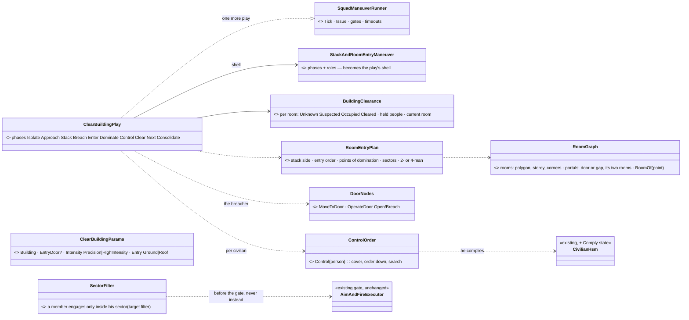
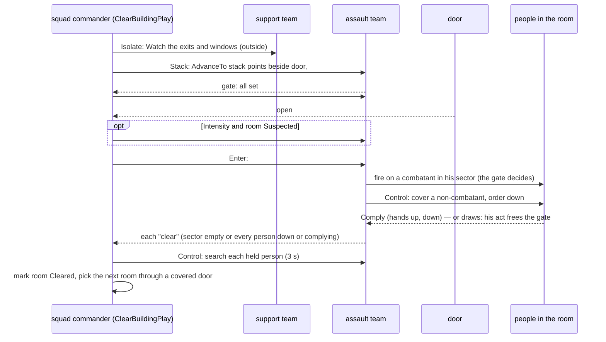
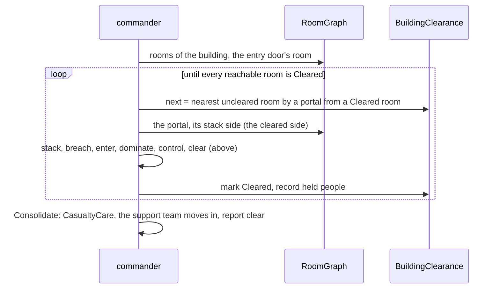
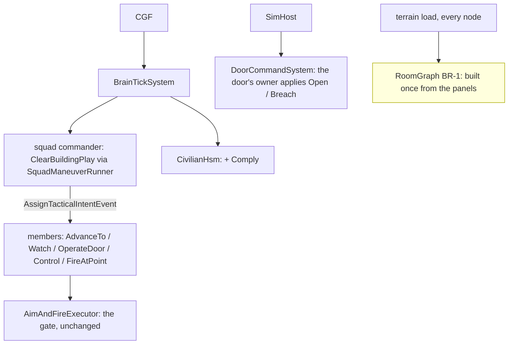

<!--STATUS
state: LIVE
updated: 2026-10-18
build-state: DESIGN — leans CB-1…CB-14 await the user (§6); slices §7 build once approved and the backend room graph (BR-1) lands
current-answer: §6 decisions (leans) · §7 slices · §8 demos — §1 is the doctrine, §2 the measured ground, §3–§5 the diagrams
stale-below: nothing.
known-rot: none.
known-conflict: none.
related-designs:
  - docs/designs/group-maneuvers/DESIGN_Squad_Tactics.md — OWNS the squad runner (`SquadManeuverRunner`, `ISquadPlay`) and every built drill; this is one more play on it (kind 5, the existing `StackAndRoomEntryManeuver` stub)
  - docs/designs/group-maneuvers/Squad_Coordination_Design_v1_1.md — §8.6 stack-and-room-entry: the original roles-and-sectors spec this design gives geometry
  - docs/DESIGN_Building_Interiors.md — (backend) OWNS buildings, panels, doors, the navmesh through doorways and the planned room/portal graph; its slice B-8 "room entry" IS this design
  - docs/DESIGN_Civilians_And_Crowd_Control.md — OWNS the civilian HSM and the armed-people rules (§5h AW-15…AW-24, CH-1) this design obeys indoors; CB-7's Comply state extends its §5e
  - docs/DESIGN_Operations_Behaviour_Catalogue.md — names the scenario (SQD-5 room clearing, SQD-6 house search, SQD-8/9 defend / attack building) and the missing pieces (room graph, room state, `FindRoomStack`)
  - docs/designs/look-direction/DESIGN_Look_Direction_And_FOV.md — (backend LD-1/LD-2) OWNS where a man looks; CB-4's sectors point the eyes once it lands
  - docs/DESIGN_Entity_Interactions.md — OWNS how a door command reaches the door's owner (OpenDoor / Breach)
  - docs/DESIGN_Orders_Params_Entity_Classes.md — R-2003: a sector is an area entity; the order on the wire is complete
  - docs/OVERVIEW_Behaviour_Building_Blocks.md — the machinery map (§9 squads: a new drill is an ISquadPlay, not a new node)
-->

# Building clearing — a squad clears a house, kills the armed, spares and controls the rest *(behaviors, `2026-10-18`)*

🔒 User, `2026-10-18`: *"I would like to add behaviors needed for military clearing houses where there might be armed insurgents inside
the rooms (need to be eliminated) while letting the civilians be, this is squad group behavior needing thorough design and knowledge of
real world military doctrines."*

**The decision in one line (lean):** a new squad play **`ClearBuilding`** on the existing runner — the squad splits into an **assault
team** (4) that clears room by room with Battle Drill 6 (stack · enter · dominate · clear · mark) and a **support team** that isolates
the building — firing under the rules already built (status combatants are shot, neutrals never, armed civilians only on their act),
and **controlling** non-combatants (a new civilian `Comply` state: hands up, down, searched, left in place) instead of ignoring them.
It needs one backend piece first: the **room graph** (rooms, portals, corners per storey).

## 1. Doctrine — what real forces do *(the basis; US Army Battle Drill 6 "Enter and Clear a Room", FM 3-21.8 / ATP 3-21.8; urban operations FM 3-06 / ATP 3-06.11; USMC MCWP 3-35.3)*

| phase | what is done | why |
|---|---|---|
| **isolate** | the support element seals the building — covers the exits and windows from outside, the assault element moves in | no one escapes or reinforces; the assault team is not shot in the back |
| **foothold** | enter at the best point (a door, a window, the roof — top-down is preferred because gravity and grenades favour the attacker), make the first room safe | the entry room is the base for everything after |
| **stack** | the team lines up on ONE side of the door, against the wall, #1 nearest the door; weapons alternate high/low and cover the danger areas | the doorway is the **fatal funnel** — nobody stands in it |
| **breach** | open it, force it (mechanical, ballistic, explosive) — or it is open | the door must not stop the entry halfway |
| **(grenade)** | **high intensity:** a fragmentation grenade before entry into a room thought to hold enemy and no non-combatants · **precision** (non-combatants likely, restrictive ROE): no fragmentation; a stun grenade, or none | precision is the default whenever civilians may be present |
| **enter** | #1 goes through and turns toward the open side (or the corner), #2 the opposite way, #3 opposite #2, #4 opposite #3 — each along the wall to his **point of domination** (≈ 1 m off the wall, a third into the room); a small room takes two | speed, surprise, violence of action — and four sectors that cover the whole room without crossing |
| **dominate** | each man clears his **sector** (the half / quarter of the room in front of him, never across a teammate) | no fratricide; every corner is covered |
| **engage** | **positive identification** before fire: hostile intent or a hostile act, or a combatant by status; controlled pairs | civilians and surrendering enemy are not targets |
| **control** | non-combatants are shouted at ("get down", "show me your hands"), put down, searched, held; a surrendering enemy is disarmed and detained | a hidden weapon is found on the search, not by a bullet |
| **clear** | each man calls "clear" (or "clear, one down", "clear, two civilians"); the team leader reports "room clear"; the room is **marked** | the squad knows which rooms are done |
| **next** | the team leader picks the next room (nearest uncleared, by the door that is covered), the team re-stacks; hallways and stairwells are danger areas cleared like rooms | the building is cleared in one continuous sweep, nothing left behind |
| **consolidate** | when the building is clear: casualties treated, non-combatants and detainees gathered and guarded, the building reported clear | the building can be handed over |

## 2. INVENTORY — what exists *(2026-10-18; three read-only sweeps, codebase-memory CLI `search_graph` (`.*Maneuver.*`, `.*(Room|Portal|Stair|Interior|Breach|Storey).*`, `.*Door.*`) + grep, and the design corpus; `check_index_coverage` NOT run — CLI only)*

| need | exists | where | missing |
|---|---|---|---|
| squad runner | ✅ `SquadManeuverRunner.Tick<TPlay,TParams>`, `ISquadPlay`, `MemberOrder` (Hold · AdvanceTo · Watch · Suppress · FireAtPoint · Stay …), gates, element partition, timeouts | `Brains/SquadManeuverRunner.cs:296`, `:333`; `Squad/Primitives/ElementPartitionPrimitive.cs:31`, `SquadGates.cs:31` | — |
| the stack drill | ⚠ a stub: `StackAndRoomEntryManeuver` (kind 5) — phases Stacking → Entering → Cleared, roles PointMan · BreachCover · Secondary ×2, **no geometry, no play** | `Squad/Maneuvers/StackAndRoomEntryManeuver.cs:24-73` | the play |
| buildings | ✅ wall panels with openings, storeys, stairs as ramps; `InsideTest` (which building) | `Terrain/TerrainBuildings.cs:35,69`; `Spatial/Eqs/EnterableShelter.cs:82` | ⛔ **no room, no portal graph, no "which room am I in"** — designed only (Building Interiors §198, B-8) |
| doors | ✅ door entities, `DoorState`, Open · Close · Lock · Unlock · **Breach (3 s)**, `MoveToDoor` / `OperateDoor` nodes, the mover opens a closed door, locked = a wall to the path | `Terrain/DoorCommands.cs:10,35`; `Terrain/DoorNodes.cs:60,109`; `CarKinem/Systems/DoorPassageSystem.cs:31` | — |
| walking inside | ✅ doorway polygons, multi-storey navmesh, stairs | `Navigation.Recast/NavDoorways.cs:16`; rail `RecastNavmeshFactoryTests.cs:100` | — |
| sight / fire inside | ✅ through openings, a closed door is opaque, penetration per panel | `Terrain/TerrainWorld.cs:418,535` | hearing ignores walls (`AcousticPerception.cs:21`) |
| interior EQS | ✅ window firing positions, cover per storey | `StarterTemplates.cs:32` | ⛔ stack positions, points of domination, next room |
| facing / sectors | ⛔ vision is 360°; "no facing control exists" | Squad Tactics §7.7.6; Look Direction LD-1…LD-3 (DESIGN) | a sector of responsibility |
| whom to shoot | ✅ the gate: `HoldNeutral` → `HoldSurrender` → `HoldConduct` (CH-1) → … → `HoldNeutralOnLine` (AW-20); `Armament.Judge` by status / known / conduct; indoors everything visible is identified (pistol 60 m by day) | `Combat/Executors/AimAndFireExecutor.cs:585-620`; `Combat/Armament.cs:265` | — (no new firing rule needed) |
| insurgents | ✅ type 2003 (status combatant, rifle + RPG); the covert insurgent (a civilian with a hidden pistol, draws, aims ⇒ Hostile) | `UrbanCombatTkbCatalog.cs:281`; Civilians §5h.7 | a room defender's posture |
| civilians indoors | ⚠ only violence frightens them: Alarmed crouches, Panic flees 20 m (through the soldiers), Inside stands then vanishes | `Brains/CivilianBehavior.cs:211-260`; `CivilianFearSystem.cs` | ⛔ **no reaction to soldiers, no compliance, no detain, no search** (Civilians §5h :1168, :1260) |
| grenades | ✅ `FireAtPoint` throws; fragments stopped by walls; **stun** (`WarheadKind.Stun` → `StunnedUntil`) | `Combat/Systems/AreaEffectSystem.cs:34,221` | ⛔ no military behaviour or the gate reads stun; indoor blast under-modelled (W-7v2) |
| shared squad memory | ✅ contacts pool, known combatants, claims (`CoverClaim`) | `SquadPerceptionMergeSystem.cs:32`; `KnownCombatants.cs:85`; `CoverClaim.cs:20` | room state (cleared / held) |
| test buildings | ✅ `house-2f` (10 × 8 m, 2 storeys, inner wall + hall door, front / back doors, stairs) placed twice in `bt-range` | `Recipes/Terrain/bt-range/buildings/house-2f.building.json` | a CQB house (hallway + 4 rooms) |

## 3. Classes

*What the picture shows that prose hid:* the whole drill is ONE new play plus three small pieces (a plan, a sector filter, a control
order) on machinery that exists — the firing gate is untouched, so a soldier indoors obeys exactly the rules he obeys outside; the one
box nobody owns yet is the backend room graph.

## 4. Sequences

*What the picture shows that prose hid:* the commander never shoots and never decides a target — it only moves men to places and
hands out sectors; every round is the member's own gate, and the civilian answers the control order with his own HSM.

## 5. Modules — who runs it each frame

*Caption:* nothing new is scheduled except the backend graph built once at load (yellow); the play runs inside the brain tick like
every other drill, and the door command already crosses to its owner.

## 6. Decisions *(⭐ lean, for the user's review — each will get an R-20xx row when approved)*

| id | decision | ⭐ lean | rejected — one line each |
|---|---|---|---|
| **CB-1** | where rooms come from | ⭐ **backend derives a room graph at load from the wall panels** (per storey: closed polygons between panels; doors and gaps are portals between two rooms; corners; `RoomOf(point)`) — the graph Building Interiors already plans for sound v2 and blast (W-7v2): ONE producer for three readers | rooms authored in each building template: a second copy of the walls to keep in step · a grid flood-fill in behaviors: every reader would re-derive it |
| **CB-2** | the squad's shape | ⭐ **two elements**: the **assault team** (4, the first fire team) clears; the **support team** (the rest) isolates — `Watch` on each exterior door and the window sides from outside — and moves in at Consolidate. Fewer than 6 men: no support team, the assault team clears alone | the whole squad in the stack: no one covers the exits · two teams leapfrogging room by room: real, but v2 (CB-13) |
| **CB-3** | entry | ⭐ **Battle Drill 6**: stack on the door's hinge-free side (the side away from the room's open part), #1 nearest; #1 turns toward the open side (or the corner when the door is at a corner), #2 the opposite way, #3 opposite #2, #4 opposite #3; each walks the wall to his point of domination; **two-man entry** when the room is under 12 m² or the team has 2–3 men (#3, #4 hold the door) | a fixed "#1 left, #2 right": wrong at a corner-fed door · everyone to the centre: a crossfire |
| **CB-4** | sectors | ⭐ **a sector is a TARGET filter now, the eyes later**: each member engages only a person inside his sector (an arc from his point of domination, ending at a teammate's line); vision stays 360° until backend LD-1 points the eyes, then the same sector is his look direction. The filter sits BEFORE the gate, never replaces it | wait for LD-1: blocks the drill on another programme · no sectors: two men fire across each other |
| **CB-5** | whom to shoot | ⭐ **no new firing rule**: the gate already does doctrine's PID — a combatant by status is shot, a Neutral never, an armed civilian only once he aims or fires (CH-1, AW-16), hands up holds (CV-13a), a neutral in the line holds (AW-20). Indoors everything visible is identified (a pistol is identified to 60 m by day) | a CQB "shoot anyone armed": AW-21's status/conduct split would break exactly where it matters |
| **CB-6** | grenades | ⭐ **the order's `Intensity`**: **Precision** (default) — never a fragmentation grenade; a STUN grenade before entry only into a room marked Suspected (a combatant heard or seen there) · **High intensity** — a fragmentation grenade before entry into a Suspected room with no non-combatant known in it. ⚠ needs backend: a stunned SOLDIER/insurgent cannot fire or move for its seconds (today only civilian code reads stun) | always a grenade: kills the civilians the user wants spared · never: loses doctrine's high-intensity case |
| **CB-7** | the civilians | ⭐ **control, not ignore**: a member who sees a non-combatant (Neutral, or Civilian class not yet acted) within 8 m issues **Control** — covers him and orders him down (a `Gesture` now, G1 speech later); the civilian HSM gets a **`Comply`** state (hands up, kneel, stay) entered when a forces person controls him and his fear is ≥ 0.3 OR his attitude ≤ 0 — a hostile-at-heart man may refuse and keep standing (then he is only watched, never shot for it); a covert insurgent who draws during control commits his act (AW-16) and the gate frees itself. ⭐ Comply wins over Panic while he is controlled (he does not run through the stack) | ignore them (today): they flee through the soldiers and nobody searches them · shoot "non-compliant": not doctrine, and breaks CH-1 |
| **CB-8** | the search | ⭐ after "room clear", one member searches each complying person: 3 s at him; a Hidden weapon found ⇒ it is laid down and the man is **detained** (out of the fight — the `LaidDown` + hands-up flag); nothing found ⇒ **held** (left in place, marked). ⛔ v1 does not escort them out (a collection point is v2) | escort everyone at once: a drill of its own · no search: a covert insurgent is never found |
| **CB-9** | room state | ⭐ **`BuildingClearance` on the commander, brain-local** (like `SquadCognitiveState`): per room Unknown / Suspected / Cleared, who is held there; read by the HTTP drill trace now; a REPLICATED room mark for the map is ui's later ask | replicated now: no reader yet · in each member: the commander picks the next room |
| **CB-10** | the order of rooms | ⭐ **nearest uncleared room reachable through a portal from a Cleared room**, hallways and stairwells as rooms; the stairs and the upper storey last (bottom-up) — `Entry: Roof` (fast rope, built) flips it top-down | top-down always: needs a roof entry the scenario may not have · a pre-planned route: the building's shape decides |
| **CB-11** | doors | ⭐ **#1 is the breacher**: a closed door ⇒ `OperateDoor Open` (1 s), locked ⇒ `Breach` (3 s) while the stack waits; explosive breach and wall breach are later (Structure Damage) | a separate breacher role: the stub's BreachCover becomes #2's cover of the door instead |
| **CB-12** | contact from an uncleared room | ⭐ **limited penetration**: shot at through a door, the stack does not enter — it fires from beside the door (the doorway is the fatal funnel), and enters only when the room has been quiet 3 s; a man down inside a room: the room is finished first, `CasualtyCare` at Consolidate | enter under fire: doctrine's fatal funnel · abort the building: a single shot ends the drill |
| **CB-13** | what is v2 | ⏳ two teams leapfrogging room by room · top-down from the roof by default · explosive breach · escort to a collection point · clearing a defended building with mouse-holing | — |
| **CB-14** | the defenders | ⭐ **no new insurgent behaviour for v1**: insurgents placed in a room hold with `CombatPosture` (they fire at whoever they see — the doorway first); the covert insurgent among civilians reuses B3 (draw → aim ⇒ Hostile) | a "barricaded defender" behaviour now: the demo needs only a man who holds and shoots |

## 7. Slices *(owners; behaviors ids from `CE-2257`)*

| slice | owner | what | needs |
|---|---|---|---|
| **BR-1** | backend | the **room graph**: rooms per storey from panels, portals (doors, gaps) with their two rooms, corners, `RoomOf(point)`; one CQB test house (hallway + 4 rooms + a closet, one storey) in `bt-range` | Building Interiors' model |
| **BR-2** | backend | a STUNNED person (any class) cannot fire or move for its seconds — the gate holds `HoldStunned`, the mover stops | Effects (built) |
| **BC-1** `CE-2257` | behaviors | **one room, one team, no civilians**: `RoomEntryPlan` (stack, order, points of domination, sectors, 2/4-man) + the play's Stack · Breach · Enter · Dominate · Clear + `SectorFilter`; demo `bc-room-clear` | BR-1 |
| **BC-2** `CE-2258` | behaviors | **civilians**: `Control` member order, civilian `Comply` state, search, held / detained; demo `bc-room-civilians` | BC-1 |
| **BC-3** `CE-2259` | behaviors | **the house**: `ClearBuilding` (support team isolates, `BuildingClearance`, next room, hallways, stairs, Consolidate); demo `bc-house-clear` | BC-1 |
| **BC-4** `CE-2260` | behaviors | **grenades and intensity** (stun / frag before entry by `Intensity` and room state); demo `bc-house-high-intensity` | BC-3, BR-2 |
| **BC-5** `CE-2261` | behaviors | **contact and casualties** (limited penetration, a man down, CasualtyCare at Consolidate); demo `bc-house-defended` | BC-3 |

⭐ BR-1 and BR-2 are dispatched to backend in [HANDOFF_Behaviors_To_Backend_Building_Clearing.md](../../blueprints/batches/HANDOFF_Behaviors_To_Backend_Building_Clearing.md).

## 8. Demos *(each with a live check and an in-process twin, as every drill)*

| demo | cast | must end with |
|---|---|---|
| `bc-room-clear` | a 4-man team at a closed door; 2 insurgents in the room's far corners | the team stacks (nobody in the doorway), opens the door, each reaches his point of domination; both insurgents down; no teammate hit; "room clear" |
| `bc-room-civilians` | the same room: 1 insurgent, 2 civilians, 1 covert insurgent (hidden pistol) | the insurgent down; the civilians comply and are searched, unhurt; the covert one is detained (found on the search) or shot only after he draws and aims |
| `bc-house-clear` | a squad (8) at the CQB house: insurgents in 2 rooms, civilians in 2 | the support team covers the exits from outside; the assault team clears every room in one sweep, nothing skipped; every insurgent down, every civilian unhurt and held; "building clear" |
| `bc-house-high-intensity` | the same house, `Intensity: HighIntensity`, no civilians | a fragmentation grenade before each Suspected room; none into an Unknown one |
| `bc-house-defended` | an insurgent firing through a door at the stack | no entry until the room is quiet; a wounded soldier is cared for after the building is clear |

## 9. What I would ask you to rule *(plain list; the leans are in §6)*

1. **CB-6 grenades:** Precision by default (stun only into a room where a combatant is suspected, never fragmentation), High intensity
   as an order option — or do you want fragmentation allowed whenever no civilian is KNOWN to be inside?
2. **CB-7 compliance:** a hostile-at-heart civilian may refuse to comply and is then only watched — or should refusal escalate (non-lethal
   force, the police ladder)?
3. **CB-8 the search** finds hidden weapons and detains — and v1 leaves held civilians in place (no escort). OK for v1?
4. **CB-10** bottom-up by default, top-down when the order says `Entry: Roof`.
