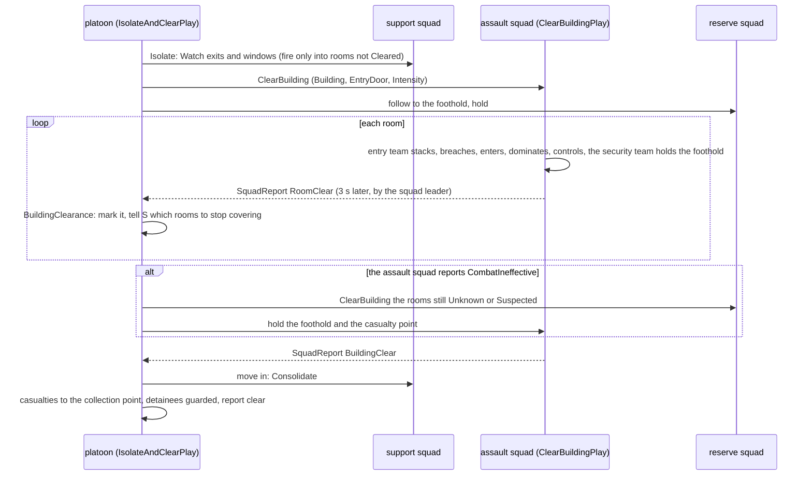
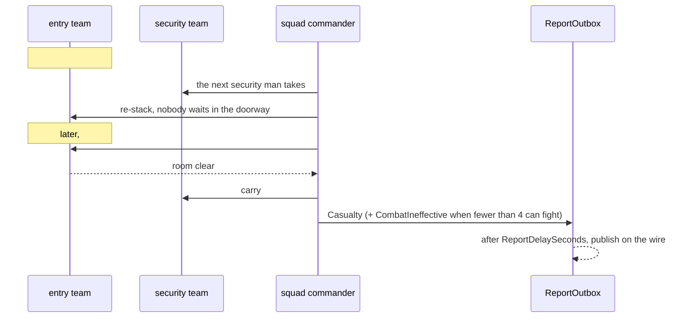
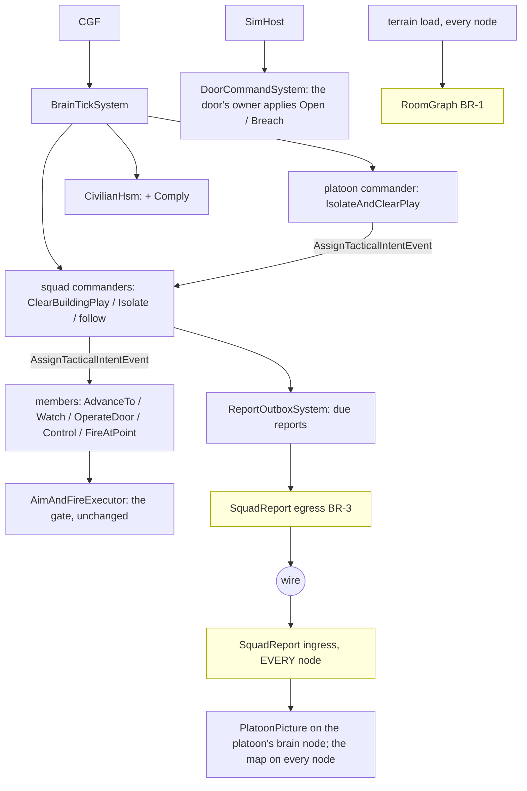

<!--STATUS
state: LIVE
updated: 2026-10-18 (approved; platoon layer, networked reports)
build-state: READY-TO-BUILD — CB-1…CB-18 APPROVED 2026-10-18 (R-2030, R-2031); slice SL-0 first (§7), the room slices wait on backend BR-1
current-answer: §3–§5 the diagrams (platoon level) · §6 decisions (approved) · §6a casualties and edge cases · §7 slices · §8 demos — §1 doctrine, §2 measured ground
stale-below: nothing.
known-rot: none. (the first draft's one-squad "support team outside" CB-2 and squad-held room state CB-9 are SUPERSEDED — §⛔ HISTORY)
known-conflict: none.
related-designs:
  - docs/designs/group-maneuvers/DESIGN_Squad_Tactics.md — OWNS the squad runner (`SquadManeuverRunner`, `ISquadPlay`) and every built drill; this is one more play on it (kind 5, the existing `StackAndRoomEntryManeuver` stub)
  - docs/designs/group-maneuvers/Squad_Coordination_Design_v1_1.md — §8.6 stack-and-room-entry: the original roles-and-sectors spec this design gives geometry
  - docs/DESIGN_Building_Interiors.md — (backend) OWNS buildings, panels, doors, the navmesh through doorways and the planned room/portal graph; its slice B-8 "room entry" IS this design
  - docs/DESIGN_Civilians_And_Crowd_Control.md — OWNS the civilian HSM and the armed-people rules (§5h AW-15…AW-24, CH-1) this design obeys indoors; CB-7's Comply state extends its §5e
  - docs/DESIGN_Operations_Behaviour_Catalogue.md — names the scenario (SQD-5 room clearing, SQD-6 house search, SQD-8/9 defend / attack building) and the missing pieces (room graph, room state, `FindRoomStack`)
  - docs/designs/look-direction/DESIGN_Look_Direction_And_FOV.md — (backend LD-1/LD-2) OWNS where a man looks; CB-4's sectors point the eyes once it lands
  - docs/DESIGN_Entity_Interactions.md — OWNS how a door command reaches the door's owner (OpenDoor / Breach)
  - docs/DESIGN_Orders_Params_Entity_Classes.md — R-2003: a sector is an area entity; the order on the wire is complete
  - docs/OVERVIEW_Behaviour_Building_Blocks.md — the machinery map (§9 squads: a new drill is an ISquadPlay, not a new node)
-->

# Building clearing — a squad clears a house, kills the armed, spares and controls the rest *(behaviors, `2026-10-18`)*

🔒 User, `2026-10-18`: *"I would like to add behaviors needed for military clearing houses where there might be armed insurgents inside
the rooms (need to be eliminated) while letting the civilians be, this is squad group behavior needing thorough design and knowledge of
real world military doctrines."*

🔒 User, `2026-10-18`, on the review: *"Platoon layer is what we need to exercise so the behaviors are created from that point of view already."* ·
*"Refusing civilians should be let be even if they protest, shout and insult unless they attack, then non lethal melee should be used (weapon butt hits for example for a soldier having other means) to stun them."* ·
*"Reuse knock down."* · *"Reports need to be networkable, nothing hidden inside single brain only."*

**The decision in one line (approved, R-2030 / R-2031):** a **platoon** play **`IsolateAndClear`** — the support squad isolates the
building, the assault squad clears it with the squad play **`ClearBuilding`** (its entry fire team clears by Battle Drill 6 while the
security fire team holds the foothold, and the two swap rooms), the reserve squad follows and relieves — on the existing runner, firing
under the rules already built (status combatants are shot, neutrals never, armed civilians only on their act), **controlling**
non-combatants (a civilian `Comply` state) and answering only an ATTACK with a rifle-butt knock-down. What a squad learns reaches the
platoon only as **typed reports on the wire** (3 s a hop, sent by the squad leader). First: the squad layer one echelon up (SL-0), and
backend's room graph.

## 1. Doctrine — what real forces do *(the basis; US Army Battle Drill 6 "Enter and Clear a Room", FM 3-21.8 / ATP 3-21.8; urban operations FM 3-06 / ATP 3-06.11; USMC MCWP 3-35.3)*

| phase | what is done | why |
|---|---|---|
| **isolate** | the support element seals the building — covers the exits and windows from outside, the assault element moves in | no one escapes or reinforces; the assault team is not shot in the back |
| **foothold** | enter at the best point (a door, a window, the roof — top-down is preferred because gravity and grenades favour the attacker), make the first room safe | the entry room is the base for everything after |
| **stack** | the team lines up on ONE side of the door, against the wall, #1 nearest the door; weapons alternate high/low and cover the danger areas | the doorway is the **fatal funnel** — nobody stands in it |
| **breach** | open it, force it (mechanical, ballistic, explosive) — or it is open | the door must not stop the entry halfway |
| **(grenade)** | **high intensity:** a fragmentation grenade before entry into a room thought to hold enemy and no non-combatants · **precision** (non-combatants likely, restrictive ROE): no fragmentation; a stun grenade, or none | precision is the default whenever civilians may be present |
| **enter** | #1 goes through and turns toward the open side (or the corner), #2 the opposite way, #3 opposite #2, #4 opposite #3 — each along the wall to his **point of domination** (≈ 1 m off the wall, a third into the room); a small room takes two | speed, surprise, violence of action — and four sectors that cover the whole room without crossing |
| **dominate** | each man clears his **sector** (the half / quarter of the room in front of him, never across a teammate) | no fratricide; every corner is covered |
| **engage** | **positive identification** before fire: hostile intent or a hostile act, or a combatant by status; controlled pairs | civilians and surrendering enemy are not targets |
| **control** | non-combatants are shouted at ("get down", "show me your hands"), put down, searched, held; a surrendering enemy is disarmed and detained | a hidden weapon is found on the search, not by a bullet |
| **clear** | each man calls "clear" (or "clear, one down", "clear, two civilians"); the team leader reports "room clear"; the room is **marked** | the squad knows which rooms are done |
| **next** | the team leader picks the next room (nearest uncleared, by the door that is covered), the team re-stacks; hallways and stairwells are danger areas cleared like rooms | the building is cleared in one continuous sweep, nothing left behind |
| **consolidate** | when the building is clear: casualties treated, non-combatants and detainees gathered and guarded, the building reported clear | the building can be handed over |

## 2. INVENTORY — what exists *(2026-10-18; three read-only sweeps, codebase-memory CLI `search_graph` (`.*Maneuver.*`, `.*(Room|Portal|Stair|Interior|Breach|Storey).*`, `.*Door.*`) + grep, and the design corpus; `check_index_coverage` NOT run — CLI only)*

| need | exists | where | missing |
|---|---|---|---|
| squad runner | ✅ `SquadManeuverRunner.Tick<TPlay,TParams>`, `ISquadPlay`, `MemberOrder` (Hold · AdvanceTo · Watch · Suppress · FireAtPoint · Stay …), gates, element partition, timeouts | `Brains/SquadManeuverRunner.cs:296`, `:333`; `Squad/Primitives/ElementPartitionPrimitive.cs:31`, `SquadGates.cs:31` | — |
| the stack drill | ⚠ a stub: `StackAndRoomEntryManeuver` (kind 5) — phases Stacking → Entering → Cleared, roles PointMan · BreachCover · Secondary ×2, **no geometry, no play** | `Squad/Maneuvers/StackAndRoomEntryManeuver.cs:24-73` | the play |
| buildings | ✅ wall panels with openings, storeys, stairs as ramps; `InsideTest` (which building) | `Terrain/TerrainBuildings.cs:35,69`; `Spatial/Eqs/EnterableShelter.cs:82` | ⛔ **no room, no portal graph, no "which room am I in"** — designed only (Building Interiors §198, B-8) |
| doors | ✅ door entities, `DoorState`, Open · Close · Lock · Unlock · **Breach (3 s)**, `MoveToDoor` / `OperateDoor` nodes, the mover opens a closed door, locked = a wall to the path | `Terrain/DoorCommands.cs:10,35`; `Terrain/DoorNodes.cs:60,109`; `CarKinem/Systems/DoorPassageSystem.cs:31` | — |
| walking inside | ✅ doorway polygons, multi-storey navmesh, stairs | `Navigation.Recast/NavDoorways.cs:16`; rail `RecastNavmeshFactoryTests.cs:100` | — |
| sight / fire inside | ✅ through openings, a closed door is opaque, penetration per panel | `Terrain/TerrainWorld.cs:418,535` | hearing ignores walls (`AcousticPerception.cs:21`) |
| interior EQS | ✅ window firing positions, cover per storey | `StarterTemplates.cs:32` | ⛔ stack positions, points of domination, next room |
| facing / sectors | ⛔ vision is 360°; "no facing control exists" | Squad Tactics §7.7.6; Look Direction LD-1…LD-3 (DESIGN) | a sector of responsibility |
| whom to shoot | ✅ the gate: `HoldNeutral` → `HoldSurrender` → `HoldConduct` (CH-1) → … → `HoldNeutralOnLine` (AW-20); `Armament.Judge` by status / known / conduct; indoors everything visible is identified (pistol 60 m by day) | `Combat/Executors/AimAndFireExecutor.cs:585-620`; `Combat/Armament.cs:265` | — (no new firing rule needed) |
| insurgents | ✅ type 2003 (status combatant, rifle + RPG); the covert insurgent (a civilian with a hidden pistol, draws, aims ⇒ Hostile) | `UrbanCombatTkbCatalog.cs:281`; Civilians §5h.7 | a room defender's posture |
| civilians indoors | ⚠ only violence frightens them: Alarmed crouches, Panic flees 20 m (through the soldiers), Inside stands then vanishes | `Brains/CivilianBehavior.cs:211-260`; `CivilianFearSystem.cs` | ⛔ **no reaction to soldiers, no compliance, no detain, no search** (Civilians §5h :1168, :1260) |
| grenades | ✅ `FireAtPoint` throws; fragments stopped by walls; **stun** (`WarheadKind.Stun` → `StunnedUntil`) | `Combat/Systems/AreaEffectSystem.cs:34,221` | ⛔ no military behaviour or the gate reads stun; indoor blast under-modelled (W-7v2) |
| shared squad memory | ✅ contacts pool, known combatants, claims (`CoverClaim`) | `SquadPerceptionMergeSystem.cs:32`; `KnownCombatants.cs:85`; `CoverClaim.cs:20` | room state (cleared / held) |
| test buildings | ✅ `house-2f` (10 × 8 m, 2 storeys, inner wall + hall door, front / back doors, stairs) placed twice in `bt-range` | `Recipes/Terrain/bt-range/buildings/house-2f.building.json` | a CQB house (hallway + 4 rooms) |
| a commander under a commander | ⚠ allowed (`UnitHierarchySystem` checks roster capacity only) but **never exercised** — 0 of the 20 shipped scenarios with a commander nest one | `Hrot.Common/Systems/UnitHierarchySystem.cs:112-160`; scenario sweep 2026-10-18 | a rail that runs it (SL-0) |
| the platoon knowing what its squads know | ⛔ the merge reads each member's own `TargetMemory`; a squad unit has none ⇒ a platoon's pool stays empty | `SquadPerceptionMergeSystem.cs:51` | the report step (CB-15) |
| the platoon hearing "under fire" / "a man down" | ⛔ both edges come from a member's Hit / `Health`; a squad unit has neither | `SquadCoordinationSystem.cs:73-74`, `SquadSensing.cs:131` | the report step |
| a wiped-out squad | ⛔ a unit has no `Health` ⇒ `Injury.IsInTheFight` is true with every man dead ⇒ the runner keeps ordering it; the platoon centroid counts it | `SquadManeuverRunner.cs:268`, `Injury.cs:65`, `UnitCentroidSystem.cs:33` | "combat effective" (SL-0) |
| a member down mid-drill | ✅ he gets no order; `SquadMemberDown` on the commander. ⚠ `BasicSquadSop` answers it with casualty care, which would pause a clearing mid-room | `SquadSensing.cs:126-143`; `BasicSquadSop.btree.json:612` | the play keeps its own casualties (§6a) |
| a report on the wire | ✅ the event-topic precedent: `BehaviorFaultReport` (origin node publishes once, every node takes it in) | `Hrot.Network.NED/BehaviorFaultMessages.cs`; `Translators/BehaviorFaultTranslators.cs` | the `SquadReport` topic (backend BR-3) |
| radio / comms | ⛔ none; Sensors G10 keeps a "Reported" modality open | `DESIGN_Sensors_And_Doctrine.md` G10 (searched `docs/`, `.dev/`; graph name pattern Radio / Comms / Communication: 0 classes) | the report step is its one seam |
| melee answer by a soldier | ⛔ only the rioter, the police line and the baton charge call `Melee.Strike` (Blunt, 3 s knock-down, 5 damage) | `Combat/Melee.cs:16-52` | the butt-stroke (CB-7) |

## 3. Classes

```mermaid
classDiagram
  direction LR
  class IsolateAndClearPlay { <<NEW ISquadPlay, on the PLATOON commander>> Isolate Foothold Clear Relieve Consolidate }
  class IsolateAndClearParams { <<NEW>> Building · EntryDoor? · Intensity Precision|HighIntensity · Entry Ground|Roof }
  class ClearBuildingPlay { <<NEW ISquadPlay, kind 5, on a SQUAD commander>> Stack Breach Enter Dominate Control Clear Next · entry + security teams swap }
  class BuildingClearance { <<NEW, on the clearing echelon's commander>> per room Unknown Suspected Cleared Blocked · held people · built from RoomClear reports }
  class SquadReport { <<NEW event, on the wire BR-3>> From · To · Kind · Subject · Position · Count · SentAt }
  class ReportKind { <<NEW enum>> Contact UnderFire Casualty RoomClear RoomBlocked BuildingClear CombatIneffective Detained }
  class ReportOutbox { <<NEW, per squad commander>> queued reports, sent after ReportDelaySeconds by a leader in the fight }
  class PlatoonPicture { <<NEW, platoon commander>> contacts from Contact reports · each squad's last status · BuildingClearance }
  class CombatEffective { <<NEW, squad layer>> a unit member is in the fight while N of its men are }
  class RoomEntryPlan { <<NEW, pure>> stack side · entry order · points of domination · sectors · 2- or 4-man }
  class RoomGraph { <<BACKEND BR-1>> rooms · portals · corners · RoomOf(point) }
  class SquadManeuverRunner { <<existing>> Tick · Issue · gates · timeouts · Live(i) }
  class SectorFilter { <<NEW>> a member engages only inside his sector }
  class ControlOrder { <<NEW MemberOrder kind>> Control(person): cover, order down, search }
  class CivilianHsm { <<existing, + Comply>> }
  class Melee { <<existing>> Strike: Blunt, 3 s knock-down }
  class AimAndFireExecutor { <<existing gate, unchanged>> }
  IsolateAndClearPlay ..|> SquadManeuverRunner : a play on the platoon
  ClearBuildingPlay ..|> SquadManeuverRunner : a play on the squad
  IsolateAndClearPlay ..> ClearBuildingPlay : orders the assault squad
  IsolateAndClearPlay --> PlatoonPicture
  PlatoonPicture --> BuildingClearance
  ReportOutbox ..> SquadReport : publishes
  SquadReport ..> PlatoonPicture : taken in
  SquadReport --> ReportKind
  ClearBuildingPlay ..> ReportOutbox : RoomClear · Casualty · …
  SquadManeuverRunner ..> CombatEffective : Live(i) for a unit member
  ClearBuildingPlay ..> RoomEntryPlan
  RoomEntryPlan ..> RoomGraph
  ClearBuildingPlay ..> ControlOrder
  ControlOrder ..> CivilianHsm : he complies
  ControlOrder ..> Melee : he attacks ⇒ butt-stroke
  SectorFilter ..> AimAndFireExecutor : before the gate, never instead
```

*What the picture shows that prose hid:* the platoon never reads a squad's memory — it knows only what arrives as a `SquadReport`, and
the report is a wire event, so every node sees the same picture (R-2031); room progress lives with the PLATOON, so swapping the clearing
squad loses nothing; and the firing gate is still untouched — a soldier indoors obeys exactly the rules he obeys outside.

## 4. Sequences

*What the picture shows that prose hid:* the platoon acts on REPORTS — three seconds stale — and the relief of a broken squad is
just the same `ClearBuilding` order to another squad over a record the platoon already holds.

*What the picture shows that prose hid:* a casualty never stops a room — the room is finished first, the casualty moved after; the
squad's own `SquadMemberDown` reaction (casualty care) is held off while the play runs, and the platoon learns of it only by report.

## 5. Modules — who runs it each frame

*Caption:* the yellow boxes are backend's; a report leaves the squad's node through the same event-topic path as a behaviour fault
(`BehaviorFaultReport`) and EVERY node takes it in — the platoon's brain builds its picture from it, the map can draw room marks
from it, a replay records it; nothing the platoon decides on is held in one brain only.

## 6. Decisions *(✅ APPROVED 2026-10-18 — R-2030, R-2031)*

| id | decision | ✅ ruled | rejected — one line each |
|---|---|---|---|
| **CB-1** | where rooms come from | **backend derives a room graph at load from the wall panels** (rooms per storey, portals with their two rooms, corners, `RoomOf`) — ONE producer for clearing, sound v2 and blast W-7v2 | rooms authored per template: a second copy of the walls · a flood-fill in behaviors: every reader re-derives it |
| **CB-2** | the shape *(revised on review)* | ⭐ **a PLATOON**: the **support squad** isolates (Watch exits and windows from outside), the **assault squad** clears, the **reserve squad** follows to the foothold and relieves; inside the assault squad the **entry fire team** clears and the **security fire team** holds the foothold and hallway, guards the held, and takes the next room (they swap). A squad given `ClearBuilding` alone (no platoon) keeps both fire teams inside | ⛔ SUPERSEDED: one squad's second team isolating from outside — four men cannot seal a house AND clear it |
| **CB-3** | entry | **Battle Drill 6**: stack on one side, #1 nearest; points of domination; **two-man entry** under 12 m² or with 2–3 men | fixed "#1 left": wrong at a corner door · all to the centre: a crossfire |
| **CB-4** | sectors | **a TARGET filter now, the eyes later** (LD-1); before the gate, never instead | wait for LD-1 · none: two men fire across each other |
| **CB-5** | whom to shoot | **no new firing rule** — the gate's status / conduct / hands-up / neutral-in-line holds already are doctrine's PID | a CQB "shoot anyone armed": breaks AW-21 |
| **CB-6** | grenades | **Precision** (default): no fragmentation; a stun grenade only into a Suspected room · **HighIntensity**: fragmentation into a Suspected room with no non-combatant known — and never with a friend within the munition's lethal radius of the aim point | always one: kills the civilians · never: loses the high-intensity case |
| **CB-7** | the civilians *(ruled on review)* | **control**: a soldier covers and orders down; the civilian HSM's **`Comply`** (hands up, kneel, stay; wins over Panic while controlled). 🔒 **One who REFUSES is let be — even protesting, shouting, insulting — and only watched. One who ATTACKS gets a rifle-butt strike: `Melee.Strike`, the existing 3 s knock-down (reused, no new stun); then he is ordered down again; a second attack ⇒ detained.** A covert insurgent who draws commits his act (AW-16) | ignore them · shoot the non-compliant: not doctrine, breaks CH-1 · a new stun effect: the knock-down already gives the window |
| **CB-8** | the search | 3 s per complying person after "room clear"; a Hidden weapon ⇒ laid down, **detained** (out of the fight); none ⇒ **held** in place; v1 no escort | escort everyone: a drill of its own · no search: the covert one is never found |
| **CB-9** | room state *(revised on review)* | **`BuildingClearance` on the CLEARING ECHELON's commander** — the platoon when there is one (a relieving squad continues it), else the squad; built from `RoomClear` / `RoomBlocked` reports, so every node can rebuild it (R-2031) | ⛔ SUPERSEDED: brain-local on the squad — a relief would start over, and it hides state in one brain |
| **CB-10** | room order | nearest uncleared room by a portal from a Cleared one; hallways and stairs are rooms; bottom-up, `Entry: Roof` flips it | top-down always · a pre-planned route |
| **CB-11** | doors | **#1 is the breacher**: Open (1 s), locked ⇒ Breach (3 s); a door that cannot be opened or breached ⇒ the room **Blocked**, skipped, reported | a separate breacher · explosive breach (later) |
| **CB-12** | contact from an uncleared room | **limited penetration**: no entry under fire through the doorway; fire from beside it; enter after 3 s quiet | enter under fire · abort the building |
| **CB-13** | v2 | top-down by default · explosive breach · escort to a collection point · mouse-holing · two clearing squads on two floors | — *(swapping fire teams moved INTO v1 — CB-2)* |
| **CB-14** | the defenders | no new insurgent behaviour: `CombatPosture` in a room; the covert insurgent reuses B3 | a barricade behaviour now |
| **CB-15** | knowledge up the chain *(ruled on review)* | ⭐ **inside a squad: automatic, as today. Squad → platoon: typed `SquadReport`s** (Contact · UnderFire · Casualty · RoomClear · RoomBlocked · BuildingClear · CombatIneffective · Detained), sent by the **squad leader in the fight** after **`ReportDelaySeconds` (default 3 s, on the unit's type)**; silent during the leader-down lull. 🔒 **On the wire — every node takes it in, nothing hidden in one brain** (R-2031). The one seam a radio model (range, jamming, G10's Reported modality) plugs into later | automatic at the platoon: an omniscient reserve commit · a full radio net now: no reader needs it |
| **CB-16** | a squad as a member *(found measuring)* | **combat effective**: a unit member is in the fight while ≥ `MinEffective` (default 4, or half its roster) of its men are; the runner's `Live(i)` and the centroid read it | the unit's own `Health`: a squad has none, and a sum would hide a wiped-out team |
| **CB-17** | casualties | the room is finished first; §6a | stop the room for a casualty: the doorway is the fatal funnel |
| **CB-18** | the isolating squad's fire | it fires only into rooms not Cleared, and stops as rooms are reported clear (doctrine's "shift fire"); ⚠ the friend-in-the-line hold is backend's B-15 (open) — until it lands the support squad watches and fires only at an exit or a window of a room the platoon holds as Unknown | free fire at the building: fratricide through a window |

## 6a. Casualties and edge cases *(approved)*

| case | behaviour |
|---|---|
| a man hit BEFORE entry | the entry stops; the next security man fills his place; re-stack — nobody stands in the doorway |
| a man hit INSIDE | the others widen their sectors, finish the room; then the security team carries him to the casualty point (the R-2012 medic, the existing carry) |
| the squad's `SquadMemberDown` reaction | held off while `ClearBuilding` runs (the play owns its casualties) |
| the entry team down to one man in the fight | the fire teams swap roles |
| fewer than `MinEffective` can fight | `CombatIneffective` report ⇒ the platoon sends the reserve to `ClearBuilding` what is left; the remnant holds the foothold and the casualty point |
| the squad leader falls | the existing succession and its 6 s lull (no reports in it); the team leader inside finishes the room |
| an insurgent raises his hands / is incapacitated | not shot (the existing gate); searched, detained (`Detained` report) |
| a civilian refuses | let be, watched — never forced, never shot for it (CB-7) |
| a civilian attacks | rifle-butt knock-down (`Melee.Strike`), ordered down again; a second attack ⇒ detained |
| a covert insurgent draws during the search | the covering man fires — the conduct rule frees him (AW-16) |
| fire from a room already Cleared | it goes back to Suspected; the security team engages; cleared again |
| an insurgent runs out | the support squad engages him (a combatant by status); a fleeing civilian is only controlled |
| a friend within the grenade's lethal radius of the aim point | no grenade |
| a door that cannot be opened or breached | the room Blocked, skipped, `RoomBlocked` report; the platoon decides (explosive breach later) |
| the report sender is down | nothing goes up until succession; the platoon sees the silence as the squad's status age |

## 7. Slices *(owners; behaviors ids `CE-2257`…`CE-2261`, `CE-2262`…`CE-2264`)*

| order | slice | owner | what | needs |
|---|---|---|---|---|
| 1 | **SL-0** `CE-2262` | behaviors | **the squad layer one echelon up**: `CombatEffective` (CB-16) read by `Live(i)` and the centroid; a rail that runs a platoon ordering a squad commander a drill (`SquadMarch`) on a nested-hierarchy scenario — the first time one is exercised | — |
| 2 | **RP-1** `CE-2263` | behaviors | **the report step** (CB-15): `SquadReport` + `ReportKind`, `ReportOutbox` (delay, leader in the fight, silent in the lull), `PlatoonPicture` taken in from the wire; Contact / UnderFire / Casualty / CombatIneffective first | backend BR-3 |
| 3 | **BC-1** `CE-2257` | behaviors | one room, one squad: `RoomEntryPlan` + entry / security fire teams, Stack · Breach · Enter · Dominate · Clear, `SectorFilter`; demo `bc-room-clear` | BR-1 |
| 4 | **BC-2** `CE-2258` | behaviors | civilians: `Control`, `Comply`, search, held / detained, the refusal rule and the butt-stroke (CB-7); demo `bc-room-civilians` | BC-1 |
| 5 | **BC-3** `CE-2259` | behaviors | the building, one squad: `BuildingClearance`, next room, hallways, stairs, the fire teams swapping, RoomClear / RoomBlocked reports; demo `bc-house-clear` | BC-1, RP-1 |
| 6 | **PL-1** `CE-2264` | behaviors | **the platoon** `IsolateAndClear`: isolate (CB-18), foothold, clear, relieve on `CombatIneffective`, consolidate; `BuildingClearance` on the platoon; demo `bc-platoon-house` | BC-3, SL-0, RP-1 |
| 7 | **BC-4** `CE-2260` | behaviors | grenades by `Intensity` (CB-6); demo `bc-house-high-intensity` | BC-3, BR-2 |
| 8 | **BC-5** `CE-2261` | behaviors | contact and casualties (CB-12, §6a); demo `bc-house-defended` | BC-3 |
| — | **BR-1** · **BR-2** · **BR-3** | backend | the room graph + a CQB test house · stun holds every class · the `SquadReport` topic on the wire | [handoff 1](../../blueprints/batches/HANDOFF_Behaviors_To_Backend_Building_Clearing.md) (BR-1, BR-2) · [handoff 2](../../blueprints/batches/HANDOFF_Behaviors_To_Backend_Building_Clearing_Reports.md) (BR-3) |

## 8. Demos *(each with a live check and an in-process twin, as every drill)*

| demo | cast | must end with |
|---|---|---|
| `bc-room-clear` | a squad at a closed door; 2 insurgents in the room's far corners | the entry team stacks (nobody in the doorway), opens, each to his point of domination; both insurgents down; no friend hit; "room clear" |
| `bc-room-civilians` | the same room: 1 insurgent, 2 civilians (one refuses and shouts), 1 covert insurgent, 1 civilian who attacks | the insurgent down; the complying civilian searched, unhurt; the refuser left standing, never struck; the attacker knocked down by a rifle butt, then held; the covert one detained on the search or shot only after he draws and aims |
| `bc-house-clear` | one squad at the CQB house: insurgents in 2 rooms, civilians in 2 | every room cleared in one sweep, the fire teams swapping; every insurgent down, every civilian unhurt and held; "building clear" reported |
| `bc-platoon-house` | a platoon (3 squads, a body-less commander) at the CQB house | the support squad covers the exits; the assault squad clears; a room-clear report reaches the platoon ~3 s after the room is clear and is seen on every node; when the assault squad is made ineffective (scripted casualties) the reserve finishes the remaining rooms, none cleared twice |
| `bc-house-high-intensity` | a squad, `Intensity: HighIntensity`, no civilians | a fragmentation grenade before each Suspected room; none into an Unknown one; none with a friend in range |
| `bc-house-defended` | an insurgent firing through a door at the stack; a soldier hit in the doorway | no entry until quiet; the next man fills the gap; the casualty carried after the room is clear |

## ⛔ HISTORY

- *(2026-10-18, first draft — SUPERSEDED on review the same day)* CB-2 was *"two elements: the assault team (4, the first fire team)
  clears; the support team (the rest) isolates — Watch on each exterior door and the window sides from outside — and moves in at
  Consolidate; fewer than 6 men: no support team."* CB-9 kept `BuildingClearance` brain-local on the squad commander. CB-13 listed two
  teams leapfrogging as v2. The four questions of §9 were answered: the leans approved, CB-7 refined (refusal ⇒ let be; attack ⇒
  butt-stroke knock-down).
