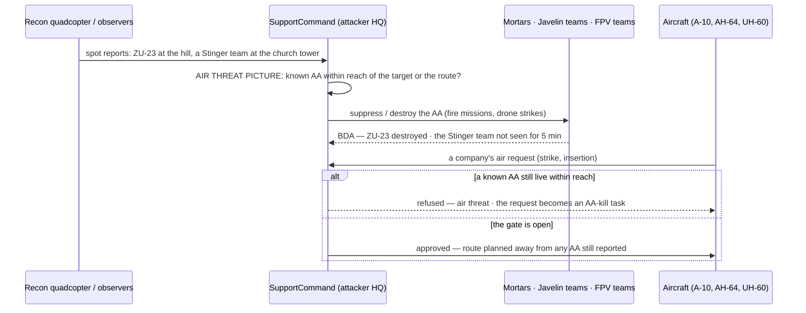
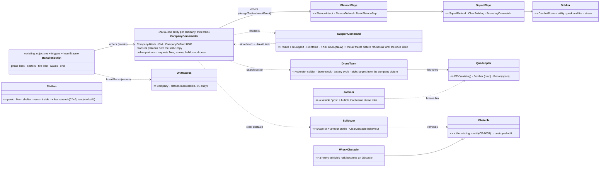
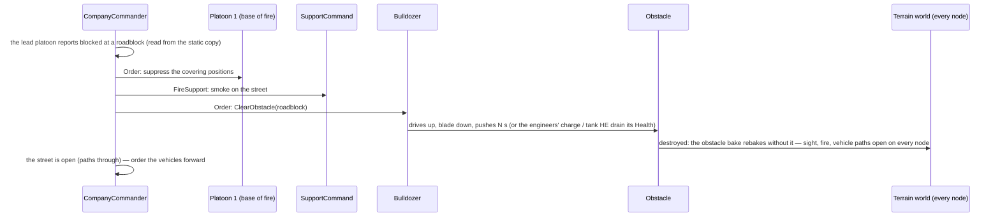
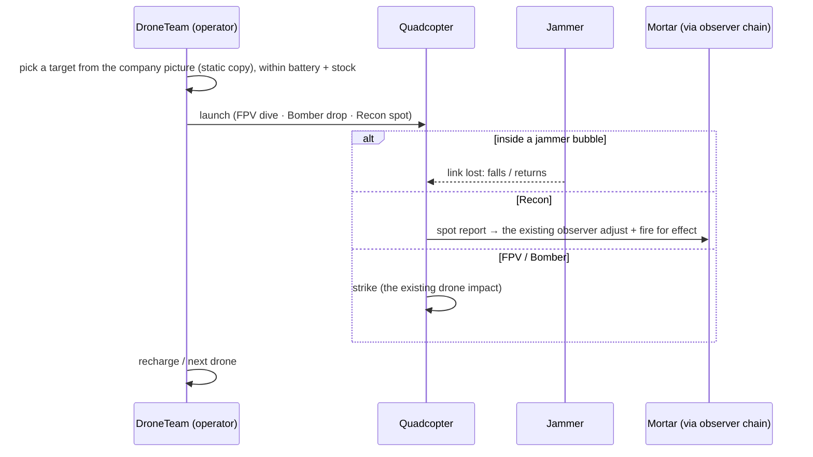
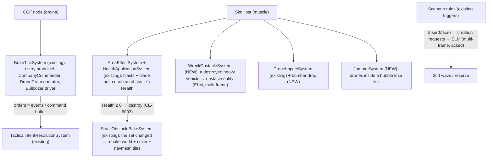

<!--STATUS
state: LIVE
build-state: READY-TO-BUILD — every decision APPROVED by the user in chat (2026-11-13, §10 D-1…D-17, D-R); F-0 (fix the flaky behaviours) first
updated: 2026-11-13 (rev 3: §9 points at the as-built parallel rule, §11 every item a tracker row in Area S, W/B lanes)
current-answer: the whole file — §2 the picture · §3 phases (overlapping) · §3a momentum · §3b the air gate · §3c civilians · §4 forces · §5 the breach drill · §6 classes · §7 sequences · §8 who runs what · §9 the parallel rules · §11 the work · §12 testing
stale-below: nothing
known-rot: none
known-conflict: none
related-designs:
  - docs/designs/group-maneuvers/DESIGN_Demo_City_Showcase.md — OWNS the demo-city showcase: a scripted timetable of ~50-entity ACTS (every feature seen once); this one is the opposite axis — scale and autonomy. Its gaps G-1…G-7 still apply to the features both use
  - docs/designs/group-maneuvers/DESIGN_Urban_Battle_Demo.md — OWNS the urban battle ladder and the platoon/squad plays this battle's platoons run unchanged
  - docs/designs/group-maneuvers/DESIGN_Command_Chain_Example.md — OWNS the echelon pattern (orders down as AssignTacticalIntentEvent, reports up); the company commander (§6) is one more level of it
  - docs/DESIGN_Scale_Rig.md — OWNS the scale budget this battle meets (R-4192: 1 000 men + 50 vehicles + 10 aircraft, ≤ 10 ms sim frame) and its measurements
  - docs/DESIGN_Parallel_Simulation.md — OWNS how the simulation reaches that budget; §9 here is the contract every new system of this battle keeps so it can run in parallel
  - docs/DESIGN_Terrain_Synth.md — OWNS the synthetic terrain generator; §11 T-1 adds an authored TOWN PLAN input to it
  - docs/DESIGN_Scenario_Macros.md — OWNS macros; §11 M-1 adds the company / platoon macros the order of battle and the waves are made of
  - docs/designs/weather/DESIGN_Weather_And_Time.md — OWNS visibility; the 5 km fog is a scenario setting of it (§8 S2 already shortens every sensor)
  - docs/designs/air-attack/DESIGN_Air_Operations.md — OWNS the air assault, the air defence and the strike aircraft used in phase 3
  - docs/designs/indirect-fire/DESIGN_Indirect_Fire.md — OWNS mortars, smoke and the observer chain the recon quadcopter joins
  - docs/designs/group-maneuvers/DESIGN_Building_Clearing.md — OWNS room / building clearing the platoons use in phase 4
  - docs/blueprints/RESUME_Coordinator_Destructible_Buildings.md — OWNS the breach / collapse path the obstacle removal (§11 O-1) reuses
-->

# DESIGN — the city battle showcase: ~1 000 men taking and holding a town, decided by their own commanders

## 0. Why

🔒 User, `2026-11-13`: *"i wanted to discuss new scenario demonstrating lots of entities (minimum 1000 soldiers, plus ground vechiles and aircraft)
that are visibly fighting in some suitable terrain, best if they are not scripted much, using their (and their commander's) brain to take decisions
… top level stuff (take over a city, defend a city) can be defined by some scripted approach like mission plans with triggers etc, lower level best
coming from automatic commander entities having their squads and squads having their teams."* — and: *"if it needs some new behaviors to look
realistic or simply good, come with suggestions"*.

## 1. INVENTORY *(`2026-11-13`; three read-only sweeps over `docs/`, `.dev/`, `scenarios/` and the code + direct reads)*

Queries: `scripts/cbm.sh search_graph` `.*(Commander|Platoon|Squad|Company|Echelon|Maneuver|Manoeuvre|Objective|Garrison|Occupy).*` ·
`.*(Weapon|Mortar|Missile|Rocket|Drone|Helicopter|Aircraft|Flight|Turret|Vehicle|Embark|Damage|Destruct|Fortif|Sandbag|AntiAir).*` ·
`.*(Navmesh|NavMesh|Building|Osm|Terrain|Lod|Partition).*` (Class) + grep. Re-run for this document: `.*(Commander|Platoon|Squad|Company|Echelon|Maneuver|Manoeuvre|Objective|Garrison|Occupy).*`
(Class) ⇒ **total 183**, none a company-level commander; `.*(Bulldozer|Dozer|Engineer|Obstacle|Wreck|Jammer|Quadcopter).*` (Class) ⇒ **total 23** —
the obstacle bake / placement / avoidance classes (`StaticObstacleBakeSystem`, `ObstacleTkbTranslator`, `OrcaObstacle` …) and `WreckSpawnSystem`;
⛔ no bulldozer, engineer, jammer or quadcopter class. ⚠ The ai-debug MCP was down: **no live run** confirmed anything below.

| capability | state | evidence |
|---|---|---|
| echelons HQ → platoon → squad → soldier | ✅ built | `PlatoonAttackBehavior.cs:208`, `PlatoonDefendBehavior.cs:198`, `SupportCommandBehavior.cs:69` (the HQ routes support only) |
| **a commander above platoon** | ⛔ **missing** | no company type, no company play (graph + grep); only prose in `DESIGN_Building_Clearing.md` |
| fire teams | data only | `UnitSubordinate.FireTeam` (`Fdp.Core/CommandHierarchy/UnitSubordinate.cs:29`); 0 readers in `Hrot.AI.Behaviors` |
| squad / platoon plays (assault, base of fire, bound, defend posts, fall back, clear room / building) | ✅ built | Urban Battle ladder; `pc-attack-dry` 12/12, `pc-defend-house` |
| scripted top: objectives, triggers that order units, waves (`InsertMacro`) | ✅ built | Scenario Rules S1 / S2 (§00.8–9) |
| mortar + observer, smoke | ✅ mortar · ⛔ smoke rounds | `ua-indirect-fire`; smoke CE-2278 designed |
| AT rockets, guided missiles, armour damage | ✅ built | `ua-rpg-window`, `ua-javelin-lock`, `ArmorModel.cs:27` |
| FPV drone (search, dive), vehicles shelter from it | ✅ built | `DroneImpactSystem.cs:28`, `ua-drone-shelter` |
| bomber / recon quadcopter, drone team, jammer | ⛔ missing | — |
| air defence vs aircraft; helicopter insertion on a DRAWN route | ✅ built | `AirDefenceBehaviors.cs:155`, `RotorcraftModel.cs:233`, `ua-air-assault` |
| wall breach, building collapse (terrain change, sight / fire / paths follow, replicated) | ✅ built | `BreachRule`, `BuildingDamageSystem.cs:49`, `AreaEffectSystem.cs:426` |
| static obstacles (concrete block 8808, car 8806, sandbag wall 8807) — baked as terrain prisms | ✅ built · ⛔ **cannot be destroyed or removed** | `StaticObstacles.cs` (CE-3136 P-7a) |
| a destroyed vehicle as an obstacle | ⛔ missing | a wreck is a presentation effect (`WreckSpawnSystem`, `EffectSystems.cs:406`) |
| bulldozer / engineering vehicle | ⛔ missing | the vehicle catalogue (`TkbEntityTypes.cs`) has none |
| weather visibility shortening every sensor | ✅ built | `PerceptionWeather.cs` (CE-3216 S2), `WeatherConditions.VisibilityM` |
| water surface blocking movement | ⛔ **missing** | `TerrainSurfaceType.Water` is read only for placement (`DESIGN_Terrain_Import_UTM.md` §9.1: "no movement cost, no sight effect") |
| synthetic terrain generator (roads, plots, buildings, heights; deterministic, in git as code) | ✅ built · ⛔ no authored layout | `DESIGN_Terrain_Synth.md`, `scripts/terrain-scale.py` |
| scale at 1 000 men | ⚠ runs, slow | W16: SimHost 37 ms, CGF 86 ms (Scale Rig §7); the speed is the parallel programme's (user: *"assume there is enough speed"*) |
| a scenario with more than one AI platoon per side | ⛔ none found | largest: `perf-stress` 992 men, squads only, no command above |

## 2. The picture — the battle at a glance

*What the picture shows that prose hid:* the battle is THREE bands the attack must cross — the open fields (where both sides' drones make a dead
zone), the ring road (the defenders' main line, roadblocked), the old town behind the river (the inner ring, the town hall). Each phase line is a
scripted trigger; everything between two lines is a company commander's problem. The air assault skips the bands and lands on the objective.

## 3. The phases — the scripted top, OVERLAPPING, and nothing below it

🔒 User, `2026-11-13`: *"it is a showcase scenario, for visual effect, showing lots of entities doing something interesting, not just sitting in
cover/firing from it and never advancing. It needs to be dynamic."* ⇒ ⭐ the phases OVERLAP: at any minute at least two areas of the town are busy.

```mermaid
gantt
  title The battle's timeline (minutes, ≈ 40 min) — at least two things at once
  dateFormat m
  axisFormat %M
  section Town
  civilians panic, flee, shelter               :civ, 0, 12m
  section Shaping
  drones up, mortars register, recon finds AA  :sh, 0, 8m
  section Ground vs air defence
  kill the hill's AA (mortars, ATGM, FPV)      :aa, 4, 12m
  section A Coy (north)
  cross the fields, breach PL B                :a1, 5, 10m
  grind to PL C                                :a2, 15, 15m
  section B Coy (south)
  cross the fields, breach PL B                :b1, 8, 10m
  grind to PL C                                :b2, 18, 14m
  section Air
  air gate opens → strikes, then insertion     :air, 16, 8m
  section Defender
  outposts withdraw, shoot and move            :d1, 5, 12m
  local counterattacks                         :d2, 12, 18m
  reserve counterattack over the bridges       :d3, 28, 8m
  section Waves
  2nd wave (macro)                             :w, 20, 10m
```

*What the picture shows that prose hid:* no phase waits for another to FINISH — the companies, the air-defence fight, the civilians and the defenders'
counterattacks run side by side; the timings are the TRIGGERS' fallbacks (§3a), the real start is whichever condition comes first.

| phase | starts when (trigger — the earlier of the two) | the battalion script orders (intent only) | what the AI then does by itself |
|---|---|---|---|
| **0 alarm** | t = 0 | — | civilians panic at the first shots: run from the shooting, hide in any building whose door opens, vanish inside; the fear spreads street by street (§3c) |
| **1 shaping** | t = 0 | drone teams on; mortars register on PL A; **find and kill the hill's air defence** | recon quadcopters find targets for the mortars, FPVs hunt in the fields — the dead zone forms; the AA fight starts (§3b) |
| **2 breach** | t = 5 min (A Coy) / 8 min (B Coy) | A Coy, B Coy: attack to PL B (ring road), **deadline 12 min** | mounted dash to the edge, dismount, carriers overwatch; outposts withdraw; roadblocks removed (§5) |
| **3 air** | **the air gate opens** (§3b) — never on a timer | strikes on what still holds; then the air assault platoon inserts at the town hall | UH-60s fly a route away from any AA still reported; the landed platoon holds the town hall |
| **4 urban grind** | a company reaches PL B | that company: attack to PL C, deadline 15 min · the 2nd wave macro enters | block-by-block; the defenders shoot and move, counterattack locally |
| **5 counterattack** | the attacker holds the square, or t = 28 min | defender reserve: counterattack the square | the reserve crosses the bridges; the attackers defend what they took |
| **6 end** | every objective held ≥ 3 min · or one side < 30 % · or t = 45 min | end, score | — |
| ✚ **pressure** | any sector with no contact for 3 min | its company: advance to the next line | keeps a quiet sector from going quiet |

⭐ The script writes **intent only** (sector, objective, phase line, deadline, fire plan, wave, end) through the built objectives and triggers (S1 / S2 +
`InsertMacro`); ⛔ it never moves a platoon.

## 3a. Momentum — what makes them MOVE *(the review, `2026-11-13`; 🔒 user: "definitely add those")*

⛔ The flaw this section fixes: every built incentive points to COVER — defenders hold posts, a soldier under fire picks Take cover / Hold, the drone
dead zone punishes the open. Without a reason to move, base of fire versus a house trades fire forever.

| mechanism | who | what it does |
|---|---|---|
| **tempo deadline → escalate** | company commander (attack) | every order carries a deadline; at 50 % of it with no progress: smoke + fires + commit the reserve; at 100 %: switch axis or bypass; ⛔ never "wait" |
| **shoot and move** | defending squad / team | after N bursts or when a position is spotted (fire received): relocate through back yards, houses, roofs to the next post — the posts are a SET per squad, not one |
| **outposts withdraw under fire** | defender outpost | at contact with a superior force: fire, then fall back along a planned route to the main line (CE-3361's fall-back, must be seen live first) |
| **technicals shoot and scoot** | defender vehicle | dash to a firing point, a burst, back into cover, next point (`ua-technical-scoot`, paused CE-2232 — fix first) |
| **local counterattack** | company commander (defence) | a lost block with a weak attacker in it: the company reserve retakes it (CC-3, promoted to must-have) |
| **suppression wears off; leaders rally** | squad leader | a pinned squad gets up again: suppression decays, the leader orders the bound; ⚠ a stress model that can pin a squad FOREVER is unmeasured — a rail first |
| **morale and rout** (AQ101 E-3 / E-4) | platoon / squad | a broken platoon runs back through the streets — the most dynamic picture a battle makes, and how a position ends without everyone dying. ⭐ promoted to MUST-HAVE (the decision still awaits the user in AQ101) |
| **casualty evacuation** | squad | a casualty is dragged / carried back (the carry exists, Map 3-D held figures) — losses become movement |
| **waves** | battalion script | the 2nd wave (macro) keeps the attack fed |
| **pressure trigger** | battalion script | a sector quiet for 3 min gets "advance to the next line" (§3) |

⭐ **"Dynamic" is MEASURED, not judged** — the full run's pass condition (§12): the share of men who moved > 50 m in every 5 minutes, contacts per
minute, each phase line reached by its deadline.

## 3b. The air gate — no aircraft into a live air defence *(🔒 user, `2026-11-13`)*

🔒 *"air attack with lots of anti aircraft missiles on the ground is a suicide mission as well … the defense needs killing first before extremely
expensive aircraft is let flying there, no?"* — ⭐ yes: the air defence is killed FROM THE GROUND first; aircraft fly only when the gate opens.

*What the picture shows that prose hid:* the gate lives in ONE place — the HQ that already routes every support request (`SupportCommandBehavior`) —
so no aircraft and no company has to remember it; and a refused air request is not lost, it turns into the ground task that opens the gate.
⚠ A HIDDEN MANPADS team (never reported) is the residual risk — the possible shoot-down is the drama (Demo City Showcase G-1, the pilot ejecting).

## 3c. Civilians — the town is alive when the attack starts, and then it PANICS *(🔒 user, `2026-11-13`)*

🔒 *"civilians panicking and evacuating when attack starts is a good idea, add it please"* — then: *"evacuation can hardly be organized under attack"* ·
*"its sheer panic i guess"* · *"people close to the warfight should simply start running away or trying to hide"* · *"exactly people are curious and start fleeing only if the danger is close (and even then some cracy filmers stay)"*. ⇒ ⭐ **no organised evacuation**: sheer panic — run from the shooting, hide, vanish (R-4035: a panicking civilian hides in a
building whose door can be opened and disappears after a while inside; never flees indefinitely).

| who | what | state |
|---|---|---|
| ≈ 200 civilians in the west belt and the old town (+ a few cars) | **close to the fighting** (shots, explosions near them): **panic** — run AWAY from the danger, or hide in the nearest building whose door opens, disappear inside after a while · **further away**: alarmed (stop, look, keep away), until the fighting comes close | ✅ built (`CivilianHsm` CIV-1 Alarmed, CIV-2 panic / shelter, Civilians §5d–§5e) |
| civilians who hear the fighting **far away** | **curious**: stop and watch, some walk to a corner / a balcony with a view and film with a phone — until the danger comes close (their fear crosses the alarm threshold), then panic | ⛔ new: a **Watch** mode in `CivilianHsm`, entered from Routine when violence is heard but fear stays below `AlarmAt` (today a distant fight leaves him in Routine; curiosity is drawn only by a casualty within 80 m, CIV-3) |
| **a few "crazy filmers"** (≈ 5 %) | stay and film even close to the fighting — flee only when hurt or when an explosion lands very close | ⛔ new: a per-civilian **boldness** trait (a scenario-set share) that raises his alarm threshold; ⚠ a phone held up at 150 m can be mistaken for a weapon by a soldier (`ua-armed-identify`) — the engine holds fire on a Neutral (AW-20), so it is tension, not a massacre |
| a crowd in a street or the square | **fear spreads**: one panics, the people around him panic — the panic travels through the town as a wave, ahead of the fighting | ⚠ CIV-3 READY-TO-BUILD (Civilians §5f) — ⭐ the one civilian piece to build |
| a driver near the fighting | panics: stops, leaves the car, runs (the abandoned car stays where it stopped — street clutter, not an obstacle) | ⚠ to check: the traffic → civilian handoff (Civilians related: AQ93 §8 — SUMO pedestrians that panic are handed to the civilian HSM) |
| a civilian in a soldier's line of fire | the shot is held (AW-20) | ✅ built |

## 4. The forces *(≈ 1 050 men, ≈ 50 vehicles, ≈ 10 aircraft — the Scale Rig budget, R-4192; more later if the speed allows)*

| | attacker (≈ 600) | defender (≈ 450) |
|---|---|---|
| manoeuvre | 2 mechanised companies (each: HQ + 3 platoons + 4 IFVs + 2 tanks) · 1 air assault platoon · a 2nd-wave company (macro, phase 4) | 3 companies in the buildings (each: HQ + 3 platoons, technicals) · 1 reserve company (counterattack) |
| support | mortar section · Javelin teams · 2 drone teams · 1 jammer vehicle · 1 engineer squad + 1 **bulldozer** · on call: A-10, AH-64 | mortar section · RPG / NLAW teams · 2 drone teams · ZU-23 + Stinger / Igla on the hill |
| air | 4 UH-60 (insertion), A-10, AH-64 — **held until the air gate opens** (§3b) | — (ground counterattack instead) |
| positions | — | **prepared from the start** by the scenario: sandbag posts, roadblocks (blocks + cars), MG nests, occupied buildings; no "prepare" behaviour |
| fire teams | **groups inside a squad** (squad leader addresses team A / team B); no team brain | same |
| company structure | HQ + 3 platoons + a **company support element** that holds the attachments (tanks, engineers, bulldozer, drone team) — ⚠ a commander's picture holds **6 subordinates** (`CommandPicture.MaxSubordinates`, `CommandComponents.cs:116`, sized for a platoon); a company with every attachment as a direct subordinate would overflow it | same (the reserve platoon, technicals and the AT teams in the support element) |
| civilians | — | ≈ 200 in the west belt and the old town + a few cars (§3c) |

Visibility: **5 km fog**, daylight only. ⭐ **Lethality is a set of scenario settings** — drone count and battery, weapon accuracy, armour —
tuned once so the field crossing costs, but does not erase, a company (§3a).

⭐⭐ **Recording is ON — always** (🔒 user: *"recording is a mandatory feature as this shows the performance of the system WHILE recording is ON"*): the
showcase demonstrates the engine's speed WITH the recorder running; the budget (R-4192) is met with it on. ⚠ The recorder cost 18.7 ms at this size
(Scale Rig §5, Evaluation Cost §11) — a requirement on the parallel / performance programme, not an optional extra.

⭐ **Repeatable, and not always the same** — the parallel programme's **deterministic mode** (R-4207) makes a seed repeat exactly (the best
seeds are the ones filmed); **scenario variants** (the existing `$variant` / variant forms, Scenario Macros §17) vary what each run starts from:
the defender layout, the roadblock set, where the air defence and the MANPADS teams stand, the civilians' density.

## 5. The roadblock breach drill — removal is mandatory

*What the picture shows that prose hid:* a roadblock is only ever passed by **removing** it (🔒 user: *"there is nothing like breach through a road
block - removal mandatory (even as disappearing)"*) — the drill around it exists only to get the remover there alive. Three removers, one effect:
the obstacle's prism leaves the terrain world. The bypass (infantry through breached walls) is the alternative ROUTE, not a removal.

## 6. Classes

*What the picture shows that prose hid:* only ONE new echelon (the company) sits in the existing chain; everything else new is a leaf the company
commander calls (bulldozer, drone team) or a world rule (obstacle health, wrecks). The platoon, squad and soldier levels are reused unchanged.

## 7. Sequences

## 8. Who runs what each frame

*What the picture shows that prose hid:* every NEW system is a SimHost or CGF system in an EXISTING scheduled place — none needs a new host or a
private loop; and every cross-entity effect (an order, a removal, a new wreck, a wave) leaves its system as an event, a command-buffer write or an
ELM creation — the shapes §9 requires. ⚠ Which node destroys a dead obstacle (its owner) — CE-6003 measures it; the bake runs on every node.

## 9. The parallel contract — the AS-BUILT rule binds every new system *(user, 2026-11-13; superseded my own paraphrase the same day)*

⭐ Not restated here — two copies rot apart. The rule is the parallel programme's as built:

- **[`DESIGN_Parallel_Simulation.md`](../../DESIGN_Parallel_Simulation.md) §18.5–§18.8** — the per-entity parallel phases every brain, squad, staff,
  stress, callout, threat, weapon and movement step runs in; any new behaviour runs there too.
- **`.claude/CLAUDE.md` "BEHAVIOUR CODE RUNS IN PARALLEL"** — the nine *never / instead* rows (another entity is written only by a command that
  lands NEXT tick, R-4212 · a cross-entity read is declared and served from the tick-start view, R-1050 · a component is added WITH its final value ·
  follow-ups through `BatchContext.Later` · no static / shared scratch or shared `Random` · no lazy registration mid-tick · managed components
  replaced, never mutated · no locks · sim time only) and the **three machine checks** (§12).
- 🔒 User, `2026-11-13` (R-1050): *"reading other entity's state is always from a world static copy, never from live - the reader declares what component it reads, system adds this to the copy list"*.
- ⭐ **Where this battle meets it:** the company commander reads its platoons, the drone operator its targets and the jammer the drones — all
  declared reads; an order, a removal, a new wreck and a wave all leave as a command / an event / an ELM creation; drone and tie-break randomness
  is seeded per entity.
- ⭐ **Where the code is written** (user, `2026-11-13`): the WORLD lane works from `ui` — its seams are identical there, and it is terrain, data,
  content and two tiny owner-only systems; the machine checks run on them later (CE-6012). The BRAINS lane — new behaviour code — works from
  `exp/threaded-build`, where the checks exist (CLAUDE.md).

## 10. Decisions — ✅ APPROVED by the user, `2026-11-13` (chat)

| # | decision | 🔒 the user |
|---|---|---|
| D-1 | **terrain: a hand-made synthetic town** — an authored town plan the synthetic generator fills (§11 T-1), then adjusted by hand; ⛔ no OSM auto-import | *"no towns generated by automatic OSM import - produces garbage often, synthetic terrain better - can take inspiration from real but needs to be hand made"* |
| D-2 | speed is the parallel programme's; this design assumes it | *"assume there is enough speed"* |
| D-3 | positions prepared from the start (scenario-placed) | *"positions should be prepared from the beginning"* |
| D-4 | the scripted top = intent only (§3) | *"top level stuff … scripted approach like mission plans with triggers"* |
| D-5 | the new behaviours of §11 | *"feature/behavior extensions otherwise approved"* · *"drone stuff approved"* |
| D-6 | roadblock: breach drill + bypass; **removal mandatory**, at least as disappearing; obstacles + wrecks get removal; a bulldozer | *"breach + bypass ok"* · *"removal manadatory (even as disappearing)"* · *"pls plan for adding the bulldozer vehicle including its 3d model (no need to look armored, just it should stand some shots as armored one would)"* · *"no blade tank necessary"* |
| D-7 | daylight only; visibility 5 km fog | *"daylight only"* · *"add a a bit of fog to limit visibility (5km maybe?)"* |
| D-8 | ≈ 1 050 men / 50 vehicles / 10 aircraft; more later | *"entity numbers ok, later we could add if performance is good"* |
| D-9 | fire teams = groups inside a squad, no team brain | (explained in chat: a fire team is part of a squad; the platoon commander drives squads) |
| D-10 | defenders: ground counterattack; drones on BOTH sides (the dead zone is wanted) | *"defenders get ground counterattack; and they have attack quadrocopters (both sides do nowadays of course, which might create a no-ones dead zone and stop the attack from any side)"* |
| D-11 | the parallel contract (§9) binds every new system | *"note the building would need to follow restricition to not go against the parallization"* |
| D-12 | never test correctness on 1 000 men (§12) | *"i can;t imagine testing on full 1k men scenarios that would take ages"* |

| D-R | ✅ **water is impassable to ground units** (the navmesh excludes `Water` surfaces; vehicles path around) — the river forces the bridges | *"river lean approved"* |
| D-13 | ✅ **dynamic, not static**: overlapping phases, tempo deadlines and escalation, active defence, morale / rout, casualty evacuation, pressure triggers, the dynamism gate (§3, §3a, §12) | *"It needs to be dynamic."* · *"good feedback! definitely add those"* |
| D-14 | ✅ **civilians panic** when the attack starts — sheer panic, flight and shelter, **no organised evacuation** (§3c) | *"civilians panicking and evacuating when attack starts is a good idea, add it please"* · *"evacuation can hardly be organized under attack"* · *"its sheer panic i guess"* · *"people close to the warfight should simply start running away or trying to hide"* · *"people are curious and start fleeing only if the danger is close (and even then some cracy filmers stay)"* |
| D-15 | ✅ **the air gate**: the air defence is killed from the ground first; aircraft fly only when the gate opens (§3b) | *"the defense needs killing first before extremely expensive aircraft is let flying there, no?"* |
| D-16 | ✅ **deterministic mode + scenario variants**: a good seed repeats exactly; variants keep runs different | *"repeatibility - determinism mode ok. scenario variants (existing feature!)can help to avoid having everything same every time"* |
| D-17 | ✅ **recording ON, always** — the showcase shows the speed WITH recording | *"recording is a mandatory feature as this shows the performance of the system WHILE recording is ON."* |

## 11. The work — every item a tracker row *(🔒 user, 2026-11-13: "all needs to be recorded in traceable tasks")*

⭐ Two lanes on two VMs (the user, 2026-11-13). **W = `showcase-world`**, made from `ui` (ids `CE-6000…`,
rulings `R-6000…`): the terrain, the world rules, the bulldozer, the scenario and its content. **B = `showcase-brains`**, made from `exp/threaded-build` (ids `CE-7000…`,
`R-7000…`): every new behaviour. ⭐ The rows live in the tracker's **Area S** ([tracker](https://github.com/pjanec/HROT/blob/ui/docs/blueprints/Blueprint_Issues_Tracker.md)); the W lane's frames are in
[`HANDOFF_Ui_To_Showcase_World.md`](../../blueprints/batches/HANDOFF_Ui_To_Showcase_World.md). ⭐ Order inside W: CE-6003 and CE-6006 first —
B's CE-7012 (the bulldozer's ClearObstacle) stands on them.

| id | row | what | reuses | lane |
|---|---|---|---|---|
| T-1 | **CE-6001** | **the town** — an authored layout of the terrain-authoring blocks (old town + square + town hall, residential belt, industrial edge, ring road, fields, hill) + a river + two bridges, fixed seed, hand-adjusted, saved as a terrain | Terrain Authoring §8, §12, §18f–§18k (the random-terrain pipeline, recipes, block layout, bridges as road); ⛔ no OSM | W |
| T-2 | **CE-6002** | D-R ✅: water impassable to ground units — ⭐ MEASURE first (Terrain Authoring §10 left it open), fix only if water is walkable | navmesh bake, `TerrainWorld.SurfaceTypeAt`, `RubbleMound` (CE-3438) | W |
| O-1 | **CE-6003** | **obstacle removal**: an obstacle type carries `Health`; the existing blast damage reaches it; at ≤ 0 the obstacle entity is destroyed ⇒ the existing obstacle bake rebakes sight, fire and navmesh on every node | `AreaEffectSystem` (Health in reach), `HealthApplicationSystem`, `StaticObstacleBakeSystem`, the obstacle types 8806–8809 | W |
| O-1b | **CE-6004** | the obstacle bake's 0.5 s WALL-CLOCK debounce (R-244) under the deterministic stepped run — measure; a removal must land at the same tick at every thread count | `StaticObstacleBake.cs:52,167`, `stepped-hash.py` — ⏳ with CE-6012 | W |
| O-2 | **CE-6005** | wreck → obstacle for heavy vehicles (tanks, IFVs), created through the ELM (multi-frame, acked) | `Health.Current ≤ 0` (as `WreckSpawnSystem` reads it), the obstacle types, the bake | W |
| V-1a | **CE-6006** | the **bulldozer** type: catalogue entry (engineering type, tracked mobility, no weapon), an armour profile (small arms bounce, a few RPG hits kill) | `TkbEntityTypes`, `NedTkbCatalog`, `ArmorModel` | W |
| V-1b | **CE-6007** | the bulldozer's **3-D model** (tracked chassis, engine block, cab, articulated blade — NOT armoured-looking), gallery thumbnail — the ONE UI-side item the user allowed | `ShapeKit`, `VisualFamily`, `scripts/thumbnails.py` | W |
| L-1 | **CE-6008** | lethality as scenario settings (drone count + battery, accuracy, armour) | the existing parameters | W |
| M-1 | **CE-6009** | company / platoon macros (side, kit, entry point); the waves inserted by trigger | Scenario Macros, `InsertMacro` | W |
| B-0 | **CE-6010** | the scenario skeleton `showcases/city-battle`: the forces of §4 by macro, prepared positions (sandbags, roadblocks), the 5 km fog, recording ON, civilians placed; the scripted top of §3 | everything above | W |
| — | **CE-6012** | the world lane's code meets the parallel checks: CE-6003 / CE-6005's rails and the feature scenarios rerun with the three checks once the lane is merged with `exp/threaded-build`; then CE-6004 | the checks | W |
| V-A | **CE-6011** | variants: defender layout, roadblock set, AA / MANPADS positions, civilian density (D-16) | `$variant`, variant forms (Scenario Macros §17) | W |
| F-0 | **CE-7001** | ⭐ FIRST in B — fix what the grind stands on: CE-2341 · CE-2304 · PL-1 / CE-2264 · CE-3361 · CE-2232 | the existing behaviours | B |
| C-1 | **CE-7002** | `CompanyCommander`: attack (base of fire / assault / reserve, phase lines, reserve commit) + defend (a block per platoon, fall back); ⚠ `CommandPicture.MaxSubordinates = 6` ⇒ the support element | PlatoonAttack / Defend, EQS, declared reads | B |
| C-2 | **CE-7003** | support calls — fires, smoke, bulldozer / engineers at a roadblock, drone tasking | SupportCommand, the observer chain | B |
| C-3 | **CE-7004** | local counterattack, asking the battalion for more — ⭐ MUST-HAVE (§3a) | — | B |
| C-4 | **CE-7005** | tempo: every company order carries a deadline; escalate at 50 % / 100 % — never "wait" | the HSM's phase timers | B |
| C-5 | **CE-7006** | the mounted / dismounted handoff | `SquadDismount`, `VehicleFightFromCover` | B |
| A-1 | **CE-7007** | active defence: shoot and move between a squad's posts; outposts withdraw | `SquadDefend`, the fall-back | B |
| A-2 | **CE-7008** | suppression wears off, leaders rally — first a rail proving whether a squad can be pinned forever | stress, `SquadRecover` | B |
| A-3 | **CE-7009** | casualty evacuation | `CasualtyCare`, the held-figure carry | B |
| G-A | **CE-7010** | the air gate in `SupportCommand` (§3b) | `SupportCommandBehavior`, air defence | B |
| CV-1 | **CE-7011** | civilians: CIV-3 fear spreads, the Watch mode (curious, filming), the boldness trait (≈ 5 % filmers), the panicking driver (§3c) | `CivilianHsm`, the phone held item | B |
| V-2 | **CE-7012** | `ClearObstacle`: drive to the blocker, blade down, push → CE-6003 | vehicle drive behaviours | B |
| R-1 | **CE-7013** | drone team: operator + stock + battery; Bomber and Recon quadcopters; recon joins the observer chain | FPV drone, `DroneImpactSystem`, `PersonObserveFire` | B |
| R-2 | **CE-7014** | anti-drone reaction + the jammer | `ua-drone-shelter` | B |
| S-1 | **CE-2278** *(existing)* | smoke rounds — ⭐ MUST-HAVE on the breach drill's critical path | indirect fire | B |
| S-2 | **CE-7015** | unit morale / rout — ⭐ MUST-HAVE; ⛔ waits for the user's AQ101 E-3 / E-4 decision | stress | B |
| S-3 | **CE-7016** | AI-chosen landing zone for the air assault | `ua-air-assault`, EQS | B |
| B-1 | **CE-7017** | the full battle on CE-6010's skeleton + the dynamism gate (§12 ⑤) | everything | B |
| FI-1 | **CE-7018** | the interest score for filming at this size | Film Director drafter | B |
| P-1 | **CE-7019** | recording ON within the budget at this size (D-17) — measured on the battle, handed to the parallel / performance programme (the recorder's 18.7 ms) | Scale Rig, CE-3427, CE-4395 | B (measure) |
| AD6 | **CE-7020** ⏸ | **later, not priority** (user, 2026-11-13): a radar SAM — a launcher vehicle with its own radar; much is built (radar seeker, chaff, the warning, the radar modality) — the sensor that runs, the vehicle and the engagement are not. When it lands it is the air gate's heaviest threat | Air Operations AD1–AD6, `AirDefenceNodes` | B (later) |

## 12. Testing — never correctness on 1 000 men

| tier | what | time |
|---|---|---|
| ① decision rails | a commander / operator / bulldozer brain fed a hand-made static copy (*"platoon 2 at 40 %, in contact at block C, reserve fresh"*) → assert the orders it emits; no simulation | seconds, every build |
| ② puppet subordinates | platoons as light entities a test script moves (position, strength, contact), no soldiers — the commander over time: phase changes, reserve commit, fall back | seconds of sim |
| ③ per-feature dry twins | one small in-process scenario per new piece (`uc-reinforce-dry` pattern): bulldozer clears a roadblock, drone team vs a jammer, company vs a platoon | minutes, on demand + nightly |
| ④ company vs company | ≈ 250 men on a slice of the town | minutes, nightly |
| ⑤ the full battle | performance (the Scale Rig, **recording ON**) and filming; ⭐ **the dynamism gate**: ≥ X % of men moved > 50 m in every 5 min · contacts per minute ≥ Y · each phase line by its deadline (X, Y set from the first runs) — "not dynamic" is a red row. ⛔ Not a behaviour-correctness gate: a wrong moment is read from its RECORDING, not re-run | the slow lane (T3) |
| ④a stalemate probe | company vs company **with deadlines** on a town slice — where a stalemate shows first | minutes, nightly |
| ✚ every new system | ⭐ **the three machine checks** (§9): its own rails run with `HROT_PARALLEL_SIM=1` + `HROT_READ_CHECK=1` (an undeclared cross-entity read throws; `=2` lists them all) and `HROT_WORLD_GUARD=1` (a write off its owning thread throws); and `python3 scripts/stepped-hash.py --threads 1,4,8` on the feature's own small scenario — the same world at every thread count. ⚠ A rail that writes another entity asserts the result ONE tick later (R-4212) | seconds |

## 13. Rejected — one line each

- **extend the demo-city showcase** — a scripted timetable of ~50-entity acts on an 800 m map: the opposite of scale and autonomy.
- **script the platoons with mission plans** — 30+ platoons by hand, and it is not the AI showing.
- **OSM-imported town** — the user: auto-import often produces garbage.
- **a tank with a dozer blade** — the user: not needed; the bulldozer is one clear role and a target the defenders go after.
- **destructible sandbags as a goal** — no one in the battle needs them gone; removal is for what blocks vehicles (§5).
- **a fire-team brain** — ≈ 260 more commander brains for little visible difference.
- **aircraft first, against a live air defence** — the user: a suicide mission; the ground kills the AA, then the gate opens (§3b).
- **sequential phases** — long quiet stretches; overlapped instead (§3).
- **3 000 men now** — 410–500 ms brain tick measured (Scale Rig §7.7); after the parallel programme.

## 14. Design docs checked

| doc | applies? |
|---|---|
| `DESIGN_Demo_City_Showcase.md` | ⛔ not as a structure (scripted acts, small scale) · ✅ its gaps G-1…G-7 for the shared features |
| `DESIGN_Urban_Battle_Demo.md` | ✅ the platoon / squad plays reused unchanged |
| `DESIGN_Command_Chain_Example.md` | ✅ the echelon pattern C-1 extends |
| `DESIGN_Scale_Rig.md` | ✅ the budget (R-4192) and the measurement |
| `DESIGN_Parallel_Simulation.md` | ✅ §9's contract |
| `DESIGN_Terrain_Synth.md` | ✅ T-1 extends it (no authored layout today) |
| `DESIGN_Terrain_Import_UTM.md` | ✅ the fact that water has no movement cost (D-R) |
| `DESIGN_Weather_And_Time.md` §8 | ✅ the fog shortens every sensor already |
