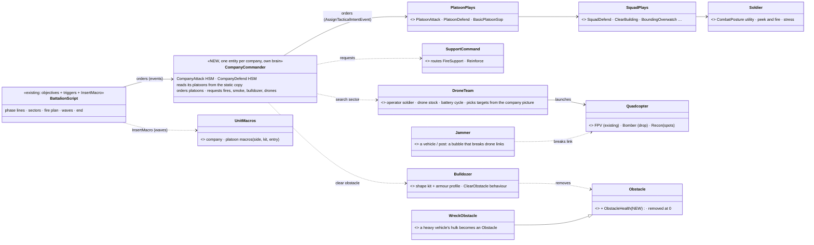
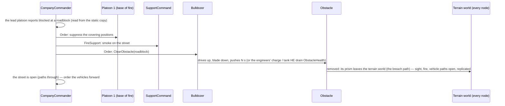
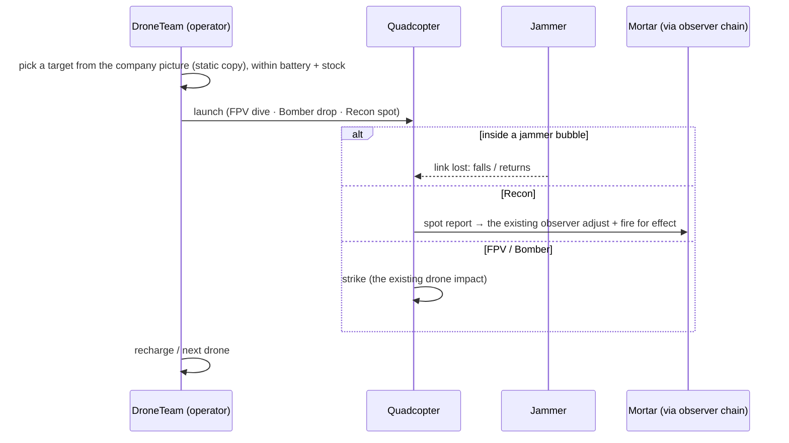
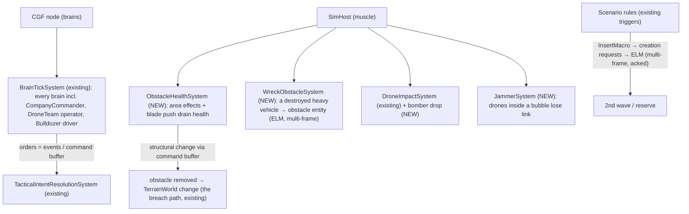

<!--STATUS
state: LIVE
build-state: READY-TO-BUILD — every lean below APPROVED by the user in chat (2026-11-13, §10); one open decision (D-R, the river) blocks only the terrain's river, not the build
updated: 2026-11-13
current-answer: the whole file — §2 the picture · §3 phases and the scripted top · §4 forces · §5 the breach drill · §6 classes · §7 sequences · §8 who runs what · §9 the parallel rules · §11 the work · §12 testing
stale-below: nothing
known-rot: none
known-conflict: none
related-designs:
  - docs/designs/group-maneuvers/DESIGN_Demo_City_Showcase.md — OWNS the demo-city showcase: a scripted timetable of ~50-entity ACTS (every feature seen once); this one is the opposite axis — scale and autonomy. Its gaps G-1…G-7 still apply to the features both use
  - docs/designs/group-maneuvers/DESIGN_Urban_Battle_Demo.md — OWNS the urban battle ladder and the platoon/squad plays this battle's platoons run unchanged
  - docs/designs/group-maneuvers/DESIGN_Command_Chain_Example.md — OWNS the echelon pattern (orders down as AssignTacticalIntentEvent, reports up); the company commander (§6) is one more level of it
  - docs/DESIGN_Scale_Rig.md — OWNS the scale budget this battle meets (R-4192: 1 000 men + 50 vehicles + 10 aircraft, ≤ 10 ms sim frame) and its measurements
  - docs/DESIGN_Parallel_Simulation.md — OWNS how the simulation reaches that budget; §9 here is the contract every new system of this battle keeps so it can run in parallel
  - docs/DESIGN_Terrain_Synth.md — OWNS the synthetic terrain generator; §11 T-1 adds an authored TOWN PLAN input to it
  - docs/DESIGN_Scenario_Macros.md — OWNS macros; §11 M-1 adds the company / platoon macros the order of battle and the waves are made of
  - docs/designs/weather/DESIGN_Weather_And_Time.md — OWNS visibility; the 5 km fog is a scenario setting of it (§8 S2 already shortens every sensor)
  - docs/designs/air-attack/DESIGN_Air_Operations.md — OWNS the air assault, the air defence and the strike aircraft used in phase 3
  - docs/designs/indirect-fire/DESIGN_Indirect_Fire.md — OWNS mortars, smoke and the observer chain the recon quadcopter joins
  - docs/designs/group-maneuvers/DESIGN_Building_Clearing.md — OWNS room / building clearing the platoons use in phase 4
  - docs/blueprints/RESUME_Coordinator_Destructible_Buildings.md — OWNS the breach / collapse path the obstacle removal (§11 O-1) reuses
-->

# DESIGN — the city battle showcase: ~1 000 men taking and holding a town, decided by their own commanders

## 0. Why

🔒 User, `2026-11-13`: *"i wanted to discuss new scenario demonstrating lots of entities (minimum 1000 soldiers, plus ground vechiles and aircraft)
that are visibly fighting in some suitable terrain, best if they are not scripted much, using their (and their commander's) brain to take decisions
… top level stuff (take over a city, defend a city) can be defined by some scripted approach like mission plans with triggers etc, lower level best
coming from automatic commander entities having their squads and squads having their teams."* — and: *"if it needs some new behaviors to look
realistic or simply good, come with suggestions"*.

## 1. INVENTORY *(`2026-11-13`; three read-only sweeps over `docs/`, `.dev/`, `scenarios/` and the code + direct reads)*

Queries: `scripts/cbm.sh search_graph` `.*(Commander|Platoon|Squad|Company|Echelon|Maneuver|Manoeuvre|Objective|Garrison|Occupy).*` ·
`.*(Weapon|Mortar|Missile|Rocket|Drone|Helicopter|Aircraft|Flight|Turret|Vehicle|Embark|Damage|Destruct|Fortif|Sandbag|AntiAir).*` ·
`.*(Navmesh|NavMesh|Building|Osm|Terrain|Lod|Partition).*` (Class) + grep. Re-run for this document: `.*(Commander|Platoon|Squad|Company|Echelon|Maneuver|Manoeuvre|Objective|Garrison|Occupy).*`
(Class) ⇒ **total 183**, none a company-level commander; `.*(Bulldozer|Dozer|Engineer|Obstacle|Wreck|Jammer|Quadcopter).*` (Class) ⇒ **total 23** —
the obstacle bake / placement / avoidance classes (`StaticObstacleBakeSystem`, `ObstacleTkbTranslator`, `OrcaObstacle` …) and `WreckSpawnSystem`;
⛔ no bulldozer, engineer, jammer or quadcopter class. ⚠ The ai-debug MCP was down: **no live run** confirmed anything below.

| capability | state | evidence |
|---|---|---|
| echelons HQ → platoon → squad → soldier | ✅ built | `PlatoonAttackBehavior.cs:208`, `PlatoonDefendBehavior.cs:198`, `SupportCommandBehavior.cs:69` (the HQ routes support only) |
| **a commander above platoon** | ⛔ **missing** | no company type, no company play (graph + grep); only prose in `DESIGN_Building_Clearing.md` |
| fire teams | data only | `UnitSubordinate.FireTeam` (`Fdp.Core/CommandHierarchy/UnitSubordinate.cs:29`); 0 readers in `Hrot.AI.Behaviors` |
| squad / platoon plays (assault, base of fire, bound, defend posts, fall back, clear room / building) | ✅ built | Urban Battle ladder; `pc-attack-dry` 12/12, `pc-defend-house` |
| scripted top: objectives, triggers that order units, waves (`InsertMacro`) | ✅ built | Scenario Rules S1 / S2 (§00.8–9) |
| mortar + observer, smoke | ✅ mortar · ⛔ smoke rounds | `ua-indirect-fire`; smoke CE-2278 designed |
| AT rockets, guided missiles, armour damage | ✅ built | `ua-rpg-window`, `ua-javelin-lock`, `ArmorModel.cs:27` |
| FPV drone (search, dive), vehicles shelter from it | ✅ built | `DroneImpactSystem.cs:28`, `ua-drone-shelter` |
| bomber / recon quadcopter, drone team, jammer | ⛔ missing | — |
| air defence vs aircraft; helicopter insertion on a DRAWN route | ✅ built | `AirDefenceBehaviors.cs:155`, `RotorcraftModel.cs:233`, `ua-air-assault` |
| wall breach, building collapse (terrain change, sight / fire / paths follow, replicated) | ✅ built | `BreachRule`, `BuildingDamageSystem.cs:49`, `AreaEffectSystem.cs:426` |
| static obstacles (concrete block 8808, car 8806, sandbag wall 8807) — baked as terrain prisms | ✅ built · ⛔ **cannot be destroyed or removed** | `StaticObstacles.cs` (CE-3136 P-7a) |
| a destroyed vehicle as an obstacle | ⛔ missing | a wreck is a presentation effect (`WreckSpawnSystem`, `EffectSystems.cs:406`) |
| bulldozer / engineering vehicle | ⛔ missing | the vehicle catalogue (`TkbEntityTypes.cs`) has none |
| weather visibility shortening every sensor | ✅ built | `PerceptionWeather.cs` (CE-3216 S2), `WeatherConditions.VisibilityM` |
| water surface blocking movement | ⛔ **missing** | `TerrainSurfaceType.Water` is read only for placement (`DESIGN_Terrain_Import_UTM.md` §9.1: "no movement cost, no sight effect") |
| synthetic terrain generator (roads, plots, buildings, heights; deterministic, in git as code) | ✅ built · ⛔ no authored layout | `DESIGN_Terrain_Synth.md`, `scripts/terrain-scale.py` |
| scale at 1 000 men | ⚠ runs, slow | W16: SimHost 37 ms, CGF 86 ms (Scale Rig §7); the speed is the parallel programme's (user: *"assume there is enough speed"*) |
| a scenario with more than one AI platoon per side | ⛔ none found | largest: `perf-stress` 992 men, squads only, no command above |

## 2. The picture — the battle at a glance

*What the picture shows that prose hid:* the battle is THREE bands the attack must cross — the open fields (where both sides' drones make a dead
zone), the ring road (the defenders' main line, roadblocked), the old town behind the river (the inner ring, the town hall). Each phase line is a
scripted trigger; everything between two lines is a company commander's problem. The air assault skips the bands and lands on the objective.

## 3. The phases — the scripted top, and nothing below it

| phase | starts when (trigger) | the battalion script orders | what the AI then does by itself |
|---|---|---|---|
| **1 shaping** | t = 0 | both sides' drone teams on; attacker mortars register on PL A; defender AA up on the hill | recon quadcopters spot for mortars, FPV hunts in the fields — the dead zone forms |
| **2 breach** | t = 5 min, or the shaping fires done | A Coy, B Coy: attack to PL B (ring road) in their sectors | companies cross under smoke, meet the outposts, clear roadblocks (§5), the defenders fall back to the main line |
| **3 air assault** | A or B Coy reaches PL B | the air assault platoon: insert at the town hall | UH-60s fly the drawn route; the defenders' AA engages; the landed platoon holds the town hall's building |
| **4 urban grind** | PL B held | both companies: attack to PL C (old town) · 2nd wave macro enters at the west edge | block-by-block clearing; the defenders' companies fall back to the inner ring |
| **5 counterattack** | the attacker holds the square | defender reserve Coy: counterattack the square | the reserve crosses the bridges; the attackers defend what they took |
| **6 end** | every objective held ≥ 3 min · or one side < 30 % strength · or 60 min | end the exercise, score | — |

⭐ The script writes **intent only** (sector, objective, phase line, fire plan, wave, end) through the built objectives and triggers (S1 / S2 + `InsertMacro`); ⛔ it never moves a platoon.

## 4. The forces *(≈ 1 050 men, ≈ 50 vehicles, ≈ 10 aircraft — the Scale Rig budget, R-4192; more later if the speed allows)*

| | attacker (≈ 600) | defender (≈ 450) |
|---|---|---|
| manoeuvre | 2 mechanised companies (each: HQ + 3 platoons + 4 IFVs + 2 tanks) · 1 air assault platoon · a 2nd-wave company (macro, phase 4) | 3 companies in the buildings (each: HQ + 3 platoons, technicals) · 1 reserve company (counterattack) |
| support | mortar section · Javelin teams · 2 drone teams · 1 jammer vehicle · 1 engineer squad + 1 **bulldozer** · on call: A-10, AH-64 | mortar section · RPG / NLAW teams · 2 drone teams · ZU-23 + Stinger / Igla on the hill |
| air | 4 UH-60 (insertion), A-10, AH-64 | — (ground counterattack instead) |
| positions | — | **prepared from the start** by the scenario: sandbag posts, roadblocks (blocks + cars), MG nests, occupied buildings; no "prepare" behaviour |
| fire teams | **groups inside a squad** (squad leader addresses team A / team B); no team brain | same |

Visibility: **5 km fog**, daylight only.

## 5. The roadblock breach drill — removal is mandatory

*What the picture shows that prose hid:* a roadblock is only ever passed by **removing** it (🔒 user: *"there is nothing like breach through a road
block - removal mandatory (even as disappearing)"*) — the drill around it exists only to get the remover there alive. Three removers, one effect:
the obstacle's prism leaves the terrain world. The bypass (infantry through breached walls) is the alternative ROUTE, not a removal.

## 6. Classes

*What the picture shows that prose hid:* only ONE new echelon (the company) sits in the existing chain; everything else new is a leaf the company
commander calls (bulldozer, drone team) or a world rule (obstacle health, wrecks). The platoon, squad and soldier levels are reused unchanged.

## 7. Sequences

## 8. Who runs what each frame

*What the picture shows that prose hid:* every NEW system is a SimHost or CGF system in an EXISTING scheduled place — none needs a new host or a
private loop; and every cross-entity effect (an order, a removal, a new wreck, a wave) leaves its system as an event, a command-buffer write or an
ELM creation — the shapes §9 requires. ⚠ The node that runs `BuildingDamageSystem` today is assumed to be the SimHost — verify before O-1.

## 9. The parallel contract — every new system keeps it *(DESIGN_Parallel_Simulation §4 + the user, 2026-11-13)*

| rule | so the system can run in batches |
|---|---|
| ⭐ **a reader declares the components it reads of OTHER entities; they are read from the world's static COPY, never live** (🔒 user: *"reading other entity's state is always from a world static copy, never from live - the reader declares what component it reads, system adds this to the copy list"*) | the company commander reads its platoons, the drone operator its targets, the jammer the drones — all from the copy |
| writes only its OWN entity in place; anything for another entity is an event or a command-buffer write | orders (events, already), obstacle health drained by area effects, the removal |
| no structural change mid-loop: create / destroy through the command buffer; new entities through the ELM (multi-frame, acked) | a wreck becoming an obstacle, a wave, a launched drone |
| no shared mutable caches or statics in a system or helper | — |
| randomness from a per-entity stream (seed = entity + tick), never `Random.Shared` | drone target choice, commander tie-breaks |
| zero allocation in the per-entity body (R-2084) | — |
| a serial-vs-parallel rail per new system: the same world byte for byte | the build's acceptance (§12) |

## 10. Decisions — ✅ APPROVED by the user, `2026-11-13` (chat)

| # | decision | 🔒 the user |
|---|---|---|
| D-1 | **terrain: a hand-made synthetic town** — an authored town plan the synthetic generator fills (§11 T-1), then adjusted by hand; ⛔ no OSM auto-import | *"no towns generated by automatic OSM import - produces garbage often, synthetic terrain better - can take inspiration from real but needs to be hand made"* |
| D-2 | speed is the parallel programme's; this design assumes it | *"assume there is enough speed"* |
| D-3 | positions prepared from the start (scenario-placed) | *"positions should be prepared from the beginning"* |
| D-4 | the scripted top = intent only (§3) | *"top level stuff … scripted approach like mission plans with triggers"* |
| D-5 | the new behaviours of §11 | *"feature/behavior extensions otherwise approved"* · *"drone stuff approved"* |
| D-6 | roadblock: breach drill + bypass; **removal mandatory**, at least as disappearing; obstacles + wrecks get removal; a bulldozer | *"breach + bypass ok"* · *"removal manadatory (even as disappearing)"* · *"pls plan for adding the bulldozer vehicle including its 3d model (no need to look armored, just it should stand some shots as armored one would)"* · *"no blade tank necessary"* |
| D-7 | daylight only; visibility 5 km fog | *"daylight only"* · *"add a a bit of fog to limit visibility (5km maybe?)"* |
| D-8 | ≈ 1 050 men / 50 vehicles / 10 aircraft; more later | *"entity numbers ok, later we could add if performance is good"* |
| D-9 | fire teams = groups inside a squad, no team brain | (explained in chat: a fire team is part of a squad; the platoon commander drives squads) |
| D-10 | defenders: ground counterattack; drones on BOTH sides (the dead zone is wanted) | *"defenders get ground counterattack; and they have attack quadrocopters (both sides do nowadays of course, which might create a no-ones dead zone and stop the attack from any side)"* |
| D-11 | the parallel contract (§9) binds every new system | *"note the building would need to follow restricition to not go against the parallization"* |
| D-12 | never test correctness on 1 000 men (§12) | *"i can;t imagine testing on full 1k men scenarios that would take ages"* |

### ⏸ Open — one decision

| # | question | ⭐ lean | what changes it |
|---|---|---|---|
| **D-R** | the river: water has **no movement cost** today, so a river would not force the bridges | ⭐ **make water impassable to ground units** (the navmesh excludes `Water` surfaces; vehicles path around) — a small terrain rule that also serves every future river | if that rule is unwanted: drop the river, use a railway embankment with two underpasses (walls + ramps that exist) |

## 11. The work *(each item small enough to build and test alone; lanes are leans)*

| id | what | reuses | lane |
|---|---|---|---|
| **T-1** | **town plan** input for `hrot-terrain-synth`: an authored JSON (ring road, old town + square, landmark, river + 2 bridges, districts with density / building mix, fields, hill) the generator fills with its building templates; then hand-adjusted; deterministic, in git as plan + code | Terrain Synth, `terrain-scale.py`, the 7 building templates | backend (terrain) |
| T-2 | D-R: water impassable to ground units | navmesh build | backend |
| **C-1** | `CompanyCommander` CC-1: attack (base of fire / assault / reserve, phase lines, reserve commit) + defend (a block per platoon, fall back to the next line) | PlatoonAttack / Defend pattern, EQS, the static copy | behaviors |
| C-2 | CC-2: support calls — fires, smoke, bulldozer / engineers at a roadblock, drone tasking | SupportCommand, the observer chain | behaviors |
| C-3 | CC-3: local counterattack, asking the battalion for more | — | behaviors |
| **O-1** | `ObstacleHealth`: an obstacle drained by area effects and the blade; at 0 **removed** (its prism leaves the terrain world) | the breach / collapse path | backend (destructible) |
| O-2 | wreck → obstacle for heavy vehicles (tanks, IFVs), through the ELM | WreckSpawn's detection, StaticObstacle | backend |
| **V-1** | the **bulldozer**: catalogue entry (engineering DIS type, tracked mobility, no weapon), a shape kit (tracked chassis, engine block, cab, articulated blade — NOT armoured-looking), an armour profile per side (small arms bounce, a few RPG hits to kill), gallery entry + thumbnail | ShapeKit, ArmorModel, the tracked model, `thumbnails.py` | behaviors (vehicle) |
| V-2 | `ClearObstacle` behaviour: drive to the blocker, blade down, push → O-1 | the vehicle drive behaviours | behaviors |
| **R-1** | drone team: operator + stock + battery; Bomber and Recon quadcopters; recon joins the observer chain | FPV drone, DroneImpactSystem, PersonObserveFire | behaviors |
| R-2 | anti-drone reaction (into cover / freeze / shoot) + the jammer (vehicle / post bubble) | `ua-drone-shelter` reaction | behaviors |
| **M-1** | company / platoon macros (side, kit, entry point) — the order of battle laid out once, the waves inserted by trigger | Scenario Macros, `InsertMacro` | coordinator / behaviors |
| S-1 | smoke rounds (CE-2278, designed) | indirect fire | behaviors |
| S-2 | unit morale / rout (AQ101 E-3 / E-4 — awaits the user) | stress | behaviors |
| S-3 | AI-chosen landing zone for the air assault (EQS: open, near the objective, out of AA reach) | `ua-air-assault` | behaviors |
| **B-1** | the scenario: `showcases/city-battle` — the forces (§4) by macro, the script (§3), the 5 km fog | everything above | coordinator |

## 12. Testing — never correctness on 1 000 men

| tier | what | time |
|---|---|---|
| ① decision rails | a commander / operator / bulldozer brain fed a hand-made static copy (*"platoon 2 at 40 %, in contact at block C, reserve fresh"*) → assert the orders it emits; no simulation | seconds, every build |
| ② puppet subordinates | platoons as light entities a test script moves (position, strength, contact), no soldiers — the commander over time: phase changes, reserve commit, fall back | seconds of sim |
| ③ per-feature dry twins | one small in-process scenario per new piece (`uc-reinforce-dry` pattern): bulldozer clears a roadblock, drone team vs a jammer, company vs a platoon | minutes, on demand + nightly |
| ④ company vs company | ≈ 250 men on a slice of the town | minutes, nightly |
| ⑤ the full battle | performance (the Scale Rig) and filming only — ⛔ never a correctness gate; a wrong moment is read from its RECORDING, not re-run | the slow lane (T3) |
| ✚ every new system | the serial-vs-parallel rail (§9) | seconds |

## 13. Rejected — one line each

- **extend the demo-city showcase** — a scripted timetable of ~50-entity acts on an 800 m map: the opposite of scale and autonomy.
- **script the platoons with mission plans** — 30+ platoons by hand, and it is not the AI showing.
- **OSM-imported town** — the user: auto-import often produces garbage.
- **a tank with a dozer blade** — the user: not needed; the bulldozer is one clear role and a target the defenders go after.
- **destructible sandbags as a goal** — no one in the battle needs them gone; removal is for what blocks vehicles (§5).
- **a fire-team brain** — ≈ 260 more commander brains for little visible difference.
- **3 000 men now** — 410–500 ms brain tick measured (Scale Rig §7.7); after the parallel programme.

## 14. Design docs checked

| doc | applies? |
|---|---|
| `DESIGN_Demo_City_Showcase.md` | ⛔ not as a structure (scripted acts, small scale) · ✅ its gaps G-1…G-7 for the shared features |
| `DESIGN_Urban_Battle_Demo.md` | ✅ the platoon / squad plays reused unchanged |
| `DESIGN_Command_Chain_Example.md` | ✅ the echelon pattern C-1 extends |
| `DESIGN_Scale_Rig.md` | ✅ the budget (R-4192) and the measurement |
| `DESIGN_Parallel_Simulation.md` | ✅ §9's contract |
| `DESIGN_Terrain_Synth.md` | ✅ T-1 extends it (no authored layout today) |
| `DESIGN_Terrain_Import_UTM.md` | ✅ the fact that water has no movement cost (D-R) |
| `DESIGN_Weather_And_Time.md` §8 | ✅ the fog shortens every sensor already |
