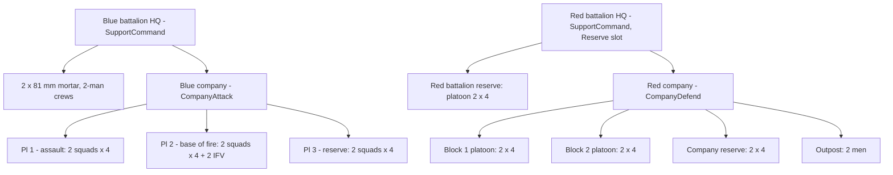
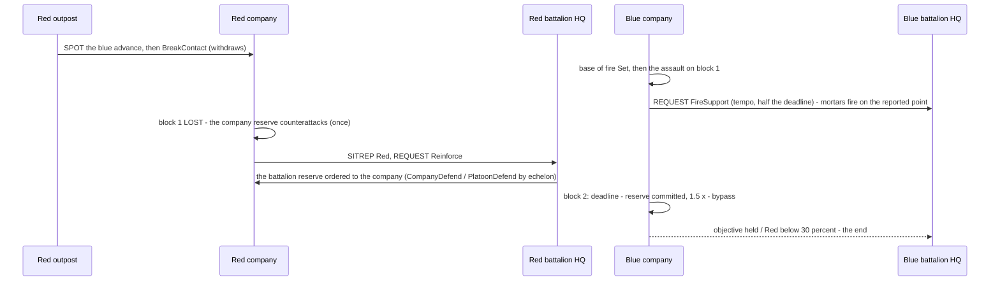
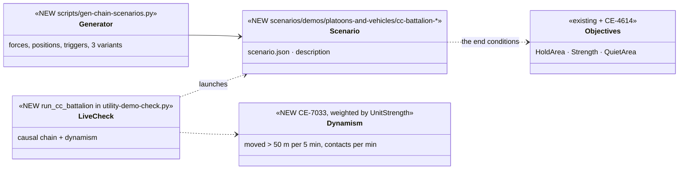

<!--STATUS
state: LIVE
build-state: READY-TO-BUILD — the user approved the shape (2026-11-14: a small REAL-squad scenario proves the command chain; the FusionSquad later); the builder measures and decides the remaining coordinates and tunables (autonomous), recording each as a lane ruling
updated: 2026-11-14 (first version — coordinator)
current-answer: the whole file
stale-below: nothing
known-rot: none
known-conflict: none
related-designs:
  - DESIGN_City_Battle_Showcase.md — §12 the test ladder: this is rung ③/④ (a real company vs a defended position, with the battalion above) — it replaces the 250-man CE-7034 as the chain's proof; §3 / §3a the phases and momentum it scales down; §6a the company as built
  - DESIGN_Command_Chain_Example.md — OWNS orders down / reports up and §8e the battalion's reserve (CE-4589) this scenario exercises; `cc-platoon-bound` is the same idea one level down
  - DESIGN_Platoon_Attack_Defend_Clear.md — OWNS the platoon plays and the reports (PhaseLine, ObjectiveSecure, FireLifted) CE-4610 decides
  - ../aggregate-units/DESIGN_Aggregate_Squad.md — the FusionSquad, deferred (R-4253); this scenario is later its CALIBRATION baseline (the same scenario run with FusionSquads)
  - ../../DESIGN_Scenario_Rules.md — §10.2 the objectives and triggers (+ `Strength` / `QuietArea`, CE-4614) the scripted top uses
-->

# DESIGN — the command chain proved on a battalion slice with REAL squads *(CE-4615)*

## 1. The request

🔒 User, `2026-11-14`: *"I think we need some simple scenario that demonstrates all this hierarchy of command with some minimalistic content.
What I would like to avoid is having hundreds of soldiers just because we want to test and prove the command hierarchy. How could we set up a
reasonable test showing that all the showcase features regarding the dynamicism and high-level planning and phase lines and calling support and
reinforcement?"* · *"ok let's leave the fusionSquad for later"* (R-4253) · *"do you have enough to write an autonomous overnight batch for the
commander chain development and testing, specified enough so no questions need to be asked?"*

**Why real squads:** the defects live where real squads meet their commanders (reports nobody sends, the drills' halves); a stand-in would bypass
them. ~60 men is affordable.

## 2. INVENTORY *(measured 2026-11-14)*

| what | found |
|---|---|
| the company behaviours | `CompanyAttack` params `Objective1…4` (PointLink), `Radius`, `Speed`, `DeadlineSeconds` (`CompanyAttackParamsJsonDto.cs:19-41`); `CompanyDefend` `Position`, `Threat`, `Frontage`, `Depth`, `Speed`, `ShootAndMoveSeconds` (`CompanyDefendParamsJsonDto.cs`); roles by slot 0 assault / 1 base of fire / 2 reserve; tempo ½ deadline ⇒ fires, 1× ⇒ reserve, 1.5× ⇒ bypass; defend: reserve reinforces, a LOST block counterattacked once (City Battle §6a, CE-7004) |
| the battalion HQ | `SupportCommandBehavior` answers FireSupport (aircraft / battery by priority) and Reinforce (`:82-176`); the reserve slot is CE-4589 |
| terrains | demo-city ≈ 780 × 750 m, 169 buildings (the only one large enough); cqb-village 260 × 184 m; test-town ≈ 330 m |
| the generator + live-check precedent | `scripts/gen-morale-scenarios.py` (a platoon, a 2-tube 81 mm battery with crews, triggers, a description) + `scripts/utility-demo-check.py` `run_morale_barrage` (`:4321`): engage, then read reports / state over HTTP and judge |
| the reports log | `/squad/reports` (`DebugApiService.Reports.cs`), the order journal (`CommandNodes.cs:45`) |
| the unit types | squad 302, platoon 305, company 306 (`TkbEntityTypes.cs:205-215`); battery and 81 mm tubes need GUNNERS in their seats (`WeaponSystems.cs:94`) |
| graph | `scripts/cbm.sh search_graph '{"name_pattern":".*(Company\|SupportCommand\|Platoon)(Attack\|Defend\|Behavior).*","label":"Class"}'` — the behaviours above; ⚠ coverage not checkable |

## 3. Diagrams

### 3.1 The forces

*What it shows: every echelon of the chain exists on both sides with the fewest men that still let each play its role — ≈ 62 men, 2 IFVs, 2
mortars; one company each, so the battalion's only jobs are FIRES (blue) and the RESERVE (red).*

### 3.2 The chain the checks look for

*What it shows: each arrow is something the live check must find in the reports and the order journal IN THIS ORDER and CAUSED by the arrow
before it — never by a clock alone (R-4251 R-D10).*

### 3.3 What is built

*What it shows: one generator writes the scenario and its variants (the morale precedent); one live-check function judges them; nothing in the
engine is new except the prerequisites (CE-4589, CE-4610, CE-4614, CE-7033).*

## 4. The scenario — fixed points and tunables

| | fixed | the builder decides (measured on demo-city, recorded as a lane ruling) |
|---|---|---|
| terrain | demo-city; ⛔ no traffic, no civilians | the axis of advance and the two objective blocks (≈ 150 m apart, the start line ≈ 150 m before block 1) |
| attack | `CompanyAttack { Objective1 = block 1, Objective2 = block 2, DeadlineSeconds }` ordered at t = 30 s | the deadline (lean 180 s), radius, speed |
| defence | `CompanyDefend` at t = 0 (blocks 1 and 2, reserve behind), the outpost forward on the axis | frontage / depth from the blocks |
| battalion | Blue HQ with the battery (fires and smoke); Red HQ with the reserve platoon in its `Reserve` slot (CE-4589) | — |
| end | Blue holds Objective2 for 120 s (`HoldArea`) · Red below 30 % (`Strength`, CE-4614) · t = 15 min | — |

| variant | change | proves |
|---|---|---|
| **cc-battalion** (base) | as above | the whole chain end to end |
| **cc-battalion-stall** | block 2 + one squad | Blue's TEMPO: fires at ½ deadline, the reserve at 1×, the bypass at 1.5× — each after the Set / failure that precedes it |
| **cc-battalion-collapse** | block 1 thin, the company reserve weak | Red: block 1 LOST ⇒ counterattack; the company Red ⇒ Reinforce ⇒ the battalion reserve arrives |

## 5. Acceptance

1. Each variant's live check PASSES on three runs, every chain arrow of §3.2 found in order, each CAUSED by its predecessor (the report precedes the
   order it triggers; the fire mission lands on a REPORTED point; a phase line reached BY a report).
2. The dynamism measure on the base run: thresholds X (moved > 50 m per 5 min) and Y (contacts per minute) set from the first three runs and then
   locked; a later run below them is a red row.
3. `HROT_PARALLEL_SIM=1` + `HROT_READ_CHECK=1` on the scenario's rails; `stepped-hash.py --threads 1,4,8` equal on the base scenario (once CE-7037
   lands).
4. A defect found in the chain is fixed in its owning behaviour with a rail in that behaviour's suite — never worked around in the scenario.
