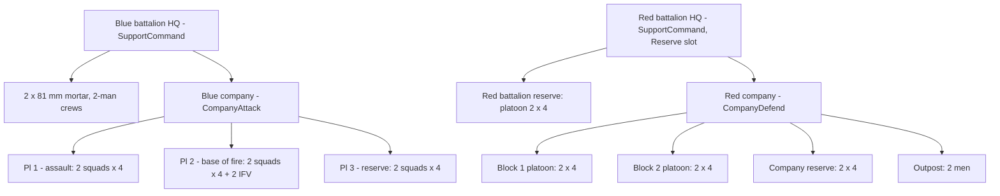
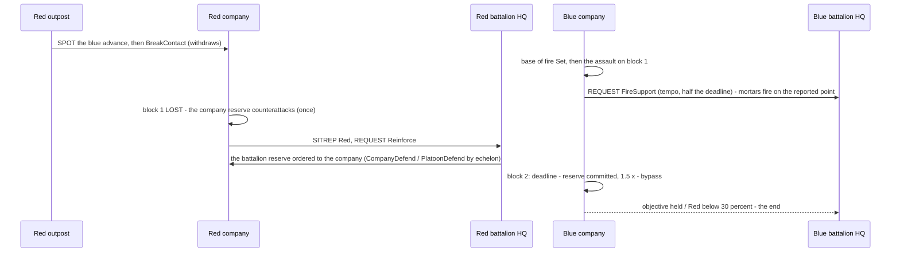
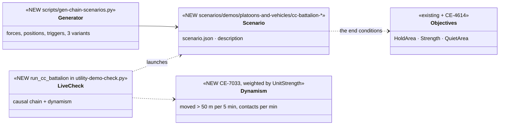

<!--STATUS
state: LIVE
build-state: BUILDING (behaviors, 2026-11-14 — §4a as built) — the user approved the shape (2026-11-14: a small REAL-squad scenario proves the command chain; the FusionSquad later); the builder measures and decides the remaining coordinates and tunables (autonomous), recording each as a lane ruling
updated: 2026-11-14 (first version — coordinator)
current-answer: the whole file
stale-below: nothing
known-rot: none
known-conflict: none
related-designs:
  - DESIGN_Assault_Under_Fire.md — the design of the base variant's failure (CE-2436); this scenario is its test (AU-6)
  - DESIGN_City_Battle_Showcase.md — §12 the test ladder: this is rung ③/④ (a real company vs a defended position, with the battalion above) — it replaces the 250-man CE-7034 as the chain's proof; §3 / §3a the phases and momentum it scales down; §6a the company as built
  - DESIGN_Command_Chain_Example.md — OWNS orders down / reports up and §8e the battalion's reserve (CE-4589) this scenario exercises; `cc-platoon-bound` is the same idea one level down
  - DESIGN_Platoon_Attack_Defend_Clear.md — OWNS the platoon plays and the reports (PhaseLine, ObjectiveSecure, FireLifted) CE-4610 decides
  - ../aggregate-units/DESIGN_Aggregate_Squad.md — the FusionSquad, deferred (R-4253); this scenario is later its CALIBRATION baseline (the same scenario run with FusionSquads)
  - ../../DESIGN_Scenario_Rules.md — §10.2 the objectives and triggers (+ `Strength` / `QuietArea`, CE-4614) the scripted top uses
-->

# DESIGN — the command chain proved on a battalion slice with REAL squads *(CE-4615)*

## 1. The request

🔒 User, `2026-11-14`: *"I think we need some simple scenario that demonstrates all this hierarchy of command with some minimalistic content.
What I would like to avoid is having hundreds of soldiers just because we want to test and prove the command hierarchy. How could we set up a
reasonable test showing that all the showcase features regarding the dynamicism and high-level planning and phase lines and calling support and
reinforcement?"* · *"ok let's leave the fusionSquad for later"* (R-4253) · *"do you have enough to write an autonomous overnight batch for the
commander chain development and testing, specified enough so no questions need to be asked?"*

**Why real squads:** the defects live where real squads meet their commanders (reports nobody sends, the drills' halves); a stand-in would bypass
them. ~60 men is affordable.

## 2. INVENTORY *(measured 2026-11-14)*

| what | found |
|---|---|
| the company behaviours | `CompanyAttack` params `Objective1…4` (PointLink), `Radius`, `Speed`, `DeadlineSeconds` (`CompanyAttackParamsJsonDto.cs:19-41`); `CompanyDefend` `Position`, `Threat`, `Frontage`, `Depth`, `Speed`, `ShootAndMoveSeconds` (`CompanyDefendParamsJsonDto.cs`); roles by slot 0 assault / 1 base of fire / 2 reserve; tempo ½ deadline ⇒ fires, 1× ⇒ reserve, 1.5× ⇒ bypass; defend: reserve reinforces, a LOST block counterattacked once (City Battle §6a, CE-7004) |
| the battalion HQ | `SupportCommandBehavior` answers FireSupport (aircraft / battery by priority) and Reinforce (`:82-176`); the reserve slot is CE-4589 |
| terrains | demo-city ≈ 780 × 750 m, 169 buildings (the only one large enough); cqb-village 260 × 184 m; test-town ≈ 330 m |
| the generator + live-check precedent | `scripts/gen-morale-scenarios.py` (a platoon, a 2-tube 81 mm battery with crews, triggers, a description) + `scripts/utility-demo-check.py` `run_morale_barrage` (`:4321`): engage, then read reports / state over HTTP and judge |
| the reports log | `/squad/reports` (`DebugApiService.Reports.cs`), the order journal (`CommandNodes.cs:45`) |
| the unit types | squad 302, platoon 305, company 306 (`TkbEntityTypes.cs:205-215`); battery and 81 mm tubes need GUNNERS in their seats (`WeaponSystems.cs:94`) |
| graph | `scripts/cbm.sh search_graph '{"name_pattern":".*(Company\|SupportCommand\|Platoon)(Attack\|Defend\|Behavior).*","label":"Class"}'` — the behaviours above; ⚠ coverage not checkable |

## 3. Diagrams

### 3.1 The forces

*What it shows: every echelon of the chain exists on both sides with the fewest men that still let each play its role — ≈ 62 men, 2 IFVs, 2
mortars; one company each, so the battalion's only jobs are FIRES (blue) and the RESERVE (red).*

### 3.2 The chain the checks look for

*What it shows: each arrow is something the live check must find in the reports and the order journal IN THIS ORDER and CAUSED by the arrow
before it — never by a clock alone (R-4251 R-D10).*

### 3.3 What is built

*What it shows: one generator writes the scenario and its variants (the morale precedent); one live-check function judges them; nothing in the
engine is new except the prerequisites (CE-4589, CE-4610, CE-4614, CE-7033).*

## 4. The scenario — fixed points and tunables

| | fixed | the builder decides (measured on demo-city, recorded as a lane ruling) |
|---|---|---|
| terrain | demo-city; ⛔ no traffic, no civilians | the axis of advance and the two objective blocks (≈ 150 m apart, the start line ≈ 150 m before block 1) |
| attack | `CompanyAttack { Objective1 = block 1, Objective2 = block 2, DeadlineSeconds }` ordered at t = 30 s | the deadline (lean 180 s), radius, speed |
| defence | `CompanyDefend` at t = 0 (blocks 1 and 2, reserve behind), the outpost forward on the axis | frontage / depth from the blocks |
| battalion | Blue HQ with the battery (fires and smoke); Red HQ with the reserve platoon in its `Reserve` slot (CE-4589) | — |
| end | Blue holds Objective2 for 120 s (`HoldArea`) · Red below 30 % (`Strength`, CE-4614) · t = 15 min | — |

| variant | change | proves |
|---|---|---|
| **cc-battalion** (base) | as above | the whole chain end to end |
| **cc-battalion-stall** | block 2 + one squad | Blue's TEMPO: fires at ½ deadline, the reserve at 1×, the bypass at 1.5× — each after the Set / failure that precedes it |
| **cc-battalion-collapse** | block 1 thin, the company reserve weak | Red: block 1 LOST ⇒ counterattack; the company Red ⇒ Reinforce ⇒ the battalion reserve arrives |

## 4a. As built *(behaviors, `2026-11-14`)*

| | built |
|---|---|
| generator | `scripts/gen-chain-scenarios.py` → `scenarios/demos/platoons-and-vehicles/cc-battalion{,-stall,-collapse}` (62 men each; 2 IFVs, 2 × 81 mm with gunner + loader) |
| coordinates | Objective 1 = the office cluster **(425, 425)** · Objective 2 = the shop column **(645, 445)** (220 m apart) · Blue assembles at (150, 405), the IFVs on the start line x ≈ 265 · the outpost at (335, 400) · the Red battalion reserve at (720, 620) |
| tunables (R-2097, lane decision) | `CompanyAttack.DeadlineSeconds` = 180 (the lean) · `CompanyDefend` Frontage 160, Depth 220 · the end trigger: `HoldArea` 120 s / `Strength` < 0.3 / 900 s · phase lines `ReachArea` PL 1 by 330 s, PL 2 by 630 s |
| the check | `scripts/utility-demo-check.py` `run_cc_battalion` (the chain §3.2 judged in order and caused) + `Dynamism` (CE-7033) |

⭐ **R-2096** *(lane decision — for the user's review)*: **`CompanyDefend` builds a LINE** — its blocks stand ACROSS the threat with the reserve and the fall-back behind (`CompanyBehaviors.cs` ~:613-625) — not two blocks in depth as §3.1 drew them. ⇒ Red's company is a line facing west AT Objective 1 (two blocks across the street, its reserve 110 m behind), its fall-back ON Objective 2; "block 1" in §3.2 is a block of that line, "block 2" its depth. Every CompanyDefend feature the chain needs is kept (a LOST block counter-attacked once, Red ⇒ Reinforce, the fall-back). The IFVs overwatch from the start line on their own SOP, outside the company (a vehicle in a platoon's roster is untested there). Would change: a `CompanyDefend` that can hold blocks in depth.

⭐ **What the live runs fixed** *(behaviors, `2026-11-15`)*:

| run | measured | fixed where |
|---|---|---|
| 1 | the report log is a 256-entry ring: SITREPs and SPOTs pushed the early reports out ⇒ the check saw no Set | the check keeps every report it has seen (by serial) |
| 1 | every company fire call refused *"danger close (friends within 600 m)"*, no round flew | **R-2099** — the HQ's answer to a REQUEST is declared danger close (`SupportCommandBehavior`, Command Chain §8e) |
| 2 | the only call was the tempo's SMOKE (CE-7025): the assault met an untouched line, PL 1 missed | **R-2100** — `CompanyAttack.EnterAssault` asks PREPARATORY HE on the objective as the assault goes in |
| 2 | the outpost SPOTs (4 s) and never withdraws: the OP play is unbuilt | **R-2101** — a scenario rule (Blue within 150 m ⇒ `Order.Move` back behind the line); the play is **CE-2435** |
| 3 | the rule's `BreakContact` order read *"not accepted"*: the Order verb counts acceptance only while the target RUNS that order's id, and a one-shot BreakContact (or the men's own fight) ends it unseen | R-2101 revised: the rule orders a MOVE (it runs ~40 s); arrow ① accepts it |
| 3 | ②③⑤⑥⑦ pass; the HE lands 2 m from the reported point; Blue still misses PL 1 | — |
| 5 | base: ②③⑤⑥⑦ ✓, PL 1 REACHED (282 s) — the assault platoon destroyed on the objective, so the company never reports it taken · stall run 1: its own arrows ②③⑦ ✓ | the dynamism measure judges phase lines on the base only (a stall misses them by design) |
| 5 | collapse run 1: ⑤⑥ ✓ but ④ never — a block WIPED OUT never read Black: the company plays never asked their platoons for a SITREP (only `PlatoonDefend` asked its squads, DA-63) | ⭐ `CommandOrders.AskSitrep` — ONE helper (lifted from `PlatoonDefend`), called by every company order site; rail `CE4615_ACompany_AsksEveryPlatoonItOrders_ForASitrep`, red-proved |
| 6 | base: Blue's assault platoon kept 7 men and reached PL 1 but never Set — `PlatoonAttack` clears EVERY building in the default 80 m (≈ 8), and the 1.5 × bypass came first · collapse 2: the block now reads LOST (64 s) and the reserve REINFORCES it — CE-7004 by design (a failing block is reinforced; a counter-attack only when one is lost with the reserve free) | **R-2097 rev. 3** `Radius` 35 m (the block's 3–4 buildings) · **R-2102** arrow ④ = the company reserve commits, by reinforcement or counter-attack (its order point moving, or its PlatoonAttack) |
| 7 | stall 2: the cluster ABORTED (a worker-pool race, `IndexOutOfRange`) · collapse 3: BOTH blocks thin ⇒ half the blocks Black ⇒ `CompanyDefend` fell back at 33 s, before contact · base 7: the outpost in the open read Health 0 at 4 s (a hit from Blue's assembly 140 m away) | `FdpWorkerPool` generation fix (Parallel Simulation, the pool row) · collapse thins BLOCK 1 only, as the variant table says · **R-2103** the outpost INSIDE the house on the axis (296, 388), withdrawn when Blue passes within 35 m |
| 8–9 | base 8: a Blue man STARTED inside the withdrawal circle ⇒ no edge (CE-4166 by design), the rule never fired; the assault platoon's PhaseLine was in the log but the check read the company's only · base 9: ①–⑧ ✓, ended by Red < 30 % at 390 s before the assault reported its objective · stall 3 and collapse 4: ✅ PASS | the withdrawal area just east of the house, off Blue's start · the check reads the chain's PhaseLine (company or platoon, R-2095) and any `<Class>Move` · **R-2104** watch 180 s past the end for the PhaseLine; a line failed BY the end is not missed |
| 10–11 | base 10: two-squad platoons — the assault squad Black in the office ⇒ `AssaultLost` broke the platoon off (probe) · base 11: three squads, worn down crossing 113 m in ≈ 170 s under the line's fire (SITREP Red from 153 s, every man alive but hit) — Objective 1 never taken · collapse 6, stall 5: ✅ PASS | **R-2105** three-squad Blue platoons · ⏳ **CE-2436** the approach (suppression / smoke on the bound, the base of fire's stand-off) — a tactics decision, open |
| 4 | Blue WINS the fight on the line (Red 1st Platoon 0 / 8 left, 2nd 2 / 8) but never occupies Objective 1; the outpost dies within ~10 s (the IFVs 70 m off) | probes: every man of Blue's assault platoon alive; the support Sets in 80 s, then the assault squad BOUNDS ≈ 0.8 m/s (≈ 20 m a bound) to an assault position 210 m away — the deadline's bypass (1.5 × 180 s) moved the company on first. ⇒ **R-2097 rev. 2** (tunables, no behaviour defect): Blue assembles 185 m out (the design's ≈ 150 m start line), the IFVs at the rear, the outpost 45 m before the line (withdrawal at 140 m), `DeadlineSeconds` 300, PL 1 / PL 2 by 420 / 720 s |
| 2 | a smoke mission makes a cloud, not a detonation | the check's arrow ③ counts smoke clouds too |

## 5. Acceptance

1. Each variant's live check PASSES on three runs, every chain arrow of §3.2 found in order, each CAUSED by its predecessor (the report precedes the
   order it triggers; the fire mission lands on a REPORTED point; a phase line reached BY a report).
   ⭐ **As amended by R-4265 (user `2026-11-16`) for the base variant:** the objective TAKEN = the PhaseLine report OR Blue holding Objective 1 for
   30 s (R-2119) — one arrow (`AU-6 Objective 1 TAKEN`) in place of the PhaseLine arrow alone; the fire arrow counts only the mortars' bursts /
   smoke within 60 m (was any cloud within 120 m).
2. The dynamism measure on the base run: thresholds X (moved > 50 m per 5 min) and Y (contacts per minute) set from the first three runs and then
   locked; a later run below them is a red row.
   ⭐ **LOCKED `2026-11-16` (CE-2436 close-out):** X = **45 %** of the men moved > 50 m in the FIRST 300 s window (the later windows fall as the attack
   goes firm on the objective — not judged), Y = **90 contacts / min** — ≈ 5 % / 10 % under the worst of twelve live runs (47 %, 99.1 / min).
   `CC_MOVED_MIN` / `CC_CONTACTS_MIN` in `utility-demo-check.py`. ⭐ **The phase-line deadlines re-timed (R-2120):** PL 1 by **700 s**, PL 2 by
   **1000 s** (the suppression-first attack takes Objective 1 at 517–608 s); ⛔ SUPERSEDED 420 / 720 s (R-2097 rev. 2, before the attack waited for
   suppression). ⚠ PL 2 lies past the 900 s end — it is closed by the end, never judged in a run.
3. `HROT_PARALLEL_SIM=1` + `HROT_READ_CHECK=1` on the scenario's rails; `stepped-hash.py --threads 1,4,8` equal on the base scenario (once CE-7037
   lands).
4. A defect found in the chain is fixed in its owning behaviour with a rail in that behaviour's suite — never worked around in the scenario.
