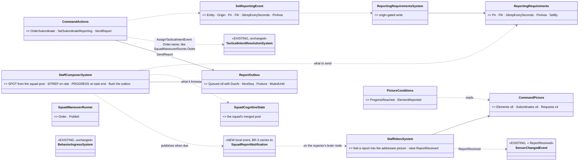
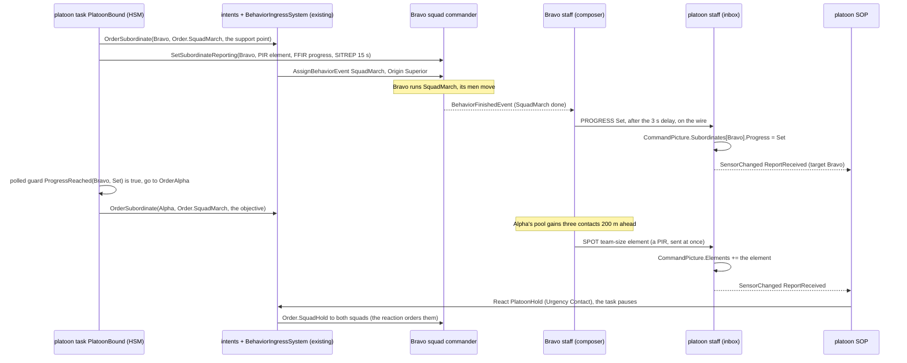
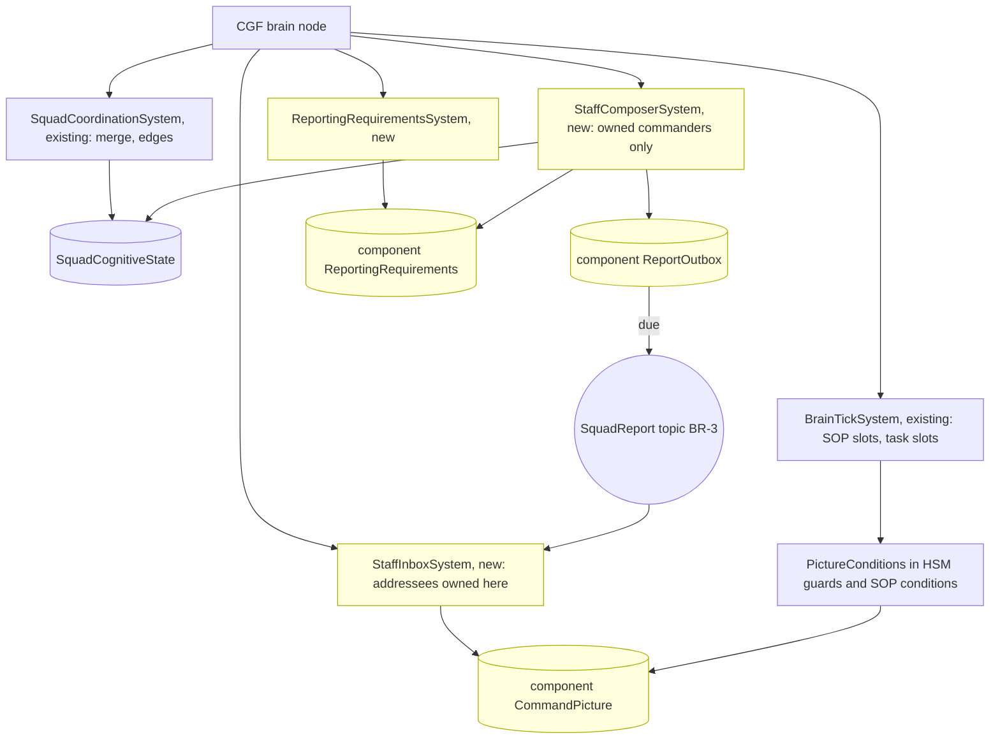
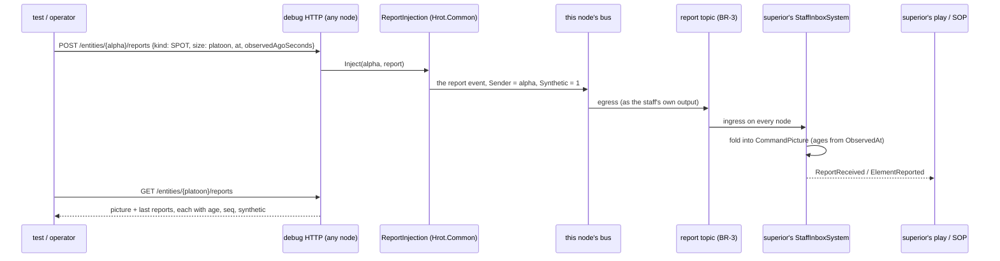

<!--STATUS
state: LIVE
updated: 2026-10-19
build-state: BUILDING — CC-A ✅ CC-B ✅ CC-C ✅ CC-E ✅ BUILT 2026-10-19 (§8a); CC-1 ✅ APPROVED (R-2043); CC-2…CC-11 ✅ APPROVED 2026-10-18 (R-2044); §7c CC-12…CC-15 ✅ APPROVED (R-2045); CC-16 ✅ APPROVED with its follow-up CE-2288 (R-2050); nothing built
current-answer: §1 the example · §1a where each piece lives (by scope) · §7a who reports, which order, autonomy · §7b mission plans and sub-behaviours · §7c reports on the debug HTTP · §2 INVENTORY · §3–§5 the diagrams · §6 the code shapes · §7 decisions · §8 slices and the check
stale-below: nothing.
known-rot: ✅ RESOLVED 2026-10-19 — ROE crosses nodes by backend's BR-13 (CE-3251, wire kind 2) and the reporting requirements by CE-2299 (wire kind 3, §8a); ⚠ CC-11's Initiative must join RoeDirectiveJson when it joins Roe. WAS: ⛔ 2026-10-18 (measured in the hand-off audit) — CC-2 and CC-11 copy the ROE pattern, and the ROE pattern is LOCAL ONLY: `SetRoeEvent` is a local bus event applied by `RoeSystem` on the node that raised it, and nothing forwards it to the node that owns the subordinate's brain (an order does cross: `TacticalIntentEgressTranslator` forwards an `AssignTacticalIntentEvent` whose target's brain is not here as a `TacticalIntentRequest`). ⇒ a superior whose brain runs on another node than its subordinate's sets ROE, `Initiative` and reporting requirements with no effect. CB-42 (requirements inside the order) had that property and CC-2 lost it. Fix asked of backend as BR-13 (docs/blueprints/batches/NOTE_Behaviors_To_Backend_Platoon_Programme.md §4, `CE-2299`); the two INVENTORY rows below now say so.
known-conflict: CC-12's "the raw report stream is GET /events" is revised by docs/designs/group-maneuvers/DESIGN_Platoon_Attack_Defend_Clear.md PC-11 (lean: Building Clearing §5a's SquadReportLog, since the /events ring holds 500 events of every type) · docs/designs/group-maneuvers/DESIGN_Building_Clearing.md CB-33 (reported contacts into the commander's TargetMemory) and CB-42 (requirements inside the order, stamped by the ingress) are revised by CC-1 and CC-2
related-designs:
  - docs/designs/group-maneuvers/DESIGN_Urban_Battle_Demo.md — the recorded idea that needs REQUEST answered by a headquarters owning support assets (§4 ①)
  - docs/designs/group-maneuvers/DESIGN_Platoon_Attack_Defend_Clear.md — the full-size plays on this machinery; asks CommandPicture Subordinates x6, PirArea, PROGRESS FireLifted, TimeInState (PC-3, PC-4, PC-7, PC-8)
  - docs/REFERENCE_Command_Building_Blocks_Measured.md — the measured blocks this example is built from, symbol by symbol
  - docs/designs/group-maneuvers/DESIGN_Building_Clearing.md — §5b–§5d OWN the report concept (kinds, ageing, staff, routes to a decision); this is its first concrete form
  - docs/designs/group-maneuvers/DESIGN_Defend_And_Attack_Position.md — the platoon plays that will use this machinery
  - docs/blueprints/Architect_Question_87_Unit_Memory.md — OWNS unit memory (R-237) and the §4 rule CC-1 follows (engine-written entity-wide data → a component)
  - docs/DESIGN_Decision_Layer.md — OWNS task · SOP · reaction (§4) and ROE (§4.4, the pattern CC-2 copies)
  - docs/designs/group-maneuvers/DESIGN_Squad_Tactics.md — OWNS the squad runner, SquadMarch and the body-less commander (§7)
-->

# A two-level command chain, worked through on the engine's own blocks *(behaviors, `2026-10-18`)*

🔒 User, `2026-10-18`: *"Again approved as a concept, but needs detailing. Keep in mind that everything the entity brain knows must be stored in its blackboard components as blackboard variables or
separate slots … What is the order? Today we support orders as a behavior requests coming with parameters … What do you mean by a gate
that can admit the order, how that could be implemented in our engine. I think we should develop some very simple example of how that
could work in the engine. On a very simple use case of multi-level command structure using the building blocks and means our engine
supports."*

**The decision in one line (lean):** each piece of knowledge lives at the SCOPE it belongs to (R-2042): what a commander knows as a
unit — its `CommandPicture` (what its subordinates reported) and the `ReportingRequirements` its superior set — is a **component**
(one per entity, written by two small **staff** systems, like `Roe` and `SquadCognitiveState`); what one running play tracks for
itself is in **that play's own slots**; both are read by ordinary `[SharedAiCondition]` guards. Report requests travel like ROE does today: **their own event, beside the
order**, so no behaviour's params DTO changes. Everything else — orders, the gate, the SOP, HSM polled guards, the squad's own merge —
is used exactly as it is.

## 1. The example — `cc-platoon-bound`

A platoon commander (body-less) with two squads, **Alpha** and **Bravo** (body-less commanders, four soldiers each), on open ground.
The platoon's task: Bravo moves to a support position; when it reports **SET**, Alpha moves to the objective. If either squad reports
an enemy element, the platoon's SOP stops the task and orders both squads to hold.

| level | entity | its task | its SOP | its knowledge |
|---|---|---|---|---|
| platoon | `Unit_InfantryPlatoon` (SL-0), body-less | 🆕 `PlatoonBound` — an HSM | 🆕 `BasicPlatoonSop` — a BTree like `BasicSquadSop` | 🆕 `[UnitMemory] CommandPicture` |
| squad | `Unit_InfantrySquad` (302), body-less | ✅ `SquadMarch` (exists), given by the platoon | ✅ `BasicSquadSop` | ✅ `SquadCognitiveState` pool (the merge) + 🆕 `[UnitMemory] ReportingRequirements` |
| soldier | rifleman | ✅ what `SquadMarch` orders him | ✅ `BasicInfantrySop` | ✅ `TargetMemory` |

### 1a. Where each piece lives — by scope, not by kind *(R-2042)*

🔒 User, `2026-10-18`: *"components are one single instance on the entity, but the slots in the blackboard can be assigned for any
single behavior that is running in parallel on the same entity."*

| scope | the engine's place for it | measured | in this example |
|---|---|---|---|
| **the entity** — true whichever behaviour runs, written by a system | a **component** (one instance per entity) | `Roe`, `TargetMemory`, `SquadCognitiveState`, `DangerAreaCognitiveBuffer`; AQ87 §4: *"engine systems (non-behaviour code needs it) → an ECS component"* | `CommandPicture` · `ReportingRequirements` · `ReportOutbox` |
| **the entity**, written and read by behaviours only | **unit memory** — one `[UnitMemory]` slot per type in the entity's blackboard store, shared by all its behaviours | `UnitMemory.Ref<T>(world, unit)`, `FiringPositionMemory` | — (nothing here is behaviour-only and entity-wide) |
| **one running behaviour** — the task, a paused task, a reaction, a hosted sub-behaviour, an HSM state | **its own occurrence slots** (params, working state; per HSM state; nested for hosted children) | `OccurrenceSlotKey` (`ComputeRootParamsKey`, `ComputeHsmStateKey`, `ComputeNested`) | `PlatoonBound`'s own working state: which squad it is waiting for, which orders IT gave, the requirements IT set (so it can withdraw them when it ends) · `PlatoonHold`'s own |
| **the hierarchy** | **one entity per commander** — every level is its own entity with its own components and slots | `UnitRoster`, `UnitSubordinate`, body-less commanders (R-272) | platoon, Alpha, Bravo each hold their own picture; nothing is shared across levels except by order and report |

⇒ The task and the reaction that pauses it both read ONE `CommandPicture` (the unit's knowledge), but each keeps its own progress in
its own slots — which is exactly why a reaction can run without disturbing the paused task's state.

## 2. INVENTORY *(the measured blocks — full detail, symbols and queries in [REFERENCE_Command_Building_Blocks_Measured](../../REFERENCE_Command_Building_Blocks_Measured.md))*

| need | exists | gap |
|---|---|---|
| knowledge of one unit, written by a system | ✅ a component (`Roe`, `SquadCognitiveState`); unit memory for behaviour-only shared data (`UnitMemory.Ref<T>`) | the three components (§1a) |
| a commander ordering a subordinate commander | ✅ `SquadManeuverRunner.Order` → `AssignTacticalIntentEvent{IntentId = "Order.<name>"}`, recorded in `SubordinateOrders`; `TacticalIntentResolutionSystem` turns it into an `AssignBehaviorEvent` on the subordinate | an HSM-callable action doing the same |
| the gate | ✅ `BehaviorIngressSystem`: Admit → PauseRecord → Start → AfterAdmitted; `PausedTask`; `ResumePausedTask`; ⛔ no general admit hook | — (CC-3: not needed) |
| something delivered with an order but not in its params | ✅ ROE: `SetRoeEvent` → `RoeSystem.Apply`, origin-gated, persists across tasks — ⛔ **on the raising node only**: the order crosses nodes (`TacticalIntentRequest`), `SetRoeEvent` does not | the requirements twin · ⭐ both forwarded to the subordinate's brain node (BR-13, `CE-2299`) |
| a system raising senses on a commander | ✅ `SquadSensing` publishes `SensorChangedEvent{Unit = commander, …}` from `SquadCoordinationSystem` (owned commanders only) | `ReportReceived` |
| a system writing, behaviours reading | ✅ `DangerAreaSensorSystem` → `DangerAreaCognitiveBuffer` → condition `DangerAreaAhead`, utility input | the staff |
| SOP reacting to an edge | ✅ `BasicSquadSop.btree.json`: `SensedFresh(…)` → `SopOrder{React}` → `SopActions.React` → `AssignBehaviorEvent{Origin = Reaction}` | the platoon's SOP asset |
| a guard reading the entity | ✅ `[SharedAiCondition] static bool G(ref P p, Entity self, EntityRepository world)`, polled (`CivilianBehavior`) | the picture guards |
| a task ending | ✅ `BehaviorFinishedEvent` (published by `BrainTickSystem`) | — (the staff reads it, CC-5) |
| the report on the wire | 🆕 designed: BR-3 `SquadReport` (backend, unstarted) | — |

## 3. Classes


*What the picture shows that prose hid:* every new box is either a component (the unit's knowledge, §1a) or a small system
or node that reads and writes those structs. Nothing new touches the gate, the intent resolution or the squad's merge: the platoon
orders a squad exactly the way `SquadManeuverRunner.Order` already does.

## 4. One run, end to end


*What the picture shows that prose hid:* the plan advances on a GUARD reading the picture, and the interrupt arrives through the SOP —
the two existing ways a brain changes course. Reports never enter a behaviour directly; they change a component struct, and the
behaviour notices on its next tick (or is woken by the edge).

## 5. Who runs it each frame


*Caption:* the staff runs as plain ECS systems in the Simulation phase on the brain node that owns the commander (the same ownership
filter `SquadCoordinationSystem` uses), BEFORE `BrainTickSystem`, so a report folded this frame is seen by this frame's guards. ⚠
Not reached today: no platoon has ever run over squads (SL-0, `CE-2262`, makes it run first); the topic is backend's BR-3.

## 6. The code shapes *(sketches — names final, bodies not)*

```csharp
// Fdp.Toolkits/Squad/Command — unit-scope knowledge written by systems ⇒ components (§1a); three new ids in GlobalComponentIds.
[ComponentId(GlobalComponentIds.CommandPicture)] public struct CommandPicture   // on the commander that RECEIVES reports
{
    public ReportedElements Elements;               // [InlineArray(8)] of ReportedElement
    public SubordinateRows  Subordinates;           // [InlineArray(4)] of SubordinateRow
    public PendingRequests  Requests;               // [InlineArray(4)] of PendingRequest
}
public struct ReportedElement { public Vector3 At; public float Radius; public byte Count, SizeClass, Activity, Equipment;
                                public uint FromNetId; public float ObservedAt; public uint Seq; }
public struct SubordinateRow  { public uint UnitNetId; public byte Progress, Strength, Ammo, Phase; public float LastSitrepAt; }

[ComponentId(GlobalComponentIds.ReportingRequirements)] public struct ReportingRequirements   // on the commander that SENDS reports
{
    public uint SuperiorNetId; public uint PirMask; public uint FfirMask; public float SitrepEverySeconds; public byte SetByOrigin;
}

public struct SetReportingEvent                      // the SetRoeEvent twin
{ public Entity Entity; public BehaviorOrigin Origin; public uint PirMask, FfirMask; public float SitrepEverySeconds; }

// The nodes — the same [SharedAi*] shapes every BTree / HSM / blueprint already binds.
[SharedAiCondition] public static bool ProgressReached(ref ProgressReachedParams p, Entity self, EntityRepository world)
    => world.HasComponent<CommandPicture>(self) && world.GetComponentRO<CommandPicture>(self).Progress(p.Subordinate) >= p.Progress;
[SharedAiCondition] public static bool ElementReported(ref ElementReportedParams p, Entity self, EntityRepository world);
[SharedAiAction]    public static NodeStatus OrderSubordinate(ref OrderSubordinateParams p, Entity self, EntityRepository world);
[SharedAiAction]    public static NodeStatus SetSubordinateReporting(ref SetReportingParams p, Entity self, EntityRepository world);
[SharedAiAction]    public static NodeStatus SendReport(ref SendReportParams p, Entity self, EntityRepository world);
```

| the platoon's task `PlatoonBound` (HSM, one region) | entry action | polled guard out |
|---|---|---|
| `OrderBravo` | `OrderSubordinate(Bravo, Order.SquadMarch, support point)` + `SetSubordinateReporting(Bravo, …)` | always → `WaitBravo` |
| `WaitBravo` | — | `ProgressReached(Bravo, Set)` → `OrderAlpha` |
| `OrderAlpha` | the same for Alpha → objective | always → `WaitAlpha` |
| `WaitAlpha` | — | `ProgressReached(Alpha, Set)` → `Done` (the task finishes) |

| the platoon's SOP `BasicPlatoonSop` (BTree, the `BasicSquadSop` shape) | |
|---|---|
| `Sequence( SensedFresh(reportReceived) , ElementReported(size ≥ team, within 400 m) , SopOrder{React PlatoonHold, Contact} )` | `PlatoonHold` orders both squads `Order.SquadHold` and ends when no element is fresh for 30 s; the task resumes at its state |

## 7. Decisions *(⭐ leans — for the user)*

| id | decision | ⭐ lean | rejected — one line each |
|---|---|---|---|
| **CC-1** ✅ | where a commander's knowledge lives | ✅ **approved (R-2043)** — **by scope (R-2042, §1a)**: the unit's knowledge — `CommandPicture`, `ReportingRequirements`, `ReportOutbox` — is three **components** on the commander (written by the staff systems; AQ87 §4's rule; the `Roe` / `SquadCognitiveState` precedent); each play's own tracking is in **its own slots**; unit memory stays for behaviour-only shared data. ⚠ Revises Building Clearing CB-33: reported elements go into `CommandPicture`, not into a `TargetMemory` on the commander. ⚠ Costs three component ids | unit memory for staff-written data (the first lean, after R-2041 as first worded): it puts system-owned state in the behaviours' store, and AQ87 §4 already ruled the other way · the commander's `TargetMemory`: perception's component, with perception's rules |
| **CC-2** ✅ | how report requests reach a subordinate | ⭐ **the ROE pattern**: a `SetReportingEvent` sent with the order (or on its own), applied by `ReportingRequirementsSystem` into the subordinate's `ReportingRequirements`, origin-gated like `RoeSystem`, persisting across tasks; sent by the node `SetSubordinateReporting` | inside every play's params DTO (CB-42 as written): each behaviour would have to carry it, and there is no admit hook to lift it out · a component stamped by the gate: the gate has no general hook, and adding one is a change to the most-shared system for one feature |
| **CC-3** ✅ | the gate | ⭐ **unchanged** — "the gate" is `BehaviorIngressSystem`, which already admits, pauses and resumes; nothing here needs it to know about reports | an admit hook: not needed once CC-2 copies ROE |
| **CC-4** ✅ | ordering a subordinate commander from an HSM / BTree / blueprint | ⭐ (refined by CC-9: two actions, abstract `OrderSubordinate` and concrete `AssignSubordinate`) a shared action `OrderSubordinate(unit, orderName, json)` doing exactly what `SquadManeuverRunner.Order` does (`AssignTacticalIntentEvent{Order.<name>, Superior}` + `SubordinateOrders`), the runner calling the same helper | a second order path: two ways to order a unit, released differently |
| **CC-5** ✅ | the first reports the staff sends without any play changing | ⭐ **PROGRESS on the task's end** (`BehaviorFinishedEvent` of the commander's task ⇒ `PROGRESS Set`), **SPOT** from the squad pool when a new element appears (a PIR), **SITREP** on the requested rate — so `SquadMarch`, unchanged, already reports SET | requiring every play to call `SendReport` for SET: every existing play would need editing first |
| **CC-6** ✅ | when the staff runs | ⭐ Simulation phase on the brain node owning the commander (the `SquadCoordinationSystem` filter), before `BrainTickSystem`; the inbox applies every report addressed to a commander owned here | in a behaviour: a report would be lost while a different state runs |
| **CC-7** ✅ | the example's scope | ⭐ exactly §1: two squads, `SquadMarch`, `SquadHold`, one HSM task, one SOP row, PROGRESS / SPOT / SITREP only — the smallest run that exercises orders down, requirements down, reports up, a guard advancing the plan and the SOP interrupting it | the full building attack first: every part at once, nothing provable on its own |

## 7a. Who reports, which order, and when may a unit act on its own *(✅ CC-8…CC-11 approved, R-2044)*

✅ CC-2…CC-11 approved — 🔒 User, `2026-10-18`: *"Approved. What about the mission plan feature we support on every entity?"*

🔒 User, `2026-10-18`: *"Who is responsible for collecting the information on the subordinate and sending reports back to the
superior? Is it the staff system or is it the behavior running there? … do the behaviors needs to understand the report requests …
Can the behavior affect the reports?"* · *"How Do we control whether a unit can act autonomously on something or needs to wait for
orders from its higher level command? Maybe some situations require autonomous response immediately while still being reported up the
chain."*

**Who does what in reporting (CC-8):**

| layer | its part | needs anything from the superior? |
|---|---|---|
| **the staff** of the subordinate (engine systems) | ⭐ **all collection and sending**: the doctrinal minimum by exception, ALWAYS — CONTACT on a new element, SITREP when a colour changes and on its routine rate, LACE after contact, PROGRESS when the task ends or fails — plus whatever the superior's requirements add | ⛔ no — the minimum is the unit's own standing reporting (a TKB default per unit type, like its SOP) |
| **the running behaviour** | only what the staff cannot infer: its **milestones** (`SendReport` PROGRESS: phase line, foothold, room clear) and its **requests** (CASEVAC, fire support, permission); and it may **shape** reporting — `ReportingPosture` *Silent* while it sneaks (the staff queues everything but CONTACT under fire) | ⛔ no — ⭐ **a behaviour never reads the superior's requirements** |
| **the superior** | ⭐ **optional** requirements (CCIR) only when its play needs MORE than the minimum (*"tell me at once about any MG"*, *"report every phase line"*) — the `SetReportingEvent` of CC-2 | — |

⇒ A subordinate reports correctly with **no** request at all; a behaviour knows nothing about requests; the superior asks only for
extras. This is how a real unit works: reporting is SOP, the commander adds CCIR.

**Abstract or concrete orders (CC-9)** — both exist today, and reporting does not care which one ran:

| kind | measured | when |
|---|---|---|
| **abstract** — *what* to do, each subordinate class decides *how* | `AssignTacticalIntentEvent{IntentId = "Order.<name>"}`, resolved by the RECEIVER's own class (`TacticalIntentResolutionSystem`); `SquadManeuverRunner.Order` | general orders — Move, Attack, Hold, Defend (RTS style) |
| **concrete** — run exactly this behaviour with these params | a behaviour name with its params (`SquadManeuverRunner.Publish` to soldiers; the hill attack's `HullDownAttack` intent) | a play that needs one exact drill from a subordinate |

⇒ CC-4 becomes **two** shared actions on the same helper: `OrderSubordinate(unit, Order.<name>, json)` (abstract) and
`AssignSubordinate(unit, behaviourName, json)` (concrete), both recorded in `SubordinateOrders` and released when the giving play ends.

**Acting alone vs waiting for orders (CC-10, CC-11)** — doctrine: **immediate action** (take cover, return fire, the battle drill's first
seconds) is ALWAYS the unit's own and ALWAYS reported; anything that **changes the mission** (assault, bypass, withdraw, clear a building)
is the commander's — unless his intent allows initiative, or there is no commander.

| SOP row class | examples | allowed when |
|---|---|---|
| **Immediate** | take cover, return fire, go to ground, casualty first aid | always — reported up as CONTACT / LACE |
| **Local** | assault a small enemy that blocks the task, break contact, bound to cover | `Initiative ≥ WithinIntent` |
| **Mission** | abandon the task, attack or clear a building, withdraw from the objective | `Initiative = Full` — or no superior at all |

| the unit | `Initiative` default |
|---|---|
| has no superior (the squad alone) | **Full** — it acts on its own SOP, exactly as today |
| has a superior, Regular+ | **WithinIntent** — immediate and local alone, mission-level waits for an order |
| has a superior, Untrained / Militia | **Full** — irregulars act on their own (the proficiency repertoire, Defend_And_Attack DA-16) |
| the superior's order says otherwise | the superior sets it with the order, as it sets ROE |

⇒ For CC-7's spot report: Alpha's men see the enemy → the squad merge → the squad's SOP takes its **Immediate** row at once (cover,
return fire — `ReactToContact`'s first seconds) **and** its staff sends a SPOT up. Whether Alpha then assaults is a **Mission**-class
choice: with `WithinIntent` it holds and waits; the platoon's SOP decides (`PlatoonHold`, or an order to assault). Without a platoon,
`Initiative = Full` and Alpha's own SOP goes on as today. If no order comes within a hold time (default 30 s), the squad's initiative
rises one step — doctrine's *"if in doubt, act on the commander's intent"*.

| id | decision | ⭐ lean | rejected — one line each |
|---|---|---|---|
| **CC-8** ✅ | who reports | ⭐ **the staff collects and sends everything**; a standing reporting minimum per unit type needs no request; behaviours only add milestones and requests (`SendReport`) and may set `ReportingPosture` (Silent); **behaviours never read the superior's requirements**; the superior's requirements are optional extras | the behaviour composing reports: every play re-implements SALUTE and must read the requirements · requirements mandatory with every order: an RTS "move" would carry a reporting spec |
| **CC-9** ✅ | abstract or concrete orders | ⭐ **both, unchanged**: `Order.<name>` (resolved by the receiver's class) and a concrete behaviour; two actions `OrderSubordinate` / `AssignSubordinate` on one helper | one kind only: RTS needs abstract, the hill attack needs concrete |
| **CC-10** ✅ | what a unit may do on its own | ⭐ every SOP row is classed **Immediate · Local · Mission**; a unit's **`Initiative`** (`ImmediateOnly · WithinIntent · Full`) admits the classes; a refused row's situation is still reported (the staff does that anyway); the gate checks it beside the existing `RoeReactions.StayOnTask` | a per-row "needs approval" flag: every SOP author re-decides doctrine per row · no limit: a platoon could never keep its squads on the plan |
| **CC-11** ✅ | where `Initiative` lives and who sets it | ⭐ **a new half of `Roe`**, set by `SetRoeEvent` (with the order or on its own, origin-gated, persists across tasks) — ROE's `Reactions` is already the "may reactions interrupt" switch; defaults by the table above; rises one step after 30 s without orders | a separate component: two sources for "what may this unit do on its own" |

⚠ CC-2 clarified: the separate event is the **report-requirements** event (`SetReportingEvent`), NOT the behaviour order; it carries
only the superior's EXTRA requirements (CC-8).

## 7b. Mission plans and sub-behaviours on the subordinate *(⭐ answer, no change to CC-1…CC-11, 2026-10-18)*

🔒 User, `2026-10-18`: *"Can it be useful for something on the subordinate entities, meaning the higher level commander sending
mission plans to the subordinate? What about the sub-behaviors, could they be useful in some cases?"*

| the mission plan, measured | code | design |
|---|---|---|
| a plan is ≤ 8 behaviours, each advanced by ONE trigger local to the entity running it (timer, under attack, health, finished) | `MissionPlanQueue`, `MissionDirectorSystem`, `MissionTriggerHelper.ResolveTrigger` | Decision Layer §2: *"an ordinary end-user-facing surface"* |
| only the operator writes plans (editor, ExCon, IG, the wire) | `ScenarioMissionService`, `MissionControlIngressTranslator` | ⛔ searched `docs/` + `.dev/`: no design for an AI-authored plan; tactical-intent DESIGN unifies AI orders and mission tasks into ONE event pipeline instead |
| an immediate order clears the plan; a reaction pauses its task | `MissionControlExecutionSystem.ClearFor`; `BehaviorOriginRank.Pauses` | Entity Control §2.1 C-4; Decision Layer §4.1 |

⇒ ⭐ **Mission plans stay the OPERATOR's surface, on the TOP commander.** The layering is: the operator gives the platoon a plan
(Move → Bound → Defend) · each task is a platoon play · the play orders its squads one task at a time (CC-9) · each squad's staff reports
(CC-8). This works today with no change. ⛔ **A commander does not write its subordinates' plans**: its triggers would be the
subordinate's own (none can say "when Bravo is set"), so the synchronisation stays in the commander's play where the picture is; and one
plan slot with two authors (the operator and an AI commander) would overwrite each other.

| sub-behaviours (hosted children, any tier — S5a) | ⭐ where they pay |
|---|---|
| a reusable phase shared by plays | `Consolidate` (360 security, LACE, redistribute ammo) after Attack, ClearBuilding and Defend; `BoundingControl` hosted by Approach (Building Clearing §5d) |
| the class-specific "how" of an abstract order | `Order.Attack` resolves to the squad's attack play, which hosts the fire-team drill |
| control beside the phases | a parallel `ControlRegion` in the play's HSM (Building Clearing §5d) |
| ⛔ not for reporting | reporting is the staff's systems (CC-8) |

A hosted child's storage is nested under its host's occurrence (S5b), so it already follows R-2042 (knowledge lives at its scope).

## 7c. Reports on the debug HTTP — watch them, and fake them *(✅ CC-12…CC-15 approved, R-2045)*

🔒 User, `2026-10-18`: *"We will need the AI debug HTTP to be able to monitor the reports for diagnostics, if not even faking the reports
for exercising the superior decision making."*


*What the picture shows that prose hid: the fake enters BEFORE the wire, as Alpha's staff would, so ageing, ordering, transport and the
superior's whole decision path run exactly as for a real report — and it works from any node, like `EntityOrders`.*

| id | decision | ⭐ lean | rejected — one line each |
|---|---|---|---|
| **CC-12** ✅ | watching | ⭐ **`GET /entities/{networkId}/reports`** (beside `/entities/{id}/squad`), read on the brain node: on a commander its `CommandPicture` (elements with kind, sender, age from `ObservedAt`, seq, synthetic), each subordinate's last colour / phase / report age and *overdue*, open requests, its `ReportingRequirements`; on any unit its `ReportOutbox` (queued, posture, the last 16 sent) and the requirements it reports under. ⭐ The report event is also kept in the existing event history (`GET /events?type=`) for the raw stream | ⛔ a new stream route: the event history already is one · ⛔ extending `GET /sitrep`: that route is a whole SIDE's picture for an external decision-maker (Entity Control), not a commander's reports — ⚠ same word, different thing |
| **CC-13** ✅ | faking | ⭐ **`POST /entities/{networkId}/reports`** — a report AS IF that unit's staff sent it (kind, subtype, the kind's fields, `observedAgoSeconds`); one service, `ReportInjection.Inject`, used by the HTTP AND by test rails (one implementation) | ⛔ writing `CommandPicture` directly: skips ageing, ordering and the wire — tests the decision only, on one node · ⛔ a sender outside the chain: the inbox counts only its subordinates, so it would test nothing |
| **CC-14** ✅ | the fake vs the real sender's ordering | ⭐ a **`Synthetic` flag** on the report: it bypasses the newest-per-sender drop (CB-32) and the sender's next REAL report of the same subject replaces it — as a later report corrects an earlier one; replay records the flag | ⛔ HTTP guessing the sender's next `Seq`: the counter lives on the sender's brain node · ⛔ a fake that is never superseded: the picture would lie forever |
| **CC-15** ✅ | lost comms | ⭐ **`POST /entities/{networkId}/reports/mute {seconds}`** — the unit's staff sends nothing, CONTACT included (radio failure); exercises the superior's *overdue* handling and the subordinate's initiative rise (CC-11) | ⛔ muting by killing the radio entity: no such entity; ⛔ only the behaviour's Silent posture: it keeps CONTACT under fire |

✅ CC-12…CC-15 approved — 🔒 User, `2026-10-18`: *"Accepted. What about reading the commander's memory? Is that sufficient to read just
the ecs components in the usual way, as is supported now, or do we need anything special?"*

**Reading the commander's memory (CC-16)** — measured. ✅ 🔒 User, `2026-10-18`, on CC-16 and `CE-2288`: *"Approved"* (R-2050).

| the memory | how it reads today | enough? |
|---|---|---|
| the staff's components — `CommandPicture`, `ReportingRequirements`, `ReportOutbox` | ✅ `GET /entities/{id}` dumps EVERY registered component, NoScenario ones too (`EntityStateExtractionService.ExtractEntities` — translator output, then reflection for the rest); a buffer written as the fixed-list wrapper (`int Count` + one `[InlineArray]` field, `FixedListShape`) prints as a plain array of the used elements (`FixedListJsonConverter`) | ⭐ **yes — if CC-A writes each buffer as that wrapper** (and enums as enums, times as sim seconds). Read it on the brain node, like `/memory` |
| the root play's own block | ✅ `BrainDiagnosticsTranslator` projects the ROOT occurrence slot into the behaviour's layout DTO, inside the same dump | yes |
| a blueprint play's variables | ✅ `GET /entities/{id}/variables?asset=` | yes |
| a HOSTED child's slots and the SOP slot | ⛔ no route: the dump reads the root slot only, `/variables` reads blueprint blocks only | ⛔ a gap — not report-specific |

| id | decision | ⭐ lean | rejected — one line each |
|---|---|---|---|
| **CC-16** ✅ *(R-2050)* | reading a commander's memory | ⭐ **no special reader for the components** — they read like any other, on the brain node; ⭐ a constraint on CC-A: every buffer is a fixed-list wrapper so the dump shows it; ⭐ `GET …/reports` (CC-12) stays the INTERPRETED view (ages, names, overdue), built from the same components; ⭐ the hosted-child / SOP slot gap is a general route, filed as `CE-2288` | ⛔ a raw-bytes route per component like `/memory`: needed only for the old `fixed` buffers, which the wrapper replaces · ⛔ waiting with the slot gap until a commander needs it: every hosted drill (`BoundingControl`, `Consolidate`) is blind over HTTP today |

## 8. Slices and the check

| order | slice | what | needs |
|---|---|---|---|
| 1 | **CC-A** `CE-2291` | the three components (+ ids) — every buffer a fixed-list wrapper (`Count` + `[InlineArray]`) so `GET /entities/{id}` shows it (CC-16); `SetReportingEvent` + `ReportingRequirementsSystem`; rails: the picture survives a behaviour switch and a reaction; the play's own slots do not leak into the reaction; an origin below the setter's is refused | — |
| 2 | **CC-B** `CE-2292` | `OrderSubordinate` (sharing `SquadManeuverRunner.Order`'s helper), `SetSubordinateReporting`, `SendReport`, `ProgressReached`, `ElementReported` | CC-A |
| 3 | **CC-C** `CE-2293` | `StaffComposerSystem` (PROGRESS on task end, SPOT from the pool, SITREP) + `StaffInboxSystem` (fold, `ReportReceived`) — first on ONE node with a local loopback of the notification, so it is provable before BR-3 | CC-A, SL-0 |
| 5 | **CC-E** `CE-2295` | the debug HTTP: `GET` / `POST /entities/{id}/reports`, `…/reports/mute`, `ReportInjection` (CC-12…CC-15), `GET /entities/{id}/order` showing the params for every origin (not only Operator — the platoon demos read a Superior order's params, Platoon_Attack_Defend_Clear §12.4) + the route docs (they feed the ai-debug MCP catalogue); rails: a fake SPOT reaches the platoon's picture with `Synthetic` set and is replaced by Alpha's next real one; a muted squad goes *overdue* | CC-C (the `Synthetic` wire flag: BR-3) |
| 4 | **CC-D** `CE-2294` | `PlatoonBound` (HSM) + `BasicPlatoonSop` + `PlatoonHold`; the scenario `cc-platoon-bound`; then on the wire once BR-3 lands | CC-B, CC-C |

**`cc-platoon-bound` must end with:** ① Bravo reaches its point and the platoon's picture shows `Bravo: Set` within 3 s (+ one frame) of
Bravo's `SquadMarch` finishing · ② only THEN is Alpha ordered (`SubordinateOrders` on the platoon) · ③ when Alpha's pool first holds the
enemy, ONE `SPOT` reaches the platoon (not one per contact) · ④ the platoon's SOP starts `PlatoonHold`, both squads hold, the task is
paused, and it resumes in `WaitAlpha` when the element goes stale · ⑤ every report is visible over HTTP (`GET /entities/{id}/reports`, CC-12) with its
`ObservedAt` and arrival time.

## 8a. As built *(2026-10-19)*

**CC-A `CE-2291`** — `FDP/Toolkits/Fdp.Toolkits/Squad/Command/`:

| piece | as built | deviation from §6 |
|---|---|---|
| `CommandPicture` (407) | `Elements` (×8 `ReportedElement`: at, radius, count, size, activity, equipment, `FromNetId`, `ObservedAt`, `ReceivedAt`, `Seq`, `Synthetic`) · `Subordinates` (×6 `SubordinateRow`: `UnitNetId`, `Progress`, strength / ammo colours, phase, `LastReportAt`, `LastSitrepAt`, `LastSeq`) · `Requests` (×4 `PendingRequest`) — each a fixed-list wrapper (CC-16) | `ReceivedAt` and `LastReportAt` added for CC-12's age / overdue; net ids are `long` (`NetworkIdentity.Value`), not `uint` |
| `ReportingRequirements` (408) | `Pir` (`PirFlags`) · `Ffir` (`FfirFlags`) · `SitrepEverySeconds` · `PirArea` (PC-3) · `SetBy` | ⛔ no `SuperiorNetId`: the addressee is always the direct superior, `UnitSubordinate.Commander` (R-2040) — one source, not two |
| `ReportOutbox` (409) | `Queued` (×8 `QueuedReport` = a `CommandReport` + `DueAt`) · `NextSeq` · `Posture` (Normal / Silent, CC-8) · `MutedUntil` (CC-15) | the posture and mute live here (one place the composer reads) |
| `CommandReport` | the closed set's one struct (CB-43): `Kind` (`ReportKind`), `Subtype`, the SALUTE / SITREP / LACE fields, `ObservedAt`, `Seq`, `Synthetic` — the outbox entry, the local notification and (BR-3) the wire payload | enum members are unique across the enums (`NoReport`, `SizeUnknown`, `SquadSize` …) for BR-3's IDL (the `Roe` precedent) |
| `SetReportingEvent` (event 3106) + `ReportingRequirementsSystem` | Input phase, in `MissionControlModule` right after `RoeSystem`; origin-gated exactly as ROE; ⭐ the event REPLACES the set, and an all-zero event WITHDRAWS it (then `SetBy` is cleared so anyone may set them again) — how a play takes its requirements back when it ends | ROE keeps an unset field; requirements are one set, so replace-and-withdraw is the simpler contract |
| registration | the three components and the event in `CognitiveComponentRegistry` (every brain host); `CgfLogicPackTests` 5 → 6 input systems, 28 → 29 total | — |

Rails: `CommandComponentsTests` (the ROE-twin gate and withdraw · every buffer a fixed list printing a plain array, enums as strings) ·
`SquadManeuverTests.CE2291_ThePicture_SurvivesATaskSwitch_AndAReaction` (through the real ingress).

**CC-B `CE-2292`** — the command actions (`Hrot.AI.Behaviors/Brains/CommandNodes.cs`) and the picture guards
(`Fdp.Toolkits/Squad/Command/PictureConditions.cs`):

| piece | as built | deviation from §6 / CB-46 |
|---|---|---|
| ⭐ one order helper | `CommandOrders.Order` (abstract, `Order.<name>`) and `CommandOrders.Assign` (concrete) — record in `SubordinateOrders` + publish at Superior; ⭐ `SquadManeuverRunner`'s private `Order` / `Publish` now CALL them (one implementation, CC-4) | a fresh order from a play (`newOrder: true`) makes the picture forget that subordinate's progress (`CommandPictureOps.OrderGiven`), so "wait for Set" waits for THIS leg's Set; the runner's re-sends keep it |
| a subordinate's name | its **roster slot** (`int Slot`) — a play is written once for any platoon | the sketch's `p.Subordinate` left open what it was |
| `OrderSubordinate` | `[SharedAiAction]` `{Slot, Order, Point, Speed, ArrivalRadius}` — **Move and Hold** (built from the order DTOs); Attack / Strike / ObserveFire name a target and are given from C# via `CommandOrders.Order` | ⚠ `AssignSubordinate` is a **C# helper only** (`CommandOrders.Assign`): a node would need a behaviour NAME and its params JSON, which unmanaged node params cannot carry — the generator's `SopOrder` path is the model when a play needs it |
| `SetSubordinateReporting` | `{Slot, Pir, Ffir, SitrepEverySeconds, PirArea}` → `SetReportingEvent` at Superior (crosses nodes, `CE-2299`) | — |
| `SendReport` | `{Kind, Subtype, Count}` — PROGRESS or REQUEST only (CC-8: the staff composes the rest), queued through `ReportQueue.Enqueue` (the one writer of the outbox, numbering `Seq`) due `ReportDelaySeconds` = 3 s later | — |
| the guards | `ProgressReached(Slot, Progress)` (the LATEST progress equals it — not ordinal) · `SubordinateColour(Slot, AtLeast)` · `SubordinateFresh(Slot, WithinSeconds)` (false = overdue) · `ElementReported(MinSize, WithinMetres, FreshSeconds)` · `PendingRequest(Kind)` | ⚠ **not built yet:** `PirMet` (no consumer, semantics open) · `TimeInState` (PC-7's 10 s lift fall-back: first consumer is `PlatoonAttack`) · `AnswerRequest` (needs requests flowing, CC-C) — each waits for its first consumer |

Rails: `CommandComponentsTests.CE2292_*` (slot + reset, the other guards, the outbox numbering) · `SquadManeuverTests.CE2292_*` (an
abstract order recorded and resetting progress while the runner's re-send does not; reporting extras reach the subordinate; a play's
milestone queued 3 s out, a SPOT refused).

**CC-C `CE-2293`** — the staff (`Fdp.Toolkits/Squad/Command/StaffSystems.cs`), on BR-3's event:

| piece | as built | deviation from §3 / §5 |
|---|---|---|
| the report on its way | ⭐ backend's **`SquadReportNotification`** (`CE-3250`, managed: `FromUnit`, `ToUnit`, `Subject`, `Building`, `SentAt`, `OriginNodeId` around the `CommandReport`) — the staff publishes it with `OriginNodeId = 0`, BR-3 carries it to every node, the ingress raises it there; on one node it is simply read back (the loopback CC-C asked for comes for free) | the §3 box's own event was dropped for backend's one (one vocabulary) |
| `StaffComposerSystem` | for every commander with a live superior (`UnitSubordinate.Commander`) and a roster, owned here (the pack's gate): ① **PROGRESS** on the end of its TASK (`BehaviorFinishedEvent`, not a reaction or the SOP): Set on success, `TaskFailed` otherwise (CC-5) · ② **SPOT** from the squad pool as ONE element (centre, radius, count, size class) — again only when it is new, changes size class or moves > 25 m; a SPOT with Count 0 when the pool empties (lost) · ③ **SITREP** at `ReportingRequirements.SitrepEverySeconds` (none without a request — CC-8's standing minimum does not include a routine one yet), strength GREEN ≥ 90 % fighting, AMBER ≥ 70 %, RED while combat effective, BLACK after · ④ **flush**: due (3 s), not muted (CC-15), and under Silent only a CONTACT | ⚠ the composer's element memory (`SpotSent`, `SpotAt`, `SpotSize`, `LastSitrepAt`) lives in `ReportOutbox` (four scalars added) · ⚠ CONTACT and LACE are not composed yet (no consumer: the SOP reads SPOT; LACE needs the casualty count wired) |
| `StaffInboxSystem` | every `SquadReportNotification` (local or arrived) to a commander owned here → `Fold`: the sender's row (newest `Seq` wins, a late older one dropped, a `Synthetic` one always taken — CB-32, CC-14), PROGRESS → `Progress`, SITREP → colours / phase, SPOT / CONTACT → the sender's element within 50 m replaced (Count 0 removes it), full ⇒ the oldest observation goes, REQUEST → `Requests`; then `SensorChange.ReportReceived` (19) on the commander — the SOP's edge, `RecentSenses` records it, and an HSM takes it as the built-in event `Sensor.ReportReceived` (id 0xFF13, `BuiltInHsmEvents`) | `Fold` is public: the HTTP fake (CC-E) folds through it |
| schedule | `CgfLogicPack`: after `SquadCoordinationSystem` and `UnitCentroidSystem`, before the cognitive runtime — this frame's guards see this frame's folds (CC-6); `CgfLogicPackTests` 23 → 25 simulation systems | — |

Rails (`SquadManeuverTests.CE2293_*`, a squad under a body-less platoon on one node): a task that ends reports Set 3 s later (not
before) into the platoon's picture, which raises `ReportReceived` and turns `ProgressReached` true · three pooled contacts are one
SPOT; 10 m is not news, 40 m replaces it, an empty pool removes it · a SITREP only at the requested rate, GREEN; mute holds the outbox ·
the inbox drops a late older report and takes a synthetic one.

**CC-E `CE-2295`** — the debug HTTP (`Hrot.Editor/DebugApi/DebugApiService.Reports.cs`) over one service
(`Fdp.Toolkits/Squad/Command/ReportInjection.cs`):

| route | as built | deviation from §7c |
|---|---|---|
| `GET /entities/{id}/reports` | the INTERPRETED view (CC-12): picture elements with `ageSeconds` (from `ObservedAt`), `receivedAt`, `seq`, `synthetic`; each subordinate's progress, colours, phase, age, `overdue` (silent > 60 s, CB-34); open requests; the requirements; the outbox (queued with `dueAt`, posture, muted) | "the last 16 sent" lives in the node log below, not in the outbox |
| `POST /entities/{id}/reports` | `ReportInjection.Inject`: the staff's own `SquadReportNotification`, from the unit to its direct superior, `Synthetic = 1`, `Seq = 0`, `ObservedAt = now − observedAgoSeconds` — before the wire, so BR-3 carries it | ⚠ `ReportInjection` is in `Fdp.Toolkits` (not `Hrot.Common`): it needs nothing above the toolkit, and the test rails reach it there |
| `POST /entities/{id}/reports/mute` | `ReportInjection.Mute` → `ReportOutbox.MutedUntil` (CC-15); 0 restores; ⚠ runs on the unit's BRAIN node (the outbox lives there) | — |
| `GET /squad/reports?last=&unit=` | ⭐ PC-11: `SquadReportLog` — a ring of 256 per world, written by `StaffInboxSystem` for EVERY report it sees, with its verdict (`folded` · `stale` · `not-owned-here`) and origin node; network ids resolved at read time (the `ShotLog` precedent) | ⚠ kept where the inbox runs (brain nodes), not on SimHost / IG |
| `GET /entities/{id}/order` | gains `task:{behavior, origin, since, params}` for the running task of ANY origin (a Superior order a squad was given) beside the operator-order `state` | — |

Rails: `SquadManeuverTests.CE2295_*` (a fake SPOT arrives synthetic, aged and logged, and the squad's next real SPOT of the same
element replaces it; a muted squad's PROGRESS waits until the radio is back); route docs in `DebugApiRouteDocs` (rail
`EveryRouteIsDocumentedTests`). ⚠ `CE-2288` (one read route over every behaviour slot) is NOT in this slice — its first consumer is
the platoon demos that watch a hosted squad play.
