<!--STATUS
state: LIVE
updated: 2026-10-19
build-state: BUILT — CC-A ✅ CC-B ✅ CC-C ✅ CC-E ✅ CC-D ✅ BUILT 2026-10-19 (§8a; cc-platoon-bound passes live, all five end conditions); CE-2288 (one read route over every behaviour slot) ✅ BUILT 2026-10-19 (§8a, end); CC-1 ✅ APPROVED (R-2043); CC-2…CC-11 ✅ APPROVED 2026-10-18 (R-2044); §7c CC-12…CC-15 ✅ APPROVED (R-2045); CC-16 ✅ APPROVED with its follow-up CE-2288 (R-2050)
current-answer: §1 the example · §1a where each piece lives (by scope) · §7a who reports, which order, autonomy · §7b mission plans and sub-behaviours · §7c reports on the debug HTTP · §2 INVENTORY · §3–§5 the diagrams · §6 the code shapes · §7 decisions · §8 slices and the check
stale-below: nothing.
known-rot: ✅ RESOLVED 2026-10-19 — ROE crosses nodes by backend's BR-13 (CE-3251, wire kind 2) and the reporting requirements by CE-2299 (wire kind 3, §8a); ⚠ CC-11's Initiative must join RoeDirectiveJson when it joins Roe. WAS: ⛔ 2026-10-18 (measured in the hand-off audit) — CC-2 and CC-11 copy the ROE pattern, and the ROE pattern is LOCAL ONLY: `SetRoeEvent` is a local bus event applied by `RoeSystem` on the node that raised it, and nothing forwards it to the node that owns the subordinate's brain (an order does cross: `TacticalIntentEgressTranslator` forwards an `AssignTacticalIntentEvent` whose target's brain is not here as a `TacticalIntentRequest`). ⇒ a superior whose brain runs on another node than its subordinate's sets ROE, `Initiative` and reporting requirements with no effect. CB-42 (requirements inside the order) had that property and CC-2 lost it. Fix asked of backend as BR-13 (docs/blueprints/batches/NOTE_Behaviors_To_Backend_Platoon_Programme.md §4, `CE-2299`); the two INVENTORY rows below now say so.
known-conflict: CC-12's "the raw report stream is GET /events" is revised by docs/designs/group-maneuvers/DESIGN_Platoon_Attack_Defend_Clear.md PC-11 (lean: Building Clearing §5a's SquadReportLog, since the /events ring holds 500 events of every type) · docs/designs/group-maneuvers/DESIGN_Building_Clearing.md CB-33 (reported contacts into the commander's TargetMemory) and CB-42 (requirements inside the order, stamped by the ingress) are revised by CC-1 and CC-2
related-designs:
  - docs/designs/group-maneuvers/DESIGN_Urban_Battle_Demo.md — the recorded idea that needs REQUEST answered by a headquarters owning support assets (§4 ①)
  - docs/designs/air-attack/DESIGN_Air_Operations.md — OWNS the aircraft attack (`AirAttackNodes.Run`, `FlyTo`) §8d's armed search is built on
  - docs/designs/indirect-fire/DESIGN_Indirect_Fire.md — OWNS the battery's fire mission §8d's HQ sends, and IF-6 (counter-battery), the later answer to §8d's heard launch
  - docs/designs/group-maneuvers/DESIGN_Platoon_Attack_Defend_Clear.md — the full-size plays on this machinery; asks CommandPicture Subordinates x6, PirArea, PROGRESS FireLifted, TimeInState (PC-3, PC-4, PC-7, PC-8)
  - docs/REFERENCE_Command_Building_Blocks_Measured.md — the measured blocks this example is built from, symbol by symbol
  - docs/designs/group-maneuvers/DESIGN_Building_Clearing.md — §5b–§5d OWN the report concept (kinds, ageing, staff, routes to a decision); this is its first concrete form
  - docs/designs/group-maneuvers/DESIGN_Defend_And_Attack_Position.md — the platoon plays that will use this machinery
  - docs/blueprints/Architect_Question_87_Unit_Memory.md — OWNS unit memory (R-237) and the §4 rule CC-1 follows (engine-written entity-wide data → a component)
  - docs/DESIGN_Decision_Layer.md — OWNS task · SOP · reaction (§4) and ROE (§4.4, the pattern CC-2 copies)
  - docs/designs/group-maneuvers/DESIGN_Squad_Tactics.md — OWNS the squad runner, SquadMarch and the body-less commander (§7)
-->

# A two-level command chain, worked through on the engine's own blocks *(behaviors, `2026-10-18`)*

🔒 User, `2026-10-18`: *"Again approved as a concept, but needs detailing. Keep in mind that everything the entity brain knows must be stored in its blackboard components as blackboard variables or
separate slots … What is the order? Today we support orders as a behavior requests coming with parameters … What do you mean by a gate
that can admit the order, how that could be implemented in our engine. I think we should develop some very simple example of how that
could work in the engine. On a very simple use case of multi-level command structure using the building blocks and means our engine
supports."*

**The decision in one line (lean):** each piece of knowledge lives at the SCOPE it belongs to (R-2042): what a commander knows as a
unit — its `CommandPicture` (what its subordinates reported) and the `ReportingRequirements` its superior set — is a **component**
(one per entity, written by two small **staff** systems, like `Roe` and `SquadCognitiveState`); what one running play tracks for
itself is in **that play's own slots**; both are read by ordinary `[SharedAiCondition]` guards. Report requests travel like ROE does today: **their own event, beside the
order**, so no behaviour's params DTO changes. Everything else — orders, the gate, the SOP, HSM polled guards, the squad's own merge —
is used exactly as it is.

## 1. The example — `cc-platoon-bound`

A platoon commander (body-less) with two squads, **Alpha** and **Bravo** (body-less commanders, four soldiers each), on open ground.
The platoon's task: Bravo moves to a support position; when it reports **SET**, Alpha moves to the objective. If either squad reports
an enemy element, the platoon's SOP stops the task and orders both squads to hold.

| level | entity | its task | its SOP | its knowledge |
|---|---|---|---|---|
| platoon | `Unit_InfantryPlatoon` (SL-0), body-less | 🆕 `PlatoonBound` — an HSM | 🆕 `BasicPlatoonSop` — a BTree like `BasicSquadSop` | 🆕 `[UnitMemory] CommandPicture` |
| squad | `Unit_InfantrySquad` (302), body-less | ✅ `SquadMarch` (exists), given by the platoon | ✅ `BasicSquadSop` | ✅ `SquadCognitiveState` pool (the merge) + 🆕 `[UnitMemory] ReportingRequirements` |
| soldier | rifleman | ✅ what `SquadMarch` orders him | ✅ `BasicInfantrySop` | ✅ `TargetMemory` |

### 1a. Where each piece lives — by scope, not by kind *(R-2042)*

🔒 User, `2026-10-18`: *"components are one single instance on the entity, but the slots in the blackboard can be assigned for any
single behavior that is running in parallel on the same entity."*

| scope | the engine's place for it | measured | in this example |
|---|---|---|---|
| **the entity** — true whichever behaviour runs, written by a system | a **component** (one instance per entity) | `Roe`, `TargetMemory`, `SquadCognitiveState`, `DangerAreaCognitiveBuffer`; AQ87 §4: *"engine systems (non-behaviour code needs it) → an ECS component"* | `CommandPicture` · `ReportingRequirements` · `ReportOutbox` |
| **the entity**, written and read by behaviours only | **unit memory** — one `[UnitMemory]` slot per type in the entity's blackboard store, shared by all its behaviours | `UnitMemory.Ref<T>(world, unit)`, `FiringPositionMemory` | — (nothing here is behaviour-only and entity-wide) |
| **one running behaviour** — the task, a paused task, a reaction, a hosted sub-behaviour, an HSM state | **its own occurrence slots** (params, working state; per HSM state; nested for hosted children) | `OccurrenceSlotKey` (`ComputeRootParamsKey`, `ComputeHsmStateKey`, `ComputeNested`) | `PlatoonBound`'s own working state: which squad it is waiting for, which orders IT gave, the requirements IT set (so it can withdraw them when it ends) · `PlatoonHold`'s own |
| **the hierarchy** | **one entity per commander** — every level is its own entity with its own components and slots | `UnitRoster`, `UnitSubordinate`, body-less commanders (R-272) | platoon, Alpha, Bravo each hold their own picture; nothing is shared across levels except by order and report |

⇒ The task and the reaction that pauses it both read ONE `CommandPicture` (the unit's knowledge), but each keeps its own progress in
its own slots — which is exactly why a reaction can run without disturbing the paused task's state.

## 2. INVENTORY *(the measured blocks — full detail, symbols and queries in [REFERENCE_Command_Building_Blocks_Measured](../../REFERENCE_Command_Building_Blocks_Measured.md))*

| need | exists | gap |
|---|---|---|
| knowledge of one unit, written by a system | ✅ a component (`Roe`, `SquadCognitiveState`); unit memory for behaviour-only shared data (`UnitMemory.Ref<T>`) | the three components (§1a) |
| a commander ordering a subordinate commander | ✅ `SquadManeuverRunner.Order` → `AssignTacticalIntentEvent{IntentId = "Order.<name>"}`, recorded in `SubordinateOrders`; `TacticalIntentResolutionSystem` turns it into an `AssignBehaviorEvent` on the subordinate | an HSM-callable action doing the same |
| the gate | ✅ `BehaviorIngressSystem`: Admit → PauseRecord → Start → AfterAdmitted; `PausedTask`; `ResumePausedTask`; ⛔ no general admit hook | — (CC-3: not needed) |
| something delivered with an order but not in its params | ✅ ROE: `SetRoeEvent` → `RoeSystem.Apply`, origin-gated, persists across tasks — ⛔ **on the raising node only**: the order crosses nodes (`TacticalIntentRequest`), `SetRoeEvent` does not | the requirements twin · ⭐ both forwarded to the subordinate's brain node (BR-13, `CE-2299`) |
| a system raising senses on a commander | ✅ `SquadSensing` publishes `SensorChangedEvent{Unit = commander, …}` from `SquadCoordinationSystem` (owned commanders only) | `ReportReceived` |
| a system writing, behaviours reading | ✅ `DangerAreaSensorSystem` → `DangerAreaCognitiveBuffer` → condition `DangerAreaAhead`, utility input | the staff |
| SOP reacting to an edge | ✅ `BasicSquadSop.btree.json`: `SensedFresh(…)` → `SopOrder{React}` → `SopActions.React` → `AssignBehaviorEvent{Origin = Reaction}` | the platoon's SOP asset |
| a guard reading the entity | ✅ `[SharedAiCondition] static bool G(ref P p, Entity self, EntityRepository world)`, polled (`CivilianBehavior`) | the picture guards |
| a task ending | ✅ `BehaviorFinishedEvent` (published by `BrainTickSystem`) | — (the staff reads it, CC-5) |
| the report on the wire | 🆕 designed: BR-3 `SquadReport` (backend, unstarted) | — |

## 3. Classes


*What the picture shows that prose hid:* every new box is either a component (the unit's knowledge, §1a) or a small system
or node that reads and writes those structs. Nothing new touches the gate, the intent resolution or the squad's merge: the platoon
orders a squad exactly the way `SquadManeuverRunner.Order` already does.

## 4. One run, end to end

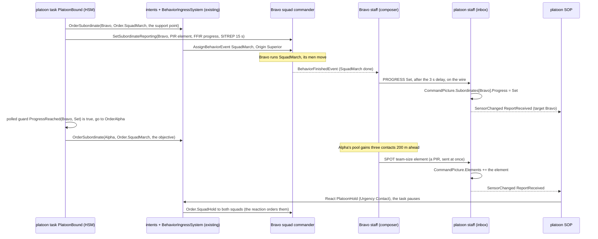
*What the picture shows that prose hid:* the plan advances on a GUARD reading the picture, and the interrupt arrives through the SOP —
the two existing ways a brain changes course. Reports never enter a behaviour directly; they change a component struct, and the
behaviour notices on its next tick (or is woken by the edge).

## 5. Who runs it each frame

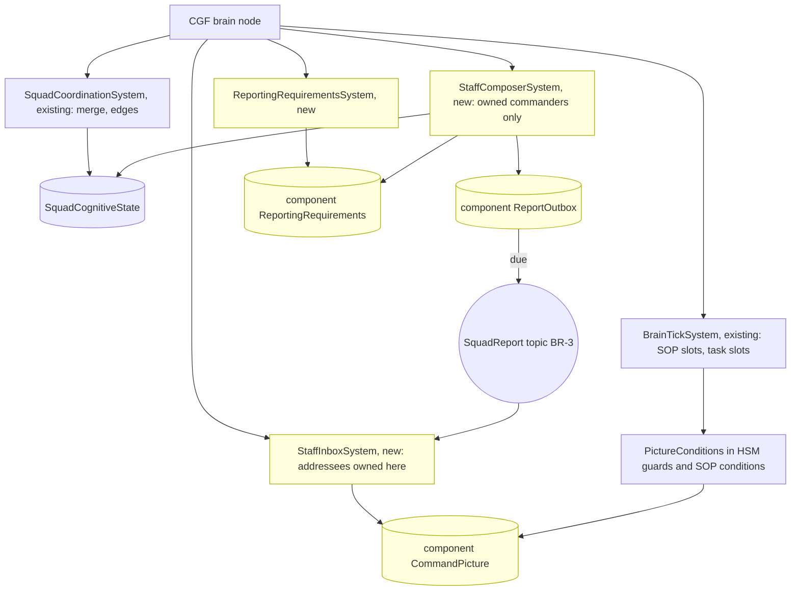
*Caption:* the staff runs as plain ECS systems in the Simulation phase on the brain node that owns the commander (the same ownership
filter `SquadCoordinationSystem` uses), BEFORE `BrainTickSystem`, so a report folded this frame is seen by this frame's guards. ⚠
Not reached today: no platoon has ever run over squads (SL-0, `CE-2262`, makes it run first); the topic is backend's BR-3.

## 6. The code shapes *(sketches — names final, bodies not)*

```csharp
// Fdp.Toolkits/Squad/Command — unit-scope knowledge written by systems ⇒ components (§1a); three new ids in GlobalComponentIds.
[ComponentId(GlobalComponentIds.CommandPicture)] public struct CommandPicture   // on the commander that RECEIVES reports
{
    public ReportedElements Elements;               // [InlineArray(8)] of ReportedElement
    public SubordinateRows  Subordinates;           // [InlineArray(4)] of SubordinateRow
    public PendingRequests  Requests;               // [InlineArray(4)] of PendingRequest
}
public struct ReportedElement { public Vector3 At; public float Radius; public byte Count, SizeClass, Activity, Equipment;
                                public uint FromNetId; public float ObservedAt; public uint Seq; }
public struct SubordinateRow  { public uint UnitNetId; public byte Progress, Strength, Ammo, Phase; public float LastSitrepAt; }

[ComponentId(GlobalComponentIds.ReportingRequirements)] public struct ReportingRequirements   // on the commander that SENDS reports
{
    public uint SuperiorNetId; public uint PirMask; public uint FfirMask; public float SitrepEverySeconds; public byte SetByOrigin;
}

public struct SetReportingEvent                      // the SetRoeEvent twin
{ public Entity Entity; public BehaviorOrigin Origin; public uint PirMask, FfirMask; public float SitrepEverySeconds; }

// The nodes — the same [SharedAi*] shapes every BTree / HSM / blueprint already binds.
[SharedAiCondition] public static bool ProgressReached(ref ProgressReachedParams p, Entity self, EntityRepository world)
    => world.HasComponent<CommandPicture>(self) && world.GetComponentRO<CommandPicture>(self).Progress(p.Subordinate) >= p.Progress;
[SharedAiCondition] public static bool ElementReported(ref ElementReportedParams p, Entity self, EntityRepository world);
[SharedAiAction]    public static NodeStatus OrderSubordinate(ref OrderSubordinateParams p, Entity self, EntityRepository world);
[SharedAiAction]    public static NodeStatus SetSubordinateReporting(ref SetReportingParams p, Entity self, EntityRepository world);
[SharedAiAction]    public static NodeStatus SendReport(ref SendReportParams p, Entity self, EntityRepository world);
```

| the platoon's task `PlatoonBound` (HSM, one region) | entry action | polled guard out |
|---|---|---|
| `OrderBravo` | `OrderSubordinate(Bravo, Order.SquadMarch, support point)` + `SetSubordinateReporting(Bravo, …)` | always → `WaitBravo` |
| `WaitBravo` | — | `ProgressReached(Bravo, Set)` → `OrderAlpha` |
| `OrderAlpha` | the same for Alpha → objective | always → `WaitAlpha` |
| `WaitAlpha` | — | `ProgressReached(Alpha, Set)` → `Done` (the task finishes) |

| the platoon's SOP `BasicPlatoonSop` (BTree, the `BasicSquadSop` shape) | |
|---|---|
| `Sequence( SensedFresh(reportReceived) , ElementReported(size ≥ team, within 400 m) , SopOrder{React PlatoonHold, Contact} )` | `PlatoonHold` orders both squads `Order.SquadHold` and ends when no element is fresh for 30 s; the task resumes at its state |

## 7. Decisions *(⭐ leans — for the user)*

| id | decision | ⭐ lean | rejected — one line each |
|---|---|---|---|
| **CC-1** ✅ | where a commander's knowledge lives | ✅ **approved (R-2043)** — **by scope (R-2042, §1a)**: the unit's knowledge — `CommandPicture`, `ReportingRequirements`, `ReportOutbox` — is three **components** on the commander (written by the staff systems; AQ87 §4's rule; the `Roe` / `SquadCognitiveState` precedent); each play's own tracking is in **its own slots**; unit memory stays for behaviour-only shared data. ⚠ Revises Building Clearing CB-33: reported elements go into `CommandPicture`, not into a `TargetMemory` on the commander. ⚠ Costs three component ids | unit memory for staff-written data (the first lean, after R-2041 as first worded): it puts system-owned state in the behaviours' store, and AQ87 §4 already ruled the other way · the commander's `TargetMemory`: perception's component, with perception's rules |
| **CC-2** ✅ | how report requests reach a subordinate | ⭐ **the ROE pattern**: a `SetReportingEvent` sent with the order (or on its own), applied by `ReportingRequirementsSystem` into the subordinate's `ReportingRequirements`, origin-gated like `RoeSystem`, persisting across tasks; sent by the node `SetSubordinateReporting` | inside every play's params DTO (CB-42 as written): each behaviour would have to carry it, and there is no admit hook to lift it out · a component stamped by the gate: the gate has no general hook, and adding one is a change to the most-shared system for one feature |
| **CC-3** ✅ | the gate | ⭐ **unchanged** — "the gate" is `BehaviorIngressSystem`, which already admits, pauses and resumes; nothing here needs it to know about reports | an admit hook: not needed once CC-2 copies ROE |
| **CC-4** ✅ | ordering a subordinate commander from an HSM / BTree / blueprint | ⭐ (refined by CC-9: two actions, abstract `OrderSubordinate` and concrete `AssignSubordinate`) a shared action `OrderSubordinate(unit, orderName, json)` doing exactly what `SquadManeuverRunner.Order` does (`AssignTacticalIntentEvent{Order.<name>, Superior}` + `SubordinateOrders`), the runner calling the same helper | a second order path: two ways to order a unit, released differently |
| **CC-5** ✅ | the first reports the staff sends without any play changing | ⭐ **PROGRESS on the task's end** (`BehaviorFinishedEvent` of the commander's task ⇒ `PROGRESS Set`), **SPOT** from the squad pool when a new element appears (a PIR), **SITREP** on the requested rate — so `SquadMarch`, unchanged, already reports SET | requiring every play to call `SendReport` for SET: every existing play would need editing first |
| **CC-6** ✅ | when the staff runs | ⭐ Simulation phase on the brain node owning the commander (the `SquadCoordinationSystem` filter), before `BrainTickSystem`; the inbox applies every report addressed to a commander owned here | in a behaviour: a report would be lost while a different state runs |
| **CC-7** ✅ | the example's scope | ⭐ exactly §1: two squads, `SquadMarch`, `SquadHold`, one HSM task, one SOP row, PROGRESS / SPOT / SITREP only — the smallest run that exercises orders down, requirements down, reports up, a guard advancing the plan and the SOP interrupting it | the full building attack first: every part at once, nothing provable on its own |

## 7a. Who reports, which order, and when may a unit act on its own *(✅ CC-8…CC-11 approved, R-2044)*

✅ CC-2…CC-11 approved — 🔒 User, `2026-10-18`: *"Approved. What about the mission plan feature we support on every entity?"*

🔒 User, `2026-10-18`: *"Who is responsible for collecting the information on the subordinate and sending reports back to the
superior? Is it the staff system or is it the behavior running there? … do the behaviors needs to understand the report requests …
Can the behavior affect the reports?"* · *"How Do we control whether a unit can act autonomously on something or needs to wait for
orders from its higher level command? Maybe some situations require autonomous response immediately while still being reported up the
chain."*

**Who does what in reporting (CC-8):**

| layer | its part | needs anything from the superior? |
|---|---|---|
| **the staff** of the subordinate (engine systems) | ⭐ **all collection and sending**: the doctrinal minimum by exception, ALWAYS — CONTACT on a new element, SITREP when a colour changes and on its routine rate, LACE after contact, PROGRESS when the task ends or fails — plus whatever the superior's requirements add | ⛔ no — the minimum is the unit's own standing reporting (a TKB default per unit type, like its SOP) |
| **the running behaviour** | only what the staff cannot infer: its **milestones** (`SendReport` PROGRESS: phase line, foothold, room clear) and its **requests** (CASEVAC, fire support, permission); and it may **shape** reporting — `ReportingPosture` *Silent* while it sneaks (the staff queues everything but CONTACT under fire) | ⛔ no — ⭐ **a behaviour never reads the superior's requirements** |
| **the superior** | ⭐ **optional** requirements (CCIR) only when its play needs MORE than the minimum (*"tell me at once about any MG"*, *"report every phase line"*) — the `SetReportingEvent` of CC-2 | — |

⇒ A subordinate reports correctly with **no** request at all; a behaviour knows nothing about requests; the superior asks only for
extras. This is how a real unit works: reporting is SOP, the commander adds CCIR.

**Abstract or concrete orders (CC-9)** — both exist today, and reporting does not care which one ran:

| kind | measured | when |
|---|---|---|
| **abstract** — *what* to do, each subordinate class decides *how* | `AssignTacticalIntentEvent{IntentId = "Order.<name>"}`, resolved by the RECEIVER's own class (`TacticalIntentResolutionSystem`); `SquadManeuverRunner.Order` | general orders — Move, Attack, Hold, Defend (RTS style) |
| **concrete** — run exactly this behaviour with these params | a behaviour name with its params (`SquadManeuverRunner.Publish` to soldiers; the hill attack's `HullDownAttack` intent) | a play that needs one exact drill from a subordinate |

⇒ CC-4 becomes **two** shared actions on the same helper: `OrderSubordinate(unit, Order.<name>, json)` (abstract) and
`AssignSubordinate(unit, behaviourName, json)` (concrete), both recorded in `SubordinateOrders` and released when the giving play ends.

**Acting alone vs waiting for orders (CC-10, CC-11)** — doctrine: **immediate action** (take cover, return fire, the battle drill's first
seconds) is ALWAYS the unit's own and ALWAYS reported; anything that **changes the mission** (assault, bypass, withdraw, clear a building)
is the commander's — unless his intent allows initiative, or there is no commander.

| SOP row class | examples | allowed when |
|---|---|---|
| **Immediate** | take cover, return fire, go to ground, casualty first aid | always — reported up as CONTACT / LACE |
| **Local** | assault a small enemy that blocks the task, break contact, bound to cover | `Initiative ≥ WithinIntent` |
| **Mission** | abandon the task, attack or clear a building, withdraw from the objective | `Initiative = Full` — or no superior at all |

| the unit | `Initiative` default |
|---|---|
| has no superior (the squad alone) | **Full** — it acts on its own SOP, exactly as today |
| has a superior, Regular+ | **WithinIntent** — immediate and local alone, mission-level waits for an order |
| has a superior, Untrained / Militia | **Full** — irregulars act on their own (the proficiency repertoire, Defend_And_Attack DA-16) |
| the superior's order says otherwise | the superior sets it with the order, as it sets ROE |

⇒ For CC-7's spot report: Alpha's men see the enemy → the squad merge → the squad's SOP takes its **Immediate** row at once (cover,
return fire — `ReactToContact`'s first seconds) **and** its staff sends a SPOT up. Whether Alpha then assaults is a **Mission**-class
choice: with `WithinIntent` it holds and waits; the platoon's SOP decides (`PlatoonHold`, or an order to assault). Without a platoon,
`Initiative = Full` and Alpha's own SOP goes on as today. If no order comes within a hold time (default 30 s), the squad's initiative
rises one step — doctrine's *"if in doubt, act on the commander's intent"*.

| id | decision | ⭐ lean | rejected — one line each |
|---|---|---|---|
| **CC-8** ✅ | who reports | ⭐ **the staff collects and sends everything**; a standing reporting minimum per unit type needs no request; behaviours only add milestones and requests (`SendReport`) and may set `ReportingPosture` (Silent); **behaviours never read the superior's requirements**; the superior's requirements are optional extras | the behaviour composing reports: every play re-implements SALUTE and must read the requirements · requirements mandatory with every order: an RTS "move" would carry a reporting spec |
| **CC-9** ✅ | abstract or concrete orders | ⭐ **both, unchanged**: `Order.<name>` (resolved by the receiver's class) and a concrete behaviour; two actions `OrderSubordinate` / `AssignSubordinate` on one helper | one kind only: RTS needs abstract, the hill attack needs concrete |
| **CC-10** ✅ | what a unit may do on its own | ⭐ every SOP row is classed **Immediate · Local · Mission**; a unit's **`Initiative`** (`ImmediateOnly · WithinIntent · Full`) admits the classes; a refused row's situation is still reported (the staff does that anyway); the gate checks it beside the existing `RoeReactions.StayOnTask` | a per-row "needs approval" flag: every SOP author re-decides doctrine per row · no limit: a platoon could never keep its squads on the plan |
| **CC-11** ✅ | where `Initiative` lives and who sets it | ⭐ **a new half of `Roe`**, set by `SetRoeEvent` (with the order or on its own, origin-gated, persists across tasks) — ROE's `Reactions` is already the "may reactions interrupt" switch; defaults by the table above; rises one step after 30 s without orders | a separate component: two sources for "what may this unit do on its own" |

⚠ CC-2 clarified: the separate event is the **report-requirements** event (`SetReportingEvent`), NOT the behaviour order; it carries
only the superior's EXTRA requirements (CC-8).

## 7b. Mission plans and sub-behaviours on the subordinate *(⭐ answer, no change to CC-1…CC-11, 2026-10-18)*

🔒 User, `2026-10-18`: *"Can it be useful for something on the subordinate entities, meaning the higher level commander sending
mission plans to the subordinate? What about the sub-behaviors, could they be useful in some cases?"*

| the mission plan, measured | code | design |
|---|---|---|
| a plan is ≤ 8 behaviours, each advanced by ONE trigger local to the entity running it (timer, under attack, health, finished) | `MissionPlanQueue`, `MissionDirectorSystem`, `MissionTriggerHelper.ResolveTrigger` | Decision Layer §2: *"an ordinary end-user-facing surface"* |
| only the operator writes plans (editor, ExCon, IG, the wire) | `ScenarioMissionService`, `MissionControlIngressTranslator` | ⛔ searched `docs/` + `.dev/`: no design for an AI-authored plan; tactical-intent DESIGN unifies AI orders and mission tasks into ONE event pipeline instead |
| an immediate order clears the plan; a reaction pauses its task | `MissionControlExecutionSystem.ClearFor`; `BehaviorOriginRank.Pauses` | Entity Control §2.1 C-4; Decision Layer §4.1 |

⇒ ⭐ **Mission plans stay the OPERATOR's surface, on the TOP commander.** The layering is: the operator gives the platoon a plan
(Move → Bound → Defend) · each task is a platoon play · the play orders its squads one task at a time (CC-9) · each squad's staff reports
(CC-8). This works today with no change. ⛔ **A commander does not write its subordinates' plans**: its triggers would be the
subordinate's own (none can say "when Bravo is set"), so the synchronisation stays in the commander's play where the picture is; and one
plan slot with two authors (the operator and an AI commander) would overwrite each other.

| sub-behaviours (hosted children, any tier — S5a) | ⭐ where they pay |
|---|---|
| a reusable phase shared by plays | `Consolidate` (360 security, LACE, redistribute ammo) after Attack, ClearBuilding and Defend; `BoundingControl` hosted by Approach (Building Clearing §5d) |
| the class-specific "how" of an abstract order | `Order.Attack` resolves to the squad's attack play, which hosts the fire-team drill |
| control beside the phases | a parallel `ControlRegion` in the play's HSM (Building Clearing §5d) |
| ⛔ not for reporting | reporting is the staff's systems (CC-8) |

A hosted child's storage is nested under its host's occurrence (S5b), so it already follows R-2042 (knowledge lives at its scope).

## 7c. Reports on the debug HTTP — watch them, and fake them *(✅ CC-12…CC-15 approved, R-2045)*

🔒 User, `2026-10-18`: *"We will need the AI debug HTTP to be able to monitor the reports for diagnostics, if not even faking the reports
for exercising the superior decision making."*

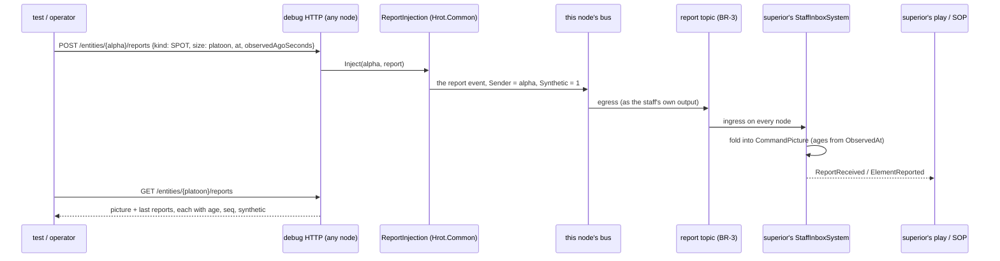
*What the picture shows that prose hid: the fake enters BEFORE the wire, as Alpha's staff would, so ageing, ordering, transport and the
superior's whole decision path run exactly as for a real report — and it works from any node, like `EntityOrders`.*

| id | decision | ⭐ lean | rejected — one line each |
|---|---|---|---|
| **CC-12** ✅ | watching | ⭐ **`GET /entities/{networkId}/reports`** (beside `/entities/{id}/squad`), read on the brain node: on a commander its `CommandPicture` (elements with kind, sender, age from `ObservedAt`, seq, synthetic), each subordinate's last colour / phase / report age and *overdue*, open requests, its `ReportingRequirements`; on any unit its `ReportOutbox` (queued, posture, the last 16 sent) and the requirements it reports under. ⭐ The report event is also kept in the existing event history (`GET /events?type=`) for the raw stream | ⛔ a new stream route: the event history already is one · ⛔ extending `GET /sitrep`: that route is a whole SIDE's picture for an external decision-maker (Entity Control), not a commander's reports — ⚠ same word, different thing |
| **CC-13** ✅ | faking | ⭐ **`POST /entities/{networkId}/reports`** — a report AS IF that unit's staff sent it (kind, subtype, the kind's fields, `observedAgoSeconds`); one service, `ReportInjection.Inject`, used by the HTTP AND by test rails (one implementation) | ⛔ writing `CommandPicture` directly: skips ageing, ordering and the wire — tests the decision only, on one node · ⛔ a sender outside the chain: the inbox counts only its subordinates, so it would test nothing |
| **CC-14** ✅ | the fake vs the real sender's ordering | ⭐ a **`Synthetic` flag** on the report: it bypasses the newest-per-sender drop (CB-32) and the sender's next REAL report of the same subject replaces it — as a later report corrects an earlier one; replay records the flag | ⛔ HTTP guessing the sender's next `Seq`: the counter lives on the sender's brain node · ⛔ a fake that is never superseded: the picture would lie forever |
| **CC-15** ✅ | lost comms | ⭐ **`POST /entities/{networkId}/reports/mute {seconds}`** — the unit's staff sends nothing, CONTACT included (radio failure); exercises the superior's *overdue* handling and the subordinate's initiative rise (CC-11) | ⛔ muting by killing the radio entity: no such entity; ⛔ only the behaviour's Silent posture: it keeps CONTACT under fire |

✅ CC-12…CC-15 approved — 🔒 User, `2026-10-18`: *"Accepted. What about reading the commander's memory? Is that sufficient to read just
the ecs components in the usual way, as is supported now, or do we need anything special?"*

**Reading the commander's memory (CC-16)** — measured. ✅ 🔒 User, `2026-10-18`, on CC-16 and `CE-2288`: *"Approved"* (R-2050).

| the memory | how it reads today | enough? |
|---|---|---|
| the staff's components — `CommandPicture`, `ReportingRequirements`, `ReportOutbox` | ✅ `GET /entities/{id}` dumps EVERY registered component, NoScenario ones too (`EntityStateExtractionService.ExtractEntities` — translator output, then reflection for the rest); a buffer written as the fixed-list wrapper (`int Count` + one `[InlineArray]` field, `FixedListShape`) prints as a plain array of the used elements (`FixedListJsonConverter`) | ⭐ **yes — if CC-A writes each buffer as that wrapper** (and enums as enums, times as sim seconds). Read it on the brain node, like `/memory` |
| the root play's own block | ✅ `BrainDiagnosticsTranslator` projects the ROOT occurrence slot into the behaviour's layout DTO, inside the same dump | yes |
| a blueprint play's variables | ✅ `GET /entities/{id}/variables?asset=` | yes |
| a HOSTED child's slots and the SOP slot | ⛔ no route: the dump reads the root slot only, `/variables` reads blueprint blocks only | ⛔ a gap — not report-specific |

| id | decision | ⭐ lean | rejected — one line each |
|---|---|---|---|
| **CC-16** ✅ *(R-2050)* | reading a commander's memory | ⭐ **no special reader for the components** — they read like any other, on the brain node; ⭐ a constraint on CC-A: every buffer is a fixed-list wrapper so the dump shows it; ⭐ `GET …/reports` (CC-12) stays the INTERPRETED view (ages, names, overdue), built from the same components; ⭐ the hosted-child / SOP slot gap is a general route, filed as `CE-2288` | ⛔ a raw-bytes route per component like `/memory`: needed only for the old `fixed` buffers, which the wrapper replaces · ⛔ waiting with the slot gap until a commander needs it: every hosted drill (`BoundingControl`, `Consolidate`) is blind over HTTP today |

## 8. Slices and the check

| order | slice | what | needs |
|---|---|---|---|
| 1 | **CC-A** `CE-2291` | the three components (+ ids) — every buffer a fixed-list wrapper (`Count` + `[InlineArray]`) so `GET /entities/{id}` shows it (CC-16); `SetReportingEvent` + `ReportingRequirementsSystem`; rails: the picture survives a behaviour switch and a reaction; the play's own slots do not leak into the reaction; an origin below the setter's is refused | — |
| 2 | **CC-B** `CE-2292` | `OrderSubordinate` (sharing `SquadManeuverRunner.Order`'s helper), `SetSubordinateReporting`, `SendReport`, `ProgressReached`, `ElementReported` | CC-A |
| 3 | **CC-C** `CE-2293` | `StaffComposerSystem` (PROGRESS on task end, SPOT from the pool, SITREP) + `StaffInboxSystem` (fold, `ReportReceived`) — first on ONE node with a local loopback of the notification, so it is provable before BR-3 | CC-A, SL-0 |
| 5 | **CC-E** `CE-2295` | the debug HTTP: `GET` / `POST /entities/{id}/reports`, `…/reports/mute`, `ReportInjection` (CC-12…CC-15), `GET /entities/{id}/order` showing the params for every origin (not only Operator — the platoon demos read a Superior order's params, Platoon_Attack_Defend_Clear §12.4) + the route docs (they feed the ai-debug MCP catalogue); rails: a fake SPOT reaches the platoon's picture with `Synthetic` set and is replaced by Alpha's next real one; a muted squad goes *overdue* | CC-C (the `Synthetic` wire flag: BR-3) |
| 4 | **CC-D** `CE-2294` | `PlatoonBound` (HSM) + `BasicPlatoonSop` + `PlatoonHold`; the scenario `cc-platoon-bound`; then on the wire once BR-3 lands | CC-B, CC-C |

**`cc-platoon-bound` must end with:** ① Bravo reaches its point and the platoon's picture shows `Bravo: Set` within 3 s (+ one frame) of
Bravo's `SquadMarch` finishing · ② only THEN is Alpha ordered (`SubordinateOrders` on the platoon) · ③ when Alpha's pool first holds the
enemy, ONE `SPOT` reaches the platoon (not one per contact) · ④ the platoon's SOP starts `PlatoonHold`, both squads hold, the task is
paused, and it resumes in `WaitAlpha` when the element goes stale · ⑤ every report is visible over HTTP (`GET /entities/{id}/reports`, CC-12) with its
`ObservedAt` and arrival time.

## 8a. As built *(2026-10-19)*

**CC-A `CE-2291`** — `FDP/Toolkits/Fdp.Toolkits/Squad/Command/`:

| piece | as built | deviation from §6 |
|---|---|---|
| `CommandPicture` (407) | `Elements` (×8 `ReportedElement`: at, radius, count, size, activity, equipment, `FromNetId`, `ObservedAt`, `ReceivedAt`, `Seq`, `Synthetic`) · `Subordinates` (×6 `SubordinateRow`: `UnitNetId`, `Progress`, strength / ammo colours, phase, `LastReportAt`, `LastSitrepAt`, `LastSeq`) · `Requests` (×4 `PendingRequest`) — each a fixed-list wrapper (CC-16) | `ReceivedAt` and `LastReportAt` added for CC-12's age / overdue; net ids are `long` (`NetworkIdentity.Value`), not `uint` |
| `ReportingRequirements` (408) | `Pir` (`PirFlags`) · `Ffir` (`FfirFlags`) · `SitrepEverySeconds` · `PirArea` (PC-3) · `SetBy` | ⛔ no `SuperiorNetId`: the addressee is always the direct superior, `UnitSubordinate.Commander` (R-2040) — one source, not two |
| `ReportOutbox` (409) | `Queued` (×8 `QueuedReport` = a `CommandReport` + `DueAt`) · `NextSeq` · `Posture` (Normal / Silent, CC-8) · `MutedUntil` (CC-15) | the posture and mute live here (one place the composer reads) · ⭐ *as built `2026-10-19` (`CE-2304`, [Defend §8c D-2k](DESIGN_Defend_And_Attack_Position.md)):* **full, `ReportQueue.Enqueue` drops the OLDEST for the new one** (newest wins, CB-32) — it refused the ninth before, so an outbox nothing empties (no superior, Silent, muted) kept its first eight for ever and swallowed every later report, PROGRESS `Set` included |
| `CommandReport` | the closed set's one struct (CB-43): `Kind` (`ReportKind`), `Subtype`, the SALUTE / SITREP / LACE fields, `ObservedAt`, `Seq`, `Synthetic` — the outbox entry, the local notification and (BR-3) the wire payload | enum members are unique across the enums (`NoReport`, `SizeUnknown`, `SquadSize` …) for BR-3's IDL (the `Roe` precedent) |
| `SetReportingEvent` (event 3106) + `ReportingRequirementsSystem` | Input phase, in `MissionControlModule` right after `RoeSystem`; origin-gated exactly as ROE; ⭐ the event REPLACES the set, and an all-zero event WITHDRAWS it (then `SetBy` is cleared so anyone may set them again) — how a play takes its requirements back when it ends | ROE keeps an unset field; requirements are one set, so replace-and-withdraw is the simpler contract |
| registration | the three components and the event in `CognitiveComponentRegistry` (every brain host); `CgfLogicPackTests` 5 → 6 input systems, 28 → 29 total | — |

Rails: `CommandComponentsTests` (the ROE-twin gate and withdraw · every buffer a fixed list printing a plain array, enums as strings) ·
`SquadManeuverTests.CE2291_ThePicture_SurvivesATaskSwitch_AndAReaction` (through the real ingress).

**CC-B `CE-2292`** — the command actions (`Hrot.AI.Behaviors/Brains/CommandNodes.cs`) and the picture guards
(`Fdp.Toolkits/Squad/Command/PictureConditions.cs`):

| piece | as built | deviation from §6 / CB-46 |
|---|---|---|
| ⭐ one order helper | `CommandOrders.Order` (abstract, `Order.<name>`) and `CommandOrders.Assign` (concrete) — record in `SubordinateOrders` + publish at Superior; ⭐ `SquadManeuverRunner`'s private `Order` / `Publish` now CALL them (one implementation, CC-4) | a fresh order from a play (`newOrder: true`) makes the picture forget that subordinate's progress (`CommandPictureOps.OrderGiven`), so "wait for Set" waits for THIS leg's Set; the runner's re-sends keep it |
| a subordinate's name | its **roster slot** (`int Slot`) — a play is written once for any platoon | the sketch's `p.Subordinate` left open what it was |
| `OrderSubordinate` | `[SharedAiAction]` `{Slot, Order, Point, Speed, ArrivalRadius}` — **Move and Hold** (built from the order DTOs); Attack / Strike / ObserveFire name a target and are given from C# via `CommandOrders.Order` | ⚠ `AssignSubordinate` is a **C# helper only** (`CommandOrders.Assign`): a node would need a behaviour NAME and its params JSON, which unmanaged node params cannot carry — the generator's `SopOrder` path is the model when a play needs it |
| `SetSubordinateReporting` | `{Slot, Pir, Ffir, SitrepEverySeconds, PirArea}` → `SetReportingEvent` at Superior (crosses nodes, `CE-2299`) | — |
| `SendReport` | `{Kind, Subtype, Count}` — PROGRESS or REQUEST only (CC-8: the staff composes the rest), queued through `ReportQueue.Enqueue` (the one writer of the outbox, numbering `Seq`) due `ReportDelaySeconds` = 3 s later | — |
| the guards | `ProgressReached(Slot, Progress)` (the LATEST progress equals it — not ordinal) · `SubordinateColour(Slot, AtLeast)` · `SubordinateFresh(Slot, WithinSeconds)` (false = overdue) · `ElementReported(MinSize, WithinMetres, FreshSeconds)` · `PendingRequest(Kind)` | ⚠ **not built yet:** `PirMet` (no consumer, semantics open) · `TimeInState` (PC-7's 10 s lift fall-back: first consumer is `PlatoonAttack`) · `AnswerRequest` (needs requests flowing, CC-C) — each waits for its first consumer |

Rails: `CommandComponentsTests.CE2292_*` (slot + reset, the other guards, the outbox numbering) · `SquadManeuverTests.CE2292_*` (an
abstract order recorded and resetting progress while the runner's re-send does not; reporting extras reach the subordinate; a play's
milestone queued 3 s out, a SPOT refused).

**CC-C `CE-2293`** — the staff (`Fdp.Toolkits/Squad/Command/StaffSystems.cs`), on BR-3's event:

| piece | as built | deviation from §3 / §5 |
|---|---|---|
| the report on its way | ⭐ backend's **`SquadReportNotification`** (`CE-3250`, managed: `FromUnit`, `ToUnit`, `Subject`, `Building`, `SentAt`, `OriginNodeId` around the `CommandReport`) — the staff publishes it with `OriginNodeId = 0`, BR-3 carries it to every node, the ingress raises it there; on one node it is simply read back (the loopback CC-C asked for comes for free) | the §3 box's own event was dropped for backend's one (one vocabulary) |
| `StaffComposerSystem` | for every commander with a live superior (`UnitSubordinate.Commander`) and a roster, owned here (the pack's gate): ① **PROGRESS** on the end of its TASK (`BehaviorFinishedEvent`, not a reaction or the SOP): Set on success, `TaskFailed` otherwise (CC-5) · ② **SPOT** from the squad pool as ONE element (centre, radius, count, size class) — again only when it is new, changes size class or moves > 25 m; a SPOT with Count 0 when the pool empties (lost) · ③ **SITREP** at `ReportingRequirements.SitrepEverySeconds` (none without a request — CC-8's standing minimum does not include a routine one yet), strength GREEN ≥ 90 % fighting, AMBER ≥ 70 %, RED while combat effective, BLACK after · ④ **flush**: due (3 s), not muted (CC-15), and under Silent only a CONTACT | ⚠ the composer's element memory (`SpotSent`, `SpotAt`, `SpotSize`, `LastSitrepAt`) lives in `ReportOutbox` (four scalars added) · ⚠ CONTACT and LACE are not composed yet (no consumer: the SOP reads SPOT; LACE needs the casualty count wired) |
| `StaffInboxSystem` | every `SquadReportNotification` (local or arrived) to a commander owned here → `Fold`: the sender's row (newest `Seq` wins, a late older one dropped, a `Synthetic` one always taken — CB-32, CC-14), PROGRESS → `Progress`, SITREP → colours / phase, SPOT / CONTACT → the sender's element within 50 m replaced (Count 0 removes it), full ⇒ the oldest observation goes, REQUEST → `Requests`; then `SensorChange.ReportReceived` (19) on the commander — the SOP's edge, `RecentSenses` records it, and an HSM takes it as the built-in event `Sensor.ReportReceived` (id 0xFF13, `BuiltInHsmEvents`) | `Fold` is public: the HTTP fake (CC-E) folds through it |
| schedule | `CgfLogicPack`: after `SquadCoordinationSystem` and `UnitCentroidSystem`, before the cognitive runtime — this frame's guards see this frame's folds (CC-6); `CgfLogicPackTests` 23 → 25 simulation systems | — |

Rails (`SquadManeuverTests.CE2293_*`, a squad under a body-less platoon on one node): a task that ends reports Set 3 s later (not
before) into the platoon's picture, which raises `ReportReceived` and turns `ProgressReached` true · three pooled contacts are one
SPOT; 10 m is not news, 40 m replaces it, an empty pool removes it · a SITREP only at the requested rate, GREEN; mute holds the outbox ·
the inbox drops a late older report and takes a synthetic one.

**CC-E `CE-2295`** — the debug HTTP (`Hrot.Editor/DebugApi/DebugApiService.Reports.cs`) over one service
(`Fdp.Toolkits/Squad/Command/ReportInjection.cs`):

| route | as built | deviation from §7c |
|---|---|---|
| `GET /entities/{id}/reports` | the INTERPRETED view (CC-12): picture elements with `ageSeconds` (from `ObservedAt`), `receivedAt`, `seq`, `synthetic`; each subordinate's progress, colours, phase, age, `overdue` (silent > 60 s, CB-34); open requests; the requirements; the outbox (queued with `dueAt`, posture, muted) | "the last 16 sent" lives in the node log below, not in the outbox |
| `POST /entities/{id}/reports` | `ReportInjection.Inject`: the staff's own `SquadReportNotification`, from the unit to its direct superior, `Synthetic = 1`, `Seq = 0`, `ObservedAt = now − observedAgoSeconds` — before the wire, so BR-3 carries it | ⚠ `ReportInjection` is in `Fdp.Toolkits` (not `Hrot.Common`): it needs nothing above the toolkit, and the test rails reach it there |
| `POST /entities/{id}/reports/mute` | `ReportInjection.Mute` → `ReportOutbox.MutedUntil` (CC-15); 0 restores; ⚠ runs on the unit's BRAIN node (the outbox lives there) | — |
| `GET /squad/reports?last=&unit=` | ⭐ PC-11: `SquadReportLog` — a ring of 256 per world, written by `StaffInboxSystem` for EVERY report it sees, with its verdict (`folded` · `stale` · `not-owned-here`) and origin node; network ids resolved at read time (the `ShotLog` precedent) | ⚠ kept where the inbox runs (brain nodes), not on SimHost / IG |
| `GET /entities/{id}/order` | gains `task:{behavior, origin, since, params}` for the running task of ANY origin (a Superior order a squad was given) beside the operator-order `state` | — |

Rails: `SquadManeuverTests.CE2295_*` (a fake SPOT arrives synthetic, aged and logged, and the squad's next real SPOT of the same
element replaces it; a muted squad's PROGRESS waits until the radio is back); route docs in `DebugApiRouteDocs` (rail
`EveryRouteIsDocumentedTests`). `CE-2288` (one read route over every behaviour slot) followed as its own slice — see the end of this section.

**CC-D `CE-2294`** — the first chain runs: `PlatoonBound` + `PlatoonHold` (`Hrot.AI.Behaviors/Brains/PlatoonBehaviors.cs`), the leg
node `MoveLeg` (`CommandNodes.cs`), the SOP asset `BasicPlatoonSop.btree.json` (the platoon type's TKB default SOP), scenario
`cc-platoon-bound`:

| piece | as built | deviation from §6 |
|---|---|---|
| `PlatoonBound` (HSM) | states `Support` → `Assault` → `Done` (Final); each leg's ACTIVITY is `MoveLeg` (its squad, its point), its polled guard `ProgressReached(slot, Set)`; `Done`'s entry withdraws the SITREP extras it asked (only when it asked). Params `PlatoonBoundParamsJsonDto`: `SupportPoint`, `Objective`, `SupportSquad` / `AssaultSquad` (1-based roster places; 0 = Bravo / Alpha), `Speed`, `ArrivalRadius`, `SitrepEverySeconds` | ⭐ §6's four states (`OrderBravo` → `WaitBravo` → …) with ENTRY actions became two states with an ACTIVITY: an HSM resumes in its state with its activities ticking (Decision Layer §4.1), and an entry action would not run again — so after a reaction replaced the squad's order, nothing would have ordered it on (see the sequence below) |
| `MoveLeg` | `[SharedAiAction]` stateful `{Slot, Point, Speed, ArrivalRadius, SitrepEverySeconds}`: orders the squad (abstract Move + the SITREP extras) whenever THIS run's order to it does not stand (`CommandOrders.Stands`: the commander's `SubordinateOrders` entry for that squad carries another run, or none) — on the state's first tick, and again after a reaction | — (new; any play's leg) |
| `PlatoonHold` (BTree reaction) | every roster squad ordered `Hold` (abstract) and kept on it while `ElementReported(Team+, 400 m, 30 s)`; Success once not. Params `PlatoonHoldParamsJsonDto` (`MinSize`, `WithinMetres`, `FreshSeconds`) | — |
| `BasicPlatoonSop` | one row: `SensedFresh(ReportReceived, 3 s)` → `ElementReported(Team, 400 m, 30 s)` → `React PlatoonHold (Contact)` | the platoon type's TKB `DefaultSop` (the `PilotSop` precedent) — SL-0 left it empty for CC-D |
| ⭐ the stale-Set guard | `SubordinateRow.OrderedAt` (set by `OrderGiven`); the inbox takes a PROGRESS only when `ObservedAt ≥ OrderedAt` | §6 reset the progress on a fresh order; a Set still on its way (3 s) would still have satisfied the NEW wait |
| ⭐ the SPOT refresh | the composer re-SPOTs a still-held element every `SpotRefreshSeconds` = 15 s (`ReportOutbox.SpotSentAt`) | CC-C sent one SPOT per element, so a still-visible enemy aged out of the platoon's picture in 30 s and the hold would end with the enemy still there — CB-33 assumes a contact is "forgotten … unless re-reported", CB-34 gives the 15 s engaged rate |
| ⭐ an element is men IN THE FIGHT | the composer counts only pool contacts that are not `ThreatDanger.IsOutOfTheFight` (dead, incapacitated, surrendered) and not `IsNeutral`; the last one going sends the lost SPOT (Count 0) at once | 📌 found LIVE in `cc-platoon-bound`: dead men stay in memory by design (R-214, CE-3080 — every threat reader filters them), so CC-C's raw pool count SPOTted three corpses every 15 s and the platoon held forever |

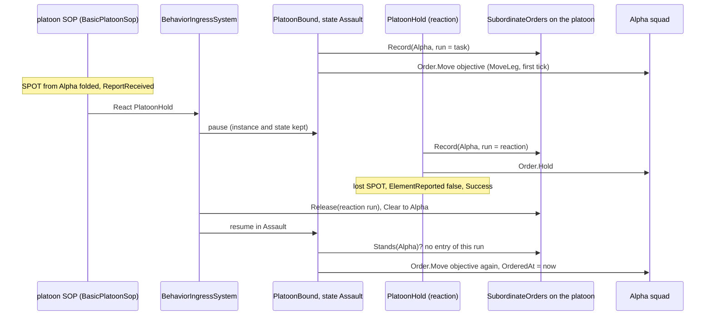
*What the picture shows that the prose hid:* the resumed task does not know it was paused — it only asks "does MY order to this squad
still stand?", and the reaction's release has answered no. The same question also covers an operator's order to the squad.

Rails: `SquadManeuverTests.CE2294_*` — the support squad ordered once and kept, the assault squad only after its Set, a Set observed
before the order not taken; the SOP's reaction pauses the task, both squads hold once, the lost SPOT resumes it and only the current
leg's squad is re-ordered; a held element re-SPOTted every 15 s. Red-proofs: the support guard always true · the fold ignoring
`OrderedAt` · `MoveLeg` ordering once per state · no refresh — each reddens its rail.

**CC-16 follow-up `CE-2288`** — one read route over every behaviour slot: `GET /entities/{networkId}/slots`
(`DebugApiService.Slots.cs`, MCP tool `get_entity_slots`), over one reader `OccurrenceSlotCatalog` (`Fdp.Toolkits/Behavior`).

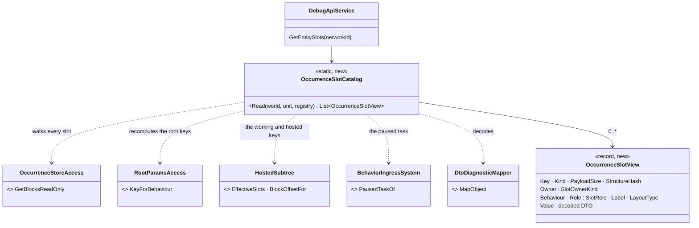
*What the picture shows that the prose hid:* nothing new stores who owns a slot. The catalog only joins blocks that already exist:
the store walk, the key functions ingress used to attach the slots, and the decoder the root dump uses.

| piece | as built | deviation from CC-16 |
|---|---|---|
| naming | a slot's key is a one-way hash, so each is named by RECOMPUTING the candidate keys of the running task (`BehaviorState`), the SOP (`SopState`) and a paused task (`BehaviorIngressSystem.PausedTaskOf`): root params / tree state / HSM keys, then `HostedSubtree.EffectiveSlots` — a tree-state slot is a hosted child (named by the child, `HostedChildren`), the rest are working state. The first claim wins: task, then SOP, then paused | — |
| decoding | `Marshal.PtrToStructure` at the slot (a hosted child: at `HostedSubtree.BlockOffsetFor(child)`, after its brain and start word) into the behaviour's `BlackboardLayoutType` / the node's `WorkingStateType`, then `DtoDiagnosticMapper.MapObject` — the root dump's path (`BrainDiagnosticsTranslator`) | tree-state and HSM slots are listed, not decoded (no layout DTO) |
| unmatched | a slot no candidate claims is still listed — key, kind, size, hash — with owner `OwnerUnknown` | — |
| the enums | `SlotOwnerKind { OwnerUnknown, Task, Sop, PausedTask }`, `SlotRole { RoleUnknown, Params, State, Hsm, Working, HostedChild }` | ⚠ member names unique across the file: the DDS IDL generator emits the toolkit's enums into one scope, and two `Unknown` members broke its build |

Rails: `SquadManeuverTests.CE2288_*` (a platoon commander: the task's params decoded, PlatoonBound's legs; the SOP's slots; once
a reaction pauses the task, the paused task's slots under their own owner) · `BehaviourTaskDemoTests.CE2288_*` (Demo_TaskChain's
hosted `MoveToLocation` named by the child and decoded at its block offset, destination x = 100) · route doc in
`DebugApiRouteDocs` (rail `EveryRouteIsDocumentedTests`). Red-proofs: the catalog naming no candidates · the hosted arm decoding at
offset 0 — each reddens its rail.

## 8b. The picture and the log on every node *(✅ approved 2026-10-19, `CE-2301` — ① BUILT 2026-10-19, ② backend's; ui's D4)*

🔒 User, `2026-10-19`: *"Have the report inbox fill the log on every node. Accepted."* · *"Replicate the commander's picture read-only. Accepted."* — ui's two leans
([DESIGN_Command_Display §6 D4](../../DESIGN_Command_Display.md), [the ui note](../../blueprints/batches/NOTE_Ui_To_Behaviors_Command_Display_Data.md)).

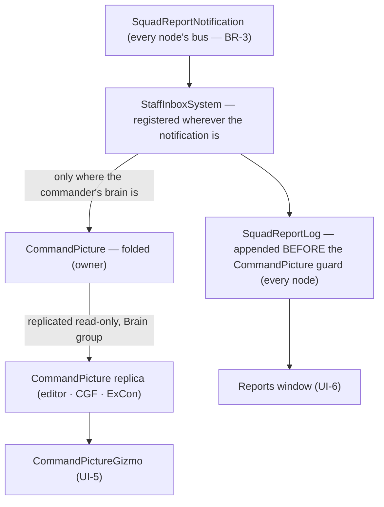
*What the picture shows that prose hid:* ONE writer of each — the log is filled by the same inbox on every node (a node that owns no
commander logs the report with verdict `not-owned-here`); the picture is folded only on the owner and every other node gets a copy, so
no node folds its own (the brain-only `OrderGiven` reset would make copies disagree — ui's rejected ⓑ).

**Detail (2026-10-19, `CE-2301`).** 🔒 User, `2026-10-19`, on whether the commander crosses nodes at all: *"Keep replication, replicate
the commander picture as well."* (measured: it does — `EntityInfo.CommanderId` resolves the commander through each node's entity map,
`EntityInfoIngressTranslator.cs:216-249`).

| part | who | how |
|---|---|---|
| ① the log on every node | behaviors | measured: the inbox is built only by `CgfLogicPack` (`:247`), so it runs on the plans with a Brain capability (editor ×2, CGF) and NOWHERE on SimHost or IG. ⇒ a cross-role capability `CoreInfrastructureCapabilities.ReportInbox` declared in the plans WITHOUT a brain (SimHost, IG — ExCon keeps no world): one inbox per node, never two. ⛔ Not the `CE-221` move (the pack's inbox out to the tail of every plan): the pack places it BEFORE the brain tick on purpose (*"this frame's guards see it"*, `CgfLogicPack.cs:244`) — at the tail the brain would read every report a frame late. The inbox LOGS every `SquadReportNotification` before its `CommandPicture` guard, and FOLDS only where `CommandPicture` is registered and the commander's `BehaviorState` is owned here (the capability always gates on authority — a replica never folds) |
| ② the picture replicated | ⭐ **backend** ([note](../../blueprints/batches/NOTE_Behaviors_To_Backend_CommandPicture_Replication.md)) | the Brain-group road `EngagementArea` took (`CE-3261`): descriptor, translator, ownership binding |
| the gizmo with no copy | ui | "not on this node yet" while the node has no `CommandPicture` for the selected commander |

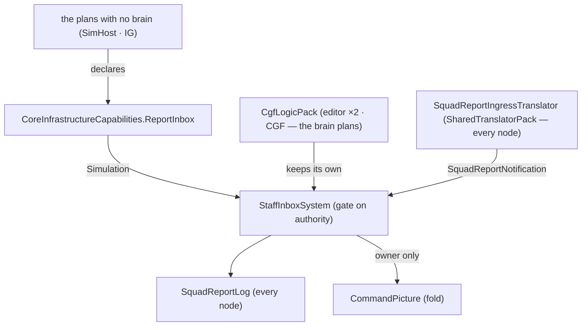
*What the picture shows that prose hid:* the notification already reaches every node (the ingress lives in the shared translator pack), but its only

**As built (2026-10-19, `CE-2301` ①).** Three things differ from the detail above; the table stands otherwise.

| | as built | why |
|---|---|---|
| the gate | `StaffInboxSystem.ForNodeWithoutBrain()` — log always; fold only for a commander whose `BehaviorState` is here AND owned here (so on a brainless node: never). The brain pack's `StaffInboxSystem(gateOnAuthority)` is unchanged | ⚠ the brain pack's gate skips only an UNOWNED `BehaviorState`; a commander replica with no `BehaviorState` would pass it, and `CommandPictureOps.EnsureRow` (`PictureConditions.cs:48`) then ADDS a local picture — a second writer the day part ② replicates the picture there |
| the guard | the inbox returns early only when the report event is unregistered; the fold alone needs `CommandPicture` registered | the old first-line guard on `CommandPicture` was what kept SimHost / IG logless |
| the plans | `CoreInfrastructureCapabilities.ReportInbox` (key `cap:infra:report-inbox`) in SimHost and IG only | ⛔ **Stride**: its plan is fused into the editor's brain plan in mode 1 (`EditorCapabilities.BuildWithInjectedMuscle`), and the pack's inbox is not keyed, so declaring it there would give the editor two — ⇒ a standalone Stride (mode 2) has no log yet. ⛔ **Traffic node**: a headless SUMO server; nothing reads a log there |

Rails (the feature's suite): `SquadManeuverTests.CE2301_ANodeWithNoBrain_LogsEveryReport_AndNeverFoldsAPicture`,
`CE2301_TheReportInbox_IsDeclaredOnlyByThePlansWithNoBrain`; IG's walk rail asserts one inbox (`IgNodeBootstrapperTests` CE2150).
reader lived in ONE role's pack — so the log existed only where a brain ran. Giving the brainless plans the same reader is the whole of
part ① (each node still has exactly one); the fold's authority gate is what keeps a replicated picture one-writer once part ② lands.

## 8c. The request round trip — Casevac first *(`CE-2305`, behaviors, 2026-10-19 — Urban Battle §5 step 4; build-state: BUILT — §8c-a; leans RQ-1…RQ-6, built under the user's "go ahead autonomously")*

📐 **Measured first (INVENTORY, 2026-10-19 — grep over `FDP/Toolkits/Fdp.Toolkits` and `Hrot.AI.Behaviors` for `RequestKind.` /
`PendingRequest` / `AnswerRequest`, and reads of `StaffSystems.cs`, `CommandComponents.cs`, `ReportQueue.cs`, `PictureConditions.cs`,
`PlatoonDefendBehavior.cs`, `CommandNodes.cs`, `CasualtyCareBehavior.cs`):** the inbox already folds a REQUEST into `CommandPicture.Requests`
and the `PendingRequest(Kind)` guard reads it — ⛔ but **nothing sends a REQUEST and nothing answers one**; a queued report carries no
subject (`QueuedReport` holds only the `CommandReport`, so the notification's `Subject` is never set); `CommandOrders.Stands` says only
that the order was recorded in this run, not that the task still runs; and the drill that fetches a man who is NOT in the squad's own
roster already exists — `SquadRecover {casualty, to, putDown}` (`CE-2173`).

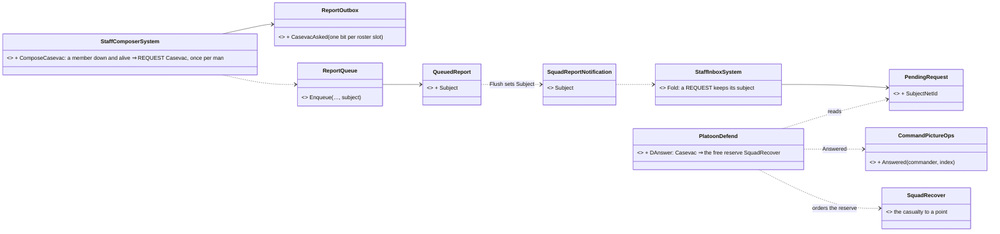
*What the picture shows that prose hid:* the round trip needs ONE new behaviour state and no new behaviour — the sender is the staff
(where LACE's WIA count already lives), the answer is an order to an existing drill, and the request's only new data is WHO.

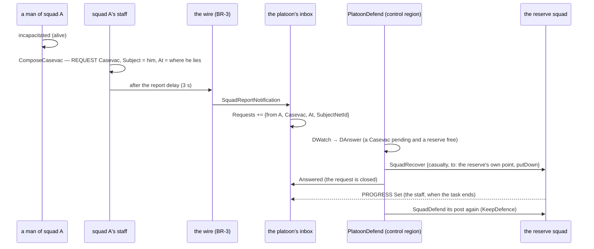
*What the picture shows that prose hid:* the request closes when it is ANSWERED, not when the casualty arrives — the platoon then
follows the reserve like any other squad, by its PROGRESS; a second request while the reserve is out waits in the picture.

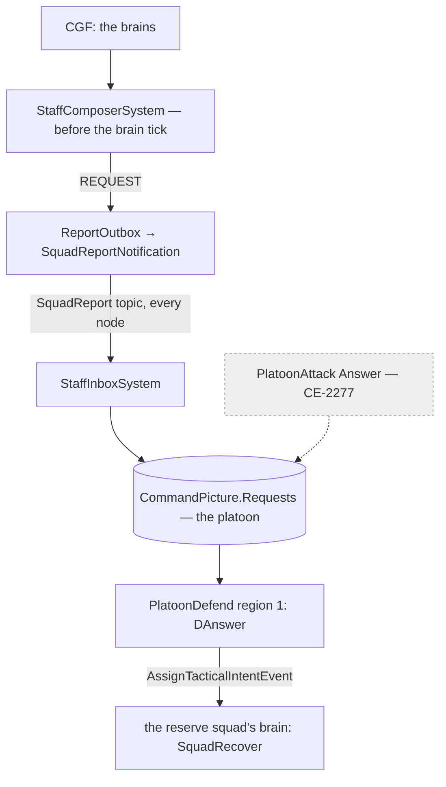
*What the picture shows that prose hid:* nothing new runs per frame; the attack's Answer (dashed) will read the same picture through the
same ops when `CE-2277` lands.

| id | decision (⭐ lean) | rejected — one line each |
|---|---|---|
| **RQ-1** | **who asks**: the staff composer, for every unit that reports — a member alive and incapacitated ⇒ REQUEST Casevac, once per man (`ReportOutbox.CasevacAsked`); the squad's own buddy aid (its SOP's casualty care) goes on, the casevac takes him from there. ⚠ **a deviation from CB-47** ("the play sends REQUESTs"): the 9-line is a standing procedure, not a play's choice | each play sends it: a casualty during `SquadMarch` (or any play that forgets) is never asked for |
| **RQ-2** | **the request names the casualty**: the queued report carries a `Subject`; the flush sets the notification's; the inbox keeps it as `PendingRequest.SubjectNetId` (a network id — the picture is replicated) | by position only: the answering squad would have to find him |
| **RQ-3** | **who answers (defend)**: `PlatoonDefend`'s control region gains DAnswer — a pending Casevac and a FREE reserve (not committed by Reinforce, not on another casevac) ⇒ `SquadRecover {casualty, to: the reserve's own point, putDown}`; the request is answered at once (`CommandPictureOps.Answered`). No free reserve ⇒ it waits | a line squad nearest the casualty: it leaves its slice of the line |
| **RQ-4** | **the reserve comes back**: on its PROGRESS Set or TaskFailed after the casevac order, the slot goes dirty and `KeepDefence` orders it to its post (`Stands` is only "recorded this run") | trust `Stands`: the reserve would stand at the collection point for good |
| **RQ-5** | **once**: a man asked for is not asked for again, even if a second squad's man lies next to him; a man who dies is not asked for (dead is not a casualty to carry) | ask every frame: the platoon's four request slots fill in a second |
| **RQ-6** | **the attack's Answer** (Platoon §4) uses the same ops with `CE-2277`; FireSupport / Reinforce answers are the headquarters play's (step 6) | build them now: no play to answer them yet |

**Slice.** RQ-1…RQ-5; rails: the composer's request (once per man, its subject, the flush's Subject), the inbox keeping the subject,
`PlatoonDefend` answering with the reserve and re-ordering it on its Set, a second request waiting while the reserve is out. ⛔ Not in
it: a live demo (folds into `pc-defend-house`, step 7), the attack's Answer.

### 8c-a. As built *(2026-10-19 — RQ-1…RQ-5; the diagrams above hold)*

| piece | where | as built |
|---|---|---|
| the ask | `StaffComposerSystem.ComposeCasevac` | each roster slot: alive and incapacitated, bit unset ⇒ REQUEST Casevac {At = where he lies, Count 1}, subject him; the bit set (`ReportOutbox.CasevacAsked`) |
| the subject | `QueuedReport.Subject` → `SquadReportNotification.Subject` (Flush) → `PendingRequest.SubjectNetId` (`Fold(…, subject)`) | `ReportQueue.Enqueue` gained an optional `subject`; the wire already carried `Subject` (`CE-3250`) |
| the close | `CommandPictureOps.Answered` · `FirstRequest` | the request leaves the picture when ANSWERED |
| the answer | `PlatoonDefend` region 1: `DWatch → DAnswer` (`CasevacPending`) → `AnswerCasevac` → `DWatch` (`Handled`) | the free reserve gets `SquadRecover {casualty, to: its own point, putDown}`; `Casevac[slot] = 1` |
| the return | `KeepDefence` | a slot out on a casevac is skipped until its PROGRESS is Set or TaskFailed, then goes dirty and is ordered to its post |

⚠ **Choices the leans did not settle — measured or argued:**

| choice | why |
|---|---|
| a man **back in the fight** clears his bit | so the same man down a second time is asked for again (RQ-5 says once per *casualty*); a dead man keeps it |
| the answer is **not** tier-gated (`p.Controls`) | DA-65 gates the *tactical* control states; fetching a casualty is a standing duty, so a Militia platoon answers too |
| not while **falling back**; **per reserve**, not per platoon: a reserve on the line (`Reinforce` makes it Line) or at the stair (`BlockStair` marks it `Spent`) is not free, a second reserve still is | the fall-back gives the reserve its covering order. 📌 a first build tested the platoon-wide `Committed` latch; a mutant (dropping it) survived and showed why it was wrong — with two reserves, the free one never answered |
| a request **naming nobody** is answered with no order | an HTTP-injected request (`ReportInjection`) may carry no subject; there is no one to fetch, and leaving it would fill the four slots |
| a reserve **out on a casevac is not free** for `BlockStair` either | `FreeReserve` excludes it — one reserve, one job |
| ⚠ two requests back to back: the reserve is re-ordered to its post, then at once to the second casevac | the return and the answer are separate states; the churn is one extra order per request, accepted |

Rails `SquadManeuverTests.CE2305_RQ1_*`, `CE2305_RQ3_*` ×2 — mutants: see the tracker row. ⛔ Not live yet (`pc-defend-house`, step 7).

## 8d. The headquarters — FireSupport and Reinforce answered with support assets *(`CE-2309`…`CE-2312`, behaviors, 2026-10-19 — Urban Battle §4 ①②③, §5 step 6; build-state: BUILT — §8d-a; leans HQ-1…HQ-9, built under the user's "go ahead autonomously")*

📐 **Measured first (INVENTORY, 2026-10-19 — grep `RequestKind\.(FireSupport|Reinforce)` / `Headquarters` / `ArmedSearch` over
`FDP/Toolkits` and `Hrot.AI.Behaviors` ⇒ only the enum values; reads of `StaffSystems.cs`, `CommandComponents.cs`, `CommandReports.cs`
(`ElementEquipment` = MG · Sniper · AT · Vehicle, **never set by the composer**), `SoundContactEvent` (it reaches the brain node with its
`SourceClass`, `AudioTargetDetectedIngressTranslator`), `AirDefenceNodes.CanEngageAir`, `AirOrderNodes.FlyTo`, `AirAttackNodes.Run`
(an entity attack succeeds when the entity is destroyed), `DroneTargets.Pick`, `CommandOrders.StillRunning`, `Locomotions.Of`; the corpus:
Urban Battle §1 beats 4–8, §3 route B, §4; backend's `NOTE_Backend_To_Behaviors_Urban_Battle_Data` (BR-14: a mortar's launch carries 1.5–2.5
km, R-3023: a soldier hears it past his ear range)):** a soldier now HEARS a mortar's launch far off, ⛔ but nothing turns it into a report;
an element's equipment is never filled in; ⛔ nothing sends FireSupport or Reinforce, and ⛔ nothing answers them; an aircraft strikes a
named POINT or ENTITY, ⛔ it cannot search an area for targets.

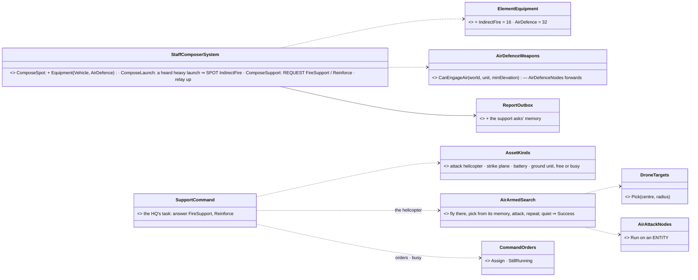
*What the picture shows that prose hid:* route B is three report rules in the SENDER's staff (hear → SPOT, see the flags, ask) and one
new commander play; the assets run behaviours that exist (strike, battery fire mission) plus one (armed search) built on the aircraft
attack that exists.

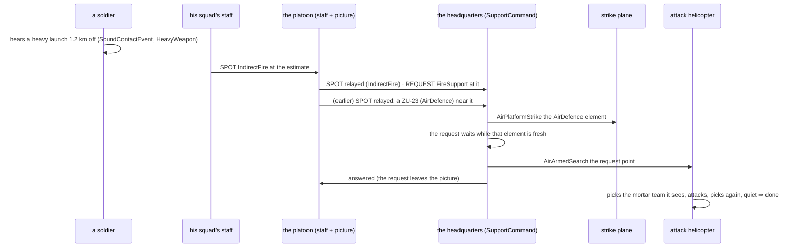
*What the picture shows that prose hid:* the headquarters never sees the mortar — only a reported point and a flag — and nothing goes to
it on a clock: every arrow into an asset follows a report.

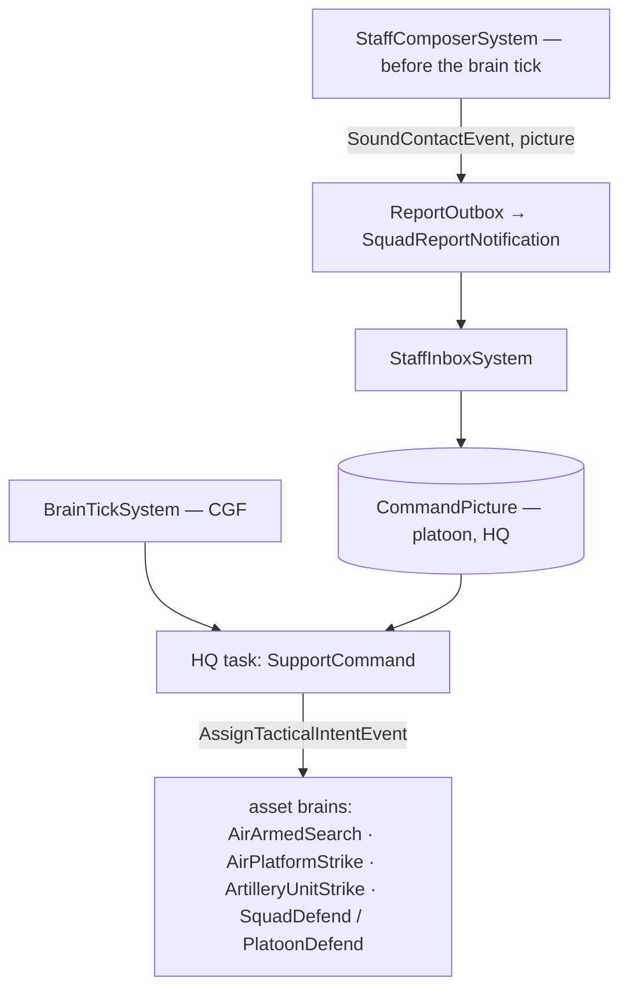
*Caption:* nothing new is scheduled — one more composer rule set before the brain tick, one more task on the HQ's brain.

| id | decision (⭐ lean) | rejected — one line each |
|---|---|---|
| **HQ-1** | **a heard launch is a SPOT** (② `CE-2309`): the composer reads this frame's `SoundContactEvent`s; a SHOT of class `HeavyWeapon` heard by one of its members from **≥ 1000 m** ⇒ SPOT {the estimate, its radius, Count 1, Equipment `IndirectFire`}, once per 30 s within 150 m of the last one. 📐 Why 1000 m: BR-14 gives the HMG (1 km), the ZU-23 (1.5 km), the launchers and the tubes ONE class, `HeavyWeapon` — beyond 1 km only the ZU-23's cannon and the tubes are heard ⇒ ⚠ a ZU-23 firing 1–1.5 km off reads as a mortar (a distinct `Artillery` class would end it — a backend data question, noted) | the battery's ground truth: the point is that it is HEARD · ≥ 300 m: every HMG in the fight would be a mortar · counter-battery radar (IF-6): later |
| **HQ-2** | **a SPOT says what it saw** (② `CE-2309`): the element's Equipment ORs, over its IDENTIFIED contacts, `Vehicle` (`VehicleCover.IsVehicle`) and `AirDefence` (`AirDefenceWeapons.CanEngageAir` at 80°, moved to the toolkit from `AirDefenceNodes`, which forwards) | flags read off unidentified sounds: a heard engine is not a ZU-23 |
| **HQ-3** | **the platoon relays what support needs** (① `CE-2310`): a commander with a superior relays every picture element flagged `IndirectFire` or `AirDefence` as its own SPOT (once per element place, 150 m) — not every element: the HQ needs only these | relay the whole picture: the HQ's eight element slots fill with infantry it does nothing about |
| **HQ-4** | **FireSupport is asked** (① `CE-2310`): a commander with a superior whose picture holds a fresh (60 s) `IndirectFire` element ⇒ REQUEST FireSupport at it, once per 120 s within 300 m | every element: the HQ would fire on every rifleman |
| **HQ-5** | **Reinforce is asked** (① `CE-2310`): its strength (`StrengthOf`) Red or worse while its picture holds a fresh element within 300 m ⇒ REQUEST Reinforce at its own position, once per 180 s | on Black only: too late to help |
| **HQ-6** | **the headquarters** (① `CE-2312`): a library task `SupportCommand` on a body-less HQ unit whose roster holds the platoons and the ASSETS; an asset is BUSY while it still runs the order the HQ gave it (`CommandOrders.StillRunning`) | a new unit type: any commander may run it · a "busy" bit set and cleared by reports: an aircraft has no staff and sends none |
| **HQ-7** | **FireSupport's answer**: an `AirDefence` element fresh within 2 km of the point and a free strike PLANE ⇒ the plane `AirPlatformStrike`s that element first, the request waits while it stays fresh; then a free attack HELICOPTER ⇒ `AirArmedSearch` the point; else a free BATTERY ⇒ `ArtilleryUnitStrike` fire for effect on it; else it waits | the battery first: a mortar team moves after its first rounds; the helicopter searches · ignore the air defence: Urban Battle beat 6 |
| **HQ-8** | **Reinforce's answer**: a free ground unit (not the requester) ⇒ `PlatoonDefend` / `SquadDefend` {the request's point, 60 / 40 m} — it joins the defence there | an air assault: the landing is a mission of its own (built, `ua-air-assault`), for a later rung |
| **HQ-9** | **armed search** (③ `CE-2311`): library `AirArmedSearch {Location, RadiusM 400, QuietSeconds 60, HeightAgl 150}` — `FlyTo` the point; on the way and over it, `DroneTargets.Pick` its own memory within the radius; a pick ⇒ `AirAttackNodes.Run` on it until destroyed, then pick again; nothing for `QuietSeconds` over the point ⇒ Success; no weapon left ⇒ Failure | a point strike: a reported mortar point is wrong by 100 m and the team moves |

### 8d-a. As built *(2026-10-19 — the diagrams above hold; `CE-2309`…`CE-2312`)*

| piece | where | as built |
|---|---|---|
| the launch SPOT (HQ-1) | `StaffComposerSystem.ComposeLaunch` + `IsLaunch` | this frame's `SoundContactEvent`s, grouped by the listener's commander; Shot · `HeavyWeapon` · ≥ `LaunchHeardMetres` (1000) ⇒ SPOT {estimate, radius, Count 1, Individual, `IndirectFire`}; once per 30 s within 150 m (`ReportOutbox.LaunchAt`) |
| the SPOT's flags (HQ-2) | `StaffComposerSystem.EquipmentOf` · `AirDefenceWeapons` (MOVED to `Fdp.Toolkits/Combat`; `AirDefenceNodes.CanEngageAir` forwards) | ORed over IDENTIFIED pool contacts: `Vehicle`, `AirDefence` (80°); a change of flags is news (`ReportOutbox.SpotEquipment`) |
| the relay (HQ-3) | `StaffComposerSystem.ComposeSupport` → `Relay` | picture elements flagged `IndirectFire` / `AirDefence`, fresh 60 s, SPOTted up with their OWN `ObservedAt`, once per flag within 150 m (`ReportOutbox.Relayed`, a fixed list of 4) |
| FireSupport (HQ-4) | same | the first fresh `IndirectFire` element ⇒ REQUEST FireSupport at it; again only after 120 s or 300 m off (`SupportAskedAt`/`Time`) |
| Reinforce (HQ-5) | same | `StrengthOf` Red / Black AND a fresh (30 s) element within 300 m of `CentreOf` (its position, else its members' middle) ⇒ REQUEST Reinforce at `CentreOf`; once per 180 s |

⚠ **Choices the leans did not settle:** the launch distance is 1000 m (the HQ-1 row, measured on BR-14's figures); the relay keeps the
element's observation time, so a superior ages it as its sender does; the composer runs ComposeSupport for every commander that HAS a picture,
so a squad (no picture) never asks.

Rails (the staff suite, `SquadManeuverTests`): `CE2309_AHeavyLaunchHeardFarOff_*`, `CE2309_ASpotOfAVehicle_*`,
`AirDefenceNodesTests.CE2309_ASpotSaysWhatItSaw_*`, `CE2310_APlatoonRelays*`, `CE2310_APlatoonDownToOneSquad_*` — mutants: see the tracker rows.

**`CE-2311`, `CE-2312` as built:**

| piece | where | as built |
|---|---|---|
| the armed search (HQ-9) | `Brains/AirArmedSearchBehavior.cs` · `Orders.AirArmedSearchOrder` · `BehaviorNames.AirArmedSearch` | a StatefulAction: attacking (`AirAttackNodes.Run` on the pick; Success = destroyed ⇒ back over the area, the quiet restarts; Failure ⇒ Failure) · else `DroneTargets.Pick(centre, radius)` ⇒ attack · else `AirOrderNodes.FlyTo` the centre at `HeightAgl`; arrived ⇒ the quiet starts; `QuietSeconds` of it ⇒ Success |
| busy | `CommandOrders.Busy` (`CommandNodes.cs`) | the commander's ticking run gave the member an order and the member still runs a task from its superior — and, in `SupportCommand`, an order given in the last 2 s (`OrderGraceSeconds`: the brain takes it next frame) |
| the HQ (HQ-6…HQ-8) | `Brains/SupportCommandBehavior.cs` · `Orders.SupportCommandParamsJsonDto` · `BehaviorNames.SupportCommand` | a StatefulAction each tick: the oldest FireSupport — an AirDefence element fresh (120 s) within 2 km ⇒ a free strike PLANE gets `Order.Strike` on it and the request waits; else a free attack HELICOPTER `AirArmedSearch`es the point, else a free BATTERY gets `Order.Strike` FFE on it; answered when sent. The oldest Reinforce — a free ground unit (not the requester: its `FromNetId`) gets `PlatoonDefend` (a unit of units, 60 m) / `SquadDefend` (40 m) at the request's point |
| what an asset is | `SupportCommandBehavior.KindOf` | a unit: `Unit_ArtilleryBattery` ⇒ Battery, else GroundUnit; else a mount-0 weapon AND `Locomotions.Of` Rotorcraft ⇒ AttackHelicopter, FixedWing ⇒ StrikePlane |

⚠ **Choices the leans did not settle:** the battery and the plane are given the ORDER `Strike` (their class picks `ArtilleryUnitStrike` /
`AirPlatformStrike`), the helicopter the behaviour by name (there is no armed-search order kind); an asset a REACTION took (an evading
helicopter's SOP row) reads free — accepted for v1; the HQ is any commander running the task (no new unit type).

Rails `AirAttackNodesTests.CE2311_*` (the air suite) · `SquadManeuverTests.CE2312_*` ×3 (the platoon harness as the HQ) — mutants: see the
tracker rows. ⛔ Not live yet (the urban demo ladder, step 8).

**Slices.** `CE-2309` (HQ-1, HQ-2) → `CE-2310` (HQ-3…HQ-5) → `CE-2311` (HQ-9) → `CE-2312` (HQ-6…HQ-8). Rails in the staff suite (the
composer's SPOT and REQUESTs), the air suite (the armed search), the platoon suite (the HQ). ⛔ Not in them: an air-assault answer, Casevac by
air, the live rung (the demo ladder, step 8).

