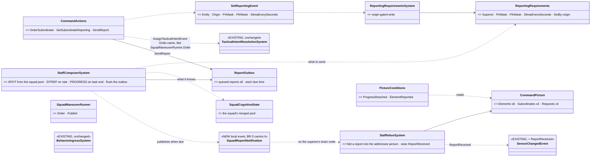
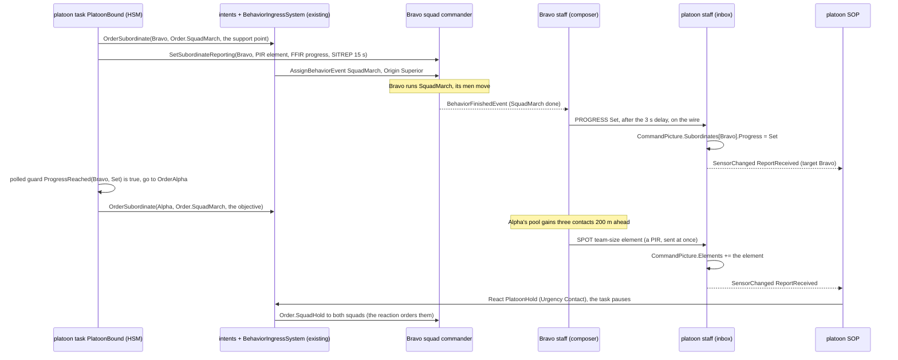
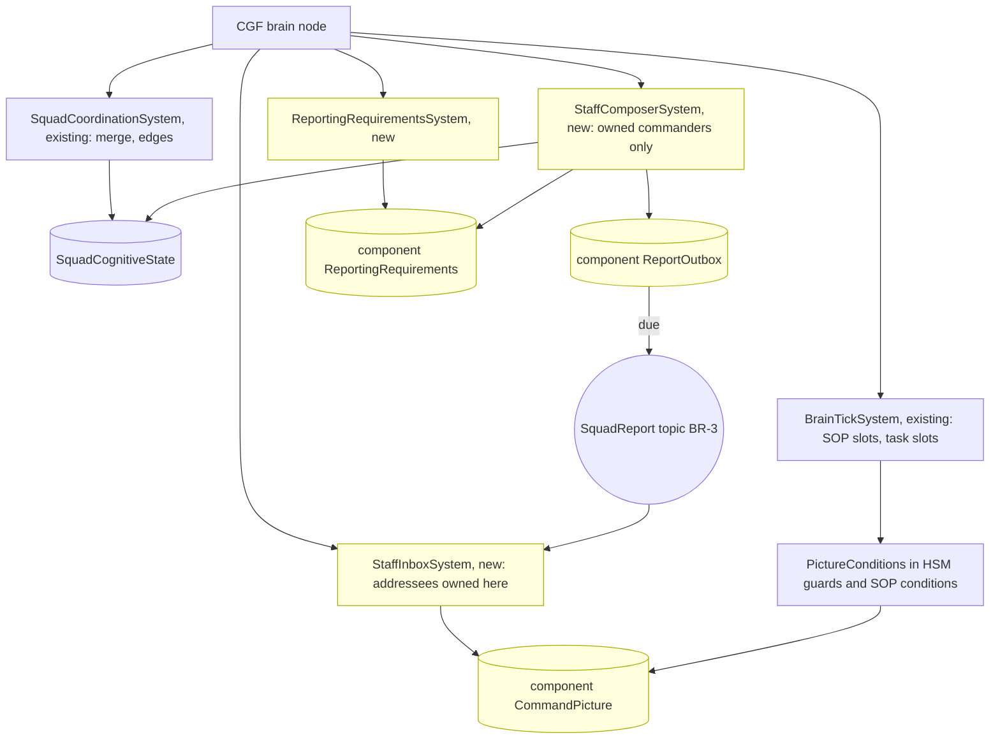

<!--STATUS
state: LIVE
updated: 2026-10-18
build-state: DESIGN — leans CC-1…CC-7 awaiting the user; nothing built
current-answer: §1 the example · §1a where each piece lives (by scope) · §2 INVENTORY · §3–§5 the diagrams · §6 the code shapes · §7 decisions · §8 slices and the check
stale-below: nothing.
known-rot: none.
known-conflict: docs/designs/group-maneuvers/DESIGN_Building_Clearing.md CB-33 (reported contacts into the commander's TargetMemory) and CB-42 (requirements inside the order, stamped by the ingress) are revised by CC-1 and CC-2
related-designs:
  - docs/REFERENCE_Command_Building_Blocks_Measured.md — the measured blocks this example is built from, symbol by symbol
  - docs/designs/group-maneuvers/DESIGN_Building_Clearing.md — §5b–§5d OWN the report concept (kinds, ageing, staff, routes to a decision); this is its first concrete form
  - docs/designs/group-maneuvers/DESIGN_Defend_And_Attack_Position.md — the platoon plays that will use this machinery
  - docs/blueprints/Architect_Question_87_Unit_Memory.md — OWNS unit memory (R-237) and the §4 rule CC-1 follows (engine-written entity-wide data → a component)
  - docs/DESIGN_Decision_Layer.md — OWNS task · SOP · reaction (§4) and ROE (§4.4, the pattern CC-2 copies)
  - docs/designs/group-maneuvers/DESIGN_Squad_Tactics.md — OWNS the squad runner, SquadMarch and the body-less commander (§7)
-->

# A two-level command chain, worked through on the engine's own blocks *(behaviors, `2026-10-18`)*

🔒 User, `2026-10-18`: *"everything the entity brain knows must be stored in its blackboard components as blackboard variables or
separate slots … What is the order? Today we support orders as a behavior requests coming with parameters … What do you mean by a gate
that can admit the order, how that could be implemented in our engine. I think we should develop some very simple example of how that
could work in the engine. On a very simple use case of multi-level command structure using the building blocks and means our engine
supports."*

**The decision in one line (lean):** each piece of knowledge lives at the SCOPE it belongs to (R-2042): what a commander knows as a
unit — its `CommandPicture` (what its subordinates reported) and the `ReportingRequirements` its superior set — is a **component**
(one per entity, written by two small **staff** systems, like `Roe` and `SquadCognitiveState`); what one running play tracks for
itself is in **that play's own slots**; both are read by ordinary `[SharedAiCondition]` guards. Report requests travel like ROE does today: **their own event, beside the
order**, so no behaviour's params DTO changes. Everything else — orders, the gate, the SOP, HSM polled guards, the squad's own merge —
is used exactly as it is.

## 1. The example — `cc-platoon-bound`

A platoon commander (body-less) with two squads, **Alpha** and **Bravo** (body-less commanders, four soldiers each), on open ground.
The platoon's task: Bravo moves to a support position; when it reports **SET**, Alpha moves to the objective. If either squad reports
an enemy element, the platoon's SOP stops the task and orders both squads to hold.

| level | entity | its task | its SOP | its knowledge |
|---|---|---|---|---|
| platoon | `Unit_InfantryPlatoon` (SL-0), body-less | 🆕 `PlatoonBound` — an HSM | 🆕 `BasicPlatoonSop` — a BTree like `BasicSquadSop` | 🆕 `[UnitMemory] CommandPicture` |
| squad | `Unit_InfantrySquad` (302), body-less | ✅ `SquadMarch` (exists), given by the platoon | ✅ `BasicSquadSop` | ✅ `SquadCognitiveState` pool (the merge) + 🆕 `[UnitMemory] ReportingRequirements` |
| soldier | rifleman | ✅ what `SquadMarch` orders him | ✅ `BasicInfantrySop` | ✅ `TargetMemory` |

### 1a. Where each piece lives — by scope, not by kind *(R-2042)*

🔒 User, `2026-10-18`: *"components are one single instance on the entity, but the slots in the blackboard can be assigned for any
single behavior that is running in parallel on the same entity."*

| scope | the engine's place for it | measured | in this example |
|---|---|---|---|
| **the entity** — true whichever behaviour runs, written by a system | a **component** (one instance per entity) | `Roe`, `TargetMemory`, `SquadCognitiveState`, `DangerAreaCognitiveBuffer`; AQ87 §4: *"engine systems (non-behaviour code needs it) → an ECS component"* | `CommandPicture` · `ReportingRequirements` · `ReportOutbox` |
| **the entity**, written and read by behaviours only | **unit memory** — one `[UnitMemory]` slot per type in the entity's blackboard store, shared by all its behaviours | `UnitMemory.Ref<T>(world, unit)`, `FiringPositionMemory` | — (nothing here is behaviour-only and entity-wide) |
| **one running behaviour** — the task, a paused task, a reaction, a hosted sub-behaviour, an HSM state | **its own occurrence slots** (params, working state; per HSM state; nested for hosted children) | `OccurrenceSlotKey` (`ComputeRootParamsKey`, `ComputeHsmStateKey`, `ComputeNested`) | `PlatoonBound`'s own working state: which squad it is waiting for, which orders IT gave, the requirements IT set (so it can withdraw them when it ends) · `PlatoonHold`'s own |
| **the hierarchy** | **one entity per commander** — every level is its own entity with its own components and slots | `UnitRoster`, `UnitSubordinate`, body-less commanders (R-272) | platoon, Alpha, Bravo each hold their own picture; nothing is shared across levels except by order and report |

⇒ The task and the reaction that pauses it both read ONE `CommandPicture` (the unit's knowledge), but each keeps its own progress in
its own slots — which is exactly why a reaction can run without disturbing the paused task's state.

## 2. INVENTORY *(the measured blocks — full detail, symbols and queries in [REFERENCE_Command_Building_Blocks_Measured](../../REFERENCE_Command_Building_Blocks_Measured.md))*

| need | exists | gap |
|---|---|---|
| knowledge of one unit, written by a system | ✅ a component (`Roe`, `SquadCognitiveState`); unit memory for behaviour-only shared data (`UnitMemory.Ref<T>`) | the three components (§1a) |
| a commander ordering a subordinate commander | ✅ `SquadManeuverRunner.Order` → `AssignTacticalIntentEvent{IntentId = "Order.<name>"}`, recorded in `SubordinateOrders`; `TacticalIntentResolutionSystem` turns it into an `AssignBehaviorEvent` on the subordinate | an HSM-callable action doing the same |
| the gate | ✅ `BehaviorIngressSystem`: Admit → PauseRecord → Start → AfterAdmitted; `PausedTask`; `ResumePausedTask`; ⛔ no general admit hook | — (CC-3: not needed) |
| something delivered with an order but not in its params | ✅ ROE: `SetRoeEvent` → `RoeSystem.Apply`, origin-gated, persists across tasks | the requirements twin |
| a system raising senses on a commander | ✅ `SquadSensing` publishes `SensorChangedEvent{Unit = commander, …}` from `SquadCoordinationSystem` (owned commanders only) | `ReportReceived` |
| a system writing, behaviours reading | ✅ `DangerAreaSensorSystem` → `DangerAreaCognitiveBuffer` → condition `DangerAreaAhead`, utility input | the staff |
| SOP reacting to an edge | ✅ `BasicSquadSop.btree.json`: `SensedFresh(…)` → `SopOrder{React}` → `SopActions.React` → `AssignBehaviorEvent{Origin = Reaction}` | the platoon's SOP asset |
| a guard reading the entity | ✅ `[SharedAiCondition] static bool G(ref P p, Entity self, EntityRepository world)`, polled (`CivilianBehavior`) | the picture guards |
| a task ending | ✅ `BehaviorFinishedEvent` (published by `BrainTickSystem`) | — (the staff reads it, CC-5) |
| the report on the wire | 🆕 designed: BR-3 `SquadReport` (backend, unstarted) | — |

## 3. Classes


*What the picture shows that prose hid:* every new box is either a component (the unit's knowledge, §1a) or a small system
or node that reads and writes those structs. Nothing new touches the gate, the intent resolution or the squad's merge: the platoon
orders a squad exactly the way `SquadManeuverRunner.Order` already does.

## 4. One run, end to end


*What the picture shows that prose hid:* the plan advances on a GUARD reading the picture, and the interrupt arrives through the SOP —
the two existing ways a brain changes course. Reports never enter a behaviour directly; they change a component struct, and the
behaviour notices on its next tick (or is woken by the edge).

## 5. Who runs it each frame


*Caption:* the staff runs as plain ECS systems in the Simulation phase on the brain node that owns the commander (the same ownership
filter `SquadCoordinationSystem` uses), BEFORE `BrainTickSystem`, so a report folded this frame is seen by this frame's guards. ⚠
Not reached today: no platoon has ever run over squads (SL-0, `CE-2262`, makes it run first); the topic is backend's BR-3.

## 6. The code shapes *(sketches — names final, bodies not)*

```csharp
// Fdp.Toolkits/Squad/Command — unit-scope knowledge written by systems ⇒ components (§1a); three new ids in GlobalComponentIds.
[ComponentId(GlobalComponentIds.CommandPicture)] public struct CommandPicture   // on the commander that RECEIVES reports
{
    public ReportedElements Elements;               // [InlineArray(8)] of ReportedElement
    public SubordinateRows  Subordinates;           // [InlineArray(4)] of SubordinateRow
    public PendingRequests  Requests;               // [InlineArray(4)] of PendingRequest
}
public struct ReportedElement { public Vector3 At; public float Radius; public byte Count, SizeClass, Activity, Equipment;
                                public uint FromNetId; public float ObservedAt; public uint Seq; }
public struct SubordinateRow  { public uint UnitNetId; public byte Progress, Strength, Ammo, Phase; public float LastSitrepAt; }

[ComponentId(GlobalComponentIds.ReportingRequirements)] public struct ReportingRequirements   // on the commander that SENDS reports
{
    public uint SuperiorNetId; public uint PirMask; public uint FfirMask; public float SitrepEverySeconds; public byte SetByOrigin;
}

public struct SetReportingEvent                      // the SetRoeEvent twin
{ public Entity Entity; public BehaviorOrigin Origin; public uint PirMask, FfirMask; public float SitrepEverySeconds; }

// The nodes — the same [SharedAi*] shapes every BTree / HSM / blueprint already binds.
[SharedAiCondition] public static bool ProgressReached(ref ProgressReachedParams p, Entity self, EntityRepository world)
    => world.HasComponent<CommandPicture>(self) && world.GetComponentRO<CommandPicture>(self).Progress(p.Subordinate) >= p.Progress;
[SharedAiCondition] public static bool ElementReported(ref ElementReportedParams p, Entity self, EntityRepository world);
[SharedAiAction]    public static NodeStatus OrderSubordinate(ref OrderSubordinateParams p, Entity self, EntityRepository world);
[SharedAiAction]    public static NodeStatus SetSubordinateReporting(ref SetReportingParams p, Entity self, EntityRepository world);
[SharedAiAction]    public static NodeStatus SendReport(ref SendReportParams p, Entity self, EntityRepository world);
```

| the platoon's task `PlatoonBound` (HSM, one region) | entry action | polled guard out |
|---|---|---|
| `OrderBravo` | `OrderSubordinate(Bravo, Order.SquadMarch, support point)` + `SetSubordinateReporting(Bravo, …)` | always → `WaitBravo` |
| `WaitBravo` | — | `ProgressReached(Bravo, Set)` → `OrderAlpha` |
| `OrderAlpha` | the same for Alpha → objective | always → `WaitAlpha` |
| `WaitAlpha` | — | `ProgressReached(Alpha, Set)` → `Done` (the task finishes) |

| the platoon's SOP `BasicPlatoonSop` (BTree, the `BasicSquadSop` shape) | |
|---|---|
| `Sequence( SensedFresh(reportReceived) , ElementReported(size ≥ team, within 400 m) , SopOrder{React PlatoonHold, Contact} )` | `PlatoonHold` orders both squads `Order.SquadHold` and ends when no element is fresh for 30 s; the task resumes at its state |

## 7. Decisions *(⭐ leans — for the user)*

| id | decision | ⭐ lean | rejected — one line each |
|---|---|---|---|
| **CC-1** | where a commander's knowledge lives | ⭐ **by scope (R-2042, §1a)**: the unit's knowledge — `CommandPicture`, `ReportingRequirements`, `ReportOutbox` — is three **components** on the commander (written by the staff systems; AQ87 §4's rule; the `Roe` / `SquadCognitiveState` precedent); each play's own tracking is in **its own slots**; unit memory stays for behaviour-only shared data. ⚠ Revises Building Clearing CB-33: reported elements go into `CommandPicture`, not into a `TargetMemory` on the commander. ⚠ Costs three component ids | unit memory for staff-written data (the first lean, after R-2041 as first worded): it puts system-owned state in the behaviours' store, and AQ87 §4 already ruled the other way · the commander's `TargetMemory`: perception's component, with perception's rules |
| **CC-2** | how report requests reach a subordinate | ⭐ **the ROE pattern**: a `SetReportingEvent` sent with the order (or on its own), applied by `ReportingRequirementsSystem` into the subordinate's `ReportingRequirements`, origin-gated like `RoeSystem`, persisting across tasks; sent by the node `SetSubordinateReporting` | inside every play's params DTO (CB-42 as written): each behaviour would have to carry it, and there is no admit hook to lift it out · a component stamped by the gate: the gate has no general hook, and adding one is a change to the most-shared system for one feature |
| **CC-3** | the gate | ⭐ **unchanged** — "the gate" is `BehaviorIngressSystem`, which already admits, pauses and resumes; nothing here needs it to know about reports | an admit hook: not needed once CC-2 copies ROE |
| **CC-4** | ordering a subordinate commander from an HSM / BTree / blueprint | ⭐ a shared action `OrderSubordinate(unit, orderName, json)` doing exactly what `SquadManeuverRunner.Order` does (`AssignTacticalIntentEvent{Order.<name>, Superior}` + `SubordinateOrders`), the runner calling the same helper | a second order path: two ways to order a unit, released differently |
| **CC-5** | the first reports the staff sends without any play changing | ⭐ **PROGRESS on the task's end** (`BehaviorFinishedEvent` of the commander's task ⇒ `PROGRESS Set`), **SPOT** from the squad pool when a new element appears (a PIR), **SITREP** on the requested rate — so `SquadMarch`, unchanged, already reports SET | requiring every play to call `SendReport` for SET: every existing play would need editing first |
| **CC-6** | when the staff runs | ⭐ Simulation phase on the brain node owning the commander (the `SquadCoordinationSystem` filter), before `BrainTickSystem`; the inbox applies every report addressed to a commander owned here | in a behaviour: a report would be lost while a different state runs |
| **CC-7** | the example's scope | ⭐ exactly §1: two squads, `SquadMarch`, `SquadHold`, one HSM task, one SOP row, PROGRESS / SPOT / SITREP only — the smallest run that exercises orders down, requirements down, reports up, a guard advancing the plan and the SOP interrupting it | the full building attack first: every part at once, nothing provable on its own |

## 8. Slices and the check

| order | slice | what | needs |
|---|---|---|---|
| 1 | **CC-A** | the three components (+ ids); `SetReportingEvent` + `ReportingRequirementsSystem`; rails: the picture survives a behaviour switch and a reaction; the play's own slots do not leak into the reaction; an origin below the setter's is refused | — |
| 2 | **CC-B** | `OrderSubordinate` (sharing `SquadManeuverRunner.Order`'s helper), `SetSubordinateReporting`, `SendReport`, `ProgressReached`, `ElementReported` | CC-A |
| 3 | **CC-C** | `StaffComposerSystem` (PROGRESS on task end, SPOT from the pool, SITREP) + `StaffInboxSystem` (fold, `ReportReceived`) — first on ONE node with a local loopback of the notification, so it is provable before BR-3 | CC-A, SL-0 |
| 4 | **CC-D** | `PlatoonBound` (HSM) + `BasicPlatoonSop` + `PlatoonHold`; the scenario `cc-platoon-bound`; then on the wire once BR-3 lands | CC-B, CC-C |

**`cc-platoon-bound` must end with:** ① Bravo reaches its point and the platoon's picture shows `Bravo: Set` within 3 s (+ one frame) of
Bravo's `SquadMarch` finishing · ② only THEN is Alpha ordered (`SubordinateOrders` on the platoon) · ③ when Alpha's pool first holds the
enemy, ONE `SPOT` reaches the platoon (not one per contact) · ④ the platoon's SOP starts `PlatoonHold`, both squads hold, the task is
paused, and it resumes in `WaitAlpha` when the element goes stale · ⑤ every report is visible over HTTP (`GET /squad/reports`) with its
`ObservedAt` and arrival time.
