<!--STATUS
state: LIVE
updated: 2026-10-21 (§8f.2 measured: the base of fire on a low berm, CE-2342…CE-2346) · 2026-10-19
build-state: BUILDING — DA-A ✅ BUILT 2026-10-19 (§8a, CE-2273) · DA-C ✅ BUILT 2026-10-19 (§8b, CE-2274) · DA-L ✅ BUILT 2026-10-19 (§13c, CE-2282; leans DA-26…DA-30 ✅ APPROVED 2026-10-19, R-2054) · READY-TO-BUILD — DA-1…DA-16 ✅ APPROVED 2026-10-18 (R-2035; DA-9 amended: ClearBuilding stays its own order, §10) · DA-17…DA-23 ✅ APPROVED 2026-10-18 (R-2036); DA-24 ✅ APPROVED (R-2038); DA-25 (§13b, the WorldSurvey sensor) amended by the user (R-2038: standing sensor, rooms derived by the sensor) — taken as approved as amended; R-2037 (the brain never reads world geometry) ruled; tracker CE-2273…CE-2285; backend frame docs/blueprints/batches/HANDOFF_Behaviors_To_Backend_Defend_And_Attack.md (BR-6…BR-11); nothing built
current-answer: §1 doctrine · §2 INVENTORY · §3–§5 the diagrams · §6 decisions · §7 edge cases · §8 slices · §9 demos · §10 presets · §11 composing the commander · §12 roles · §13 sectors · §14 sensors · §15 every behaviour · §16 the roof · §17 test scenarios
stale-below: ⛔ HISTORY at the end (the superseded synchronous §13b).
known-rot: §3 / §4 / §15 name PlatoonPicture and the report kinds PostsManned · Displacing · SniperContact · PhaseLine · Foothold · ObjectiveTaken — now CommandPicture (CC-1) and the closed PROGRESS / SPOT set (CB-43; DESIGN_Platoon_Attack_Defend_Clear PC-2/PC-4); DA-7's ROE lift on a squad does not reach its men today (RoeOf is per entity) — PC-6 / CE-2289; DA-9's "AttackPositionPlay ISquadPlay" is an HSM asset (PC-1). §17 `tq-urban-ambush-counterattack` is set in test-town, whose 6 buildings are SOLID prisms (no interior) — it cannot clear there; the platoon demos move it, `tq-military-attack-defended` and `tq-police-arrest-surprise` to the new terrain cqb-village (DESIGN_Platoon_Attack_Defend_Clear §12, PC-12).
known-conflict: none — the Building Clearing platoon play is RESOLVED as the ClearBuilding preset (§10, R-2035).
related-designs:
  - docs/blueprints/Architect_Question_94_Brain_Geometry_Sites.md — backend's answer to §13b for ITS sites (CE-2287): the home of each (the fire gates into the muscle's fire pipeline, the danger-area sight into its sensor, door approach and spawn level on the muscle), leans for the user
  - docs/DESIGN_World_Survey_Sensor.md — (backend, CE-3249) OWNS how DA-25's WorldSurvey is built: the road, the answer, the room derivation, the slices
  - docs/designs/group-maneuvers/DESIGN_Platoon_Attack_Defend_Clear.md — the concrete platoon HSMs PlatoonAttack / PlatoonDefend and the six squad plays with roles and the report contract; revises §3/§4 report names (PC-2) and needs PC-6 for DA-7
  - docs/designs/group-maneuvers/DESIGN_Command_Chain_Example.md — the concrete command machinery (CommandPicture, staff, OrderSubordinate) its platoon plays will run on
  - docs/designs/group-maneuvers/DESIGN_Building_Clearing.md — OWNS the clearing drill (rooms, entry, sectors, reports R-2031, EngagementArea, BuildingClearance, the platoon frame SL-0); this design is the ATTACK in front of it and the DEFENCE it meets
  - docs/DESIGN_Temperament_And_Stress.md — OWNS a man's will (RiskAcceptance, Obedience, Nerve, Resolve, stress, the break); this design adds his ABILITY (proficiency) beside it and never merges the two
  - docs/DESIGN_Peek_And_Fire.md — OWNS the expose / hide / relocate cycle (PeekAndFire, WindowDuel, FiringPositionMemory); defenders at windows and attackers behind cover run it, with proficiency setting its timings
  - docs/DESIGN_Building_Interiors.md — OWNS storeys, wall openings, window firing points (§3l), stairs and the roof slab; the defence's building posts are generated from them
  - docs/designs/group-maneuvers/DESIGN_Squad_Tactics.md — OWNS the squad drills (suppress-and-manoeuvre, fire and movement, bounding overwatch, danger crossing, casualty care) the attack's squads run
  - docs/designs/group-maneuvers/Squad_Coordination_Design_v1_1.md — OWNS the roster, roles and fire allocation inside a squad
  - docs/designs/hill-attack/DESIGN.md — the one built platoon commander (R-2022 shoot-and-duck, R-2023 never the same spot twice); its intent dispatch is the precedent for ordering squads
  - docs/blueprints/Architect_Question_85_Hit_Chance.md — OWNS the hit model's spread; DA-2 adds one shooter factor to it
  - docs/blueprints/batches/HANDOFF_Behaviors_To_Backend_Defend_And_Attack.md — the backend frame: spread factor, acquisition by exposure, LMGs and roles on the wire, sniper / DMR / scope, BuildingOf(point), trenches later
  - docs/designs/look-direction/DESIGN_Look_Direction_And_FOV.md — OWNS where a man looks (LD-1…LD-3); the march watch sectors and EngagementArea.WatchBearing point the eyes once it lands
  - docs/DESIGN_Orders_Params_Entity_Classes.md — OWNS R-2003 (a sector is an area entity) and the Designate › Set sector gesture (§13.3, F10); §13a builds the two sector levels on it
  - docs/DESIGN_Decision_Layer.md — OWNS task · SOP · reaction and resume (§4.1, §4.9); §11's town movement is a task and the attack a reaction
  - docs/DESIGN_Operations_Behaviour_Catalogue.md — the catalogue rows SQD-8 / SQD-11 (defend), D7 (trenches) and the building-post templates this design builds
-->

# Defending and attacking a position — from untrained insurgents to a skilled unit *(behaviors, `2026-10-18`)*

🔒 User, `2026-10-18`: *"I would like to design also behaviors for defending certain place including multi story buildings and
corresponding attack tactics. Defenders and attackers skill level needs to be settable from a group of untrained insurgents to a skilled
military unit - it migh drive the tactics chosen by their commanders. Defenders are usually prepared, using varoous cover spots outside
(behinds walls, obstacles, in dug-in holes..) as well as inside (behind windows - lean and peek might apply for observation, quick shot
while in fight), on the roof etc. Attackers need to advance, closing, using cover behind obstacles,busing short peek and shot, flanking
the building etc … Snipers migh help on both sides."* · *"This likely includes multi team coordination"* · *"The attack and building
clear might be connected in natural sequece i guess"*.

**The decision in one line (lean):** a per-man **`CombatProficiency`** (one 0–1 value, five named tiers) that sets how well he shoots,
how briefly he shows himself and how fast he reacts, and that **gates the plays his commander may choose**. On top of it go two
platoon plays: **`DefendPosition`**, which generates prepared posts outside, at windows on every storey and on the roof, with sectors,
a trigger line, alternates and a fall-back; and **`AttackPosition`**, which runs observe → support by fire → approach → isolate →
foothold → clear or assault through → consolidate. For a building, **the clearing already designed becomes the attack's last phases**.
Snipers are a two-man team behaviour used by both sides. Every hand-off between teams rides the networked squad reports (R-2031).

## 1. Doctrine — what real forces do *(US Army ATP 3-21.8 Infantry Platoon and Squad: the defence and the attack chapters; ATP 3-06.11 Combined Arms Operations in Urban Terrain; breaching fundamentals SOSRA: suppress, obscure, secure, reduce, assault; sniper employment, FM 3-22.10 / ATP 3-21.18)*

| | defence | attack |
|---|---|---|
| **the plan** | an engagement area (EA) where the enemy is to be killed · a trigger line where fire opens · each element a **sector** · **primary, alternate, supplementary** positions · an observation post (OP) forward · a reserve · a fall-back route | **isolate** the objective · a **support-by-fire** (SBF) element suppresses it · the **assault** element moves by covered routes, usually to a **flank** · **obscure** with smoke where it must cross open ground · gain a **foothold** · clear · **consolidate** and get ready for the counterattack |
| **buildings** | fight from **inside the room, set back** from the window, never on the sill · upper storeys for fields of fire, the ground floor held lightly · the roof for observation and snipers, but exposed to air and indirect fire · withdrawal routes planned before the fight | suppress **every window that sees the assault's route** · shift and then **lift** fire as the assault reaches the building, so as not to hit your own · enter at the least defended point, from the top when there is a way up · then the clearing drill (Building Clearing §1) |
| **fire control** | hold fire until the enemy is inside the EA (an ambush effect) · mutual support between positions · the final protective line when he closes | the SBF fires at known and likely posts, rate high at the assault's move, low otherwise · the assault fires only when it must |
| **snipers** | far back, deep in a room, few shots, then move · targets: leaders, machine-gunners, snipers, radio | the same from an overwatch with a long line of sight · counter-sniper: locate, then suppress with heavy fire, smoke, manoeuvre or a sniper |
| **untrained / irregulars** | occupy windows and roofs, open fire at first sight at any range, spray, shoot and move to another window, withdraw or blend in individually, no sectors and no reserve | mass rush on the nearest axis with covering spray, little use of cover or smoke, high casualties, breaks under fire |

## 2. INVENTORY *(2026-10-18 — codebase-memory CLI `search_graph` over Class / Method / Enum / Struct for `Storey|Floor`, `Roof`, `Window|Loophole|FiringPost|BuildingPost`, `Flank`, `Overwatch`, `Smoke`, `Skill|Proficien|Training|Marksman|Veteran`, `Trench|Foxhole|DugIn|Fortif|Bunker|Sandbag|Obstacle`, `Defen[cs]e|Defend|HoldPosition|Occupy`, `Sniper`, `.*Play` (16 squad plays); grep for `ISquadPlay`, `DefendArea`, `FallBack`; one read-only code sweep, nine questions, every answer opened at the line; the design corpus sweep for defence / attack / snipers / skill. `check_index_coverage` NOT run — CLI only)*

| need | exists | where | missing |
|---|---|---|---|
| a defend order | ⚠ `DefendArea` intent → infantry run `CombatPosture`, moving to the area's centre and holding within its radius; **no posts, no sectors** · `CommanderNodes` sends a hard-coded `DefendArea` with empty params (TODOs) | `Mappers/DefendAreaMapper.cs:48-49`; `Brains/CommanderNodes.cs:68-88` | the plan, the posts, the sectors, fire control (DA-4…DA-7) |
| squad plays | ✅ 16 `ISquadPlay`s on one runner — march, suppress-and-manoeuvre, fire and movement, bounding overwatch, danger crossing, hold, break contact, casualty care, embark / dismount, airborne, fast rope, battery fire mission; **none defends** | `Brains/*Behavior.cs`, `SquadManeuverRunner.cs` | `DefendPositionPlay`, `AttackPositionPlay` |
| a platoon commander | ✅ hill attack: a BTree of C# nodes ordering its tanks by `AssignTacticalIntentEvent` (origin Superior): `MoveToLocation`, then `HullDownAttack` in alternating waves; **no SBF element** (the idle half is just not ordered) | `HillAttackCommanderNodes.cs:164-170, 385-412, 531-537, 745-786` | squads as subordinates (SL-0, Building Clearing), a support element |
| storeys, stairs, roof | ✅ a building template holds storeys; walls are cut around openings, upper storeys become slabs, stairs ramps, a flat roof a walkable slab; the navmesh climbs the stair; **`house-2f`** (two storeys, windows, stairs, flat roof) in `bt-range`, placed twice | `Terrain/TerrainBuildingExpander.cs:65-143, 214-230`; `TerrainBuildings.cs:69-83`; `bt-range/buildings/house-2f.building.json`; `RecastNavmeshFactoryTests.cs:100-117, 166` | ⚠ house-2f has **no stair to the roof** (the expander allows one, `:122-128`) |
| windows | ✅ real OPENINGS: wall below the 0.9 m sill and above the 2.1 m head, nothing between — sight and rounds pass; a `glass` material exists, unused | `TerrainBuildingExpander.cs:34, 180-182, 226-227`; `materials.json:10` | — |
| window firing posts | ✅ `FindWindowFiringPosition`: a point on the inside face of each window at the lowest stance that clears the sill, filtered by seeing the target | `Spatial/Eqs/StarterTemplates.cs:32`; `TerrainCoverProvider.cs:122-129, 172-182` | a **set-back** post deep in the room (DA-6) |
| expose / hide / relocate | ✅ `PeekAndFire` + `WindowDuel` (window shape: prone under the sill, up at it, another window after 3 exposures; street shape: crouched behind cover, steps out, suppresses, relocates ≥ 8 m); exposure = max(`ExposeSeconds` 3 s, 2 × aim time 0.8 s) | `Brains/WindowDuelBehavior.cs:25-45`; `PeekAndFireNodes.cs:178, 233-234`; `AimAndFireExecutor.cs:819-821` | proficiency to set the timings (DA-2) |
| outside cover | ✅ static obstacles with a height: cover points stand ≥ 1.5 m, crouch ≥ 0.9 m, prone ≥ 0.45 m; `sandbags` and `earth-berm` materials; the shot and the "am I hidden" tests use the stance's eye and body points | `StaticObstacleDto.cs:15-28`; `TerrainCoverProvider.cs:70-73, 114-116`; `CheapLineOfSightTest.cs:101-131`; `materials.json:12-13` | — |
| dug-in holes, trenches | ⛔ none in code; D7 (authored polylines cut into height and navmesh) decided, not built | `DESIGN_Operations_Behaviour_Catalogue.md:243, 299, 316` | DA-8 |
| flank / retreat / fire points | ✅ `FindFlankingPosition` (side-on ring around the target) used by suppress-and-manoeuvre and `Flank` · `FindSafeRetreatPoint` (R-3004, always answers) · `FindOpenFiringPosition` · `FindCoverFromTarget` · `FindThrowingPosition` | `StarterTemplates.cs:11, 51, 75, 95`; `SuppressAndManeuverBehavior.cs:187` | `FindDefensivePosts`, `FindBuildingPosts`, `FindRoofPosts`, `FindOverwatchPosition` (catalogue rows only) |
| smoke | ✅ a Smoke warhead makes a cloud that passes 10 % of sight, blocks through not beside or over, thins at its edge; **TKB smoke grenade 6041** (8 m radius, 4 m high, 75 s) | `Combat/Systems/AreaEffectSystem.cs:64, 101-106`; `AreaEffectCloudTests.cs:130-153`; `MunitionTkbCatalog.cs:130, 304-306` | ⛔ **no loadout carries it, no behaviour throws it** (DA-12) · ⚠ the catalogue's "no smoke" row is stale |
| skill | ⛔ **none**: spread = mount `DispersionMils` × moving 2 × under fire 2 × stance (prone 0.5, crouched 0.75) × wounded arm 1.6; no shooter factor; deflection horizontal only | `Combat/HitModel.cs:45-58, 106-112` | DA-1, DA-2 |
| detection vs exposure | ⚠ seen the tick any ONE of 2–3 body points has a clear line; no exposure fraction, no acquisition time | `LosStrategies.cs:283-302, 438-440`; `ContactHysteresis.cs:8-10`; `VisualPerception.cs:115-131` | DA-3 |
| snipers | ⛔ no sniper or marksman weapon, no scope; the only optics are binoculars (×2 range, 10° FOV) | `Combat/HeldItems.cs:17, 20`; `VisualPerception.cs:63-68` | DA-13 |
| where a shot came from | ⛔ `NearMissEvent` carries the unit and the closest point, **not the shooter or the round's origin** | `Combat/Events/NearMissEvent.cs:16-26` | DA-14 (backend) |
| fire control | ✅ ROE `RoeFire { HoldFire, ReturnFire, FireAtWill }` + `ForceLevel` on the unit | `Behavior/Components/Roe.cs:9-35` | the trigger that lifts it (DA-7) |
| sectors | 🆕 designed: `EngagementArea` (per member, read by the target pick before the gate) | Building Clearing §7a (CB-4, CB-18) | — reuse |
| the platoon frame and reports | 🆕 designed: SL-0 (`Unit_InfantryPlatoon`, `CombatEffective`, a nested hierarchy run), RP-1 (`SquadReport` on the wire, `ReportOutbox`, `PlatoonPicture`) | Building Clearing §7 (`CE-2262`, `CE-2263`); backend BR-3 | — reuse; new report kinds (DA-15) |
| temperament | ✅ `CombatTemperament` (RiskAcceptance, Obedience) + designed Nerve, Resolve, stress, the break | AQ89; Temperament design | — reuse; kept apart from skill |
| retreat | ✅ `FallBack` (R-259), squad `BreakContact` | `SquadContactBehaviors.cs:191`; `FallBack.btree.json` | — reuse |

## 3. Classes


*What the picture shows that prose hid:* skill reaches the world through only TWO existing places, the hit model's spread and peek's
timings, plus one new gate, the repertoire. Both platoon plays sit on the clearing design's platoon frame, its reports and its
`EngagementArea`, so sectors, shifting fire and "don't fire into rooms we hold" are one mechanism, not three. The building attack ENDS
in the existing `ClearBuildingPlay`, not a second clearing.

## 4. Sequences

### 4.1 Attack on a defended two-storey building (regular platoon)

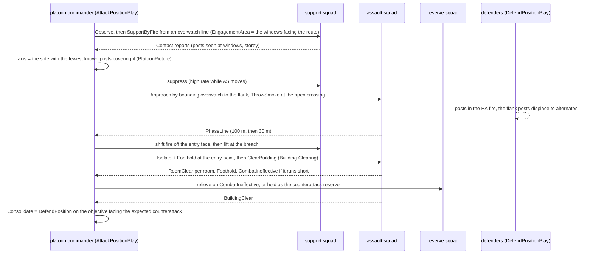
*What the picture shows that prose hid:* every phase change waits on a REPORT, not a clock. The 3 s report delay (R-2031) is the friction
that makes "lift fire" a real coordination risk. The reserve is a decision on a report, not a fixed phase.

### 4.2 Defence of the same building (militia vs regular, side by side)

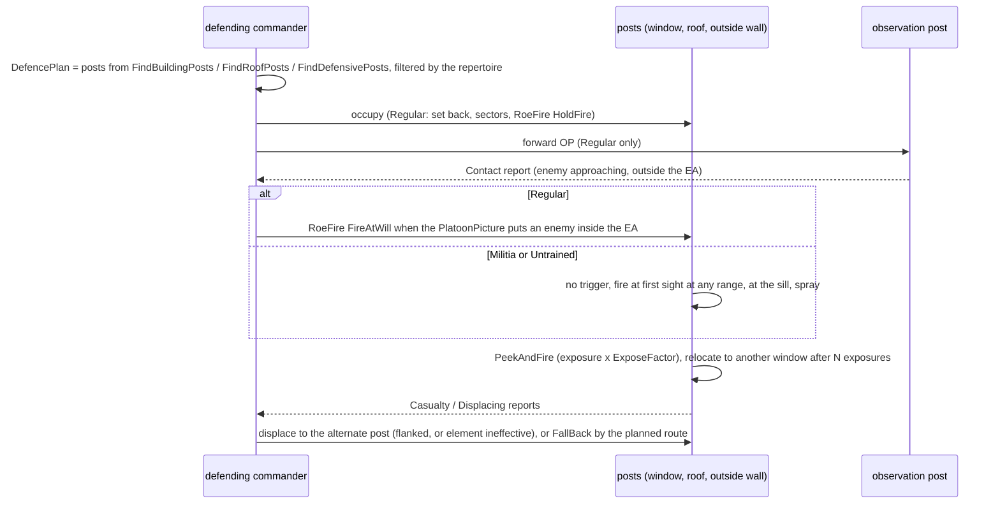
*What the picture shows that prose hid:* the tiers do not need two behaviours. The same play runs, and the repertoire turns off the OP, the
trigger line, the set-back and the sectors, which is exactly how irregulars differ.

## 5. Modules — who runs it each frame

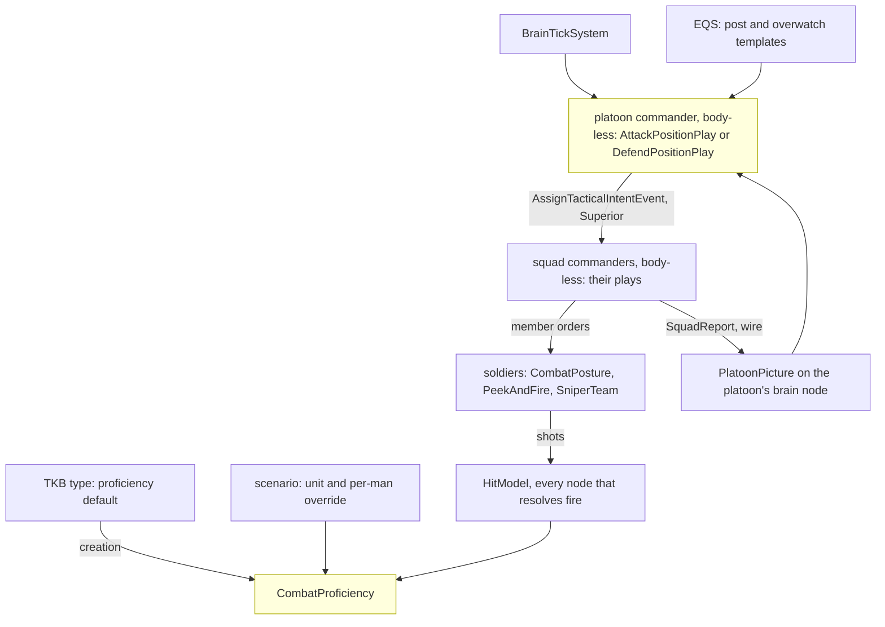
*Caption:* the only per-frame engine change is one factor in the hit model, read where fire is resolved; everything else runs on the brain
node inside plays the runner already ticks. ⚠ **Not reached today:** a platoon over infantry squads has never run (SL-0 makes it run first).

## 6. Decisions *(✅ approved 2026-10-18, R-2035 — 🔒 "Perfect."; DA-9 as amended in §10)*

| id | decision | ⭐ lean | rejected — one line each |
|---|---|---|---|
| **DA-1** | what skill is | **one `CombatProficiency` 0–1 per man, beside `CombatTemperament`**, five named tiers as presets: Untrained 0.1 · Militia 0.35 · Regular 0.6 · Veteran 0.8 · Elite 0.95. Set like temperament: a TKB type default (insurgent Militia, soldier Regular, police Regular), a **unit-level setting that fills every member not authored**, a per-man scenario override; unset reads Regular | many separate skills (marksmanship, fieldcraft, tactics): five sliders per man is unauthorable · folding it into temperament: will and ability are different (a brave novice, a careful expert) |
| **DA-2** | what skill changes in a man | through **`ProficiencyOf`**, each **exactly 1.0 / 0 at Regular** so every existing rail and demo is unchanged: spread × (Untrained 2.5 · Militia 1.6 · Regular 1.0 · Veteran 0.8 · Elite 0.65, linear between) · exposure time × (1.8 … 1.0 … 0.7) · reaction delay before the first shot at a new contact (+1.2 s … 0 … 0) · burst discipline (Untrained empties the magazine, Militia long bursts, Regular+ aimed / controlled) · cover discipline (below Regular: stays at the sill, does not change window after N exposures) | skill on the weapon: a rifle is not trained · range-dependent skill: the spread is already angular, so error grows with range |
| **DA-3** | detection vs exposure | ⭐ **acquisition time by exposure** (backend frame): a contact is acquired after a delay that grows with range and with how little of the man shows (body points visible of those his stance has) and shrinks with the observer's proficiency; **0 for a fully exposed man within 100 m** ⇒ close-range rails unchanged. Without it, a short peek and a set-back window post protect only against being HIT, never against being SEEN | keep instant detection: makes the peek, the set-back and the sniper's hide meaningless for sight · a full silhouette-area model: costlier, same behaviour |
| **DA-4** | the defence plan | **`DefencePlan` computed when the order is given**: the EA (the order's polygon, or the area in front of the position along the threat axis) · the threat axis (the order's, else from the picture) · per element **primary + alternate + supplementary** posts · an OP forward · a reserve (one squad of three) · a fall-back route (`FindSafeRetreatPoint` from the position). Re-planned only on a new axis (supplementary posts face it) | a fixed plan authored per scenario: works once · re-plan every frame: posts dither |
| **DA-5** | where the posts come from | **new EQS templates**, scored for: sees into the EA, cover from the threat axis, ≥ 8 m from the next post, **mutual support** (sees a neighbour's front): `FindDefensivePosts` (outside cover, walls, sandbags, berms), `FindBuildingPosts` (per storey, windows facing the EA, upper storey preferred, ground floor lightly held), `FindRoofPosts` (roof edge, prone, only if the roof is reachable). ⭐ An **authored fighting position** in the scenario (a point + facing) is preferred over a generated one | only authored posts: a defence needs hand-placing in every scenario · only generated: the scenario author cannot say "the MG goes here" |
| **DA-6** | fighting from a window | Regular+ fight from a **set-back post** 1.5–2.5 m inside the room on the line through the window (sees a narrower arc, is far harder to see, needs DA-3 to matter); below Regular **at the sill** (today's `FindWindowFiringPosition`). Observation is a lean / peek at the window frame (BR-5); a quick shot is `PeekAndFire`'s window shape with DA-2 timings, **relocating to another window after N exposures** (R-2023's rule for infantry) | always at the sill: the doctrinal error irregulars make, wrong for regulars · always set back: untrained should be easier to kill |
| **DA-7** | fire control in defence | Regular+ start at **`RoeFire.HoldFire`** with the EA as their `EngagementArea`; the commander lifts to `FireAtWill` when the picture puts an enemy inside the EA (or a post is fired upon: `ReturnFire` already allows it). Below Regular: `FireAtWill` from the start, no EA | a new "trigger" mechanism: ROE already holds and lifts fire, networked |
| **DA-8** | dug-in holes and trenches | ⭐ **phase 2, backend frame**: a `FightingPosition` world object (foxhole, trench section) that lowers its occupant's body points by its depth and joins the navmesh. ⭐ **Phase 1 uses what exists**: sandbag walls and earth berms as static obstacles (cover height already ruled by the stance thresholds) | build trenches first: the whole of D7 (height-grid carve, navmesh) for the same behaviour a 1 m berm gives |
| **DA-9** | the attack and the clearing | ⭐ **ONE platoon play `AttackPosition`**: Observe → SupportByFire → Approach → Isolate → Foothold → Clear (building: `ClearBuildingPlay` on the assault squad) or AssaultThrough (open position: suppress-and-manoeuvre's assault) → Consolidate (= `DefendPosition` on the objective). **`IsolateAndClear` (PL-1) becomes this play** — a clear with no opposition is the same play with an empty approach. ⚠ Changes the approved clearing design's platoon section: everything else in it stays | two plays chained: both would own "isolate" and the hand-off between them |
| **DA-10** | choosing the axis | the commander picks the **assault position on the side of the objective covered by the fewest KNOWN posts** (picture), reached by a covered route: v1 = `FindFlankingPosition` around the objective with `ThreatExposureTest` against the known posts, then bounding overwatch between cover. A path-exposure route planner is v2 | always frontal: the irregular's choice, kept for Untrained · a full route planner first: v1 already flanks |
| **DA-11** | support by fire, shift and lift | the SBF squad watches and suppresses the **windows / posts that see the assault's route** (its `EngagementArea`); on the assault's **PhaseLine** reports it shifts off the entry face, at **Foothold** it lifts to depth (the upper storey, the roof, the next building). Fire into a room the attackers hold is refused (CB-18, same component) | fixed timings: friendly fire whenever the assault is slow · no shifting: the assault walks into its own SBF |
| **DA-12** | smoke | smoke grenade 6041 into **Regular+ loadouts** (one or two per man); a `ThrowSmoke` member order at a point between the element and the known posts; the attack uses it at **open crossings** (the danger-crossing drill's open stretch) and on the **breach face**; a defender uses it to **break contact** | smoke only by the commander: a squad crossing a street would wait for a report round trip |
| **DA-13** | snipers | a **sniper team** (shooter + spotter) behaviour for both sides: `FindOverwatchPosition` (300–800 m, long line of sight to the objective, set back inside a building or behind cover) · targets in order: snipers, MG gunners, leaders, window posts · **few shots, then relocate** (R-2023) · the spotter reports `Contact`s up. ⚠ Needs from backend / TKB: a **sniper rifle** (≈ 0.3 mil spread) and a **designated-marksman rifle** (≈ 1 mil), a **scope** on the mount (×4 range, narrow FOV: the binocular rule on a weapon) | a sniper as a better rifleman: without the hide and the relocation he dies to the first SBF |
| **DA-14** | counter-sniper | a squad taking **near misses from an unseen long-range shooter** reports `SniperContact` (the bearing) and goes to cover; the commander answers by tier: Regular+ suppress the suspected building with the SBF, smoke, and send the own sniper or manoeuvre; below Regular, spray in the general direction. ⚠ Needs the **round's origin on `NearMissEvent`** (backend: the ballistics knows it) | guess the direction from the squad's contacts: an unseen sniper is not a contact |
| **DA-15** | coordination across teams | **only orders down and reports up** on the existing paths: `AssignTacticalIntentEvent` (Superior) to squads, `SquadReport` (R-2031) to the platoon; new kinds **`PostsManned · Displacing · SniperContact · PhaseLine · Foothold · ObjectiveTaken`** beside the clearing's. Both sides' commanders decide from their `PlatoonPicture`, never from the other squads' brains | a shared platoon blackboard: R-2031 forbids it ("nothing hidden inside single brain only") |
| **DA-16** | what the tier lets a commander do (the repertoire) | **Untrained**: defend = occupy the nearest windows and roof, no plan · attack = frontal rush with spray, no smoke. **Militia**: + a base of fire and a rush, posts at the sill, individual withdrawal. **Regular**: the full plans (sectors, trigger, OP, alternates; SBF, flank, bounding, smoke, shift / lift). **Veteran**: + reserve counterattack, set-back posts everywhere, a DMR. **Elite**: + multiple assault axes, roof entry when there is a way up (fast rope exists), a sniper team, smoke on every breach. The commander's tier is his unit's median man | the commander's own skill only: a skilled officer with untrained men cannot run a regular's plan |

## 7. Edge cases

| case | what happens |
|---|---|
| the defenders fall back UPWARD while the building is being cleared | rooms they leave are `Suspected` again for the clearing (Building Clearing `BuildingClearance`); the stair is a danger area; a defender who is cornered upstairs fights or surrenders by Resolve (CB-28) |
| the attack comes from an unexpected side | defenders re-plan on the new axis: they move to **supplementary** posts; untrained just turn and shoot from where they are |
| the SBF loses line of sight (smoke, its own losses) | it reports, and the commander holds the assault at the last phase line until fire is re-established or another squad takes over the SBF |
| the assault squad is shot below combat effective in the approach | `CombatIneffective` report; the reserve takes the assault (Regular+), else the attack is broken off by `BreakContact` |
| a defender sniper kills the attacking platoon leader | succession (Squad Tactics §7.2) at squad level; at platoon level the senior squad leader's commander takes the play, reported |
| ammo low on the SBF | the rate drops (the Ammo input already damps Suppress); a `CombatIneffective` with reason ammo when empty |
| civilians in the building | the clearing's civilian rules apply in the clear phase; the SBF fires only at seen combatants (ROE `Status`) |
| both sides untrained | no plans, no smoke, both spray: the fight is decided by numbers and cover, which is the point of the demo |
| a roof with no stair (house-2f) | `FindRoofPosts` returns nothing (not reachable); an Elite attacker may still fast-rope onto it |
| the defence breaks (stress) | men break individually (TS-6), and the post's element reports `Displacing`; the commander orders the fall-back if more than half are gone |

## 8. Slices *(behaviors `CE-2273`…`CE-2285`; backend BR-6…BR-11 in the handoff)*

| order | slice | owner | what | needs |
|---|---|---|---|---|
| 1 | **DA-A** `CE-2273` | behaviors | `CombatProficiency` + `ProficiencyOf` + tiers + unit fill + translator key (DA-1); neutral rail: Regular reads exactly today | — |
| 2 | **DA-B** (backend BR-6, BR-7) | backend (frame) | the spread factor in `HitModel` (DA-2) · acquisition time by exposure (DA-3) · the round's origin on `NearMissEvent` (DA-14) | DA-A |
| 3 | **DA-C** `CE-2274` | behaviors | the DA-2 timings in `PeekAndFire` (exposure, relocation, cover discipline, reaction delay, bursts) | DA-A |
| 4 | **DA-D** `CE-2275` | behaviors | `DefencePlan` + `FindDefensivePosts` / `FindBuildingPosts` / `FindRoofPosts` + set-back posts + `DefendPositionPlay` at **squad** level, sectors via `EngagementArea`, HoldFire and its lift (DA-4…DA-7); `DefendArea` maps to it | DA-C, Clearing BC-1 (`EngagementArea`) |
| 5 | **DA-E** `CE-2276` | behaviors | platoon defence: OP, reserve, alternates, displacement, fall-back, storeys; the report kinds (DA-15) | DA-D, SL-0, RP-1 |
| 6 | **DA-F** `CE-2277` | behaviors | `AttackPositionPlay` (DA-9…DA-11) absorbing PL-1: SBF, axis, approach, shift and lift, isolate, foothold, clear / assault through, consolidate | DA-E, Clearing BC-3 |
| 7 | **DA-G** `CE-2278` | behaviors + TKB | smoke loadout and `ThrowSmoke` (DA-12) | DA-F |
| 8 | **DA-H** `CE-2279` | behaviors + backend / TKB | sniper and DMR weapons, the scope, `FindOverwatchPosition`, `SniperTeamBehavior`, the counter-sniper drill (DA-13, DA-14) | DA-B, DA-F |
| 9 | **DA-I** `CE-2280` | behaviors | the repertoire gate in both commanders (DA-16) + the tier ladder of demos (§9) | DA-F…DA-H |
| — | **DA-J** (backend BR-11) | backend (frame, later) | `FightingPosition` holes and trenches (DA-8, D7) | — |
| 2a | **DA-K** `CE-2281` | behaviors + backend / TKB | roles (DA-19): the new `TacticalDesignation` values + fire team index, the element split by team, the MG first into the base of fire; the infantry LMGs and their carriers (TKB) | DA-A |
| 3a | **DA-L** `CE-2282` | behaviors | `EngagementArea` with `Allow` / `NoFire` in the five target picks and the two gates (DA-20) — ⭐ ONE build shared with Building Clearing BC-1 | — |
| 3b | **DA-M** `CE-2283` | behaviors + backend | the new sensor changes (DA-21); building / storey / room of a point from a PointSurvey answer (R-2037) | DA-L, DA-P |
| 6a | **DA-N** `CE-2284` | behaviors | `UrbanMovement`, `PlatoonSop`, the `ReactToFireFromBuilding` preset with clear / bypass (DA-17, DA-18) | DA-F, DA-M |
| 1a | **DA-O** `CE-2285` | behaviors (FDP Terrain, cross-lane) | `roof` as rings + `house-3f` with the roof stair house and parapet (DA-22) | — |
| 0 | **DA-P** (backend BR-12) | backend | the `WorldSurvey` sensor: VisibilityFan · BuildingSurvey · PointSurvey, solved on the muscle (DA-25, R-2037) | — |
| 0a | **DA-Q** `CE-2286` | behaviors | move behaviors' brain-side geometry reads onto WorldSurvey / EQS answers (§13b table) + the conformance rail | DA-P |

### 8a. DA-A in detail — `CombatProficiency`, its three sources and its one reader *(`CE-2273`, behaviors, 2026-10-19)*

**INVENTORY** (codebase-memory CLI `search_graph`, Class / Struct / Enum / Method, `.*(Proficien|Skill|Training|Veteran|Marksman).*` →
**0**; `.*Temperament.*` → `CombatTemperament`, `TemperamentOf`, `CombatTemperamentTranslator`; grep for the registration sites:
`HrotSharedComponentRegistry.cs:194` (every node), `HrotScenarioSerializerFactory.cs:26`; the TKB projection precedent
`BehaviorTkbTranslator` (ROE defaults). `check_index_coverage` NOT run — CLI only.)

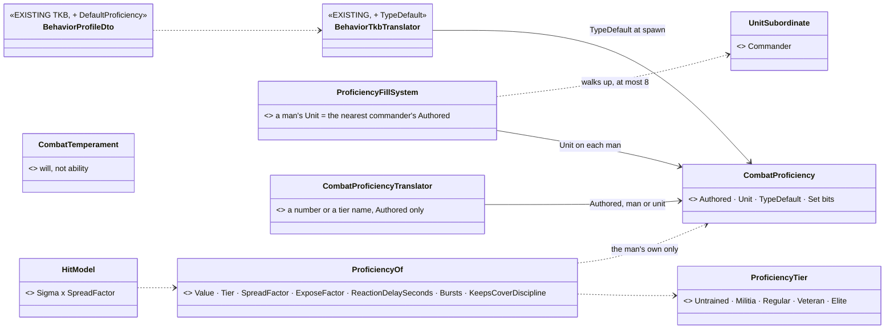
*What the picture shows that prose hid:* the reader looks at the man's OWN component only — never up the chain — so the hit model
(backend BR-6, on whichever node resolves the shot) needs nothing but the man. The unit's setting reaches him by the fill system
WRITING his `Unit` field, which is why "fill" in DA-1 is a writer and not a chain walk like `RoeOf` (CE-2289).

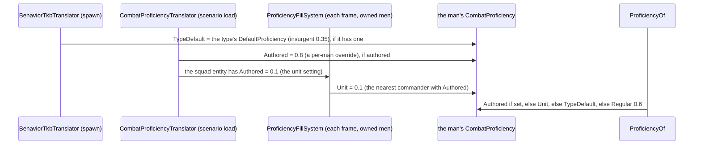
*What the picture shows that prose hid:* the three sources never overwrite each other — each has its own field and bit, and the
precedence lives in ONE place, the reader. A unit setting changed later (a scenario edit, a future order) reaches the men on the next
frame; a man moved to another squad takes the new squad's.

| ⭐ decision | lean | rejected — one line each |
|---|---|---|
| the component's shape | three values with their own `Set` bits (`Authored`, `Unit`, `TypeDefault`) — 0 is a legitimate proficiency, so "unset" is a bit (the `CombatTemperament` rule) | one value overwritten by each source: a later TKB projection or fill would clobber an authored override |
| the unit fill | `ProficiencyFillSystem` (CgfLogicPack, gated on authority, after `UnitCentroidSystem`): each owned man with a `UnitSubordinate` gets `Unit` = the nearest commander's `Authored` (≤ 8 levels), cleared when none | a chain read in `ProficiencyOf` (the `RoeOf` shape): the hit model would need the commander entity on the node that resolves the shot |
| the factors | exactly 1.0 / 0 at Regular (0.6) and with no component; linear between the five presets (DA-2's tables) | — |
| the scenario key | `"Proficiency"`: a number 0–1 or a tier name (`"Militia"`), on a man or a unit; only `Authored` is saved | a separate `"ProficiencyTier"` key: two spellings for one value |
| where the TKB default lives | `BehaviorProfileDto.DefaultProficiency` (0 = none ⇒ Regular); insurgent 505 = Militia 0.35 | a new descriptor: one float |

⚠ Not in DA-A: the wire (BR-6 decides whether the component replicates or the hit model runs on the brain node) · the repertoire's
"commander's tier = his unit's median man" (DA-16, `CE-2280`).

**As built (2026-10-19, `CE-2273`)** — as drawn above: `CombatProficiency` (component 415, registered on every node beside
`CombatTemperament`), `ProficiencyOf` (`Value`, `Tier`, `SpreadFactor`, `ExposeFactor`, `ReactionDelaySeconds`, `Bursts`,
`KeepsCoverDiscipline`), `ProficiencyFillSystem` (CgfLogicPack, after the staff), `BehaviorProfileDto.DefaultProficiency` projected by
`BehaviorTkbTranslator`, `CombatProficiencyTranslator` (scenario key `"Proficiency"`). Deviations:

| what | as built | why |
|---|---|---|
| the in-between factors DA-2 left open | exposure × 1.8 · **1.4** · 1.0 · **0.85** · 0.7; reaction delay 1.2 · **0.6** · 0 · 0 · 0 s (Untrained … Elite) | DA-2 named the ends and Regular; the middle values keep each line monotonic and linear between presets |
| the fill's reach | a man is filled only where his brain is owned (gated on `BehaviorState` authority on a cluster) | the component is written on its owner; a brain-less body keeps its own or its type's value |
| the insurgent type default | ⚠ **not set anywhere yet**: type 505 (Insurgent) has no TKB catalog entry to carry it | the field and its projection are built and railed; the first insurgent TKB entry sets `DefaultProficiency = 0.35` |

Rails: `CombatProficiencyTests` (neutral at Regular / none / unregistered — bit-exact; the presets and the line; precedence; the unit
fill, nearest wins, taken back; the TKB projection under an authored value) · `CombatProficiencyTranslatorTests` (number or tier
name, only the authored value saved) · `CgfLogicPackTests` (+1 system). Red-proof: the fill writing nothing reddens the fill rail.

### 8b. DA-C in detail — proficiency in the peek-and-fire cycle *(`CE-2274`, behaviors, 2026-10-19)*

**INVENTORY** (grep `ExposeSeconds|ExposuresPerPosition|RoundsPerExposure|BlindRounds` over `Hrot/` `FDP/`: one owner,
`PeekAndFireNodes` — `Effective` resolves the authored values once per tick, line ~244, and every phase reads that one copy; the
readers already built in DA-A: `ProficiencyOf.ExposeFactor`, `ReactionDelaySeconds`, `Bursts`, `Tier`; PC-15 (R-2046) sets who switches.
codebase-memory not connected this session; `check_index_coverage` NOT run.)

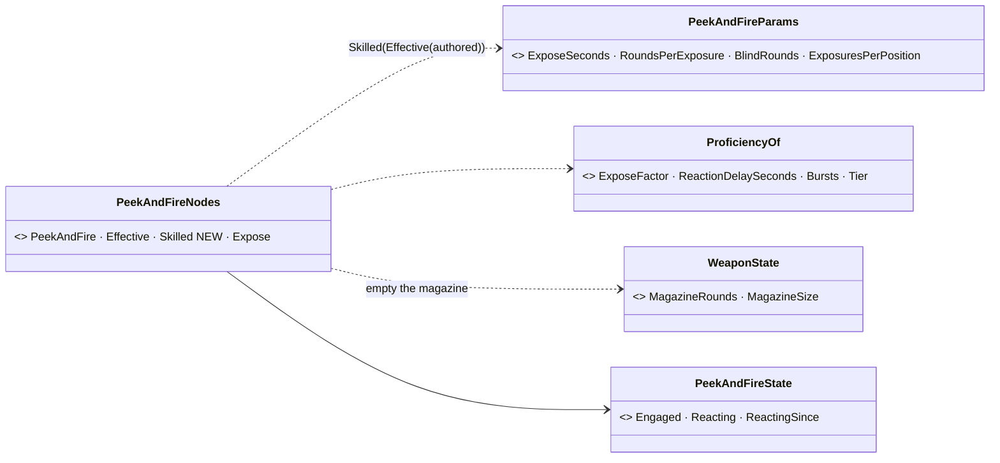
*What the picture shows that prose hid:* the whole slice is one function between the node's parameter resolution and its phases —
every timing the cycle uses comes from that one copy, so no phase learns about skill.

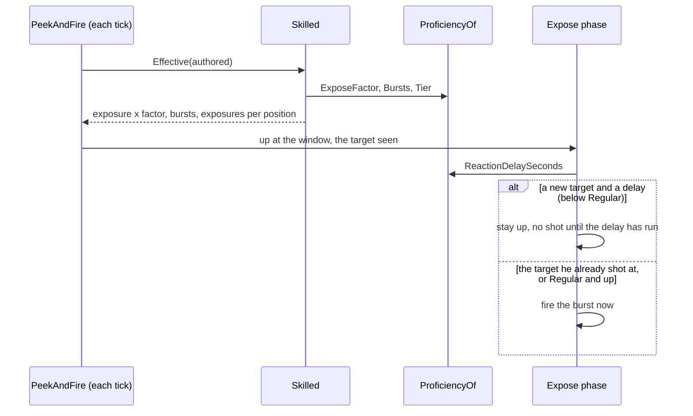
*What the picture shows that prose hid:* the delay is per TARGET, not per exposure — the second time he comes up at the same man he
fires at once, which is what "reaction to a new contact" means.

| ⭐ decision | as built | rejected — one line each |
|---|---|---|
| where | `PeekAndFireNodes.Skilled`, applied to `Effective(authored)` each tick | in each phase: four places to keep in step |
| exposure | × `ExposeFactor` (1.8 · 1.4 · 1.0 · 0.85 · 0.7) | — |
| bursts | Militia × 2 (aimed and blind) · Untrained the rounds left in his magazine (its size when empty, 30 without one) | a fixed 30: a pistol has 15 |
| who switches (PC-15) | Untrained / Militia: never by count (`int.MaxValue`) — heat still burns a spot · Regular as authored (3) · Veteran one sooner · Elite after one | below Regular never moving: a burned window would hold him forever |
| reaction delay | before the FIRST shot at a NEW target (`Engaged` ≠ it), up and visible meanwhile | before every exposure: the same man twice is not a new contact |

⭐ Neutral at Regular and with no component, exactly (rail). Rails `PeekAndFireNodesTests.CE2274_*` (3, the node's suite).
⚠ Not here: DA-6's set-back window post for Regular+ (`CE-2275`, the squad defence picks the post).

### 8c. DA-D in detail — `SquadDefend`, the squad holds a position *(`CE-2275`, behaviors, 2026-10-19 — slice D-1 designed here; D-2 below)*

**INVENTORY** *(2026-10-19 — one read-only sweep agent, grep + every hit opened; the codebase-memory CLI was reachable (`home-user-HROT`) but
not used for this sweep, `check_index_coverage` not run — so "does not exist" below means "not found by text search")*:

| need | exists | where | ⇒ |
|---|---|---|---|
| a squad play | ✅ 14 `ISquadPlay`s on one runner; the closest is `SquadHoldPlay` (one element, every man `Hold`, ends on time or all-clear) | `SquadManeuverRunner.cs:320-341`; `SquadContactBehaviors.cs:34-104` | ⭐ a 15th play, the hold's shape |
| the terrain from a play | ✅ `AskTerrainAll` — one-shot child EQS sensor on the commander, solved on SimHost, **≤ 16 ranked points**, not the same frame, dropped after its answer; a point in slot 1 (`ContextPoint1`) | `SquadManeuverRunner.cs:686-731`; `EqsComponents.cs:89` | ⭐ the posts' road; the answer carries position, score, stance, kind, **no facing** |
| window posts | ✅ `CoverPointsGenerator { Kind = WindowFiring }` — one point per window on **every storey**, 0.75 m in from the inside face, at the lowest stance that clears the sill; `FindWindowFiringPosition` keeps those that see a target | `CoverPointsGenerator.cs:12-80`; `StarterTemplates.cs:32`; `TerrainCoverProvider.cs:122-182` | ⭐ reuse the generator; ⛔ no set-back variant (DA-6 ⇒ D-2) |
| outside posts | ✅ `FindCoverFromTarget` (cover points hidden from a target or a point) | `Spatial/Eqs/FindCoverFromTarget.cs:13` | ⭐ the second ask |
| picking one point per man | ✅ `SquadCover.Pick` — spacing **2-D** (`PickSpacingMetres` 2 m) | `SquadCover.cs:96-120` | ⚠ two storeys of one window column share XY ⇒ the defence picks in **3-D** |
| the engagement area | ✅ the squad commander's own `EngagementArea` Allow (an arc or an area entity) — set by the operator's *Set sector* (`CE-2149`) or a platoon; `EngagementAreas.AllowsUnit(view, commander, point)`; a man may CHOOSE a target inside his commander's Allow (Militia+), self-defence excepted | `EngagementArea.cs:36-200` | ⭐ the EA is read, never stamped by the play |
| fire control | ✅ `SetRoeEvent` (3104, origin-gated) through the chain (`RoeOf`, `CE-2289`); ⛔ **no withdraw**: a field once set stays set; ⛔ **no play sets ROE** today | `SetRoeEvent.cs:13`; `RoeSystem.cs:49-66`; `Roe.cs:104-130` | ⇒ DA-35 |
| the trigger / displace sensors | ⛔ `ContactInEngagementArea`, `ContactOutsideSector`, `PositionUntenable` do not exist (the enum ends at `ReportReceived` 19); `RecentSenses` keeps the LAST time per kind, no count | `SensorChangedEvent.cs:12-73`; `RecentSenses.cs:78-140` | ⇒ the play counts near misses itself (DA-38) |
| reports | ✅ `ReportQueue.Enqueue` (the play's own PROGRESS: `Set`, `Displacing`, `FallingBack` exist) | `ReportQueue.cs:14`; `CommandReports.cs:32-51` | ⭐ reuse |
| the defend order | ⚠ `DefendArea` {centre lat/lon, radius} ⇒ `CombatPosture` for a soldier (by TKB type); nothing for a squad | `DefendAreaMapper.cs:45-87`; `DefendAreaIntentDto.cs:16-28` | ⭐ a unit with a roster ⇒ `SquadDefend` |
| authored fighting positions | ⛔ none in the scenario format | — | DA-5's authored post stays open (D-2) |
| `house-3f` (roof storey, stair house, parapet) | ✅ built by ui | `CE-1182`; `Recipes/Buildings/house-3f.building.json` | the demo's house |

**Design docs checked:** [Platoon §5–§6a, §12.2](DESIGN_Platoon_Attack_Defend_Clear.md) — ✅ applies: the play's phases, its PROGRESS, `sq-defend-house` · §4.2 / DA-4…DA-7 above — ✅ applies, D-1 builds the squad half · §13a (DA-24) — ✅ the squad sector is the EA, `MemberArc` per man · `DESIGN_Operations_Behaviour_Catalogue.md` §4 `OccupyPost` — a catalogue row, no mechanism · `.dev/` — searched, no record.

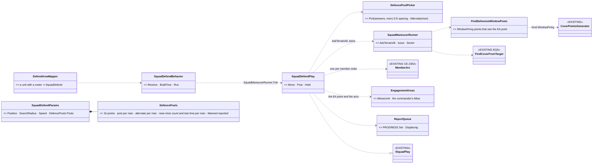
*What the picture shows that prose hid:* the play owns **no new mechanism** — posts come from the EQS road plays already use, the men's
sectors from `MemberArc`, hold fire from the squad's own sector, reports from the queue. The new parts are a template, a pure picker and the
play's memory; the picker is pure so the 3-D spacing and the alternate rule are railed without a world.

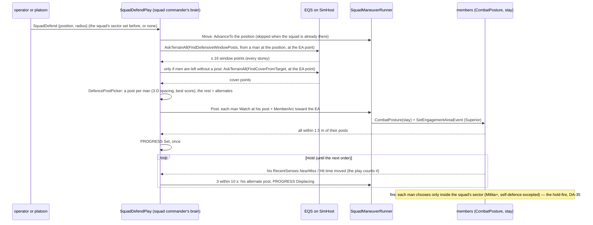

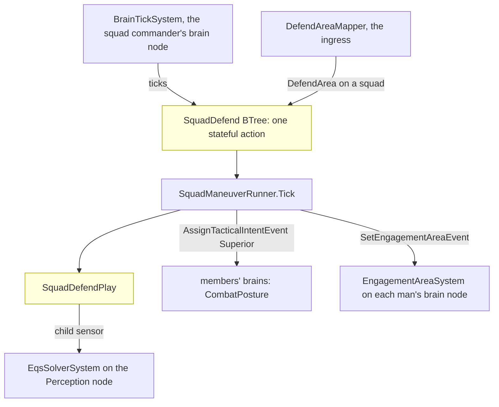
*Caption:* nothing new runs per frame outside the commander's own tick — the play is reached only through the runner, and the posts are
solved where every EQS query is. ⚠ The near-miss count reads each man's `RecentSenses` on the COMMANDER's node: true where the squad's
brains share a node (the CGF norm); ⛔ not measured for a squad split across nodes.

| id | decision | ⭐ lean | rejected — one line each |
|---|---|---|---|
| **DA-34** | where D-1's posts come from | **two asks in turn**: `FindDefensiveWindowPosts` (window points within `SearchRadius` of the position that see the EA point) — then, only for men still without a post, `FindCoverFromTarget` at the EA point (walls, sandbags, berms, and the roof parapet if it yields cover points — ⛔ measure in the build). One post per man by score with **3-D** spacing ≥ 2.5 m; the unused points are the alternates | three templates (`FindBuildingPosts` / `FindRoofPosts` / `FindDefensivePosts`, DA-5's names) at once: the same generator twice under three names before any user needs the difference · the BuildingSurvey's windows: a standing sensor for what one EQS ask already answers; it returns with the set-back (D-2) |
| **DA-35** | hold fire | ⭐ *(corrected 2026-10-19 — the first lean claimed to revise Platoon §6a; it did not: §6a's "alone" is the squad with no platoon play above it, and under a platoon the PLATOON holds and lifts, §5 Occupy / Engage)* **The hold is an ROE the order-giver sets** (the operator in `sq-defend-house`, the platoon in `PlatoonDefend`) — ROE persists across tasks by design (`Roe.cs`), so it is never the play's to withdraw. **Under a platoon** the play never touches ROE. **Alone** — a `HoldFire` set on the squad commander itself by a non-Superior origin — the play LIFTS it to `FireAtWill` (origin Self, the order-giver's rank) on the first pooled contact inside the squad's sector, or the first round at one of its men (DA-7's "a post is fired upon"). Its sector keeps every man choosing inside it before and after. ✅ **BUILT 2026-10-19**: `SquadDefendPlay.LiftOwnHold` (every tick, either phase; once) | the play SETTING `HoldFire` itself: `SetRoeEvent` has no withdraw and a task clear runs no play `Release` (DA-32) ⇒ the hold would outlive a cleared defence · the sector alone (the first lean): a `HoldFire` order then has no lift at all, and an alone squad shot at from outside its sector could never answer |
| **DA-36** | the EA | the squad commander's own Allow (an operator's *Set sector*, a platoon's `SquadSector`); its point for the asks = the area's position, or the arc's middle at half its range. **None ⇒ all-round**: the window ask without a target (every window within the radius), arcs outward, no hold | an EA in the order: a second place a sector lives, and a squad sector is an area entity by DA-24 |
| **DA-37** | each man's arc | `MemberArc` from his post: centred on the bearing to the EA point, ±45°; all-round ⇒ centred on the bearing position → post, ±60° | splitting the EA between men by bearing (DA-24's `ForMembers`): needs `SectorPlanner`, which D-1 does not — it returns with roles (DA-K) |
| **DA-38** | displace | the play counts each man's hits / near misses (a new `RecentSenses` time = one) ⇒ **3 within 10 s** ⇒ his alternate post (the nearest unused point ≥ 2.5 m from every post), PROGRESS `Displacing`; his count restarts | waiting for DA-21's `PositionUntenable`: the same count, one sensor later — it may replace this when it lands |
| **DA-39** | the order | a new library behaviour **`SquadDefend`** {Position, SearchRadius 30 m, Speed}; `DefendArea` on a unit with a roster ⇒ `SquadDefend` at the area's centre (radius ⇒ `SearchRadius`); runs until the next order; Failure when no man is alive | a `Defend` preset of `SquadHold`: the hold has no posts and no memory |

**As built (D-1, 2026-10-19)** — as drawn, with these names: `SquadDefendBehavior` / `SquadDefendPlay` / `DefencePosts` / `DefencePostPicker`
(`Hrot.AI.Behaviors/Brains/SquadDefendBehavior.cs`) · `SquadDefendManeuver` kind 18, phases Moving → Posting
(`Fdp.Toolkits/Squad/Maneuvers/SquadDefendManeuver.cs`, named in `SquadDrillNames`) · `FindDefensiveWindowPosts` and its no-EA twin
`FindWindowPostsAllRound` (`StarterTemplates.cs`) · `EngagementAreas.TryAllowPoint` (the EA's point: an area's outline mean, else the arc's
middle at the middle of its range, 100 m with none) · `DefendAreaMapper`'s roster arm. Details the diagrams leave open: the move ends when every
live man is within 6 m of the position (or after 90 s); a post ask unanswered for 5 s is given up and the men left over hold where they are; a
man with no post holds with an arc toward the EA; only rounds after the posts are given count. ⚠ The window answer's STANCE is not passed to
the man — ⭐ since D-2a his take-cover branch reads it from the window point itself (the window column); the set-back stays D-2. Rails (the play's suite, `SquadManeuverTests`):
`CE2275_DefencePostPicker_SpacesPostsIn3D_AndGivesTheNearestFreeAlternate` · `CE2275_SquadDefend_MovesThenMansWindowAndCoverPosts_WithArcsTowardItsSector_AndReportsSet`
· `CE2275_SquadDefend_AManUnderFire_MovesToHisAlternatePost_AndReportsDisplacing`; the mapper's suite: `TryMap_AUnitWithMen_DefendsWithSquadDefend_AtTheAreaCentre`. ⭐ The alone lift (DA-35): `CE2275_SquadDefendAlone_LiftsAnOperatorsHoldFire_OnAContactInsideItsSector_NotOutside` · `CE2275_SquadDefend_ARoundAtAManLiftsItsOwnHold_ButNeverAPlatoonsHold` (the harness now runs `RoeSystem` beside `EngagementAreaSystem`); a TKB-default hold (`Unmarked`) is not an order and is never lifted.

#### D-2a — a man fights FROM his post *(PC-14, R-2047; behaviors, 2026-10-19)*

📐 **Measured first:** a posted man runs `CombatPosture` (stay) and its take-cover branch runs `PeekAndFire` with the **defaults** —
`FindCoverFromTarget`, 15 m round **wherever he stands** (`CombatPostureBehavior.cs:156`; `Resolve` never sets `Peek`). ⇒ under fire
D-1's window man could hide anywhere within 15 m: the drift PC-14 forbids.

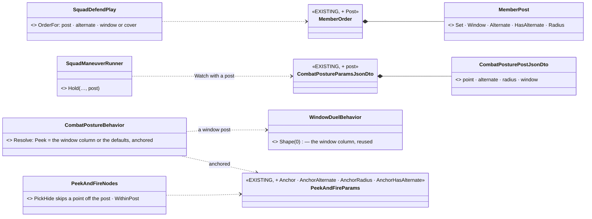
*What the picture shows that prose hid:* the post rides the order the man **already** gets — no new member order, no new behaviour; the one
new rule sits in the ONE place a hide point is chosen (`PickHide`), so every peek path (first pick, rotation, suppress-and-bound) obeys it.

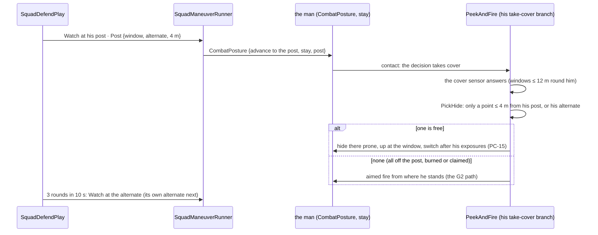

| id | decision | ⭐ lean | rejected — one line each |
|---|---|---|---|
| **DA-40** | how a posted man fights from his post | the order carries his **post set** (PC-14's "SquadDefend hands the post set into the order"): the post, his alternate, a 4 m radius, window or cover. `CombatPosture` anchors its own `PeekAndFire`: a window post flies **the window column** (`WindowDuelBehavior.Shape(0)` — prone under the sill, a stance peek, `FindWindowFiringPosition`), a cover post the defaults; `PickHide` skips a point farther than 4 m from the post and not on his alternate (`MatchRadius`). None left ⇒ he fires from where he stands | a new `FightFromPost` member order publishing `WindowDuel`: the man loses his posture's decision (suppress, hold prone, the throw) and `PeekAndFire` answers Success when nothing is in view, so he stops watching · the filter in the EQS template: the sensor is shared and centres on Self; the post is per man |

⚠ **Not built here:** PC-14's other half — the hide point inside his `EngagementArea.Allow` (an `Allow` tests TARGETS; a shooter's point
inside it is a new reader) — the anchor keeps him at his arc's origin meanwhile. ⚠ The posture's **advance** branch (flank, firing position)
could still take a posted man off his post — ✅ measured live and closed by **D-2d** below.

#### D-2b — the set-back post, by the squad's tier *(DA-6, DA-16; behaviors, 2026-10-19)*

📐 **Measured first:** a window point is built by `TerrainCoverProvider.AddPanelFaces` 0.75 m inside the face, facing OUT
(`Direction` = toward the window), at the lowest stance that clears the sill; nothing deeper in the room is generated. The floor and
"something stands here" rules (`HasFloor`, `Occupied`) live there, and `TerrainWorld.SegmentBlocked` answers "is a wall in between".

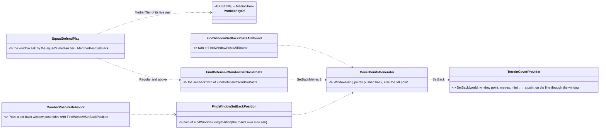
*What the picture shows that prose hid:* the set-back is ONE geometry rule in the provider that already owns the window points, reached
through one generator option — three templates are the existing three with the option set, so the post ask, the all-round ask and the
man's own hide ask all agree on where a set-back post is.

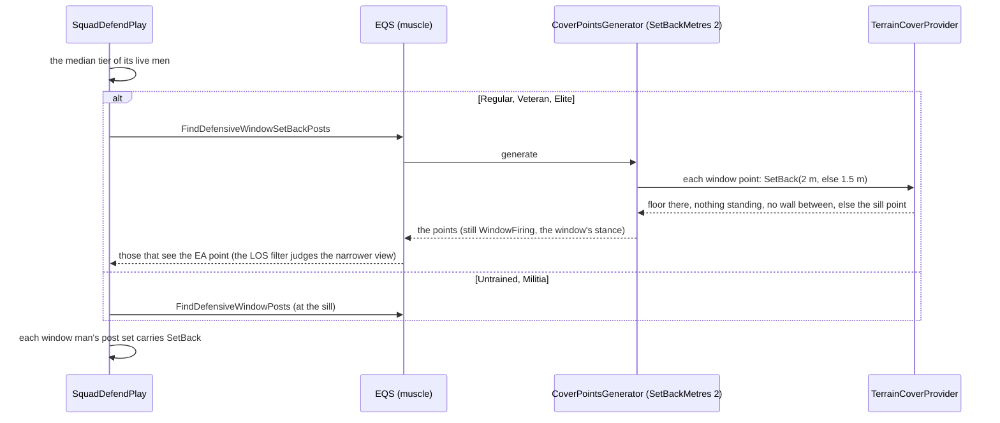

| id | decision | ⭐ lean | rejected — one line each |
|---|---|---|---|
| **DA-41** | where a set-back post is | the window point pushed back along its own facing **2 m** (DA-6's 1.5–2.5 m, its middle), else **1.5 m**, kept only where the floor continues, nothing stands and no wall lies between it and the window (`SegmentBlocked` at 1 m); neither fits ⇒ **the sill point** (a shallow room still gets a post). Kind stays `WindowFiring` and keeps the window's stance, so `PeekAndFire` still comes up at it; the LOS filter decides whether the narrower view still sees the EA | a new `CoverKind.WindowSetBack` baked into the provider's database: every cover reader, the gizmo and the kind encoding learn a value for what is one push · the set-back computed in the play: the man's own hide ask (his PeekAndFire) would still answer sill points |
| **DA-42** | who sets back | the **squad's median tier** (DA-16: "the commander's tier is his unit's median man") over its live men: ⛔ SUPERSEDED 2026-10-19 by D-2l (R-2059): **Veteran and above** set back, a Regular stands at the window FRAME — was: **Regular and above** set back (DA-6), Untrained / Militia at the sill. One ask, so one tier for the squad; each window man's post set carries it into his own hide ask | per man: the posts come from one ask for the whole squad · the commander's own tier: a skilled leader with untrained men cannot run a regular's plan (DA-16's rejection) |

📐 **Measured in the build (House A, `bt-range`):** an UPSTAIRS set-back post does not see a man 24 m from the house — 2 m back, the line
down to him crosses the sill — so the post ask answers the ground-floor windows for a close EA; at 84 m the upstairs set-back posts see.
⇒ a set-back defence gives up the near ground below its upper windows, as DA-6's narrower arc says; the LOS filter already makes that choice.

⚠ **Not built here:** DA-16's "Veteran: set-back posts everywhere" vs Regular — ✅ built in **D-2j** below (DA-50) · ⛔ SUPERSEDED: "both set
back where the room allows (the sill fallback is the only difference that exists today)" · DA-6's observation by a lean at the frame (BR-5) · the narrower view's effect on being SEEN needs
DA-3 (backend `CE-3260`, built) — not measured live yet.

#### D-2c — flanked: a contact close beside or behind a posted man *(DA-21 `ContactOutsideSector`, DA-4; behaviors, 2026-10-19)*

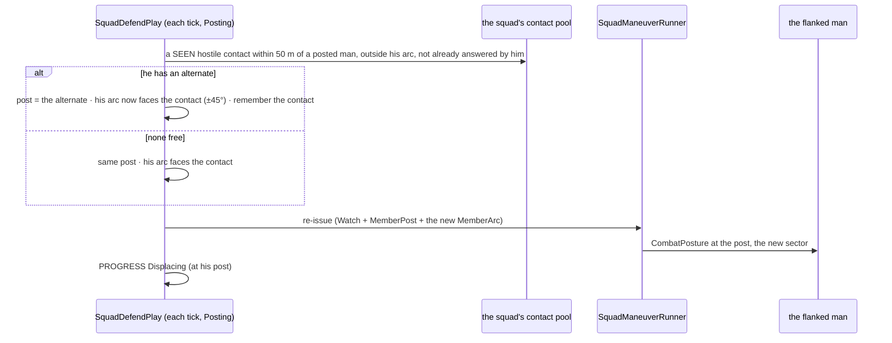
*What the picture shows that prose hid:* nothing new is sensed — the pool and the arcs the play already holds answer it, and the answer
rides the same re-issue the near-miss displace (DA-38) uses; the turn is per man and once per contact, so two flankers turn him twice,
one flanker never makes him dither.

| id | decision | ⭐ lean | rejected — one line each |
|---|---|---|---|
| **DA-43** | what a flanked defender does | DA-21's `ContactOutsideSector` **counted in the play** (DA-38's precedent, replaced by the sensor when `CE-2283` lands): a **seen** hostile pooled contact within **50 m** of his post, outside his arc ⇒ he displaces to **his alternate** (DA-21's reader) and **his arc faces the contact** there (DA-4: "supplementary posts face" a new axis) — no alternate ⇒ he turns where he is; once per contact (its id); PROGRESS `Displacing` | only the alternate (DA-21's words alone): the alternate faces the EA too, so he would move and still may not shoot the man beside him · only the arc turn: a man flanked at his post stays in the flanker's sights · a HEARD contact: anonymous, its id unstable — a turn per sound would dither (it waits for the sensor) |

*As built (2026-10-19):* `SquadDefendPlay.Flanked` beside `Displace`, `DefencePosts.Faces` / `FaceBearing` / `Flanker`, the arc read through one `ArcOf` (so the order and the check agree). Rail `CE2275_SquadDefend_AFlankedManTakesHisAlternate_FacingTheFlanker_OncePerContact`: too far (85 m) and in front (25 m) turn nobody; the same flanker working round behind again turns nobody twice.

#### D-2d — his approach moves stay on his post too *(PC-14, R-2047; behaviors, 2026-10-19)*

📐 **Measured first, live** (`sq-defend-house`): every man reached his post (0–0.4 m at 2.5 s), and by 5 s — no Blue in the sector yet — they
stood **3–7 m off it**, later up to 9 m. The utility trace of a drifted man: his posture's winner was **AdvanceAndAttack (1.08)** against Hold
(0.38), TakeCover 0 — the posted man was not hiding, he was **approaching**: the approach decision's firing-position / flank move
(`EqsTacticsNodes.Run`, `FindOpenFiringPosition` 40 m round him) walked him away. D-2a anchored only the take-cover branch. Because the men
never stood within 1.5 m of their posts together, PROGRESS `Set` never fired either.

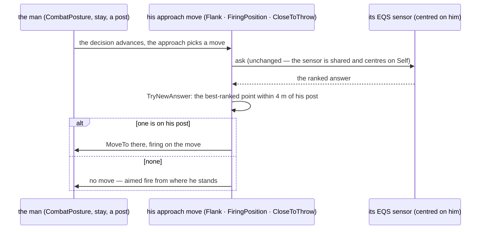
*What the picture shows that prose hid:* the anchor is the SAME one D-2a put on the hide (`PickHide`), applied at the one place each approach
move takes its point (`TryNewAnswer`) — the sensor, the decision and the branch are untouched, so a posted man still flanks or finds a better
firing spot, inside his room; and with nothing there he still fights (before, a move with no answer stood silent).

| id | decision | ⭐ lean | rejected — one line each |
|---|---|---|---|
| **DA-44** | how a posted man's approach moves stay on his post | `EqsTacticsParams` gets `Anchor` + `AnchorRadius` (D-2a's shape on `PeekAndFireParams`); `CombatPostureBehavior.Post` sets them on **Flank, Firing and Throw** from the order's post (4 m); `TryNewAnswer` takes the best-ranked point inside it, none ⇒ no move and **he fires from where he stands**. **Flee is free** (breaking is morale, not repositioning). PROGRESS `Set` counts a man within **the post radius** (his room), not 1.5 m of its point — his fight moves him between its points | remove the advance branch for a posted man: he loses the throw and the flank inside his own building, and the decision layer has no "posted" input · lower the advance score when posted: a utility tweak every posture user would feel, and a high enough threat still wins it · move him back to the point after each fight move: a dither between two points |

*As built (2026-10-19):* `EqsTacticsParams.Anchor/AnchorRadius` · `EqsTacticsNodes.TryNewAnswer(…, in p, …)` · `FireOnTheMove` fires for a
posted man with no move · `CombatPostureBehavior.Post(…, ref CombatPostureBlackboard)` · `SquadDefendPlay.Manned` reads `PostRadius`
(`MannedMetres` retired). Rail `TacticsTreesTests.CE2275_APostedMansFlank_StaysOnHisPost_AndNothingOnItMeansHeFightsWhereHeStands`.

#### D-2e — he occupies his post first *(PC-14, R-2047; behaviors, 2026-10-19)*

📐 **Measured first, live** (`sq-defend-house`, after D-2d), on the brain (CGF) and the muscle (SimHost) side by side:
① the move to an upstairs post is pathed (14.75 m, via the stair) and **Following** — ② at the first contact (a Blue seen at ~117 m,
outside the sector) the posture's winner flipped from the advance to **Suppress**, whose step stops the move (`act=0`) — ③ he then stood
**5 m off his post on the stairs for 10 s**, until the squad's next re-issue. Every man still off his post at the first contact did the
same, so PROGRESS `Set` never fired. ⚠ Also measured: the walk itself is slow in the crowded ground floor (≈ 0.4 m/s on a 2 m/s
order, seven men in one room) — a muscle-side question, not answered here.

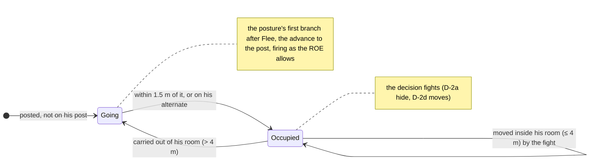
*What the picture shows that prose hid:* the gate is a **latch**, not a distance test — a plain "farther than 1.5 m" would yank him back
from every D-2d move inside his room, and a plain "farther than 4 m" would let the first contact strand him 3 m short on the stairs.

| id | decision | ⭐ lean | rejected — one line each |
|---|---|---|---|
| **DA-45** | when a posted man fights from where he stands | not before he has **stood on his post once**: `CombatPosture` (with a post) runs `PostureNodes.OffPost` first after Flee — true until he is within **1.5 m** of the post (or on his alternate), then only when something carries him beyond the post's **4 m** (his room); while true he runs the advance to the post (firing, ROE-gated). Flee stays free. PROGRESS `Set` (D-2d: within 4 m) follows | anchor Suppress / Hold to the post too: they stand still by design, so the man would still stop wherever the contact found him · a squad-side "Occupy" phase that withholds the fight until Set: a man under fire on the stairs could not return it · lower the posture decision's other options while posted: the decision layer has no "posted" input and a strong enough threat still wins |

*As built (2026-10-19):* `PostureNodes.OffPost` + `OccupyState` (the latch, `OccupiedMetres = 1.5`) · `CombatPosture`'s winner selector: Flee,
then the occupy branch (shares the advance's state), then the options as before (they are exclusive, so the reorder is neutral). Rails
`TacticsTreesTests.CE2275_APostedManNotYetOnHisPost_GoesThere_WhateverTheDecision` · `CE2275_OffPost_LatchesOnArrival_FreesHisRoom_AndCallsHimBackFromOutsideIt`.

#### D-2f — an authored fighting position *(DA-5's second half; behaviors, 2026-10-19)*

📐 **Measured first:** the order (`SquadDefendParamsJsonDto`) carries a point, a radius and a speed — no post. No params DTO carries a
list yet; ⭐ the schema the order forms read (`DtoJsonSchemaExtractor.cs:261`) **describes an array field as `type: array`**, while a
fixed-list wrapper (`FixedListShape`) would fall to its struct branch and show as an object of `Count` / `Items` — ⇒ a plain DTO
**array** it is (the resolver copies it into the blittable order). The facing follows the posture order's own convention,
`watchTowards` (a point he faces; zero = none). The posts' memory (`DefencePosts`) knows a window post only by its index (`< WindowCount`).

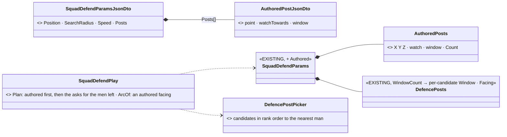
*What the picture shows that prose hid:* nothing new picks a post — an authored post is a **candidate ranked first**, so the one
picker gives it to the nearest man exactly as it gives a window; what changes is only that "window" and "facing" become properties of
a candidate instead of a position in the list.

| id | decision | ⭐ lean | rejected — one line each |
|---|---|---|---|
| **DA-46** | how an authored fighting position reaches the defence | the order's **`Posts`** array (≤ 8 used; each a `point`, an optional `watchTowards`, and whether it is a `window`) are the **first candidates**: the picker hands them out first (nearest man, the 2.5 m spacing), and the terrain asks run only if a live man is still without a post. An authored `watchTowards` points that man's arc (±45°) instead of the EA; a window post fights the window way (D-2a, at the authored point — no set-back). Each candidate carries its own window flag and facing (`DefencePosts.Window` / `Watch`), replacing `WindowCount` | posts as scenario entities (a route-like marker): a new entity kind, its translator and gizmo for what is one field of one order · a fixed-list wrapper in the DTO: the order-form schema would show it as an object of `Count`/`Items` (`DtoJsonSchemaExtractor`'s struct branch) · a facing bearing: needs a "none" the zero bearing cannot be — the posture order already faces by a point |

*As built (2026-10-19):* `SquadDefendParamsJsonDto.Posts` (`SquadDefendPostJsonDto[]`: `point`, `watchTowards`, `window`; the first 8)
→ the resolver copies them into `SquadDefendParams.Authored` (`AuthoredPosts`) · `Plan` places them once (`DefencePosts.AddAuthored`), runs
the one picker, and skips both asks when no live man is left without a post · `DefencePosts.Window` / `Authored` / `Watch` per candidate
replace `WindowCount` · an authored window post is not set back · `ArcOf` turns a man's arc to his post's `watchTowards`. Rail
`SquadManeuverTests.CE2275_SquadDefend_AuthoredPostsComeFirst_TheTerrainIsAskedOnlyForTheMenLeft_AndAWatchPointTurnsTheArc`.

#### D-2g — the roof, behind its parapet *(DA-5 `FindRoofPosts`, DA-22; behaviors, 2026-10-19)*

📐 **Measured first** *(`cqb-village`, OBJ = `house-3f`, a sector point 45 m south)*: the roof storey (floor 6 m, 1 m parapet) carries
**22 cover points, all crouched**; `FindCoverFromTarget` keeps **none** of them (it wants a point HIDDEN from the target, and a crouched
head clears the parapet), and the window asks only read window points ⇒ a roof was never a post. The cover generator has no notion of
"on a roof"; the terrain does (`TerrainWorld.SurfacesAt` lists the surfaces at a spot, the ground's index among them).

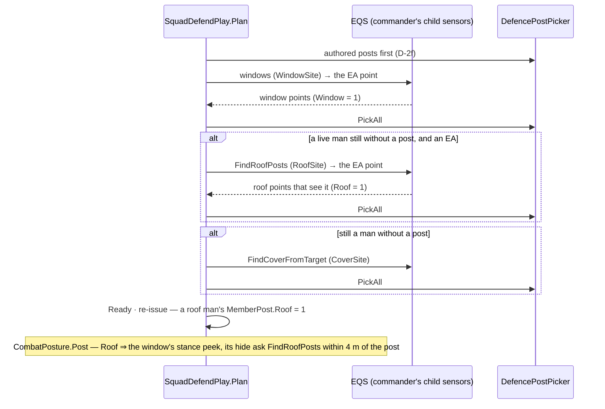
*What the picture shows that prose hid:* the roof is **one more ask in the same chain**, ranked after the windows and before plain
cover, gated like the others on "a man still without a post" — no new picker, no new phase; and the man's fight on the roof is the
window's fight (prone, up at the point's stance) with a different hide ask, so nothing new runs in the posture either.

| id | decision | ⭐ lean | rejected — one line each |
|---|---|---|---|
| **DA-47** | how a roof becomes a post, and how it is fought | **`FindRoofPosts`**: the cover generator with `RoofOnly` (the point's own surface is the TOP one at its spot, above the ground's, within 0.5 m; it reads 256 raw points so the ground round the self cannot crowd the roof out of the cap) · the eye sees the EA point · nearer scores more · no path ⇒ dropped (DA-5's *"only if reachable"*, `PathCostScoreTest`). The squad asks it **second**, only with an EA, for the men the windows left; a roof post's man hides **prone** behind the parapet and comes up to the point's stance (crouched) to fire — `MemberPost.Roof` → `CombatPosturePostJsonDto.roof` → the window's stance peek with `FindRoofPosts` as its hide ask | a `CoverKind.Roof` in the cover database: re-pins every terrain's database checksum for what one generator flag answers at query time · roof points through `FindCoverFromTarget`: measured — it keeps none (the head is seen) · the roof before the windows: a roof is the more exposed post (DA-5 ranks the upper storey's windows first) |

*As built (2026-10-19):* `CoverPointsGenerator.RoofOnly` + `OnRoof` · `StarterTemplates.FindRoofPosts` (asset `2b048d56-…`) ·
`SquadDefendPlay.RoofSite` / `DefencePosts.Roof` / `RoofStage` · `MemberPost.Roof` → `CombatPosturePostJsonDto.roof` →
`CombatPostureBehavior.Post` (the window shape with `FindRoofPosts`). ⚠ An **authored** post on a roof is not flagged a roof post — it
is fought as cover; mark it when a scenario needs one. Rails `TerrainEqsTests.CE2275_D2g_FindRoofPosts_OnOBJ_AnswersRoofPointsOnly_ThatSeeTheSector`
(cqb-village: every answer at 6 m, on the roof, seeing the sector) · `SquadManeuverTests.CE2275_SquadDefend_TheRoofIsAskedAfterTheWindows_ForTheMenLeft_AndARoofManHidesBehindTheParapet`.

#### D-2h — the automatic weapon on the longest view *(DA-19, DA-25 VisibilityFan; behaviors, 2026-10-19)*

📐 **Measured first:** the `WorldSurvey` sensor (`CE-3249`, backend — [World Survey](../../DESIGN_World_Survey_Sensor.md)) is built and
has **no production reader yet**; its `VisibilityFan` casts ≤ 24 **horizontal** rays from ≤ 12 origins at `EyeHeight` above each and
answers each ray's free distance (`WorldSurveySolve.Fan`). ⚠ Horizontal ⇒ from a roof (eye 7.6 m over a 7 m parapet top) every ray runs
to the range: the fan cannot tell a roof's long view from plunging fire into the sky. The squad's roles are read in one place,
`SquadRoles` (`CarriesSupportWeapon` = AR or MG, `CE-2281`). The picker hands posts out by distance only.

```mermaid
sequenceDiagram
  participant P as SquadDefendPlay.Plan
  participant W as WorldSurvey (FanSite, standing child)
  participant S as SimHost solver
  P->>P: posts picked (authored · windows · roof · cover)
  alt the squad has an AR / MG holding a post, an EA, and ≥ 2 non-roof posts held
    P->>W: Ensure(Fan: one origin per held non-roof post, bearing → the EA point, ±45°, 9 rays, range to the EA's far edge)
    W->>S: SensorConfigPayload (WorldSurvey)
    S-->>W: rays · Free per ray
    P->>P: view(post) = mean Free of its rays
    P->>P: the AR / MG not on the longest view (by > 5 m) ⇒ swap posts with its holder (not another AR / MG)
    P->>W: Release
  end
  P->>P: Ready · re-issue
```
*What the picture shows that prose hid:* the fan is asked **once, before the posts are given** — the swap changes who stands where,
never what the posts are, so no man is sent twice; and the roof posts are never origins at all.

| id | decision | ⭐ lean | rejected — one line each |
|---|---|---|---|
| **DA-48** | how the AR / MG gets the post with the longest view down the EA | a **last stage of `Plan`**: one `VisibilityFan` survey (origins = the held non-roof posts, ≤ 12, each looking at the EA point ± 45°, 9 rays, eye 1.6 m, range = distance to the EA point + its depth, capped 300 m); a post's view = the mean free distance of its rays; the automatic weapon whose post's view is beaten by more than 5 m **swaps posts** with that post's holder (never with another automatic weapon); no answer within the ask timeout ⇒ posts as picked. Roof posts are never origins (a horizontal ray over a parapet measures the sky, not grazing fire) | after the posts are given: every swap sends two men twice · an EQS score instead (`FindLongestView`): an EQS answer ranks points, it does not compare the ones already chosen, and DA-25 put this question on the survey · the max ray instead of the mean: one gap between houses would win over a post that covers the whole sector |

*As built (2026-10-19):* `SquadDefendPlay.GunOnTheLongestView` — the last stage of `Plan` (`FanSite`, `DefencePosts.FanStage`,
`FanRays` 9, `LongerViewMetres` 5), the survey through `WorldSurveyChildSensor.Ensure` / `Read` / `Release` (the sensor's first
production reader); a stale or missing answer after the 5 s ask timeout leaves the posts as picked. ⚠ Live, `sq-defend-house` has no
automatic weapon in its cast — the in-process rail answers the survey by hand; the real solver's fan on OBJ is not yet measured. Rail
`SquadManeuverTests.CE2275_SquadDefend_TheMachineGunnerTakesThePostWithTheLongestView`.


#### D-2i — his hide search looks at his sector *(PC-14's `Allow` half; behaviors, 2026-10-19)*

📐 **Measured first:** a posted man's hide and peek sensors are aimed at his **top threat** (`PeekAndFireNodes.KeepSensors` →
`SensorAim` → `EqsTacticsNodes.Point`), and the top threat is deliberately **not** filtered by his sector (DA-27, `CE-2282`: *"the
threat he hides from may lie outside his sector"*; only the shot is, `LockTarget`). A window hide ask keeps points that **see** its
slot-1 target ⇒ with the threat outside his arc he takes the window that faces the threat, i.e. away from his sector — the drift PC-14
forbids. D-2a's anchor keeps him in his room; it does not keep him looking the right way.

```mermaid
sequenceDiagram
  participant N as PeekAndFire (posted man)
  participant E as EngagementAreas
  participant S as his hide / peek sensors
  N->>N: SensorAim(top threat) — the freshest evidence (D13)
  N->>E: Allows(him, the threat's spot)? (own arc · his squad's · self-defence 50 m / 5 s)
  alt allowed, or no post
    N->>S: aim at the threat (as before)
  else outside his sector
    N->>E: TryAllowPoint(him) — his arc's middle at mid-range
    N->>S: aim at that point (heard id SectorAimId)
  end
```
*What the picture shows that prose hid:* the shot and the search were already split — the shot asks `Allows` (`LockTarget`), the
search did not; D-2i puts the same question in front of the search, and only for a posted man, so an unposted rifleman still hides
from whatever threatens him most.

| id | decision | ⭐ lean | rejected — one line each |
|---|---|---|---|
| **DA-49** | how a posted man's next hide point stays inside his sector | `PeekAndFireNodes.PostedAim`: a posted man (`AnchorRadius` > 0) whose threat his sector does not allow (`EngagementAreas.Allows` — his arc, his squad's, self-defence) aims his hide and peek sensors at his sector's point (`TryAllowPoint`) instead; allowed, unposted or no sector ⇒ the threat as before | a hide point "inside the Allow" taken literally: his arc's origin IS his post, so every point within 4 m is "inside" in some direction — the test says nothing · a new EQS test on the muscle (the point's facing in his arc): a new template variant per hide template for what one aim choice already answers · filtering the threat itself by sector: DA-27 keeps him hiding from the real danger when not posted |

*As built (2026-10-19):* `PeekAndFireNodes.PostedAim` + `SectorAimId`, called from `KeepSensors` (both the cover and the step-peek sensor).
Rail `PeekAndFireNodesTests.CE2275_D2i_APostedMansHideSearch_LooksAtHisSector_WhenTheThreatIsOutsideIt` (outside ⇒ the sector point, and
the node's own cover sensor is aimed there; inside, unposted, or self-defence ⇒ the threat).


#### D-2j — a Veteran squad takes only real set-back windows *(DA-16 "Veteran: set-back posts everywhere"; behaviors, 2026-10-19)*

📐 **Measured first:** the set-back pass (`TerrainCoverProvider.SetBack`, D-2b) tries 2 m, then 1.5 m, then **leaves the point at the
sill** — and nothing in the answer says which happened, so a Regular and a Veteran squad got the same posts. `EqsResult.Flags` crosses
the wire unchanged (SimHost egress `Flags`/`FlagsMeaningful` → `EqsResultUpdateSystem` on the brain), and EQS §4.2 reserves bits 8–15.

```mermaid
sequenceDiagram
  participant G as CoverPointsGenerator (set-back pass, SimHost)
  participant W as the wire (EqsResult Flags)
  participant P as SquadDefendPlay.Settle (brain)
  G->>G: SetBack(window) — moved ≥ 0.1 m from the sill?
  G->>W: FlagsMeaningful bit 8 on every point · Flags bit 8 only when it moved
  W->>P: the window answer, flags intact
  alt the squad's median man is Veteran or better (SetBackOnly)
    P->>P: drop a window point whose bit 8 is meaningful and unset
  else Regular
    P->>P: keep it (set back where the room allows, else the sill)
  end
```
*What the picture shows that prose hid:* the muscle already knew whether each window fit a set-back; the answer simply had no field for it.
One bit carries it, and the tier rule stays on the brain where every other tier rule is.

| id | decision | ⭐ lean | rejected — one line each |
|---|---|---|---|
| **DA-50** | what "Veteran: set-back posts everywhere" changes | §4.2 bit 8 **`IsSetBack`** (`CoverPointsGenerator.FlagSetBack`), written by every set-back pass (meaningful on each point; set when the point really moved back); a squad whose median live man is **Veteran or better** (`DefencePosts.SetBackOnly`) drops the window points left at the sill — a too-shallow room is no post, and the man goes to the roof or cover asks instead. Regular keeps the sill fallback | a strict template per variant (`…SetBackStrict`): three more templates for one bit of the same pass · re-deriving "did it move" on the brain from the sill points: the brain never reads geometry (R-2037) · Veteran's own hide ask filtered too: deferred — his post is already a real set-back point, and his hide ask is anchored to it |

*As built (2026-10-19):* `CoverPointsGenerator.FlagSetBack` (bit 8, recorded in EQS §4.2) · `DefencePosts.SetBackOnly` · `SquadDefendPlay.MedianTier`
(was `SetsBack`) · `Settle` drops unmarked window points for `SetBackOnly`. Rails `TerrainEqsTests.CE2275_D2j_ASetBackPass_MarksTheWindowsItMovedBack_*`,
`SquadManeuverTests.CE2275_D2j_AVeteranSquad_TakesOnlyRealSetBackWindows` (Veteran 2 window posts, Regular 4).

#### D-2k — one move per post: a re-issue sends only what changed *(`CE-2304`'s behaviour half; behaviors, 2026-10-19)*

📐 **Measured first** (`sq-defend-house` in process, the squad's drill trace and every man's `BehaviorState` / `NavigationIntent`
per frame): the squad's run never restarted (one instance, phase Posting throughout) and its roster never reordered, yet from 10 s every
man got a fresh order **26 times in 14 s, all in the same frames**. Each was `SquadDefendPlay.Displace` (DA-38): **43 displacements in
14 s**, each man ping-ponging between two posts (slot 1: posts 10 ↔ 12, slot 2: 5 ↔ 6, slot 5: 2 ↔ 3). Two defects compounded:
the rounds of the fire a man moved through counted at once at his new post, so he was sent straight back; and every displacement
re-sent **every** man's order, each re-send a new behaviour instance (stop, then start) for six men who had not moved.

```mermaid
sequenceDiagram
  participant D as SquadDefendPlay.Displace
  participant R as SquadManeuverRunner.Issue
  participant K as Keep (Hold / Move)
  participant C as CommandOrders
  participant M as each member
  D->>D: rounds at man i since MovedAt[i] + DisplacedGraceSeconds? (DA-56)
  D->>D: 3 within 10 s ⇒ PostOf[i] = alternate · MovedAt[i] = now · Reissue
  R->>K: every live member's order for the phase
  K->>C: StillRunning(member, behaviour, json)? (DA-57)
  alt same run, same behaviour, same params, he still runs it from his superior
    C-->>K: true ⇒ nothing sent
  else anything differs (his new post, a reaction took him, it finished)
    K->>C: Assign ⇒ SubordinateOrders.Record(json) + publish
    C->>M: the order (a new instance)
  end
```
*What the picture shows that prose hid:* the play decides **which** man moves; the runner used to tell **all** of them. The skip sits at
the one order helper (`CommandOrders`), keyed on what the record already holds plus the params, so every play that re-issues gets it.

| id | decision | ⭐ lean | rejected — one line each |
|---|---|---|---|
| **DA-56** | when a displaced man's rounds count again | for **`DisplacedGraceSeconds` = 10 s** (DA-38's own window) after he is sent to a new post — by DA-38 or a flank (DA-43) — his rounds are read and dropped: he is moving there, not holding it; after it, three more move him again | counting only within `PostRadius` of the new post: two posts of one room (2.5 m apart, a storey up) are both "within 4 m", so he would count from the moment he left · a cap of N displacements per man: hides a post that is really untenable |
| **DA-58** | when PROGRESS Set fires | once every live posted man has **reached** his post — stood within `PostRadius` of it since he was last sent to one (`DefencePosts.Reached`, cleared by DA-38 / DA-43's moves) — not "all within `PostRadius` in one frame" | a wider radius for Set: any figure is arbitrary against a peek step-out (`PeekSearchRadius` from a hide point up to 4 m out) · testing his hide point instead of him: he stands where the peek put him, not at the point |
| **DA-57** | what a re-issue re-sends | the runner's **Hold / Watch and Move** orders (`Keep`) are skipped when `CommandOrders.StillRunning`: the ticking run's record for him names the same behaviour **and the same params** (`SubordinateOrders.Entry.Json`), and his `BehaviorState` runs that behaviour from `Superior`. A pause, a retake or a silent leader still re-sends whatever a reaction replaced | dedup in every `Assign`: the airborne exit re-sends ON PURPOSE to a man still aboard (`AirborneDrill.ReorderSeconds`) and a battery's next salvo is the same params · dedup on the receiving side (the intent ingress): a re-send from an operator or a new run is a real new order there · dropping the alternate from the Watch params so they change less: the man's hide search reads it (D-2a) |

*As built (2026-10-19):* `SubordinateOrders.Entry.Json` (and `Record`'s `json`) · `CommandOrders.StillRunning` · `SquadManeuverRunner.Keep`
(Hold, Move) · `DefencePosts.MovedAt` · `SquadDefendPlay.DisplacedGraceSeconds` · `DefencePosts.Reached` (DA-58). Rails `SquadManeuverTests.CE2304_AReissue_ResendsOnlyTheMenWhoseOrderChanged_*`,
`…CE2304_ADisplacedMan_IsNotSentStraightBack_*`, `…CE2304_Set_CountsAManWhoReachedHisPost_*`.

*Live after it (`sq-defend-house`, 4 runs):* 6 squad issues in 18 s instead of 26, every man keeping one order instance through the
others' moves; every live man reaches his post (closest frame: all within 0.2 m) — yet `Set` came in 1 run of 4. 📐 **Cause, measured:**
the squad has no superior, so the staff never empties its outbox (`StaffComposerSystem` sends only for a unit with a live superior);
the 8-slot outbox filled with `Displacing` reports and **refused the ninth** — `Set` — while `ReportedSet` was already 1, so it never
came again. ⇒ ⭐ a full outbox drops its oldest report instead (`ReportQueue.Enqueue`; [Command Chain §8a `ReportOutbox`](DESIGN_Command_Chain_Example.md)).
After it Set came in 2 runs of 3; in the third, one man (Rifleman 6) stood **4.2 m** from his post — fighting from a hide point of
it — for 4½ minutes, and no frame had all seven within 4 m ⇒ **DA-58**: Set counts a man who has *reached* his post.

#### D-2l — the frame lean: a trained man watches AND fires from beside the window frame *(`CE-2275`; behaviors — ✅ approved 2026-10-19, R-2059; build-state: ✅ BUILT 2026-10-19 — the diagrams below are the as-built)*

🔒 User, `2026-10-19`, asking: *"isn't the peak and fire better implemented using leaning from the side of the frame towards the window
center than by lying under the window and then crouching, looking out, firing, and go back to lying?"* — then *"Approved, keep the
Veteran set-back."*

📐 **Measured before the lean:** a leaning man is seen and hit only on his leaning half and SHOOTS from the leaned eye
(`Lean.cs`, `ShotOrigin.cs:19-20`); a shot the frame would stop is refused (`LineOfFire.MuzzleMasked`, the first 2 m) — so the lean's
arc limit is enforced by the model, not by the behaviour · the window peek today hides and peeks on ONE point (`PeekAndFireNodes.cs:392-393`),
the only defence against being predictable is the relocate after 3 exposures · a posted man with no threat just stops
(`PostureNodes.Hold`), standing in the opening · the cover answer drops the window's facing (`CoverPointsGenerator.Generate`), so the
frame's edges and the wall's direction come only from a `BuildingSurvey` (`SurveyPortal.Width`, `SurveyFace.Out`) · the look turns the
eyes, not the body, and `LeanLeft` is HIS left (`Lean.cs:13`) · `Leans.Set` is instant · nothing in the brain calls it yet.

| id | decision (✅ approved) | rejected — one line each |
|---|---|---|
| **DA-77** | **who** — a Regular+ man at a window post; below Regular stays at the sill and pops up (DA-6's irregular error); a **Veteran keeps the set-back post** where the room is deep enough (D-2b/D-2j) and leans at the frame elsewhere | the frame lean for everyone: the irregulars' difference is the point · replacing the set-back: a Veteran loses the room's shadow |
| **DA-78** | **where** — beside the frame, behind the wall: the squad's ONE `BuildingSurvey` of its posts gives each window post its window (centre, width, wall direction); the post carries a "watch from here" point (frame edge + ~0.3 m behind the wall) and a lean side | a fixed 0.6 m beside the centre line: on a wide window he still stands in the opening |
| **DA-79** | **which side** — the frame side AWAY from the target's bearing (from the left of the frame he sees ahead and to the right); a target on the other side ⇒ he crosses to the other frame side (a relocate, ~1 m); his body is turned to face out on arrival so his left / right mean something | the side from whatever way he faces: correct only by luck |
| **DA-80** | **what he does there** — ONE mechanism for watching and fighting: stands beside the frame upright (hidden), leans out to watch, leans out to fire (a new PeekAndFire window shape — the stance peek's "come up" becomes "lean out"); heavy fire still sends him prone; a short brain delay before the first shot so the instant lean is not faster than coming up was | separate watch and fire mechanisms: two ways of standing at one window |
| **DA-81** | **blast radius** — the new shape is chosen only for those posts; `WindowDuel`'s two shapes, `ua-rpg-window` and default `CombatPosture` keep the pop-up unless authored | changing the shared window shape: three demos move with it |

📐 **Measured for the UML (2026-10-19):** a STANDING person with a look turns his body to it (`CarKinematicsSystem.cs:346-360`, CE-3252)
— the `Look` node points him at the threat or his sector, out through the window ⇒ ⭐ **DA-79 refined:** the lean side is computed when he
leans, from his ACTUAL facing and the opening's bearing (opening to his left ⇒ `LeanLeft`), and kept until he straightens; no body-turn
work is needed · under `HoldFire` PeekAndFire stays hidden (`PeekAndFireNodes.cs:499`) — at a frame he leans out to WATCH without firing
(DA-6's observation) · the window's frame comes from a `BuildingSurvey` portal of `Kind` 1 (Window) nearest the post (`SurveyPortal`
centre + `Width`, its `SurveyFace` gives the wall's direction and outward normal).

```mermaid
classDiagram
  class SquadDefendPlay { <<EXTENDED>> FrameSite 0x22750005 · Plan: the survey Ensured at the window stage start (Regular+) · Frames() after the window answer }
  class DefencePosts { <<EXTENDED>> FrameWanted · WindowFrom · WindowSettled · per candidate Frame · Shallow · FrameA/B · Opening }
  class WindowFrame { <<NEW, pure>> FromSurvey(answer, post) · Facing(A, B, Opening, target) · Other · SideToward(at, facing, opening) · SideFromFrame }
  class MemberPost { <<EXTENDED>> Frame · FrameA · FrameB · Opening }
  class CombatPosturePostJsonDto { <<EXTENDED>> frame · frameA · frameB · opening }
  class PeekAndFireParams { <<EXTENDED>> Frame · FrameA · FrameB · Opening }
  class PeekAndFireState { <<EXTENDED>> Framed · FrameOff · Leaning · LeanAt }
  class PeekAndFireNodes { <<EXTENDED>> ChooseFrame · GoToFrame · FrameHidden · LeanToward · LeanSeconds 0.4 }
  class PostureNodes { <<EXTENDED>> HoldWatch + Deactivate_HoldWatch · FrameWatchState }
  class CombatPostureBehavior { <<EXTENDED>> Post sets Peek.Frame* · the Hold leaf is HoldWatch }
  class Leans { <<existing CE-3257>> Set · Of }
  class WorldSurveyChildSensor { <<existing CE-3249>> Ensure · Read · Release }
  SquadDefendPlay --> WorldSurveyChildSensor
  SquadDefendPlay --> WindowFrame
  SquadDefendPlay --> DefencePosts
  SquadDefendPlay --> MemberPost
  MemberPost --> CombatPosturePostJsonDto : SquadManeuverRunner.Hold
  CombatPosturePostJsonDto --> PeekAndFireParams : CombatPostureBehavior.Post
  PeekAndFireNodes --> PeekAndFireState
  PeekAndFireNodes --> WindowFrame
  PeekAndFireNodes --> Leans
  PostureNodes --> PeekAndFireNodes : LeanToward
  PostureNodes --> Leans
  CombatPostureBehavior --> PostureNodes
```
*What the picture shows that prose hid:* the frame geometry is worked out ONCE, by the squad, from one survey — the man only ever receives
two points and an opening. The lean itself is the existing `Leans` writer; nothing new crosses the wire but the post's fields.

```mermaid
sequenceDiagram
  participant SQ as SquadDefend (commander)
  participant WS as BuildingSurvey (FrameSite)
  participant M as CombatPosture (the man)
  participant PF as PeekAndFire (frame mode)
  participant L as Leans
  SQ->>SQ: window stage starts · median tier ⇒ FrameWanted (Regular+) · SetBack (Veteran+)
  SQ->>WS: Ensure OfArea(position, search radius)
  SQ->>SQ: the window ask settles · a Veteran's shallow points kept, marked Shallow
  WS-->>SQ: portals (Window) + faces — or nothing by AskTimeoutSeconds from the stage start
  SQ->>SQ: Frames() · eligible point with a window ⇒ frame post at the point away from the EA · shallow without ⇒ dropped · survey released
  SQ->>M: Hold {post: frame, frameA, frameB, opening}
  M->>M: no threat ⇒ HoldWatch: walk to the frame point (beyond 0.75 m), stand, lean toward the opening
  M->>L: Set(side from his facing — else from the frame)
  M->>PF: a threat ⇒ PeekAndFire (HoldWatch's exit straightens him)
  PF->>PF: ChooseFrame: the point away from the target (the other when burned) · hide standing, prone if suppressed
  PF->>L: expose = lean out · the exposure counts after LeanSeconds · fire
  PF->>L: recover = LeanNone · masked or exposures spent ⇒ cross to the other point · move fails ⇒ FrameOff, the sill
```
*What the picture shows that prose hid:* watching and fighting are the same lean from the same point — the fight only adds choosing the
side by the target and the fire.

```mermaid
graph TD
  CGF[CGF node: the brains] --> SQB[SquadDefend on the commander]
  CGF --> MB[CombatPosture on each man]
  SQB -->|EQS child sensor, solved on SimHost| SH[SimHost: WorldSurvey solve]
  MB -->|Leans.Set, replicated dtLean| SHE[SimHost: the eye and the hit boxes lean]
  SQB -->|member order JSON| MB
```
*What the picture shows that prose hid:* both writes happen on the brain's node and reach SimHost through existing roads (the sensor
transport, `dtLean`) — no new system is registered anywhere.

| id | decision (refined by the UML) | rejected — one line each |
|---|---|---|
| **DA-82** | the frame point: **the frame edge + 0.25 m along the wall, 0.5 m inside it** — his shoulder at the edge, so the 0.4 m lean puts his eye ~0.15 m into the opening | 0.35 m: the eye stays behind the wall · deeper than 0.5 m: he sees through a narrower cone |
| **DA-83** | the lean takes **0.4 s** before the first round (the exposure starts after it) | instant: faster than the 0.6 s stance blend it replaces |
| **DA-84** | **no frame for a post** (no survey answer in 5 s, no window portal within 2.5 m, or his move there fails) ⇒ that post fights as before: the sill pop-up (Regular) or dropped (a Veteran's shallow window, D-2j) | waiting for the survey forever: a squad that never posts |

**As built (2026-10-19)** — where the build went beyond the approved table, each a deviation argued here, not a new decision:

| as built | why |
|---|---|
| ⛔ **SUPERSEDES D-2b's DA-42 row for Regular**: a Regular squad asks the SILL window template and stands at the frame; only **Veteran+** sets back (`SetBack` = `SetBackOnly` = Veteran+, `FrameWanted` = Regular+) | DA-77 — the frame lean replaces the Regular's set-back; keeping both would put a Regular in the room's shadow AND at the frame |
| the survey is asked when the window stage STARTS and read after the window ask settles (`WindowSettled`); the 5 s timeout runs from the stage start | the two asks run in parallel — a squad waits for the slower one, never for both in turn |
| a Veteran's shallow window point is kept through `Settle` (marked `Shallow`) and decided in `Frames()`: a frame ⇒ a frame post, none ⇒ dropped (D-2j's rule, moved one step later) | D-2j dropped it in `Settle`, before any frame was known |
| the lean side falls back to the frame's own geometry (`WindowFrame.SideFromFrame`) for a man with no transform | DA-79 (refined) reads his facing; a man without one still leans the right way |
| `HoldWatch` walks a man more than 0.75 m from his frame point to it (1.5 m/s) before leaning; a failed move ⇒ he holds where he is | `Occupy` (D-2e) stops at 1.5 m, which can leave him in the opening |
| a frame fighter ignores `SuppressBeforeRelocate` (no burst-and-bound between two frame points ~1.5 m apart) | the crossing is a step behind the wall, not a bound |
| 📐 rails: `SquadManeuverTests` `CE2275_D2l_*` (4) and `PeekAndFireNodesTests` `D2l_R1…R5`; the squad harness answers the frame survey at once (`Squad.FrameSurvey`, empty by default — DA-84's no-frame case), standing in for SimHost's solve | the existing D-2a / D-2b / D-2f / D-2j rails changed with the Regular row above |

**Slices.** **D-1** (`CE-2275`, this build): everything above · the rails in `SquadManeuverTests` (the play's suite) · the picker's pure rails.
**D-2** (later, its own row): DA-6's set-back post (a `WindowSetBack` kind from the generator on the muscle — the answer has no facing) and
the tier split (below Regular at the sill, DA-16) · the AR on the longest view (a VisibilityFan answer, DA-25) · an authored post in the
scenario (DA-5) · `ContactOutsideSector` displacement (DA-21) · `sq-defend-house` live + its twin (needs D-2's roof check).

### 8d. DA-E in detail — `PlatoonDefend`, the platoon holds a position over its squads *(`CE-2276`, behaviors, 2026-10-19 — slice E-1 designed and built here; E-2, E-3 below)*

**INVENTORY** *(2026-10-19 — codebase-memory MCP `search_graph` `.*Platoon.*` (Class): 13 — `PlatoonBound`, `PlatoonHold`, `PlatoonHillAttack` + their DTOs and tests; `^(ElementsAt|PirMet|TimeInState|SetSquadRoe|SetSquadSector|SplitArea|PlanDefence|TaskOrganize|MarkNoFire|AnswerRequest|…)$`: 16 hits, ⛔ none of the platoon-play actions Platoon §3 names exists; `.*(EngagementArea|SquadSector|SectorPlanner|DefendArea|SquadDefend|NoFire).*` (Class): 22; grep `PirFlags`/`PirArea` readers; `check_index_coverage` run on the five files read — no recorded issue, best effort)*

| need | exists | where | ⇒ |
|---|---|---|---|
| a platoon task as an HSM over picture guards | ✅ `PlatoonBound` (flat states, `MoveLeg` activity re-orders when the order does not `Stand`) | `Brains/PlatoonBehaviors.cs` | the pattern to copy |
| picture guards | ✅ `ProgressReached` · `SubordinateColour` · `SubordinateFresh` · `ElementReported` (distance from the commander, not an area) · `PendingRequest` | `Squad/Command/PictureConditions.cs` | ⛔ no "element inside an area", no "every squad Set" ⇒ two guards on the play |
| a squad's sector | ✅ the squad commander's `EngagementArea` (arc **or** `AllowArea`), read by `SquadDefend` (`TryAllowPoint`), `AllowsUnit`, `MemberArc`; set by `SetEngagementAreaEvent`, origin-gated (an Operator's wins) | `Behavior/Components/EngagementArea.cs` | the platoon writes each line squad's slice as a Superior arc |
| PIR "inside the area" | ⚠ `PirFlags.InArea` + `PirArea` carried to the squad (`ReportingRequirementsSystem`) — ⛔ **no composer reads any PIR flag** (`StaffSystems.cs`: zero reads); every squad already SPOTs its whole pool (one element, CC-7) | `Squad/Command/StaffSystems.cs` | the platoon tests its picture's elements against its own EA — no PIR needed |
| ROE down the chain | ✅ `RoeOf` (PC-6, `CE-2289`); `SquadDefend` lifts its own HoldFire **only when not Superior-set** (`LiftOwnHold`) | `SquadDefendBehavior.cs:645` | a platoon-set HoldFire is the platoon's to lift — exactly DA-7 |
| the squad play | ✅ `SquadDefend` (D-1…D-2j) | §8c | reused unchanged |
| the defend order | ⚠ `DefendArea` → any unit with a roster runs **`SquadDefend`** (D-1) — a platoon too | `Mappers/DefendAreaMapper.cs:48` | E-1 orders `PlatoonDefend` by name; the mapper's platoon arm is E-2 |
| the platoon SOP | ⚠ `BasicPlatoonSop` reacts to any reported element with `PlatoonHold` — a defending platoon would pull its line off the posts | `Library/Sop/BasicPlatoonSop.btree.json` | DA-55 |
| faking reports | ✅ `POST /entities/{id}/reports` (`ReportInjection.Inject`, CC-13) | `DebugApiService.Reports.cs:99` | `pc-defend-dry` |

```mermaid
classDiagram
  direction LR
  class PlatoonDefendBehavior { <<NEW HSM asset, E-1>> DPlan · Occupy · Ready · Engage }
  class PlatoonDefencePlan { <<NEW block>> Position · Area : EngagementArea · per slot Role, Point, Left, Right · HoldsFire · Made }
  class PlatoonDefendNodes { <<NEW SharedAi>> PlanDefence · KeepDefence · HoldTheLine · OpenFire · Planned · LineSet · EnemyInArea · AreaQuiet }
  class SectorSplit { <<NEW pure>> Split(left, right, n, overlap) }
  class CommandOrders { <<existing CC-9>> Assign · Stands }
  class CommandPicture { <<existing CC-1>> Elements · Subordinates }
  class EngagementAreas { <<existing DA-L>> InArc · + Contains(area, point) }
  class SquadDefendPlay { <<existing D-1…D-2j>> }
  class RoeOf { <<existing PC-6>> }
  PlatoonDefendBehavior --> PlatoonDefencePlan
  PlatoonDefendBehavior ..> PlatoonDefendNodes
  PlatoonDefendNodes ..> SectorSplit : at plan time
  PlatoonDefendNodes ..> CommandOrders : SquadDefend per squad
  PlatoonDefendNodes ..> CommandPicture : guards
  PlatoonDefendNodes ..> EngagementAreas : SetEngagementAreaEvent, Contains
  PlatoonDefendNodes ..> RoeOf : SetRoeEvent per squad
  CommandOrders ..> SquadDefendPlay : the squad runs it
```
*What the picture shows that prose hid:* only three boxes are new and none of them parses a report or reads geometry: the plan is
authored or computed once, every guard reads the picture the staff already folds, and the squad play below is the one D-1 built.

```mermaid
stateDiagram-v2
  direction LR
  [*] --> DPlan
  DPlan --> Occupy : Planned
  Occupy --> Ready : LineSet (every line squad PROGRESS Set)
  Ready --> Engage : EnemyInArea (an element inside the EA, fresh 30 s)
  Engage --> Ready : AreaQuiet (none inside for 120 s)
  note right of Occupy
    activity KeepDefence in Occupy, Ready, Engage:
    a squad whose order does not Stand is ordered again
  end note
  note left of Ready
    DA-98: while the line holds, region 1 DLift
    lifts the hold when it is hit (no state change)
  end note
```
*What the picture shows that prose hid:* the orders are kept by the SAME activity in all three states, so a squad whose order was
replaced is re-ordered wherever the plan stands, and the fire control is two entry actions — the only thing the states change.

```mermaid
sequenceDiagram
  participant P as platoon PlatoonDefend
  participant L as line squads (SquadDefend)
  participant R as reserve squad
  participant ST as platoon staff (inbox)
  P->>P: DPlan: roles, points, the EA split by bearing (10 % overlap)
  P->>L: Assign SquadDefend {point} + SetEngagementArea {slice} + SetRoe HoldFire
  P->>R: Assign SquadDefend {point behind} + no sector + SetRoe ReturnFire
  L-->>ST: PROGRESS Set (each)
  ST-->>P: LineSet ⇒ Ready
  L-->>ST: SPOT (the pool's element)
  ST-->>P: EnemyInArea ⇒ Engage
  P->>L: SetRoe FireAtWill (reaches every man, PC-6)
  Note over P: no element inside for 120 s ⇒ Ready, HoldFire again
```
*What the picture shows that prose hid:* the trigger is a SPOT the squads send anyway; the 3 s report delay is the only latency between
the first enemy entering the EA and the whole line opening fire — the leader's decision, not each man's.

```mermaid
graph TD
  CGF[CGF brain node] --> BT[BrainTickSystem]
  BT --> PT[platoon task slot: PlatoonDefend HSM]
  BT --> SQ[squad task slots: SquadDefend]
  CGF --> IN[StaffInboxSystem, before BrainTickSystem]
  PT -->|AssignTacticalIntentEvent Superior| SQ
  PT -->|SetEngagementAreaEvent Superior| EAS[EngagementAreaSystem]
  PT -->|SetRoeEvent Superior| ROE[RoeSystem]
  SQ -->|SendReport PROGRESS Set| OUT[ReportOutbox]
  OUT --> IN
  IN --> PIC[(CommandPicture)]
  PIC --> PT
  classDef new fill:#ffd,stroke:#aa0
  PT:::new
```
*Caption:* everything runs where the first chain (`cc-platoon-bound`) already runs; the new box is the task. ⚠ **Not reached:** a platoon
given **`DefendArea`** still runs `SquadDefend` (the mapper's roster arm) — E-1 is ordered by name; and a platoon carrying
`BasicPlatoonSop` was paused by its hold row — closed by DA-55's guard.

| id | decision | ⭐ lean | rejected — one line each |
|---|---|---|---|
| **DA-51** | where each squad goes | **authored in the order** (`Squads[]`: roster place, line or reserve, point, search radius — the D-2f precedent, DA-46); none authored ⇒ every squad on the line at the order's position, and with three or more the **last is the reserve, 40 m behind** (opposite the EA's middle bearing) | derive the battle positions from a `BuildingSurvey` now: a second planner (which building per squad), deferred to E-3 — the answer exists, the choosing does not · always one point: two squads in one house crowd each other's posts |
| **DA-52** | the squad's sector | **an ARC slice of the platoon's EA on each line squad's `EngagementArea`** (Superior; origin the platoon's position; the EA split by bearing into equal shares, each 10 % wider; squads matched left to right by their bearing), the reserve none; a polygon EA is given whole to each line squad (`AllowArea`). ⚠ **Deviates from DA-24's "squad level = a polygon area entity"** — the arc is what every squad-level reader already reads, it is one event with no entity to create, replicate and destroy per plan, and an operator's polygon still wins by the origin gate | polygon `SquadSector` entities now: entity lifecycle for nothing a reader uses (none reads a polygon the arc cannot say) · no sectors: two squads fire at the same man and the flank goes unwatched |
| **DA-53** | the trigger and its end | **`EnemyInArea`: a picture element inside the plan's EA observed within 30 s** (the SPOT refresh is 15 s); **`AreaQuiet`: none inside observed within 120 s** ⇒ back to Ready. No EA at all ⇒ any element within 300 m of the position | the PIR `InArea` path: no composer reads PIR flags, and the pool's SPOT is sent regardless · each squad lifting its own hold (D-1's `LiftOwnHold`): the line opens fire piecemeal and the first squad gives every post away |
| **DA-54** | fire control | Regular+: the line squads **`HoldFire`** (Superior) in Occupy and Ready, **`FireAtWill`** in Engage; the reserve **`ReturnFire`** throughout (it must not show itself, and may defend itself). Below Regular (the platoon's own tier): **`FireAtWill` from the start**, no hold (§5's repertoire) | one write on the platoon (PC-6 reaches all): the reserve could not differ · `ReturnFire` for the line: the first enemy in the EA walks through unengaged until he shoots |
| ⭐ **DA-98** *(new 2026-10-19, found live)* | the trigger before the line is set | ⭐ **the control region LIFTS the hold (`DWatch → DLift` on `HitBeforeSet`) while the line holds: an element inside the EA (fresh 30 s) AND a line squad whose SITREP is worse than Green ⇒ the line fires at will, the reserve still only returns it; the phases do not change** (a first cut moved Occupy → Engage and so tripped E-3a's fall-back on one Red squad of two — four control-region rails caught it). 📐 Measured live (`pc-defend-house`): under fire from 120 m the line squads kept DISPLACING (`SquadDefend`'s exposure rule), never reported Set, so `LineSet` never came and the line held its fire until a squad was Black — and DA-35 rightly lets no man lift a platoon's hold. The hold buys an ambush; an enemy already hitting the line has found it | opening on any element inside while occupying: a SPOT is not a hit — DA-53's rail keeps the trigger discipline · the man under fire lifting it: DA-35 · a timeout on Occupy: fires at nobody in particular |
| **DA-55** | the platoon SOP during a defence | ⚠ `BasicPlatoonSop`'s hold row would order every squad `Hold` (off its posts) and pause the trigger. the row gets a first guard **`PlatoonDefendBehavior.NotDefending`** (no params: the running task is not `PlatoonDefend`) — *as built in E-1, 2026-10-19: `pc-defend-dry` needed it, the platoon type's TKB default SOP is `BasicPlatoonSop`* | `Reactions = StayOnTask` on the platoon: the chain (PC-6) would carry it to every man and kill their own contact drills · let `PlatoonHold` skip squads already defending: the task is still paused, so the trigger never fires |

#### E-2 — the control region *(`CE-2276` E-2; behaviors, 2026-10-19 — Platoon §5's control region less Counterattack and DAnswer, which are E-3)*

📐 **Measured first:** `HsmBuilder` has `Parallel()` + `InRegion(i)` (`CE-1003`, kernel rails `DeclaredRegionTests`,
`RegionScopedTransitionTests`); the curated runner ticks every region's activity (rail ⑥, `BrainTickSystemHsmArmTests`). The SITREP
road exists end to end: `SetReportingEvent{SitrepEverySeconds}` (Superior) → the squad staff's `ComposeSitrep` → `CommandPicture` row
`Strength` → `PictureConditions.SubordinateColour`. ⛔ `SquadDefend` has **no OP team** (no member split) — so the OP is a squad.

```mermaid
stateDiagram-v2
  direction LR
  state "PlatoonDefend (parallel)" as PD {
    state "region 0 — phase (E-1)" as R0 {
      [*] --> DPlan
      DPlan --> Occupy : Planned
      Occupy --> Ready : LineSet
      Ready --> Engage : EnemyInArea
      Engage --> Ready : AreaQuiet
    }
    --
    state "region 1 — control (E-2)" as R1 {
      [*] --> DWatch
      DWatch --> OpBack : OpThreatened
      DWatch --> Supplementary : Flanked
      DWatch --> Reinforce : LineSquadFailing
      OpBack --> DWatch : Handled
      Supplementary --> DWatch : Handled
      Reinforce --> DWatch : Handled
    }
  }
```
*What the picture shows that prose hid:* the control states never ORDER anything. Each entry action rewrites one or two slots of the
plan and marks them dirty; region 0's `KeepDefence` — already running in every post-plan state — is the one writer of orders and
re-sends a dirty slot. ⇒ two regions, one order path, no race between them.

```mermaid
sequenceDiagram
  participant SQ as line squad (staff)
  participant PIC as CommandPicture
  participant C as control region
  participant PL as PlatoonDefencePlan
  participant K as KeepDefence (phase region)
  participant R as reserve squad
  K->>SQ: SquadDefend + slice + SetReporting {SITREP 15 s}
  SQ-->>PIC: SITREP strength RED · SPOT inside its slice
  C->>PIC: LineSquadFailing? (colour ≥ Red, a fresh element in that slice, a reserve free)
  C->>PL: reserve slot: point 15 m behind the squad, role Line, the squad's slice · Dirty · Committed
  K->>R: SquadDefend {that point} + the slice + SetRoe FireAtWill
```
*What the picture shows that prose hid:* "Reinforce" is a plan edit plus the order the phase region would give anyway — the SITREP the
guard reads exists only because `KeepDefence` asks for it with each order.

```mermaid
classDiagram
  class PlatoonDefencePlan { <<EXTENDED>> Role Line|Reserve|Op · Dirty[] · Flank[] · BackX/Y/Z[] · Committed · Controls }
  class PlatoonDefendBehavior { <<EXTENDED>> OpThreatened · Flanked · LineSquadFailing · Handled · BringOpBack · Supplement · Reinforce }
  class KeepDefence { <<EXTENDED>> re-sends a Dirty slot · asks every squad for a 15 s SITREP }
  class PictureConditions { <<existing>> SubordinateColour }
  class DefendAreaMapper { <<EXTENDED>> a unit whose members are units ⇒ PlatoonDefend }
  PlatoonDefendBehavior --> PlatoonDefencePlan
  PlatoonDefendBehavior --> PictureConditions
  KeepDefence --> PlatoonDefencePlan
```

| id | decision | ⭐ lean | rejected — one line each |
|---|---|---|---|
| **DA-59** | the OP | an authored squad with **`Op`** (DA-51's `Squads[]`) stands at its point with no sector and returns fire; **`OpThreatened`**: a fresh element (≤ 30 s) within **300 m** of the OP ⇒ **OpBack**: it goes to its `Back` point (authored, else the position) and **becomes a reserve** (depth, available to Reinforce) | a team-sized OP: `SquadDefend` has no member split — a new play for a later slice · the OP joining the line: re-slicing every line squad mid-defence re-plans their posts |
| **DA-60** | Supplementary | **`Flanked`**: a fresh element within **150 m** of the position and **outside the EA** ⇒ the line squad nearest it, not yet turned, gets a slice **centred on the element's bearing** (its own slice's width) and is re-ordered — `SquadDefend` re-plans its posts facing the flank; once per squad, and an element a turned squad's slice already holds turns nobody else (📐 as built: without that test the east SPOT that turned Alpha turned Bravo two ticks later — the first rail passed only because its window was 4 ticks) | turning only its men (D-2c already does, per man) · a separate supplementary-posts plan: the squad's own post planner is the one that knows the building |
| **DA-61** | Reinforce | **`LineSquadFailing`**: a line squad's SITREP **Red or worse** and a fresh element **inside its slice**, and a reserve not yet committed ⇒ the reserve goes **15 m behind that squad** (away from its slice's middle) with **that slice**, `FireAtWill`; once | the reserve on the squad's own point: two squads' post plans in one room · Reinforce on Amber: Amber is a casualty, not a failing squad (CB-37) |
| **DA-62** | who orders | the control states **edit the plan and mark the slot dirty**; `KeepDefence` (region 0) re-sends a dirty slot and clears it — the one writer | the control entry actions ordering directly: two writers of one squad's order across two regions |
| **DA-63** | the SITREP the guard needs | `KeepDefence` asks each squad it orders for a **15 s SITREP** (`SetReportingEvent`, Superior) | an always-on staff SITREP: a squad alone would report to nobody |
| **DA-64** | `DefendArea` to a platoon | the mapper's roster arm: members that are **units** ⇒ `PlatoonDefend {Position, SearchRadius}` (the area's centre and radius); else `SquadDefend` as before | a separate intent id: the operator says "defend" to any unit |
| **DA-65** | below Regular | **no control region work**: the guards read `p.Controls` (Regular+), so Untrained / Militia never OpBack, supplement or reinforce (Platoon §5 "below Regular") | a second asset without the region: one asset is the rule (DA-16) |

✅ **As built (2026-10-19):** all of the above, in `PlatoonDefendBehavior.BuildPlatoonDefend` (root `Defending`, parallel) with
`DefendAreaMapper.PlatoonDefendAt`. Rails: `SquadManeuverTests.CE2276_E2_*` (OP back · flank turn once per squad · Red + in-slice
reinforce · the reserve committed once with two reserves · Militia does nothing; 12 mutants red) and `DefendAreaMapperTests.TryMap_AUnitOfUnits_*`; the platoon harness runs
`ReportingRequirementsSystem` so the DA-63 SITREP request lands. ⛔ Not yet live: `pc-defend-dry` exercises region 0 only.

#### E-3a — FallBack *(`CE-2276` E-3a; behaviors, 2026-10-19 — Platoon §5's last phase state)*

📐 **Measured first:** a `Final` leaf in **any** region sets `InstanceFlags.Terminated` (`HsmKernelCore.cs:367`, `:906`) and
`HsmRunner` reads that as `Success` (`HsmRunner.cs:208`) ⇒ a Final state in region 0 ends the whole parallel run, control region
included. `BreakContactPlay` finds its own retreat point (`FindSafeRetreatPoint`) and **fails with no top contact**
(`SquadContactBehaviors.cs:178`); it has no authored destination. No system reports `ProgressKind.FallingBack` (grep: the enum member
only); the staff reports **Set** when a squad's task succeeds (`StaffSystems.cs:66`) — that is what "FallingBack, done" can read.

```mermaid
stateDiagram-v2
  direction LR
  state "region 0 — phase" as R0 {
    Engage --> FallBack : HalfTheLineFailing
    FallBack --> FellBack : LineFellBack
    FellBack --> [*]
  }
```
*What the picture shows that prose hid:* `FellBack` is a Final leaf of region 0, so reaching it ends the run — the control region
does not need its own exit; its guards only need to stop acting while the platoon falls back.

```mermaid
sequenceDiagram
  participant G as HalfTheLineFailing
  participant PL as PlatoonDefencePlan
  participant K as KeepDefence (FallBack's activity)
  participant L as line squads
  participant R as reserve
  G->>PL: ≥ half the live line squads SITREP Red+
  Note over PL: FallBack entry: Falling = 1, every slot Dirty, all FireAtWill
  K->>R: SquadDefend {FallBackTo} (covers)
  K->>L: BreakContact {To = FallBackTo}
  L-->>PL: PROGRESS Set (the BreakContact order succeeded)
  PL->>PL: LineFellBack ⇒ FellBack (Final) ⇒ the run's Success
```
*What the picture shows that prose hid:* the same one writer (DA-62) gives the fall-back orders — `KeepDefence` reads `Falling` and
picks the behaviour; no second order path appears for the last phase.

```mermaid
classDiagram
  class PlatoonDefencePlan { <<EXTENDED>> Falling · FallBackX/Y/Z }
  class PlatoonDefendParamsJsonDto { <<EXTENDED>> FallBackTo }
  class PlatoonDefendBehavior { <<EXTENDED>> HalfTheLineFailing · LineFellBack · FallBackOrders }
  class KeepDefence { <<EXTENDED>> Falling ⇒ BreakContact for a line squad, SquadDefend at FallBackTo for the reserve }
  class BreakContactParamsJsonDto { <<EXTENDED>> To }
  class BreakContactPlay { <<EXTENDED>> To set ⇒ that is the answer: no terrain query, no contact needed }
  PlatoonDefendBehavior --> PlatoonDefencePlan
  KeepDefence --> BreakContactParamsJsonDto
  BreakContactPlay --> BreakContactParamsJsonDto
```

| id | decision | ⭐ lean | rejected — one line each |
|---|---|---|---|
| **DA-66** | where to | the order's **`FallBackTo`** point; none ⇒ **100 m behind the position** (away from the EA's middle, the reserve's rule) | a multi-bound route: one bound is the doctrine's minimum and every squad already bounds inside `BreakContact` · the squads' own retreat queries: each finds a different point, the platoon scatters |
| **DA-67** | when | **Engage → FallBack** when **half or more of the live line squads** have SITREP **Red or worse** (Platoon §5) | any one squad Red: that is Reinforce's case (DA-61) · a timer: the colours are the measure the design names |
| **DA-68** | the line's order | `BreakContact {To = FallBackTo}` — with `To` set the play takes it as its answer, asks no terrain and needs no contact; the two elements still bound one covering the other | `SquadMarch`: no covering element under fire · a new play: `BreakContact` is the bounding withdrawal already |
| **DA-69** | the reserve | `SquadDefend` at `FallBackTo` (it covers the line coming in), fire at will; the line fires at will too | the reserve breaking contact as well: nobody covers the last bound |
| **DA-70** | the end | **FallBack → FellBack (Final)** when every live line squad reported **Set** for its BreakContact order ⇒ the run's `Success` (the reserve's Set is not waited for — it is already there) | `FallingBack` PROGRESS: nothing reports it; Set on the current order already means "done" (CC-5) |
| **DA-71** | the control region while falling back | every control guard also needs **`Falling == 0`** — no OpBack, flank turn or reinforce during the withdrawal | a third region: one flag on the plan is enough |

✅ **As built (2026-10-19):** as drawn — `FallBack` (entry `FallBackOrders`, activity `KeepDefence`) and `FellBack` (Final) in region 0;
the end guard is E-1's own **`LineSet`** (every live line squad's latest PROGRESS for its current order is Set), so no second guard
was needed. A finished `BreakContact` is not re-sent: `CommandOrders.Stands` reads the run's order record, not whether the squad still
runs it. While falling back a line squad's slice is withdrawn (it fires at will at whatever it sees). The default point has no arc to
be "behind" ⇒ the position (an order with no arc should author `FallBackTo`). Rails: `SquadManeuverTests.CE2276_E3a_*` (3).

#### E-3b — block the stair *(`CE-2276` E-3b; behaviors, 2026-10-19 — Platoon §5's Counterattack row, the Regular half)*

📐 **Measured first:** the `WorldSurvey` sensor is built (`CE-3249`, `WorldSurveyChildSensor`): a `BuildingSurvey` answer carries each
building's rooms (four corners, `FloorZ`, `Indoors`) and portals (`Kind` 3 = **Stair**, its centre) — `WorldSurveyModel.cs:126-170`;
SquadDefend's D-2h already reads a survey from a commander the same way (`SquadDefendBehavior.cs:477`), and its rails fake the answer
(`SquadManeuverTests` D-2h). ⛔ **`ClearBuilding` does not exist** (`CE-2259` / `CE-2264` open) ⇒ the Veteran counterattack cannot be
built; until it is, a Veteran blocks the stair too.

```mermaid
sequenceDiagram
  participant D as DPlan (PlanDefence)
  participant WS as WorldSurvey (BuildingSurvey of the position)
  participant G as EnemyInside
  participant PL as PlatoonDefencePlan
  participant K as KeepDefence
  participant R as reserve
  D->>WS: Ensure OfArea(position, 5 m) — standing, once
  WS-->>G: rooms + portals of the defended building
  G->>G: a fresh element inside an indoor room (its corners, its floor ± a storey)
  Note over PL: BlockTheStair entry: reserve → the lowest Stair portal, radius 6 m · Dirty · Committed
  K->>R: SquadDefend {the stair} + FireAtWill
```
*What the picture shows that prose hid:* the trigger reads the SAME answer the stair comes from — one standing sensor, no PointSurvey
round trip per element; and blocking spends the reserve (`Committed`), so Reinforce and the block can never both take it.

```mermaid
stateDiagram-v2
  direction LR
  state "region 1 — control" as R1 {
    DWatch --> BlockStair : EnemyInside
    BlockStair --> DWatch : Handled
  }
```

```mermaid
classDiagram
  class PlatoonDefencePlan { <<existing>> Committed — blocking spends the reserve, so it happens once }
  class PlatoonDefendBehavior { <<EXTENDED>> BuildingSite · EnemyInside · BlockTheStair }
  class WorldSurveyChildSensor { <<existing CE-3249>> Ensure · Read }
  class SurveyRoom { <<existing>> Corners · FloorZ · Indoors }
  class SurveyPortal { <<existing>> Kind Stair · X Y Z }
  PlatoonDefendBehavior --> WorldSurveyChildSensor
  PlatoonDefendBehavior --> SurveyRoom
  PlatoonDefendBehavior --> SurveyPortal
```

| id | decision | ⭐ lean | rejected — one line each |
|---|---|---|---|
| **DA-72** | which building | a standing `BuildingSurvey` **of the area within 5 m of the position**, asked at plan time; the defended building is the answer's building nearest the position | every building in the area: a neighbour's stair is not ours · a building index in the order: the position already names it |
| **DA-73** | "inside the building" | a fresh element (≤ 30 s) inside an **indoor room's corners** of that building, at that room's storey (`FloorZ − 1 m … FloorZ + 2.8 m`) | a `PointSurvey` per element: a second sensor re-pointed per SPOT, a round trip each time, for what the room outlines already answer · the building's footprint only: a man on the roof or in the yard is not inside |
| **DA-74** | what is done | the **reserve** (a live one, not yet committed) `SquadDefend`s at the building's **lowest Stair portal** (the one an attacker on the ground floor climbs), search radius 6 m, fire at will; **once**, because it spends the reserve (`Committed` — 📐 a separate "blocked" mark was built and measured redundant: its mutant survived) | the stair nearest the element: an attacker already upstairs is past it · every stair: one reserve, one place |
| **DA-75** | Veteran | blocks too, until `ClearBuilding` (`CE-2259`) exists — then a Veteran counterattacks the storey (Platoon §5) | holding the counterattack back for a play that does not exist: a Veteran would do less than a Regular |
| **DA-76** | below Regular, falling back, no answer | nothing: the guard reads `p.Controls`, `Falling == 0`, a ready and fresh answer, and a building with a Stair | blocking from a stale answer: the stair may be rubble now |

✅ **As built (2026-10-19):** as drawn — `BlockStair` in region 1 (entry `BlockTheStair`, guard `EnemyInside`), the survey ensured in
`PlanDefence` (site `BuildingSite`), only for Regular+ (a Militia platoon never asks). The reserve keeps its `Reserve` role (no
sector) with the stair as its point. Rails: `SquadManeuverTests.CE2276_E3b_*` (2), the answer faked as D-2h fakes its fan.
⛔ Not yet live: no scenario puts an enemy inside a defended building (`pc-defend-house`, E-3).

#### E-4 — battle positions over an AREA *(`CE-2276` E-4; behaviors, 2026-10-19 — Urban Battle §5 step 2, R-2060's area rule (Platoon §5a), DA-51's deferred half; build-state: ✅ BUILT 2026-10-19 — leans DA-85…DA-92 ✅ approved by the user ("Yes go ahead autonomously"), with the obstacle rule below; the diagrams are the as-built)*

📐 **Measured first (INVENTORY, 2026-10-19 — codebase-memory CLI `search_graph` `.*(BattlePosition|DefencePlan|PlanDefence|PlatoonDefence|Position(Planner|Picker)|SquadPosition).*` (Class): **1** — `PlatoonDefencePlan`; `.*(Survey|WorldSurvey).*` (Class): 24 — the CE-3249 model, sensor, solve and wire; ⚠ `check_index_coverage` is not reachable through the CLI, so the counts are best effort):**
`PlanDefence` puts every line squad on the order's position with the order's radius (E-1, `PlatoonDefendBehavior.cs:254`) ⇒ in an area
two squads ask for the windows of the same house. The area survey exists (`WorldSurveyRequest.OfArea`) and answers each building's
centre, `Solid`, levels, faces (outward) and portals (windows with their face) — ⚠ **at most 4 buildings, the FIRST 4 BY INDEX**
(`WorldSurveySolve.cs:101`), not the nearest. `SquadDefend` asks its windows within its order's radius of its first man (`Plan`), so a
squad given a building's centre and a building-sized radius asks for that building only. `Slice` already orders spread squads by bearing.

```mermaid
classDiagram
  direction LR
  class PlatoonDefendBehavior { <<EXTENDED>> PlanDefence: an AREA ⇒ ask PositionsSite, wait ≤ 5 s, then BattlePositions.Plan }
  class PlatoonDefencePlan { <<EXTENDED>> Asked · AskedAt }
  class BattlePositions { <<NEW, pure>> Plan(answer, centre, radius, ea, lines) ⇒ a point and a radius per line squad · Rank(buildings) }
  class WorldSurveyChildSensor { <<existing CE-3249>> Ensure · Read · Release }
  class WorldSurveySolve { <<EXTENDED — backend's file>> an area keeps its NEAREST 4 buildings }
  class SquadDefendPlay { <<existing D-1…D-2l>> one squad, one building's windows }
  PlatoonDefendBehavior --> PlatoonDefencePlan
  PlatoonDefendBehavior ..> WorldSurveyChildSensor : PositionsSite 0x22760002
  PlatoonDefendBehavior ..> BattlePositions
  WorldSurveyChildSensor ..> WorldSurveySolve : solved on SimHost
  PlatoonDefendBehavior ..> SquadDefendPlay : SquadDefend {Position, SearchRadius} per squad
```
*What the picture shows that prose hid:* the planner is one pure function between an answer that already exists and an order that
already exists — the squads below are unchanged; only WHERE each one is sent moves.

```mermaid
sequenceDiagram
  participant PD as PlanDefence (DPlan)
  participant WS as BuildingSurvey (PositionsSite)
  participant BP as BattlePositions
  participant SQ as each line squad
  PD->>PD: an area? (radius ≥ 40 m, no Squads[] authored) — else E-1's one position
  PD->>WS: Ensure OfArea(centre, radius)
  WS-->>PD: the nearest 4 buildings (or nothing by 5 s)
  PD->>BP: Plan(answer, centre, radius, EA, line squads)
  BP->>BP: rank non-solid buildings: windows facing the EA, then nearness
  BP-->>PD: one building centre per line squad · the rest across the EA's middle, 40 m apart
  PD->>PD: the reserve 40 m behind (E-1) · Slice the EA by bearing · Made
  PD->>SQ: SquadDefend {Position: its point, SearchRadius: its building's size}
```
*What the picture shows that prose hid:* the wait is the only new state — DPlan already runs until `Made`, so a five-second answer
costs no new HSM state.

```mermaid
graph TD
  CGF[CGF node: the platoon's brain] --> PD[PlatoonDefend · DPlan]
  PD -->|EQS child sensor, PositionsSite| SH[SimHost: WorldSurveySolve]
  SH -->|WorldSurveyResult| PD
  PD -->|CommandOrders.Assign SquadDefend| SQ[the squads' brains]
```
*What the picture shows that prose hid:* the same road as E-3b's survey (one more site on the same sensor); nothing is registered anywhere.

| id | decision (⭐ lean) | rejected — one line each |
|---|---|---|
| **DA-85** | **what is an area**: a platoon order with **radius ≥ 40 m** and no authored `Squads[]`; smaller ⇒ E-1's one position (a single building is the one-position case, §5a) | always plan: every E-1 order would wait 5 s for a survey of one point · a separate intent: the operator says "defend" either way (DA-64) |
| **DA-86** | **which building per line squad**: the survey's non-solid buildings, ranked by **windows on faces looking toward the EA** (outward within 72° of the bearing to the EA's middle; all windows with no EA), then **nearness to the centre**; one line squad per building in rank order | every building whatever it faces: a squad in a house with its back to the enemy · the solid prisms: nobody can enter them (test-town) |
| **DA-87** | **a building squad's order**: its building's **centre** at the ground floor, **radius = half its longest face + 3 m** (≥ 8 m) — its window ask covers its own house | the area's radius: back to every squad asking for every window · a fixed 10 m: a long block loses its far end |
| **DA-88** | **open ground — the obstacles first** 🔒 *(user, 2026-10-19: "the area to defend/attack can contain various obstacles and buildings")*: the line squads left over take the survey's **solid** buildings (a shed, a wreck — an obstacle, not a house) nearest the centre first, each squad in its **lee** (the side away from the EA, half its longest face + 2 m out); the rest (all of them when there is nothing) stand **across the EA's middle bearing**, 40 m apart from the centre — right, left, right … — inside the area. Every open-ground squad gets **radius 25 m**, so its own cover ask finds the walls, fences and berms there (⚠ kind `wall` / `fence` is NOT in the survey — measured: 27 walls and 4 fences across the shipped worlds, none a building) | all at the centre: two squads crowd one spot · a cover ask by the platoon first: an EQS query needs an origin ENTITY (`EqsSensor.ContextSlot0`), and a platoon has none at the centre · walls in the survey now: backend's answer shape — a later `Obstacles` survey kind, not this slice |
| **DA-89** | **the reserve, the OP, the fall-back**: unchanged (E-1 / E-2 / E-3a) — the reserve 40 m behind, never given a building | the last-ranked building for the reserve: it is behind the line only by luck |
| **DA-90** | **no answer in 5 s** (no survey solver, a lost answer) ⇒ DA-88 for every line squad; the plan is never held longer | waiting: a platoon that never occupies · E-1's one position: two squads in one house |
| **DA-91** | **the line's sectors**: E-1's `Slice` as it is — the squads now stand apart, so it orders them by bearing | a slice per building face: a sector the squad's posts cannot see is no better than the arc |
| **DA-92** | ⚠ **cross-lane (backend's file `WorldSurveySolve`)**: an area ask keeps the **nearest** 4 buildings (by footprint distance to the centre), not the first 4 by index — D-2l's frame survey has the same need | asking backend and waiting: one sort, in a file whose owner's rule (`MaxBuildings`) it keeps |

**As built (2026-10-19)** — the deviations, each argued:

| as built | why |
|---|---|
| `PlatoonDefencePlan.Asked` / `AskedAt`; `PlanDefence` asks on its first tick and returns Running until the answer or `PositionsTimeoutSeconds` (5 s) | DPlan already runs until `Made` — no HSM change |
| the planner runs only when no `Squads[]` are authored (DA-51's authored squads still win) | an authored plan is the author's |
| in an area the reserve's radius is the open-ground 25 m, not the area's | the reserve would otherwise ask for every window of the area |
| ⚠ a SOLID building's layout has no faces (`BuildingLayout.Derive`), so its lee uses `ObstacleHalfMetres` 4 m + 2 m | 📐 measured in the build; a footprint size in `SurveyBuilding` would make it exact — a later backend field, not needed for the slice |
| the nearest sort keeps NAMED buildings (`OfBuildings`) first, then the area's by footprint distance | a named building was asked for by name |
| 📐 the solve rail on cqb-village round H5 (230, 204), 200 m: **H5 · SNP · H3 · OBJ** (OBJ ~104 m beats the CMP shed ~119 m); unsorted it was H1 · OBJ · H3 · H6 | the rail's first expectation guessed the shed — the measurement corrected it |

**Slices.** E-4 is one slice: the planner, the cross-lane sort, rails in the platoon suite (`SquadManeuverTests.CE2276_E4_*`, 3) and
the solve's own suite (`WorldSurveySolveTests.CE2276_E4_*`). ⛔ Not in it: open-ground positions picked from a cover answer (DA-88 leaves that to
each squad), more than 4 buildings (a second ask), a squad split over two houses.

**Slices.** **E-1** (built): the plan, the four phase states, the two guards, fire control; rails in the platoon suite; `pc-defend-dry`
①② (Platoon §12.2). **E-2** (built): the control region (the first production use of parallel regions) — OpBack (an OP team forward), Supplementary,
Reinforce (needs the line's SITREP extras) — and the `DefendArea` mapper's platoon arm. **E-3a** (built): FallBack. **E-3b** (built): block the stair (Regular and, until
`ClearBuilding` exists, Veteran). **E-3** (rest): the Veteran counterattack (⛔ waits for `ClearBuilding`, `CE-2259`), DAnswer, battle positions from a `BuildingSurvey`
(DA-51's deferred half; the survey is built, `CE-3249`); `pc-defend-house`.

### 8e. The ambush — the trigger man and the initiation *(`CE-2306`, behaviors, 2026-10-19 — Urban Battle §4 ④, §5 step 5; build-state: BUILT — §8e.1; leans DA-93…DA-97, built under the user's "go ahead autonomously")*

📐 **Measured first (INVENTORY, 2026-10-19 — grep `Charges\.Ask|InitiatedBy|TriggerIed|KillZone` over `Hrot/` and `FDP/` outside tests ⇒
ONE caller, `DetonateChargeBehavior.Set` (his own worn charge); reads of `Charges.cs`, `HeldItems.cs`, `DetonateChargeBehavior.cs`,
`SquadDefendBehavior.LiftOwnHold`, `DroneTargets.Pick`, `VehicleCover.IsVehicle`; the corpus: Civilians AW-12 / HI-6 / §5l, the catalogue's
ASY-3/ASY-4/SQD-10 rows, Squad Tactics §5 "a static ambusher has no library form today"):** a placed charge set off by a man with a phone
is BUILT in the engine (`Charges.Ask` — HI-6, `CE-3234`), ⛔ but **no behaviour sets off a charge it does not wear**; and the ambush's
"hold fire until the enemy is in the kill zone" is ALREADY `SquadDefend`'s own-hold lift (DA-35: an operator's `HoldFire` on the squad
goes at the first pooled contact inside its sector, or a round at a man) — ⛔ but that lifts on the FIRST man seen in the zone, not on
the initiation, so the cell opens fire before the IED goes.

```mermaid
classDiagram
  direction LR
  class TriggerIedBehavior { <<NEW, Hrot.AI.Behaviors/Brains>> TriggerIed(Charge, KillZoneMetres, AnyTarget, TimeoutSeconds) · Watch(p, ws, self, world) }
  class TriggerIedParamsJsonDto { <<NEW, Hrot.Core MapDefinitions>> Charge · KillZoneMetres · AnyTarget · TimeoutSeconds }
  class KillZone { <<NEW static>> Entered(world, watcher, at, metres, vehiclesOnly) }
  class Charges { <<existing HI-6>> IsCharge · Ask(charge, by) — a phone in hand }
  class HeldItems { <<existing>> Set(man, Phone) }
  class TargetMemory { <<existing>> what he saw }
  class VehicleCover { <<existing>> IsVehicle }
  class SquadDefend { <<EXTENDED>> + InitiatedBy (the charge) }
  class LiftOwnHold { <<EXTENDED, DA-35>> an initiated ambush lifts on the burst or a round, not on contact }
  TriggerIedBehavior ..> HeldItems : the phone in hand
  TriggerIedBehavior ..> KillZone
  KillZone ..> TargetMemory
  KillZone ..> VehicleCover
  TriggerIedBehavior ..> Charges : Ask(charge, self)
  SquadDefend --> LiftOwnHold
  LiftOwnHold ..> Charges : IsCharge(InitiatedBy) — gone = initiated
```
*What the picture shows that prose hid:* the ambush needs no ambush play — the trigger man is one small behaviour over the built charge
pipeline, and the cell is the existing `SquadDefend` with one more way its hold is lifted.

```mermaid
sequenceDiagram
  participant T as trigger man (TriggerIed)
  participant V as the convoy
  participant C as ChargeSystem (the charge's position owner)
  participant A as the ambush cell (SquadDefend, operator HoldFire)
  T->>T: phone in hand, still, watching
  V->>V: drives into the kill zone (within KillZoneMetres of the charge)
  A->>A: sees it inside its sector — holds (InitiatedBy set)
  T->>T: his memory: a hostile vehicle there
  T->>C: Charges.Ask(charge, by him)
  C->>C: the burst, the charge is gone
  A->>A: InitiatedBy no longer a charge ⇒ FireAtWill (Self, once)
  A->>V: the cell opens fire
```
*What the picture shows that prose hid:* the cell never needs to hear the blast or know the trigger man — the charge's own end is the
signal, and it holds on every node because the teardown replicates (`Charges.End`).

```mermaid
graph TD
  BT[BrainTickSystem — CGF] --> TI[TriggerIed — the trigger man's task]
  TI --> ASK[Charges.Ask — DetonateChargeEvent]
  ASK --> CS[ChargeSystem — Interactions capability, the charge's position owner]
  BT --> SD[SquadDefend — the cell's task]
  SD --> LH[LiftOwnHold — reads the charge's life]
  CS -.->|the charge ends, every node| LH
```
*Caption:* nothing new is scheduled; the two halves meet only through the charge entity.

| id | decision (⭐ lean) | rejected — one line each |
|---|---|---|
| **DA-93** | **the trigger man**: a library behaviour `TriggerIed {Charge, KillZoneMetres = 10, AnyTarget = false, TimeoutSeconds = 0}` — takes his phone in hand, stands still, and when HIS memory holds a hostile (not neutral, alive, identified) VEHICLE within `KillZoneMetres` of the charge (flat), asks it with `by` = himself; Success once asked; Failure with no phone, no charge, or the timeout | a squad play: a lone watcher with a phone is the usual trigger man · `DetonateCharge` with a target: it is the wearer's own charge, no watching |
| **DA-94** | **what triggers it**: vehicles only by default (an IED is laid for the convoy); `AnyTarget` takes people too (a foot patrol) | every contact: a passer-by on foot would waste the IED on the first soldier |
| **DA-95** | **he sees it himself** — his own `TargetMemory`, never ground truth | the charge's own proximity: a fuse, not a trigger man — the training point is that killing or blinding him stops the IED |
| **DA-96** | **the cell waits for the initiation**: `SquadDefend.InitiatedBy` (the charge): with it, the own-hold lifts when the charge is gone (spent, or destroyed) or a round lands at a man — NOT on a contact in the sector | a new ambush play: SquadDefend already owns posts, sector and the hold · lift on the blast's sound: the cell may not hear it, and a heard blast elsewhere would set it off |
| **DA-97** | **after**: the trigger man's task ends (Success); what he does next is his plan's (a mission phase: fight, flee, blend back — built) | an HSM that also fights: `CombatPosture` and the blend-back already exist as orders |

**Slice.** DA-93…DA-96; rails: the trigger man asks only when a hostile vehicle he remembers is in the zone (a person, a neutral, one
outside the zone do not), with the phone in hand; no phone / no charge ⇒ Failure; the cell with `InitiatedBy` holds through a contact in
its sector and lifts when the charge is gone. ⛔ Not in it: the convoy's reaction (⑤), placing the IED (an author's charge on the ground),
a live demo (the ladder's "convoy hit and dismount" rung).

#### 8e.1 As built *(2026-10-19 — the diagrams above hold)*

| piece | where | as built |
|---|---|---|
| the trigger man | `Brains/TriggerIedBehavior.cs` · `TriggerIedParamsJsonDto` · `BehaviorNames.TriggerIed` | a StatefulAction: the charge resolved each tick from its network id (a load re-allocates handles); the phone taken in hand (`HeldItems.Set`), still (`LocomotionMoveTo.Stop`); `KillZone.Entered` ⇒ `Charges.Ask(charge, him)` ⇒ Success |
| the kill zone | `KillZone.Entered(world, watcher, at, metres, vehiclesOnly)` (same file) | his `TargetMemory`: identified (not anonymous), alive, another force and not Neutral, within `metres` flat; `vehiclesOnly` ⇒ `VehicleCover.IsVehicle` |
| the initiation | `SquadDefendParams.InitiatedBy` (network id) · `SquadDefendParamsJsonDto.InitiatedBy` (EntityRef) · `SquadDefendBehavior.Initiated` | in `LiftOwnHold`: with it, the trigger is "the charge no longer resolves to a charge", in place of `ContactInSector`; a round at a man still lifts |

⚠ **Choices the leans did not settle:** a charge id that never resolved (a typo) reads as INITIATED, so an ambush with a bad id fires at
the first contact as before — the safe side (it does not hold for ever); the trigger man needs his phone even for a charge he carries
(`DetonateCharge` is the wearer's own behaviour); `TimeoutSeconds` is read but has no rail.

Rails `TriggerIedBehaviorTests` ×3 (in `StationWeaponBehaviorTests.cs`, its `World`) · `SquadManeuverTests.CE2306_AnAmbush_*` — mutants: see
the tracker row (7/7 killed). ⛔ Not live yet.

### 8f. DA-F in detail — `PlatoonAttack`, the platoon attacks an AREA *(`CE-2277`, behaviors, 2026-10-19 — Urban Battle §5 step 7, R-2060's area rule; build-state: BUILT — §8f.1; leans AT-1…AT-12, built under the user's "go ahead autonomously")*

📐 **Measured first (INVENTORY, 2026-10-19 — grep `PlatoonAttack|AttackPosition|AttackBuilding` over `Hrot/` ⇒ none; reads of
`PlatoonDefendBehavior.cs` (the two-region HSM, `KeepDefence` the one order writer, the area survey of E-4), `ClearBuildingBehavior.cs`
(Foothold · RoomClear · BuildingClear, CE-2259), `SquadDefendBehavior.cs` (posts, sector, PROGRESS Set), `BoundingOverwatchBehavior.cs`,
`FireAndMovement`, `SuppressAndManeuver`, `BreakContact {To}`, `BattlePositions`, `CommandOrders`, the picture guards; the corpus: Platoon §4
(the phases and the control region, approved PC-1…PC-13), DA-9…DA-11, §10 presets (R-2035), Platoon §5a (the area, R-2060)):** every
squad play the attack's phases name EXISTS except `SupportByFire`, `Approach` and `FollowAndSupport` — and each of those three is an existing
play given the right order: a squad holding posts that face the objective IS a base of fire (`SquadDefend` + its sector + FireAtWill), a
bounding approach IS `BoundingOverwatch` to the assault position, a follow IS a bound one position behind. ⇒ the attack is ONE platoon
HSM over plays that exist, in the shape `PlatoonDefend` already proved.

```mermaid
classDiagram
  direction LR
  class PlatoonAttack { <<NEW HSM, Brains/PlatoonAttackBehavior.cs>> region 0 the phases · region 1 the control }
  class PlatoonAttackPlan { <<NEW>> objectives (≤ 6) · roles per slot · the current objective · its support / assault points }
  class AttackObjectives { <<NEW static, pure>> Plan(answer, picture, area): enemy elements in the area grouped by building, then the area's buildings }
  class KeepAttack { <<NEW, the one order writer>> each slot's order for the phase }
  class SquadDefend { <<existing>> the base of fire (sector on the objective, FireAtWill) · the consolidation }
  class BoundingOverwatch { <<existing>> the approach · the follow }
  class ClearBuilding { <<existing CE-2259>> Foothold · RoomClear · BuildingClear }
  class FireAndMovement { <<existing>> the assault through an open position }
  class BreakContact { <<existing>> the abort }
  class CommandPicture { <<existing>> PROGRESS · SITREP · elements · requests }
  PlatoonAttack --> PlatoonAttackPlan
  PlatoonAttack ..> AttackObjectives : Plan
  PlatoonAttack ..> KeepAttack
  KeepAttack ..> SquadDefend
  KeepAttack ..> BoundingOverwatch
  KeepAttack ..> ClearBuilding
  KeepAttack ..> FireAndMovement
  KeepAttack ..> BreakContact
  PlatoonAttack ..> CommandPicture : guards
```
*What the picture shows that prose hid:* nothing new below the platoon — the three "new" squad plays of Platoon §6 are orders to plays that
exist; the new code is the plan, the objective list and one order writer, as in `PlatoonDefend`.

```mermaid
stateDiagram-v2
  direction LR
  state "PlatoonAttack" as PA {
    state "phases" as PH {
      [*] --> APlan
      APlan --> ASupport : objectives listed
      ASupport --> AApproach : support Set (base of fire up)
      AApproach --> AAssault : assault Set (at the assault position)
      AAssault --> ANext : BuildingClear, or Set (assault through)
      ANext --> ASupport : another objective
      ANext --> AConsolidate : the last one
      AConsolidate --> AWon : every squad Set
    }
    --
    state "control" as CT {
      [*] --> AWatch
      AWatch --> ARelieve : the assault Black, a reserve free
      ARelieve --> AWatch
      AWatch --> AAnswer : a Casevac, a reserve free
      AAnswer --> AWatch
      AWatch --> AAbort : the assault Black, no reserve
    }
  }
```
*What the picture shows that prose hid:* the area is a LOOP over objectives — support, approach, assault, next — so one building and a
whole quarter are the same machine; the lift of fire is the support's order changing at AAssault's entry, not a state of its own (v1).

```mermaid
graph TD
  BT[BrainTickSystem — CGF] --> PT[platoon task: PlatoonAttack, two regions]
  PT -->|AssignTacticalIntentEvent + SetEngagementAreaEvent + SetRoeEvent| SQ[squad tasks: SquadDefend · BoundingOverwatch · ClearBuilding · FireAndMovement · BreakContact]
  SQ -->|PROGRESS · SITREP · SPOT| STAFF[staff → CommandPicture]
  STAFF --> PT
  SH[SimHost perception] -->|BuildingSurvey of the area| PT
```
*Caption:* the same modules as `PlatoonDefend`: one more task on the platoon's brain, its squads' plays unchanged.

| id | decision (⭐ lean) | rejected — one line each |
|---|---|---|
| **AT-1** | ⭐ **one HSM `PlatoonAttack {Position, SearchRadius, Preset, Speed}`** — two regions (PC-1); presets (R-2035): `AttackPosition` (default: open positions assaulted through, buildings cleared), `ClearBuilding` (no support phase — PL-1) | four assets: Platoon PC-2 · an `ISquadPlay`: Platoon PC-1 |
| **AT-2** | ⭐ **the objectives of an AREA** (R-2060): one `BuildingSurvey` of the area (E-4's ask); every fresh enemy element of the picture inside the area is an objective — inside a surveyed building ⇒ that building (cleared), else its own point (assaulted through); several in one building are one objective; ordered nearest the platoon first; ≤ 6. No element known ⇒ the area's enterable buildings, nearest first (a sweep) | the order names the buildings: an area order would need a list the author cannot know · one objective: R-2060 |
| **AT-3** | ⭐ **roles at the plan** (PC-9, v1): 1 squad ⇒ assault only · 2 ⇒ assault + support · 3+ ⇒ assault (slot 0), support (slot 1), reserve (the rest); a relief swaps the assault and a reserve | by SITREP strength at the plan: the first SITREP comes 15 s in |
| **AT-4** | ⭐ **the base of fire**: the support `SquadDefend`s a point 120 m from the objective toward the platoon, its sector the objective ± 25°, FireAtWill; its Set opens the approach | a new `SupportByFire` play: `SquadDefend` already mans posts that face a sector and fires in it |
| **AT-5** | ⭐ **the approach** (DA-10 v1): the assault `BoundingOverwatch`es to a point 40 m from the objective, 70° round from the support's line toward the side with FEWER reported elements (left when even); the reserve bounds to 60 m behind it; the assault's Set opens the assault | the frontal line: the support would fire across the assault · a path-exposure planner: DA-10's v2 |
| **AT-6** | ⭐ **the lift** (DA-11 v1): at the assault's start the support's ROE becomes `ReturnFire` — it stops suppressing the objective it is about to enter, still answers fire at itself; at the next objective it is FireAtWill again | a NoFire area over the entry face: Platoon PC-7 — the NoFire writer is DA-L's next step; ReturnFire is the safe half now |
| **AT-7** | ⭐ **the assault**: a building ⇒ `ClearBuilding {the building's point}` (its BuildingClear ends it); an open position ⇒ `FireAndMovement {to the point}` (its Set ends it); a building the clearing reports Blocked ⇒ the next objective | `SuppressAndManeuver` for the open point: it re-finds its target from contacts; the point is known |
| **AT-8** | ⭐ **consolidation**: every squad `SquadDefend`s round the last objective (60 m, the platoon's own sector), each line's Set ⇒ the run succeeds | the task ends at the last BuildingClear: nobody holds what was taken |
| **AT-9** | ⭐ **relief** (Platoon §4 Relieve): the assault reports SITREP Black and a reserve is free ⇒ they swap roles; the new assault gets the current phase's order | re-plan: the objective list is still right |
| **AT-10** | ⭐ **abort**: the assault Black and no reserve left ⇒ every squad `BreakContact {To: the platoon's start}`; the run fails | fight on to the last man: no commander does |
| **AT-11** | ⭐ **the Casevac answer** (RQ-6): the same as `PlatoonDefend`'s DAnswer — a free reserve `SquadRecover`s to its own point; back on its Set | a second answer path: one rule, two plays — the shared part moves to one helper |
| **AT-12** | ⭐ **one order writer** (`KeepAttack`, as `KeepDefence`): a slot whose order of THIS phase does not stand, or that is marked dirty, is ordered again — so a squad a reaction took is re-ordered wherever the plan stands | orders in each state's entry: a squad whose order a reaction replaced would never get it back |

**Slice.** AT-1…AT-12 in one build, rails in the platoon suite (the Platoon harness, faked reports — Platoon §12.2 stage A); then the
live `pc-attack-dry` and `pc-defend-house` (step 7's demos). ⛔ Not in it: smoke (DA-G), the counter-sniper (DA-H), the NoFire lift
(PC-7's full form), `ReactToFireFromBuilding` (DA-N), a Veteran's second axis.

#### 8f.1 As built *(2026-10-19 — the three diagrams above hold)*

`Brains/PlatoonAttackBehavior.cs` (`PlatoonAttackPlan`, `AttackObjectives.Plan`, the HSM, `KeepAttack`, `CasevacAnswers`);
`PlatoonAttackParamsJsonDto` `{Position, SearchRadius (0 = 60), Preset, Speed}`.

| AT | as built — only where the lean left a choice |
|---|---|
| AT-1 | ⚠ `Preset` parses **by name** (`"AttackPosition"` · `"ClearBuilding"`); a number fails the parse and ingress DROPS the order (measured: the rails' first cut sent `0`) |
| AT-2 | the survey waits ≤ 5 s, then plans from the elements alone; no element and no building ⇒ the area's middle as one open objective (so `NothingToAttack` does not fire today) |
| AT-5 | the reserve's point is 100 m from the objective on the assault's flank (60 m behind the assault point) |
| AT-7 | the assault's `TaskFailed` (a blocked building) also takes the next objective |
| AT-10 | ABreaking orders `BreakContact {To: the start}`; every squad's Set or TaskFailed ⇒ ABroke raises fault `Custom + 277` — the run FAILS |
| AT-11 | ⭐ ONE helper for both plays: `CasevacAnswers.Answer` / `.Returned` (`PlatoonDefend`'s `AnswerCasevac` and `KeepDefence` now call it); the attack's reserve carries the casualty to where it stands |
| AT-12 | a phase change marks every role slot dirty, so `KeepAttack` re-orders with `newOrder` — the picture forgets the last leg's Set (`OrderGiven`) and a stale Set cannot open the next phase (rail: the second objective's approach waits for the support's NEW Set) |
| ⭐ **AT-13** *(new, found live)* | ⭐ **the platoon SOP does not hold an attack** — `BasicPlatoonSop`'s hold row gains `PlatoonAttackBehavior.NotAttacking` beside DA-55's `NotDefending`. 📐 Measured live (`pc-defend-house`, first run): at the first SPOT the SOP paused the attack for `PlatoonHold` and every squad held at its start — the attack never began. An attack expects contact: its base of fire answers it, its control region relieves and breaks off. Rail `CE2277_WithItsSop_AReportedEnemy_DoesNotPauseTheAttack` |

Rails `SquadManeuverTests.CE2277_*` ×5 — mutants: see the tracker row. ✅ **`pc-attack-dry` 12/12 live** (`scripts/utility-demo-check.py pc-attack-dry`, cqb-village: a Blue platoon 150 m south of OBJ; the live area survey returned OBJ as the one objective; the support went to (124, 37) — the SBF berm — and each faked report moved one phase). ✅ **`pc-defend-house` live** (`2026-10-20`, nothing faked, AI on both sides; `--timeout 600`): Blue's support Set at 47 s ⇒ the bound; Red's line, hit while still displacing, lifts its hold (DA-98) at 72 s; Blue's assault `ClearBuilding`s OBJ with the lift at 341 s. Two runs before it found AT-13 and DA-98.

#### 8f.2 ⚠ Measured `2026-10-21` — the base of fire on a low berm *(behaviors; the user's live report on `pc-defend-house`; NOT yet decided — leans in the tracker rows)*

🔒 User, `2026-10-21` (live): *"soldiers coming on the left side trying to go around the left side of the wall… then they go back to
the left side of the wall but to the side towards the house… crawl around the corner of the wall back to safety… then they immediately
turn back"* · *"I haven't seen much of casualty rescuing"* · *"the attack team in the middle of the wall is standing very close to each other."*

📐 Two in-process runs with a per-man trace (positions, orders, sector point) and a sight probe of the SBF berm (60 m × 2 m × 1 m, y 39–41):

| finding | measured | row |
|---|---|---|
| AT-4's posts cannot use a 1 m berm | the cover filter needs the sector point NOT to see a crouched eye (1.1 m) — neither face qualifies (south face hidden ≤ 0.8 m only); from a sector point inside a building every point qualifies ⇒ run 1: posts on the enemy face · run 2: none, the men held in a 0.9 m clump short of the berm | `CE-2342` |
| a man sent to an exposed post and shot at oscillates | the AQ96 crawl finds the safe face (direction test), then rises and walks back to the exposed destination | `CE-2343` |
| wounded lie through a lull | 4 down by 60 s; one 4 m carry (the reserve, AT-11) in 6 min | `CE-2344` |
| no dispersion | 2.5 m post spacing vs §9's "posts spread ≥ 8 m" | `CE-2345` |
| a re-issued support order restarts the move | t16: back to Moving, the leader walked back round the berm | `CE-2346` |

## 9. Demos *(each with an HTTP live check and an in-process twin; `bt-range` and its two `house-2f`, a roof stair added for the roof demos)*

| demo | cast | must end with |
|---|---|---|
| `dp-squad-wall` | a regular squad behind sandbag walls defending a road, an enemy squad walking in | posts spread ≥ 8 m with overlapping arcs (posture trace) · nobody fires before the first enemy crosses the trigger line (`/combat/shots` times × positions) · then all fire within 1 s |
| `dp-insurgents-house` | six militia in `house-2f`, two on the upper storey, one on the roof, a regular squad approaching | they open fire at first sight (> 300 m), at the sill, and change window after their exposures · their hit rate is below the regulars' (`/combat/shots` hits / shots per side) |
| `ap-squad-vs-wall` | a regular squad attacking two men behind a wall | one element suppresses while the other flanks (`FindFlankingPosition`), then assaults; the wall's men are hit from the side |
| ⭐ `ap-platoon-house` | a regular platoon (support, assault, reserve) against eight regular defenders in `house-2f` | the full §4.1 sequence in the report log: `Contact` → `PhaseLine` ×2 → `Foothold` → `RoomClear` per room → `BuildingClear` → `PostsManned` (consolidate) · ⭐ **no SBF round crosses a window of a room the attackers then held** · the report log identical on CGF, SimHost and IG |
| `ap-untrained-rush` | a militia platoon attacking two regular squads dug behind berms | a frontal rush with no smoke; most attackers down before 50 m; the survivors break (`StressBreak`) |
| `ap-elite-smoke` | an elite platoon against militia in `house-2f` | smoke on the open crossing and the breach face, a second axis from the roof by fast rope, few attacker casualties |
| `sn-sniper-duel` | a sniper team on each side, 500 m apart, a regular squad with each | each sniper fires ≤ 3 shots per position then relocates · the squad under sniper fire reports `SniperContact` with a bearing within 15° of the true one and suppresses that building |
| `tier-ladder` | the same house, the same attack, run five times with both sides at each tier | the attacker's casualties fall and the time to `BuildingClear` falls as the tier rises (a table in the run report) |

## 10. One play, presets — the clearing stays its own ORDER *(✅ ruled 2026-10-18, R-2035)*

🔒 User, `2026-10-18`: *"Perfect. The building clearing might stay as separate, but in the way as you said, it is the same play, just with different presets."*

| preset (the order a person gives) | phases it runs | who uses it | default settings |
|---|---|---|---|
| **`ClearBuilding`** | Isolate → Foothold → Clear → Consolidate · the Approach runs only if the building fires | police, soldiers searching a building nobody defends | police: `Objective: Arrest`, `ForceLevel: NonLethal`, ROE `ReturnFire` · soldiers: `Eliminate` |
| **`AttackBuilding`** | Observe → SupportByFire → Approach → Isolate → Foothold → Clear → Consolidate | a building known to be defended | `Eliminate`, `FireAtWill` inside the objective |
| **`AttackPosition`** | Observe → SupportByFire → Approach → AssaultThrough → Consolidate | an open position: a wall line, a trench, a compound | `Eliminate` |
| **`ReactToFireFromBuilding`** | *(started by the SOP, never by a person)* the squad in contact IS the support by fire → Approach → Isolate → Foothold → Clear → Consolidate, or **Bypass** (DA-18) | a unit moving through town shot at from a building | inherits the paused task's ROE and objective |

⇒ Building Clearing's `IsolateAndClear` (CB-17/CB-18, PL-1 `CE-2264`) **is** the `ClearBuilding` preset of `AttackPositionPlay`.
Everything else that design ruled (the room drill, entry, sectors, reports, arrest, stun, casualties) is unchanged.

## 11. Composing the commander — moving through town, attacked, clearing, then carrying on

🔒 User, `2026-10-18`, on §11–§17: *"Approved"* (R-2036). *(✅ approved R-2036 — DA-17, DA-18)*

**What exists (measured 2026-10-18):**

| piece | does | where |
|---|---|---|
| **task · SOP · reaction** | a body-less squad commander runs an SOP (`BasicSquadSop`); a `SensorChangedEvent` wakes it; a reaction (origin Reaction, an urgency) **pauses** the task and the task **resumes in place** when the reaction ends; at most one paused task; any new order drops the paused one | `BrainTickSystem.cs:220-246, 445-454`; `BehaviorIngressSystem.cs:258-265, 298-320, 405-418, 459-485`; Decision Layer §4.1, §4.9 (R-199, `CE-2081`) |
| **a mission** | `MissionPlanQueue`: up to 8 phases, each a behaviour + a trigger (TimerElapsed · UnderAttack · HealthCritical · BehaviorFinished); a reaction's end does NOT advance the phase; a faulted phase halts the plan | `MissionComponents.cs:42-62, 140-170`; `MissionDirectorSystem.cs:102-103, 126-146, 211-229` |
| **moving** | `SquadMarch` (file, wedge, line), travelling / bounding overwatch; a danger-area sensor along the route (street crossing ≤ 40 m, **intersection** = a node of ≥ 3 roads, open ground ≥ 20 m) ⇒ `DangerAreaAhead` ⇒ `SquadDangerCrossing` | `SquadMarchBehavior.cs:34-100, 208-213`; `DangerAlongRouteClassifier.cs:3-37, 250`; `SquadDangerCrossingBehavior.cs:44-228` |
| **react to contact** | squad: 3 s return fire and hold, then decide once: Assault · BreakContact · Hold · Rescue; ⛔ **no building case** — the contact is a 2-D point | `SquadContactBehaviors.cs:279-520`; `SquadContactResponseDecision.cs:35-51` |
| **looking at windows** | ⛔ nothing: `Watch` = go there and hold, no facing; vision is 360° for every soldier until LD-1…LD-3 (look direction, designed) | `SquadManeuverRunner.cs:50-53`; Look Direction §1.1–§1.3 |

```mermaid
stateDiagram-v2
  direction LR
  state "TASK: UrbanMovement (route legs in params)" as Move
  state "REACTION: ReactToFireFromBuilding" as React
  state "decide (platoon, on the reports)" as Decide
  state "AttackBuilding phases" as Attack
  state "Bypass: suppress, smoke, cross" as Bypass
  state "Consolidate" as Cons
  [*] --> Move
  Move --> React : squad SOP reports FiredOnFromStructure, platoon SOP reacts (urgency UnderFire)
  React --> Decide : the squad in contact holds and returns fire (existing ReactToContact first 3 s)
  Decide --> Attack : the building dominates the rest of the route, or the task says clear
  Decide --> Bypass : off the route and the tier may bypass (Regular+)
  Attack --> Cons : BuildingClear report
  Bypass --> Move : past the building
  Cons --> Move : reaction ends, the task RESUMES at its current leg
```
*What the picture shows that prose hid:* the switch is **not** authored into the movement behaviour. The movement is the platoon's
TASK, the attack is a REACTION its SOP starts, and the existing gate pauses and resumes the task. ⚠ The one measured catch: when the
platoon orders its squads into the attack, **that new order drops each squad's own paused march leg** (`BehaviorIngressSystem.cs:417`).
So the platoon's resumed task re-issues the legs to the squads from where they now stand. Squads never resume on their own.

| id | decision | ⭐ lean | rejected — one line each |
|---|---|---|---|
| **DA-17** | the town movement | a platoon task **`UrbanMovement`**: the route as legs in the play's own params *(not a `MissionPlanQueue` — Command Chain §7b)*; one squad leads in travelling overwatch, one bounds behind it, one is the reserve; each squad marches in a file along the building lines, each man given a **watch sector** (front, left windows, right windows, rear, upper storeys) by his place in the file (§13); intersections and open stretches go through the existing danger-area drill | one big "patrol" behaviour holding every reaction: the user's own SOP ruling (Decision Layer §4) forbids embedding reactions in tasks |
| **DA-18** | after fire from a building | the platoon SOP decides once from its picture: **clear** when the building is within 50 m of the remaining route, or the task says "secure the route" · **bypass** (suppress + smoke + cross out of its arcs) when it is off the route and the tier is Regular+ · Untrained and Militia always assault it head-on. Then the reaction ends and the task resumes | always clear: a unit would spend the day on every window that fires once · always bypass: leaves an enemy behind the column |

## 12. Roles in the squad *(✅ approved R-2036 — DA-19)*

**Measured:** roles exist as **`TacticalDesignation`** — `Commander · SquadLeader · Wingman · Support · TeamLeader · Medic`
(`Fdp.Core/CommandHierarchy/TacticalDesignation.cs:8-20`; TeamLeader and Medic are CGF-local, not on the NED wire enum), stored on
`UnitRoster.TacticalDesignations[]` and `UnitSubordinate.Designation`, set by the TKB composition (squad = 1 SquadLeader + 9 Wingman,
`BdcTkbCatalog.cs:748-749`) or the scenario (`"Designation": "Medic"`). **Read by only two things:** leader succession
(`SquadSensing.cs:92-170`) and casualty care's medic pick (`CasualtyCareBehavior.cs:262-265`). ⛔ **The element split and fire
allocation ignore roles** — the base of fire is "the first half of the roster" (`SuppressAndManeuverManeuver.cs:66-74`). ⛔ **No
infantry machine gun exists**: the only MachineGun-category weapons are a tank coax, crew-served M2 / DShK, M134, a sentry gun and
the ZU-23; no infantry type carries one; `M249` is only a ballistic reference row.

| id | decision | ⭐ lean | rejected — one line each |
|---|---|---|---|
| **DA-19** | roles | **append** `AutomaticRifleman · MachineGunner · Grenadier · Marksman · AntiTank` to `TacticalDesignation`, plus a **fire team index** (A / B) per member — the doctrinal 9-man squad: a leader + two teams of four (team leader, automatic rifleman, grenadier, rifleman). Readers: the element split goes **by fire team**, not by roster halves · the base of fire and the SBF take the AR / MG first · a defence puts the MG on the post with the longest view down the EA (its final protective line) · the clearing stack never puts the AR first · the sniper team is two Marksmen · a casualty's role is taken over (the next rifleman picks up the AR's role). ⚠ Needs from backend / TKB: an **infantry LMG** (M249-class, and a PKM-class for the other side) and a soldier type carrying it; the wire enum gains the new values | a role component separate from the designation: two stores of one fact · roles inferred from the weapon carried: a rifleman who picks up the MG would need re-inferring every frame, and the medic carries a rifle |

### 12a. BR-8 as built *(backend, `CE-3253`, 2026-10-19 — cross-lane fold by backend)*

| piece | as built | where | rail |
|---|---|---|---|
| the roles | `TacticalDesignation` gains `AutomaticRifleman 7 · MachineGunner 8 · Grenadier 9 · Marksman 10 · AntiTank 11` (appended) | `Fdp.Core/CommandHierarchy/TacticalDesignation.cs` | — |
| on the wire | `eTacticalDesignation` carries EVERY value by the same name and value — ⭐ `TeamLeader 5` and `Medic 6` too (⛔ before, they crossed as raw numbers outside the enum) | `Hrot.Network.NED/GenericDescriptors.cs` | `TacticalDesignationMapperTests.CE3253_*` (every member, name + value) · `EntityInfoTranslatorTests.CE3253_*` (a MachineGunner arrives as one) |
| from a scenario | by name (`"designation": "MachineGunner"`) — the existing `UnitSubordinateTranslator` parse, nothing new | — | `UnitSubordinateTranslatorTests.CE3253_*` |
| the guns | `InfantryLmg` mount (mount 0, `MachineGun` category, belt, 1 in 5 traces, the rifleman's aim error): an **M249-class** (5.56, 200 belt, 750 rpm, 800 m) and a **PKM-class** (the 7.62 ball, 100 box, 650 rpm, 1000 m) | `NedTkbCatalog.InfantryLmg` | `NedTkbBuilderCombatTests.CE3253_*` |
| the men | `Infantry_AutomaticRifleman` **207** (US, faction 1) and `Infantry_MachineGunnerPkm` **208** (Russia, faction 2): the rifleman's body, sensor, injury, carrier and brain with the LMG | `TkbEntityTypes`, `NedTkbCatalog.MachineGunner` (BdcTkbCatalog.cs) | the same |
| ⛔ not here | the fire-team index, the element split by team, the MG first into the base of fire, role takeover (behaviors' `CE-2281`) · the squad's composition (still 1 SquadLeader + 9 Wingman — behaviors decides where the AR / MG go) · the grenadier's launcher and the AT gunner's weapon (no new weapon: the role only) | | |

### 12b. BR-9 as built — the sniper rifle, the DMR, the scope *(backend, `CE-3254`, 2026-10-19 — cross-lane fold by backend; DA-13)*

| piece | as built | where | rail |
|---|---|---|---|
| the scope (data) | `WeaponMountDto.ScopeMagnification` (0 / 1 = none) + `ScopeFovDegrees` (appended), mapped from the builder's `WeaponMount` | `WeaponSuiteDto.cs`, `SimCombatDef.cs`, `BdcTkbBuilder.cs` | `NedTkbBuilderCombatTests.CE3254_*` |
| the scope in use | ⭐ **the binocular rule on a weapon**: `HeldItems.ScopeUp` — AIMED (`WeaponPostureKind.Aimed`) with an own mount (`ActiveMount` < 32) that has a scope ⇒ `VisualPerception.Optics` multiplies the range and narrows the cone (binoculars first: one or the other); `HeldItems.IdentificationOptics` returns the magnification. Lowered (Ready / Idle) ⇒ the naked eye | `HeldItems.cs`, `VisualPerception.cs` | `HeldItemsTests.CE3254_*` (500 → 2000 m: a man at 600 m becomes reachable; ×4 identification) |
| the rifles | `ScopedRifle` mount (small arms, the 7.62 ball, ×4 scope, 1.5 s aim): **M24-class** sniper 0.3 mil, 5 rounds, 800 m, 4° · **M110-class** DMR 1 mil, 20 rounds, 600 m, 6° · **SVD-class** DMR 1 mil, 10 rounds, 600 m, 6° | `NedTkbCatalog.ScopedRifle` (BdcTkbCatalog.cs) | the same |
| the men | `Infantry_Sniper` **209** (US) · `Infantry_Marksman` **210** (US) · `Infantry_MarksmanSvd` **211** (Russia, faction 2) — the rifleman's body with the scoped rifle; the role is `TacticalDesignation.Marksman` (BR-8) | `TkbEntityTypes`, `NedTkbCatalog.MachineGunner` | the same |
| ⛔ not here | the sniper team (hide, few shots, relocate, the spotter — behaviors' `CE-2279`) · a spread factor for a better shooter (BR-6 — ✅ built since, §12c) | | |

### 12d. BR-7 as built — acquisition time by exposure *(backend, `CE-3260`, 2026-10-19 — the engine of DA-3; its design lives in [Sensors and Doctrine §5.7](../../DESIGN_Sensors_And_Doctrine.md), not here)*

`delay = 2 s × (max(0, range − 100 m) / 400 m + (1 − clear points / his stance's)) × the observer's factor` (Untrained 1.8 · Militia 1.4 ·
Regular 1.0 · Veteran 0.85 · Elite 0.7, through `ProficiencyOf`). A fully exposed man within 100 m: 0, as before. One of three points at
300 m: ≈ 2.3 s. Fully exposed at 300 m: 1 s. A hide longer than the lost threshold (20 ticks) starts the dwell over. ⭐ Only SIGHT waits
(vision, and thermal, which shares the sight test); a radar contact does not. ⇒ Your short peek and the set-back window post now protect
from being SEEN, not only from being hit (DA-3's point).

### 12c. BR-6 as built — the shooter's proficiency in the spread *(backend, `CE-3259`, 2026-10-19 — cross-lane fold by backend; DA-2)*

| piece | as built | where | rail |
|---|---|---|---|
| the factor | `HitModel.Sigma` × `ProficiencyOf.SpreadFactor(body)` — Untrained 2.5 · Militia 1.6 · Regular 1.0 · Veteran 0.8 · Elite 0.65, linear between; a man with no component and an authored Regular are **bit-identical** to before. `body` is `HitModel.BodyOf`: a man's own, a carried weapon system's carrier, a station weapon's host (a vehicle reads Regular) | `Combat/HitModel.cs` | `HitModelTests.CE3259_*` |
| ⭐ **who can read it** | ⚠ found while building: `CombatProficiency` was registered on every node but NOT replicated — the muscle, which resolves the shot (`FireProcessingSystem`), held only the TYPE default it projected at spawn; an authored "this squad is elite" never reached the spread. ⇒ **replicated**: Brain group, `dtCombatProficiency` (150), all three sources and the set bits (the precedence stays in `ProficiencyOf`, the one reader). BR-7's acquisition reads it on the muscle too | `EntityCombatProficiencyTranslators.cs`, `HrotOwnershipGroups`, `NedOwnershipGroupBinding` | `BodyPartReplicationTests.CE3259_*`, both descriptor-map rails |

### 12c. DA-K — what is built, what is blocked *(`CE-2281`, behaviors, 2026-10-19)*

**Measured** (a read-only sweep, 2026-10-19): only `EntityInfo.CommanderId` and `TacticalDesignation` cross the wire
(`GenericDescriptors.cs:164-185`); every node builds its OWN roster from `CmdAssignSubordinate` (`UnitHierarchySystem.cs:138-150`) or
on load (`GenesisMaterializationSystem.cs:206-219`); `UnitSubordinateTranslator` is not extraction-safe, so the brain node gets a
man's `UnitSubordinate` from the WIRE. Every squad play partitions on its first tick only, by roster halves or by who reported
(`SquadManeuverRunner.cs:346-353`). Succession rewrites the successor's designation locally and never marks it for the wire
(`SquadSensing.cs:116-118`); and a second `CmdAssignSubordinate` for the same commander appends the man again
(`UnitHierarchySystem.cs:117-122`, its class comment says so). A man's machine gun is his TKB TYPE's mount 0 (207 / 208), not an item.

```mermaid
classDiagram
  direction LR
  class SquadRoles { <<NEW, the ONE role reader>> Of(world, roster, slot) · CarriesSupportWeapon(role) }
  class SquadSensing { <<EXISTING, routed>> succession }
  class CasualtyCare { <<EXISTING, routed>> the medic pick }
  class SuppressAndManeuverPlay { <<EXISTING, + roles>> the AR / MG join the base of fire }
  class TacticalDesignation { <<EXISTING + BR-8>> AutomaticRifleman · MachineGunner · Grenadier · Marksman · AntiTank }
  class FireTeam { <<BUILT, backend R-3019: on UnitSubordinate, CmdAssignSubordinate, the scenario and the wire>> None A B C D }
  class RoleTakeover { <<NOT BUILT: needs a weapon to pick up>> }
  SquadSensing ..> SquadRoles
  CasualtyCare ..> SquadRoles
  SuppressAndManeuverPlay ..> SquadRoles
  SquadRoles ..> TacticalDesignation
```
*What the picture shows that prose hid:* two of the three copies of "his role is his component's, else the roster's" already existed
(succession, the medic pick); the third reader would have been a third copy — `SquadRoles` is the one, and the two blocked boxes are
blocked for reasons outside this lane.

| piece | state | ⭐ lean for the blocked ones |
|---|---|---|
| the role reader | ✅ `SquadRoles.Of` (succession and the medic pick routed through it) | — |
| the AR / MG first into the base of fire | ✅ `SuppressAndManeuverPlay.Start`: after the split by reporters (or halves), every AR / MG goes to the base of fire, if a live man is left to assault | — |
| ⛔ the element split BY FIRE TEAM | ✅ **carrier BUILT `2026-10-19` (backend, R-3019)**: `Fdp.Core.CommandHierarchy.FireTeam` (byte: None, A…D) on `UnitSubordinate` (in its trailing pad, still 12 B), on `CmdAssignSubordinate` (so an in-place reassignment carries it, CE-3263), `InitialUnitSubordinateIntent`, the scenario key `UnitSubordinate.FireTeam` ("A"…"D", absent = none) and appended to the wire `EntityInfo` (`FireTeam` byte) — ⏳ the plays' split is behaviors'. ⛔ WAS **blocked**: a fire-team index has no carrier — a scenario value would never reach the brain node (it gets `UnitSubordinate` from the wire) | ⭐ a `FireTeam` byte beside the designation, on `UnitSubordinate`, the scenario key and **`EntityInfo`** (one more wire field, backend) — then one helper replaces the plays' halves |
| ⛔ role takeover on a casualty | **blocked**: the AR's gun is his TYPE's mount, nothing can pick it up; re-labelling a rifleman would send a man with no MG to the base of fire as one | ⭐ wait for a weapon pick-up design (a held item from a body, `ItemSources`); and make succession's designation change reach the wire first (mark it dirty, and fix the duplicate append) — both backend |

⚠ Neither blocked part is decided by this lane alone: the user rules on the fire-team carrier and on weapon pick-up.

## 13. Sectors — how they are assigned and how a man keeps to his *(✅ approved R-2036 — DA-20)*

**Measured:** ⛔ **no sector, arc or engagement-area restriction exists anywhere** (only a turret's traverse limit). A target is chosen
in **five places**: `EqsTacticsNodes.TopThreat` (`:322-348`, an ordered target first, else the `ThreatRankingDecision` utility),
`TopAim` (`:373-388`, a heard point), `PeekAndFireNodes.LockTarget` (`:527-535`), the squad's `ThreatMatrixAssignmentSystem`
(greedy, focus cap 2), and each play's `SquadManeuverRunner.TopContact` (`:703-708`). The **last check before a shot** is
`AimAndFireExecutor` (body twist → friendly on the line → neutral on the line → muzzle blocked → ROE, `:243-281`), plus
`FireAtPointExecutor.ShootAtPoint` (`:237-247`).

```mermaid
classDiagram
  direction LR
  class EngagementArea { <<NEW component on the member>> Allow shapes (arc or polygon) · NoFire shapes · WatchBearing · SetBy order id }
  class EngagementAreas { <<NEW pure>> Permits(member, point) · InWatch(member, point) }
  class TopThreat { <<EXISTING>> }
  class LockTarget { <<EXISTING PeekAndFire>> }
  class ThreatMatrixAssignmentSystem { <<EXISTING>> }
  class TopContact { <<EXISTING runner>> }
  class AimAndFireExecutor { <<EXISTING gate, + 1 check>> }
  class FireAtPointExecutor { <<EXISTING, + 1 check>> }
  class OrderParams { <<EXISTING order JSON>> carries the sector }
  OrderParams ..> EngagementArea : the member's own brain writes it from its order
  TopThreat ..> EngagementAreas : drop contacts outside Allow
  LockTarget ..> EngagementAreas
  ThreatMatrixAssignmentSystem ..> EngagementAreas : assign only inside each member's Allow
  TopContact ..> EngagementAreas : the squad's union
  AimAndFireExecutor ..> EngagementAreas : refuse a shot ending in NoFire
  FireAtPointExecutor ..> EngagementAreas
```
*What the picture shows that prose hid:* the sector is **two filters with different jobs**. `Allow` decides **what he CHOOSES** (in
the five target picks); `NoFire` decides **what he may NEVER hit** (in the gate). Only the second is a safety rule, and it is the one
that makes shifting and lifting fire safe.

| id | decision | ⭐ lean | rejected — one line each |
|---|---|---|---|
| **DA-20** | sectors | one **`EngagementArea`** per member — the component Building Clearing already designed (CB-4, CB-18), now with two lists: **`Allow`** (arcs from his post: left and right bearing and a max range, or a polygon such as a building face's windows) and **`NoFire`** (polygons: rooms the friends hold, the assault element's area). **Who assigns:** the play of his commander writes the sector into the ORDER it gives him — the defence plan per post, the SBF its window faces, the clearing its room sectors, the march each man's watch sector by file place — and the member's own brain stamps the component from the order, so it crosses nodes with the order (R-2031: nothing hidden in one brain). **Shift and lift** = the platoon sends the SBF squad a new order with moved shapes. **How he uses it:** contacts outside `Allow` are not chosen, **except** one that hit or near-missed him in the last 5 s within 50 m (self-defence, as `ReturnFire` already reads); a shot whose line ends inside `NoFire` is **refused at the gate, always**. Below Regular: no `Allow` (they fire at anything); `NoFire` still applies, since it is the friends' safety. Once LD-1 lands, `WatchBearing` is also where he looks | a sector as a new firing rule only in the gate: he would keep choosing a target he may not shoot and freeze · a sector per behaviour: five places would each grow their own |

### 13a. Sector shapes, who finds them, who gets them — two levels *(✅ DA-24 approved 2026-10-18, R-2038; refines DA-20)*

**Measured:** ⭐ **a sector is already ruled to be an AREA ENTITY** (R-2003, user *"Sector as area for sure"*; Orders design F10): a
tactical graphic, a polygon (`EditablePolyline : IAreaOutline`, vertices relative to the entity's position,
`Hrot.Core/Components/Map/EditablePolyline.cs:20-29`), replicated as `MapVisualOverlay` (`Hrot.Network.NED/MapDescriptors.cs:60`),
picked in an order as an `EntityRef` with `[MapPickableEntity("tactical_graphics")]`. An operator can already give a unit one:
**Designate › Set sector…** (Orders §13.3, built, `CE-2149`). ⛔ Nothing reads it as a sector yet. Doctrine: the platoon leader gives
each squad its sector (left and right limits, depth); the squad leader gives each team and man his part of it, overlapping the
neighbour's.

```mermaid
classDiagram
  direction LR
  class SquadSector { <<AREA ENTITY, existing kind, R-2003>> polygon · owner unit · Allow or NoFire }
  class MemberArc { <<NEW value, in the member order>> origin · left bearing · right bearing · min and max range · storey band · relative (to the route) or fixed }
  class SectorPlanner { <<NEW pure>> SplitArea(area, squads) · ForMembers(squad sector, posts, roles) · Moving(file places) }
  class PlatoonPlay { <<AttackPosition, DefendPosition, UrbanMovement>> }
  class SquadPlay { <<SquadDefend, SupportByFire, Approach, march, clearing>> }
  class EngagementArea { <<NEW component, member and squad commander>> Allow · WatchBearing }
  class NoFireAreas { <<NEW pure>> NoFire areas owned by any unit in his chain of command }
  class RoomEntryPlan { <<Building Clearing>> room sectors }
  PlatoonPlay ..> SectorPlanner : SplitArea, when it plans or shifts
  PlatoonPlay --> SquadSector : creates one per squad, or uses the operator's
  PlatoonPlay ..> SquadPlay : the order carries the SquadSector ref
  SquadPlay ..> SectorPlanner : ForMembers, when it gives member orders
  SquadPlay ..> RoomEntryPlan : inside a room
  SquadPlay ..> MemberArc : one per member order
  MemberArc ..> EngagementArea : the member's brain stamps it
  SquadSector ..> EngagementArea : the squad commander's Allow
  NoFireAreas ..> SquadSector : the NoFire ones
```
*What the picture shows that prose hid:* the two levels use **two different shapes for a reason**. The squad's sector is a **polygon
entity**, so it is on the map, on the wire and can be drawn by a person. A man's part is a cheap **arc in his order**, so it can be
redone every time someone is hit or moves, without creating entities. **NoFire areas are never copied down:** the gate looks them up
through the man's chain of command, so one write by the platoon reaches every man on every node.

```mermaid
sequenceDiagram
  participant PL as platoon play
  participant SP as SectorPlanner
  participant SQ as squad play
  participant M as member brain
  participant G as target pick + gate
  PL->>SP: SplitArea(the EA or the objective or the route corridor, squads, their places)
  SP-->>PL: one polygon per squad (10 percent overlap with the neighbour)
  PL->>PL: create the SquadSector area entities (or take the operator's)
  PL->>SQ: order (SquadDefend / SupportByFire / march leg) + SquadSector ref
  SQ->>SP: ForMembers(the sector, each man's post, roles)
  SP-->>SQ: one MemberArc per man (MG on the long axis, team A left, team B right)
  SQ->>M: member order + MemberArc
  M->>M: EngagementArea.Allow = the arc
  G->>G: choose only inside Allow (self-defence excepted) · refuse any shot ending in a NoFire area of his chain
  Note over SQ: a man down or moved ⇒ ForMembers again, the neighbours widen
  Note over PL: shift or lift fire ⇒ move the SquadSector polygon, or add a NoFire area
```
*What the picture shows that prose hid:* the planner is asked **only at order time and on change** (a plan, a phase, a casualty, a
displacement, a shift of fire) — never per frame. A sector change is one order, which is why it crosses nodes.

| who | finds | from | when |
|---|---|---|---|
| **platoon commander** (`DefendPosition`) | one polygon per squad on the line: the EA split by bearing from the position's centre, each 10 % wider than its share (mutual support); the reserve gets none until committed | the order's EA, or the area in front of the position along the threat axis | the plan; a new threat axis (supplementary sectors) |
| **platoon commander** (`AttackPosition`) | the SBF squad: a strip in front of the objective's faces that see the assault's route (their windows); the assault squad: the entry face + a lateral boundary; a **NoFire** area around the assault squad's live men, and per room it holds | the objective building (a BuildingSurvey answer from the muscle, R-2037), the chosen axis | each phase; each `PhaseLine` / `Foothold` / `RoomClear` report |
| **platoon commander** (`UrbanMovement`) | relative sectors: lead squad the corridor ahead, the following squad the two building faces of the street with an upper-storey band, the rear squad behind | the route leg | each leg |
| **squad commander** (`SquadDefend`, `SupportByFire`) | each man's arc: the bearings from HIS post to the edges of the squad polygon, split between neighbours with ~10° overlap; the MG on the longest axis (its final protective line); team A the left half, team B the right | the squad sector, the posts, the roles (DA-19) | the order; a casualty (the neighbours widen); a displacement |
| **squad commander** (march) | by place in the file: point man front 90°, then alternating left and right building faces, every second man the upper storeys, the last man the rear | the file order | each leg; a casualty |
| **squad commander** (clearing) | the room sectors (`RoomEntryPlan`, Building Clearing CB-4) | the room graph | each room |
| **the operator** | any squad sector, by **Designate › Set sector** (built) | — | ⭐ an operator's sector wins over the planner's |

| id | decision | ⭐ lean | rejected — one line each |
|---|---|---|---|
| **DA-24** | the two levels and their shapes | **squad level = an AREA ENTITY polygon** (R-2003), created by the platoon play (or drawn by the operator), owned by the platoon, read by the squad commander's `EngagementArea`, `TopContact` and `ThreatMatrixAssignment` · **member level = an ARC in the member order** (origin, left and right bearing, range band, storey band; fixed, or relative to the route while moving), computed by the squad play with `SectorPlanner`, stamped by the member's brain · **NoFire = area entities owned by a unit**, honoured by every man whose chain of command includes that unit (looked up, never copied) · by tier: Untrained none · Militia squad level only · Regular+ both levels. v1 arcs come from geometry only; v2 clips each arc to what the man can actually see from his post (EQS line-of-sight samples) | member sectors as area entities: ten map objects per squad, recreated at every casualty · squad sectors as arcs: an operator could not draw one, and it would not be on the map · NoFire copied into every order: one missed copy is a friendly-fire bug |

#### 13a-1. `MemberArc` — the squad play's arc for one man *(`CE-2302`, behaviors, 2026-10-19 — the member level of DA-24 over DA-26's road)*

**INVENTORY** (grep + read, 2026-10-19; the codebase-memory MCP was down, its CLI was not used for this slice — `check_index_coverage`
not run): the member order is `MemberOrder` (`SquadManeuverRunner.cs:69`, a plain struct the play returns from `OrderFor`; ⚠ its
`Arc` byte is FireAtPoint's LOW / HIGH preference, not a sector); the runner publishes each member's behaviour in `Issue`
(`:436-466`) and records each one against the commander's RUN (`CommandOrders.Assign` → `SubordinateOrders.Record`,
`CommandNodes.cs:54`); when that run ends — finished, cleared, replaced — `SubordinateOrders.Release` clears every order it gave
(CE-2141, `BehaviorOwnedPart.cs:52`) ⭐ the release a sector must follow; the sector road is `SetEngagementAreaEvent` (event 3107,
origin-gated, replace, all-empty withdraws — `EngagementArea.cs:63`, `EngagementAreaSystem.cs:46-61`); the eyes already follow an
arc's middle (`LookNodes.cs:115-130`). ⛔ No `SectorPlanner` exists — this slice needs none (one play, geometry it already has).

```mermaid
classDiagram
  direction LR
  class MemberOrder { <<EXISTING, + Sector>> Kind · Point · … }
  class MemberArc { <<NEW value>> Set · LeftBearing · RightBearing · MinRange · MaxRange — origin = the order's point }
  class ISquadPlay { <<EXISTING>> OrderFor returns the arc with the order }
  class DangerCrossingPlay { <<EXISTING, first user>> near / far security: their side of the road }
  class SquadManeuverRunner { <<EXISTING, + Sector>> Issue publishes the arc, or withdraws }
  class SubordinateOrders { <<EXISTING CE-2141>> Release — the run ended: clear his order, withdraw his Superior sector }
  class EngagementAreas { <<EXISTING reader, + WithdrawSuperior>> }
  class SetEngagementAreaEvent { <<EXISTING 3107>> origin Superior }
  class EngagementAreaSystem { <<EXISTING>> the origin gate — an operator's sector is never replaced }
  class EngagementArea { <<EXISTING 417, replicated>> }
  MemberOrder *-- MemberArc
  ISquadPlay ..> MemberOrder
  DangerCrossingPlay ..|> ISquadPlay
  SquadManeuverRunner ..> SetEngagementAreaEvent : per member — the arc
  SquadManeuverRunner ..> EngagementAreas : WithdrawSuperior when his order has no arc
  SubordinateOrders ..> EngagementAreas : WithdrawSuperior with each released order
  SetEngagementAreaEvent ..> EngagementAreaSystem
  EngagementAreaSystem --> EngagementArea
```
*What the picture shows that prose hid:* the play only RETURNS an arc; the runner is the one place that turns it into the event, so no
play publishes anything and every play gets the same withdraw rule for free. The rule needs no memory in the play's state: **a man's
sector set by a Superior is his current play's** — an order without an arc withdraws it, and the end of the commander's run withdraws it
together with his order (the release that already exists, CE-2141). A mid-play reset (the crossing switching to a bound) is covered by
the next issue. The operator's sector outranks it at the origin gate,
so neither the arc nor the withdraw ever touches it.

```mermaid
sequenceDiagram
  participant PLAY as DangerCrossingPlay.OrderFor
  participant RUN as SquadManeuverRunner.Issue
  participant BUS as the bus (kind 4 when his brain is elsewhere)
  participant SYS as EngagementAreaSystem (his brain node)
  PLAY-->>RUN: Watch(near spot) + Sector(his side of the road, ±45°)
  RUN->>RUN: the Watch order (CombatPosture, stay)
  RUN->>BUS: SetEngagementAreaEvent(man, arc from his spot, Superior)
  BUS->>SYS: replaces his set (an Operator's stays)
  Note over RUN: next issue gives him no arc (he crosses) ⇒ withdraw if a Superior set it
  Note over RUN,SYS: the commander's run ends (finished, cleared, replaced) ⇒ SubordinateOrders.Release clears his order AND withdraws his Superior sector
```

| id | decision | ⭐ lean (built) | rejected — one line each |
|---|---|---|---|
| **DA-31** | where the arc comes from | the play returns it with the member order (`MemberOrder.Sector`); the runner publishes it | each play publishing its own events: six copies of the withdraw rule |
| **DA-32** | who withdraws | by rule (a Superior-set sector is the current play's): the runner on each issue without an arc, and `SubordinateOrders.Release` when the run that gave it ends — the ONE release a member's order already has | a mask in `SquadPlayState`: lost when a play's state is reset mid-run · a withdraw in every squad deactivator (built first, then retired the same day): a CLEAR of the task runs no deactivator here, so the rail stayed red — and it would have been a second release beside CE-2141's |
| **DA-33** | the crossing's arcs | near- and far-side security: the man's own side of the crossing line, ±45° around it, no range limit; the crossing element and the reform: none | the whole road (180°) per man: the two security men would overlap completely, and doctrine gives each his flank |

### 13c. DA-L in detail — the mechanism *(`CE-2282`, behaviors, 2026-10-19 — leans refining the approved DA-20 / DA-24)*

✅ **DA-26…DA-30 APPROVED as leaned and as built (R-2054).** 🔒 User, `2026-10-19`: *"Pls also record there i am approving your leans. Backend might have already actend on those."*

**INVENTORY** (a read-only sweep of every site, 2026-10-19; codebase-memory CLI earlier found no `Sector` / `EngagementArea` /
`WatchBearing` / `FireArc` type — grep agrees; `check_index_coverage` NOT run, CLI only):

| need | measured | where |
|---|---|---|
| ⛔ ONE choke point for "what to shoot" | **none**. `TopThreat` serves BOTH hiding (TakeCover, FallBack, posture sensors) and fire (`PostureNodes.Fire`); `LockTarget` picks for PeekAndFire / VehicleFightFromCover; `ThreatMatrixAssignment` assigns per member; `TopContact` feeds the plays' Suppress orders | `EqsTacticsNodes.cs:322,223,235`; `PostureNodes.cs:443`; `PeekAndFireNodes.cs:527`; `ThreatMatrixAssignmentSystem.cs:105`; `SquadManeuverRunner.cs:693` |
| the gates | aimed: `AimAndFireExecutor.HoldOf` (:585, shared by the aimed and the turret path) and friendly / neutral on the line (:253, :261); blind `FireBlind` (:438-442); point `ShootAtPoint` (:257-263); the hidden-target throw (`HiddenTargetThrow.TryThrow`) | `AimAndFireExecutor.cs`, `FireAtPointExecutor.cs`, `HiddenTargetThrow.cs` |
| ⛔ who shot at me | nothing: `Hit` and `NearMiss` are timestamps in `RecentSenses`; `NearMissEvent` has the round's closest point but no shooter (the projectile's `Shooter` is not copied) | `RecentSenses.cs`; `NearMissEvent.cs:16-28`; `BallisticsSystem.cs:345-370` |
| an area | `EditablePolyline` (Hrot.Core) on every node, read from the toolkit as `IAreaOutline` through `WeatherField.TryOutline`; `PolygonMath.Contains` | `IAreaOutline.cs`; `WeatherField.cs:236`; `PolygonMath.cs:29` |
| a network id → entity | `NetworkIdResolver.ResolveNetworkId` (the ONE resolver) | `Replication/Services/NetworkIdResolver.cs:105` |
| the operator's sector | ⛔ `Designate › Set sector` writes a station-local remembered field, not an order field — no AI effect | `OrderDesignations.cs:24-112` |

```mermaid
classDiagram
  direction LR
  class EngagementArea { <<NEW component 417, on a man or a commander>> Arc origin left right range · AllowArea net id · WatchBearing · NoFire x4 net ids · SetBy }
  class SetEngagementAreaEvent { <<NEW event 3107, the SetRoeEvent twin>> replaces the set · all empty withdraws }
  class EngagementAreaSystem { <<NEW, Input, after ReportingRequirementsSystem>> origin-gated · a replica left to its owner }
  class EngagementAreas { <<NEW pure reader, the ONLY one>> Allows(view, man, point) · AllowsUnit(view, commander, point) · IsNoFire(view, shooter, point) · FirstAllowed }
  class ProficiencyOf { <<CE-2273>> Tier }
  class RecentSenses { <<EXISTING>> Hit · NearMiss times }
  class IAreaOutline { <<EXISTING>> the polygon of an area entity }
  class NetworkIdResolver { <<EXISTING>> }
  class PostureNodes_Fire { <<EXISTING, + Allow>> the top threat, else the first allowed one }
  class LockTarget { <<EXISTING, + Allow>> }
  class ThreatMatrixAssignment { <<EXISTING, + Allow>> a pair outside the man's Allow is not assigned }
  class TopContact { <<EXISTING, unchanged: it also moves the squad>> }
  class SquadSuppress { <<EXISTING runner order + Suppress fire step, + Allow>> }
  class AimAndFire_and_FireAtPoint { <<EXISTING gates, + NoFire>> HoldNoFireArea }
  SetEngagementAreaEvent ..> EngagementAreaSystem
  EngagementAreaSystem --> EngagementArea
  EngagementAreas ..> EngagementArea : the man's, and his commanders' NoFire
  EngagementAreas ..> ProficiencyOf : below Regular no member Allow, Untrained none
  EngagementAreas ..> RecentSenses : self-defence
  EngagementAreas ..> IAreaOutline
  EngagementAreas ..> NetworkIdResolver
  PostureNodes_Fire ..> EngagementAreas
  LockTarget ..> EngagementAreas
  ThreatMatrixAssignment ..> EngagementAreas
  SquadSuppress ..> EngagementAreas
  AimAndFire_and_FireAtPoint ..> EngagementAreas
```
*What the picture shows that prose hid:* with no single choke point, `Allow` must sit in each place that chooses what to
SHOOT — and never in `TopThreat` or `TopContact`, which also decide what to HIDE from and where to MOVE (a man hides from every threat, he shoots only inside
his sector). `NoFire` is one check at every gate. Everything reads one pure class; nothing else interprets the component.

```mermaid
sequenceDiagram
  participant PLAY as commander's play (later slices)
  participant BUS as the bus (and the wire, kind 4 later)
  participant SYS as EngagementAreaSystem (the man's brain node)
  participant PICK as a fire pick (posture, LockTarget, matrix, TopContact)
  participant GATE as the firing gate
  PLAY->>BUS: SetEngagementAreaEvent(man, arc, origin Superior) beside his order
  BUS->>SYS: origin-gated, replaces the set
  SYS->>SYS: EngagementArea on the man
  PICK->>PICK: the top threat outside Allow and no self-defence: take the first remembered one inside, or hold fire
  PLAY->>BUS: SetEngagementAreaEvent(platoon commander, NoFire = the assault's area)
  GATE->>GATE: the shot ends in a NoFire area of his chain: HoldNoFireArea, always (self-defence does not lift it)
```
*What the picture shows that prose hid:* the sector travels the way ROE and reporting do (CC-2's shape, R-2044), not inside every
order's params — so no play's params change and a shift of fire is one event.

✅ **RULED `2026-10-19` (R-3020 — a duplicate of R-2054 above, recorded in the backend lane)** — DA-26…DA-30 as leaned. 🔒 User: *"Sector leans accepted."*

| id | decision | ⭐ lean | rejected — one line each |
|---|---|---|---|
| **DA-26** | how a sector reaches the man | ⭐ **the ROE twin** `SetEngagementAreaEvent` beside the order (origin-gated, replace, all-empty withdraws), the shape CC-2 (R-2044) chose for reporting; across nodes on the tactical-intent road like kinds 2 and 3 (a kind 4 — asked of backend) | inside every order's params (DA-20's first wording): each play's DTO grows a sector, and CB-42 lost to CC-2 for the same reason |
| **DA-27** | where `Allow` applies | ⭐ the FIRE picks: the posture fire step (falls back to the first remembered, engageable, allowed contact, else holds fire), `LockTarget`, the threat matrix (a pair outside the man's `Allow` is not assigned), the runner's **Suppress order** (the squad commander's `Allow`: outside it the member holds) and the **Suppress behaviour's fire step** (the man's own). **Not** `TopThreat` nor `TopContact` — both also decide where to HIDE and MOVE (break contact, flank, cover) | in `TopThreat`: a man would stop hiding from a threat outside his sector · only at the gate: DA-20's "he would freeze" |
| **DA-28** | self-defence | ⭐ a contact within **50 m** is allowed while the man has a `Hit` or `NearMiss` within **5 s** — the timestamps `ReturnFire` already reads; the shooter is not known today (DA-14's round origin, backend, will tighten it to "the one who shot at me") | wait for the round's origin: no sector would work in a fight until then |
| **DA-29** | tiers (DA-24) | ⭐ a man's own `Allow` counts from Regular up; a commander's (the squad level) from Militia up; Untrained none — read through `ProficiencyOf.Tier`. `NoFire` for everyone, always | the tier gate inside every pick: four copies |
| **DA-30** | shapes and ids | ⭐ `Allow` = an arc (origin, left / right compass bearing, min / max range) and / or an area entity (network id, the `PirArea` precedent), the union; `NoFire` = up to 4 area entities on the unit that owns them, looked up through the man's chain (`UnitSubordinate.Commander`, ≤ 8); compass bearings: 0 = north (+Y), 90 = east (+X) | entity handles in the component: not meaningful on another node, and the wire carries network ids |

⚠ **Not in this slice:** who WRITES sectors (the plays: `SquadDefend` `CE-2275`, the SBF, the clearing `CE-2257`, the march) and the
`SectorPlanner` (§13a) · the wire (kind 4, backend) — until it lands a superior on another node than the man's brain sets a sector with no
effect, exactly as CC-2 did before kind 3 · `WatchBearing` pointing the eyes (LD-3, `CE-2297`) · a commander's `NoFire` read on a man's
brain node in another process needs the commander's component there (the CE-2289 ROE question; backend's answer for ROE was to
replicate it).

**As built (2026-10-19, `CE-2282`)** — as drawn above, with DA-27 as corrected (the Suppress order and step, not `TopContact`):
`EngagementArea` (component 417, `CognitiveComponentRegistry`), `SetEngagementAreaEvent` (event 3107) + `EngagementAreaSystem`
(`MissionControlModule`, after `ReportingRequirementsSystem`), `EngagementAreas` (`Allows`, `AllowsUnit`, `IsNoFire`, `InArc`),
`EqsTacticsNodes.FirstAllowedRemembered`; the picks in `PostureNodes.Fire`, `PeekAndFireNodes.LockTarget`,
`ThreatMatrixAssignmentSystem`, `SquadManeuverRunner.Suppress`, `SuppressNodes.SuppressContact`; the gates in
`AimAndFireExecutor.HoldOf` + `FireBlind`, `FireAtPointExecutor.ShootAtPoint` (`obeyRoe`), `HiddenTargetThrow.TryThrow`, reason
`ActionReason.HoldNoFireArea`. Rails: `EngagementAreaTests` (6, four red-proofed) · `CgfLogicPackTests`, `MissionControlModuleTests`
(+1 input system). Backend asked for the kind 4, the commander's component on the men's nodes, and DA-14's round origin
([note](../../blueprints/batches/NOTE_Behaviors_To_Backend_Sectors.md)). ⚠ Nothing WRITES a sector yet — the plays that do are the next
slices (`CE-2275` SquadDefend, `CE-2257` the clearing, the march), so no demo shows it until then.


#### 13c-1. Backend's half, as built *(`CE-3261`, `CE-3262`, `CE-3263` — 2026-10-19; behaviors' [sectors note](../../blueprints/batches/NOTE_Behaviors_To_Backend_Sectors.md) ① ② ③ ⑤ — cross-lane fold by backend)*

| ask | as built | rail |
|---|---|---|
| ① a sector set across nodes | `TacticalIntentWireKind.SetEngagementArea` (4): the egress forwards a `SetEngagementAreaEvent` whose man's brain runs elsewhere (kind 3's shape, after the frame's orders, on the same writer); the owner's ingress raises it again for `EngagementAreaSystem`'s origin gate. [Entity Control §2.3a](../../DESIGN_Entity_Control.md) | `TacticalIntentEgressTranslatorTests.CE3261_*`, `TacticalIntentIngressTranslatorTests.CE3261_*` |
| ② a commander's sector on his men's brain nodes | ⭐ **replicated**, not copied into each man: `EngagementArea` is Brain group, `dtEngagementArea` (151), field for field (the four NoFire ids flattened). `EngagementAreas` already walks the man's chain, so a commander's NoFire reaches every man's node with no reader change | `BodyPartReplicationTests.CE3261_*`, both descriptor-map rails |
| ③ the round's origin (DA-14) | `NearMissEvent.Origin{X,Y,Z}` + `HasOrigin` — the round's MUZZLE (R-217 keeps it on the round); on the wire (`NearMiss`, appended). ⛔ still no shooter identity: a man under fire knows where it came from, not who. DA-28's self-defence can now ask "a contact near the origin" | `BallisticsSystemTests…CE3064` (extended), `NearMissTranslatorTests.CE3262_*` |
| ⑤ succession on the wire | `SquadSensing.Succession` marks the successor's `EntityInfo` dirty; ⭐ `UnitHierarchySystem` updates a re-assign to the SAME commander IN PLACE (the roster entry + the man's designation) — ⛔ it used to append him a second time | `SquadCoordinationSystemTests.CE2125_*` (extended), `UnitHierarchySystemTests.CE3263_*` |
| ④ a fire-team index on the wire | ✅ APPROVED `2026-10-19` (R-3019; 🔒 user, on the Q94 + fire-team summary: *"Approved. Move fire check to muscle. Anyway brain should be sending just fire requeat and can update ammo based on fire notification (and we would need to add  refused flag to the notification)."*) — a `FireTeam` byte appended to `EntityInfo`'s descriptor + the scenario key; backend builds it. ⛔ WAS: not built — your lean awaits the user. ⭐ Backend's view: the wire can take it — one byte appended to `EntityInfo`'s descriptor, the `TacticalDesignation` road | — |

### 13b. Where the planner runs — the brain ASKS the muscle, then decides *(✅ rule R-2037; DA-25 the survey sensor, amended by the user 2026-10-18 — R-2038)*

🔒 User, `2026-10-18`, on DA-25: *"sensors on the simhost (perception role) might keep working and providing the data on the background and keep delivering the results automatically so The brain just reads them without re-asking and without waiting"* · *"Reasking every time is also valid if it goes with diffetent imputs."* · *"The room graph is probably something also the EQS query or the sensor can create on its own based on the building geometry. It shouldn't be something the scenario or terrain needs to provide. That way we could apply the behavior to any building without prior knowledge."*

⭐ **Measured — this is how EQS sensors already work:** a live sensor is **re-solved continuously** on a Perception node by `EqsSolverSystem` (Muscle tier, driven at 10 Hz; every live sensor ordered by band, then oldest result; a counted budget, `EqsSolverSystem.cs:15-25, 67-74`); each answer carries its `RefreshTick` (`EqsDdsTopics.cs:130-132`); the Brain picks the least-loaded Perception node per sensor (R-179, `EqsDdsTopics.cs:50-52`); **re-asking with new inputs** is `EqsChildSensor.Refresh(view, child, config)`, which bumps the epoch so only answers for the new inputs count (`EqsChildSensor.cs:168-190`). ⇒ `WorldSurvey` reuses exactly that: a **standing** sensor, not a request.

🔒 User, `2026-10-18`: *"The line of sight must always be a sensor or raycast query which goes to the muscle and returns back as a result.
 It is nothing that is calculatable immediately on the brain It always needs to go to muscle and back."* — because smoke,
destruction and doors change the world and *"only the muscle knows the current state of the environment"*. *"The final decisions, of
course, can stay on brain."* ⛔ The first version of this section (a synchronous planner reading `IWorldQuery` on the brain) is
SUPERSEDED — see HISTORY.

**What the planner needs, split by the rule:**

| the planner needs | kind | ⇒ where it comes from |
|---|---|---|
| the plan: EA, axis, which squad where, known enemy posts, roles, tier | brain data | the play itself — immediate |
| splitting a polygon by bearing, an arc around a post, the overlap | pure math, no world | immediate, on the brain |
| the posts (walkable, in cover, seeing the EA) | world | EQS, solved on the muscle (exists) |
| what each post can SEE across its arc (walls, windows, smoke, rubble) | world | 🆕 a **visibility fan** asked of the muscle |
| the building faces, windows, storeys, rooms, doors as they are NOW | world | 🆕 a **building survey** from the muscle — ⭐ it DERIVES the rooms itself from the building's current walls and openings (any building, no authored or pre-baked rooms) |
| which building / storey / room a point is in; heights and roof surfaces | world | 🆕 a **point survey** asked of the muscle (replaces BR-10's direct `BuildingOf`) |

```mermaid
sequenceDiagram
  participant C as commander play (brain)
  participant S as WorldSurvey child sensor (brain side)
  participant M as Perception node (SimHost: live world, smoke, doors, damage)
  participant P as SectorPlanner (pure, brain)
  C->>S: create once: posts (EQS template) + building survey + visibility fan per post
  S->>M: sensor config on the wire (the EQS road: owner, epoch)
  Note over C: only the FIRST answer is waited for, the squads keep their current orders
  loop standing sensor, re-solved in the background (10 Hz scheduler, banded, oldest first)
    M->>M: solve against the CURRENT world (rooms derived from the current walls)
    M-->>S: answer on the wire with its RefreshTick
  end
  S-->>C: SensorChange SurveyReady on the first answer and when it changes
  C->>P: Split(the latest answer, the plan) whenever the play needs it
  P-->>C: squad polygons + member arcs (pure, immediate)
  C->>C: create or move the SquadSector areas, send the orders that changed
  Note over C: NEW INPUTS (a new post, a new area) = Refresh(child, config): a new epoch, wait for its first answer
```
*What the picture shows that prose hid:* the wait happens **once per input set**, not per decision. After the first answer the sensor keeps
solving in the background and the brain just reads the latest; it re-asks only when the INPUTS change. The decision over the answer is
immediate and stays on the brain.

| id | decision | ⭐ lean | rejected — one line each |
|---|---|---|---|
| **DA-25** | how the brain gets geometry | ⭐ **one `WorldSurvey` sensor in the EQS family** (backend frame): a child sensor of any unit (the same lifecycle, epoch and config / answer translators as EQS — `EqsChildSensor`), solved on the muscle against the live world (`Trace` with the sight purpose: walls, openings, doors, clouds, damage), its answer applied into a cognitive buffer on the brain (the danger-area sensor's shape) and announced by `SensorChange.SurveyReady`. **Standing** (R-2038): created once, re-solved in the background on its band, the brain reads the latest answer; new inputs go through `Refresh`. Three question shapes: **VisibilityFan** (≤ 12 origins, an arc each, eye height, range, ≤ 24 rays → per ray the free distance and what stopped it) · **BuildingSurvey** (an area or building → storeys, faces, window and door openings, and **the room graph it derives itself** from those walls and openings — rooms, portals, corners — so any building works with no prior knowledge; cached per building and re-derived when that building is damaged) · **PointSurvey** (points → building, storey, room, indoors, ground and surface heights). The answer carries its `RefreshTick`; a stale answer (older than its band's period × 3) is reported as stale, never silently used. ⭐ The SectorPlanner is a pure function over the latest answer | a raycast batch per ray: the existing `RaycastRequestEvent` solver casts against entity circles (`RaycastSolverSystem.cs:18-24`), ⛔ not measured whether it sees walls and smoke, and a fan would be hundreds of loose events · a new EQS generator only: an EQS answer is ranked points, not a visibility profile or a building's openings · the brain's terrain copy (the superseded lean): breaks the rule |

**Existing code that breaks the rule — found while measuring this** *(grep for `WorldQuery.Of`, `TerrainWorld`, `SightBlocked`,
`SegmentBlocked`, `InsideTest` in code that runs on the brain; codebase-memory CLI not used for this sweep — a text sweep, so the list is
what the pattern matched, not proof of completeness)*:

| where | reads on the brain | kind | owner |
|---|---|---|---|
| `IndirectFireBehaviors.Sees` (`:612-618`) | the observer sees the burst — `SightBlocked` | **line of sight** | behaviors |
| `VehicleFightFromCoverNodes.CanSeeMe` (`:652-663`) | can the remembered threat see me — `SightBlocked` | **line of sight** | behaviors |
| `CivilianBehavior.IsIndoors` (`:758-763`) | inside a building — `TerrainWorld` + `InsideTest` | **building geometry** | behaviors |
| `AirborneDrill` rope point / ring spots (`AirborneDrillBehaviors.cs:222-677`) | roof and ground surfaces | **building geometry**, heights | behaviors |
| `IndirectFireBehaviors` aim heights + `FireSolution.For` / `ClearsDensely` (`:88, 143, 307, 644`; `FireSolution.cs:82, 137`) | ground height, does the arc clear the terrain | heights, **geometry** | behaviors (call) / backend (`FireSolution`) |
| air behaviours: `GroundHeightAt` (`AirAttackBehaviors.cs:543, 1057`, `AirOrderBehaviors.cs:45`, `AirHolds.cs:110`) | ground height under an aircraft or a target | heights | behaviors |
| `DangerAreaSensorSystem.Rate` (brain half, `Squad/Systems/DangerAreaSensorSystem.cs`) | does the remembered contact see the area — `TerrainWorld.SegmentBlocked` | **line of sight** | backend (`CE-3072`) |
| `AimAndFireExecutor` (Brain executor set, `CgfLogicPack.cs:164-167`) → `LineOfFire.MuzzleMasked` (`AimAndFireExecutor.cs:268-275`; `LineOfFire.cs:67-83`, `TerrainPenetration.Carry`) | is the muzzle masked by a wall | **geometry** | backend |
| ⭐ *full sweep, 2026-10-18 (one read-only agent, every hit traced to its CGF registration):* `AirborneDrillBehaviors.Plan` (`:406-437`), the stick-drift wind (`:410` → `WeatherField.GroundZ`), `SquadInputs.CasualtyExposure` (`SquadInputs.cs:114-122` → `SightBlocked`) | landing ground, wind profile, sight to a casualty | heights, **sight** | behaviors |
| ⭐ *full sweep:* `FireAtPointExecutor.cs:121` (`FireSolution.For`), `AimAndFireExecutor.ReleaseCue` / `ReleaseAt` (`:637-653`), `DoorNodes.ApproachPoint` (`DoorNodes.cs:172-182`), `NetworkSpawningSystem.cs:217-220` (`ResolveLevel`), `AreaEffectCloudSystem.cs:65` and `Armament.Judge` → `WeatherField` ground height | arc / charge choice, bomb release, which side of a door, spawn level, cloud drift, fog visibility | **geometry**, heights | backend |

⚠ `AimPoint.Middle` itself reads stance heights only (no terrain) — corrected by the full sweep. ⚠ The editor builds the same Brain pack (`EditorSubsystem.cs:1627`), so every site above also runs offline. ⭐ The brain's terrain is for drawing the map (user, 2026-10-18).

⚠ Stated fairly: today's brain-side `SightBlocked` already multiplies in smoke clouds and doors (`TerrainWorldQuery.cs:69-76`) — but
only by mirroring state the muscle owns, and with no destruction at all; that mirroring is exactly what R-2037 forbids. ⭐ The fix is
tracked as `CE-2286` (behaviors' sites) and in the backend note; a conformance rail (an allow-list that may only shrink) keeps new
code from adding a brain-side geometry read.

## 14. New sensors and sensor changes *(✅ approved R-2036 — DA-21)*

**Measured:** a near miss and a hit carry **no shooter** (`NearMissEvent.cs:5-23`; `ThreatEvaluationSystem.cs:205`). ⭐ What gives
the shooter's position is the **gunshot SOUND**: `SoundEmissionSystem.cs:54-64` records it and it arrives as an anonymous
`SoundContactEvent` with an error radius (`SoundContactEvent.cs:8-30`), merged into memory (`TargetMemory.HearContact`). ⛔ Nothing
maps a position to a building. Existing squad changes: `SquadContact 11 · UnderFire 12 · AllClear 13 · LeaderDown 14 · MemberDown 15`,
plus `DangerAreaAhead` (an SOP condition).

| new | kind | raised when | read by |
|---|---|---|---|
| **`FiredOnFromStructure`** | squad `SensorChange` | a seen shooter, or a gunshot sound contact whose error circle mostly lies inside a building footprint, during `UnderFire`; carries building id + storey (+ the window when the room graph BR-1 places it) | the squad SOP (report up), the platoon SOP (DA-18) |
| **`SniperFire`** | member and squad change | near misses or hits with no seen shooter and the gunshot heard beyond 250 m (or not heard) | the counter-sniper reaction (DA-14) |
| **`ContactInEngagementArea`** | squad change, once per contact | a hostile contact enters the post's EA | the defence's fire-control lift (DA-7) |
| **`ContactOutsideSector`** (flanked) | member change | a hostile contact within 50 m outside his `Allow`, behind or beside him | the defender's displace to an alternate post (DA-4) |
| **`PositionUntenable`** | member change | ≥ 3 near misses or a friend down at the same post within 10 s | displace (DA-4) |
| — the defence's trigger line crossing | *(not a sensor)* | — | an EA test on the picture |
| `BuildingOf(point)` | ⛔ not a brain query (R-2037): a **PointSurvey** answer from the muscle (§13b) | — | `FiredOnFromStructure`, the axis choice — one round trip before the change is raised |

⚠ **DA-14's backend need is downgraded:** the round's origin on `NearMissEvent` is no longer required for v1, because the gunshot
sound already carries the shooter's position. It is kept as an option if sound proves too coarse at sniper ranges (⛔ not measured:
the audible range of a rifle shot in `SoundEmissionSystem`).

## 15. Every behaviour, what it does, how they work together

```mermaid
graph TD
  subgraph platoon[platoon commander, body-less]
    UM[UrbanMovement task]
    PSOP[PlatoonSop]
    APP[AttackPositionPlay presets]
    DPP[DefendPositionPlay]
  end
  subgraph squad[squad commanders, body-less]
    SSOP[BasicSquadSop]
    MARCH[SquadMarch / overwatch / DangerCrossing]
    RTC[ReactToContact]
    SBF[SupportByFirePlay]
    APR[Approach: BoundingOverwatch / FireAndMovement]
    ISO[IsolateBuildingPlay]
    CLR[ClearBuildingPlay]
    SDEF[SquadDefendPlay]
    CSN[CounterSniper]
  end
  subgraph men[soldiers]
    POST[OccupyPost / Displace]
    PEEK[PeekAndFire / WindowDuel]
    CP[CombatPosture]
    SNP[SniperTeam]
    SMK[ThrowSmoke]
    ROOM[clearing member behaviours]
  end
  UM -->|legs| MARCH
  SSOP -->|reaction| RTC
  RTC -->|FiredOnFromStructure report| PSOP
  PSOP -->|reaction pauses UM| APP
  APP -->|orders| SBF
  APP -->|orders| APR
  APP -->|orders| ISO
  APP -->|orders| CLR
  APP -->|Consolidate| DPP
  DPP -->|orders| SDEF
  SSOP -->|SniperFire| CSN
  SBF --> PEEK
  APR --> CP
  APR --> SMK
  CLR --> ROOM
  SDEF --> POST
  POST --> PEEK
  classDef new fill:#ffd,stroke:#aa0
  UM:::new
  PSOP:::new
  APP:::new
  DPP:::new
  SBF:::new
  SDEF:::new
  CSN:::new
  POST:::new
  SNP:::new
  SMK:::new
```
*Caption:* arrows down are ORDERS (`AssignTacticalIntentEvent` from a Superior, or a member order); every arrow up is a networked
`SquadReport` (R-2031). Yellow is new. Nothing talks sideways: two squads coordinate only through their platoon.

| behaviour | level | 🆕 / ✅ | what it does | started by | hands off to |
|---|---|---|---|---|---|
| `UrbanMovement` | platoon task | 🆕 | the route as legs; lead squad, follow squad, reserve; each squad marches with watch sectors | a person, the mission | `SquadMarch` per squad; paused by `PlatoonSop` |
| `PlatoonSop` | platoon SOP | 🆕 | answers squad reports: `FiredOnFromStructure` → clear or bypass (DA-18); `CombatIneffective` → relief; `SniperContact` → counter-sniper support | always running | `AttackPositionPlay` as a reaction |
| `AttackPositionPlay` | platoon | 🆕 | the presets of §10, phase by phase on reports | an order, or `PlatoonSop` | `SupportByFirePlay`, Approach, `IsolateBuildingPlay`, `ClearBuildingPlay`, `DefendPositionPlay` |
| `DefendPositionPlay` | platoon (and squad) | 🆕 | the `DefencePlan`: posts, sectors, OP, reserve, fall-back; fire control | an order, or Consolidate | `SquadDefendPlay` per squad |
| `SquadDefendPlay` | squad | 🆕 | gives each man his post and sector, lifts hold-fire on `ContactInEngagementArea`, displaces on reports | the platoon | `OccupyPost` per man |
| `SupportByFirePlay` | squad | 🆕 | occupies the SBF line, suppresses the window faces in its `Allow`, rate high while the assault moves, shifts and lifts on new orders | the platoon | members' `PeekAndFire` / `FireAtPoint` |
| `SquadMarch`, travelling / bounding overwatch, `SquadDangerCrossing` | squad | ✅ | movement in formation, bounds, the crossing drill at intersections and open stretches | `UrbanMovement` legs, the squad SOP | — |
| `ReactToContact` | squad reaction | ✅ + building case | first 3 s: return fire and hold; ⚙ now also raises `FiredOnFromStructure` when the contact is in a building | `BasicSquadSop` | the platoon via the report |
| Approach (`BoundingOverwatch`, `FireAndMovement`) | squad | ✅ + smoke | closes on the assault position by bounds, throws smoke at open stretches | the platoon | — |
| `IsolateBuildingPlay`, `ClearBuildingPlay` | squad | 🆕 (Building Clearing) | exits watched; the room-by-room drill | the platoon | the clearing member behaviours |
| `CounterSniper` | squad reaction | 🆕 | cover, report `SniperContact` with the bearing, suppress the suspected building (Regular+) | `SniperFire` | — |
| `CasualtyCare`, `BreakContact`, `FallBack` | squad / member | ✅ | as built | SOPs | — |
| `OccupyPost` / `Displace` | member | 🆕 | go to the post by a covered path, take its stance, face the sector, hold fire until lifted; move to the alternate on `ContactOutsideSector` / `PositionUntenable` | `SquadDefendPlay` | `PeekAndFire` at the post |
| `PeekAndFire` / `WindowDuel` | member | ✅ + proficiency | expose, fire, hide, relocate after N exposures | posts, SBF | — |
| `CombatPosture` | member | ✅ | the per-man posture decision (now damped by temperament, TS-5) | default | — |
| `SniperTeam` | member pair | 🆕 | overwatch hide, target priority, few shots then move, spotter reports | an order | — |
| `ThrowSmoke` | member order | 🆕 | throws grenade 6041 at a point | squad plays | — |
| `Surrender`, `SearchPerson`, `Detain`, … | member | ✅ / 🆕 (Clearing) | arrest and capture | the clearing drill | — |

## 16. The roof — a floor with a stair house *(✅ approved R-2036 — DA-22)*

🔒 User, `2026-10-18`: *"A small little house on top of the roof with a door that lead to the roof. The roof is then basically just
another floor with the hole for stairs and a small house on top of that."*

**Measured** (`TerrainBuildingExpander.cs`): walls are free segments **per storey**, not tied to the outline (`:91-102`); a storey's
floor is any set of rings (`:107`); a stair may go up to `storeys.Count` (`:122-128`); doors are allowed on any storey (`:156-243`).
⛔ But the **roof is either the full footprint at the top height or `"none"`** (`:139-141`) — no stair hole, no partial roof.

| id | decision | ⭐ lean | rejected — one line each |
|---|---|---|---|
| **DA-22** | how the roof is built | exactly the user's picture: the roof **is the top storey** — its floor rings leave the stairwell open, its only walls are the **stair house** (≈ 3 × 3 m, a door onto the roof) and a **1 m parapet** around the edge (low cover for a roof post, ruled by the existing stance thresholds) — and the template's `roof` accepts **rings** (like `floor`), here the stair house's footprint. One small expander change (FDP Terrain, a cross-lane edit said in the commit). New template **`house-3f`** in `bt-range`: two storeys + the roof storey, its stair from the ground to the roof | the untested workaround (`roof: "none"` + a wall-less extra storey as the stair house's lid): makes a phantom storey every reader would count |

## 17. Test scenarios *(✅ approved R-2036 — DA-23, each with an HTTP live check and an in-process twin)*

| scenario | the people and their settings | what happens | must end with |
|---|---|---|---|
| ⭐ **`tq-police-arrest-surprise`** | police platoon (Regular, `ClearBuilding`, `Arrest`, `NonLethal`, ROE `ReturnFire`, stun grenades) · 3 suspects in `house-3f`, **not defending** (Militia, idle in rooms, `Resolve` 0.2, one with a hidden pistol), 2 civilians | no fire ⇒ the Approach phase is **skipped**; isolate, a quiet foothold at the back door, rooms cleared with shouts and stun; the pistol man draws and is knocked down (non-lethal melee, R-2030 ruling) | every suspect `Detained` and `Restrained` · the pistol found by the search and laid down · **zero lethal rounds** (`/combat/shots`) · the report log `Foothold → RoomClear … → BuildingClear` with no `Contact` before the foothold |
| ⭐ **`tq-military-attack-defended`** | regular platoon (`AttackBuilding`, `Eliminate`, smoke) · 8 insurgents (Militia) running `DefendPosition` in `house-3f`: window posts on both storeys, 2 on the roof behind the parapet, an MG at the upper corner window, a sniper (Marksman) in a second building 300 m off | Observe → SBF on the window faces → the axis from the side with fewest known posts → bounds + smoke over the open street → foothold → clear top-down after the roof is suppressed | `BuildingClear` · defenders dead or surrendered by `Resolve` · `SniperFire` raised and the sniper's building suppressed · **no SBF round into a room the attackers held** · reports identical on CGF, SimHost, IG |
| ⭐ **`tq-urban-ambush-counterattack`** | regular platoon on `UrbanMovement` through `test-town` (3 legs, one intersection) · 4 insurgents (Militia, `Resolve` 0.9 two of them, 0.2 the others) in a building beside leg 2, `DefendPosition` preset **Ambush** (hold fire until the column is inside the EA) | the column crosses the intersection by the drill, is fired on, the squad in contact returns fire, reports `FiredOnFromStructure`; the platoon reacts with `ReactToFireFromBuilding` (the building is beside the route ⇒ clear); clear with `Eliminate`: the two who refuse and keep fighting are killed, the two who surrender are detained; consolidate; **the movement resumes at leg 2** | the trace: `UrbanMovement` paused → reaction → `BuildingClear` → `UrbanMovement` resumed at the same leg (`/entities/{id}` task state) · every non-surrendering insurgent dead, every surrendering one detained, none killed after surrendering · the column reaches leg 3's end |
| `tq-ambush-bypass` | the same, but the ambush building is 120 m off the route | `Bypass`: suppress + smoke + cross | no squad enters the building; the movement resumes |
| `tq-tier-ladder` | `tq-military-attack-defended` five times, both sides at each tier | — | attacker losses and time-to-clear fall as the tier rises |

## ⛔ HISTORY

- **2026-10-18, §13b first version (SUPERSEDED the same day by R-2037):** the SectorPlanner as a synchronous function on the brain reading building faces and line of sight through `IWorldQuery` (CGF loads the terrain). ⛔ The user ruled that the brain never reads world geometry: smoke, destruction and doors change it and only the muscle knows the current state. The rest of that version (posts from EQS, the answer carried by the area entity and the order) still holds.
