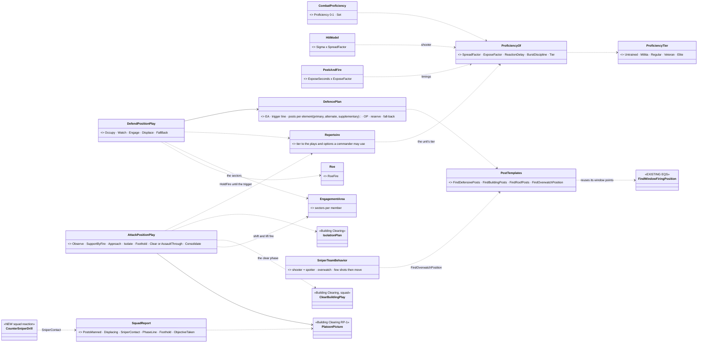
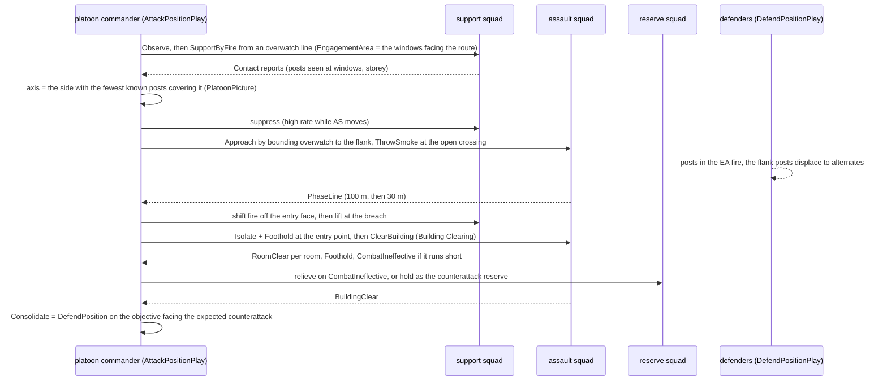
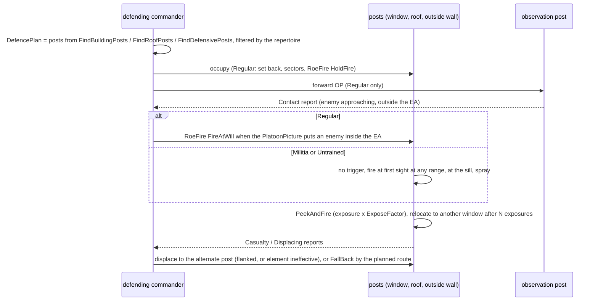
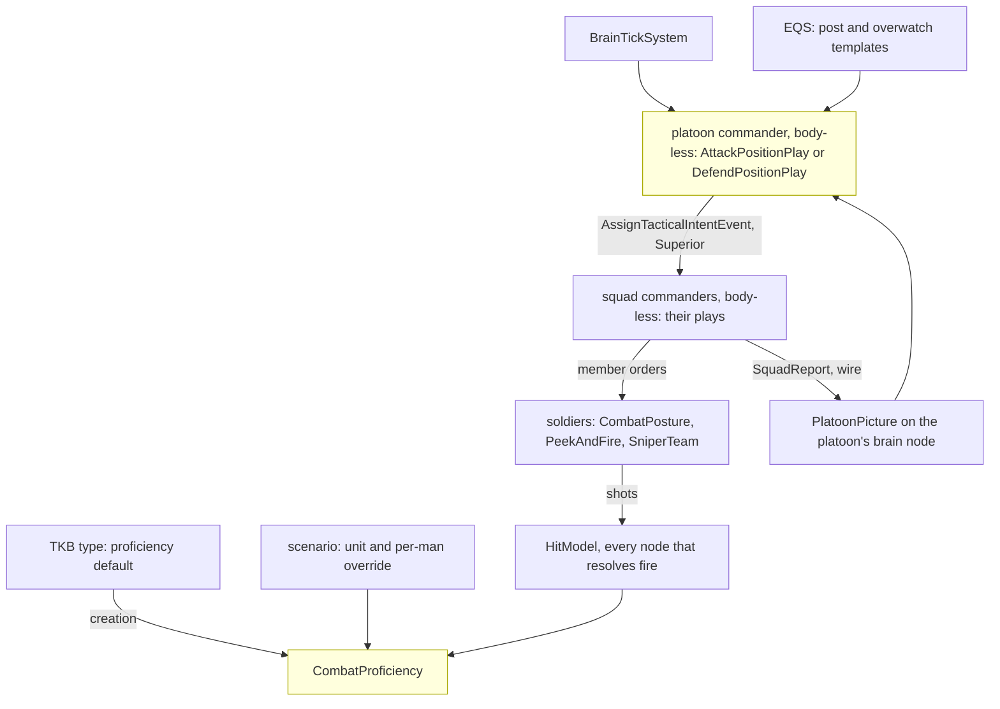
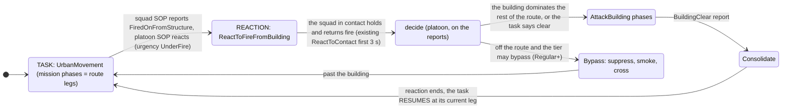
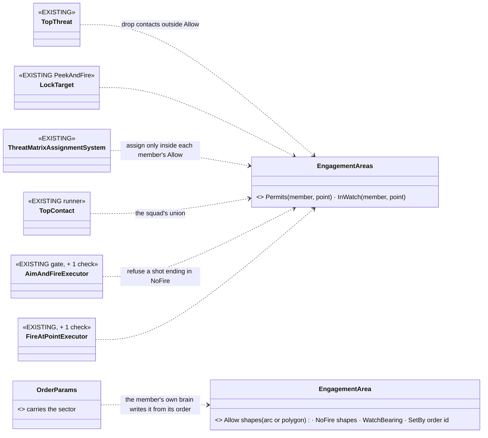
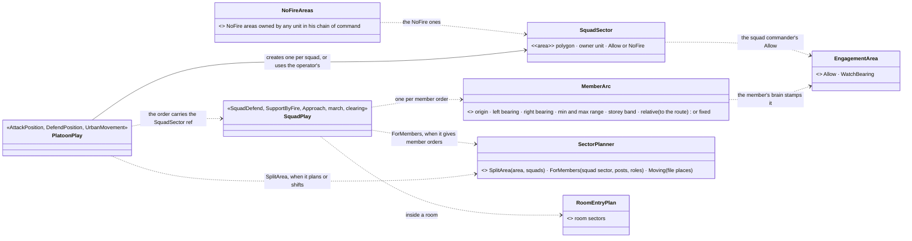
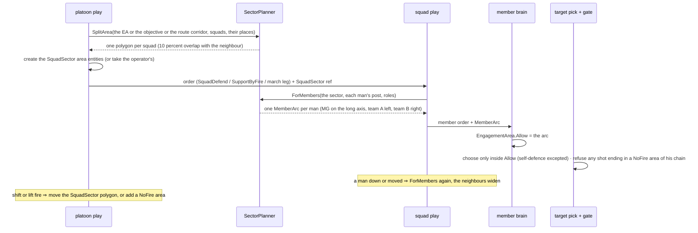
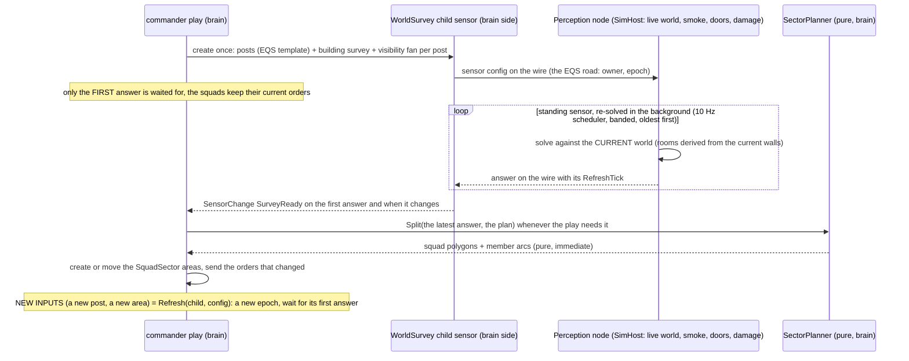
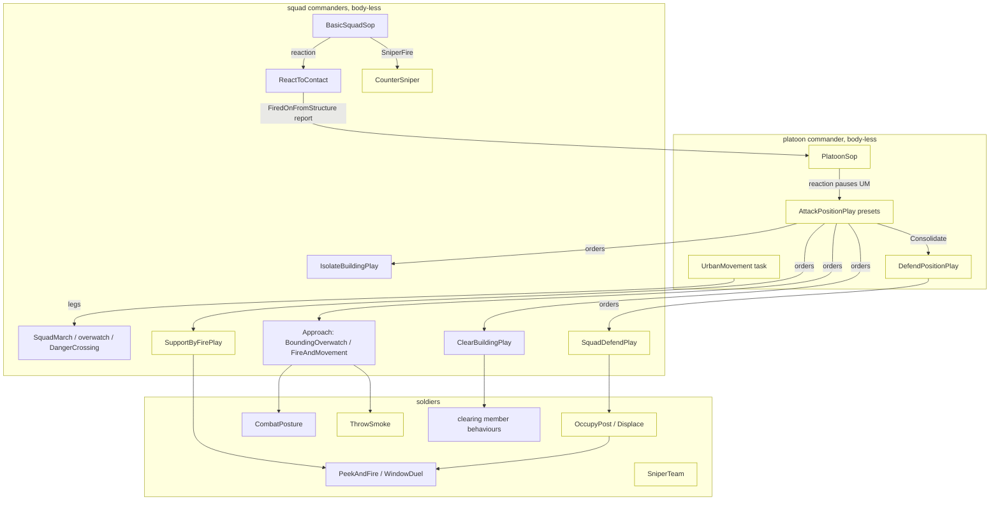

<!--STATUS
state: LIVE
updated: 2026-10-18
build-state: READY-TO-BUILD — DA-1…DA-16 ✅ APPROVED 2026-10-18 (R-2035; DA-9 amended: ClearBuilding stays its own order, §10) · DA-17…DA-23 ✅ APPROVED 2026-10-18 (R-2036); DA-24 ✅ APPROVED (R-2038); DA-25 (§13b, the WorldSurvey sensor) amended by the user (R-2038: standing sensor, rooms derived by the sensor) — taken as approved as amended; R-2037 (the brain never reads world geometry) ruled; tracker CE-2273…CE-2285; backend frame docs/blueprints/batches/HANDOFF_Behaviors_To_Backend_Defend_And_Attack.md (BR-6…BR-11); nothing built
current-answer: §1 doctrine · §2 INVENTORY · §3–§5 the diagrams · §6 decisions · §7 edge cases · §8 slices · §9 demos · §10 presets · §11 composing the commander · §12 roles · §13 sectors · §14 sensors · §15 every behaviour · §16 the roof · §17 test scenarios
stale-below: ⛔ HISTORY at the end (the superseded synchronous §13b).
known-rot: none.
known-conflict: none — the Building Clearing platoon play is RESOLVED as the ClearBuilding preset (§10, R-2035).
related-designs:
  - docs/designs/group-maneuvers/DESIGN_Command_Chain_Example.md — the concrete command machinery (CommandPicture, staff, OrderSubordinate) its platoon plays will run on
  - docs/designs/group-maneuvers/DESIGN_Building_Clearing.md — OWNS the clearing drill (rooms, entry, sectors, reports R-2031, EngagementArea, BuildingClearance, the platoon frame SL-0); this design is the ATTACK in front of it and the DEFENCE it meets
  - docs/DESIGN_Temperament_And_Stress.md — OWNS a man's will (RiskAcceptance, Obedience, Nerve, Resolve, stress, the break); this design adds his ABILITY (proficiency) beside it and never merges the two
  - docs/DESIGN_Peek_And_Fire.md — OWNS the expose / hide / relocate cycle (PeekAndFire, WindowDuel, FiringPositionMemory); defenders at windows and attackers behind cover run it, with proficiency setting its timings
  - docs/DESIGN_Building_Interiors.md — OWNS storeys, wall openings, window firing points (§3l), stairs and the roof slab; the defence's building posts are generated from them
  - docs/designs/group-maneuvers/DESIGN_Squad_Tactics.md — OWNS the squad drills (suppress-and-manoeuvre, fire and movement, bounding overwatch, danger crossing, casualty care) the attack's squads run
  - docs/designs/group-maneuvers/Squad_Coordination_Design_v1_1.md — OWNS the roster, roles and fire allocation inside a squad
  - docs/designs/hill-attack/DESIGN.md — the one built platoon commander (R-2022 shoot-and-duck, R-2023 never the same spot twice); its intent dispatch is the precedent for ordering squads
  - docs/blueprints/Architect_Question_85_Hit_Chance.md — OWNS the hit model's spread; DA-2 adds one shooter factor to it
  - docs/blueprints/batches/HANDOFF_Behaviors_To_Backend_Defend_And_Attack.md — the backend frame: spread factor, acquisition by exposure, LMGs and roles on the wire, sniper / DMR / scope, BuildingOf(point), trenches later
  - docs/designs/look-direction/DESIGN_Look_Direction_And_FOV.md — OWNS where a man looks (LD-1…LD-3); the march watch sectors and EngagementArea.WatchBearing point the eyes once it lands
  - docs/DESIGN_Orders_Params_Entity_Classes.md — OWNS R-2003 (a sector is an area entity) and the Designate › Set sector gesture (§13.3, F10); §13a builds the two sector levels on it
  - docs/DESIGN_Decision_Layer.md — OWNS task · SOP · reaction and resume (§4.1, §4.9); §11's town movement is a task and the attack a reaction
  - docs/DESIGN_Operations_Behaviour_Catalogue.md — the catalogue rows SQD-8 / SQD-11 (defend), D7 (trenches) and the building-post templates this design builds
-->

# Defending and attacking a position — from untrained insurgents to a skilled unit *(behaviors, `2026-10-18`)*

🔒 User, `2026-10-18`: *"I would like to design also behaviors for defending certain place including multi story buildings and
corresponding attack tactics. Defenders and attackers skill level needs to be settable from a group of untrained insurgents to a skilled
military unit - it migh drive the tactics chosen by their commanders. Defenders are usually prepared, using varoous cover spots outside
(behinds walls, obstacles, in dug-in holes..) as well as inside (behind windows - lean and peek might apply for observation, quick shot
while in fight), on the roof etc. Attackers need to advance, closing, using cover behind obstacles,busing short peek and shot, flanking
the building etc … Snipers migh help on both sides."* · *"This likely includes multi team coordination"* · *"The attack and building
clear might be connected in natural sequece i guess"*.

**The decision in one line (lean):** a per-man **`CombatProficiency`** (one 0–1 value, five named tiers) that sets how well he shoots,
how briefly he shows himself and how fast he reacts, and that **gates the plays his commander may choose**. On top of it go two
platoon plays: **`DefendPosition`**, which generates prepared posts outside, at windows on every storey and on the roof, with sectors,
a trigger line, alternates and a fall-back; and **`AttackPosition`**, which runs observe → support by fire → approach → isolate →
foothold → clear or assault through → consolidate. For a building, **the clearing already designed becomes the attack's last phases**.
Snipers are a two-man team behaviour used by both sides. Every hand-off between teams rides the networked squad reports (R-2031).

## 1. Doctrine — what real forces do *(US Army ATP 3-21.8 Infantry Platoon and Squad: the defence and the attack chapters; ATP 3-06.11 Combined Arms Operations in Urban Terrain; breaching fundamentals SOSRA: suppress, obscure, secure, reduce, assault; sniper employment, FM 3-22.10 / ATP 3-21.18)*

| | defence | attack |
|---|---|---|
| **the plan** | an engagement area (EA) where the enemy is to be killed · a trigger line where fire opens · each element a **sector** · **primary, alternate, supplementary** positions · an observation post (OP) forward · a reserve · a fall-back route | **isolate** the objective · a **support-by-fire** (SBF) element suppresses it · the **assault** element moves by covered routes, usually to a **flank** · **obscure** with smoke where it must cross open ground · gain a **foothold** · clear · **consolidate** and get ready for the counterattack |
| **buildings** | fight from **inside the room, set back** from the window, never on the sill · upper storeys for fields of fire, the ground floor held lightly · the roof for observation and snipers, but exposed to air and indirect fire · withdrawal routes planned before the fight | suppress **every window that sees the assault's route** · shift and then **lift** fire as the assault reaches the building, so as not to hit your own · enter at the least defended point, from the top when there is a way up · then the clearing drill (Building Clearing §1) |
| **fire control** | hold fire until the enemy is inside the EA (an ambush effect) · mutual support between positions · the final protective line when he closes | the SBF fires at known and likely posts, rate high at the assault's move, low otherwise · the assault fires only when it must |
| **snipers** | far back, deep in a room, few shots, then move · targets: leaders, machine-gunners, snipers, radio | the same from an overwatch with a long line of sight · counter-sniper: locate, then suppress with heavy fire, smoke, manoeuvre or a sniper |
| **untrained / irregulars** | occupy windows and roofs, open fire at first sight at any range, spray, shoot and move to another window, withdraw or blend in individually, no sectors and no reserve | mass rush on the nearest axis with covering spray, little use of cover or smoke, high casualties, breaks under fire |

## 2. INVENTORY *(2026-10-18 — codebase-memory CLI `search_graph` over Class / Method / Enum / Struct for `Storey|Floor`, `Roof`, `Window|Loophole|FiringPost|BuildingPost`, `Flank`, `Overwatch`, `Smoke`, `Skill|Proficien|Training|Marksman|Veteran`, `Trench|Foxhole|DugIn|Fortif|Bunker|Sandbag|Obstacle`, `Defen[cs]e|Defend|HoldPosition|Occupy`, `Sniper`, `.*Play` (16 squad plays); grep for `ISquadPlay`, `DefendArea`, `FallBack`; one read-only code sweep, nine questions, every answer opened at the line; the design corpus sweep for defence / attack / snipers / skill. `check_index_coverage` NOT run — CLI only)*

| need | exists | where | missing |
|---|---|---|---|
| a defend order | ⚠ `DefendArea` intent → infantry run `CombatPosture`, moving to the area's centre and holding within its radius; **no posts, no sectors** · `CommanderNodes` sends a hard-coded `DefendArea` with empty params (TODOs) | `Mappers/DefendAreaMapper.cs:48-49`; `Brains/CommanderNodes.cs:68-88` | the plan, the posts, the sectors, fire control (DA-4…DA-7) |
| squad plays | ✅ 16 `ISquadPlay`s on one runner — march, suppress-and-manoeuvre, fire and movement, bounding overwatch, danger crossing, hold, break contact, casualty care, embark / dismount, airborne, fast rope, battery fire mission; **none defends** | `Brains/*Behavior.cs`, `SquadManeuverRunner.cs` | `DefendPositionPlay`, `AttackPositionPlay` |
| a platoon commander | ✅ hill attack: a BTree of C# nodes ordering its tanks by `AssignTacticalIntentEvent` (origin Superior): `MoveToLocation`, then `HullDownAttack` in alternating waves; **no SBF element** (the idle half is just not ordered) | `HillAttackCommanderNodes.cs:164-170, 385-412, 531-537, 745-786` | squads as subordinates (SL-0, Building Clearing), a support element |
| storeys, stairs, roof | ✅ a building template holds storeys; walls are cut around openings, upper storeys become slabs, stairs ramps, a flat roof a walkable slab; the navmesh climbs the stair; **`house-2f`** (two storeys, windows, stairs, flat roof) in `bt-range`, placed twice | `Terrain/TerrainBuildingExpander.cs:65-143, 214-230`; `TerrainBuildings.cs:69-83`; `bt-range/buildings/house-2f.building.json`; `RecastNavmeshFactoryTests.cs:100-117, 166` | ⚠ house-2f has **no stair to the roof** (the expander allows one, `:122-128`) |
| windows | ✅ real OPENINGS: wall below the 0.9 m sill and above the 2.1 m head, nothing between — sight and rounds pass; a `glass` material exists, unused | `TerrainBuildingExpander.cs:34, 180-182, 226-227`; `materials.json:10` | — |
| window firing posts | ✅ `FindWindowFiringPosition`: a point on the inside face of each window at the lowest stance that clears the sill, filtered by seeing the target | `Spatial/Eqs/StarterTemplates.cs:32`; `TerrainCoverProvider.cs:122-129, 172-182` | a **set-back** post deep in the room (DA-6) |
| expose / hide / relocate | ✅ `PeekAndFire` + `WindowDuel` (window shape: prone under the sill, up at it, another window after 3 exposures; street shape: crouched behind cover, steps out, suppresses, relocates ≥ 8 m); exposure = max(`ExposeSeconds` 3 s, 2 × aim time 0.8 s) | `Brains/WindowDuelBehavior.cs:25-45`; `PeekAndFireNodes.cs:178, 233-234`; `AimAndFireExecutor.cs:819-821` | proficiency to set the timings (DA-2) |
| outside cover | ✅ static obstacles with a height: cover points stand ≥ 1.5 m, crouch ≥ 0.9 m, prone ≥ 0.45 m; `sandbags` and `earth-berm` materials; the shot and the "am I hidden" tests use the stance's eye and body points | `StaticObstacleDto.cs:15-28`; `TerrainCoverProvider.cs:70-73, 114-116`; `CheapLineOfSightTest.cs:101-131`; `materials.json:12-13` | — |
| dug-in holes, trenches | ⛔ none in code; D7 (authored polylines cut into height and navmesh) decided, not built | `DESIGN_Operations_Behaviour_Catalogue.md:243, 299, 316` | DA-8 |
| flank / retreat / fire points | ✅ `FindFlankingPosition` (side-on ring around the target) used by suppress-and-manoeuvre and `Flank` · `FindSafeRetreatPoint` (R-3004, always answers) · `FindOpenFiringPosition` · `FindCoverFromTarget` · `FindThrowingPosition` | `StarterTemplates.cs:11, 51, 75, 95`; `SuppressAndManeuverBehavior.cs:187` | `FindDefensivePosts`, `FindBuildingPosts`, `FindRoofPosts`, `FindOverwatchPosition` (catalogue rows only) |
| smoke | ✅ a Smoke warhead makes a cloud that passes 10 % of sight, blocks through not beside or over, thins at its edge; **TKB smoke grenade 6041** (8 m radius, 4 m high, 75 s) | `Combat/Systems/AreaEffectSystem.cs:64, 101-106`; `AreaEffectCloudTests.cs:130-153`; `MunitionTkbCatalog.cs:130, 304-306` | ⛔ **no loadout carries it, no behaviour throws it** (DA-12) · ⚠ the catalogue's "no smoke" row is stale |
| skill | ⛔ **none**: spread = mount `DispersionMils` × moving 2 × under fire 2 × stance (prone 0.5, crouched 0.75) × wounded arm 1.6; no shooter factor; deflection horizontal only | `Combat/HitModel.cs:45-58, 106-112` | DA-1, DA-2 |
| detection vs exposure | ⚠ seen the tick any ONE of 2–3 body points has a clear line; no exposure fraction, no acquisition time | `LosStrategies.cs:283-302, 438-440`; `ContactHysteresis.cs:8-10`; `VisualPerception.cs:115-131` | DA-3 |
| snipers | ⛔ no sniper or marksman weapon, no scope; the only optics are binoculars (×2 range, 10° FOV) | `Combat/HeldItems.cs:17, 20`; `VisualPerception.cs:63-68` | DA-13 |
| where a shot came from | ⛔ `NearMissEvent` carries the unit and the closest point, **not the shooter or the round's origin** | `Combat/Events/NearMissEvent.cs:16-26` | DA-14 (backend) |
| fire control | ✅ ROE `RoeFire { HoldFire, ReturnFire, FireAtWill }` + `ForceLevel` on the unit | `Behavior/Components/Roe.cs:9-35` | the trigger that lifts it (DA-7) |
| sectors | 🆕 designed: `EngagementArea` (per member, read by the target pick before the gate) | Building Clearing §7a (CB-4, CB-18) | — reuse |
| the platoon frame and reports | 🆕 designed: SL-0 (`Unit_InfantryPlatoon`, `CombatEffective`, a nested hierarchy run), RP-1 (`SquadReport` on the wire, `ReportOutbox`, `PlatoonPicture`) | Building Clearing §7 (`CE-2262`, `CE-2263`); backend BR-3 | — reuse; new report kinds (DA-15) |
| temperament | ✅ `CombatTemperament` (RiskAcceptance, Obedience) + designed Nerve, Resolve, stress, the break | AQ89; Temperament design | — reuse; kept apart from skill |
| retreat | ✅ `FallBack` (R-259), squad `BreakContact` | `SquadContactBehaviors.cs:191`; `FallBack.btree.json` | — reuse |

## 3. Classes

*What the picture shows that prose hid:* skill reaches the world through only TWO existing places, the hit model's spread and peek's
timings, plus one new gate, the repertoire. Both platoon plays sit on the clearing design's platoon frame, its reports and its
`EngagementArea`, so sectors, shifting fire and "don't fire into rooms we hold" are one mechanism, not three. The building attack ENDS
in the existing `ClearBuildingPlay`, not a second clearing.

## 4. Sequences

### 4.1 Attack on a defended two-storey building (regular platoon)

*What the picture shows that prose hid:* every phase change waits on a REPORT, not a clock. The 3 s report delay (R-2031) is the friction
that makes "lift fire" a real coordination risk. The reserve is a decision on a report, not a fixed phase.

### 4.2 Defence of the same building (militia vs regular, side by side)

*What the picture shows that prose hid:* the tiers do not need two behaviours. The same play runs, and the repertoire turns off the OP, the
trigger line, the set-back and the sectors, which is exactly how irregulars differ.

## 5. Modules — who runs it each frame

*Caption:* the only per-frame engine change is one factor in the hit model, read where fire is resolved; everything else runs on the brain
node inside plays the runner already ticks. ⚠ **Not reached today:** a platoon over infantry squads has never run (SL-0 makes it run first).

## 6. Decisions *(✅ approved 2026-10-18, R-2035 — 🔒 "Perfect."; DA-9 as amended in §10)*

| id | decision | ⭐ lean | rejected — one line each |
|---|---|---|---|
| **DA-1** | what skill is | **one `CombatProficiency` 0–1 per man, beside `CombatTemperament`**, five named tiers as presets: Untrained 0.1 · Militia 0.35 · Regular 0.6 · Veteran 0.8 · Elite 0.95. Set like temperament: a TKB type default (insurgent Militia, soldier Regular, police Regular), a **unit-level setting that fills every member not authored**, a per-man scenario override; unset reads Regular | many separate skills (marksmanship, fieldcraft, tactics): five sliders per man is unauthorable · folding it into temperament: will and ability are different (a brave novice, a careful expert) |
| **DA-2** | what skill changes in a man | through **`ProficiencyOf`**, each **exactly 1.0 / 0 at Regular** so every existing rail and demo is unchanged: spread × (Untrained 2.5 · Militia 1.6 · Regular 1.0 · Veteran 0.8 · Elite 0.65, linear between) · exposure time × (1.8 … 1.0 … 0.7) · reaction delay before the first shot at a new contact (+1.2 s … 0 … 0) · burst discipline (Untrained empties the magazine, Militia long bursts, Regular+ aimed / controlled) · cover discipline (below Regular: stays at the sill, does not change window after N exposures) | skill on the weapon: a rifle is not trained · range-dependent skill: the spread is already angular, so error grows with range |
| **DA-3** | detection vs exposure | ⭐ **acquisition time by exposure** (backend frame): a contact is acquired after a delay that grows with range and with how little of the man shows (body points visible of those his stance has) and shrinks with the observer's proficiency; **0 for a fully exposed man within 100 m** ⇒ close-range rails unchanged. Without it, a short peek and a set-back window post protect only against being HIT, never against being SEEN | keep instant detection: makes the peek, the set-back and the sniper's hide meaningless for sight · a full silhouette-area model: costlier, same behaviour |
| **DA-4** | the defence plan | **`DefencePlan` computed when the order is given**: the EA (the order's polygon, or the area in front of the position along the threat axis) · the threat axis (the order's, else from the picture) · per element **primary + alternate + supplementary** posts · an OP forward · a reserve (one squad of three) · a fall-back route (`FindSafeRetreatPoint` from the position). Re-planned only on a new axis (supplementary posts face it) | a fixed plan authored per scenario: works once · re-plan every frame: posts dither |
| **DA-5** | where the posts come from | **new EQS templates**, scored for: sees into the EA, cover from the threat axis, ≥ 8 m from the next post, **mutual support** (sees a neighbour's front): `FindDefensivePosts` (outside cover, walls, sandbags, berms), `FindBuildingPosts` (per storey, windows facing the EA, upper storey preferred, ground floor lightly held), `FindRoofPosts` (roof edge, prone, only if the roof is reachable). ⭐ An **authored fighting position** in the scenario (a point + facing) is preferred over a generated one | only authored posts: a defence needs hand-placing in every scenario · only generated: the scenario author cannot say "the MG goes here" |
| **DA-6** | fighting from a window | Regular+ fight from a **set-back post** 1.5–2.5 m inside the room on the line through the window (sees a narrower arc, is far harder to see, needs DA-3 to matter); below Regular **at the sill** (today's `FindWindowFiringPosition`). Observation is a lean / peek at the window frame (BR-5); a quick shot is `PeekAndFire`'s window shape with DA-2 timings, **relocating to another window after N exposures** (R-2023's rule for infantry) | always at the sill: the doctrinal error irregulars make, wrong for regulars · always set back: untrained should be easier to kill |
| **DA-7** | fire control in defence | Regular+ start at **`RoeFire.HoldFire`** with the EA as their `EngagementArea`; the commander lifts to `FireAtWill` when the picture puts an enemy inside the EA (or a post is fired upon: `ReturnFire` already allows it). Below Regular: `FireAtWill` from the start, no EA | a new "trigger" mechanism: ROE already holds and lifts fire, networked |
| **DA-8** | dug-in holes and trenches | ⭐ **phase 2, backend frame**: a `FightingPosition` world object (foxhole, trench section) that lowers its occupant's body points by its depth and joins the navmesh. ⭐ **Phase 1 uses what exists**: sandbag walls and earth berms as static obstacles (cover height already ruled by the stance thresholds) | build trenches first: the whole of D7 (height-grid carve, navmesh) for the same behaviour a 1 m berm gives |
| **DA-9** | the attack and the clearing | ⭐ **ONE platoon play `AttackPosition`**: Observe → SupportByFire → Approach → Isolate → Foothold → Clear (building: `ClearBuildingPlay` on the assault squad) or AssaultThrough (open position: suppress-and-manoeuvre's assault) → Consolidate (= `DefendPosition` on the objective). **`IsolateAndClear` (PL-1) becomes this play** — a clear with no opposition is the same play with an empty approach. ⚠ Changes the approved clearing design's platoon section: everything else in it stays | two plays chained: both would own "isolate" and the hand-off between them |
| **DA-10** | choosing the axis | the commander picks the **assault position on the side of the objective covered by the fewest KNOWN posts** (picture), reached by a covered route: v1 = `FindFlankingPosition` around the objective with `ThreatExposureTest` against the known posts, then bounding overwatch between cover. A path-exposure route planner is v2 | always frontal: the irregular's choice, kept for Untrained · a full route planner first: v1 already flanks |
| **DA-11** | support by fire, shift and lift | the SBF squad watches and suppresses the **windows / posts that see the assault's route** (its `EngagementArea`); on the assault's **PhaseLine** reports it shifts off the entry face, at **Foothold** it lifts to depth (the upper storey, the roof, the next building). Fire into a room the attackers hold is refused (CB-18, same component) | fixed timings: friendly fire whenever the assault is slow · no shifting: the assault walks into its own SBF |
| **DA-12** | smoke | smoke grenade 6041 into **Regular+ loadouts** (one or two per man); a `ThrowSmoke` member order at a point between the element and the known posts; the attack uses it at **open crossings** (the danger-crossing drill's open stretch) and on the **breach face**; a defender uses it to **break contact** | smoke only by the commander: a squad crossing a street would wait for a report round trip |
| **DA-13** | snipers | a **sniper team** (shooter + spotter) behaviour for both sides: `FindOverwatchPosition` (300–800 m, long line of sight to the objective, set back inside a building or behind cover) · targets in order: snipers, MG gunners, leaders, window posts · **few shots, then relocate** (R-2023) · the spotter reports `Contact`s up. ⚠ Needs from backend / TKB: a **sniper rifle** (≈ 0.3 mil spread) and a **designated-marksman rifle** (≈ 1 mil), a **scope** on the mount (×4 range, narrow FOV: the binocular rule on a weapon) | a sniper as a better rifleman: without the hide and the relocation he dies to the first SBF |
| **DA-14** | counter-sniper | a squad taking **near misses from an unseen long-range shooter** reports `SniperContact` (the bearing) and goes to cover; the commander answers by tier: Regular+ suppress the suspected building with the SBF, smoke, and send the own sniper or manoeuvre; below Regular, spray in the general direction. ⚠ Needs the **round's origin on `NearMissEvent`** (backend: the ballistics knows it) | guess the direction from the squad's contacts: an unseen sniper is not a contact |
| **DA-15** | coordination across teams | **only orders down and reports up** on the existing paths: `AssignTacticalIntentEvent` (Superior) to squads, `SquadReport` (R-2031) to the platoon; new kinds **`PostsManned · Displacing · SniperContact · PhaseLine · Foothold · ObjectiveTaken`** beside the clearing's. Both sides' commanders decide from their `PlatoonPicture`, never from the other squads' brains | a shared platoon blackboard: R-2031 forbids it ("nothing hidden inside single brain only") |
| **DA-16** | what the tier lets a commander do (the repertoire) | **Untrained**: defend = occupy the nearest windows and roof, no plan · attack = frontal rush with spray, no smoke. **Militia**: + a base of fire and a rush, posts at the sill, individual withdrawal. **Regular**: the full plans (sectors, trigger, OP, alternates; SBF, flank, bounding, smoke, shift / lift). **Veteran**: + reserve counterattack, set-back posts everywhere, a DMR. **Elite**: + multiple assault axes, roof entry when there is a way up (fast rope exists), a sniper team, smoke on every breach. The commander's tier is his unit's median man | the commander's own skill only: a skilled officer with untrained men cannot run a regular's plan |

## 7. Edge cases

| case | what happens |
|---|---|
| the defenders fall back UPWARD while the building is being cleared | rooms they leave are `Suspected` again for the clearing (Building Clearing `BuildingClearance`); the stair is a danger area; a defender who is cornered upstairs fights or surrenders by Resolve (CB-28) |
| the attack comes from an unexpected side | defenders re-plan on the new axis: they move to **supplementary** posts; untrained just turn and shoot from where they are |
| the SBF loses line of sight (smoke, its own losses) | it reports, and the commander holds the assault at the last phase line until fire is re-established or another squad takes over the SBF |
| the assault squad is shot below combat effective in the approach | `CombatIneffective` report; the reserve takes the assault (Regular+), else the attack is broken off by `BreakContact` |
| a defender sniper kills the attacking platoon leader | succession (Squad Tactics §7.2) at squad level; at platoon level the senior squad leader's commander takes the play, reported |
| ammo low on the SBF | the rate drops (the Ammo input already damps Suppress); a `CombatIneffective` with reason ammo when empty |
| civilians in the building | the clearing's civilian rules apply in the clear phase; the SBF fires only at seen combatants (ROE `Status`) |
| both sides untrained | no plans, no smoke, both spray: the fight is decided by numbers and cover, which is the point of the demo |
| a roof with no stair (house-2f) | `FindRoofPosts` returns nothing (not reachable); an Elite attacker may still fast-rope onto it |
| the defence breaks (stress) | men break individually (TS-6), and the post's element reports `Displacing`; the commander orders the fall-back if more than half are gone |

## 8. Slices *(behaviors `CE-2273`…`CE-2285`; backend BR-6…BR-11 in the handoff)*

| order | slice | owner | what | needs |
|---|---|---|---|---|
| 1 | **DA-A** `CE-2273` | behaviors | `CombatProficiency` + `ProficiencyOf` + tiers + unit fill + translator key (DA-1); neutral rail: Regular reads exactly today | — |
| 2 | **DA-B** (backend BR-6, BR-7) | backend (frame) | the spread factor in `HitModel` (DA-2) · acquisition time by exposure (DA-3) · the round's origin on `NearMissEvent` (DA-14) | DA-A |
| 3 | **DA-C** `CE-2274` | behaviors | the DA-2 timings in `PeekAndFire` (exposure, relocation, cover discipline, reaction delay, bursts) | DA-A |
| 4 | **DA-D** `CE-2275` | behaviors | `DefencePlan` + `FindDefensivePosts` / `FindBuildingPosts` / `FindRoofPosts` + set-back posts + `DefendPositionPlay` at **squad** level, sectors via `EngagementArea`, HoldFire and its lift (DA-4…DA-7); `DefendArea` maps to it | DA-C, Clearing BC-1 (`EngagementArea`) |
| 5 | **DA-E** `CE-2276` | behaviors | platoon defence: OP, reserve, alternates, displacement, fall-back, storeys; the report kinds (DA-15) | DA-D, SL-0, RP-1 |
| 6 | **DA-F** `CE-2277` | behaviors | `AttackPositionPlay` (DA-9…DA-11) absorbing PL-1: SBF, axis, approach, shift and lift, isolate, foothold, clear / assault through, consolidate | DA-E, Clearing BC-3 |
| 7 | **DA-G** `CE-2278` | behaviors + TKB | smoke loadout and `ThrowSmoke` (DA-12) | DA-F |
| 8 | **DA-H** `CE-2279` | behaviors + backend / TKB | sniper and DMR weapons, the scope, `FindOverwatchPosition`, `SniperTeamBehavior`, the counter-sniper drill (DA-13, DA-14) | DA-B, DA-F |
| 9 | **DA-I** `CE-2280` | behaviors | the repertoire gate in both commanders (DA-16) + the tier ladder of demos (§9) | DA-F…DA-H |
| — | **DA-J** (backend BR-11) | backend (frame, later) | `FightingPosition` holes and trenches (DA-8, D7) | — |
| 2a | **DA-K** `CE-2281` | behaviors + backend / TKB | roles (DA-19): the new `TacticalDesignation` values + fire team index, the element split by team, the MG first into the base of fire; the infantry LMGs and their carriers (TKB) | DA-A |
| 3a | **DA-L** `CE-2282` | behaviors | `EngagementArea` with `Allow` / `NoFire` in the five target picks and the two gates (DA-20) — ⭐ ONE build shared with Building Clearing BC-1 | — |
| 3b | **DA-M** `CE-2283` | behaviors + backend | the new sensor changes (DA-21); building / storey / room of a point from a PointSurvey answer (R-2037) | DA-L, DA-P |
| 6a | **DA-N** `CE-2284` | behaviors | `UrbanMovement`, `PlatoonSop`, the `ReactToFireFromBuilding` preset with clear / bypass (DA-17, DA-18) | DA-F, DA-M |
| 1a | **DA-O** `CE-2285` | behaviors (FDP Terrain, cross-lane) | `roof` as rings + `house-3f` with the roof stair house and parapet (DA-22) | — |
| 0 | **DA-P** (backend BR-12) | backend | the `WorldSurvey` sensor: VisibilityFan · BuildingSurvey · PointSurvey, solved on the muscle (DA-25, R-2037) | — |
| 0a | **DA-Q** `CE-2286` | behaviors | move behaviors' brain-side geometry reads onto WorldSurvey / EQS answers (§13b table) + the conformance rail | DA-P |

## 9. Demos *(each with an HTTP live check and an in-process twin; `bt-range` and its two `house-2f`, a roof stair added for the roof demos)*

| demo | cast | must end with |
|---|---|---|
| `dp-squad-wall` | a regular squad behind sandbag walls defending a road, an enemy squad walking in | posts spread ≥ 8 m with overlapping arcs (posture trace) · nobody fires before the first enemy crosses the trigger line (`/combat/shots` times × positions) · then all fire within 1 s |
| `dp-insurgents-house` | six militia in `house-2f`, two on the upper storey, one on the roof, a regular squad approaching | they open fire at first sight (> 300 m), at the sill, and change window after their exposures · their hit rate is below the regulars' (`/combat/shots` hits / shots per side) |
| `ap-squad-vs-wall` | a regular squad attacking two men behind a wall | one element suppresses while the other flanks (`FindFlankingPosition`), then assaults; the wall's men are hit from the side |
| ⭐ `ap-platoon-house` | a regular platoon (support, assault, reserve) against eight regular defenders in `house-2f` | the full §4.1 sequence in the report log: `Contact` → `PhaseLine` ×2 → `Foothold` → `RoomClear` per room → `BuildingClear` → `PostsManned` (consolidate) · ⭐ **no SBF round crosses a window of a room the attackers then held** · the report log identical on CGF, SimHost and IG |
| `ap-untrained-rush` | a militia platoon attacking two regular squads dug behind berms | a frontal rush with no smoke; most attackers down before 50 m; the survivors break (`StressBreak`) |
| `ap-elite-smoke` | an elite platoon against militia in `house-2f` | smoke on the open crossing and the breach face, a second axis from the roof by fast rope, few attacker casualties |
| `sn-sniper-duel` | a sniper team on each side, 500 m apart, a regular squad with each | each sniper fires ≤ 3 shots per position then relocates · the squad under sniper fire reports `SniperContact` with a bearing within 15° of the true one and suppresses that building |
| `tier-ladder` | the same house, the same attack, run five times with both sides at each tier | the attacker's casualties fall and the time to `BuildingClear` falls as the tier rises (a table in the run report) |

## 10. One play, presets — the clearing stays its own ORDER *(✅ ruled 2026-10-18, R-2035)*

🔒 User, `2026-10-18`: *"Perfect. The building clearing might stay as separate, but in the way as you said, it is the same play, just with different presets."*

| preset (the order a person gives) | phases it runs | who uses it | default settings |
|---|---|---|---|
| **`ClearBuilding`** | Isolate → Foothold → Clear → Consolidate · the Approach runs only if the building fires | police, soldiers searching a building nobody defends | police: `Objective: Arrest`, `ForceLevel: NonLethal`, ROE `ReturnFire` · soldiers: `Eliminate` |
| **`AttackBuilding`** | Observe → SupportByFire → Approach → Isolate → Foothold → Clear → Consolidate | a building known to be defended | `Eliminate`, `FireAtWill` inside the objective |
| **`AttackPosition`** | Observe → SupportByFire → Approach → AssaultThrough → Consolidate | an open position: a wall line, a trench, a compound | `Eliminate` |
| **`ReactToFireFromBuilding`** | *(started by the SOP, never by a person)* the squad in contact IS the support by fire → Approach → Isolate → Foothold → Clear → Consolidate, or **Bypass** (DA-18) | a unit moving through town shot at from a building | inherits the paused task's ROE and objective |

⇒ Building Clearing's `IsolateAndClear` (CB-17/CB-18, PL-1 `CE-2264`) **is** the `ClearBuilding` preset of `AttackPositionPlay`.
Everything else that design ruled (the room drill, entry, sectors, reports, arrest, stun, casualties) is unchanged.

## 11. Composing the commander — moving through town, attacked, clearing, then carrying on

🔒 User, `2026-10-18`, on §11–§17: *"Approved"* (R-2036). *(✅ approved R-2036 — DA-17, DA-18)*

**What exists (measured 2026-10-18):**

| piece | does | where |
|---|---|---|
| **task · SOP · reaction** | a body-less squad commander runs an SOP (`BasicSquadSop`); a `SensorChangedEvent` wakes it; a reaction (origin Reaction, an urgency) **pauses** the task and the task **resumes in place** when the reaction ends; at most one paused task; any new order drops the paused one | `BrainTickSystem.cs:220-246, 445-454`; `BehaviorIngressSystem.cs:258-265, 298-320, 405-418, 459-485`; Decision Layer §4.1, §4.9 (R-199, `CE-2081`) |
| **a mission** | `MissionPlanQueue`: up to 8 phases, each a behaviour + a trigger (TimerElapsed · UnderAttack · HealthCritical · BehaviorFinished); a reaction's end does NOT advance the phase; a faulted phase halts the plan | `MissionComponents.cs:42-62, 140-170`; `MissionDirectorSystem.cs:102-103, 126-146, 211-229` |
| **moving** | `SquadMarch` (file, wedge, line), travelling / bounding overwatch; a danger-area sensor along the route (street crossing ≤ 40 m, **intersection** = a node of ≥ 3 roads, open ground ≥ 20 m) ⇒ `DangerAreaAhead` ⇒ `SquadDangerCrossing` | `SquadMarchBehavior.cs:34-100, 208-213`; `DangerAlongRouteClassifier.cs:3-37, 250`; `SquadDangerCrossingBehavior.cs:44-228` |
| **react to contact** | squad: 3 s return fire and hold, then decide once: Assault · BreakContact · Hold · Rescue; ⛔ **no building case** — the contact is a 2-D point | `SquadContactBehaviors.cs:279-520`; `SquadContactResponseDecision.cs:35-51` |
| **looking at windows** | ⛔ nothing: `Watch` = go there and hold, no facing; vision is 360° for every soldier until LD-1…LD-3 (look direction, designed) | `SquadManeuverRunner.cs:50-53`; Look Direction §1.1–§1.3 |

*What the picture shows that prose hid:* the switch is **not** authored into the movement behaviour. The movement is the platoon's
TASK, the attack is a REACTION its SOP starts, and the existing gate pauses and resumes the task. ⚠ The one measured catch: when the
platoon orders its squads into the attack, **that new order drops each squad's own paused march leg** (`BehaviorIngressSystem.cs:417`).
So the platoon's resumed task re-issues the legs to the squads from where they now stand. Squads never resume on their own.

| id | decision | ⭐ lean | rejected — one line each |
|---|---|---|---|
| **DA-17** | the town movement | a platoon task **`UrbanMovement`**: the route as mission legs; one squad leads in travelling overwatch, one bounds behind it, one is the reserve; each squad marches in a file along the building lines, each man given a **watch sector** (front, left windows, right windows, rear, upper storeys) by his place in the file (§13); intersections and open stretches go through the existing danger-area drill | one big "patrol" behaviour holding every reaction: the user's own SOP ruling (Decision Layer §4) forbids embedding reactions in tasks |
| **DA-18** | after fire from a building | the platoon SOP decides once from its picture: **clear** when the building is within 50 m of the remaining route, or the task says "secure the route" · **bypass** (suppress + smoke + cross out of its arcs) when it is off the route and the tier is Regular+ · Untrained and Militia always assault it head-on. Then the reaction ends and the task resumes | always clear: a unit would spend the day on every window that fires once · always bypass: leaves an enemy behind the column |

## 12. Roles in the squad *(✅ approved R-2036 — DA-19)*

**Measured:** roles exist as **`TacticalDesignation`** — `Commander · SquadLeader · Wingman · Support · TeamLeader · Medic`
(`Fdp.Core/CommandHierarchy/TacticalDesignation.cs:8-20`; TeamLeader and Medic are CGF-local, not on the NED wire enum), stored on
`UnitRoster.TacticalDesignations[]` and `UnitSubordinate.Designation`, set by the TKB composition (squad = 1 SquadLeader + 9 Wingman,
`BdcTkbCatalog.cs:748-749`) or the scenario (`"Designation": "Medic"`). **Read by only two things:** leader succession
(`SquadSensing.cs:92-170`) and casualty care's medic pick (`CasualtyCareBehavior.cs:262-265`). ⛔ **The element split and fire
allocation ignore roles** — the base of fire is "the first half of the roster" (`SuppressAndManeuverManeuver.cs:66-74`). ⛔ **No
infantry machine gun exists**: the only MachineGun-category weapons are a tank coax, crew-served M2 / DShK, M134, a sentry gun and
the ZU-23; no infantry type carries one; `M249` is only a ballistic reference row.

| id | decision | ⭐ lean | rejected — one line each |
|---|---|---|---|
| **DA-19** | roles | **append** `AutomaticRifleman · MachineGunner · Grenadier · Marksman · AntiTank` to `TacticalDesignation`, plus a **fire team index** (A / B) per member — the doctrinal 9-man squad: a leader + two teams of four (team leader, automatic rifleman, grenadier, rifleman). Readers: the element split goes **by fire team**, not by roster halves · the base of fire and the SBF take the AR / MG first · a defence puts the MG on the post with the longest view down the EA (its final protective line) · the clearing stack never puts the AR first · the sniper team is two Marksmen · a casualty's role is taken over (the next rifleman picks up the AR's role). ⚠ Needs from backend / TKB: an **infantry LMG** (M249-class, and a PKM-class for the other side) and a soldier type carrying it; the wire enum gains the new values | a role component separate from the designation: two stores of one fact · roles inferred from the weapon carried: a rifleman who picks up the MG would need re-inferring every frame, and the medic carries a rifle |

## 13. Sectors — how they are assigned and how a man keeps to his *(✅ approved R-2036 — DA-20)*

**Measured:** ⛔ **no sector, arc or engagement-area restriction exists anywhere** (only a turret's traverse limit). A target is chosen
in **five places**: `EqsTacticsNodes.TopThreat` (`:322-348`, an ordered target first, else the `ThreatRankingDecision` utility),
`TopAim` (`:373-388`, a heard point), `PeekAndFireNodes.LockTarget` (`:527-535`), the squad's `ThreatMatrixAssignmentSystem`
(greedy, focus cap 2), and each play's `SquadManeuverRunner.TopContact` (`:703-708`). The **last check before a shot** is
`AimAndFireExecutor` (body twist → friendly on the line → neutral on the line → muzzle blocked → ROE, `:243-281`), plus
`FireAtPointExecutor.ShootAtPoint` (`:237-247`).

*What the picture shows that prose hid:* the sector is **two filters with different jobs**. `Allow` decides **what he CHOOSES** (in
the five target picks); `NoFire` decides **what he may NEVER hit** (in the gate). Only the second is a safety rule, and it is the one
that makes shifting and lifting fire safe.

| id | decision | ⭐ lean | rejected — one line each |
|---|---|---|---|
| **DA-20** | sectors | one **`EngagementArea`** per member — the component Building Clearing already designed (CB-4, CB-18), now with two lists: **`Allow`** (arcs from his post: left and right bearing and a max range, or a polygon such as a building face's windows) and **`NoFire`** (polygons: rooms the friends hold, the assault element's area). **Who assigns:** the play of his commander writes the sector into the ORDER it gives him — the defence plan per post, the SBF its window faces, the clearing its room sectors, the march each man's watch sector by file place — and the member's own brain stamps the component from the order, so it crosses nodes with the order (R-2031: nothing hidden in one brain). **Shift and lift** = the platoon sends the SBF squad a new order with moved shapes. **How he uses it:** contacts outside `Allow` are not chosen, **except** one that hit or near-missed him in the last 5 s within 50 m (self-defence, as `ReturnFire` already reads); a shot whose line ends inside `NoFire` is **refused at the gate, always**. Below Regular: no `Allow` (they fire at anything); `NoFire` still applies, since it is the friends' safety. Once LD-1 lands, `WatchBearing` is also where he looks | a sector as a new firing rule only in the gate: he would keep choosing a target he may not shoot and freeze · a sector per behaviour: five places would each grow their own |

### 13a. Sector shapes, who finds them, who gets them — two levels *(✅ DA-24 approved 2026-10-18, R-2038; refines DA-20)*

**Measured:** ⭐ **a sector is already ruled to be an AREA ENTITY** (R-2003, user *"Sector as area for sure"*; Orders design F10): a
tactical graphic, a polygon (`EditablePolyline : IAreaOutline`, vertices relative to the entity's position,
`Hrot.Core/Components/Map/EditablePolyline.cs:20-29`), replicated as `MapVisualOverlay` (`Hrot.Network.NED/MapDescriptors.cs:60`),
picked in an order as an `EntityRef` with `[MapPickableEntity("tactical_graphics")]`. An operator can already give a unit one:
**Designate › Set sector…** (Orders §13.3, built, `CE-2149`). ⛔ Nothing reads it as a sector yet. Doctrine: the platoon leader gives
each squad its sector (left and right limits, depth); the squad leader gives each team and man his part of it, overlapping the
neighbour's.

*What the picture shows that prose hid:* the two levels use **two different shapes for a reason**. The squad's sector is a **polygon
entity**, so it is on the map, on the wire and can be drawn by a person. A man's part is a cheap **arc in his order**, so it can be
redone every time someone is hit or moves, without creating entities. **NoFire areas are never copied down:** the gate looks them up
through the man's chain of command, so one write by the platoon reaches every man on every node.

*What the picture shows that prose hid:* the planner is asked **only at order time and on change** (a plan, a phase, a casualty, a
displacement, a shift of fire) — never per frame. A sector change is one order, which is why it crosses nodes.

| who | finds | from | when |
|---|---|---|---|
| **platoon commander** (`DefendPosition`) | one polygon per squad on the line: the EA split by bearing from the position's centre, each 10 % wider than its share (mutual support); the reserve gets none until committed | the order's EA, or the area in front of the position along the threat axis | the plan; a new threat axis (supplementary sectors) |
| **platoon commander** (`AttackPosition`) | the SBF squad: a strip in front of the objective's faces that see the assault's route (their windows); the assault squad: the entry face + a lateral boundary; a **NoFire** area around the assault squad's live men, and per room it holds | the objective building (a BuildingSurvey answer from the muscle, R-2037), the chosen axis | each phase; each `PhaseLine` / `Foothold` / `RoomClear` report |
| **platoon commander** (`UrbanMovement`) | relative sectors: lead squad the corridor ahead, the following squad the two building faces of the street with an upper-storey band, the rear squad behind | the route leg | each leg |
| **squad commander** (`SquadDefend`, `SupportByFire`) | each man's arc: the bearings from HIS post to the edges of the squad polygon, split between neighbours with ~10° overlap; the MG on the longest axis (its final protective line); team A the left half, team B the right | the squad sector, the posts, the roles (DA-19) | the order; a casualty (the neighbours widen); a displacement |
| **squad commander** (march) | by place in the file: point man front 90°, then alternating left and right building faces, every second man the upper storeys, the last man the rear | the file order | each leg; a casualty |
| **squad commander** (clearing) | the room sectors (`RoomEntryPlan`, Building Clearing CB-4) | the room graph | each room |
| **the operator** | any squad sector, by **Designate › Set sector** (built) | — | ⭐ an operator's sector wins over the planner's |

| id | decision | ⭐ lean | rejected — one line each |
|---|---|---|---|
| **DA-24** | the two levels and their shapes | **squad level = an AREA ENTITY polygon** (R-2003), created by the platoon play (or drawn by the operator), owned by the platoon, read by the squad commander's `EngagementArea`, `TopContact` and `ThreatMatrixAssignment` · **member level = an ARC in the member order** (origin, left and right bearing, range band, storey band; fixed, or relative to the route while moving), computed by the squad play with `SectorPlanner`, stamped by the member's brain · **NoFire = area entities owned by a unit**, honoured by every man whose chain of command includes that unit (looked up, never copied) · by tier: Untrained none · Militia squad level only · Regular+ both levels. v1 arcs come from geometry only; v2 clips each arc to what the man can actually see from his post (EQS line-of-sight samples) | member sectors as area entities: ten map objects per squad, recreated at every casualty · squad sectors as arcs: an operator could not draw one, and it would not be on the map · NoFire copied into every order: one missed copy is a friendly-fire bug |

### 13b. Where the planner runs — the brain ASKS the muscle, then decides *(✅ rule R-2037; DA-25 the survey sensor, amended by the user 2026-10-18 — R-2038)*

🔒 User, `2026-10-18`, on DA-25: *"sensors on the simhost (perception role) might keep working and providing the data on the background and keep delivering the results automatically so The brain just reads them without re-asking and without waiting"* · *"Reasking every time is also valid if it goes with diffetent imputs."* · *"The room graph is probably something also the EQS query or the sensor can create on its own based on the building geometry. It shouldn't be something the scenario or terrain needs to provide. That way we could apply the behavior to any building without prior knowledge."*

⭐ **Measured — this is how EQS sensors already work:** a live sensor is **re-solved continuously** on a Perception node by `EqsSolverSystem` (Muscle tier, driven at 10 Hz; every live sensor ordered by band, then oldest result; a counted budget, `EqsSolverSystem.cs:15-25, 67-74`); each answer carries its `RefreshTick` (`EqsDdsTopics.cs:130-132`); the Brain picks the least-loaded Perception node per sensor (R-179, `EqsDdsTopics.cs:50-52`); **re-asking with new inputs** is `EqsChildSensor.Refresh(view, child, config)`, which bumps the epoch so only answers for the new inputs count (`EqsChildSensor.cs:168-190`). ⇒ `WorldSurvey` reuses exactly that: a **standing** sensor, not a request.

🔒 User, `2026-10-18`: *"The line of sight must always be a sensor or raycast query which goes to the muscle and returns back as a result.
 It is nothing that is calculatable immediately on the brain It always needs to go to muscle and back."* — because smoke,
destruction and doors change the world and *"only the muscle knows the current state of the environment"*. *"The final decisions, of
course, can stay on brain."* ⛔ The first version of this section (a synchronous planner reading `IWorldQuery` on the brain) is
SUPERSEDED — see HISTORY.

**What the planner needs, split by the rule:**

| the planner needs | kind | ⇒ where it comes from |
|---|---|---|
| the plan: EA, axis, which squad where, known enemy posts, roles, tier | brain data | the play itself — immediate |
| splitting a polygon by bearing, an arc around a post, the overlap | pure math, no world | immediate, on the brain |
| the posts (walkable, in cover, seeing the EA) | world | EQS, solved on the muscle (exists) |
| what each post can SEE across its arc (walls, windows, smoke, rubble) | world | 🆕 a **visibility fan** asked of the muscle |
| the building faces, windows, storeys, rooms, doors as they are NOW | world | 🆕 a **building survey** from the muscle — ⭐ it DERIVES the rooms itself from the building's current walls and openings (any building, no authored or pre-baked rooms) |
| which building / storey / room a point is in; heights and roof surfaces | world | 🆕 a **point survey** asked of the muscle (replaces BR-10's direct `BuildingOf`) |

*What the picture shows that prose hid:* the wait happens **once per input set**, not per decision. After the first answer the sensor keeps
solving in the background and the brain just reads the latest; it re-asks only when the INPUTS change. The decision over the answer is
immediate and stays on the brain.

| id | decision | ⭐ lean | rejected — one line each |
|---|---|---|---|
| **DA-25** | how the brain gets geometry | ⭐ **one `WorldSurvey` sensor in the EQS family** (backend frame): a child sensor of any unit (the same lifecycle, epoch and config / answer translators as EQS — `EqsChildSensor`), solved on the muscle against the live world (`Trace` with the sight purpose: walls, openings, doors, clouds, damage), its answer applied into a cognitive buffer on the brain (the danger-area sensor's shape) and announced by `SensorChange.SurveyReady`. **Standing** (R-2038): created once, re-solved in the background on its band, the brain reads the latest answer; new inputs go through `Refresh`. Three question shapes: **VisibilityFan** (≤ 12 origins, an arc each, eye height, range, ≤ 24 rays → per ray the free distance and what stopped it) · **BuildingSurvey** (an area or building → storeys, faces, window and door openings, and **the room graph it derives itself** from those walls and openings — rooms, portals, corners — so any building works with no prior knowledge; cached per building and re-derived when that building is damaged) · **PointSurvey** (points → building, storey, room, indoors, ground and surface heights). The answer carries its `RefreshTick`; a stale answer (older than its band's period × 3) is reported as stale, never silently used. ⭐ The SectorPlanner is a pure function over the latest answer | a raycast batch per ray: the existing `RaycastRequestEvent` solver casts against entity circles (`RaycastSolverSystem.cs:18-24`), ⛔ not measured whether it sees walls and smoke, and a fan would be hundreds of loose events · a new EQS generator only: an EQS answer is ranked points, not a visibility profile or a building's openings · the brain's terrain copy (the superseded lean): breaks the rule |

**Existing code that breaks the rule — found while measuring this** *(grep for `WorldQuery.Of`, `TerrainWorld`, `SightBlocked`,
`SegmentBlocked`, `InsideTest` in code that runs on the brain; codebase-memory CLI not used for this sweep — a text sweep, so the list is
what the pattern matched, not proof of completeness)*:

| where | reads on the brain | kind | owner |
|---|---|---|---|
| `IndirectFireBehaviors.Sees` (`:612-618`) | the observer sees the burst — `SightBlocked` | **line of sight** | behaviors |
| `VehicleFightFromCoverNodes.CanSeeMe` (`:652-663`) | can the remembered threat see me — `SightBlocked` | **line of sight** | behaviors |
| `CivilianBehavior.IsIndoors` (`:758-763`) | inside a building — `TerrainWorld` + `InsideTest` | **building geometry** | behaviors |
| `AirborneDrill` rope point / ring spots (`AirborneDrillBehaviors.cs:222-677`) | roof and ground surfaces | **building geometry**, heights | behaviors |
| `IndirectFireBehaviors` aim heights + `FireSolution.For` / `ClearsDensely` (`:88, 143, 307, 644`; `FireSolution.cs:82, 137`) | ground height, does the arc clear the terrain | heights, **geometry** | behaviors (call) / backend (`FireSolution`) |
| air behaviours: `GroundHeightAt` (`AirAttackBehaviors.cs:543, 1057`, `AirOrderBehaviors.cs:45`, `AirHolds.cs:110`) | ground height under an aircraft or a target | heights | behaviors |
| `DangerAreaSensorSystem.Rate` (brain half, `Squad/Systems/DangerAreaSensorSystem.cs`) | does the remembered contact see the area — `TerrainWorld.SegmentBlocked` | **line of sight** | backend (`CE-3072`) |
| `AimAndFireExecutor` (Brain executor set, `CgfLogicPack.cs:164-167`) → `LineOfFire.MuzzleMasked` (`AimAndFireExecutor.cs:268-275`; `LineOfFire.cs:67-83`, `TerrainPenetration.Carry`) | is the muzzle masked by a wall | **geometry** | backend |
| ⭐ *full sweep, 2026-10-18 (one read-only agent, every hit traced to its CGF registration):* `AirborneDrillBehaviors.Plan` (`:406-437`), the stick-drift wind (`:410` → `WeatherField.GroundZ`), `SquadInputs.CasualtyExposure` (`SquadInputs.cs:114-122` → `SightBlocked`) | landing ground, wind profile, sight to a casualty | heights, **sight** | behaviors |
| ⭐ *full sweep:* `FireAtPointExecutor.cs:121` (`FireSolution.For`), `AimAndFireExecutor.ReleaseCue` / `ReleaseAt` (`:637-653`), `DoorNodes.ApproachPoint` (`DoorNodes.cs:172-182`), `NetworkSpawningSystem.cs:217-220` (`ResolveLevel`), `AreaEffectCloudSystem.cs:65` and `Armament.Judge` → `WeatherField` ground height | arc / charge choice, bomb release, which side of a door, spawn level, cloud drift, fog visibility | **geometry**, heights | backend |

⚠ `AimPoint.Middle` itself reads stance heights only (no terrain) — corrected by the full sweep. ⚠ The editor builds the same Brain pack (`EditorSubsystem.cs:1627`), so every site above also runs offline. ⭐ The brain's terrain is for drawing the map (user, 2026-10-18).

⚠ Stated fairly: today's brain-side `SightBlocked` already multiplies in smoke clouds and doors (`TerrainWorldQuery.cs:69-76`) — but
only by mirroring state the muscle owns, and with no destruction at all; that mirroring is exactly what R-2037 forbids. ⭐ The fix is
tracked as `CE-2286` (behaviors' sites) and in the backend note; a conformance rail (an allow-list that may only shrink) keeps new
code from adding a brain-side geometry read.

## 14. New sensors and sensor changes *(✅ approved R-2036 — DA-21)*

**Measured:** a near miss and a hit carry **no shooter** (`NearMissEvent.cs:5-23`; `ThreatEvaluationSystem.cs:205`). ⭐ What gives
the shooter's position is the **gunshot SOUND**: `SoundEmissionSystem.cs:54-64` records it and it arrives as an anonymous
`SoundContactEvent` with an error radius (`SoundContactEvent.cs:8-30`), merged into memory (`TargetMemory.HearContact`). ⛔ Nothing
maps a position to a building. Existing squad changes: `SquadContact 11 · UnderFire 12 · AllClear 13 · LeaderDown 14 · MemberDown 15`,
plus `DangerAreaAhead` (an SOP condition).

| new | kind | raised when | read by |
|---|---|---|---|
| **`FiredOnFromStructure`** | squad `SensorChange` | a seen shooter, or a gunshot sound contact whose error circle mostly lies inside a building footprint, during `UnderFire`; carries building id + storey (+ the window when the room graph BR-1 places it) | the squad SOP (report up), the platoon SOP (DA-18) |
| **`SniperFire`** | member and squad change | near misses or hits with no seen shooter and the gunshot heard beyond 250 m (or not heard) | the counter-sniper reaction (DA-14) |
| **`ContactInEngagementArea`** | squad change, once per contact | a hostile contact enters the post's EA | the defence's fire-control lift (DA-7) |
| **`ContactOutsideSector`** (flanked) | member change | a hostile contact within 50 m outside his `Allow`, behind or beside him | the defender's displace to an alternate post (DA-4) |
| **`PositionUntenable`** | member change | ≥ 3 near misses or a friend down at the same post within 10 s | displace (DA-4) |
| — the defence's trigger line crossing | *(not a sensor)* | — | an EA test on the picture |
| `BuildingOf(point)` | ⛔ not a brain query (R-2037): a **PointSurvey** answer from the muscle (§13b) | — | `FiredOnFromStructure`, the axis choice — one round trip before the change is raised |

⚠ **DA-14's backend need is downgraded:** the round's origin on `NearMissEvent` is no longer required for v1, because the gunshot
sound already carries the shooter's position. It is kept as an option if sound proves too coarse at sniper ranges (⛔ not measured:
the audible range of a rifle shot in `SoundEmissionSystem`).

## 15. Every behaviour, what it does, how they work together

*Caption:* arrows down are ORDERS (`AssignTacticalIntentEvent` from a Superior, or a member order); every arrow up is a networked
`SquadReport` (R-2031). Yellow is new. Nothing talks sideways: two squads coordinate only through their platoon.

| behaviour | level | 🆕 / ✅ | what it does | started by | hands off to |
|---|---|---|---|---|---|
| `UrbanMovement` | platoon task | 🆕 | the route as legs; lead squad, follow squad, reserve; each squad marches with watch sectors | a person, the mission | `SquadMarch` per squad; paused by `PlatoonSop` |
| `PlatoonSop` | platoon SOP | 🆕 | answers squad reports: `FiredOnFromStructure` → clear or bypass (DA-18); `CombatIneffective` → relief; `SniperContact` → counter-sniper support | always running | `AttackPositionPlay` as a reaction |
| `AttackPositionPlay` | platoon | 🆕 | the presets of §10, phase by phase on reports | an order, or `PlatoonSop` | `SupportByFirePlay`, Approach, `IsolateBuildingPlay`, `ClearBuildingPlay`, `DefendPositionPlay` |
| `DefendPositionPlay` | platoon (and squad) | 🆕 | the `DefencePlan`: posts, sectors, OP, reserve, fall-back; fire control | an order, or Consolidate | `SquadDefendPlay` per squad |
| `SquadDefendPlay` | squad | 🆕 | gives each man his post and sector, lifts hold-fire on `ContactInEngagementArea`, displaces on reports | the platoon | `OccupyPost` per man |
| `SupportByFirePlay` | squad | 🆕 | occupies the SBF line, suppresses the window faces in its `Allow`, rate high while the assault moves, shifts and lifts on new orders | the platoon | members' `PeekAndFire` / `FireAtPoint` |
| `SquadMarch`, travelling / bounding overwatch, `SquadDangerCrossing` | squad | ✅ | movement in formation, bounds, the crossing drill at intersections and open stretches | `UrbanMovement` legs, the squad SOP | — |
| `ReactToContact` | squad reaction | ✅ + building case | first 3 s: return fire and hold; ⚙ now also raises `FiredOnFromStructure` when the contact is in a building | `BasicSquadSop` | the platoon via the report |
| Approach (`BoundingOverwatch`, `FireAndMovement`) | squad | ✅ + smoke | closes on the assault position by bounds, throws smoke at open stretches | the platoon | — |
| `IsolateBuildingPlay`, `ClearBuildingPlay` | squad | 🆕 (Building Clearing) | exits watched; the room-by-room drill | the platoon | the clearing member behaviours |
| `CounterSniper` | squad reaction | 🆕 | cover, report `SniperContact` with the bearing, suppress the suspected building (Regular+) | `SniperFire` | — |
| `CasualtyCare`, `BreakContact`, `FallBack` | squad / member | ✅ | as built | SOPs | — |
| `OccupyPost` / `Displace` | member | 🆕 | go to the post by a covered path, take its stance, face the sector, hold fire until lifted; move to the alternate on `ContactOutsideSector` / `PositionUntenable` | `SquadDefendPlay` | `PeekAndFire` at the post |
| `PeekAndFire` / `WindowDuel` | member | ✅ + proficiency | expose, fire, hide, relocate after N exposures | posts, SBF | — |
| `CombatPosture` | member | ✅ | the per-man posture decision (now damped by temperament, TS-5) | default | — |
| `SniperTeam` | member pair | 🆕 | overwatch hide, target priority, few shots then move, spotter reports | an order | — |
| `ThrowSmoke` | member order | 🆕 | throws grenade 6041 at a point | squad plays | — |
| `Surrender`, `SearchPerson`, `Detain`, … | member | ✅ / 🆕 (Clearing) | arrest and capture | the clearing drill | — |

## 16. The roof — a floor with a stair house *(✅ approved R-2036 — DA-22)*

🔒 User, `2026-10-18`: *"A small little house on top of the roof with a door that lead to the roof. The roof is then basically just
another floor with the hole for stairs and a small house on top of that."*

**Measured** (`TerrainBuildingExpander.cs`): walls are free segments **per storey**, not tied to the outline (`:91-102`); a storey's
floor is any set of rings (`:107`); a stair may go up to `storeys.Count` (`:122-128`); doors are allowed on any storey (`:156-243`).
⛔ But the **roof is either the full footprint at the top height or `"none"`** (`:139-141`) — no stair hole, no partial roof.

| id | decision | ⭐ lean | rejected — one line each |
|---|---|---|---|
| **DA-22** | how the roof is built | exactly the user's picture: the roof **is the top storey** — its floor rings leave the stairwell open, its only walls are the **stair house** (≈ 3 × 3 m, a door onto the roof) and a **1 m parapet** around the edge (low cover for a roof post, ruled by the existing stance thresholds) — and the template's `roof` accepts **rings** (like `floor`), here the stair house's footprint. One small expander change (FDP Terrain, a cross-lane edit said in the commit). New template **`house-3f`** in `bt-range`: two storeys + the roof storey, its stair from the ground to the roof | the untested workaround (`roof: "none"` + a wall-less extra storey as the stair house's lid): makes a phantom storey every reader would count |

## 17. Test scenarios *(✅ approved R-2036 — DA-23, each with an HTTP live check and an in-process twin)*

| scenario | the people and their settings | what happens | must end with |
|---|---|---|---|
| ⭐ **`tq-police-arrest-surprise`** | police platoon (Regular, `ClearBuilding`, `Arrest`, `NonLethal`, ROE `ReturnFire`, stun grenades) · 3 suspects in `house-3f`, **not defending** (Militia, idle in rooms, `Resolve` 0.2, one with a hidden pistol), 2 civilians | no fire ⇒ the Approach phase is **skipped**; isolate, a quiet foothold at the back door, rooms cleared with shouts and stun; the pistol man draws and is knocked down (non-lethal melee, R-2030 ruling) | every suspect `Detained` and `Restrained` · the pistol found by the search and laid down · **zero lethal rounds** (`/combat/shots`) · the report log `Foothold → RoomClear … → BuildingClear` with no `Contact` before the foothold |
| ⭐ **`tq-military-attack-defended`** | regular platoon (`AttackBuilding`, `Eliminate`, smoke) · 8 insurgents (Militia) running `DefendPosition` in `house-3f`: window posts on both storeys, 2 on the roof behind the parapet, an MG at the upper corner window, a sniper (Marksman) in a second building 300 m off | Observe → SBF on the window faces → the axis from the side with fewest known posts → bounds + smoke over the open street → foothold → clear top-down after the roof is suppressed | `BuildingClear` · defenders dead or surrendered by `Resolve` · `SniperFire` raised and the sniper's building suppressed · **no SBF round into a room the attackers held** · reports identical on CGF, SimHost, IG |
| ⭐ **`tq-urban-ambush-counterattack`** | regular platoon on `UrbanMovement` through `test-town` (3 legs, one intersection) · 4 insurgents (Militia, `Resolve` 0.9 two of them, 0.2 the others) in a building beside leg 2, `DefendPosition` preset **Ambush** (hold fire until the column is inside the EA) | the column crosses the intersection by the drill, is fired on, the squad in contact returns fire, reports `FiredOnFromStructure`; the platoon reacts with `ReactToFireFromBuilding` (the building is beside the route ⇒ clear); clear with `Eliminate`: the two who refuse and keep fighting are killed, the two who surrender are detained; consolidate; **the movement resumes at leg 2** | the trace: `UrbanMovement` paused → reaction → `BuildingClear` → `UrbanMovement` resumed at the same leg (`/entities/{id}` task state) · every non-surrendering insurgent dead, every surrendering one detained, none killed after surrendering · the column reaches leg 3's end |
| `tq-ambush-bypass` | the same, but the ambush building is 120 m off the route | `Bypass`: suppress + smoke + cross | no squad enters the building; the movement resumes |
| `tq-tier-ladder` | `tq-military-attack-defended` five times, both sides at each tier | — | attacker losses and time-to-clear fall as the tier rises |

## ⛔ HISTORY

- **2026-10-18, §13b first version (SUPERSEDED the same day by R-2037):** the SectorPlanner as a synchronous function on the brain reading building faces and line of sight through `IWorldQuery` (CGF loads the terrain). ⛔ The user ruled that the brain never reads world geometry: smoke, destruction and doors change it and only the muscle knows the current state. The rest of that version (posts from EQS, the answer carried by the area entity and the order) still holds.
