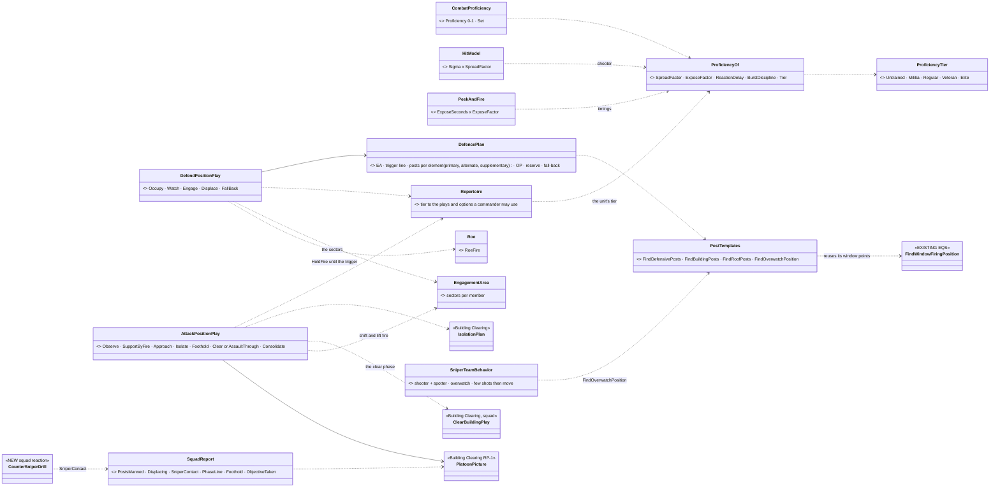
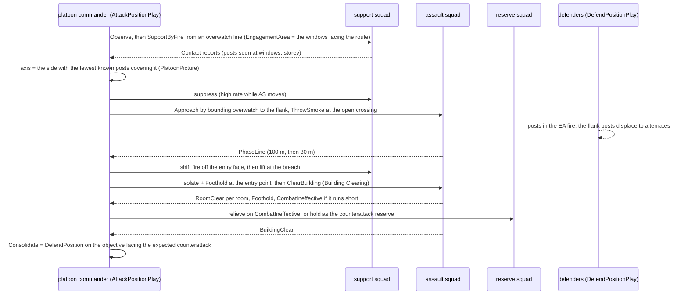
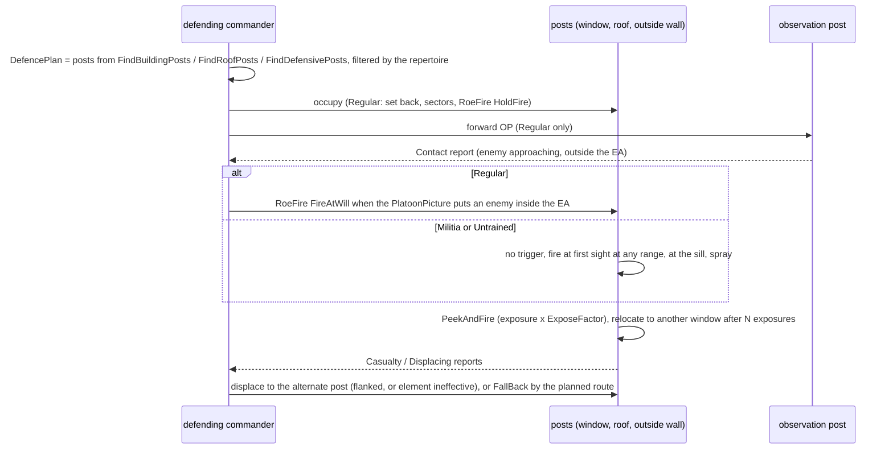
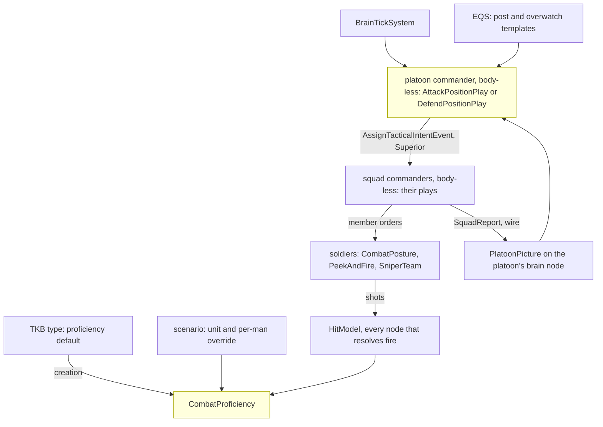

<!--STATUS
state: LIVE
updated: 2026-10-18
build-state: DESIGN — leans DA-1…DA-16 awaiting the user; nothing built
current-answer: §1 doctrine · §2 INVENTORY · §3–§5 the diagrams · §6 decisions (leans) · §7 edge cases · §8 slices · §9 demos
stale-below: nothing.
known-rot: none.
known-conflict: docs/designs/group-maneuvers/DESIGN_Building_Clearing.md — its platoon play `IsolateAndClear` (CB-17/CB-18, PL-1 `CE-2264`, approved R-2030) is PROPOSED here (DA-9) to become the later phases of ONE platoon `AttackPosition` play; not changed there until the user approves
related-designs:
  - docs/designs/group-maneuvers/DESIGN_Building_Clearing.md — OWNS the clearing drill (rooms, entry, sectors, reports R-2031, EngagementArea, BuildingClearance, the platoon frame SL-0); this design is the ATTACK in front of it and the DEFENCE it meets
  - docs/DESIGN_Temperament_And_Stress.md — OWNS a man's will (RiskAcceptance, Obedience, Nerve, Resolve, stress, the break); this design adds his ABILITY (proficiency) beside it and never merges the two
  - docs/DESIGN_Peek_And_Fire.md — OWNS the expose / hide / relocate cycle (PeekAndFire, WindowDuel, FiringPositionMemory); defenders at windows and attackers behind cover run it, with proficiency setting its timings
  - docs/DESIGN_Building_Interiors.md — OWNS storeys, wall openings, window firing points (§3l), stairs and the roof slab; the defence's building posts are generated from them
  - docs/designs/group-maneuvers/DESIGN_Squad_Tactics.md — OWNS the squad drills (suppress-and-manoeuvre, fire and movement, bounding overwatch, danger crossing, casualty care) the attack's squads run
  - docs/designs/group-maneuvers/Squad_Coordination_Design_v1_1.md — OWNS the roster, roles and fire allocation inside a squad
  - docs/designs/hill-attack/DESIGN.md — the one built platoon commander (R-2022 shoot-and-duck, R-2023 never the same spot twice); its intent dispatch is the precedent for ordering squads
  - docs/blueprints/Architect_Question_85_Hit_Chance.md — OWNS the hit model's spread; DA-2 adds one shooter factor to it
  - docs/DESIGN_Operations_Behaviour_Catalogue.md — the catalogue rows SQD-8 / SQD-11 (defend), D7 (trenches) and the building-post templates this design builds
-->

# Defending and attacking a position — from untrained insurgents to a skilled unit *(behaviors, `2026-10-18`)*

🔒 User, `2026-10-18`: *"I would like to design also behaviors for defending certain place including multi story buildings and
corresponding attack tactics. Defenders and attackers skill level needs to be settable from a group of untrained insurgents to a skilled
military unit - it migh drive the tactics chosen by their commanders. Defenders are usually prepared, using varoous cover spots outside
(behinds walls, obstacles, in dug-in holes..) as well as inside (behind windows - lean and peek might apply for observation, quick shot
while in fight), on the roof etc. Attackers need to advance, closing, using cover behind obstacles,busing short peek and shot, flanking
the building etc … Snipers migh help on both sides."* · *"This likely includes multi team coordination"* · *"The attack and building
clear might be connected in natural sequece i guess"*.

**The decision in one line (lean):** a per-man **`CombatProficiency`** (one 0–1 value, five named tiers) that sets how well he shoots,
how briefly he shows himself and how fast he reacts, and that **gates the plays his commander may choose**. On top of it go two
platoon plays: **`DefendPosition`**, which generates prepared posts outside, at windows on every storey and on the roof, with sectors,
a trigger line, alternates and a fall-back; and **`AttackPosition`**, which runs observe → support by fire → approach → isolate →
foothold → clear or assault through → consolidate. For a building, **the clearing already designed becomes the attack's last phases**.
Snipers are a two-man team behaviour used by both sides. Every hand-off between teams rides the networked squad reports (R-2031).

## 1. Doctrine — what real forces do *(US Army ATP 3-21.8 Infantry Platoon and Squad: the defence and the attack chapters; ATP 3-06.11 Combined Arms Operations in Urban Terrain; breaching fundamentals SOSRA: suppress, obscure, secure, reduce, assault; sniper employment, FM 3-22.10 / ATP 3-21.18)*

| | defence | attack |
|---|---|---|
| **the plan** | an engagement area (EA) where the enemy is to be killed · a trigger line where fire opens · each element a **sector** · **primary, alternate, supplementary** positions · an observation post (OP) forward · a reserve · a fall-back route | **isolate** the objective · a **support-by-fire** (SBF) element suppresses it · the **assault** element moves by covered routes, usually to a **flank** · **obscure** with smoke where it must cross open ground · gain a **foothold** · clear · **consolidate** and get ready for the counterattack |
| **buildings** | fight from **inside the room, set back** from the window, never on the sill · upper storeys for fields of fire, the ground floor held lightly · the roof for observation and snipers, but exposed to air and indirect fire · withdrawal routes planned before the fight | suppress **every window that sees the assault's route** · shift and then **lift** fire as the assault reaches the building, so as not to hit your own · enter at the least defended point, from the top when there is a way up · then the clearing drill (Building Clearing §1) |
| **fire control** | hold fire until the enemy is inside the EA (an ambush effect) · mutual support between positions · the final protective line when he closes | the SBF fires at known and likely posts, rate high at the assault's move, low otherwise · the assault fires only when it must |
| **snipers** | far back, deep in a room, few shots, then move · targets: leaders, machine-gunners, snipers, radio | the same from an overwatch with a long line of sight · counter-sniper: locate, then suppress with heavy fire, smoke, manoeuvre or a sniper |
| **untrained / irregulars** | occupy windows and roofs, open fire at first sight at any range, spray, shoot and move to another window, withdraw or blend in individually, no sectors and no reserve | mass rush on the nearest axis with covering spray, little use of cover or smoke, high casualties, breaks under fire |

## 2. INVENTORY *(2026-10-18 — codebase-memory CLI `search_graph` over Class / Method / Enum / Struct for `Storey|Floor`, `Roof`, `Window|Loophole|FiringPost|BuildingPost`, `Flank`, `Overwatch`, `Smoke`, `Skill|Proficien|Training|Marksman|Veteran`, `Trench|Foxhole|DugIn|Fortif|Bunker|Sandbag|Obstacle`, `Defen[cs]e|Defend|HoldPosition|Occupy`, `Sniper`, `.*Play` (16 squad plays); grep for `ISquadPlay`, `DefendArea`, `FallBack`; one read-only code sweep, nine questions, every answer opened at the line; the design corpus sweep for defence / attack / snipers / skill. `check_index_coverage` NOT run — CLI only)*

| need | exists | where | missing |
|---|---|---|---|
| a defend order | ⚠ `DefendArea` intent → infantry run `CombatPosture`, moving to the area's centre and holding within its radius; **no posts, no sectors** · `CommanderNodes` sends a hard-coded `DefendArea` with empty params (TODOs) | `Mappers/DefendAreaMapper.cs:48-49`; `Brains/CommanderNodes.cs:68-88` | the plan, the posts, the sectors, fire control (DA-4…DA-7) |
| squad plays | ✅ 16 `ISquadPlay`s on one runner — march, suppress-and-manoeuvre, fire and movement, bounding overwatch, danger crossing, hold, break contact, casualty care, embark / dismount, airborne, fast rope, battery fire mission; **none defends** | `Brains/*Behavior.cs`, `SquadManeuverRunner.cs` | `DefendPositionPlay`, `AttackPositionPlay` |
| a platoon commander | ✅ hill attack: a BTree of C# nodes ordering its tanks by `AssignTacticalIntentEvent` (origin Superior): `MoveToLocation`, then `HullDownAttack` in alternating waves; **no SBF element** (the idle half is just not ordered) | `HillAttackCommanderNodes.cs:164-170, 385-412, 531-537, 745-786` | squads as subordinates (SL-0, Building Clearing), a support element |
| storeys, stairs, roof | ✅ a building template holds storeys; walls are cut around openings, upper storeys become slabs, stairs ramps, a flat roof a walkable slab; the navmesh climbs the stair; **`house-2f`** (two storeys, windows, stairs, flat roof) in `bt-range`, placed twice | `Terrain/TerrainBuildingExpander.cs:65-143, 214-230`; `TerrainBuildings.cs:69-83`; `bt-range/buildings/house-2f.building.json`; `RecastNavmeshFactoryTests.cs:100-117, 166` | ⚠ house-2f has **no stair to the roof** (the expander allows one, `:122-128`) |
| windows | ✅ real OPENINGS: wall below the 0.9 m sill and above the 2.1 m head, nothing between — sight and rounds pass; a `glass` material exists, unused | `TerrainBuildingExpander.cs:34, 180-182, 226-227`; `materials.json:10` | — |
| window firing posts | ✅ `FindWindowFiringPosition`: a point on the inside face of each window at the lowest stance that clears the sill, filtered by seeing the target | `Spatial/Eqs/StarterTemplates.cs:32`; `TerrainCoverProvider.cs:122-129, 172-182` | a **set-back** post deep in the room (DA-6) |
| expose / hide / relocate | ✅ `PeekAndFire` + `WindowDuel` (window shape: prone under the sill, up at it, another window after 3 exposures; street shape: crouched behind cover, steps out, suppresses, relocates ≥ 8 m); exposure = max(`ExposeSeconds` 3 s, 2 × aim time 0.8 s) | `Brains/WindowDuelBehavior.cs:25-45`; `PeekAndFireNodes.cs:178, 233-234`; `AimAndFireExecutor.cs:819-821` | proficiency to set the timings (DA-2) |
| outside cover | ✅ static obstacles with a height: cover points stand ≥ 1.5 m, crouch ≥ 0.9 m, prone ≥ 0.45 m; `sandbags` and `earth-berm` materials; the shot and the "am I hidden" tests use the stance's eye and body points | `StaticObstacleDto.cs:15-28`; `TerrainCoverProvider.cs:70-73, 114-116`; `CheapLineOfSightTest.cs:101-131`; `materials.json:12-13` | — |
| dug-in holes, trenches | ⛔ none in code; D7 (authored polylines cut into height and navmesh) decided, not built | `DESIGN_Operations_Behaviour_Catalogue.md:243, 299, 316` | DA-8 |
| flank / retreat / fire points | ✅ `FindFlankingPosition` (side-on ring around the target) used by suppress-and-manoeuvre and `Flank` · `FindSafeRetreatPoint` (R-3004, always answers) · `FindOpenFiringPosition` · `FindCoverFromTarget` · `FindThrowingPosition` | `StarterTemplates.cs:11, 51, 75, 95`; `SuppressAndManeuverBehavior.cs:187` | `FindDefensivePosts`, `FindBuildingPosts`, `FindRoofPosts`, `FindOverwatchPosition` (catalogue rows only) |
| smoke | ✅ a Smoke warhead makes a cloud that passes 10 % of sight, blocks through not beside or over, thins at its edge; **TKB smoke grenade 6041** (8 m radius, 4 m high, 75 s) | `Combat/Systems/AreaEffectSystem.cs:64, 101-106`; `AreaEffectCloudTests.cs:130-153`; `MunitionTkbCatalog.cs:130, 304-306` | ⛔ **no loadout carries it, no behaviour throws it** (DA-12) · ⚠ the catalogue's "no smoke" row is stale |
| skill | ⛔ **none**: spread = mount `DispersionMils` × moving 2 × under fire 2 × stance (prone 0.5, crouched 0.75) × wounded arm 1.6; no shooter factor; deflection horizontal only | `Combat/HitModel.cs:45-58, 106-112` | DA-1, DA-2 |
| detection vs exposure | ⚠ seen the tick any ONE of 2–3 body points has a clear line; no exposure fraction, no acquisition time | `LosStrategies.cs:283-302, 438-440`; `ContactHysteresis.cs:8-10`; `VisualPerception.cs:115-131` | DA-3 |
| snipers | ⛔ no sniper or marksman weapon, no scope; the only optics are binoculars (×2 range, 10° FOV) | `Combat/HeldItems.cs:17, 20`; `VisualPerception.cs:63-68` | DA-13 |
| where a shot came from | ⛔ `NearMissEvent` carries the unit and the closest point, **not the shooter or the round's origin** | `Combat/Events/NearMissEvent.cs:16-26` | DA-14 (backend) |
| fire control | ✅ ROE `RoeFire { HoldFire, ReturnFire, FireAtWill }` + `ForceLevel` on the unit | `Behavior/Components/Roe.cs:9-35` | the trigger that lifts it (DA-7) |
| sectors | 🆕 designed: `EngagementArea` (per member, read by the target pick before the gate) | Building Clearing §7a (CB-4, CB-18) | — reuse |
| the platoon frame and reports | 🆕 designed: SL-0 (`Unit_InfantryPlatoon`, `CombatEffective`, a nested hierarchy run), RP-1 (`SquadReport` on the wire, `ReportOutbox`, `PlatoonPicture`) | Building Clearing §7 (`CE-2262`, `CE-2263`); backend BR-3 | — reuse; new report kinds (DA-15) |
| temperament | ✅ `CombatTemperament` (RiskAcceptance, Obedience) + designed Nerve, Resolve, stress, the break | AQ89; Temperament design | — reuse; kept apart from skill |
| retreat | ✅ `FallBack` (R-259), squad `BreakContact` | `SquadContactBehaviors.cs:191`; `FallBack.btree.json` | — reuse |

## 3. Classes

*What the picture shows that prose hid:* skill reaches the world through only TWO existing places, the hit model's spread and peek's
timings, plus one new gate, the repertoire. Both platoon plays sit on the clearing design's platoon frame, its reports and its
`EngagementArea`, so sectors, shifting fire and "don't fire into rooms we hold" are one mechanism, not three. The building attack ENDS
in the existing `ClearBuildingPlay`, not a second clearing.

## 4. Sequences

### 4.1 Attack on a defended two-storey building (regular platoon)

*What the picture shows that prose hid:* every phase change waits on a REPORT, not a clock. The 3 s report delay (R-2031) is the friction
that makes "lift fire" a real coordination risk. The reserve is a decision on a report, not a fixed phase.

### 4.2 Defence of the same building (militia vs regular, side by side)

*What the picture shows that prose hid:* the tiers do not need two behaviours. The same play runs, and the repertoire turns off the OP, the
trigger line, the set-back and the sectors, which is exactly how irregulars differ.

## 5. Modules — who runs it each frame

*Caption:* the only per-frame engine change is one factor in the hit model, read where fire is resolved; everything else runs on the brain
node inside plays the runner already ticks. ⚠ **Not reached today:** a platoon over infantry squads has never run (SL-0 makes it run first).

## 6. Decisions *(⭐ leans — for the user)*

| id | decision | ⭐ lean | rejected — one line each |
|---|---|---|---|
| **DA-1** | what skill is | **one `CombatProficiency` 0–1 per man, beside `CombatTemperament`**, five named tiers as presets: Untrained 0.1 · Militia 0.35 · Regular 0.6 · Veteran 0.8 · Elite 0.95. Set like temperament: a TKB type default (insurgent Militia, soldier Regular, police Regular), a **unit-level setting that fills every member not authored**, a per-man scenario override; unset reads Regular | many separate skills (marksmanship, fieldcraft, tactics): five sliders per man is unauthorable · folding it into temperament: will and ability are different (a brave novice, a careful expert) |
| **DA-2** | what skill changes in a man | through **`ProficiencyOf`**, each **exactly 1.0 / 0 at Regular** so every existing rail and demo is unchanged: spread × (Untrained 2.5 · Militia 1.6 · Regular 1.0 · Veteran 0.8 · Elite 0.65, linear between) · exposure time × (1.8 … 1.0 … 0.7) · reaction delay before the first shot at a new contact (+1.2 s … 0 … 0) · burst discipline (Untrained empties the magazine, Militia long bursts, Regular+ aimed / controlled) · cover discipline (below Regular: stays at the sill, does not change window after N exposures) | skill on the weapon: a rifle is not trained · range-dependent skill: the spread is already angular, so error grows with range |
| **DA-3** | detection vs exposure | ⭐ **acquisition time by exposure** (backend frame): a contact is acquired after a delay that grows with range and with how little of the man shows (body points visible of those his stance has) and shrinks with the observer's proficiency; **0 for a fully exposed man within 100 m** ⇒ close-range rails unchanged. Without it, a short peek and a set-back window post protect only against being HIT, never against being SEEN | keep instant detection: makes the peek, the set-back and the sniper's hide meaningless for sight · a full silhouette-area model: costlier, same behaviour |
| **DA-4** | the defence plan | **`DefencePlan` computed when the order is given**: the EA (the order's polygon, or the area in front of the position along the threat axis) · the threat axis (the order's, else from the picture) · per element **primary + alternate + supplementary** posts · an OP forward · a reserve (one squad of three) · a fall-back route (`FindSafeRetreatPoint` from the position). Re-planned only on a new axis (supplementary posts face it) | a fixed plan authored per scenario: works once · re-plan every frame: posts dither |
| **DA-5** | where the posts come from | **new EQS templates**, scored for: sees into the EA, cover from the threat axis, ≥ 8 m from the next post, **mutual support** (sees a neighbour's front): `FindDefensivePosts` (outside cover, walls, sandbags, berms), `FindBuildingPosts` (per storey, windows facing the EA, upper storey preferred, ground floor lightly held), `FindRoofPosts` (roof edge, prone, only if the roof is reachable). ⭐ An **authored fighting position** in the scenario (a point + facing) is preferred over a generated one | only authored posts: a defence needs hand-placing in every scenario · only generated: the scenario author cannot say "the MG goes here" |
| **DA-6** | fighting from a window | Regular+ fight from a **set-back post** 1.5–2.5 m inside the room on the line through the window (sees a narrower arc, is far harder to see, needs DA-3 to matter); below Regular **at the sill** (today's `FindWindowFiringPosition`). Observation is a lean / peek at the window frame (BR-5); a quick shot is `PeekAndFire`'s window shape with DA-2 timings, **relocating to another window after N exposures** (R-2023's rule for infantry) | always at the sill: the doctrinal error irregulars make, wrong for regulars · always set back: untrained should be easier to kill |
| **DA-7** | fire control in defence | Regular+ start at **`RoeFire.HoldFire`** with the EA as their `EngagementArea`; the commander lifts to `FireAtWill` when the picture puts an enemy inside the EA (or a post is fired upon: `ReturnFire` already allows it). Below Regular: `FireAtWill` from the start, no EA | a new "trigger" mechanism: ROE already holds and lifts fire, networked |
| **DA-8** | dug-in holes and trenches | ⭐ **phase 2, backend frame**: a `FightingPosition` world object (foxhole, trench section) that lowers its occupant's body points by its depth and joins the navmesh. ⭐ **Phase 1 uses what exists**: sandbag walls and earth berms as static obstacles (cover height already ruled by the stance thresholds) | build trenches first: the whole of D7 (height-grid carve, navmesh) for the same behaviour a 1 m berm gives |
| **DA-9** | the attack and the clearing | ⭐ **ONE platoon play `AttackPosition`**: Observe → SupportByFire → Approach → Isolate → Foothold → Clear (building: `ClearBuildingPlay` on the assault squad) or AssaultThrough (open position: suppress-and-manoeuvre's assault) → Consolidate (= `DefendPosition` on the objective). **`IsolateAndClear` (PL-1) becomes this play** — a clear with no opposition is the same play with an empty approach. ⚠ Changes the approved clearing design's platoon section: everything else in it stays | two plays chained: both would own "isolate" and the hand-off between them |
| **DA-10** | choosing the axis | the commander picks the **assault position on the side of the objective covered by the fewest KNOWN posts** (picture), reached by a covered route: v1 = `FindFlankingPosition` around the objective with `ThreatExposureTest` against the known posts, then bounding overwatch between cover. A path-exposure route planner is v2 | always frontal: the irregular's choice, kept for Untrained · a full route planner first: v1 already flanks |
| **DA-11** | support by fire, shift and lift | the SBF squad watches and suppresses the **windows / posts that see the assault's route** (its `EngagementArea`); on the assault's **PhaseLine** reports it shifts off the entry face, at **Foothold** it lifts to depth (the upper storey, the roof, the next building). Fire into a room the attackers hold is refused (CB-18, same component) | fixed timings: friendly fire whenever the assault is slow · no shifting: the assault walks into its own SBF |
| **DA-12** | smoke | smoke grenade 6041 into **Regular+ loadouts** (one or two per man); a `ThrowSmoke` member order at a point between the element and the known posts; the attack uses it at **open crossings** (the danger-crossing drill's open stretch) and on the **breach face**; a defender uses it to **break contact** | smoke only by the commander: a squad crossing a street would wait for a report round trip |
| **DA-13** | snipers | a **sniper team** (shooter + spotter) behaviour for both sides: `FindOverwatchPosition` (300–800 m, long line of sight to the objective, set back inside a building or behind cover) · targets in order: snipers, MG gunners, leaders, window posts · **few shots, then relocate** (R-2023) · the spotter reports `Contact`s up. ⚠ Needs from backend / TKB: a **sniper rifle** (≈ 0.3 mil spread) and a **designated-marksman rifle** (≈ 1 mil), a **scope** on the mount (×4 range, narrow FOV: the binocular rule on a weapon) | a sniper as a better rifleman: without the hide and the relocation he dies to the first SBF |
| **DA-14** | counter-sniper | a squad taking **near misses from an unseen long-range shooter** reports `SniperContact` (the bearing) and goes to cover; the commander answers by tier: Regular+ suppress the suspected building with the SBF, smoke, and send the own sniper or manoeuvre; below Regular, spray in the general direction. ⚠ Needs the **round's origin on `NearMissEvent`** (backend: the ballistics knows it) | guess the direction from the squad's contacts: an unseen sniper is not a contact |
| **DA-15** | coordination across teams | **only orders down and reports up** on the existing paths: `AssignTacticalIntentEvent` (Superior) to squads, `SquadReport` (R-2031) to the platoon; new kinds **`PostsManned · Displacing · SniperContact · PhaseLine · Foothold · ObjectiveTaken`** beside the clearing's. Both sides' commanders decide from their `PlatoonPicture`, never from the other squads' brains | a shared platoon blackboard: R-2031 forbids it ("nothing hidden inside single brain only") |
| **DA-16** | what the tier lets a commander do (the repertoire) | **Untrained**: defend = occupy the nearest windows and roof, no plan · attack = frontal rush with spray, no smoke. **Militia**: + a base of fire and a rush, posts at the sill, individual withdrawal. **Regular**: the full plans (sectors, trigger, OP, alternates; SBF, flank, bounding, smoke, shift / lift). **Veteran**: + reserve counterattack, set-back posts everywhere, a DMR. **Elite**: + multiple assault axes, roof entry when there is a way up (fast rope exists), a sniper team, smoke on every breach. The commander's tier is his unit's median man | the commander's own skill only: a skilled officer with untrained men cannot run a regular's plan |

## 7. Edge cases

| case | what happens |
|---|---|
| the defenders fall back UPWARD while the building is being cleared | rooms they leave are `Suspected` again for the clearing (Building Clearing `BuildingClearance`); the stair is a danger area; a defender who is cornered upstairs fights or surrenders by Resolve (CB-28) |
| the attack comes from an unexpected side | defenders re-plan on the new axis: they move to **supplementary** posts; untrained just turn and shoot from where they are |
| the SBF loses line of sight (smoke, its own losses) | it reports, and the commander holds the assault at the last phase line until fire is re-established or another squad takes over the SBF |
| the assault squad is shot below combat effective in the approach | `CombatIneffective` report; the reserve takes the assault (Regular+), else the attack is broken off by `BreakContact` |
| a defender sniper kills the attacking platoon leader | succession (Squad Tactics §7.2) at squad level; at platoon level the senior squad leader's commander takes the play, reported |
| ammo low on the SBF | the rate drops (the Ammo input already damps Suppress); a `CombatIneffective` with reason ammo when empty |
| civilians in the building | the clearing's civilian rules apply in the clear phase; the SBF fires only at seen combatants (ROE `Status`) |
| both sides untrained | no plans, no smoke, both spray: the fight is decided by numbers and cover, which is the point of the demo |
| a roof with no stair (house-2f) | `FindRoofPosts` returns nothing (not reachable); an Elite attacker may still fast-rope onto it |
| the defence breaks (stress) | men break individually (TS-6), and the post's element reports `Displacing`; the commander orders the fall-back if more than half are gone |

## 8. Slices *(ids allocated on approval, behaviors block from `CE-2273`)*

| order | slice | owner | what | needs |
|---|---|---|---|---|
| 1 | **DA-A** | behaviors | `CombatProficiency` + `ProficiencyOf` + tiers + unit fill + translator key (DA-1); neutral rail: Regular reads exactly today | — |
| 2 | **DA-B** | backend (frame) | the spread factor in `HitModel` (DA-2) · acquisition time by exposure (DA-3) · the round's origin on `NearMissEvent` (DA-14) | DA-A |
| 3 | **DA-C** | behaviors | the DA-2 timings in `PeekAndFire` (exposure, relocation, cover discipline, reaction delay, bursts) | DA-A |
| 4 | **DA-D** | behaviors | `DefencePlan` + `FindDefensivePosts` / `FindBuildingPosts` / `FindRoofPosts` + set-back posts + `DefendPositionPlay` at **squad** level, sectors via `EngagementArea`, HoldFire and its lift (DA-4…DA-7); `DefendArea` maps to it | DA-C, Clearing BC-1 (`EngagementArea`) |
| 5 | **DA-E** | behaviors | platoon defence: OP, reserve, alternates, displacement, fall-back, storeys; the report kinds (DA-15) | DA-D, SL-0, RP-1 |
| 6 | **DA-F** | behaviors | `AttackPositionPlay` (DA-9…DA-11) absorbing PL-1: SBF, axis, approach, shift and lift, isolate, foothold, clear / assault through, consolidate | DA-E, Clearing BC-3 |
| 7 | **DA-G** | behaviors + TKB | smoke loadout and `ThrowSmoke` (DA-12) | DA-F |
| 8 | **DA-H** | behaviors + backend / TKB | sniper and DMR weapons, the scope, `FindOverwatchPosition`, `SniperTeamBehavior`, the counter-sniper drill (DA-13, DA-14) | DA-B, DA-F |
| 9 | **DA-I** | behaviors | the repertoire gate in both commanders (DA-16) + the tier ladder of demos (§9) | DA-F…DA-H |
| — | **DA-J** | backend (frame, later) | `FightingPosition` holes and trenches (DA-8, D7) | — |

## 9. Demos *(each with an HTTP live check and an in-process twin; `bt-range` and its two `house-2f`, a roof stair added for the roof demos)*

| demo | cast | must end with |
|---|---|---|
| `dp-squad-wall` | a regular squad behind sandbag walls defending a road, an enemy squad walking in | posts spread ≥ 8 m with overlapping arcs (posture trace) · nobody fires before the first enemy crosses the trigger line (`/combat/shots` times × positions) · then all fire within 1 s |
| `dp-insurgents-house` | six militia in `house-2f`, two on the upper storey, one on the roof, a regular squad approaching | they open fire at first sight (> 300 m), at the sill, and change window after their exposures · their hit rate is below the regulars' (`/combat/shots` hits / shots per side) |
| `ap-squad-vs-wall` | a regular squad attacking two men behind a wall | one element suppresses while the other flanks (`FindFlankingPosition`), then assaults; the wall's men are hit from the side |
| ⭐ `ap-platoon-house` | a regular platoon (support, assault, reserve) against eight regular defenders in `house-2f` | the full §4.1 sequence in the report log: `Contact` → `PhaseLine` ×2 → `Foothold` → `RoomClear` per room → `BuildingClear` → `PostsManned` (consolidate) · ⭐ **no SBF round crosses a window of a room the attackers then held** · the report log identical on CGF, SimHost and IG |
| `ap-untrained-rush` | a militia platoon attacking two regular squads dug behind berms | a frontal rush with no smoke; most attackers down before 50 m; the survivors break (`StressBreak`) |
| `ap-elite-smoke` | an elite platoon against militia in `house-2f` | smoke on the open crossing and the breach face, a second axis from the roof by fast rope, few attacker casualties |
| `sn-sniper-duel` | a sniper team on each side, 500 m apart, a regular squad with each | each sniper fires ≤ 3 shots per position then relocates · the squad under sniper fire reports `SniperContact` with a bearing within 15° of the true one and suppresses that building |
| `tier-ladder` | the same house, the same attack, run five times with both sides at each tier | the attacker's casualties fall and the time to `BuildingClear` falls as the tier rises (a table in the run report) |
