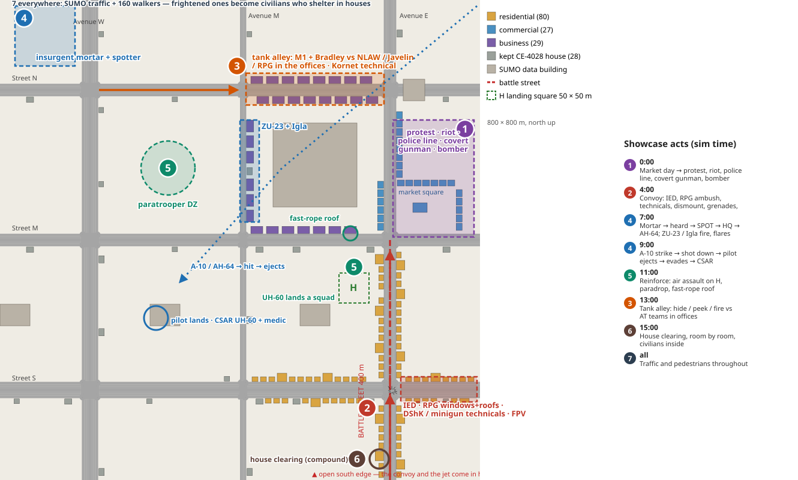
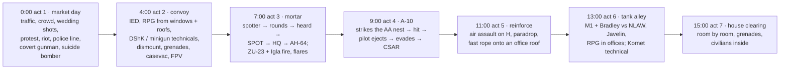

<!--STATUS
state: LIVE
updated: 2026-10-21
build-state: DESIGN — a proposal awaiting the user's choices (§4 D-1…D-5, each with a lean)
current-answer: §1 the map · §2 the acts · §3 INVENTORY (what each act reuses, what is missing) · §4 decisions · §5 the gaps
stale-below: nothing.
known-rot: none.
known-conflict: none. ⚠ Relation to DESIGN_Urban_Battle_Demo.md — CONSISTENT: that design's flagship (`uc-urban-battle`) is ONE act
  here (act 2–4); its route B (assets sent only on a report) stays the rule INSIDE an act; this design adds a timetable BETWEEN acts so
  every feature is seen in one run (D-2).
related-designs:
  - docs/DESIGN_Film_Director.md — OWNS how the showcase is played and filmed: each act becomes a take, the acts a reel
  - docs/designs/group-maneuvers/DESIGN_Urban_Battle_Demo.md — OWNS the urban battle, its ladder (§6) and demo-city's quarters (§4a/§4b); acts 2–4 are its flagship
  - docs/OVERVIEW_Rules_And_Demos.md — OWNS the index of every built rule and demo this showcase is assembled from
  - docs/DESIGN_Civilians_And_Crowd_Control.md — OWNS act 1 (protest, police, covert armed, bomber) and the shelter every act's civilians use
  - docs/designs/air-attack/DESIGN_Air_Operations.md — OWNS act 3–5's aircraft, air defence, evasion, air assault
  - docs/designs/airborne/DESIGN_Airborne_Insertion.md — OWNS the paradrop, fast rope and the ejection (act 4–5)
  - docs/designs/indirect-fire/DESIGN_Indirect_Fire.md — OWNS the mortar and its spotter (act 3)
  - docs/designs/vehicle-tactics/DESIGN_Urban_Armour_Tactics.md — OWNS act 6's tank and AT-team fight
  - docs/designs/group-maneuvers/DESIGN_Building_Clearing.md — OWNS act 7
  - docs/blueprints/Architect_Question_93_Sumo_Traffic_Node.md — OWNS the traffic and the walkers who become civilians (everywhere)
-->

# The demo-city showcase — almost everything the engine does, in one place

> 🔒 **User, `2026-10-21`:** *"I would like to build a scenario that demonstrates that almost all in one single place … military
> operations, but with some civilian urban area … mortars, tank and car hiding behind corners, street fights … attacking tanks from the
> buildings using RPG and other anti-tank weapons, anti-aircraft weapons firing at incoming aircraft … helicopter dropping the soldiers …
> aircraft coming and bombing. When the aircraft is shot down, the pilot should jump out … paratroopers jumping from the helicopter, using
> grenades … insurgents running Toyota with heavy machine guns and anti-tank guns … convoys … disembarking when attacked … frightened
> civilians that are hiding weapons … suicide bombers, house clearing … the ideas might not be meaningful. They just should demonstrate
> the possibilities."*

## 0. What the user saw in the existing urban demo *(🔒 2026-10-21 — a report, not a fix request)*

> *"I have never seen the IED explosive to explode, harming the front vehicle. If the car with the soldiers is hit, they go out and they
> just stand there around the vehicle. I could not see the mortar attacking. I could not see the aircraft attacking the mortars. So the
> ideas were big, but the actual interpretation and demonstration of them was not really what I was expecting."*

⭐ **The lesson this design takes from it (D-3):** a check that only asserts *"X happens only when Y"* passes when X never happens — the
flagship's ①–③ are all of that shape, and its recorded PASS says so itself (*"no REQUEST was made, so the HQ sent nothing"*,
[Urban Battle](DESIGN_Urban_Battle_Demo.md) §6). ⇒ every act here asserts its beat happened and was visible. ⚠ Why the dismounted men
stood by their vehicle was not measured here — the owning lane's question.

## 1. The map — seven stages on demo-city

*What the picture shows that prose could not:* the seven stages sit in seven different corners of the 800 m city, so the camera can
follow one act at a time, and the acts that must touch do touch. The aircraft sent against the air-defence nest on the office roofs falls
over the empty west suburb, where its pilot lands and the rescue helicopter can reach him. The reinforcements land on square H, one row
behind the convoy's street. Stage 7, the SUMO traffic and walkers, is everywhere. *(An overlay on the quarter plan
`img/demo-city-quarters.svg`, the Urban Battle design §4b.)*

## 2. The acts — a timetable between acts, no script inside one

*What the picture shows that prose hid:* each act is STARTED by the clock (its lead unit holds, then a `TimerElapsed` phase lets it go), so
a viewer sees every feature within about 17 minutes of sim time. What happens inside an act is not scripted: the convoy's halt or
push-through, who the RPG hits, whether the A-10 is actually brought down, where the pilot runs. Acts 3 and 4 keep the Urban Battle's
route B (the HQ sends the AH-64 and the A-10 only on a report), with a timed fallback so the beat still happens (D-2, G-3).

## 3. INVENTORY — every wish, where it is already shown, and what is missing *(measured 2026-10-21: three read-only sweeps over `docs/`, `scenarios/`, `Hrot/Subsystems/Hrot.AI.Behaviors/Brains/`; ⚠ the code graph was down — grep only — and `check_index_coverage` was not run)*

| wish (user's words) | act | built and shown live in | gap |
|---|---|---|---|
| mortars | 3 | ✅ `ua-indirect-fire` (adjust, time on target, danger close), `uc-request-chain(-dry)` | the ≥ 1 km "heard launch" rule is a coin flip on this 850 m terrain (CE-3018) → G-3 |
| tank hiding behind corners | 6 | ✅ `ua-tank-corner` 4/4, `ua-javelin-lock` 5/5 | port to demo-city (`uc-tank-street`, the ladder's L3) |
| car hiding behind corners | 2, 6 | ⏸ `ua-technical-scoot` (CE-2232: a hide that cannot see the target) | G-5 |
| street fights | 2, 5 | ✅ `uc-convoy-hit` 8/8, `pc-attack-dry` 12/12, `ua-fire-and-movement` 6/6, `ua-bounding-overwatch` 9/9 | — |
| RPG / AT from buildings | 2, 6 | ✅ `ua-rpg-window` 4/4, `ua-ifv-standoff` 4/4; Kornet in `ua-weapon-systems` | the NLAW gunner (2007) is in no scenario; RPG from a ROOF is not asserted anywhere |
| anti-aircraft at incoming aircraft | 3, 4 | ⚠ `ua-air-defence` 4/4, `uc-a10-zu23-dry` 7/7 | the flares are not seen (Air Ops §9h); the Igla gunner (203) is in no scenario → G-4 |
| helicopter dropping soldiers | 5 | ✅ `ua-air-assault` 7/7, `ua-fast-rope-roof` | — |
| aircraft bombing | 4 | ✅ `ua-air-strike` 5/5, `ua-air-attack` 15/15 | — |
| shot down → pilot jumps out | 4 | ⚠ `ua-eject` 4/5 — but there the ejection is a 40 s TIMER "malfunction", not a hit; auto-eject at 20 % health is unit-tested only | **G-1** — the one wish not yet shown live at all |
| paratroopers from the helicopter | 5 | ✅ `ua-airborne-drop` (a stick of 8 from a UH-60 lands within 10.5 m and assembles) | from a fixed-wing plane ⛔ (the C-130 has no brain) — not needed |
| grenades, not just rifles | 2, 7 | 🟡 `ua-grenade-or-rifle` (in-process twin only), `bt-grenade-posture` | G-2: not in the live check; no grenade in room clearing (CE-2260) |
| insurgent Toyotas, HMG and AT | 2, 6 | 🟡 types 104–110 (M2, DShK, minigun, Kornet, ZU-23) exist; ZU-23 shown in `uc-urban-battle` | DShK / minigun presets are in no scenario — just use them |
| convoys through the city | 2 | ✅ `uc-convoy-hit(-ifv)`, `uc-urban-battle` 6/6 | — |
| disembark when attacked, return fire | 2 | ✅ same | — |
| civilians hiding weapons | 1 | ✅ `ua-armed-draw-aim` 7/7, `ua-armed-blend-back` 5/5, `ua-armed-celebration` 5/5 | — |
| suicide bombers | 1 | ✅ `ua-armed-bomber` 5/5 (a vest in a crowd) | a car bomb (VBIED) is mechanism only → G-7 (optional) |
| house clearing | 7 | 🟡 `bc-house-clear` twin 3/3 (≈ 200 s), `bc-room-clear` twin 3/4 | G-6: flaky entry (CE-2341), no live check |
| frightened civilians | everywhere | ✅ `ua-civ-shelter` 15/15, `-cower`, `-contagion`; SUMO walkers become civilians and shelter (AQ93 §15.9, live) | — |
| *(not asked, shown anyway)* FPV drone, police and riot, casevac, CSAR, surrender, HQ request chain | 1–5 | ✅ `ua-drone-shelter`, `ua-civ-provocation` 7/7, `ua-civ-police-line` 6/6, `ua-casualty-care`, `ua-air-rescue` 8/8, `ua-armed-surrender` 7/7, `uc-reinforce-dry` 6/6 | FPV vs the convoy is the ladder's L5, not built |

⇒ **Of 18 wishes, 12 are shown live today, 5 are built but not shown live (or are flaky), and one is not shown at all: an aircraft
actually shot down, with its pilot ejecting (G-1).**

## 4. Decisions *(each with a lean — reply "approved" or name the one to change)*

| # | question | ⭐ lean | rejected — one line each |
|---|---|---|---|
| **D-1** | one scenario, or several? | ⭐ **both, in that order**: each act is first its own scenario (`uc-show-1-market` … `uc-show-7-clearing`, most of them ports of passing demos), each with its own live check; then **`uc-showcase`** loads them all on demo-city at once | one big file built directly: when a beat fails nobody can tell which act broke · separate scenarios only: not "one single place" |
| **D-2** | how the acts follow each other | ⭐ **a timetable between acts, no script inside one**: each act's lead unit holds, then a `TimerElapsed` phase starts it; acts 3–4 keep route B (the HQ sends on a report) with a timed fallback | fully report-driven (the flagship's route B): a run may never show the A-10 at all — it is sent only if a ZU-23 is reported, and the mortar's SPOT is a coin flip here · everything timed: the AI's decisions would no longer show |
| **D-3** | what an act's check asserts | ⭐ **that its beat HAPPENED and could be SEEN, plus the rules that must always hold** — e.g. act 2: the charge went off AND the lead vehicle took damage; the dismounted men left the vehicle's side for cover AND fired; act 3: rounds landed AND an aircraft fired at the tubes. The winner is never asserted (R-2060) | ⛔ invariants alone — the Urban Battle flagship's way: *"the charge only with a vehicle in its zone"*, *"nothing sent without a report"* both HOLD when nothing happens, so a run in which the IED never hurts the lead vehicle and no aircraft ever attacks the mortar passes 6/6 (§0 below, the user's own viewing) |
| **D-4** | how big | ⭐ **≈ 165 entities + ≈ 20 cover obstacles + the traffic** (200 cars, 160 walkers): act 1 ≈ 50 (crowd, police, wedding, gunman, bomber), act 2 ≈ 40, acts 3–4 ≈ 18, act 5 ≈ 28, act 6 ≈ 20, act 7 ≈ 7 — inside the 300-civilian ceiling (R-3029) and the 500-a-tick creation limit; load ≈ 30 s like `uc-urban-battle` | a bigger battle: the civilian ceiling is a measured per-frame budget, not a guess |
| **D-5** | who builds it | ⭐ **behaviors** owns the acts (it owns the Urban Battle ladder and every behaviour used); the coordinator builds act 7's traffic side and the assembly (`uc-showcase`) and closes G-1 with backend; ui closes G-4 (flares seen) | one lane building every act: the acts reuse four lanes' behaviours |

## 5. The gaps to close first *(lean and lane each)*

| # | gap | ⭐ lean | lane |
|---|---|---|---|
| **G-1** | an aircraft **shot down**, its pilot ejecting — 🔒 user, 2026-10-21: *"the pilot ejecting from a destroyed aircraft falling down should be some kind of natural behavior of the aircraft not something I need to script"* | ✅ **it already is natural, by design**: the aircraft TYPE carries an ejection seat (`EjectionDto`) and `EjectionSystem` fires it by itself at ≤ 20 % health or on a catastrophic one-blow wreck (`EjectionSystem.cs:50`, CE-3215); a dead plane falls (`FixedWingModel.cs:19`). ⛔ The scenario must NOT script it. What is missing: ① only the A-10 type has a seat (`NedTkbCatalog.cs:1212`) — every crewed fixed-wing type should; ② no live run has ever brought an aircraft down (`ua-eject` uses a timed "malfunction"): measure whether a ZU-23 / Igla can, after CE-2185's aircraft armour | backend (seats, damage) · behaviors (the act) |
| **G-2** | grenades in the live check; grenades in room clearing | port `ua-grenade-or-rifle` to the live script; CE-2260 (grenade before entry) is the clearing half | behaviors |
| **G-3** | the mortar's SPOT is a coin flip on this terrain (CE-3018) | the timed fallback of D-2: the HQ's air asset also has a late timer phase; the report still decides when it comes in time | behaviors |
| **G-4** | flares are released but not seen; the Igla is in no scenario | draw the flare (Visual Effects); put the Igla gunner on the office roof | ui · behaviors |
| **G-5** | a technical scoots to a hide that cannot see its target (CE-2232) | fix before act 6 uses the Kornet technical; until then it fires from a fixed position | behaviors |
| **G-6** | room clearing loses all its entry men in 1 run of 4 (CE-2341); a door can read open on another node (CE-2335) | act 7 waits for CE-2341; it is the last act for that reason | behaviors · backend |
| **G-7** *(optional, the "crazy" list)* | a car bomb: an insurgent drives a car with a charge in its boot at a checkpoint | a behaviour on the existing car-boot charge (ST-9): drive to a point, set off when a vehicle or a group is near; the checkpoint fires at the car that does not stop | behaviors |

**The crazy extras, if wanted** *(each costs one scenario edit, no new code)*: a wedding party firing into the air on the market square at
0:30, which the checkpoint does not shoot (`ua-armed-celebration`'s rule) · a SUMO bus caught in the convoy's crossfire, which becomes our
wreck and its passengers our civilians (AQ93 K7) · the downed pilot coming down on a market-hall roof · a dusk run of the whole thing
(`WeatherConditions` — the look only; night does not yet affect sight, Weather §S2).

**Design docs checked:** [Urban Battle](DESIGN_Urban_Battle_Demo.md) §1–§6 — applies: its flagship is acts 2–4 and its ladder rungs are
the ports this needs; its route B stays inside an act · [Rules and Demos index](../../OVERVIEW_Rules_And_Demos.md) — applies: the
source of every "shown live in" cell · [Airborne Insertion](../airborne/DESIGN_Airborne_Insertion.md) — applies: the ejection is
timer-driven in its demo (G-1) · [Air Operations](../air-attack/DESIGN_Air_Operations.md) §9h — applies: flares not seen (G-4) ·
[Building Clearing](DESIGN_Building_Clearing.md) §7 — applies: the twins pass, the live check does not exist (G-6) ·
[Indirect Fire](../indirect-fire/DESIGN_Indirect_Fire.md) — applies: the mortar and the spotter; illumination and smoke rounds are not
built, so no night flares.
