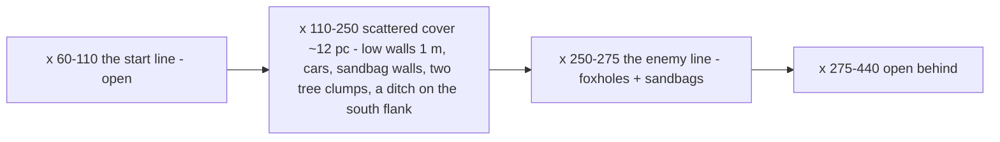
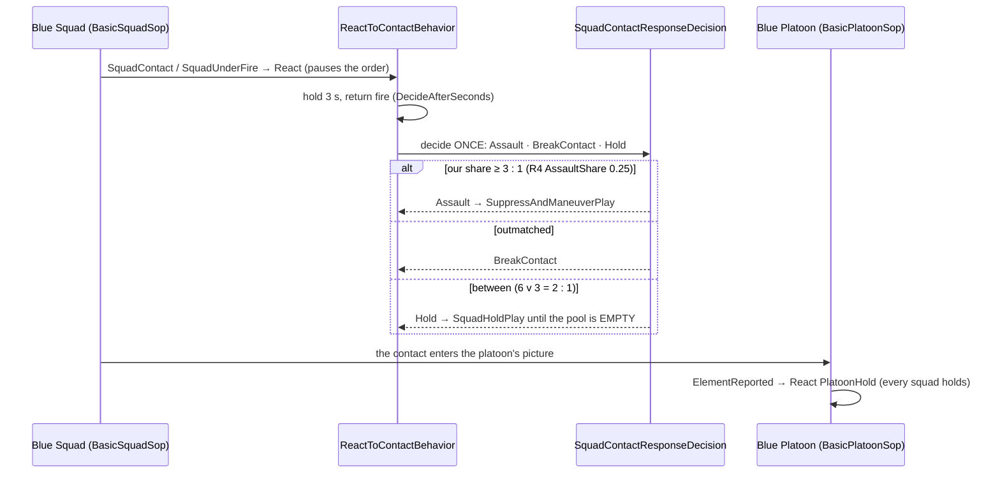
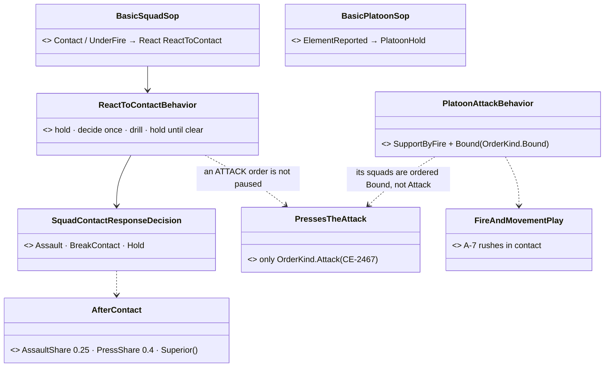

<!--STATUS
state: LIVE
build-state: BUILDING — the field, OF1, OF2, OF4 BUILT and run (§8.1, §8.2); OF3, OF5 DESIGN
updated: 2026-11-23 (first version — behaviors, on the user's request)
current-answer: §1 the request · §2 doctrine · §5 the field · §6 the suite · §7 the diagrams · §8 claims
stale-below: nothing
known-rot: none
known-conflict: none
related-designs:
  - DESIGN_Urban_Fight_Suite.md — OWNS the realism rubric (never / timeline / outcome / review) this suite reuses on OPEN ground; its U1–U6 are the dense-town twins
  - ../../DESIGN_Scenario_Regression.md — OWNS the check grammar (exposed, still, cover, bunched, near, field, fighting, for) every row here is written in
  - DESIGN_Squad_Tactics.md — OWNS react to contact (§4, S2-D the once-only assault / break / hold choice, R4's 3 : 1) and the plays the suite exercises
  - DESIGN_Assault_Under_Fire.md — OWNS fire and movement in contact (A-7) and the base of fire (A-3); OF2 / OF3 judge it on open ground
  - DESIGN_Defend_And_Attack_Position.md — OWNS PlatoonAttack (DA-9…DA-19, AT-1…AT-13); OF2 judges it
  - DESIGN_City_Battle_Showcase.md — §12 the test ladder's "④a stalemate probe": this suite is that probe at squad / platoon scale, before the town
-->

# DESIGN — the open-field suite: squads and platoons fighting across open ground with scattered cover

🔒 **User, `2026-11-23`:** *"open field with some obstacles so that the soldiers can take cover and not being exposed all the time, but still mostly an
open field … in the city battle … staying in the middle of open field and basically playing a ditch war. Not making attempts to move forward, not
being supported by the other squads. … apply the same methodology … testing scenarios with success condition based on a military doctrine"* · *"Yes, please."*

## 1. The request, in one line

A set of small scenarios on open ground with ~10–15 % scattered cover, each judged by machine against the infantry drills, that shows WHETHER and
WHERE squads and platoons stall — built and run BEFORE any behaviour is changed (the suite measures; the fixes follow from its reds).

## 2. The doctrine — the proven solution for this problem class

| drill (ATP 3-21.8, *Infantry Platoon and Squad*) | what a trained unit does | the timing |
|---|---|---|
| **react to contact** (battle drill) | the men in contact return fire at once and get to cover; the leader locates the enemy and wins the firefight; then decides: attack, break contact, or report and hold for the platoon | fire at once · cover within seconds |
| **fire and movement** (individual movement techniques) | one element fires while the other moves; **rushes of 3–5 s** cover to cover ("I'm up, he sees me, I'm down"), crawls where the cover is low | ≤ 5 s exposed per rush |
| **squad / platoon attack** (battle drill) | a base of fire SUPPRESSES; a manoeuvre element moves to a flank under that fire; the assault goes through while the base fires, then shifts or lifts | the assault moves only while the base suppresses |
| **bounding overwatch** (movement when contact is likely) | one element overwatches from cover, the other bounds to the next cover | each bound ENDS in cover |
| **break contact** (battle drill) | an outmatched element suppresses and withdraws by bounds cover to cover | never a stand in the open |

⭐ **What doctrine does NOT say:** that a squad holds until it has 3 : 1. **3 : 1 is the planning ratio for attacking a prepared defence at the decisive
point**; a squad that meets an equal or smaller enemy wins the firefight and moves. ⇒ the measurable tells of a ditch war are: **nobody moving while the
enemy is still fighting · no element suppressing for another · nobody else coming to help.**

## 3. The rubric

The urban suite's four layers, unchanged (📄 `DESIGN_Urban_Fight_Suite.md` §1): **1 never** (doctrine's hard lines) · **2 timeline** (the drill in time) ·
**3 outcome** (the fight is decided) · **4 review** (judgement, turned into rows when the grammar can say it). Every row about men judges
`fighting: true` (a downed man is not idle).

## 4. INVENTORY *(2026-11-23)*

| query | result |
|---|---|
| `search_graph` `.*(Contact\|Assault\|Suppress\|Bound\|Overwatch\|Flank\|FireAndMovement\|Rush\|PlatoonAttack\|PlatoonHold\|ReactTo).*` Class | 102 (`has_more`) — the plays: `ReactToContactBehavior`, `SquadContactResponseDecision`, `SuppressAndManeuverPlay`, ⭐ `FireAndMovementPlay` / `FireAndMovementManeuver` / `FireAndMovementBehavior`, `BoundingOverwatchPlay`, `TravellingOverwatchManeuver`, `BreakContactPlay`, `SquadHoldPlay`, `PlatoonAttackBehavior`, `PlatoonBoundBehavior`, `PlatoonHoldBehavior`, `SuppressBehavior` |
| `search_graph` `.*(Play\|Maneuver)$` Class | 37 (`has_more: false`) |
| scenarios on OPEN ground with a fight (folder sweep) | `rf-car-squads` (two immortal squads behind cars, static) — ⛔ **no squad or platoon ATTACKING across open ground**; every platoon scenario (`pc-*`) is urban (`cqb-village`, `wide-corridor`) |
| ⚠ coverage | `check_index_coverage` is not available through the CLI — the class counts are what the graph indexed |

## 5. The field — one layout every scenario shares (`basic-desert`, x 60–440, y 440–580)

⭐ `basic-desert` is flat (height 0) and empty north of y 430 (its four features end at y 410), so the field is ALL scenario-placed terrain features
(`TerrainFeature`: Clutter, Wall, Ground ditch / foxhole, Group of trees) — one generator, `scripts/make-open-field-scenarios.py`.

*What the picture shows that prose hid:* the cover is SCATTERED on the approach, never continuous — a unit that wants to close must leave one piece of
cover for the next (the tell OF1–OF3 judge); the ditch gives the south flank a covered route (what a manoeuvre element should find).

## 6. The suite — the expect rows stated UPFRONT (R-4277)

| # | situation | must (timeline / outcome) | never | the cause it probes (§8) |
|---|---|---|---|---|
| **OF1** | a 6-man squad (`InfantrySquadMove` east across the field — a movement to contact) meets a 3-man fire team dug in at x ≈ 260, ~150 m | Blue fires within 5 s of Red's first round · every Blue man in the fight in cover within 20 s · ⭐ the fire team is BEATEN (all out of the fight) within 300 s | ⭐ every Blue man STILL (within 2 m) for 60 s while Red still fights · a Blue man upright in the open in Red's sight 10 s · Blue bunched | C-1 (3 : 1 hold) |
| **OF2** | a platoon (3 squads, `PlatoonAttack`) attacks a squad holding the enemy line from ~300 m | a squad suppresses from cover while another moves · the objective is taken | every squad still 60 s · an assault while the base of fire is silent | C-2 (a bounding squad is not "attacking") |
| **OF3** | a squad bounds across the field (`BoundingOverwatch`), then meets a fire team | each bound ends within 2.5 m of cover · in contact, rushes ≤ 5 s | a man upright in the open in Red's sight 10 s | — (expected to pass) |
| **OF4** | a platoon moving across the field; ONE squad is fired on from the flank | within 60 s another squad moves to support or flank | every squad of the platoon still 60 s | C-3 (the platoon holds) |
| **OF5** | a squad meets a platoon with a machine gun | breaks contact cover to cover | an assault; a stand in the open | the counterweight — fixing C-1 must not make squads charge everything |

⚠ **One sample is not a band** — the deterministic run is one honest sample for layers 1–2; layer 3 bands need seeds (as in the urban suite).

## 7. The diagrams — what the code does today at contact (the suspected path, to be confirmed by OF1 / OF2 / OF4)

*What the picture shows that prose hid:* nothing on the path between 3 : 1 and outmatched ever MOVES — the squad holds until the enemy is gone, and the
platoon's only contact row holds the other squads too. That is the ditch war, if the runs take this path.

*What the picture shows that prose hid:* every box exists — the suite builds NO behaviour; it measures which of these edges a run takes.

## 8. Claims *(code measured `2026-11-23`; the RUN half is what OF1 / OF2 / OF4 measure)*

| # | the claim | code — how it IS | design — how it was MEANT | the run |
|---|---|---|---|---|
| C-1 | a squad in contact below 3 : 1 and not outmatched HOLDS until the enemy is gone | ✅ `ReactToContactBehavior` decides once; `AfterContact.AssaultShare` 0.25 | ⚠ Squad Tactics S2-D / R4 · doctrine §2: win the firefight, then move | OF1 |
| C-2 | a platoon's bounding squad stops at contact | ✅ `PressesTheAttack` keys on `OrderKind.Attack`; `BoundingOverwatch` fulfils `Bound` | ⚠ Assault Under Fire A-7: in contact the assault moves by fire and movement | OF2 |
| C-3 | a reported enemy holds the whole platoon | ✅ `BasicPlatoonSop` — one contact row, `PlatoonHold` | ⚠ doctrine: the platoon leader manoeuvres another squad | OF4 |
| C-4 | the city battle's stalls are C-1…C-3 | ⛔ not measured (the showcase is too large to attribute) | — | the city battle, AFTER the suite is green |

### 8.2 OF2 and OF4 — the first runs, `2026-11-23`

| scenario | verdict | measured |
|---|---|---|
| OF2 `of-platoon-attack` (15 v 6, ~185 m) | ✅ ALL rows | a squad `SupportByFire` from 0.25 s, a squad `BoundingOverwatch` from 53.5 s; the line beaten at 116 s (102 s after Red's first round), a Blue man on it at 292 s; nobody upright in the open 10 s |
| OF4 `of-platoon-flank-contact` (15 v 3, ~80–150 m from the north) | ❌ 2 rows | ✅ no freeze (never all still 60 s), the fire team beaten at 88.5 s · ❌ Blue's first round 8.4 s after Red's (window 5 s) · ❌ Blue Squad 3 Rifleman 1 upright in the open in Red's sight 10 s (CE-2494 again) |

⇒ ⭐⭐ **None of C-1, C-2, C-3 reproduces at these sizes and ranges** (6 v 3, 15 v 6, 15 v 3 at 80–190 m): squads and the platoon FIGHT FORWARD and decide
the fight in 1–2 minutes. ⇒ the city battle's ditch war needs conditions this field does not have yet — ⚠ to measure, not assume: **range** (at 300 m+
hits are rare and a firefight may never be decided), **an equal or stronger defender** (6 v 6, an MG behind sandbags), **the scale** (companies, the
platoon SOP's hold — C-3 — only fires when the platoon is NOT already attacking). ⏭ the next probe: the city battle itself (what its stalled squads
are doing, at what range, against what) — then an OF variant that reproduces it.

### 8.1 OF1 — the first run, `2026-11-23` (`b780b594a` + the backend merge)

| row | verdict | measured (probe, every 4 s) |
|---|---|---|
| Blue returns fire within 5 s | ✅ 19.45 s (Red 18.5 s) | contact at ~150 m, Blue at x ≈ 110 |
| ⭐ the DITCH WAR (all still 60 s) | ✅ never | ⭐ **C-1 does NOT bite at 6 v 3 here**: ReactToContact, the leader killed at ~26 s, then from 36 s pairs ADVANCE 6–12 m while the others `Suppress` — fire and movement — until Red is beaten |
| the fire team beaten within 300 s | ✅ 64.5 s | — |
| ⛔ every man in cover within 20 s | ❌ | the men stay where contact found them (x 100–110), the field's nearest cover 10–20 m ahead |
| ⛔ nobody upright in the open in Red's sight 10 s | ❌ 60 s, Grenadier 2 | he stood at (107.6, 513.8) in `CombatPosture` 20 s+, upright; ⚠ not himself under fire |

⇒ ⛔ **First reading RETRACTED** ("a man not fired on stays upright where he stands"). ⭐ **Measured, sampled every second** (Grenadier 2): 47 s prone
suppressing behind the sandbags → 48–54 s a crouched RUSH 15 m into the open (`FireAndMovementPlay` found no cover within 17 m — the next is 20–32 m on —
so `SquadCover.OneRush` straight ahead) → 55–60 s `Suppress` CROUCHED there (CE-8311 D-15: the lowest stance whose line clears the enemy's sandbags).
⚠ Doctrine: a rush ends DOWN — at cover or prone. ⇒ CE-2494; the fixes touch CE-8311 D-15 and CE-3090 — decisions for the user. ⇒ the city battle's stall is to be looked for at PLATOON scale (C-2, C-3:
OF2, OF4) — ⛔ C-1 stays a claim about strength ratios other than 2 : 1 (OF5 and a 6 v 6 variant would probe it).

## 9. Decisions — for the user, AFTER the suite shows red *(leans, not rulings)*

| | lean |
|---|---|
| D-1 when a squad may assault / flank | when its fire SUPPRESSES the enemy (fire superiority), not a fixed 3 : 1 headcount |
| D-2 how long a hold may last | ~30 s, then the squad reports and the platoon must act |
| D-3 what the platoon does on a contact | a platoon react-to-contact drill: the squad in contact is the base of fire, another squad flanks — instead of every squad holding |

## 10. Design docs checked

- `DESIGN_Urban_Fight_Suite.md` — applies: the rubric and the check rows are reused as they are.
- `DESIGN_Squad_Tactics.md` §4 — applies: owns C-1's choice (S2-D, R4); a fix to C-1 lands there.
- `DESIGN_Assault_Under_Fire.md` — applies: A-7 is the intended in-contact movement C-2 should reach; mostly BUILT (AU-1…AU-7).
- `DESIGN_Defend_And_Attack_Position.md` — applies: owns `PlatoonAttack`, judged by OF2.
- `DESIGN_City_Battle_Showcase.md` §12 — applies: plans a "stalemate probe"; this suite is that probe at small scale. ⛔ It records no measured open-field stall yet.
