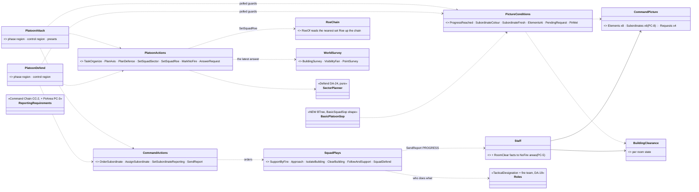
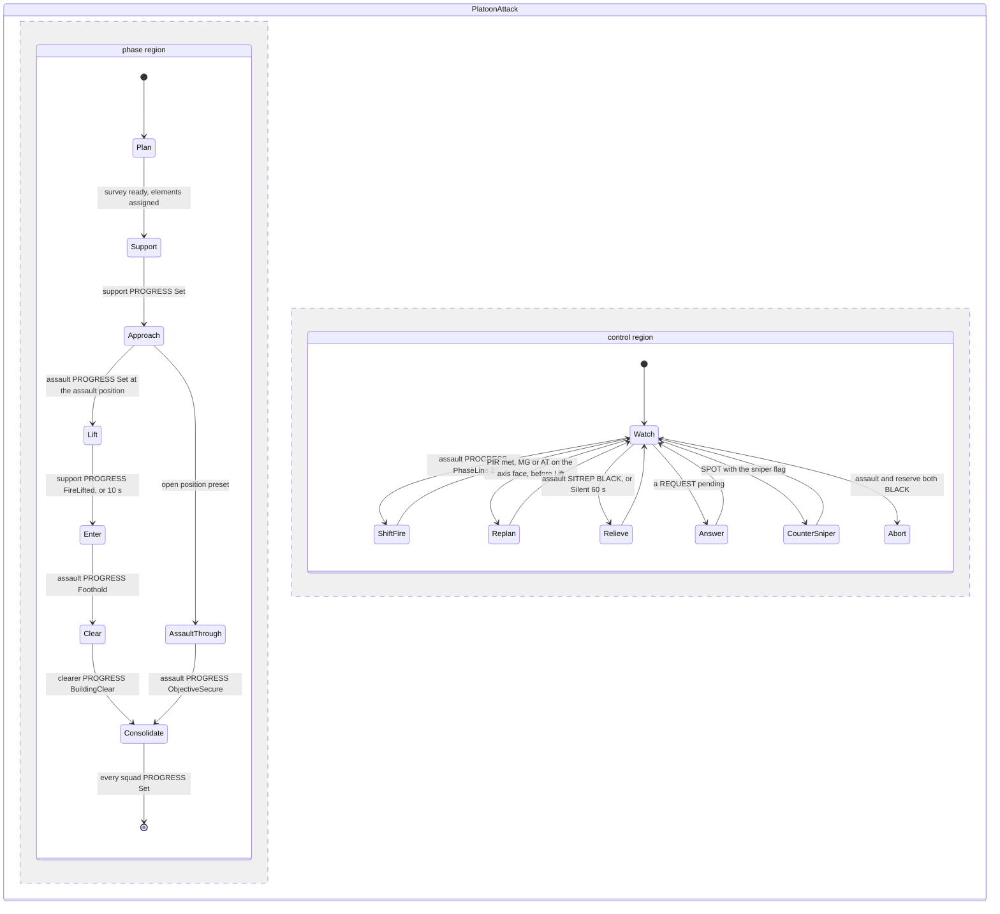
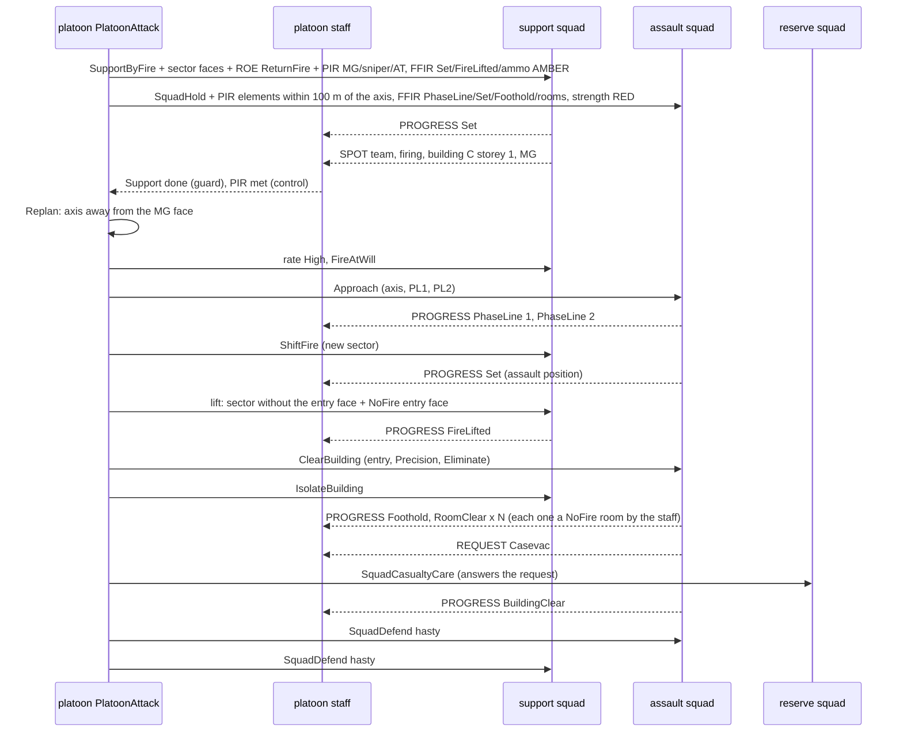
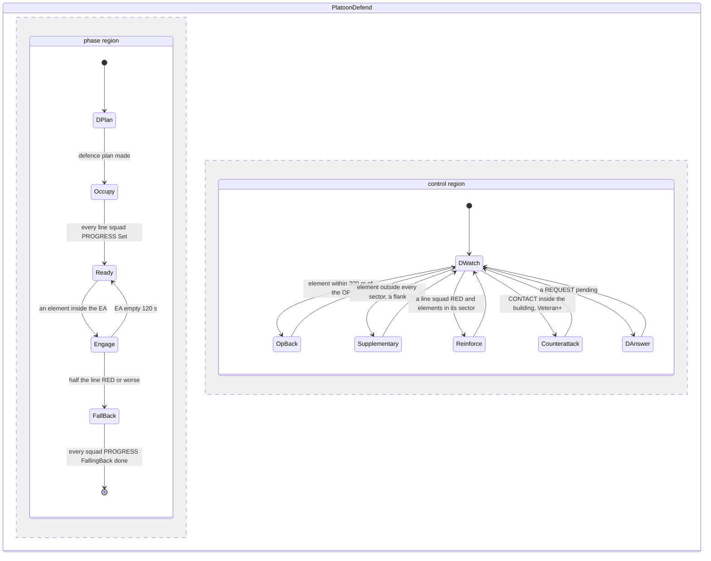
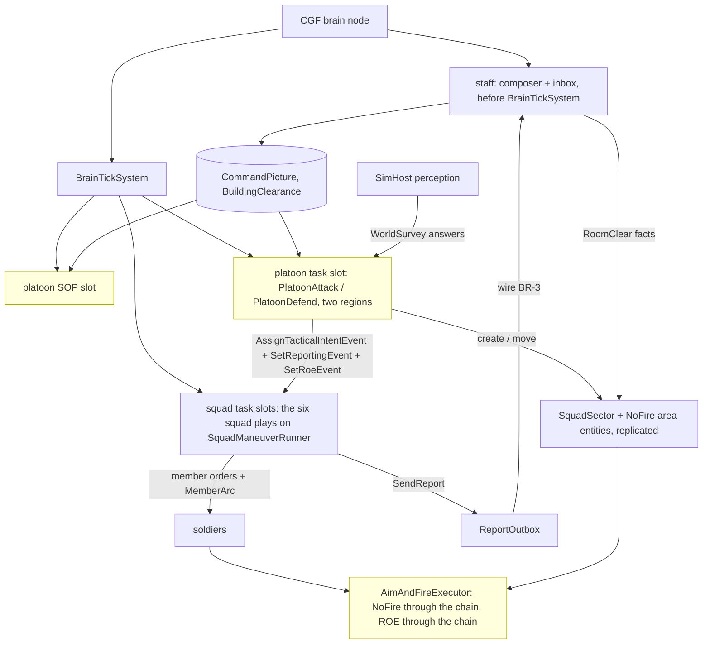

<!--STATUS
state: LIVE
updated: 2026-10-18
build-state: DESIGN — PC-1…PC-10 leans awaiting the user; nothing built. Builds inside the existing slices (DA-E CE-2276, DA-F CE-2277, PL-1 CE-2264, CC-A…CC-E) plus CE-2289 (ROE through the chain)
current-answer: §1 the shape · §2 INVENTORY · §3 classes · §4 the attack (and clear) · §5 the defence · §6 the squad plays and roles · §7 the report contract · §8 acting alone · §9 modules · §10 decisions · §11 slices
stale-below: nothing.
known-rot: none.
known-conflict: none — it makes concrete, and in two places revises, DESIGN_Defend_And_Attack_Position (§3/§4 PlatoonPicture and the report kinds PostsManned · Displacing · SniperContact · PhaseLine · Foothold · ObjectiveTaken are now CommandPicture and the closed PROGRESS / SPOT set, PC-2; DA-7's ROE lift needs PC-6)
related-designs:
  - docs/designs/group-maneuvers/DESIGN_Defend_And_Attack_Position.md — OWNS the doctrine, proficiency tiers, posts, sectors (DA-20, DA-24), the survey sensor (R-2037/R-2038), the presets (R-2035) and the town movement; this design turns its two platoon plays into concrete HSMs on the command machinery
  - docs/designs/group-maneuvers/DESIGN_Building_Clearing.md — OWNS the room drill, BuildingClearance (CB-9), the report concept and vocabulary (§5b–§5d, CB-36…CB-47); the attack's Clear phase runs its ClearBuildingPlay
  - docs/designs/group-maneuvers/DESIGN_Command_Chain_Example.md — OWNS the machinery used here: CommandPicture, ReportingRequirements, the staff, OrderSubordinate / AssignSubordinate, picture guards, Initiative (CC-1…CC-16)
  - docs/REFERENCE_Command_Building_Blocks_Measured.md — the measured blocks, symbol by symbol
  - docs/designs/group-maneuvers/DESIGN_Squad_Tactics.md — OWNS the squad runner and the built drills (bounding overwatch, suppress-and-manoeuvre, break contact, casualty care) the squad plays reuse
  - docs/DESIGN_Decision_Layer.md — OWNS task · SOP · reaction and ROE (§4.4); PC-6 extends ROE through the chain
-->

# The platoon attacks, defends and clears a building — concrete commander and squad behaviours *(behaviors, `2026-10-18`)*

🔒 User, `2026-10-18`: *"Now with all the existing designs we made recently, I would like you to apply these for the previously
mentioned bigger behaviors like attacking a building or a fortified place and defending the building or a fortified place … design the
higher level commander behaviors needed to control the attack and the defense as well as the house clearing. In all there are multiple
subordinate squads with different role. and the same one level below the squad behaviors for serving these attack and defend higher level
behaviors, using squad members with different roles. Will you be able to come with concrete commander-level behaviors that are using the
reports, to support those?"*

**The decision in one line (lean):** two platoon **HSMs** — **`PlatoonAttack`** (its presets are the orders AttackBuilding ·
AttackPosition · ClearBuilding · ReactToFireFromBuilding, R-2035) and **`PlatoonDefend`** — each with a **phase region** that advances
on PROGRESS reports and a parallel **control region** that adjusts on SITREP / SPOT / REQUEST; they give each squad a **role** (support,
assault, reserve; or line, OP, reserve), its **sector**, its **ROE** and its **report requirements** with the order. Below them, six
squad plays on the existing runner give each man his job by his **role** (team leader, automatic rifleman, grenadier, rifleman, marksman,
medic). Every hand-off is a report up and an order down; nothing reads another brain.

## 1. The shape — who is who

| level | entity | runs (task) | its SOP | knows |
|---|---|---|---|---|
| **platoon** | `Unit_InfantryPlatoon` (SL-0), body-less | `PlatoonAttack` / `PlatoonDefend` (HSM, two regions) | `BasicPlatoonSop` | `CommandPicture` · `BuildingClearance` · `ReportingRequirements` (from its own superior, if any) |
| **rifle squad** ×3 | `Unit_InfantrySquad` (302), body-less; 9 men: squad leader + fire team A + fire team B (team leader, automatic rifleman, grenadier, rifleman) | one of the six squad plays (§6) | `BasicSquadSop` | its pool (`SquadCognitiveState`) · `ReportingRequirements` · `ReportOutbox` |
| **weapons squad** (optional) | a squad unit of two MG teams (gunner + assistant) | `SupportByFire` | `BasicSquadSop` | as a squad |
| **sniper pair** (optional, Veteran+) | two Marksmen, **bodied members of the platoon HQ** — they feed the platoon's own memory automatically (CB-36) | `SniperTeam` | `BasicInfantrySop` | `TargetMemory` |

Task organisation (doctrine: support, assault, reserve) is decided by the platoon play at **Plan**, not fixed by the roster:

| element | attack | defence | clearing |
|---|---|---|---|
| **support** | the weapons squad, else the squad nearest the overwatch line | — | isolates (watches exits and windows) |
| **assault** | the strongest squad (SITREP strength) | — | clears (`ClearBuildingPlay`) |
| **reserve** | the rest: follows, relieves, counter-attack guard | one squad, held back, counter-attacks (Veteran+) | follows to the foothold, relieves |
| **line** | — | the other squads, one sector each | — |
| **OP** | — | fire team B of one line squad, forward (Regular+) | — |

## 2. INVENTORY *(2026-10-18 — codebase-memory CLI `search_graph` `.*(Play\|Maneuver)$` (Class): 15 squad plays + their maneuvers; `.*(MemberOrderKind\|TacticalDesignation\|SquadRole\|FireTeam).*` (Enum): 2; reads of `UnitRoster`, `MemberOrderKind`, `RoeOf`, `RoeSystem`; the three owning designs end to end. `check_index_coverage` NOT run — CLI only)*

| need | exists | where | gap |
|---|---|---|---|
| squad plays to reuse | ✅ 15: `SquadMarch` · `TravellingOverwatch` · `BoundingOverwatch` · `FireAndMovement` · `SuppressAndManeuver` · `DangerCrossing` · `SquadHold` · `BreakContact` · `SquadCasualtyCare` · `SquadEmbark` / `Dismount` · airborne ×3 · `BatteryFireMission` | `Brains/*Behavior.cs`, `Squad/Maneuvers/` | `SupportByFire`, `IsolateBuilding`, `FollowAndSupport`, `SquadDefend` (designed, §6) |
| member orders | ✅ 9: `Hold · AdvanceTo · Disembark · Suppress · CarryCasualty · Watch · Embark · FireAtPoint · Stay` | `SquadManeuverRunner.MemberOrderKind` | `OccupyPost`, `ThrowSmoke` (Defend DA-12, DA-20) · the clearing's member orders (Building Clearing §7a) |
| roles | ✅ `TacticalDesignation` (Commander · SquadLeader · Wingman · Support · TeamLeader · Medic) | `Fdp.Core/CommandHierarchy/TacticalDesignation.cs` | the DA-19 roles + fire team index (`CE-2281`) |
| a roster big enough | ✅ `UnitRoster.Capacity` = 16 members | `UnitRoster.cs` | — |
| the commander's picture | 🆕 designed: `CommandPicture` (Elements ×8 · Subordinates ×4 · Requests ×4) | Command Chain §6 | ⚠ **Subordinates ×4 is exactly full**: 3 squads + the weapons squad, no room for an attachment (PC-8); the sniper pair needs no row (bodied, PC-10) |
| HSM parallel regions | ✅ built and railed (`StateFlags.IsParallel`, rail ⑥) | `HsmKernelCore` | ⚠ **no production HSM uses them yet** — these two assets are the first |
| a "10 s in this state" guard | ⛔ none found (`[SharedAiCondition]` names with Elapsed / TimeIn / Since / Timeout: 0) | — | `TimeInState(seconds)`: the state's entry action stamps sim time into its own state slot, the guard compares (PC-7) |
| report requirements | 🆕 designed: `ReportingRequirements` (Superior · PirMask · FfirMask · SitrepEverySeconds · SetBy) | Command Chain §6 | ⚠ a PIR "element inside MY area" needs the area (PC-3) |
| ROE reaching the men | ⚠ **per entity only**: `RoeOf.Fire(view, unit)` reads the unit's OWN `Roe`, unset ⇒ `FireAtWill`; `RoeSystem` writes one entity; nothing reads up the chain | `Behavior/Components/Roe.cs` (`RoeOf`), `RoeSystem` | ⛔ a platoon's `HoldFire` on a squad never reaches its soldiers, and the gate reads the soldier (PC-6, `CE-2289`) |
| sectors, NoFire | 🆕 designed: `SquadSector` area entity · `MemberArc` in the order · NoFire looked up through the chain | Defend §13a (DA-24) | — reuse |
| geometry on the brain | ⛔ ruled out (R-2037): posts, faces, rooms, visibility come from `WorldSurvey` answers solved on the muscle | Defend §13b | — reuse |

## 3. Classes

*What the picture shows that prose hid:* the platoon plays contain **no report parsing and no geometry**. They are assets of states,
entry actions and guards; the heavy parts are shared C# actions over the latest survey answer, and every guard reads the picture the
staff already folded. Only three boxes are new beyond the owning designs: the two HSM assets with their SOP, `PlatoonActions`, and
`RoeChain`.

## 4. `PlatoonAttack` — attack a building or a position, and clear it

*What the picture shows that prose hid:* every step of the plan waits on a **report a squad sends because the platoon asked for it**
(§7) — never on a clock, except the one deliberate 10 s fall-back on the lift. The control region keeps ticking while a phase runs, so
shifting fire, relieving the assault and answering a CASEVAC never stop the plan.

| phase state | entry action (orders down) | guard out (reports up) |
|---|---|---|
| **Plan** | `TaskOrganize` (§1 table) · ask `WorldSurvey`: BuildingSurvey of the objective, VisibilityFan from candidate support lines · `PlanAxis`: the side covered by the fewest known posts (DA-10) | survey answered + elements assigned |
| **Support** | support: `Order.SupportByFire` {line, `SquadSector` = the faces that see the axis, rate Low} + ROE `ReturnFire` · assault: `Order.SquadHold` covered · reserve: `Order.FollowAndSupport` {behind the assault} | `ProgressReached(support, Set)` |
| **Approach** | support: rate **High**, ROE `FireAtWill` · assault: `Order.Approach` {axis, phase lines PL1 100 m · PL2 30 m, smoke at open stretches} | `ProgressReached(assault, Set)` |
| **Lift** | support: `Order.SupportByFire` {sector WITHOUT the entry face, NoFire over the entry face (`MarkNoFire`)} | `ProgressReached(support, FireLifted)` or 10 s in state |
| **Enter** | assault: `Order.ClearBuilding` {entry point, Intensity, Objective} · support: `Order.IsolateBuilding` {the exits and windows of the other faces} · reserve: `Order.FollowAndSupport` {the foothold} | `ProgressReached(assault, Foothold)` |
| **Clear** | — (the clearer runs its rooms; the staff turns each RoomClear into a NoFire room, PC-5) | `ProgressReached(clearer, BuildingClear)` |
| **AssaultThrough** *(open position)* | assault: `Order.SuppressAndManeuver` {through the objective} | `ProgressReached(assault, ObjectiveSecure)` |
| **Consolidate** | each squad: `Order.SquadDefend` {hasty, a sector of the objective facing the expected counter-attack} | every squad `ProgressReached(·, Set)` ⇒ the task ends; the platoon's staff sends PROGRESS ObjectiveSecure up |

| control state | when (guard) | does |
|---|---|---|
| **ShiftFire** | `ProgressReached(assault, PhaseLine 2)` | moves the support's `SquadSector` off the face the assault heads for (one new order) |
| **Replan** | `PirMet(MG or AT, on the axis face)`, phase before Lift | `PlanAxis` again; a changed axis ⇒ a new `Order.Approach` |
| **Relieve** | `SubordinateColour(assault) == BLACK` or `!SubordinateFresh(assault)` | the reserve becomes the clearer: `Order.ClearBuilding` over the rooms `BuildingClearance` still holds Unknown / Suspected; the remnant holds the foothold |
| **Answer** | `PendingRequest(kind)` | Casevac ⇒ reserve: `Order.SquadCasualtyCare` {the casualty point} · FireSupport ⇒ support: `FireAtPoint` at the request's location · Permission ⇒ §8 · Resupply ⇒ the reserve's ammo to the requester (v2) — each answer cites the request id (`AnswerRequest`) |
| **CounterSniper** | `ElementsAt(any, equipment = sniper)` | the sniper pair, if any: `SniperTeam` {that building} · else support suppresses it |
| **Abort** | assault and reserve both BLACK | every squad `Order.BreakContact`; the task FAILS (its staff sends SITREP BLACK up) |

**Presets (R-2035)** — one asset, the preset picks the first phase and which phases are skipped:

| preset (the order) | runs | skips |
|---|---|---|
| `AttackBuilding` | Plan → Support → Approach → Lift → Enter → Clear → Consolidate | — |
| `AttackPosition` | Plan → Support → Approach → AssaultThrough → Consolidate | Lift, Enter, Clear |
| `ClearBuilding` | Plan → Enter (support isolates first) → Clear → Consolidate | Support, Approach, Lift — re-entered only if a squad reports CONTACT from the objective |
| `ReactToFireFromBuilding` | the squad in contact IS the support: Plan → Approach → Lift → Enter → Clear → Consolidate, or **Bypass** (DA-18) | Support |

*What the picture shows that prose hid:* the platoon never sees a soldier or a contact — only one SPOT element, the progress subtypes
and a request; and the safety of the lift does not depend on the report arriving: the NoFire area over the entry face is written by the
platoon BEFORE it waits for `FireLifted`, and the gate refuses fire into it whatever the support squad's state.

## 5. `PlatoonDefend` — defend a building or a fortified place

*What the picture shows that prose hid:* the trigger line is not a timer or a sensor of its own — it is `ElementsAt(EA)` over the SPOTs
the line squads and the OP send because the EA is their PIR. The same report that starts the fire also feeds the control region's
flank and reinforcement checks.

| phase state | entry action | guard out |
|---|---|---|
| **DPlan** | `PlanDefence` (DA-4): the EA, the threat axis, per squad primary + alternate + supplementary posts (survey answers, DA-5), the OP, the reserve, the fall-back route · `SectorPlanner.SplitArea` ⇒ one `SquadSector` per line squad | plan made |
| **Occupy** | each line squad: `Order.SquadDefend` {posts, sector, OP team (one squad), alternates} + ROE **`HoldFire`** (Regular+; `FireAtWill` below) · reserve: `Order.SquadDefend` {a covered position behind, no sector} | every line squad `ProgressReached(·, Set)` |
| **Ready** | — | `ElementsAt(EA, any)` |
| **Engage** | every line squad: ROE `FireAtWill` (`SetSquadRoe`, reaches the men by PC-6) | EA empty 120 s ⇒ back to Ready (`HoldFire` again) · `SubordinateColour ≤ RED` on half the line ⇒ FallBack |
| **FallBack** | the reserve covers (`SquadDefend` at the fall-back route's first bound) · line squads: `Order.BreakContact` {the route} | every squad PROGRESS FallingBack, done |

| control state | when | does |
|---|---|---|
| **OpBack** | `ElementsAt(within 300 m of the OP)` | the OP squad: `Order.SquadDefend` {OP team rejoins its posts} |
| **Supplementary** | `ElementsAt(outside every SquadSector, within 150 m)` | the squad on that side: `Order.SquadDefend` {its supplementary posts, a sector facing the flank} |
| **Reinforce** | `SubordinateColour(sq) ≤ RED` and `ElementsAt(sq's sector)` | the reserve: `Order.SquadDefend` {the alternate posts behind `sq`, the same sector} |
| **Counterattack** *(Veteran+; Regular blocks instead)* | a line squad's CONTACT or SPOT located inside the defended building (PointSurvey storey) | the reserve: `Order.ClearBuilding` {that storey's rooms} — the clearing drill, used in reverse · Regular: the reserve `SquadDefend` at the stair |
| **DAnswer** | `PendingRequest(kind)` | Casevac ⇒ the reserve's medic team · Permission ⇒ §8 · Resupply (v2) |

**Below Regular (the repertoire, DA-16):** Untrained and Militia run the **same asset** with the control region's Supplementary,
Reinforce and Counterattack disabled by the tier, no OP, no `HoldFire` — so they fire at first sight and never re-plan, which is how
irregulars differ (Defend §4.2).

## 6. The squad plays that serve them, and what each role does

| squad play | 🆕 / ✅ | phases | reports it sends itself (`SendReport`) | its staff adds by the platoon's requirements |
|---|---|---|---|---|
| **`SupportByFire`** | 🆕 | move (bounding overwatch, ✅) → occupy the line → suppress (rate Low / High) → shift / lift on new orders | PROGRESS **Set** on the line · **FireLifted** when a lift order is applied | SPOT of elements at windows (PIR MG / sniper / AT) · SITREP ammo |
| **`Approach`** | ✅ `BoundingOverwatch` / `FireAndMovement` + phase lines + smoke | bound by fire teams along the axis | PROGRESS **PhaseLine** n · **Set** at the assault position | CONTACT on the axis · SITREP strength |
| **`IsolateBuilding`** | 🆕 (Building Clearing) | two teams to diagonal corners, each watching two faces' exits and windows | PROGRESS **Set** (isolated) | SPOT of anyone leaving |
| **`ClearBuilding`** | 🆕 (Building Clearing) | entry team stacks, breaches, enters, dominates, controls; the security team holds the foothold; swap | **Foothold** · **RoomClear** / **RoomBlocked** · **Detained** · **BuildingClear** · REQUEST **Casevac** | SITREP strength, LACE |
| **`FollowAndSupport`** | 🆕 | follow the assault one bound behind in cover · hold near the foothold · stand by to take over | PROGRESS **Set** | SITREP |
| **`SquadDefend`** | 🆕 (Defend DA-D) | occupy posts (primary) → hold fire → engage → displace (alternate) · the OP team forward when ordered | PROGRESS **Set** (posts manned) · **Displacing** · **FallingBack** | SPOT / CONTACT in the EA or on a flank · SITREP · LACE |

**Who does what inside the squad (roles, DA-19):**

| role | `SupportByFire` | `Approach` | `IsolateBuilding` | `ClearBuilding` | `SquadDefend` |
|---|---|---|---|---|---|
| **squad leader** | places the line; sends the reports | moves with the bounding team | at the corner with the wider view | outside the stack, directs; sends the reports | at the post seeing the whole sector |
| **team leader** | his team's half of the sector | leads his team's bound; throws **smoke** at an open stretch | runs one corner | #1 of the entry (breacher) or leads the security team | his team's half |
| **automatic rifleman** | the centre, the longest view, the **highest rate** (the base of fire) | the overwatching team's base of fire | covers the longest face | never first in the stack; covers the hallway | the post with the longest view down the EA (final protective line) |
| **grenadier** | window faces under 150 m | — | the face with the most windows | #2 (stun / frag by Intensity, CB-30) | the dead ground in front |
| **rifleman** | spread between, aimed fire | moves | watches | #3 / #4 | the alternates first |
| **marksman** (DMR) | windows beyond 200 m | — | — | — | the far edge of the EA |
| **medic** | stays back in cover | follows | — | with the security team (casualty point) | with the reserve |

## 7. The report contract — what each order asks for, and what each report drives

Every order carries its requirements by `SetSubordinateReporting` (CC-2: their own event, beside the order). The staff then sends those
**at once** and the rest by routine (CC-8).

| play → element | PIR (about the enemy) | FFIR (about own) | SITREP |
|---|---|---|---|
| attack → **support** | MG · sniper · AT · any element in the objective | Set · FireLifted · ammo ≤ AMBER | 15 s |
| attack → **assault** | any element within 100 m of the axis | PhaseLine · Set · Foothold · RoomClear · RoomBlocked · BuildingClear · strength ≤ RED | 15 s |
| attack → **reserve** | — | Set · strength ≤ RED | 30 s |
| defend → **line squad** | any element inside the EA · outside its sector within 150 m · vehicle / AT | Set · Displacing · FallingBack · strength ≤ AMBER · ammo ≤ AMBER | 15 s |
| defend → **OP squad** | any element | Set | 15 s |
| defend → **reserve** | — | Set | 30 s |

| report | sent by | the platoon reads it as | route (CB-45) |
|---|---|---|---|
| PROGRESS Set / PhaseLine / FireLifted / Foothold / BuildingClear / ObjectiveSecure | the squad play | the phase advances | phase-region guard |
| PROGRESS RoomClear / RoomBlocked | `ClearBuilding` | `BuildingClearance` + a NoFire room (PC-5) | staff, no behaviour |
| PROGRESS Displacing / FallingBack | `SquadDefend` | a post given up; the defence's reserve logic | control-region guard |
| SPOT (size, MG / sniper / AT flags, building + storey) | the squad staff | elements for `PlanAxis`, `ElementsAt(EA)`, flanks, counter-sniper | control guard; phase guard (Ready → Engage) |
| CONTACT | the squad staff | a new element at once | SOP (an unexpected building: `FiredOnFromStructure`) or control guard |
| SITREP colours / age | the squad staff | Relieve, Reinforce, FallBack, Abort; Silent = unknown | control guard |
| REQUEST Casevac / FireSupport / Permission | the squad play or SOP | an order that cites its id | control-region Answer |

## 8. Acting alone inside these plays *(CC-10, CC-11)*

| SOP row | class | on the assault squad (`WithinIntent`) | on a militia group (`Full`) |
|---|---|---|---|
| take cover, return fire (`ReactToContact`'s first 3 s) | **Immediate** | always, reported as CONTACT | always |
| an enemy team blocking the approach within 50 m ⇒ suppress-and-manoeuvre it | **Local** | yes, then back to the task | yes |
| a different building fires ⇒ clear it · withdraw | **Mission** | ⛔ not alone: REQUEST **Permission** (the row's id); the platoon's Answer grants it when it keeps the intent (the building covers the axis) or refuses (the support suppresses it instead) | yes, alone |
| a subordinate Silent 60 s (platoon SOP) | Local | the platoon sends the reserve's leader to check (Regular+) | — |

## 9. Who runs it each frame

*Caption:* everything runs where it already runs: the plays on the brain node's `BrainTickSystem`, the staff before it, the geometry on
the muscle. ⚠ **Not reached today:** no platoon has run over squads (SL-0), and **ROE set on a squad never reaches its men** — the gate
reads each soldier's own `Roe` — which is why the gate box is yellow (PC-6).

## 10. Decisions *(⭐ leans — for the user)*

| id | decision | ⭐ lean | rejected — one line each |
|---|---|---|---|
| **PC-1** | what a platoon play is | ⭐ an **HSM asset with two parallel regions** (phase + control, CB-45) using the shared command actions and picture guards; the squad plays stay **`ISquadPlay`s on the runner** | the platoon as an `ISquadPlay` (DA-9 as first written): the runner re-issues member orders every tick and has no parallel region; its gates are for soldiers, not reports · one blueprint per play: no parallel regions in a blueprint |
| **PC-2** | one asset or one per order | ⭐ **one `PlatoonAttack` with presets** (R-2035) choosing the first phase and the skips; `PlatoonDefend` its own | four assets: the relief, shift and answer logic copied four times |
| **PC-3** | requirements that name an area | ⭐ `ReportingRequirements` gains **`PirArea`** (the net id of an area entity — the EA or the squad's sector) for "element inside" / "outside within 150 m" | a PIR per area kind: the masks would multiply |
| **PC-4** | the closed set | ⭐ PROGRESS gains **`FireLifted`**; **PhaseLine** carries its index in `Count`; nothing else new (CB-43) | an acknowledgement kind for every order: the lift is the one hand-off where a late answer kills friends |
| **PC-5** | NoFire for cleared rooms | ⭐ the **staff** turns each folded RoomClear into a NoFire area owned by the platoon (the room's outline from the platoon's BuildingSurvey answer) — mechanical, and it must happen while the play is paused by a reaction | the play's control region: a paused task would leave a cleared room open to the support's fire |
| **PC-6** | ROE reaching the men | ⭐ **`RoeOf` reads up the chain**: a man's own `Roe` when set, else his nearest commander's set one (the NoFire lookup's rule) — one write by the platoon reaches every man on every node; a per-man setting still wins (`CE-2289`) | copy ROE down into every member: a missed copy is a man firing in `HoldFire` · leave it per entity: DA-7's lift cannot work |
| **PC-7** | the lift hand-off | ⭐ NoFire over the entry face FIRST, then wait for `FireLifted`, **10 s fall-back** (a new shared guard `TimeInState`, its start stamped by the state's entry action) | wait for the report only: a lost report stalls the attack · no wait: the assault enters while the support still fires |
| **PC-8** | the picture's size | ⭐ `CommandPicture.Subordinates` **×6** (3 squads + the weapons squad + two attachments, e.g. a vehicle section), Elements ×8, Requests ×4 | ×4: full with a standard platoon, nothing can be attached |
| **PC-9** | who becomes support / assault / reserve | ⭐ decided at **Plan** from the picture (the weapons squad supports; the strongest by SITREP assaults); re-decided only on Relieve | fixed by the roster: a squad that lost half its men would still lead |
| **PC-10** | the sniper pair | ⭐ **bodied members of the platoon HQ**: their sightings feed the platoon's memory automatically (CB-36), and the platoon gives them `SniperTeam` by `AssignSubordinate` | a sniper "unit": a commander for two men, and their sightings would arrive only by report |

## 11. Slices — where each piece is built *(the owning slices stay the place)*

| piece | lands in |
|---|---|
| `CommandPicture` ×6, `PirArea`, `FireLifted`, the NoFire-from-RoomClear staff rule | **CC-A**, **CC-C** (Command Chain) |
| `RoeOf` up the chain | 🆕 **`CE-2289`** (behaviors), before DA-E |
| `SquadDefend` + `PlatoonDefend` | **DA-D** `CE-2275` (squad) · **DA-E** `CE-2276` (platoon) |
| `SupportByFire`, `FollowAndSupport`, `Approach` phase lines + smoke, `PlatoonAttack` (AttackBuilding / AttackPosition / ReactToFireFromBuilding) | **DA-F** `CE-2277` · smoke **DA-G** `CE-2278` |
| `IsolateBuilding`, `ClearBuilding`, the `ClearBuilding` preset | **BC-3** `CE-2259` · **PL-1** `CE-2264` |
| the roles in each play (§6 table) | **DA-K** `CE-2281` |
| the counter-sniper and the sniper pair | **DA-H** `CE-2279` |

**Checked by the approved scenarios** (Defend §17): `tq-military-attack-defended` must show, in `GET /entities/{platoon}/reports`
(CC-12), the report order Set (support) → SPOT MG → PhaseLine 1, 2 → Set (assault) → FireLifted → Foothold → RoomClear … →
BuildingClear → Set ×3; `tq-police-arrest-surprise` the ClearBuilding preset with no Support / Approach phase; `dp-squad-wall` and a new
**`dp-platoon-house`** (two line squads + reserve in `house-3f` against a regular platoon) the Ready → Engage edge on the first SPOT
inside the EA, and a Reinforce or Counterattack in the report log. ⭐ Each can be driven without the other side, by faking the reports
over HTTP (CC-13).
