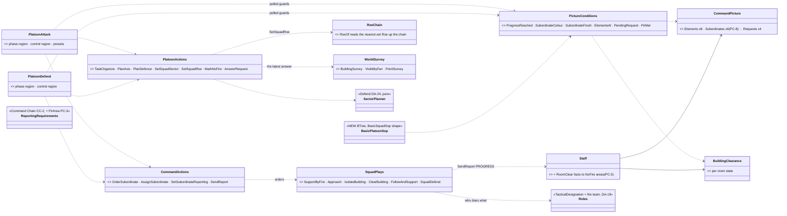
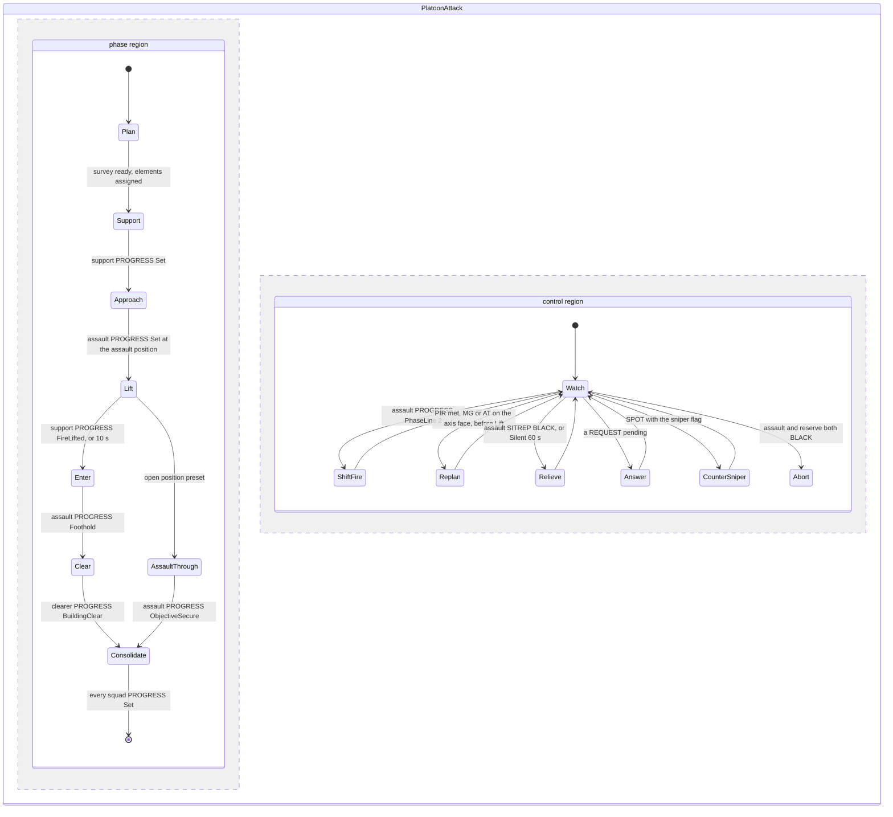
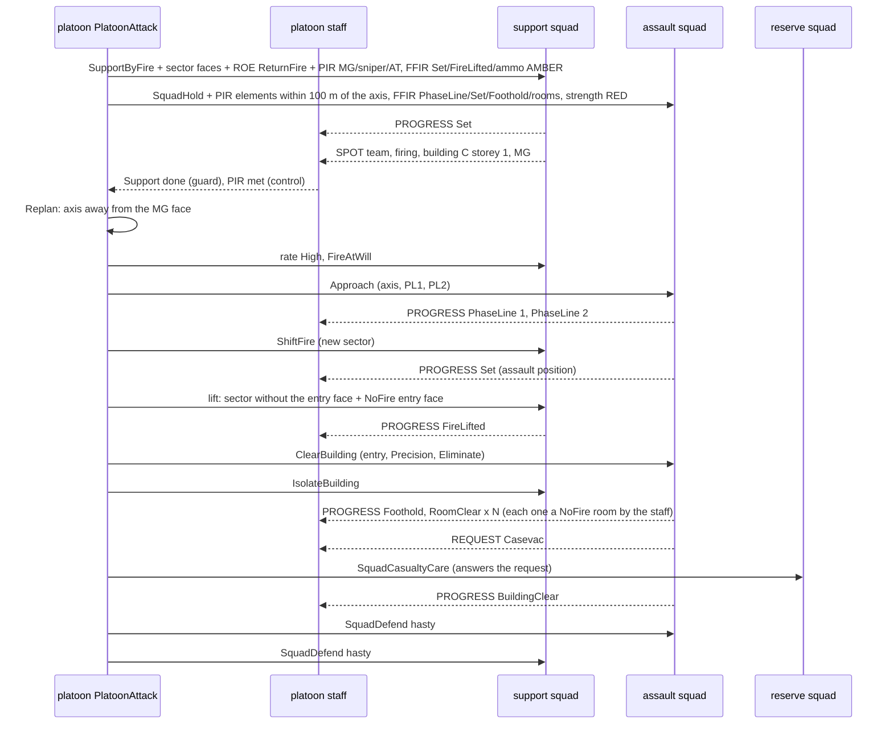
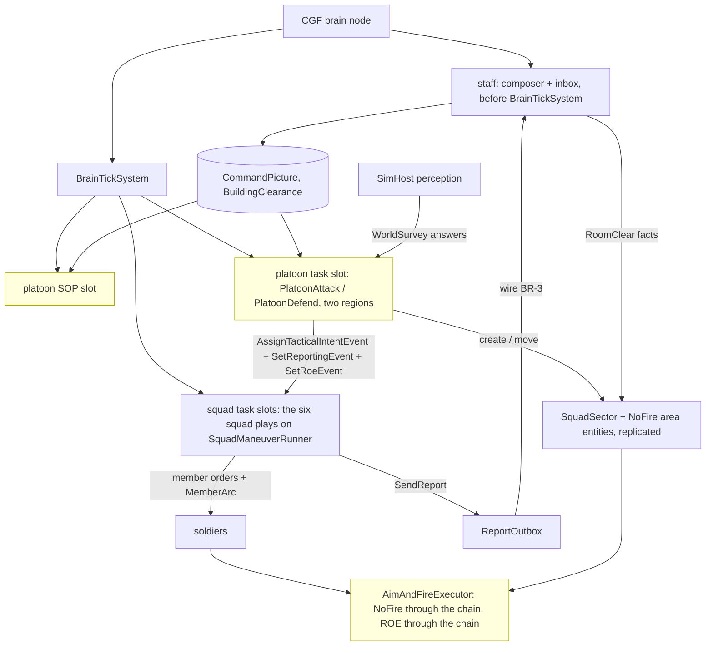
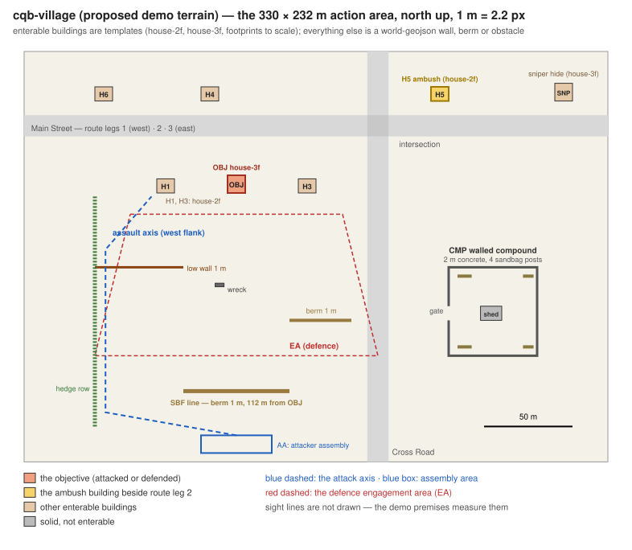
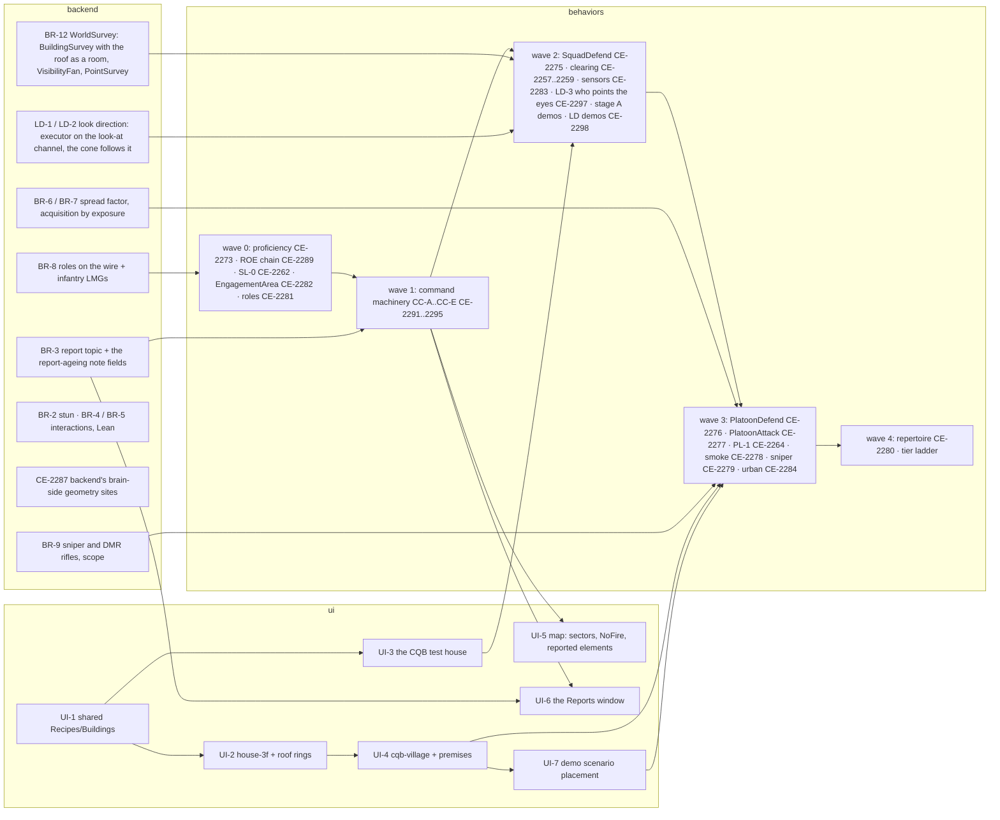

<!--STATUS
state: LIVE
updated: 2026-10-18
build-state: READY-TO-BUILD — PC-1…PC-13 ✅ APPROVED 2026-10-18 (R-2046); PC-14…PC-16 (§6b) ✅ APPROVED 2026-10-18 (R-2047); work split per lane in §13; nothing built. Builds inside the existing slices (DA-E CE-2276, DA-F CE-2277, PL-1 CE-2264, CC-A…CC-E) plus CE-2289 (ROE through the chain) and CE-2290 (the demo terrain)
current-answer: §1 the shape · §2 INVENTORY · §3 classes · §4 the attack (and clear) · §5 the defence · §6 the squad plays and roles · §7 the report contract · §8 acting alone · §9 modules · §10 decisions · §11 slices · §6a sensors, sectors and the roof · §6b window switching and relocation (PC-14…PC-16) · §12 the demo scenarios (PC-11…PC-13) · §13 the work, split per lane
stale-below: nothing.
known-rot: none.
known-conflict: none — it makes concrete, and in two places revises, DESIGN_Defend_And_Attack_Position (§3/§4 PlatoonPicture and the report kinds PostsManned · Displacing · SniperContact · PhaseLine · Foothold · ObjectiveTaken are now CommandPicture and the closed PROGRESS / SPOT set, PC-2; DA-7's ROE lift needs PC-6)
related-designs:
  - docs/designs/group-maneuvers/DESIGN_Defend_And_Attack_Position.md — OWNS the doctrine, proficiency tiers, posts, sectors (DA-20, DA-24), the survey sensor (R-2037/R-2038), the presets (R-2035) and the town movement; this design turns its two platoon plays into concrete HSMs on the command machinery
  - docs/designs/group-maneuvers/DESIGN_Building_Clearing.md — OWNS the room drill, BuildingClearance (CB-9), the report concept and vocabulary (§5b–§5d, CB-36…CB-47); the attack's Clear phase runs its ClearBuildingPlay
  - docs/designs/group-maneuvers/DESIGN_Command_Chain_Example.md — OWNS the machinery used here: CommandPicture, ReportingRequirements, the staff, OrderSubordinate / AssignSubordinate, picture guards, Initiative (CC-1…CC-16)
  - docs/REFERENCE_Command_Building_Blocks_Measured.md — the measured blocks, symbol by symbol
  - docs/designs/group-maneuvers/DESIGN_Squad_Tactics.md — OWNS the squad runner and the built drills (bounding overwatch, suppress-and-manoeuvre, break contact, casualty care) the squad plays reuse
  - docs/DESIGN_Decision_Layer.md — OWNS task · SOP · reaction and ROE (§4.4); PC-6 extends ROE through the chain
  - docs/designs/look-direction/DESIGN_Look_Direction_And_FOV.md — OWNS where a man looks (LD-1…LD-5, R-2048): §3 brings it into this programme, its demos and the look checks added to §12's
  - docs/DESIGN_Peek_And_Fire.md — OWNS the expose / hide / relocate cycle, FiringPositionMemory heat and CoverClaim; §6b keeps relocation inside a man's post and sector (PC-14) and sets who switches by tier (PC-15)
-->

# The platoon attacks, defends and clears a building — concrete commander and squad behaviours *(behaviors, `2026-10-18`)*

🔒 User, `2026-10-18`: *"Now with all the existing designs we made recently, I would like you to apply these for the previously
mentioned bigger behaviors like attacking a building or a fortified place and defending the building or a fortified place … design the
higher level commander behaviors needed to control the attack and the defense as well as the house clearing. In all there are multiple
subordinate squads with different role. and the same one level below the squad behaviors for serving these attack and defend higher level
behaviors, using squad members with different roles. Will you be able to come with concrete commander-level behaviors that are using the
reports, to support those?"*

**The decision in one line (lean):** two platoon **HSMs** — **`PlatoonAttack`** (its presets are the orders AttackBuilding ·
AttackPosition · ClearBuilding · ReactToFireFromBuilding, R-2035) and **`PlatoonDefend`** — each with a **phase region** that advances
on PROGRESS reports and a parallel **control region** that adjusts on SITREP / SPOT / REQUEST; they give each squad a **role** (support,
assault, reserve; or line, OP, reserve), its **sector**, its **ROE** and its **report requirements** with the order. Below them, six
squad plays on the existing runner give each man his job by his **role** (team leader, automatic rifleman, grenadier, rifleman, marksman,
medic). Every hand-off is a report up and an order down; nothing reads another brain.

## 1. The shape — who is who

| level | entity | runs (task) | its SOP | knows |
|---|---|---|---|---|
| **platoon** | `Unit_InfantryPlatoon` (SL-0), body-less | `PlatoonAttack` / `PlatoonDefend` (HSM, two regions) | `BasicPlatoonSop` | `CommandPicture` · `BuildingClearance` · `ReportingRequirements` (from its own superior, if any) |
| **rifle squad** ×3 | `Unit_InfantrySquad` (302), body-less; 9 men: squad leader + fire team A + fire team B (team leader, automatic rifleman, grenadier, rifleman) | one of the six squad plays (§6) | `BasicSquadSop` | its pool (`SquadCognitiveState`) · `ReportingRequirements` · `ReportOutbox` |
| **weapons squad** (optional) | a squad unit of two MG teams (gunner + assistant) | `SupportByFire` | `BasicSquadSop` | as a squad |
| **sniper pair** (optional, Veteran+) | two Marksmen, **bodied members of the platoon HQ** — they feed the platoon's own memory automatically (CB-36) | `SniperTeam` | `BasicInfantrySop` | `TargetMemory` |

Task organisation (doctrine: support, assault, reserve) is decided by the platoon play at **Plan**, not fixed by the roster:

| element | attack | defence | clearing |
|---|---|---|---|
| **support** | the weapons squad, else the squad nearest the overwatch line | — | isolates (watches exits and windows) |
| **assault** | the strongest squad (SITREP strength) | — | clears (`ClearBuildingPlay`) |
| **reserve** | the rest: follows, relieves, counter-attack guard | one squad, held back, counter-attacks (Veteran+) | follows to the foothold, relieves |
| **line** | — | the other squads, one sector each | — |
| **OP** | — | fire team B of one line squad, forward (Regular+) | — |

## 2. INVENTORY *(2026-10-18 — codebase-memory CLI `search_graph` `.*(Play\|Maneuver)$` (Class): 15 squad plays + their maneuvers; `.*(MemberOrderKind\|TacticalDesignation\|SquadRole\|FireTeam).*` (Enum): 2; reads of `UnitRoster`, `MemberOrderKind`, `RoeOf`, `RoeSystem`; the three owning designs end to end. `check_index_coverage` NOT run — CLI only)*

| need | exists | where | gap |
|---|---|---|---|
| squad plays to reuse | ✅ 15: `SquadMarch` · `TravellingOverwatch` · `BoundingOverwatch` · `FireAndMovement` · `SuppressAndManeuver` · `DangerCrossing` · `SquadHold` · `BreakContact` · `SquadCasualtyCare` · `SquadEmbark` / `Dismount` · airborne ×3 · `BatteryFireMission` | `Brains/*Behavior.cs`, `Squad/Maneuvers/` | `SupportByFire`, `IsolateBuilding`, `FollowAndSupport`, `SquadDefend` (designed, §6) |
| member orders | ✅ 9: `Hold · AdvanceTo · Disembark · Suppress · CarryCasualty · Watch · Embark · FireAtPoint · Stay` | `SquadManeuverRunner.MemberOrderKind` | `OccupyPost`, `ThrowSmoke` (Defend DA-12, DA-20) · the clearing's member orders (Building Clearing §7a) |
| roles | ✅ `TacticalDesignation` (Commander · SquadLeader · Wingman · Support · TeamLeader · Medic) | `Fdp.Core/CommandHierarchy/TacticalDesignation.cs` | the DA-19 roles + fire team index (`CE-2281`) |
| a roster big enough | ✅ `UnitRoster.Capacity` = 16 members | `UnitRoster.cs` | — |
| the commander's picture | 🆕 designed: `CommandPicture` (Elements ×8 · Subordinates ×4 · Requests ×4) | Command Chain §6 | ⚠ **Subordinates ×4 is exactly full**: 3 squads + the weapons squad, no room for an attachment (PC-8); the sniper pair needs no row (bodied, PC-10) |
| HSM parallel regions | ✅ built and railed (`StateFlags.IsParallel`, rail ⑥) | `HsmKernelCore` | ⚠ **no production HSM uses them yet** — these two assets are the first |
| a "10 s in this state" guard | ⛔ none found (`[SharedAiCondition]` names with Elapsed / TimeIn / Since / Timeout: 0) | — | `TimeInState(seconds)`: the state's entry action stamps sim time into its own state slot, the guard compares (PC-7) |
| report requirements | 🆕 designed: `ReportingRequirements` (Superior · PirMask · FfirMask · SitrepEverySeconds · SetBy) | Command Chain §6 | ⚠ a PIR "element inside MY area" needs the area (PC-3) |
| ROE reaching the men | ⚠ **per entity only**: `RoeOf.Fire(view, unit)` reads the unit's OWN `Roe`, unset ⇒ `FireAtWill`; `RoeSystem` writes one entity; nothing reads up the chain | `Behavior/Components/Roe.cs` (`RoeOf`), `RoeSystem` | ⛔ a platoon's `HoldFire` on a squad never reaches its soldiers, and the gate reads the soldier (PC-6, `CE-2289`) |
| sectors, NoFire | 🆕 designed: `SquadSector` area entity · `MemberArc` in the order · NoFire looked up through the chain | Defend §13a (DA-24) | — reuse |
| geometry on the brain | ⛔ ruled out (R-2037): posts, faces, rooms, visibility come from `WorldSurvey` answers solved on the muscle | Defend §13b | — reuse |

## 3. Classes

*What the picture shows that prose hid:* the platoon plays contain **no report parsing and no geometry**. They are assets of states,
entry actions and guards; the heavy parts are shared C# actions over the latest survey answer, and every guard reads the picture the
staff already folded. Only three boxes are new beyond the owning designs: the two HSM assets with their SOP, `PlatoonActions`, and
`RoeChain`.

## 4. `PlatoonAttack` — attack a building or a position, and clear it

*What the picture shows that prose hid:* every step of the plan waits on a **report a squad sends because the platoon asked for it**
(§7) — never on a clock, except the one deliberate 10 s fall-back on the lift. The control region keeps ticking while a phase runs, so
shifting fire, relieving the assault and answering a CASEVAC never stop the plan.

| phase state | entry action (orders down) | guard out (reports up) |
|---|---|---|
| **Plan** | `TaskOrganize` (§1 table) · ask `WorldSurvey`: BuildingSurvey of the objective, VisibilityFan from candidate support lines · `PlanAxis`: the side covered by the fewest known posts (DA-10) | survey answered + elements assigned |
| **Support** | support: `Order.SupportByFire` {line, `SquadSector` = the faces that see the axis, rate Low} + ROE `ReturnFire` · assault: `Order.SquadHold` covered · reserve: `Order.FollowAndSupport` {behind the assault} | `ProgressReached(support, Set)` |
| **Approach** | support: rate **High**, ROE `FireAtWill` · assault: `Order.Approach` {axis, phase lines PL1 100 m · PL2 30 m, smoke at open stretches} | `ProgressReached(assault, Set)` |
| **Lift** | support: `Order.SupportByFire` {sector WITHOUT the entry face, NoFire over the entry face (`MarkNoFire`)} | `ProgressReached(support, FireLifted)` or 10 s in state |
| **Enter** | assault: `Order.ClearBuilding` {entry point, Intensity, Objective} · support: `Order.IsolateBuilding` {the exits and windows of the other faces} · reserve: `Order.FollowAndSupport` {the foothold} | `ProgressReached(assault, Foothold)` |
| **Clear** | — (the clearer runs its rooms; the staff turns each RoomClear into a NoFire room, PC-5) | `ProgressReached(clearer, BuildingClear)` |
| **AssaultThrough** *(open position)* | assault: `Order.SuppressAndManeuver` {through the objective} | `ProgressReached(assault, ObjectiveSecure)` |
| **Consolidate** | each squad: `Order.SquadDefend` {hasty, a sector of the objective facing the expected counter-attack} | every squad `ProgressReached(·, Set)` ⇒ the task ends; the platoon's staff sends PROGRESS ObjectiveSecure up |

| control state | when (guard) | does |
|---|---|---|
| **ShiftFire** | `ProgressReached(assault, PhaseLine 2)` | moves the support's `SquadSector` off the face the assault heads for (one new order) |
| **Replan** | `PirMet(MG or AT, on the axis face)`, phase before Lift | `PlanAxis` again; a changed axis ⇒ a new `Order.Approach` |
| **Relieve** | `SubordinateColour(assault) == BLACK` or `!SubordinateFresh(assault)` | the reserve becomes the clearer: `Order.ClearBuilding` over the rooms `BuildingClearance` still holds Unknown / Suspected; the remnant holds the foothold |
| **Answer** | `PendingRequest(kind)` | Casevac ⇒ reserve: `Order.SquadCasualtyCare` {the casualty point} · FireSupport ⇒ support: `FireAtPoint` at the request's location · Permission ⇒ §8 · Resupply ⇒ the reserve's ammo to the requester (v2) — each answer cites the request id (`AnswerRequest`) |
| **CounterSniper** | `ElementsAt(any, equipment = sniper)` | the sniper pair, if any: `SniperTeam` {that building} · else support suppresses it |
| **LiftRoof** | `ProgressReached(clearer, RoomClear)` for the **stair house** (the room under the roof exit, from the BuildingSurvey) | the support's sector loses the roof + a NoFire area over it, BEFORE the clearer opens the stair-house door — the roof is cleared last, from inside (§6a) |
| **Abort** | assault and reserve both BLACK | every squad `Order.BreakContact`; the task FAILS (its staff sends SITREP BLACK up) |

**Presets (R-2035)** — one asset, the preset picks the first phase and which phases are skipped:

| preset (the order) | runs | skips |
|---|---|---|
| `AttackBuilding` | Plan → Support → Approach → Lift → Enter → Clear → Consolidate | — |
| `AttackPosition` | Plan → Support → Approach → Lift → AssaultThrough → Consolidate (the support lifts off the objective as the assault closes) | Enter, Clear |
| `ClearBuilding` | Plan → Enter (support isolates first) → Clear → Consolidate | Support, Approach, Lift — re-entered only if a squad reports CONTACT from the objective |
| `ReactToFireFromBuilding` | the squad in contact IS the support: Plan → Approach → Lift → Enter → Clear → Consolidate, or **Bypass** (DA-18) | Support |

*What the picture shows that prose hid:* the platoon never sees a soldier or a contact — only one SPOT element, the progress subtypes
and a request; and the safety of the lift does not depend on the report arriving: the NoFire area over the entry face is written by the
platoon BEFORE it waits for `FireLifted`, and the gate refuses fire into it whatever the support squad's state.

## 5. `PlatoonDefend` — defend a building or a fortified place

```mermaid
stateDiagram-v2
  direction LR
  state "PlatoonDefend" as PD {
    state "phase region" as DPH {
      [*] --> DPlan
      DPlan --> Occupy : defence plan made
      Occupy --> Ready : every line squad PROGRESS Set
      Ready --> Engage : an element inside the EA
      Engage --> Ready : EA empty 120 s
      Engage --> FallBack : half the line RED or worse
      FallBack --> [*] : every squad PROGRESS FallingBack done
    }
    --
    state "control region" as DCT {
      [*] --> DWatch
      DWatch --> OpBack : element within 300 m of the OP
      OpBack --> DWatch
      DWatch --> Supplementary : element outside every sector, a flank
      Supplementary --> DWatch
      DWatch --> Reinforce : a line squad RED and elements in its sector
      Reinforce --> DWatch
      DWatch --> Counterattack : CONTACT inside the building, Veteran+
      Counterattack --> DWatch
      DWatch --> DAnswer : a REQUEST pending
      DAnswer --> DWatch
    }
  }
```

*What the picture shows that prose hid:* the trigger line is not a timer or a sensor of its own — it is `ElementsAt(EA)` over the SPOTs
the line squads and the OP send because the EA is their PIR. The same report that starts the fire also feeds the control region's
flank and reinforcement checks.

| phase state | entry action | guard out |
|---|---|---|
| **DPlan** | `PlanDefence` (DA-4): the EA, the threat axis, per squad primary + alternate + supplementary posts (survey answers, DA-5), the OP, the reserve, the fall-back route · `SectorPlanner.SplitArea` ⇒ one `SquadSector` per line squad | plan made |
| **Occupy** | each line squad: `Order.SquadDefend` {posts, sector, OP team (one squad), alternates} + ROE **`HoldFire`** (Regular+; `FireAtWill` below) · reserve: `Order.SquadDefend` {a covered position behind, no sector} | every line squad `ProgressReached(·, Set)` |
| **Ready** | — | `ElementsAt(EA, any)` |
| **Engage** | every line squad: ROE `FireAtWill` (`SetSquadRoe`, reaches the men by PC-6) | EA empty 120 s ⇒ back to Ready (`HoldFire` again) · `SubordinateColour ≤ RED` on half the line ⇒ FallBack |
| **FallBack** | the reserve covers (`SquadDefend` at the fall-back route's first bound) · line squads: `Order.BreakContact` {the route} | every squad PROGRESS FallingBack, done |

| control state | when | does |
|---|---|---|
| **OpBack** | `ElementsAt(within 300 m of the OP)` | the OP squad: `Order.SquadDefend` {OP team rejoins its posts} |
| **Supplementary** | `ElementsAt(outside every SquadSector, within 150 m)` | the squad on that side: `Order.SquadDefend` {its supplementary posts, a sector facing the flank} |
| **Reinforce** | `SubordinateColour(sq) ≤ RED` and `ElementsAt(sq's sector)` | the reserve: `Order.SquadDefend` {the alternate posts behind `sq`, the same sector} |
| **Counterattack** *(Veteran+; Regular blocks instead)* | a line squad's CONTACT or SPOT located inside the defended building (PointSurvey storey) | the reserve: `Order.ClearBuilding` {that storey's rooms} — the clearing drill, used in reverse · Regular: the reserve `SquadDefend` at the stair |
| **DAnswer** | `PendingRequest(kind)` | Casevac ⇒ the reserve's medic team · Permission ⇒ §8 · Resupply (v2) |

**Below Regular (the repertoire, DA-16):** Untrained and Militia run the **same asset** with the control region's Supplementary,
Reinforce and Counterattack disabled by the tier, no OP, no `HoldFire` — so they fire at first sight and never re-plan, which is how
irregulars differ (Defend §4.2).

## 6. The squad plays that serve them, and what each role does

| squad play | 🆕 / ✅ | phases | reports it sends itself (`SendReport`) | its staff adds by the platoon's requirements |
|---|---|---|---|---|
| **`SupportByFire`** | 🆕 | move (bounding overwatch, ✅) → occupy the line → suppress (rate Low / High) → shift / lift on new orders | PROGRESS **Set** on the line · **FireLifted** when a lift order is applied | SPOT of elements at windows (PIR MG / sniper / AT) · SITREP ammo |
| **`Approach`** | ✅ `BoundingOverwatch` / `FireAndMovement` + phase lines + smoke | bound by fire teams along the axis | PROGRESS **PhaseLine** n · **Set** at the assault position | CONTACT on the axis · SITREP strength |
| **`IsolateBuilding`** | 🆕 (Building Clearing) | two teams to diagonal corners, each watching two faces' exits and windows | PROGRESS **Set** (isolated) | SPOT of anyone leaving |
| **`ClearBuilding`** | 🆕 (Building Clearing) | entry team stacks, breaches, enters, dominates, controls; the security team holds the foothold; swap | **Foothold** · **RoomClear** / **RoomBlocked** · **Detained** · **BuildingClear** · REQUEST **Casevac** | SITREP strength, LACE |
| **`FollowAndSupport`** | 🆕 | follow the assault one bound behind in cover · hold near the foothold · stand by to take over | PROGRESS **Set** | SITREP |
| **`SquadDefend`** | 🆕 (Defend DA-D) | occupy posts (primary) → hold fire → engage → displace (alternate) · the OP team forward when ordered | PROGRESS **Set** (posts manned) · **Displacing** · **FallingBack** | SPOT / CONTACT in the EA or on a flank · SITREP · LACE |

**Who does what inside the squad (roles, DA-19):**

| role | `SupportByFire` | `Approach` | `IsolateBuilding` | `ClearBuilding` | `SquadDefend` |
|---|---|---|---|---|---|
| **squad leader** | places the line; sends the reports | moves with the bounding team | at the corner with the wider view | outside the stack, directs; sends the reports | at the post seeing the whole sector |
| **team leader** | his team's half of the sector | leads his team's bound; throws **smoke** at an open stretch | runs one corner | #1 of the entry (breacher) or leads the security team | his team's half |
| **automatic rifleman** | the centre, the longest view, the **highest rate** (the base of fire) | the overwatching team's base of fire | covers the longest face | never first in the stack; covers the hallway | the post with the longest view down the EA (final protective line) |
| **grenadier** | window faces under 150 m | — | the face with the most windows | #2 (stun / frag by Intensity, CB-30) | the dead ground in front |
| **rifleman** | spread between, aimed fire | moves | watches | #3 / #4 | the alternates first |
| **marksman** (DMR) | windows beyond 200 m | — | — | — | the far edge of the EA |
| **medic** | stays back in cover | follows | — | with the security team (casualty point) | with the reserve |

## 6a. Sensors, sectors and the roof — where each one is used *(✅ asked by the user, R-2046)*

🔒 User, `2026-10-18`: *"Approved. Does this still inlude the new sensors and sector assigning and roof reachable by stairs so even roof
can be secured during the house clearing operation?"* — ⭐ **yes**; the table says where each one lands in these plays.

| piece | owning design | used by | for |
|---|---|---|---|
| **`WorldSurvey` BuildingSurvey** (faces, windows, storeys, rooms **derived** from the current walls, the roof storey included) | Defend §13b DA-25, R-2038 | `PlatoonAttack` Plan · `PlatoonDefend` DPlan · `ClearBuilding` | the entry face, the window faces the support covers, the rooms to clear, `BuildingClearance`, the NoFire room outlines (PC-5) |
| **VisibilityFan** | DA-25 | `SetSquadSector`, `SquadDefend` | what each post really sees across its arc (v2 clipping of `MemberArc`) |
| **PointSurvey** | DA-25 | the squad staff's SPOT | building + storey of an element (the platoon's `ElementsAt` and Counterattack read it) |
| EQS `FindBuildingPosts` · **`FindRoofPosts`** · `FindDefensivePosts` · `FindOverwatchPosition` | DA-5, DA-13 | `PlanDefence`, the sniper pair | posts per storey and **on the roof** (only when reachable — `house-3f` is), the sniper's hide |
| **`FiredOnFromStructure`** | DA-21 | squad SOP ⇒ CONTACT up ⇒ platoon SOP | `ReactToFireFromBuilding` (the preset) |
| **`SniperFire`** | DA-21 | squad SOP | cover + a SPOT with the sniper flag ⇒ the platoon's CounterSniper |
| **`ContactInEngagementArea`** | DA-21 | `SquadDefend` (alone, it lifts its own hold-fire) · the staff's PIR "element inside the EA" | the trigger |
| **`ContactOutsideSector`** | DA-21 | `SquadDefend` | a man flanked moves to his alternate; the staff's PIR "outside within 150 m" ⇒ Supplementary |
| **`PositionUntenable`** | DA-21 | `SquadDefend` | displace to the alternate post ⇒ PROGRESS Displacing |
| **`SquadSector`** (area entity per squad) | Defend §13a DA-24 | `SetSquadSector` in both platoon plays | the support's window faces · the assault's entry face · each line squad's slice of the EA · **a roof band for the roof posts** |
| **`MemberArc`** (in each member order) | DA-24 | every squad play's `ForMembers` | each man's part of the squad sector, by role (§6 table) |
| **NoFire areas** (looked up through the chain) | DA-24 | `MarkNoFire` (entry face, the roof before the exit), the staff (each cleared room) | the gate refuses any round ending in them |

**The roof, in the clearing** (`house-3f`, DA-22: the roof is a storey with a stair house and a 1 m parapet):

| step | what happens | from |
|---|---|---|
| the survey | the roof storey is **one room** (open, bounded by the parapet) whose portal is the **stair-house door**; the stair house is a room of its own | BR-12 (the backend note asks for it explicitly) |
| the order | rooms bottom-up (CB-10), so the roof is LAST; `Entry: Roof` (Elite, fast rope) flips it | Building Clearing CB-10 |
| before the door | the platoon's control region **LiftRoof**: the support stops firing at the roof, NoFire over it | §4 control table |
| the exit | the stair-house door is a fatal funnel: **pie it** (`SliceThePie`, CB-22), a stun first under Arrest or Precision with people known (CB-30), then out fast, the AR never first | Building Clearing CB-22, CB-30 |
| the defenders | prone behind the parapet (low cover, the stance thresholds), from `FindRoofPosts` | Defend DA-5, DA-22 |
| done | PROGRESS **RoomClear** (roof) ⇒ then BuildingClear | CB-43 |

## 6b. Never showing twice at the same place — window switching and relocation *(✅ PC-14…PC-16 approved, R-2047)*

✅ 🔒 User, `2026-10-18`: *"Approved. Is LD-1 in the plan too?"*

🔒 User, `2026-10-18`: *"the defenders and maybe also the attackers, are they using the maneuvers like switching windows to not appear
every time at the same place where the attackers can be waiting for?"* — ⭐ **yes, it is built**, and the same rule as R-2023 (the hill
attack: *"so the enemy cannot aim and wait"*). What this programme adds is keeping it inside each man's post and sector.

| measured *(`PeekAndFireNodes`, `WindowDuelBehavior.Shape`, `FiringPositionMemory` / `PositionHeat`)* | |
|---|---|
| **the defender at a window** (shape A) | prone under the sill, up at the window, fires, down; after **3 exposures** another window ≥ 2 m away (`FindWindowFiringPosition`, 12 m search) |
| **the attacker behind cover** (shape B) | crouched behind cover, steps out, fires, back; after **2 exposures** a suppressive burst, then relocates **≥ 8 m** (`FindCoverFromTarget`, 15 m search) |
| **memory of used spots** | `FiringPositionMemory` — the UNIT's memory (outlives a posture switch, a reload, a re-plan): every exposure heats the spot, **being shot at heats it more**; hot enough ⇒ **burned** and skipped until it cools (a half-life); a warm spot scores lower when the next one is chosen |
| **two men, one window** | `CoverClaim`: a point another unit claimed is skipped |
| **the watcher's side** | a man who loses sight of his target fires a **blind burst at the remembered spot** (the Blind phase) — the "waiting for him to reappear" the switching defeats |
| ⛔ **not there yet** | the hide candidates ignore the man's **post and sector** (a defender may slide to a window in his neighbour's arc, an SBF man off his line) · a soldier's **eyes do not stay on** the window where the enemy last showed (vision is 360° until LD-1 — ✅ now in the plan, R-2048, Look Direction §3) · below Regular the switching is ON today, though DA-2 says the untrained stay at the sill |

| id | decision | ⭐ lean | rejected — one line each |
|---|---|---|---|
| **PC-14** | where a man may move to | the next hide point must lie **inside his `EngagementArea.Allow`** (it still sees his sector) and, in a defence, be one of **his post's windows or his alternate** (`SquadDefend` hands the post set into the order); an SBF man stays **on the support line**; a man who finds none fights from where he is (the existing "every point burned" path) | free relocation: a defender drifts into a neighbour's arc and a sector goes empty · a fixed post: he shows at the same window until hit |
| **PC-15** | who switches | by proficiency (DA-2): **Untrained / Militia stay at the sill and do not switch**, Regular switches after 3, **Veteran after 2, Elite after 1** — and Veteran+ also leave at once when shot at (the heat already burns the spot) | everyone switches: the untrained look trained · nobody: the regulars die at the first window |
| **PC-16** | the other side's counter-play | v1: the blind burst at the remembered window (built) + the acquisition time by exposure (BR-7) — a man up at a NEW window is acquired later than one who reappears where he was watched; ⭐ once LD-1 lands, Regular+ attackers keep **`WatchBearing` on the last window an element showed at** (the squad's SPOT gives the storey), so switching is what beats them | pre-aim without look direction: there are no eyes to aim |

## 7. The report contract — what each order asks for, and what each report drives

Every order carries its requirements by `SetSubordinateReporting` (CC-2: their own event, beside the order). The staff then sends those
**at once** and the rest by routine (CC-8).

| play → element | PIR (about the enemy) | FFIR (about own) | SITREP |
|---|---|---|---|
| attack → **support** | MG · sniper · AT · any element in the objective | Set · FireLifted · ammo ≤ AMBER | 15 s |
| attack → **assault** | any element within 100 m of the axis | PhaseLine · Set · Foothold · RoomClear · RoomBlocked · BuildingClear · strength ≤ RED | 15 s |
| attack → **reserve** | — | Set · strength ≤ RED | 30 s |
| defend → **line squad** | any element inside the EA · outside its sector within 150 m · vehicle / AT | Set · Displacing · FallingBack · strength ≤ AMBER · ammo ≤ AMBER | 15 s |
| defend → **OP squad** | any element | Set | 15 s |
| defend → **reserve** | — | Set | 30 s |

| report | sent by | the platoon reads it as | route (CB-45) |
|---|---|---|---|
| PROGRESS Set / PhaseLine / FireLifted / Foothold / BuildingClear / ObjectiveSecure | the squad play | the phase advances | phase-region guard |
| PROGRESS RoomClear / RoomBlocked | `ClearBuilding` | `BuildingClearance` + a NoFire room (PC-5) | staff, no behaviour |
| PROGRESS Displacing / FallingBack | `SquadDefend` | a post given up; the defence's reserve logic | control-region guard |
| SPOT (size, MG / sniper / AT flags, building + storey) | the squad staff | elements for `PlanAxis`, `ElementsAt(EA)`, flanks, counter-sniper | control guard; phase guard (Ready → Engage) |
| CONTACT | the squad staff | a new element at once | SOP (an unexpected building: `FiredOnFromStructure`) or control guard |
| SITREP colours / age | the squad staff | Relieve, Reinforce, FallBack, Abort; Silent = unknown | control guard |
| REQUEST Casevac / FireSupport / Permission | the squad play or SOP | an order that cites its id | control-region Answer |

## 8. Acting alone inside these plays *(CC-10, CC-11)*

| SOP row | class | on the assault squad (`WithinIntent`) | on a militia group (`Full`) |
|---|---|---|---|
| take cover, return fire (`ReactToContact`'s first 3 s) | **Immediate** | always, reported as CONTACT | always |
| an enemy team blocking the approach within 50 m ⇒ suppress-and-manoeuvre it | **Local** | yes, then back to the task | yes |
| a different building fires ⇒ clear it · withdraw | **Mission** | ⛔ not alone: REQUEST **Permission** (the row's id); the platoon's Answer grants it when it keeps the intent (the building covers the axis) or refuses (the support suppresses it instead) | yes, alone |
| a subordinate Silent 60 s (platoon SOP) | Local | the platoon sends the reserve's leader to check (Regular+) | — |

## 9. Who runs it each frame

*Caption:* everything runs where it already runs: the plays on the brain node's `BrainTickSystem`, the staff before it, the geometry on
the muscle. ⚠ **Not reached today:** no platoon has run over squads (SL-0), and **ROE set on a squad never reaches its men** — the gate
reads each soldier's own `Roe` — which is why the gate box is yellow (PC-6).

## 10. Decisions *(⭐ leans — for the user)*

| id | decision | ⭐ lean | rejected — one line each |
|---|---|---|---|
| **PC-1** | what a platoon play is | ⭐ an **HSM asset with two parallel regions** (phase + control, CB-45) using the shared command actions and picture guards; the squad plays stay **`ISquadPlay`s on the runner** | the platoon as an `ISquadPlay` (DA-9 as first written): the runner re-issues member orders every tick and has no parallel region; its gates are for soldiers, not reports · one blueprint per play: no parallel regions in a blueprint |
| **PC-2** | one asset or one per order | ⭐ **one `PlatoonAttack` with presets** (R-2035) choosing the first phase and the skips; `PlatoonDefend` its own | four assets: the relief, shift and answer logic copied four times |
| **PC-3** | requirements that name an area | ⭐ `ReportingRequirements` gains **`PirArea`** (the net id of an area entity — the EA or the squad's sector) for "element inside" / "outside within 150 m" | a PIR per area kind: the masks would multiply |
| **PC-4** | the closed set | ⭐ PROGRESS gains **`FireLifted`**; **PhaseLine** carries its index in `Count`; nothing else new (CB-43) | an acknowledgement kind for every order: the lift is the one hand-off where a late answer kills friends |
| **PC-5** | NoFire for cleared rooms | ⭐ the **staff** turns each folded RoomClear into a NoFire area owned by the platoon (the room's outline from the platoon's BuildingSurvey answer) — mechanical, and it must happen while the play is paused by a reaction | the play's control region: a paused task would leave a cleared room open to the support's fire |
| **PC-6** | ROE reaching the men | ⭐ **`RoeOf` reads up the chain**: a man's own `Roe` when set, else his nearest commander's set one (the NoFire lookup's rule) — one write by the platoon reaches every man on every node; a per-man setting still wins (`CE-2289`) | copy ROE down into every member: a missed copy is a man firing in `HoldFire` · leave it per entity: DA-7's lift cannot work |
| **PC-7** | the lift hand-off | ⭐ NoFire over the entry face FIRST, then wait for `FireLifted`, **10 s fall-back** (a new shared guard `TimeInState`, its start stamped by the state's entry action) | wait for the report only: a lost report stalls the attack · no wait: the assault enters while the support still fires |
| **PC-8** | the picture's size | ⭐ `CommandPicture.Subordinates` **×6** (3 squads + the weapons squad + two attachments, e.g. a vehicle section), Elements ×8, Requests ×4 | ×4: full with a standard platoon, nothing can be attached |
| **PC-9** | who becomes support / assault / reserve | ⭐ decided at **Plan** from the picture (the weapons squad supports; the strongest by SITREP assaults); re-decided only on Relieve | fixed by the roster: a squad that lost half its men would still lead |
| **PC-10** | the sniper pair | ⭐ **bodied members of the platoon HQ**: their sightings feed the platoon's memory automatically (CB-36), and the platoon gives them `SniperTeam` by `AssignSubordinate` | a sniper "unit": a commander for two men, and their sightings would arrive only by report |

## 11. Slices — where each piece is built *(the owning slices stay the place)*

| piece | lands in |
|---|---|
| `CommandPicture` ×6, `PirArea`, `FireLifted`, the NoFire-from-RoomClear staff rule | **CC-A**, **CC-C** (Command Chain) |
| `RoeOf` up the chain | 🆕 **`CE-2289`** (behaviors), before DA-E |
| `SquadDefend` + `PlatoonDefend` | **DA-D** `CE-2275` (squad) · **DA-E** `CE-2276` (platoon) |
| `SupportByFire`, `FollowAndSupport`, `Approach` phase lines + smoke, `PlatoonAttack` (AttackBuilding / AttackPosition / ReactToFireFromBuilding) | **DA-F** `CE-2277` · smoke **DA-G** `CE-2278` |
| `IsolateBuilding`, `ClearBuilding`, the `ClearBuilding` preset | **BC-3** `CE-2259` · **PL-1** `CE-2264` |
| the roles in each play (§6 table) | **DA-K** `CE-2281` |
| the counter-sniper and the sniper pair | **DA-H** `CE-2279` |

**Checked by the approved scenarios** (Defend §17): `tq-military-attack-defended` must show, in `GET /entities/{platoon}/reports`
(CC-12), the report order Set (support) → SPOT MG → PhaseLine 1, 2 → Set (assault) → FireLifted → Foothold → RoomClear … →
BuildingClear → Set ×3; `tq-police-arrest-surprise` the ClearBuilding preset with no Support / Approach phase; `dp-squad-wall` and a new
**`dp-platoon-house`** (two line squads + reserve in `house-3f` against a regular platoon) the Ready → Engage edge on the first SPOT
inside the EA, and a Reinforce or Counterattack in the report log. ⭐ Each can be driven without the other side, by faking the reports
over HTTP (CC-13).

## 12. The demo scenarios *(⭐ leans PC-11…PC-13, 2026-10-18)*

🔒 User, `2026-10-18`: *"And not just design the behaviors, but design the demo scenarios."*

### 12.1 The stage — a new terrain, `cqb-village`

*What the picture shows that prose hid:* every demo below is ONE place — the objective with a building on each side, a street
through an intersection for the movement and the ambush, a sniper hide in range of both the objective and the support line, a walled
compound for the open-position attack, and an approach field whose only cover is a hedge, a low wall, a wreck and two berms, so the
covered route (west) and the open one (centre) differ.

**Why not the terrains that exist** *(measured 2026-10-18, the world geojson of each)*:

| terrain | buildings | ⇒ |
|---|---|---|
| `test-town` | 6, **all solid prisms** (height + floors, no template, no interior) | ⛔ nothing can be entered — the approved `tq-urban-ambush-counterattack` (Defend §17) **cannot clear its building there** |
| `bt-range` | 2 × `house-2f` 60 m apart + 1 solid block; walls are a test row of materials at y = 40 | no approach cover, no street, no second building at sniper range; its `premises.json` (DemoPremisesTests) pins its sight lines, so adding features risks the existing demos |
| `demo-city` | 5, solid | — |

| id | decision | ⭐ lean | rejected — one line each |
|---|---|---|---|
| **PC-12** | where the demos run | ⭐ (`CE-2290`) **a new terrain `cqb-village`** (the picture; local metres, flat ground) with its own `premises.json` rows for the sight lines the demos need (support line ⇒ OBJ's south windows · SNP ⇒ OBJ and ⇒ the support line · the hedge route hidden from OBJ's south face); ⭐ the building templates (`house-2f`, `house-3f` DA-O, the CQB house BR-1) move to the **shared `Recipes/Buildings/`** — `TerrainAssets` already looks there after the terrain's own folder, but no such folder exists yet — so `bt-range` and `cqb-village` use the same files | grow `bt-range`: its premises would have to be re-proven · copy the templates per terrain: two copies of one house drift |

### 12.2 The ladder — logic first, then each squad play, then the whole fight

Network ids: attacking platoon **Blue 1** = HQ 9200, squads 9210 / 9220 / 9230 (men +1…+9), weapons squad 9240 (two MG teams),
sniper pair 9251–9252 (bodied, under the HQ) · defending platoon **Red** = HQ 9300, squads 9310 / 9320 / 9330. Every demo has an HTTP
live check (`scripts/utility-demo-check.py`, one `run_*` each) and an in-process twin (`PlatoonScenarioTests`, one test each).

| stage | demo | proves | cast and settings | driven by | must end with *(read over HTTP)* | needs |
|---|---|---|---|---|---|---|
| **A** logic | `pc-attack-dry` | `PlatoonAttack`'s decisions on reports alone | Blue 1 (Regular) at the AA, order **AttackBuilding** OBJ; **no enemy** | the squads move for real; the enemy and the clearing are **faked** (CC-13): a SPOT MG at OBJ's south face 5 s after the support's Set; Foothold, RoomClear ×4, BuildingClear from the assault; later a SITREP BLACK from the assault | ① each squad's behaviours in the order of §4 (`GET /entities/{squad}/order`, polled: `current` + origin Superior + `since`) · ② the Approach axis is the WEST one after the faked MG (its params vs the pre-SPOT plan) · ③ a new support sector at PhaseLine 2 · ④ the NoFire area over the entry face exists BEFORE ClearBuilding is ordered · ⑤ the BLACK ⇒ the reserve gets ClearBuilding within 1 s, over the rooms still not Cleared · ⑥ every faked report is `Synthetic` and replaced by the next real one | CC-A…E, `PlatoonAttack`, `SupportByFire` |
| **A** logic | `pc-defend-dry` | `PlatoonDefend`'s decisions, and ROE reaching the men | Red (Regular) in OBJ, H1 + H3, reserve in H4, OP team at the low wall; order **DefendPosition** {the EA}; no enemy | faked SPOTs: outside the EA · inside it · on the west flank · inside OBJ storey 1; a SITREP RED from squad 9310 | ① no ROE change on the outside SPOT · ② **every Red man's effective ROE `FireAtWill` within 1 s** of the inside SPOT (`roeEffective` on `GET /entities/{id}/state`, PC-6) · ③ the OP squad re-ordered (OpBack) · ④ the west squad to its supplementary posts · ⑤ RED + a SPOT in its sector ⇒ the reserve to its alternates · ⑥ the storey-1 SPOT ⇒ Veteran: reserve ClearBuilding storey 1, Regular: reserve SquadDefend at the stair (run twice) | CC-A…E, `CE-2289`, `PlatoonDefend`, `SquadDefend` |
| **B** squad | `sq-support-by-fire` | `SupportByFire` and the roles in it | one Blue squad (Regular, AR, grenadier) at the support line; 3 Red dummies peeking at OBJ's south windows, both storeys, unkillable (Health 100 000) | its orders posted over HTTP: rate Low → High → shift (sector off the west face) → lift (NoFire on the entry face) | ① PROGRESS Set · ② the AR fires the most rounds of the squad, the grenadier's at the nearer windows · ③ rounds per 10 s at High ≥ 2 × Low · ④ after the lift **no round crosses an entry-face window** (`/combat/shots`) · ⑤ PROGRESS FireLifted within 3 s + 1 frame of the lift | DA-K roles, `SupportByFire` |
| **B** squad | `sq-isolate` | `IsolateBuilding` | one Blue squad around H3; inside, 1 insurgent and 1 civilian, both leave by the back door (30 s, 50 s — a scenario script) | its order | ① Set with two teams at diagonal corners · ② the insurgent engaged, a SPOT sent · ③ the civilian never a target, only watched | BC isolate |
| **B** squad | `sq-defend-house` | `SquadDefend` in a 3-storey house | one Red squad (Regular) in OBJ; a Blue fire team walks in from the south | its order {posts: every storey + the roof parapet, HoldFire} | ① ≥ 1 post per storey, the roof manned · ② the AR's post has the longest view down the EA · ③ no Red round before the first Blue enters the EA, then every post fires within 1 s · ④ a man with 3 near misses moves to his alternate (Displacing) | DA-D, DA-O |
| **C** platoon | ⭐ `pc-attack-house` | the whole attack and clear, both sides AI | Blue 1 (Regular, **AttackBuilding**, Eliminate, smoke) vs 8 Red Militia in OBJ (windows on both storeys, 2 on the roof parapet, an MG at the upper corner window) + a Red Marksman in SNP | AI on both sides | ① **the report log in order**: Set (support) → SPOT MG → PhaseLine 1, 2 → Set (assault) → FireLifted → Foothold → RoomClear … → BuildingClear → Set ×3 (`GET /squad/reports`, PC-11) · ② a SPOT with the sniper flag, then rounds into SNP · ③ **no support round into a room after its RoomClear** · ④ the log identical on CGF, SimHost, IG · ⑤ every defender dead or surrendered (Resolve) | everything above + DA-F, DA-G, DA-H, BC-3 |
| **C** platoon | ⭐ `pc-defend-house` | the whole defence against a real attack | Red (Regular): squad 9310 in OBJ, 9320 in H1 + H3, reserve 9330 in H4, OP team at the low wall vs Blue 1 (Regular, AttackBuilding) | AI on both sides; ⛔ the winner is NOT asserted | ① the OP's SPOT, then OpBack · ② Ready → Engage on the first SPOT inside the EA, no Red round before it · ③ Supplementary once Blue's west axis is reported · ④ Reinforce or Counterattack in the log · ⑤ Blue's log meets `pc-attack-house` ① | `pc-defend-dry` + `pc-attack-house` |
| **C** platoon | `pc-attack-compound` | the open-position preset | Blue 1 (**AttackPosition** CMP) vs 6 Red Militia at the 4 sandbag posts, an MG at the NE post | AI | ① no Enter / Clear state (preset) · ② the support suppresses the posts that see the gate, lifts before the assault enters it · ③ ObjectiveSecure, then SquadDefend facing east | DA-F |
| **C** platoon | `pc-clear-police` | the ClearBuilding preset (police) | `tq-police-arrest-surprise` (Defend §17) moved to OBJ | AI | as Defend §17, plus: no Support / Approach state in the trace | PL-1, CE-2266 |
| **C** platoon | `pc-urban-ambush` | movement → reaction → clear → resume | `tq-urban-ambush-counterattack` (Defend §17) moved here: Blue 1 on **UrbanMovement** along Main Street (legs west → intersection → east), 4 Militia in H5 (Ambush preset) | AI | as Defend §17 (resumes at leg 2) | DA-N |
| **C** platoon | `pc-ambush-bypass` | the bypass branch | the same, but the route turns south down the Cross Road at the intersection, so the fire comes from SNP, 100 m off the rest of the route | AI | no squad enters SNP · suppress + smoke + cross · the movement resumes | DA-N |
| **C** platoon | `pc-tier-ladder` | the repertoire | `pc-attack-house` five times, both sides at each tier | AI | attacker losses and time to BuildingClear fall as the tier rises (a table in the run report) | DA-I |

⭐ **Look direction (R-2048):** its own demos (`ld-sentry-surprise`, `ld-crossing-security`, `ld-watch-last-window`, `ld-room-sectors`) run on `bt-range` and are listed in [Look Direction §3.4](../look-direction/DESIGN_Look_Direction_And_FOV.md); the same section adds a look check to `sq-defend-house`, `sq-support-by-fire`, `pc-urban-ambush` and `pc-defend-house` above.

⭐ **Kept where they are** (Building Clearing §8, the CQB test house): `bc-platoon-house` (the clearing alone, no defence) and
`bc-platoon-house-relief` (scripted casualties ⇒ relief) already prove the Clear phase and Relieve; they are not copied here.

### 12.3 The flagship's script — what the viewer sees, minute by minute *(`pc-attack-house`)*

| time | on the map | in the report log (the platoon's) |
|---|---|---|
| 0:00 | Blue 1 at the AA; the platoon plans (survey asked) | — |
| 0:20 | the weapons squad bounds to the berm on the support line; squads 2, 3 wait behind it | — |
| 1:10 | the support squad is down behind the berm, watching OBJ's windows | **PROGRESS Set** (support) |
| 1:15 | a Red MG fires from OBJ's upper corner window | **SPOT** team, firing, OBJ storey 2, MG |
| 1:20 | the platoon re-plans: the axis goes west (hedge, low wall) | — |
| 1:25 | the support opens at a high rate; squad 2 moves up the hedge row by bounds; smoke at the open gap | — |
| 2:30 | squad 2 at the low wall | **PROGRESS PhaseLine 1** |
| 3:10 | squad 2 behind H1 (30 m); the support's sector leaves the west face | **PROGRESS PhaseLine 2** |
| 3:20 | the Red Marksman in SNP fires at the support line | **SPOT** individual, SNP, sniper |
| 3:25 | the sniper pair and one MG team engage SNP | — |
| 3:40 | squad 2 stacks at OBJ's west door | **PROGRESS Set** (assault) |
| 3:42 | the support lifts off the west face | **PROGRESS FireLifted** |
| 3:45 | squad 2 breaches and enters | — |
| 3:55 | the first room is held | **PROGRESS Foothold** |
| 4:00–7:30 | room by room, up the stair, the roof last; the support isolates the other faces; squad 3 waits at H1 | **RoomClear** × n · **REQUEST Casevac** once · `SquadCasualtyCare` ordered to squad 3 |
| 7:40 | — | **PROGRESS BuildingClear** |
| 8:00 | all three squads take hasty posts facing north and east | **PROGRESS Set** × 3; the platoon's task ends |

### 12.4 What every live check also asserts *(beside Building Clearing §8.2)*

- **The check reads only HTTP, never a brain component:** the report log, each unit's `GET /entities/{id}/order`, the shots, the area entities, the entity state.
- ⚠ **Measured:** `GET /entities/{id}/order` returns the running behaviour's `params` only when its origin is **Operator** (`DebugApiService.GetOrder`); a platoon's order to a squad is origin **Superior**, so ② (the axis in the Approach params) needs the params shown for every origin — one line, folded into **CC-E**.
- **The report log is the same on every node** (CGF, SimHost, IG) — R-2031's proof.
- **Every report's `ObservedAt` ≤ its arrival time**, and the arrival is 3 s (+ 1 frame) after the sender's event (the delay is real).
- **No round ever ends inside a NoFire area of the shooter's chain of command** (`/combat/shots` × the area entities and their creation times).
- **No faked report survives the next real one** (stage A only): a `Synthetic` element or status is replaced, never stuck.

| id | decision | ⭐ lean | rejected — one line each |
|---|---|---|---|
| **PC-11** | where a check reads the full report log | ⭐ **Building Clearing §5a's `SquadReportLog`**: a ring per node written by the report ingress (the `ShotLog` precedent), `GET /squad/reports` — ⚠ this **revises CC-12's** *"the raw stream is the existing `GET /events?type=`"*: §5a measured that ring at **500 events of every type**, so a firefight evicts a report within seconds, and its payloads carry node-local ids | `GET /events` only (CC-12 as approved): a long demo loses its first reports · `GET /entities/{id}/reports` only: the last 16 per commander, not the log |
| **PC-13** | the order of the demos | ⭐ **stage A first** — the commander logic proven with faked reports (CC-13) before any fight exists; stage B one squad play each; stage C the whole fights. A red in C is then narrowed by the A and B that still pass | the flagship first: a red there could be any of 20 behaviours |

## 13. The work, split per lane *(R-2046; the user: "split across usual lanes … ui lane could help creating terrains")*

🔒 User, `2026-10-18`: *"Pls prepare tasks and split the acroas usual lanes (ui, backend, behaviors). As ui lane might not have as much
to do as other lanes it could help creating terrains or something."*

*What the picture shows that prose hid:* the three lanes can all **start today** — backend on the survey and the report topic, ui on
the buildings and the terrain, behaviors on wave 0 — and the first point where one lane WAITS on another is behaviors' wave 2 (the
rooms from BR-12, the CQB house from UI-3). The stage C demos need the terrain (UI-4) before any fight can be run.

| lane | items | where they are framed |
|---|---|---|
| **backend** | BR-12 (+ the roof room) · BR-3 (+ the note's fields incl. `Synthetic`) · **LD-1 / LD-2** (look direction, R-2048) · LD-4 last · BR-6 / BR-7 · BR-8 · BR-9 · BR-2 · BR-4 / BR-5 · CE-2287; ⚠ **BR-1 is superseded**: its room graph is BR-12's derived rooms, its test house moves to ui (UI-3) | the existing handoffs + [`NOTE_Behaviors_To_Backend_Platoon_Programme.md`](../../blueprints/batches/NOTE_Behaviors_To_Backend_Platoon_Programme.md) (order, the roof room, BR-1's split) |
| **ui** | UI-1 … UI-7 (table in the handoff); takes over `CE-2285` (house-3f) and `CE-2290` (cqb-village) | [`HANDOFF_Behaviors_To_Ui_Platoon_Demos.md`](../../blueprints/batches/HANDOFF_Behaviors_To_Ui_Platoon_Demos.md) |
| **behaviors** | waves 0–4 above (LD-3 `CE-2297` and the LD demos `CE-2298` in wave 2, [Look Direction §3](../look-direction/DESIGN_Look_Direction_And_FOV.md)); the command machinery gets its own rows `CE-2291`…`CE-2295` (CC-A…CC-E); the demo harness `CE-2296`; `CE-2263` (RP-1) is folded into `CE-2291`…`CE-2295` | the tracker rows |
