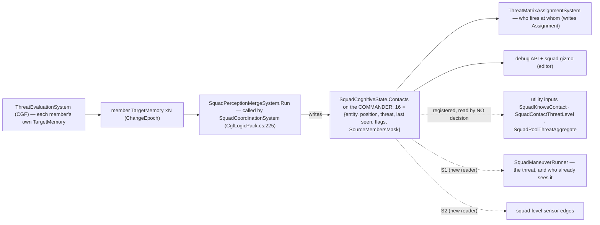
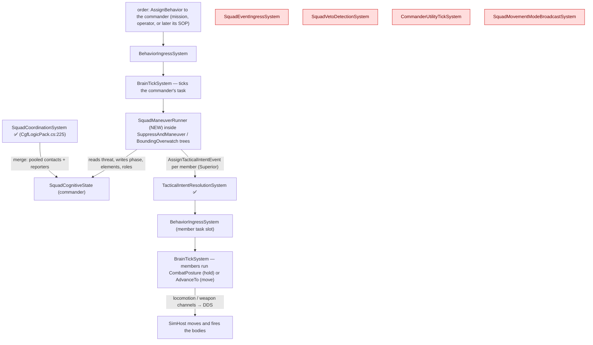
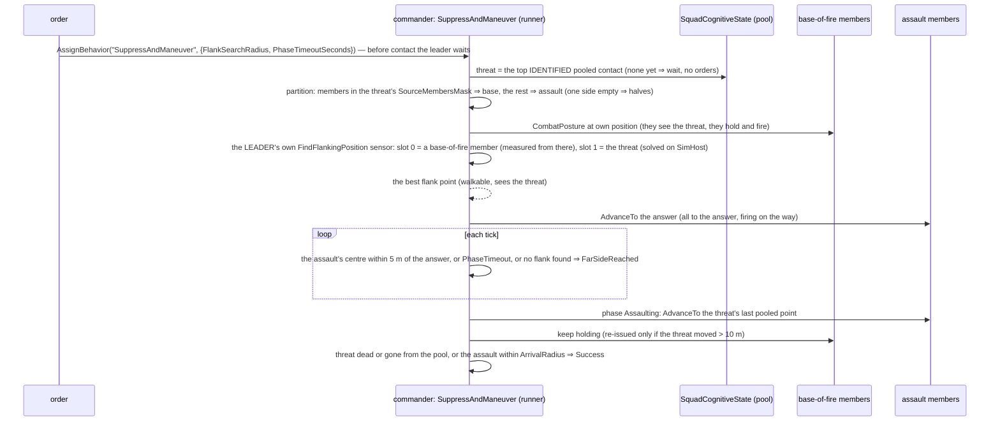
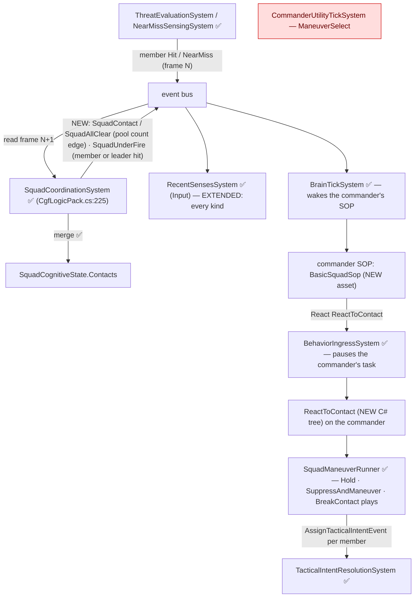
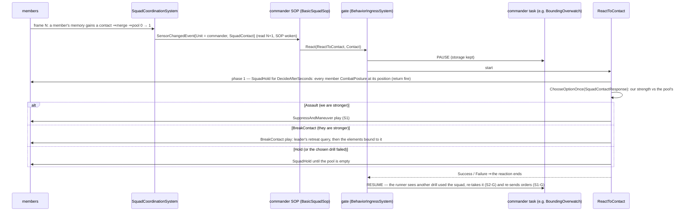
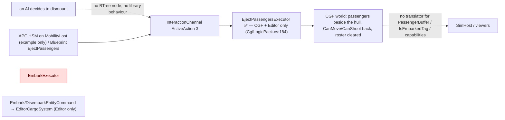
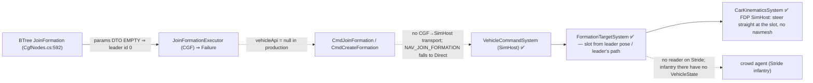
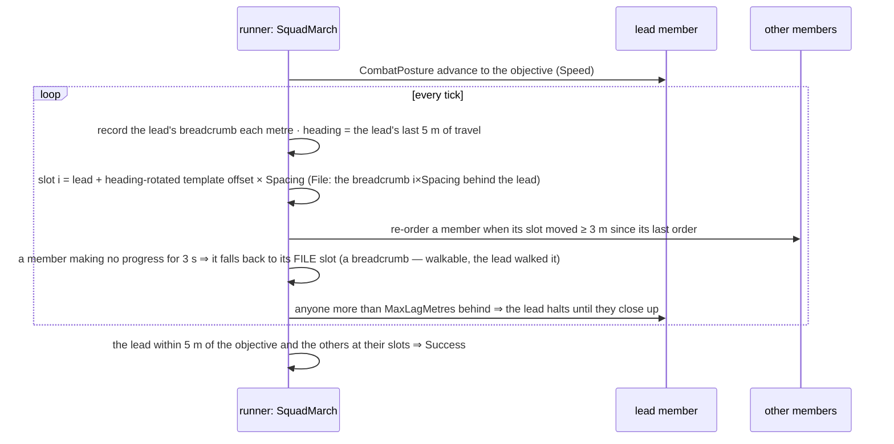

<!--STATUS
state: LIVE
updated: 2026-10-11
build-state: S1 BUILT 2026-10-11 (as-built §3.6) · S2 READY-TO-BUILD 2026-10-11 (§4) · embark §5 and formations §6 are MEASUREMENTS, not plans
current-answer: §3.6 S1 as built · §2a the squad's shared contacts (where, who writes, who reads) · §3 S1 (the generic squad manoeuvre runner + suppress-and-manoeuvre) · §4 S2 (react to contact — §4.0 claims, §4.1–§4.3 diagrams, §4.4 the alert hop by hop, §4.5 decisions, §4.6 acceptance) · §5 embark/disembark as measured · §6 formations as measured + §6.1 the simple squad formation (SquadMarch)
stale-below: nothing
known-rot: S1-C was a geometric flank point in the first draft (same day) — measured unsafe (off-mesh moves fail forever) and replaced by an EQS query — first on the lead assault member, then on the LEADER with slot 0 = that member (a leader may own EQS queries like any unit). DESIGN_Operations_Behaviour_Catalogue.md §4/§7 say the embark/eject executors are "not registered on CGF" — eject IS registered there (CgfLogicPack.cs:184); embark is registered nowhere (§5 here)
known-conflict: none
related-designs:
  - docs/DESIGN_Operations_Behaviour_Catalogue.md — OWNS which operations need squads (§3 taxonomy, §11 the review and S1–S3 order this file builds)
  - docs/designs/group-maneuvers/Squad_Coordination_Design_v1_1.md — OWNS what the squad layer is (5 primitives, the 6 manoeuvre tables, the perception merge); this file only RUNS them
  - docs/designs/group-maneuvers/DESIGN_Squad_Wiring.md — OWNS where the squad layer runs on CGF and the first runner (§6 BoundingOverwatch, CE-3162) this file generalises
  - docs/DESIGN_Decision_Layer.md — OWNS the task / SOP slots, the reaction gate and ROE that S2 plugs into (§4)
  - docs/DESIGN_Sensors_And_Doctrine.md — OWNS SensorChange and the SOP wake (§7.3) S2 extends with squad-level edges
  - docs/DESIGN_Entity_Interactions.md — OWNS embarkation (§7, R-224, CE-3110); §5 here is its measured state
  - docs/designs/navig-2/Navigation_Design_v2_0.md — names a "formations" design that was never written (:1040, :1666); §6 here is the measured state
  - docs/designs/commander-subordinates/DESIGN.md — OWNS UnitRoster / UnitSubordinate and the FormationController/Follower refactor (Phase 2) §6 measures
-->

# Squad tactics — the runner, react to contact, and what embark / formations can carry

🔒 *User, `2026-10-11`: "Ok to both questions. Before you start building a design with diagrams is required. And measurement of what
you do not know. And pls explain how s2 will work. And measure the embark/disembark and whether it works and whether it can be used and
how it works. Also how formations work and if they can be used for squad marching and whether they work at all. No handoffs to backend."*
⇒ the behaviors lane builds all of it, cross-lane edits named in each commit.

## 1. INVENTORY *(2026-10-11 — codebase-memory graph (MCP, then its CLI when the server dropped) + grep + three read-only sweeps)*

| query | total | result |
|---|---|---|
| `search_graph name_pattern=".*Maneuver$" label=Class` | 6 | BoundingOverwatch, DangerAreaCrossing, HillCrestHullDown, StackAndRoomEntry, SuppressAndManeuver, TravellingOverwatch — all static tables in `Fdp.Toolkits/Squad/Maneuvers/` |
| `search_graph name_pattern=".*Maneuver.*" label=Interface` | **0** | the six share no interface |
| `search_graph name_pattern=".*(Maneuver\|Squad\|Formation\|Bounding\|Overwatch).*" label=Class` | 81 | squad state, 6 systems (4 with no production caller — §3.1), primitives, formation types |
| `search_graph name_pattern="^(Flank\|TakeCover\|FallBack\|Suppress\|AdvanceAndAttack\|CloseToThrow)$" label=Method` | 6 | the member-level nodes (`EqsTacticsNodes`, `PostureNodes`) |
| `search_graph name_pattern=".*Formation.*(System\|Executor\|Controller\|Follower)$"` | 4 | `FormationController`, `FormationFollower`, `FormationTargetSystem`, `JoinFormationExecutor` |
| `search_graph name_pattern=".*(Embark\|Disembark\|Eject\|Passenger).*"` + grep | 2 executors, 2 commands, 2 components | `EmbarkExecutor`, `EjectPassengersExecutor`, `Embark/DisembarkEntityCommand`, `PassengerBuffer`, `IsEmbarkedTag` |
| C#-built library behaviours (`[BTreeDefinition` grep) + `Assets/BTrees/Library/` | 11 + 7 | the only squad one is `BoundingOverwatch`; members' tool is `CombatPosture` |
| ⚠ `check_index_coverage` | — | ⛔ not run — not available through the CLI; the exhaustive claims above are graph + grep agreeing |

## 2. Claims the design rests on

| claim | code — how it is | design — how it was meant |
|---|---|---|
| one manoeuvre runs; it is hard-wired to its table | `BoundingOverwatchBehavior.cs:62,104-145` | Squad_Coordination §2 "they differ only in configuration"; Squad_Wiring §6 "each is the same node shape over its own table" |
| a commander order lands in the member's TASK slot at Superior | `BoundingOverwatchBehavior.cs:154-166` → `TacticalIntentResolutionSystem.cs:129` (registered `CgfLogicPack.cs:163`) | Decision Layer §4 (origins `Sop < Superior < Operator`) |
| a member's own SOP reaction pauses a Superior order; a NEW Superior order ends that reaction | `BehaviorIngressSystem.cs:248-257` | Decision Layer :1233; TUTORIAL_Behaviour_Composition advises ROE `StayOnTask` for smart tasks like CombatPosture |
| the merge records WHO reported each contact | `SquadPerceptionMergeSystem.cs:161,183,211` (`SourceMembersMask`) | Squad_Coordination §4 |
| members do NOT get squadmates' contacts in their memory — only a utility input | merge writes the commander only; `ThreatRankingDecision.cs:24` ranks the member's OWN memory (assigned target is a bias) | Squad_Coordination §4: "surfaced as a Utility consideration input (`SquadKnowsContact`)" |
| ⇒ the member `Flank` node cannot flank a threat it has not itself seen | `EqsTacticsNodes.cs:144-152` (NeedsEntity: own top threat) | Eqs_Consuming_Behaviours §9 |
| a commander may be a body-less entity (no position) | `SquadManeuverTests.cs:53-66`; `hill-attack-close` "Tank Platoon" | — ⇒ the runner never reads the commander's position |
| the covering element "holds and fights" through CombatPosture at its own position | `BoundingOverwatchBehavior.cs:139-150` | Squad_Wiring §6 |
| ✅ a soldier ordered `CombatPosture` at its OWN position, with the enemy in SIGHT, holds and fires: it picks Suppress (healthy) or HoldProne (half health), never moves, the order never ends; with no enemy it ends at once (nothing to do) | 📐 measured `2026-10-11`: a throwaway rail on the `TacticsTreesTests` harness (winner 3 / 6, weapon channel AimAndFire, locomotion idle, no `BehaviorFinished`), then removed | Decision Layer §3.3b (CE-2105) |
| ⛔ a move to a point more than 2 m off the walkable area FAILS: the end point is snapped only within ±2 m (±4 m vertically), else `FailedUnreachable` — and `AdvanceAndAttack` then re-issues the same failing move forever | `DotRecastNavmeshProvider.cs:43,428-431`; `MoveToExecutor.cs:120`; `PostureNodes.cs:242-247` | — |
| ⛔ the navmesh lives on SimHost; the squad leader's logic runs on CGF, which cannot snap or test a point | `SimHostNodeBootstrapper.cs:60` (the node's `INavmeshProvider`); no provider on CGF | Terrain_World §4.1 |
| ✅ an EQS query is solved on SimHost for a sensor parented to ANY networked unit — a body-less leader included — measuring from slot 0 when set, aimed at an entity (slot 1) the owner need not have seen | `EqsChildSensor.Ensure(view, parent, site, config)` (`EqsChildSensor.cs:57`); `EqsContext.Self` slot 0 first (`EqsContext.cs:20-30`); slot-1 aim `EqsTacticsNodes.cs:362-364` | EQS v1.3 |
| ⛔ a BODY-LESS leader (e.g. `hill-attack-close`'s platoon) has a network id SimHost resolves | not measured — the S1 live rail uses a soldier-leader; a body-less one is checked before a scenario relies on it | — |
| ✅ the merge runs in the SAME frame a member's memory changes (any member's `ChangeEpoch` differs ⇒ merge now; else every 6 ticks); threat evaluation is registered before it | `SquadPerceptionMergeSystem.cs:44-61`; `CgfLogicPack.cs:222,225` | Squad_Coordination §4 (S-2) |
| ⛔ a paused task RESUMES with its working state kept, and does not re-send what it already sent | Decision Layer §4.9 (CE-2081): only a channel leaf re-activates | ⇒ the runner must re-issue its members' orders after a pause (S1-G) |

### 2a. The squad's shared contacts — where they live, who writes, who reads *(measured)*

*What the picture shows that prose hid: the pool is a plain component on the commander (`SquadCognitiveState`, own `[ComponentId]`,
`DataPolicy.NoScenario` — not saved, not replicated), written by ONE system on CGF, and today read only for fire distribution and
debugging. Members never see it except through utility inputs no decision uses ⇒ a soldier knows only what IT has seen.*

## 3. S1 — one generic manoeuvre runner, and suppress-and-manoeuvre on it *(build-state: BUILT — as-built §3.6)*

### 3.1 Who runs what, each frame (CGF)

*What the picture shows that prose hid: everything S1 needs already ticks on CGF — the merge, the order rail, the member runners.
The four red systems have no production caller and S1 does not revive them: arrival is polled by the runner (Squad_Wiring §6
measured the ingress keys on intent ids the per-entity counter breaks).*

### 3.2 Classes

```mermaid
classDiagram
  class ISquadPlay { <<NEW interface, Hrot.AI.Behaviors/Brains/Squad>> ManeuverKind · Table · AbortPhase · ElementCount · IsSuccess(phase) · Start(ctx) PlayStart Go/Wait/Fail · OrderFor(ctx, member) MemberOrder · Completed(ctx) PhaseEvent? }
  class SquadManeuverRunner { <<NEW static>> +Tick(play, ref SquadPlayState, ctx) NodeStatus }
  class SquadPlayContext { <<NEW ref struct>> world · commander · roster · squad · now · Threat }
  class SquadPlayState { <<NEW — generalises BoundingOverwatchState>> Started · IssuedPhase · PhaseStartedAt · per-member target XYZ · Threat id + point }
  class MemberOrder { <<NEW struct>> Hold | AdvanceTo · Point · Speed · ArrivalRadius · RoleId }
  class AdvanceToBehavior { <<NEW library behaviour, Library/Infantry>> AdvanceTo: one StatefulAction over PostureNodes.AdvanceAndAttack }
  class CombatPosture { <<existing library behaviour>> }
  class BoundingOverwatchPlay { <<NEW adapter>> over BoundingOverwatchManeuver }
  class SuppressAndManeuverPlay { <<NEW adapter>> over SuppressAndManeuverManeuver }
  class BoundingOverwatchBehavior { <<existing, REWIRED>> tree + params unchanged; Run → runner }
  class SuppressAndManeuverBehavior { <<NEW>> [BTreeDefinition SuppressAndManeuver, Library/Squad] }
  class SuppressAndManeuverParamsJsonDto { <<NEW, Hrot.Core>> [BehaviorContract Commander] FlankSearchRadius 40 · Speed 3 · ArrivalRadius 8 · PhaseTimeoutSeconds 90 }
  class SquadHsmShell { <<existing>> Tick(ref state, events, tick) }
  class BoundingOverwatchManeuver { <<existing table>> }
  class SuppressAndManeuverManeuver { <<existing table, EXTENDED>> + PhaseAssaulting }
  class ElementPartitionPrimitive { <<existing>> }
  class SquadCognitiveState { <<existing>> Contacts (+ SourceMembersMask) · PhaseId · Elements · Roles }
  class AssignTacticalIntentEvent { <<existing>> → member CombatPosture (Superior) }
  ISquadPlay <|.. BoundingOverwatchPlay
  ISquadPlay <|.. SuppressAndManeuverPlay
  BoundingOverwatchPlay ..> BoundingOverwatchManeuver
  SuppressAndManeuverPlay ..> SuppressAndManeuverManeuver
  BoundingOverwatchBehavior ..> SquadManeuverRunner
  SuppressAndManeuverBehavior ..> SquadManeuverRunner
  SuppressAndManeuverBehavior ..> SuppressAndManeuverParamsJsonDto
  SquadManeuverRunner ..> ISquadPlay
  SquadManeuverRunner *-- SquadPlayState
  SquadManeuverRunner ..> SquadHsmShell : phase on Completed()
  SquadManeuverRunner ..> ElementPartitionPrimitive : on Start
  SquadManeuverRunner ..> SquadCognitiveState
  SquadManeuverRunner ..> AssignTacticalIntentEvent : MemberOrder → member order JSON
  AssignTacticalIntentEvent ..> CombatPosture : Hold
  AssignTacticalIntentEvent ..> AdvanceToBehavior : AdvanceTo
```

*What the picture shows that prose hid: the existing tables stay the source of phases and roles; the NEW code is one runner and
one small adapter per table — a sixth manoeuvre is an adapter, not a copy of a 216-line node. `BoundingOverwatch` keeps its name,
params and two rails (R-137: unifying may not cost a feature).*

### 3.3 Suppress-and-manoeuvre, one run

### 3.4 Decisions *(leans)*

| # | decision | ⭐ lean | why |
|---|---|---|---|
| **S1-A** | where the play logic lives | one runner + an `ISquadPlay` adapter per existing table, in `Hrot.AI.Behaviors` | orders are `CombatPosture` JSON (a `Hrot.Core` DTO), which `Fdp.Toolkits` must not see; the tables stay in the toolkit |
| **S1-B** | how the base of fire is chosen | the members that REPORTED the threat (`SourceMembersMask`) | they already see it, so "hold and fire" means firing; the rest have no line of sight to waste |
| **S1-C** | how the flank point is found | ⭐ **the LEADER queries the terrain**, as any unit can: its own child sensor with the existing `FindFlankingPosition` template, slot 0 (the unit it measures from) = a base-of-fire member (as built, §3.6), slot 1 = the threat entity; until it answers, the assault holds | 📐 measured: a point computed on CGF can land off the walkable area and the move then fails forever, and CGF has no navmesh (§2). The query is solved on SimHost and returns only walkable points that SEE the threat. `EqsContext.Self` takes slot 0 before the owner (`EqsContext.cs:22`), so a leader with no body still measures from a member; the sensor reaches SimHost when its owner and its slots are networked entities (`EqsSensorConfigEgressTranslator.cs:113-130`, `…IngressTranslator.cs:140,438`) |
| **S1-D** | does the drill end at the flank or assault through | ⭐ **assault through** — the doctrinal end of the drill: from the flank the assault element moves ONTO and THROUGH the enemy's position, firing, while the base of fire shifts or stops its fire, so the position is cleared, not just shot at. Add `PhaseAssaulting` to `SuppressAndManeuverManeuver` (Suppressing → FarSideReached → Assaulting → BoundComplete → AssaultComplete) | a flank alone is half the drill; ⚠ changes a library table, so its unit tests are updated in the same commit |
| **S1-E** | a mover that never arrives | the phase advances on `PhaseTimeoutSeconds`, as bounding's timeout does | a member pinned by its own SOP reaction must not freeze the squad |
| **S1-G** | after a pause (S2's reaction, an operator order) | the runner notices a gap in its own ticks and re-issues every member's current order | 📐 measured (§2): resume keeps the runner's state but sends nothing again |
| **S1-F** | members' own SOP reactions | the runner leaves ROE alone; the acceptance scenario gives members ROE `StayOnTask` (CombatPosture takes cover by itself) | the gate already lets a fresh Superior order end a reaction; squad-level control of member reactions is S2's job |

Rejected: **one node per manoeuvre** — six copies of one shape; **ordering the member `Flank` behaviour** — it fails on a threat the
member never saw (§2); **a flank point computed on CGF** — it can land off the walkable area and the move then fails forever (§2);
**the query on the lead member** — it works, but it would make a member own the squad's state; the leader can own it (`EqsContext.cs:20-30`).

### 3.5 Acceptance

| rail | where | asserts |
|---|---|---|
| the two existing `BoundingOverwatch` rails | `SquadManeuverTests` (the feature's suite) | unchanged and green after the rewire |
| `SuppressAndManeuver` partition / flank side / assault phase / success / no-threat Failure | `SquadManeuverTests` | per §3.3, on the same fake squad |
| `SuppressAndManeuverManeuverTests` | `Fdp.Toolkits.Tests` | the extended table |
| live: `tt-suppress-flank` on `test-town` | new `SquadTacticsScenarioTests` (cluster) | base members fire (ammo drops) and stay within 5 m; the assault ends ≥ 60° round the threat from the base's bearing; then the threat dies or the assault reaches it |

### 3.6 As built *(behaviors, `2026-10-11`; 🔒 user: "yes go to S1 please")*

| file | what |
|---|---|
| `Brains/SquadManeuverRunner.cs` | `ISquadPlay<TParams>`, `SquadPlayContext`, `SquadPlayState`, `MemberOrder`, `PlayStart`, `SquadManeuverRunner.Tick` |
| `Brains/BoundingOverwatchBehavior.cs` | REWIRED: same name, params, tree; `BoundingOverwatchPlay` over the runner (its state type is now `SquadPlayState`) |
| `Brains/SuppressAndManeuverBehavior.cs` | NEW behaviour `SuppressAndManeuver` (Library/Squad) + `SuppressAndManeuverPlay` + a deactivator that drops the flank query |
| `Brains/AdvanceToBehavior.cs` + `Hrot.Core/…/AdvanceToParamsJsonDto.cs` | NEW library behaviour `AdvanceTo` (Library/Infantry; Infantry · Insurgent): move to `Objective` at `Speed`, firing at what it sees on the way (`PostureNodes.AdvanceAndAttack`), Success on arrival — every runner MOVE order uses it |
| `Hrot.Core/…/SuppressAndManeuverParamsJsonDto.cs` | NEW contract (Commander): `FlankSearchRadius` 40 · `Speed` 3 · `ArrivalRadius` 8 · `PhaseTimeoutSeconds` 90 |
| `Fdp.Toolkits/Squad/Maneuvers/SuppressAndManeuverManeuver.cs` | `PhaseAssaulting = 3` added (no id renumbered); FarSideReached → Assaulting → BoundComplete → AssaultComplete |
| `Brains/AdvanceToBehavior.cs` rail: `TacticsTreesTests.CE2123_AdvanceTo_MovesToItsObjective_UnderContact_FiringOnTheWay` | a soldier ordered `AdvanceTo` with an enemy in sight moves AND fires |
| `Recipes/Scenarios/tt-suppress-flank` | a leader (rifleman) ordered `SuppressAndManeuver`, four riflemen, an armed idle hostile with 100 000 health on `test-town` |

**Deviations from §3.2–§3.4 — each measured, none silent:**

| planned | built | why |
|---|---|---|
| flank query slot 0 = the assault's lead member | slot 0 = the first live **base-of-fire** member | `FindFlankingPosition` scores side-on to the slot1→slot0 line (`StarterTemplates.cs:61`), so measuring from the base makes the answer a flank of the base→enemy axis — the doctrinal flank; and its threat-exposure test reads slot 0's memory, which the base has (it reported the enemy) and the assault may not |
| optional `Target` param | none — the squad's top identified pooled contact | no shipped commander contract carries an entity reference yet; added when a scenario needs a named target |
| no contact ⇒ Failure | no contact ⇒ **Wait** (`PlayStart.Wait`): Running, no orders, until the squad pools an identified enemy | a leader ordered at scenario load has no contact yet; "on contact, execute" is what an author means |
| moves are `CombatPosture` with an objective (`Assault=true`) | HOLD orders stay `CombatPosture` at the member's own position; MOVE orders (assault, bounding movers) are the NEW library `AdvanceTo`; `MemberOrder.Assault` removed | 📐 measured live (first cluster run): under contact `CombatPosture` picks Suppress (winner 3) and fires IN PLACE — the assault never left the base line (flank 2°) and the phase only advanced on its timeout. Its options choose WHAT to do about a threat; an order to GO somewhere needs a tree whose only job is to go (Decision Layer §3.3b) |
| each assault member at its own point | the flank is reached when the assault's CENTRE is within 5 m of the answer; every assault member is sent to the answer itself | offsets added to a walkable answer can land off the walkable area (§2: such moves fail forever); the answer and the enemy's own position are both walkable |

| rail | proves | red-proof |
|---|---|---|
| `SquadManeuverTests.CE507_BoundingOverwatch_*` (2, unchanged) | bounding kept every behaviour through the rewire (R-137) | — |
| `…CE2123_SuppressAndManeuver_TheSeersHold_TheRestFlankWhereTheLeaderAsks_ThenAssaultThrough` | reporters (members 2, 3 — not the first half) hold; the leader's query (slot 0 a seer, slot 1 the enemy); the assault goes to the answer, then through; Success | partition forced to halves ⇒ red |
| `…CE2123_SuppressAndManeuver_NoFlankPoint_TheAssaultGoesStraightThrough` | an empty answer skips the flank | — |
| `…CE2123_SuppressAndManeuver_EndsWhenTheEnemyIsDown_AndWaitsForContact` | enemy down ⇒ Success; ordered before contact ⇒ waits, then starts | — |
| `…CE2123_AfterAPause_TheRunnerReSendsEveryOrder` | S1-G | gap detection off ⇒ red |
| `SuppressAndManeuverManeuverTests.…TransitionsToAssaulting_ThenBoundComplete_ToAssaultComplete` | the extended table | — |
| `SquadTacticsScenarioTests` (cluster, `tt-suppress-flank`) | live: contact ⇒ start, the flank ≥ 45° round the enemy from the base, the base fires and holds (horizontally — a standing member's height followed the ground, z 0 → 9), the assault goes through | ✅ green `2026-10-11` (33 s): the flank came out **75°** round the enemy, the assault covered ~60 m, the base fired 150 → 113 rounds and held. The run before `AdvanceTo` failed at **2°**: the assault fired in place under `CombatPosture` |
| `CuratedBehaviorRegistrarTests` (CE3164 group, SR_R2 names) | `AdvanceTo` and `SuppressAndManeuver` are registered and sit in their picker folders | — |

## 4. S2 — react to contact *(build-state: READY-TO-BUILD — `2026-10-11`; 🔒 user: "go to S2")*

⭐ **What S2 is, in one line:** when the squad meets the enemy, its LEADER notices (a squad-level sensing edge), its own
standing orders react (a squad SOP), it holds and returns fire for a moment, decides once — assault, break contact or hold —
runs that drill on the S1 runner, and when the drill ends the leader's interrupted task carries on.

### 4.0 Claims the design rests on *(measured `2026-10-11`; both columns)*

| claim | code — how it IS | design — how it was MEANT |
|---|---|---|
| a `SensorChangedEvent` lives one frame; published in frame N it is READ in N+1 | `FdpEventBus.cs:30` ("visible in the next frame (after SwapBuffers)") | Decision Layer §4.3 (R-195: the SOP wakes the next frame) |
| the SOP wake, `RecentSenses` and the HSM reserved events key on `evt.Unit` only — a commander's SOP works unchanged | `RecentSensesSystem.cs:21-26`; `BrainTickSystem.cs:227` | Sensors & Doctrine §7.3 |
| ⛔ `RecentSenses` records kinds 1–7 only, in a BYTE mask — a kind ≥ 8 is dropped (`default: return`), so the danger-area kinds 8–10 are never recorded today | `RecentSenses.cs:31-42` | Decision Layer §4.3 — "when each kind last happened": ALL kinds ⇒ the record is incomplete, not intended |
| adding a kind touches: the enum, the HSM name table (pinned by `BuiltInHsmEventsParityTests`), `RecentSenses` | `SensorChangedEvent.cs:12`; `BuiltInHsmEvents.cs:19-23` | Sensors & Doctrine §7.3b ("the ids are ABI: 0xFF00 + SensorChange") |
| `SensorChangedEvent` is NOT replicated (no translator; its IDL is only generated) ⇒ new kinds change no wire contract in use | grep `Hrot/Network`: no `SensorChangedEvent` | R-134 (network kept apart from internal events) |
| producers publish through the command buffer | `ThreatEvaluationSystem.cs:178-188`, `NearMissSensingSystem.cs:24` | — |
| `SquadCoordinationSystem` is the one squad driver on CGF; the pool changes only on a merge (≈ 10 Hz, or at once on a member epoch change) | `SquadCoordinationSystem.cs:63-70`; `SquadPerceptionMergeSystem.cs:56-61` | Squad_Wiring §3; Squad_Coordination v1.1 |
| `SopActions.React` already running the same behaviour as a reaction ⇒ Success, nothing published ⇒ two rows naming one behaviour never restart it | `SopActions.cs:52-55` | Decision Layer §4.6 |
| a reaction pauses the task (unless ROE `StayOnTask`); when it ends the task RESUMES with its storage | `BehaviorIngressSystem.cs:246-252`, `PauseRecord` | Decision Layer §4.9a (CE-2081) |
| ⛔ **a resumed squad drill reads the squad state ANOTHER drill wrote**: `ManeuverKind`, `PhaseId`, `Elements` live on the commander, shared; a suppress drill that ended `Aborted` (2) leaves `PhaseId = 2` = bounding's `PhaseAborted` ⇒ the resumed bounding FAILS; any other end leaves the wrong partition | `SquadManeuverRunner.cs:174-190`; `SuppressAndManeuverManeuver.cs:34-38`; `BoundingOverwatchManeuver.cs:31-33` | ⛔ searched `docs/` + `.dev/`: no design covers two drills sharing one squad — new in S2 (S2-G) |
| `ChooseOption` re-scores EVERY tick | `UtilityNodes.cs:64-68` | Decision Layer §3 (hysteresis, no latch) |
| the existing squad decision `ManeuverSelectStarterDecision` answers "how to cross a danger area", reads only the active danger area (no producer) and is driven only by the dead `CommanderUtilityTickSystem` | `ManeuverSelectStarterDecision.cs:18-90` | Squad_Wiring §5 D3 (not wired) |
| `SquadStrengthRatio` (squad health) exists; the enemy side exists only per unit (`EnemyStrengthRatio` over the unit's own memory) | `SquadInputs.cs:130-148`; `StandardInputs.cs:271-284` | Decision Layer §3.3 (CE-3054 C) |
| the leader may own a `FindSafeRetreatPoint` query as it owns the flank query: grid around slot 0 that slot 1 cannot see, unreachable dropped | `StarterTemplates.cs:90-108`; §2 (EQS on any networked unit) | EQS v1.3 §19.6 |
| `BoundingOverwatchManeuver` alternates the two elements until the play reports an outcome | `BoundingOverwatchManeuver.cs:47-54` | Squad_Coordination v1.1 |
| no shipped TKB type sets a `DefaultSop`; a scenario sets the SOP per entity (`"Sop": {"Name": …}`) | grep `DefaultSop` in data: none; `tt-take-cover/scenario.json:43` | Decision Layer §4.5 (CE-2077) |
| nothing named ReactToContact / BreakContact / squad SOP exists | `search_graph` `.*React.*Contact.*` · `.*BreakContact.*` · `.*SquadSop.*` · `.*SquadHold.*`: 0 code nodes | Decision Layer §4 sequence names `ReactToContact` as the drill |

### 4.1 Who runs what, each frame (CGF)

*What the picture shows that prose hid: the only NEW system code is the producer inside the driver that already merges the
pool; everything downstream of the event is the per-unit machinery, reached because the event's `Unit` is the commander. The
red box is the existing squad chooser — not revived (S2-D).*

### 4.2 Classes

```mermaid
classDiagram
  class SensorChange { <<existing enum, EXTENDED>> + SquadContact 11 · SquadUnderFire 12 · SquadAllClear 13 }
  class RecentSenses { <<existing, EXTENDED>> + AreaAhead..AreaCleared · SquadContact · SquadUnderFire · SquadAllClear · SeenMask ushort }
  class BuiltInHsmEvents { <<existing, EXTENDED>> + Sensor.SquadContact · Sensor.SquadUnderFire · Sensor.SquadAllClear }
  class SquadCoordinationSystem { <<existing, EXTENDED>> + squad edges after the merge }
  class SquadSensing { <<NEW static, Fdp.Toolkits/Squad>> Edges(repo, commander, countBefore) · UnderFire(repo, gate) }
  class SquadInputs { <<existing, EXTENDED>> + SquadEnemyStrengthRatio }
  class SquadContactResponseDecision { <<NEW [UtilityDecision], ManeuverSelect>> Assault 1 · BreakContact 2 · Hold 3 }
  class UtilityNodes { <<existing, EXTENDED>> + ChooseOptionOnce }
  class SquadManeuverRunner { <<existing, FIXED>> re-takes the squad when another drill used it (S2-G) }
  class SquadHoldPlay { <<NEW play>> all Hold · ends on time or no contact }
  class BreakContactPlay { <<NEW play over BoundingOverwatchManeuver>> leader's FindSafeRetreatPoint · bounds straight to the answer }
  class SuppressAndManeuverPlay { <<existing S1 play>> }
  class ReactToContactBehavior { <<NEW [BTreeDefinition ReactToContact, Library/Squad]>> hold · decide once · drill }
  class BreakContactBehavior { <<NEW [BTreeDefinition BreakContact, Library/Squad]>> }
  class SquadHoldBehavior { <<NEW [BTreeDefinition SquadHold, Library/Squad]>> }
  class BasicSquadSop { <<NEW asset Library/Sop>> UnderFire → React · Contact → React }
  class ParamsDtos { <<NEW, Hrot.Core>> ReactToContact · BreakContact · SquadHold }
  SquadCoordinationSystem ..> SquadSensing
  SquadSensing ..> SensorChange : publishes, Unit = commander
  RecentSenses ..> SensorChange
  BuiltInHsmEvents ..> SensorChange
  BasicSquadSop ..> RecentSenses : SensedFresh
  BasicSquadSop ..> ReactToContactBehavior : React
  ReactToContactBehavior ..> UtilityNodes : ChooseOptionOnce
  UtilityNodes ..> SquadContactResponseDecision
  SquadContactResponseDecision ..> SquadInputs
  ReactToContactBehavior ..> SquadHoldPlay
  ReactToContactBehavior ..> SuppressAndManeuverPlay
  ReactToContactBehavior ..> BreakContactPlay
  BreakContactBehavior ..> BreakContactPlay
  SquadHoldBehavior ..> SquadHoldPlay
  SquadHoldPlay ..> SquadManeuverRunner
  BreakContactPlay ..> SquadManeuverRunner
  SuppressAndManeuverPlay ..> SquadManeuverRunner
```

*What the picture shows that prose hid: S2 is three new plays-or-trees on the S1 runner plus one choice; the trigger is three
enum values and one producer. The runner FIX is load-bearing — without it a drill run as a reaction breaks the task it paused.*

### 4.3 One contact, end to end

### 4.4 The alert, hop by hop *(each hop measured)*

| edge | produced when | the leader reads it |
|---|---|---|
| `SquadContact` | after a merge, the pool count went 0 → >0 | frame N+1 (merge runs in N, the bus delivers in N+1) |
| `SquadAllClear` | after a merge, the pool count went >0 → 0 | frame N+1 |
| `SquadUnderFire` | a `Hit` / `NearMiss` edge whose `Unit` is a roster member OR the commander itself (a soldier-leader is in the fight) | frame N+2 — the member's edge is published in N, read by the driver in N+1, re-published, read in N+2 |

⭐ One `SquadUnderFire` per member edge (no throttle) — the same grain as the per-unit `Hit`; `RecentSenses` only keeps the time.
⚠ Published only for a commander this node owns (the driver's `WithOwnedWhen` gate).

### 4.5 Decisions *(leans)*

| # | decision | ⭐ lean | why |
|---|---|---|---|
| **S2-A** | the trigger | three NEW kinds `SquadContact` 11 · `SquadUnderFire` 12 · `SquadAllClear` 13, `Unit` = commander, from `SquadCoordinationSystem` after its merge | a soldier-leader's OWN `FirstThreat` and its squad's must stay distinguishable; the driver already knows the pool changed |
| **S2-B** | `RecentSenses` | record EVERY kind (8–13 too) in a `ushort` mask | the byte mask cannot hold ≥ 8; the area kinds were silently dropped — round-out, same fix |
| **S2-C** | the leader's standing orders | `BasicSquadSop`, a JSON SOP asset (the twin of `BasicInfantrySop`): UnderFire fresh → React `ReactToContact` (UnderFire); Contact fresh → React `ReactToContact` (Contact); no idle row | SOPs are recipes an author copies and edits in the editor, as `BasicInfantrySop` is. ⚠ ONE SOP slot per entity ⇒ a soldier-leader given the squad SOP no longer runs its own soldier reactions — it is the squad's brain; splitting body and command is out of S2's scope |
| **S2-D** | the choice | NEW `SquadContactResponseDecision` (`ManeuverSelect` kind): Assault = our strength high × their share low; BreakContact = their share high; Hold = a floor | the existing `ManeuverSelectStarterDecision` answers another question, reads a dead provider and cannot be named by a tree |
| **S2-E** | when to decide | ONCE, after `DecideAfterSeconds` (3 s) of holding and returning fire — NEW shared node `ChooseOptionOnce` (keeps the first winner) | `ChooseOption` re-scores every tick; a flip mid-drill would restart the drill (new partition, new query) |
| **S2-F** | breaking contact | `BreakContactPlay` over `BoundingOverwatchManeuver`: the leader's own `FindSafeRetreatPoint` query (slot 0 = a live member, slot 1 = the top threat); each bound goes STRAIGHT to the answer; ends when both elements are within `ArrivalRadius`; no answer ⇒ Failure (the tree falls back to Hold) | bounding's geometric steps can land off the walkable area (S1 measured: such moves fail forever); the answer is walkable and hidden from the threat |
| **S2-G** | two drills on one squad | the runner remembers its own manoeuvre kind; on a tick where the squad's `ManeuverKind` is NOT its own (another drill ran while it was paused) it RE-TAKES the squad: re-partitions, restores its own kind and its last phase, re-issues | measured defect (§4.0): the resumed drill otherwise reads the other drill's phase — `Aborted` collides with its own abort id |
| **S2-H** | round-out | `BreakContact` and `SquadHold` are also Library/Squad behaviours an operator or mission can order | the reaction's options are drills a commander is ordered to do anyway; each is one attribute + one params contract |

Rejected: **reuse `FirstThreat`/`Hit` with `Unit` = commander** — a soldier-leader's own edges would read as the squad's;
**re-score the choice every tick** — drills restart on a flip; **bounding with geometric steps to break contact** — off-mesh
points fail forever (S1); **revive `CommanderUtilityTickSystem`** — every consideration it carries reads a provider nobody
writes (Squad_Wiring §5 D3); **a second SOP slot for the squad** — the gate, the wake and `RecentSenses` all key on one unit;
a body-less commander is the clean model and needs nothing new.

### 4.6 Acceptance

| rail | where | asserts |
|---|---|---|
| the edges | `SquadCoordinationSystemTests` (the driver's suite) | pool 0→1 ⇒ one `SquadContact` on the commander; 1→0 ⇒ `SquadAllClear`; a member `Hit` ⇒ `SquadUnderFire`; a commander this node does not own ⇒ nothing; still allocation-free |
| the record | `RoeAndRecentSensesTests` | every kind 1–13 is recorded and read back |
| the HSM names | `BuiltInHsmEventsParityTests` | the three names, ids `0xFF0B`–`0xFF0D` |
| the input | `SquadInputs` rail | 1 armed enemy vs 4 healthy armed members = 0.2; empty pool = 0 |
| the choice | `SquadContactResponseDecision` rail | strong ⇒ Assault; outmatched ⇒ BreakContact |
| `ChooseOptionOnce` | `UtilityNodes` rail | keeps its first winner when the scores change |
| S2-G | `SquadManeuverTests` | bounding paused, a suppress drill runs and ends `Aborted`, bounding resumes ⇒ it keeps going with its own kind and partition |
| the reaction | `SquadManeuverTests` | `ReactToContact`: holds for `DecideAfterSeconds`, then a strong squad assaults, an outmatched one breaks contact to the leader's retreat answer; `BreakContact` with no answer falls back to hold |
| the SOP | `BasicSquadSop` rail | a fresh `SquadContact` on the commander ⇒ React `ReactToContact` pausing its task |
| live: `tt-react-contact` on `test-town` | `SquadTacticsScenarioTests` (cluster) | a squad bounding toward an objective meets an enemy ⇒ the leader's SOP pauses the bound, the squad holds, then runs a drill; when it ends, bounding resumes (`ManeuverKind` 2 → 3 → 2) |

## 5. Embark / disembark — as measured *(2026-10-11)*

*What the picture shows that prose hid: the only live path ends in the CGF world — nothing tells SimHost the soldiers left the
vehicle — and boarding (`EmbarkExecutor`, red) is constructed only by its unit test.*

| fact | evidence |
|---|---|
| "inside" means only CanMove/CanShoot stripped: the passenger is not hidden, not carried with the vehicle, still targetable | no reader of `IsEmbarkedTag` outside its writers |
| capacity is a fixed 8; no seats or crew | `InteractionComponents.cs:14` |
| the planned fix exists and is approved: one `Embarkation` rules class applied on the vehicle's owner, `PassengerBuffer` replicated, passenger side derived (R-224, `CE-3110`) | Entity Interactions §7 |
| no test shows a dismount on SimHost; the cluster test that boots the APC demo never asserts an eject | `UrbanCombatFileLifecycleTests.cs:62` |

⭐ **Verdict:** usable today only as "the vehicle ejects everyone, on CGF". A squad that dismounts under fire (S3) needs R-224's
slice I-2a first (rules class + owner-applied commands + embark registered) and I-2b (replicate `PassengerBuffer`, derive the rest),
plus a library node to request it. The behaviors lane builds that as S3's first step, against Entity Interactions §7.

## 6. Formations — as measured *(2026-10-11)*

*What the picture shows that prose hid: the engine half works (proven only in the standalone CarKinem example); every hop from an
AI decision to it is broken, and on Stride infantry nothing reads a slot at all.*

| fact | evidence |
|---|---|
| shapes: column / wedge / line, hard-coded 16 slots, 4–5 m spacing; `Spacing` and most params unused | `FormationTemplateManager.cs:20-65` |
| followers steer straight at their slot — no path round obstacles | `CarKinematicsSystem.cs:209-223` |
| no test moves a formation on any HROT host; no scenario uses `JoinFormation` | unit tests only |
| no formations design doc exists (Navigation v2 defers it to a doc never written) | `Navigation_Design_v2_0.md:1040,1666` |

⭐ **Verdict:** proper formation movement (vehicles and infantry, station keeping, wheeling, reforming, road and terrain shaping)
is its own programme — filed as `CE-2124`, not started. ⛔ Repairing `JoinFormation` for infantry is rejected: seven broken hops, a new
DDS command, and followers that still steer straight at a slot with no path finding.

### 6.1 A simple squad formation for now — `SquadMarch`, one more play on the S1 runner *(lean; infantry only)*

*What the pictures show that prose hid: every point a member is sent to is either a breadcrumb the lead actually walked (always
reachable) or a shape slot that is DROPPED for the breadcrumb the moment it does not work — so the walls, doorways and narrow streets
that make real formations hard collapse into "walk in file behind the lead", which is what a squad in a street does anyway.*

| simplified now | left to the formations programme (`CE-2124`) |
|---|---|
| slots re-issued as ordinary moves, members path-find on their own | station keeping (speed matching, catch-up gain per member) |
| heading from the lead's last 5 m; slots jump when it turns | wheeling / pivoting through a turn |
| stuck or unreachable ⇒ file slot | reshaping to fit the terrain, choosing the shape by terrain or danger |
| the lead waits for stragglers | per-member gaits and spacing by visibility |
| infantry only | vehicles, convoys, mounted ↔ dismounted transitions |

⛔ **Not measured** (measured in the build, on the live rail): how many path requests a squad's re-orders cost on SimHost (estimate:
8 members × one re-order per ~2 s ≈ 4 a second per squad) against the solver's per-frame budget.
