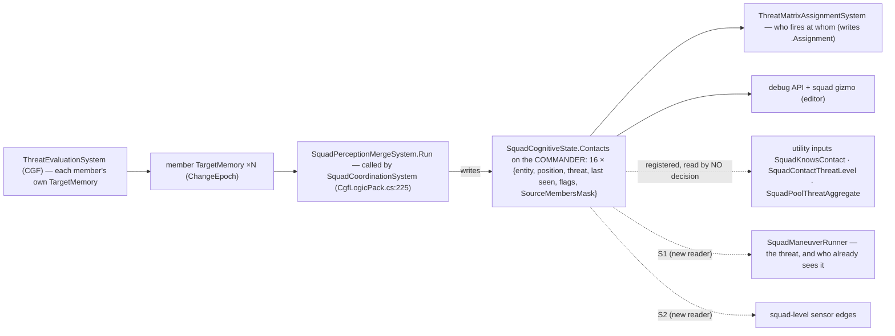
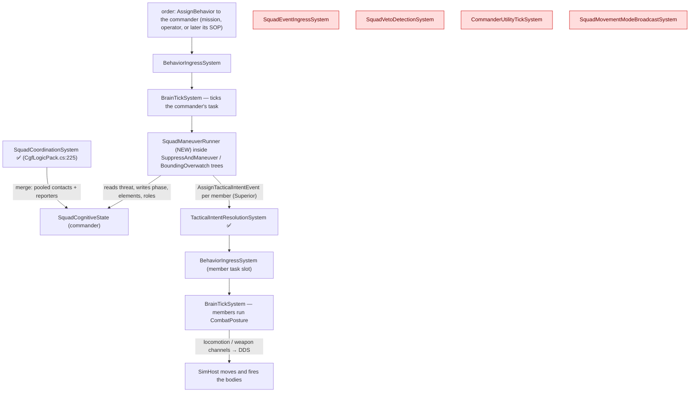
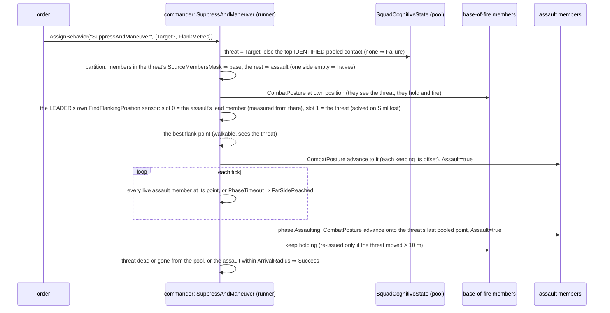
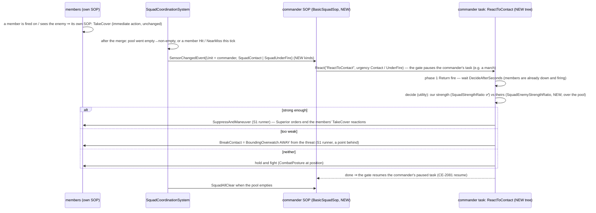
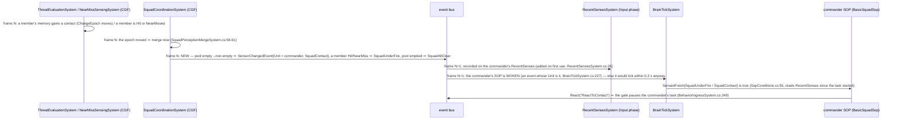
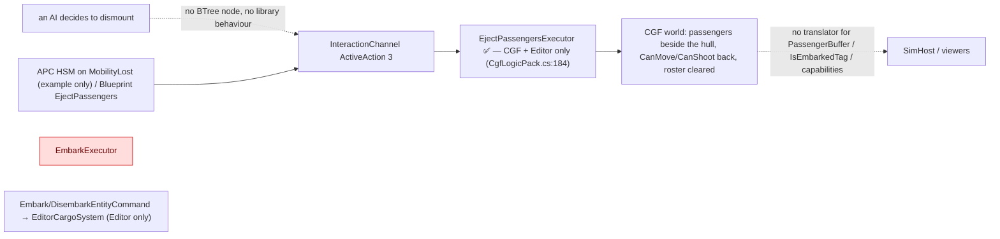
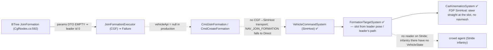
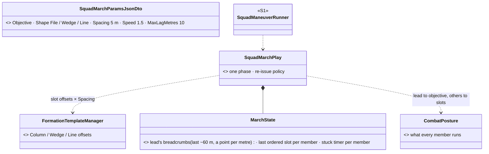
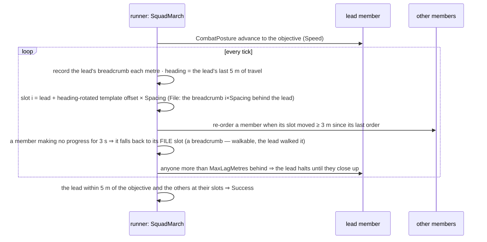

<!--STATUS
state: LIVE
updated: 2026-10-11
build-state: S1 READY-TO-BUILD (leans §3.4 awaiting the user's nod) · S2 DESIGN (§4) · embark §5 and formations §6 are MEASUREMENTS, not plans
current-answer: §2a the squad's shared contacts (where, who writes, who reads) · §3 S1 (the generic squad manoeuvre runner + suppress-and-manoeuvre) · §4 S2 (react to contact — how it works; §4.1 the alert hop by hop) · §5 embark/disembark as measured · §6 formations as measured + §6.1 the simple squad formation (SquadMarch)
stale-below: nothing
known-rot: S1-C was a geometric flank point in the first draft (same day) — measured unsafe (off-mesh moves fail forever) and replaced by an EQS query — first on the lead assault member, then (user, R-270) on the LEADER with slot 0 = that member. DESIGN_Operations_Behaviour_Catalogue.md §4/§7 say the embark/eject executors are "not registered on CGF" — eject IS registered there (CgfLogicPack.cs:184); embark is registered nowhere (§5 here)
known-conflict: none
related-designs:
  - docs/DESIGN_Operations_Behaviour_Catalogue.md — OWNS which operations need squads (§3 taxonomy, §11 the review and S1–S3 order this file builds)
  - docs/designs/group-maneuvers/Squad_Coordination_Design_v1_1.md — OWNS what the squad layer is (5 primitives, the 6 manoeuvre tables, the perception merge); this file only RUNS them
  - docs/designs/group-maneuvers/DESIGN_Squad_Wiring.md — OWNS where the squad layer runs on CGF and the first runner (§6 BoundingOverwatch, CE-3162) this file generalises
  - docs/DESIGN_Decision_Layer.md — OWNS the task / SOP slots, the reaction gate and ROE that S2 plugs into (§4)
  - docs/DESIGN_Sensors_And_Doctrine.md — OWNS SensorChange and the SOP wake (§7.3) S2 extends with squad-level edges
  - docs/DESIGN_Entity_Interactions.md — OWNS embarkation (§7, R-224, CE-3110); §5 here is its measured state
  - docs/designs/navig-2/Navigation_Design_v2_0.md — names a "formations" design that was never written (:1040, :1666); §6 here is the measured state
  - docs/designs/commander-subordinates/DESIGN.md — OWNS UnitRoster / UnitSubordinate and the FormationController/Follower refactor (Phase 2) §6 measures
-->

# Squad tactics — the runner, react to contact, and what embark / formations can carry

🔒 *User, `2026-10-11`: "Ok to both questions. Before you start building a design with diagrams is required. And measurement of what
you do not know. And pls explain how s2 will work. And measure the embark/disembark and whether it works and whether it can be used and
how it works. Also how formations work and if they can be used for squad marching and whether they work at all. No handoffs to backend."*
⇒ the behaviors lane builds all of it, cross-lane edits named in each commit.

## 1. INVENTORY *(2026-10-11 — codebase-memory graph (MCP, then its CLI when the server dropped) + grep + three read-only sweeps)*

| query | total | result |
|---|---|---|
| `search_graph name_pattern=".*Maneuver$" label=Class` | 6 | BoundingOverwatch, DangerAreaCrossing, HillCrestHullDown, StackAndRoomEntry, SuppressAndManeuver, TravellingOverwatch — all static tables in `Fdp.Toolkits/Squad/Maneuvers/` |
| `search_graph name_pattern=".*Maneuver.*" label=Interface` | **0** | the six share no interface |
| `search_graph name_pattern=".*(Maneuver\|Squad\|Formation\|Bounding\|Overwatch).*" label=Class` | 81 | squad state, 6 systems (4 with no production caller — §3.1), primitives, formation types |
| `search_graph name_pattern="^(Flank\|TakeCover\|FallBack\|Suppress\|AdvanceAndAttack\|CloseToThrow)$" label=Method` | 6 | the member-level nodes (`EqsTacticsNodes`, `PostureNodes`) |
| `search_graph name_pattern=".*Formation.*(System\|Executor\|Controller\|Follower)$"` | 4 | `FormationController`, `FormationFollower`, `FormationTargetSystem`, `JoinFormationExecutor` |
| `search_graph name_pattern=".*(Embark\|Disembark\|Eject\|Passenger).*"` + grep | 2 executors, 2 commands, 2 components | `EmbarkExecutor`, `EjectPassengersExecutor`, `Embark/DisembarkEntityCommand`, `PassengerBuffer`, `IsEmbarkedTag` |
| C#-built library behaviours (`[BTreeDefinition` grep) + `Assets/BTrees/Library/` | 11 + 7 | the only squad one is `BoundingOverwatch`; members' tool is `CombatPosture` |
| ⚠ `check_index_coverage` | — | ⛔ not run — not available through the CLI; the exhaustive claims above are graph + grep agreeing |

## 2. Claims the design rests on

| claim | code — how it is | design — how it was meant |
|---|---|---|
| one manoeuvre runs; it is hard-wired to its table | `BoundingOverwatchBehavior.cs:62,104-145` | Squad_Coordination §2 "they differ only in configuration"; Squad_Wiring §6 "each is the same node shape over its own table" |
| a commander order lands in the member's TASK slot at Superior | `BoundingOverwatchBehavior.cs:154-166` → `TacticalIntentResolutionSystem.cs:129` (registered `CgfLogicPack.cs:163`) | Decision Layer §4 (origins `Sop < Superior < Operator`) |
| a member's own SOP reaction pauses a Superior order; a NEW Superior order ends that reaction | `BehaviorIngressSystem.cs:248-257` | Decision Layer :1233; TUTORIAL_Behaviour_Composition advises ROE `StayOnTask` for smart tasks like CombatPosture |
| the merge records WHO reported each contact | `SquadPerceptionMergeSystem.cs:161,183,211` (`SourceMembersMask`) | Squad_Coordination §4 |
| members do NOT get squadmates' contacts in their memory — only a utility input | merge writes the commander only; `ThreatRankingDecision.cs:24` ranks the member's OWN memory (assigned target is a bias) | Squad_Coordination §4: "surfaced as a Utility consideration input (`SquadKnowsContact`)" |
| ⇒ the member `Flank` node cannot flank a threat it has not itself seen | `EqsTacticsNodes.cs:144-152` (NeedsEntity: own top threat) | Eqs_Consuming_Behaviours §9 |
| a commander may be a body-less entity (no position) | `SquadManeuverTests.cs:53-66`; `hill-attack-close` "Tank Platoon" | — ⇒ the runner never reads the commander's position |
| the covering element "holds and fights" through CombatPosture at its own position | `BoundingOverwatchBehavior.cs:139-150` | Squad_Wiring §6 |
| ✅ a soldier ordered `CombatPosture` at its OWN position, with the enemy in SIGHT, holds and fires: it picks Suppress (healthy) or HoldProne (half health), never moves, the order never ends; with no enemy it ends at once (nothing to do) | 📐 measured `2026-10-11`: a throwaway rail on the `TacticsTreesTests` harness (winner 3 / 6, weapon channel AimAndFire, locomotion idle, no `BehaviorFinished`), then removed | Decision Layer §3.3b (CE-2105) |
| ⛔ a move to a point more than 2 m off the walkable area FAILS: the end point is snapped only within ±2 m (±4 m vertically), else `FailedUnreachable` — and `AdvanceAndAttack` then re-issues the same failing move forever | `DotRecastNavmeshProvider.cs:43,428-431`; `MoveToExecutor.cs:120`; `PostureNodes.cs:242-247` | — |
| ⛔ the navmesh lives on SimHost; the squad leader's logic runs on CGF, which cannot snap or test a point | `SimHostNodeBootstrapper.cs:60` (the node's `INavmeshProvider`); no provider on CGF | Terrain_World §4.1 |
| ✅ an EQS query is solved on SimHost for a sensor parented to ANY networked unit — a body-less leader included — measuring from slot 0 when set, aimed at an entity (slot 1) the owner need not have seen | `EqsChildSensor.Ensure(view, parent, site, config)` (`EqsChildSensor.cs:57`); `EqsContext.Self` slot 0 first (`EqsContext.cs:20-30`); slot-1 aim `EqsTacticsNodes.cs:362-364` | EQS v1.3; 🔒 R-270 |
| ⛔ a BODY-LESS leader (e.g. `hill-attack-close`'s platoon) has a network id SimHost resolves | not measured — the S1 live rail uses a soldier-leader; a body-less one is checked before a scenario relies on it | — |
| ✅ the merge runs in the SAME frame a member's memory changes (any member's `ChangeEpoch` differs ⇒ merge now; else every 6 ticks); threat evaluation is registered before it | `SquadPerceptionMergeSystem.cs:44-61`; `CgfLogicPack.cs:222,225` | Squad_Coordination §4 (S-2) |
| ⛔ a paused task RESUMES with its working state kept, and does not re-send what it already sent | Decision Layer §4.9 (CE-2081): only a channel leaf re-activates | ⇒ the runner must re-issue its members' orders after a pause (S1-G) |

### 2a. The squad's shared contacts — where they live, who writes, who reads *(measured)*

*What the picture shows that prose hid: the pool is a plain component on the commander (`SquadCognitiveState`, own `[ComponentId]`,
`DataPolicy.NoScenario` — not saved, not replicated), written by ONE system on CGF, and today read only for fire distribution and
debugging. Members never see it except through utility inputs no decision uses ⇒ a soldier knows only what IT has seen.*

## 3. S1 — one generic manoeuvre runner, and suppress-and-manoeuvre on it *(build-state: READY-TO-BUILD)*

### 3.1 Who runs what, each frame (CGF)

*What the picture shows that prose hid: everything S1 needs already ticks on CGF — the merge, the order rail, the member runners.
The four red systems have no production caller and S1 does not revive them: arrival is polled by the runner (Squad_Wiring §6
measured the ingress keys on intent ids the per-entity counter breaks).*

### 3.2 Classes

*What the picture shows that prose hid: the existing tables stay the source of phases and roles; the NEW code is one runner and
one small adapter per table — a sixth manoeuvre is an adapter, not a copy of a 216-line node. `BoundingOverwatch` keeps its name,
params and two rails (R-137: unifying may not cost a feature).*

### 3.3 Suppress-and-manoeuvre, one run

### 3.4 Decisions *(leans)*

🔒 *User, `2026-10-11` (R-270): "Squad leader can use eqs queries if he needs something from terrain"*

| # | decision | ⭐ lean | why |
|---|---|---|---|
| **S1-A** | where the play logic lives | one runner + an `ISquadPlay` adapter per existing table, in `Hrot.AI.Behaviors` | orders are `CombatPosture` JSON (a `Hrot.Core` DTO), which `Fdp.Toolkits` must not see; the tables stay in the toolkit |
| **S1-B** | how the base of fire is chosen | the members that REPORTED the threat (`SourceMembersMask`) | they already see it, so "hold and fire" means firing; the rest have no line of sight to waste |
| **S1-C** | how the flank point is found | ⭐ 🔒 **the LEADER queries the terrain** (R-270): its own child sensor with the existing `FindFlankingPosition` template, slot 0 (the unit it measures from) = the assault element's lead member, slot 1 = the threat entity; until it answers, the assault holds | 📐 measured: a point computed on CGF can land off the walkable area and the move then fails forever, and CGF has no navmesh (§2). The query is solved on SimHost and returns only walkable points that SEE the threat. `EqsContext.Self` takes slot 0 before the owner (`EqsContext.cs:22`), so a leader with no body still measures from a member; the sensor reaches SimHost when its owner and its slots are networked entities (`EqsSensorConfigEgressTranslator.cs:113-130`, `…IngressTranslator.cs:140,438`) |
| **S1-D** | does the drill end at the flank or assault through | ⭐ **assault through** — the doctrinal end of the drill: from the flank the assault element moves ONTO and THROUGH the enemy's position, firing, while the base of fire shifts or stops its fire, so the position is cleared, not just shot at. Add `PhaseAssaulting` to `SuppressAndManeuverManeuver` (Suppressing → FarSideReached → Assaulting → BoundComplete → AssaultComplete) | a flank alone is half the drill; ⚠ changes a library table, so its unit tests are updated in the same commit |
| **S1-E** | a mover that never arrives | the phase advances on `PhaseTimeoutSeconds`, as bounding's timeout does | a member pinned by its own SOP reaction must not freeze the squad |
| **S1-G** | after a pause (S2's reaction, an operator order) | the runner notices a gap in its own ticks and re-issues every member's current order | 📐 measured (§2): resume keeps the runner's state but sends nothing again |
| **S1-F** | members' own SOP reactions | the runner leaves ROE alone; the acceptance scenario gives members ROE `StayOnTask` (CombatPosture takes cover by itself) | the gate already lets a fresh Superior order end a reaction; squad-level control of member reactions is S2's job |

Rejected: **one node per manoeuvre** — six copies of one shape; **ordering the member `Flank` behaviour** — it fails on a threat the
member never saw (§2); **a flank point computed on CGF** — it can land off the walkable area and the move then fails forever (§2);
**the query on the lead member** — it works, but the user ruled the leader is the one who asks the terrain (R-270), and it would make a member own squad-level state.

### 3.5 Acceptance

| rail | where | asserts |
|---|---|---|
| the two existing `BoundingOverwatch` rails | `SquadManeuverTests` (the feature's suite) | unchanged and green after the rewire |
| `SuppressAndManeuver` partition / flank side / assault phase / success / no-threat Failure | `SquadManeuverTests` | per §3.3, on the same fake squad |
| `SuppressAndManeuverManeuverTests` | `Fdp.Toolkits.Tests` | the extended table |
| live: `tt-suppress-flank` on `test-town` | new `SquadTacticsScenarioTests` (cluster) | base members fire (ammo drops) and stay within 5 m; the assault ends ≥ 60° round the threat from the base's bearing; then the threat dies or the assault reaches it |

## 4. S2 — react to contact *(build-state: DESIGN — how it will work)*

*What the picture shows that prose hid: S2 adds only a squad-level TRIGGER and a small DECISION; the drill bodies are S1 plays, and
the slot / gate / resume machinery is the per-unit one, unchanged — the commander is simply the unit whose senses are the squad's.*

| new in S2 | why |
|---|---|
| 3 `SensorChange` kinds: `SquadContact`, `SquadUnderFire`, `SquadAllClear`, published with `Unit = commander` | the SOP wake, `RecentSenses` and HSM reserved events all key on `evt.Unit` (`BrainTickSystem.cs:227`) — so the commander's SOP works unchanged. ⚠ NEW kinds, not FirstThreat/Hit: a soldier-leader's OWN contact and its squad's must stay distinguishable |
| `BasicSquadSop` (library, commander) | the squad twin of `BasicInfantrySop` |
| `ReactToContact` tree: ReturnFire → a utility choice → one S1 runner subtree | drills compose as subtrees, as CombatPosture composes its options |
| input `SquadEnemyStrengthRatio` over the pool | `EnemyStrengthRatio` reads the unit's own memory (`StandardInputs.cs:271`) |

### 4.1 The alert, hop by hop *(each hop measured; only the producer and the three kinds are new)*

*What the picture shows that prose hid: the commander learns of contact ONE frame after the member does — the merge is not the
delay (it runs the same frame); the bus is. An HSM-hosted squad SOP would get the same edges as reserved events (`0xFF00 + kind`,
`BuiltInHsmEvents.cs`) because the HSM runner keys on `Unit` too.*

| who | does what | where |
|---|---|---|
| generates the alert | `SquadCoordinationSystem`, right after its merge — it already loops every commander and knows whether the pool changed | NEW code in `SquadCoordinationSystem.cs` (one method); it needs last frame's pool count (kept in `SquadCognitiveState`, NEW byte) and this frame's member Hit/NearMiss events (already on the bus) |
| carries it | the existing `SensorChangedEvent`, `Unit` = the commander, three NEW `SensorChange` values | `SensorChangedEvent.cs` |
| the leader reads it | its SOP — the SAME machinery a soldier's SOP uses: woken by the event, `SensedFresh(kind)` true for a few seconds after it | `BrainTickSystem`, `RecentSenses`, `SopConditions` — unchanged |

⛔ Measured since: a paused commander task resumes with its state but does not re-send orders (§2) ⇒ S1-G covers it. Still not
measured: whether member-level and commander-level reactions fight over the same member in the first second (members' own TakeCover
vs the leader's first order) — measured on the live rail when S2 is built.
resumes it cleanly (CE-2081 covers member tasks); and how far `SquadCoordinationSystem`'s ~6-tick merge delays the trigger.

## 5. Embark / disembark — as measured *(2026-10-11)*

*What the picture shows that prose hid: the only live path ends in the CGF world — nothing tells SimHost the soldiers left the
vehicle — and boarding (`EmbarkExecutor`, red) is constructed only by its unit test.*

| fact | evidence |
|---|---|
| "inside" means only CanMove/CanShoot stripped: the passenger is not hidden, not carried with the vehicle, still targetable | no reader of `IsEmbarkedTag` outside its writers |
| capacity is a fixed 8; no seats or crew | `InteractionComponents.cs:14` |
| the planned fix exists and is approved: one `Embarkation` rules class applied on the vehicle's owner, `PassengerBuffer` replicated, passenger side derived (R-224, `CE-3110`) | Entity Interactions §7 |
| no test shows a dismount on SimHost; the cluster test that boots the APC demo never asserts an eject | `UrbanCombatFileLifecycleTests.cs:62` |

⭐ **Verdict:** usable today only as "the vehicle ejects everyone, on CGF". A squad that dismounts under fire (S3) needs R-224's
slice I-2a first (rules class + owner-applied commands + embark registered) and I-2b (replicate `PassengerBuffer`, derive the rest),
plus a library node to request it. The behaviors lane builds that as S3's first step, against Entity Interactions §7.

## 6. Formations — as measured *(2026-10-11)*

*What the picture shows that prose hid: the engine half works (proven only in the standalone CarKinem example); every hop from an
AI decision to it is broken, and on Stride infantry nothing reads a slot at all.*

| fact | evidence |
|---|---|
| shapes: column / wedge / line, hard-coded 16 slots, 4–5 m spacing; `Spacing` and most params unused | `FormationTemplateManager.cs:20-65` |
| followers steer straight at their slot — no path round obstacles | `CarKinematicsSystem.cs:209-223` |
| no test moves a formation on any HROT host; no scenario uses `JoinFormation` | unit tests only |
| no formations design doc exists (Navigation v2 defers it to a doc never written) | `Navigation_Design_v2_0.md:1040,1666` |

⭐ **Verdict:** proper formation movement (vehicles and infantry, station keeping, wheeling, reforming, road and terrain shaping)
is its own programme — filed as `CE-2124`, not started. ⛔ Repairing `JoinFormation` for infantry is rejected: seven broken hops, a new
DDS command, and followers that still steer straight at a slot with no path finding.

### 6.1 A simple squad formation for now — `SquadMarch`, one more play on the S1 runner *(lean; infantry only)*

*What the pictures show that prose hid: every point a member is sent to is either a breadcrumb the lead actually walked (always
reachable) or a shape slot that is DROPPED for the breadcrumb the moment it does not work — so the walls, doorways and narrow streets
that make real formations hard collapse into "walk in file behind the lead", which is what a squad in a street does anyway.*

| simplified now | left to the formations programme (`CE-2124`) |
|---|---|
| slots re-issued as ordinary moves, members path-find on their own | station keeping (speed matching, catch-up gain per member) |
| heading from the lead's last 5 m; slots jump when it turns | wheeling / pivoting through a turn |
| stuck or unreachable ⇒ file slot | reshaping to fit the terrain, choosing the shape by terrain or danger |
| the lead waits for stragglers | per-member gaits and spacing by visibility |
| infantry only | vehicles, convoys, mounted ↔ dismounted transitions |

⛔ **Not measured** (measured in the build, on the live rail): how many path requests a squad's re-orders cost on SimHost (estimate:
8 members × one re-order per ~2 s ≈ 4 a second per squad) against the solver's per-frame budget.
