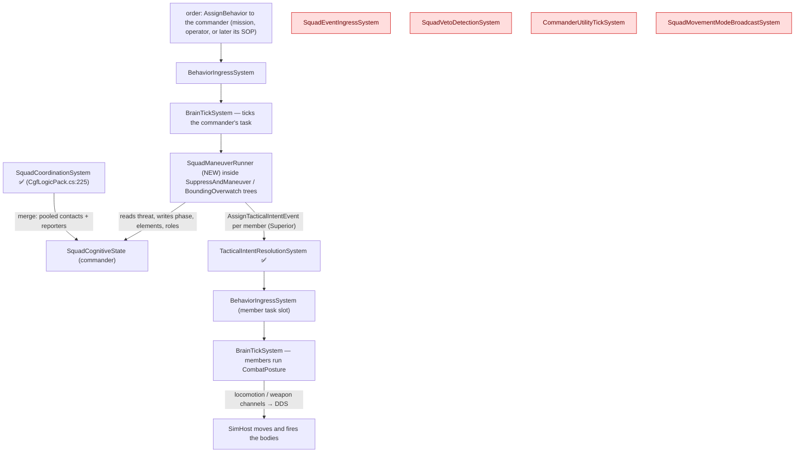
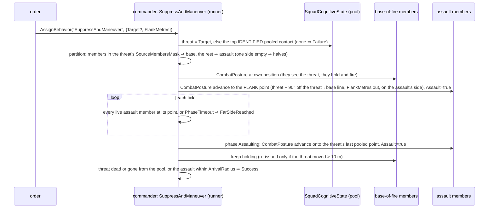
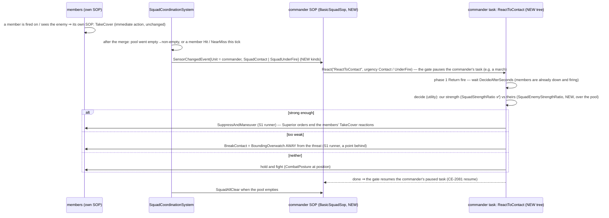
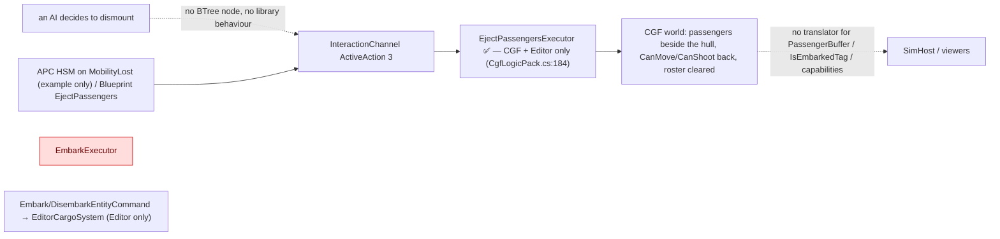
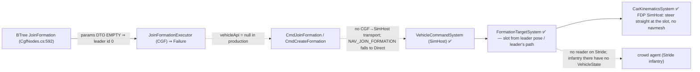

<!--STATUS
state: LIVE
updated: 2026-10-11
build-state: S1 READY-TO-BUILD (leans §3.4 awaiting the user's nod) · S2 DESIGN (§4) · embark §5 and formations §6 are MEASUREMENTS, not plans
current-answer: §3 S1 (the generic squad manoeuvre runner + suppress-and-manoeuvre) · §4 S2 (react to contact — how it works) · §5 embark/disembark as measured · §6 formations as measured
stale-below: nothing
known-rot: DESIGN_Operations_Behaviour_Catalogue.md §4/§7 say the embark/eject executors are "not registered on CGF" — eject IS registered there (CgfLogicPack.cs:184); embark is registered nowhere (§5 here)
known-conflict: none
related-designs:
  - docs/DESIGN_Operations_Behaviour_Catalogue.md — OWNS which operations need squads (§3 taxonomy, §11 the review and S1–S3 order this file builds)
  - docs/designs/group-maneuvers/Squad_Coordination_Design_v1_1.md — OWNS what the squad layer is (5 primitives, the 6 manoeuvre tables, the perception merge); this file only RUNS them
  - docs/designs/group-maneuvers/DESIGN_Squad_Wiring.md — OWNS where the squad layer runs on CGF and the first runner (§6 BoundingOverwatch, CE-3162) this file generalises
  - docs/DESIGN_Decision_Layer.md — OWNS the task / SOP slots, the reaction gate and ROE that S2 plugs into (§4)
  - docs/DESIGN_Sensors_And_Doctrine.md — OWNS SensorChange and the SOP wake (§7.3) S2 extends with squad-level edges
  - docs/DESIGN_Entity_Interactions.md — OWNS embarkation (§7, R-224, CE-3110); §5 here is its measured state
  - docs/designs/navig-2/Navigation_Design_v2_0.md — names a "formations" design that was never written (:1040, :1666); §6 here is the measured state
  - docs/designs/commander-subordinates/DESIGN.md — OWNS UnitRoster / UnitSubordinate and the FormationController/Follower refactor (Phase 2) §6 measures
-->

# Squad tactics — the runner, react to contact, and what embark / formations can carry

🔒 *User, `2026-10-11`: "Ok to both questions. Before you start building a design with diagrams is required. And measurement of what
you do not know. And pls explain how s2 will work. And measure the embark/disembark and whether it works and whether it can be used and
how it works. Also how formations work and if they can be used for squad marching and whether they work at all. No handoffs to backend."*
⇒ the behaviors lane builds all of it, cross-lane edits named in each commit.

## 1. INVENTORY *(2026-10-11 — codebase-memory graph (MCP, then its CLI when the server dropped) + grep + three read-only sweeps)*

| query | total | result |
|---|---|---|
| `search_graph name_pattern=".*Maneuver$" label=Class` | 6 | BoundingOverwatch, DangerAreaCrossing, HillCrestHullDown, StackAndRoomEntry, SuppressAndManeuver, TravellingOverwatch — all static tables in `Fdp.Toolkits/Squad/Maneuvers/` |
| `search_graph name_pattern=".*Maneuver.*" label=Interface` | **0** | the six share no interface |
| `search_graph name_pattern=".*(Maneuver\|Squad\|Formation\|Bounding\|Overwatch).*" label=Class` | 81 | squad state, 6 systems (4 with no production caller — §3.1), primitives, formation types |
| `search_graph name_pattern="^(Flank\|TakeCover\|FallBack\|Suppress\|AdvanceAndAttack\|CloseToThrow)$" label=Method` | 6 | the member-level nodes (`EqsTacticsNodes`, `PostureNodes`) |
| `search_graph name_pattern=".*Formation.*(System\|Executor\|Controller\|Follower)$"` | 4 | `FormationController`, `FormationFollower`, `FormationTargetSystem`, `JoinFormationExecutor` |
| `search_graph name_pattern=".*(Embark\|Disembark\|Eject\|Passenger).*"` + grep | 2 executors, 2 commands, 2 components | `EmbarkExecutor`, `EjectPassengersExecutor`, `Embark/DisembarkEntityCommand`, `PassengerBuffer`, `IsEmbarkedTag` |
| C#-built library behaviours (`[BTreeDefinition` grep) + `Assets/BTrees/Library/` | 11 + 7 | the only squad one is `BoundingOverwatch`; members' tool is `CombatPosture` |
| ⚠ `check_index_coverage` | — | ⛔ not run — not available through the CLI; the exhaustive claims above are graph + grep agreeing |

## 2. Claims the design rests on

| claim | code — how it is | design — how it was meant |
|---|---|---|
| one manoeuvre runs; it is hard-wired to its table | `BoundingOverwatchBehavior.cs:62,104-145` | Squad_Coordination §2 "they differ only in configuration"; Squad_Wiring §6 "each is the same node shape over its own table" |
| a commander order lands in the member's TASK slot at Superior | `BoundingOverwatchBehavior.cs:154-166` → `TacticalIntentResolutionSystem.cs:129` (registered `CgfLogicPack.cs:163`) | Decision Layer §4 (origins `Sop < Superior < Operator`) |
| a member's own SOP reaction pauses a Superior order; a NEW Superior order ends that reaction | `BehaviorIngressSystem.cs:248-257` | Decision Layer :1233; TUTORIAL_Behaviour_Composition advises ROE `StayOnTask` for smart tasks like CombatPosture |
| the merge records WHO reported each contact | `SquadPerceptionMergeSystem.cs:161,183,211` (`SourceMembersMask`) | Squad_Coordination §4 |
| members do NOT get squadmates' contacts in their memory — only a utility input | merge writes the commander only; `ThreatRankingDecision.cs:24` ranks the member's OWN memory (assigned target is a bias) | Squad_Coordination §4: "surfaced as a Utility consideration input (`SquadKnowsContact`)" |
| ⇒ the member `Flank` node cannot flank a threat it has not itself seen | `EqsTacticsNodes.cs:144-152` (NeedsEntity: own top threat) | Eqs_Consuming_Behaviours §9 |
| a commander may be a body-less entity (no position) | `SquadManeuverTests.cs:53-66`; `hill-attack-close` "Tank Platoon" | — ⇒ the runner never reads the commander's position |
| the covering element "holds and fights" through CombatPosture at its own position | `BoundingOverwatchBehavior.cs:139-150` | Squad_Wiring §6 |
| ⛔ **assumed:** a CombatPosture holding at its own point actually FIRES at a known threat | not measured — the S1 live rail asserts it (ammo drops) | — |
| ⛔ **assumed:** a flank point that lands inside a building is reached at the nearest walkable spot | not measured — the build checks `LocomotionMoveTo` with such a point first | — |

## 3. S1 — one generic manoeuvre runner, and suppress-and-manoeuvre on it *(build-state: READY-TO-BUILD)*

### 3.1 Who runs what, each frame (CGF)

*What the picture shows that prose hid: everything S1 needs already ticks on CGF — the merge, the order rail, the member runners.
The four red systems have no production caller and S1 does not revive them: arrival is polled by the runner (Squad_Wiring §6
measured the ingress keys on intent ids the per-entity counter breaks).*

### 3.2 Classes

```mermaid
classDiagram
  class ISquadPlay { <<NEW interface, Hrot.AI.Behaviors/Brains/Squad>> ManeuverKind · Table · AbortPhase · ElementCount · IsSuccess(phase) · Start(ctx) bool · OrderFor(ctx, member) MemberOrder · Completed(ctx) PhaseEvent? }
  class SquadManeuverRunner { <<NEW static>> +Tick(play, ref SquadPlayState, ctx) NodeStatus }
  class SquadPlayContext { <<NEW ref struct>> world · commander · roster · squad · now · Threat }
  class SquadPlayState { <<NEW — generalises BoundingOverwatchState>> Started · IssuedPhase · PhaseStartedAt · per-member target XYZ · Threat id + point }
  class MemberOrder { <<NEW struct>> Hold | AdvanceTo · Point · Assault · ArrivalRadius }
  class BoundingOverwatchPlay { <<NEW adapter>> over BoundingOverwatchManeuver }
  class SuppressAndManeuverPlay { <<NEW adapter>> over SuppressAndManeuverManeuver }
  class BoundingOverwatchBehavior { <<existing, REWIRED>> tree + params unchanged; Run → runner }
  class SuppressAndManeuverBehavior { <<NEW>> [BTreeDefinition SuppressAndManeuver, Library/Squad] }
  class SuppressAndManeuverParamsJsonDto { <<NEW, Hrot.Core>> [BehaviorContract Commander] Target (optional EntityRef) · FlankMetres 25 · Speed 3 · PhaseTimeoutSeconds 90 · ArrivalRadius 8 }
  class SquadHsmShell { <<existing>> Tick(ref state, events, tick) }
  class BoundingOverwatchManeuver { <<existing table>> }
  class SuppressAndManeuverManeuver { <<existing table, EXTENDED>> + PhaseAssaulting }
  class ElementPartitionPrimitive { <<existing>> }
  class SquadCognitiveState { <<existing>> Contacts (+ SourceMembersMask) · PhaseId · Elements · Roles }
  class AssignTacticalIntentEvent { <<existing>> → member CombatPosture (Superior) }
  ISquadPlay <|.. BoundingOverwatchPlay
  ISquadPlay <|.. SuppressAndManeuverPlay
  BoundingOverwatchPlay ..> BoundingOverwatchManeuver
  SuppressAndManeuverPlay ..> SuppressAndManeuverManeuver
  BoundingOverwatchBehavior ..> SquadManeuverRunner
  SuppressAndManeuverBehavior ..> SquadManeuverRunner
  SuppressAndManeuverBehavior ..> SuppressAndManeuverParamsJsonDto
  SquadManeuverRunner ..> ISquadPlay
  SquadManeuverRunner *-- SquadPlayState
  SquadManeuverRunner ..> SquadHsmShell : phase on Completed()
  SquadManeuverRunner ..> ElementPartitionPrimitive : on Start
  SquadManeuverRunner ..> SquadCognitiveState
  SquadManeuverRunner ..> AssignTacticalIntentEvent : MemberOrder → CombatPosture JSON
```

*What the picture shows that prose hid: the existing tables stay the source of phases and roles; the NEW code is one runner and
one small adapter per table — a sixth manoeuvre is an adapter, not a copy of a 216-line node. `BoundingOverwatch` keeps its name,
params and two rails (R-137: unifying may not cost a feature).*

### 3.3 Suppress-and-manoeuvre, one run

### 3.4 Decisions *(leans)*

| # | decision | ⭐ lean | why |
|---|---|---|---|
| **S1-A** | where the play logic lives | one runner + an `ISquadPlay` adapter per existing table, in `Hrot.AI.Behaviors` | orders are `CombatPosture` JSON (a `Hrot.Core` DTO), which `Fdp.Toolkits` must not see; the tables stay in the toolkit |
| **S1-B** | how the base of fire is chosen | the members that REPORTED the threat (`SourceMembersMask`) | they already see it, so "hold and fire" means firing; the rest have no line of sight to waste |
| **S1-C** | how the flank point is found | geometric (90° off the threat→base line, `FlankMetres` out, on the side the assault already is) | the member `Flank` node needs the threat in the member's OWN memory (§2), and an EQS sensor on the commander needs a body the commander may not have. EQS-scored flanks are a later step, run by a member who has seen the threat |
| **S1-D** | does the drill end at the flank or assault through | ⭐ **assault through**: add `PhaseAssaulting` to `SuppressAndManeuverManeuver` (Suppressing → FarSideReached → Assaulting → BoundComplete → AssaultComplete) | a flank alone is half the drill; ⚠ changes a library table, so its unit tests are updated in the same commit |
| **S1-E** | a mover that never arrives | the phase advances on `PhaseTimeoutSeconds`, as bounding's timeout does | a member pinned by its own SOP reaction must not freeze the squad |
| **S1-F** | members' own SOP reactions | the runner leaves ROE alone; the acceptance scenario gives members ROE `StayOnTask` (CombatPosture takes cover by itself) | the gate already lets a fresh Superior order end a reaction; squad-level control of member reactions is S2's job |

Rejected: **one node per manoeuvre** — six copies of one shape; **ordering the member `Flank` behaviour** — it fails on a threat the
member never saw (§2); **a commander EQS flank query** — the template scores from the commander's own position, which may not exist.

### 3.5 Acceptance

| rail | where | asserts |
|---|---|---|
| the two existing `BoundingOverwatch` rails | `SquadManeuverTests` (the feature's suite) | unchanged and green after the rewire |
| `SuppressAndManeuver` partition / flank side / assault phase / success / no-threat Failure | `SquadManeuverTests` | per §3.3, on the same fake squad |
| `SuppressAndManeuverManeuverTests` | `Fdp.Toolkits.Tests` | the extended table |
| live: `tt-suppress-flank` on `test-town` | new `SquadTacticsScenarioTests` (cluster) | base members fire (ammo drops) and stay within 5 m; the assault ends ≥ 60° round the threat from the base's bearing; then the threat dies or the assault reaches it |

## 4. S2 — react to contact *(build-state: DESIGN — how it will work)*

*What the picture shows that prose hid: S2 adds only a squad-level TRIGGER and a small DECISION; the drill bodies are S1 plays, and
the slot / gate / resume machinery is the per-unit one, unchanged — the commander is simply the unit whose senses are the squad's.*

| new in S2 | why |
|---|---|
| 3 `SensorChange` kinds: `SquadContact`, `SquadUnderFire`, `SquadAllClear`, published with `Unit = commander` | the SOP wake, `RecentSenses` and HSM reserved events all key on `evt.Unit` (`BrainTickSystem.cs:227`) — so the commander's SOP works unchanged. ⚠ NEW kinds, not FirstThreat/Hit: a soldier-leader's OWN contact and its squad's must stay distinguishable |
| `BasicSquadSop` (library, commander) | the squad twin of `BasicInfantrySop` |
| `ReactToContact` tree: ReturnFire → a utility choice → one S1 runner subtree | drills compose as subtrees, as CombatPosture composes its options |
| input `SquadEnemyStrengthRatio` over the pool | `EnemyStrengthRatio` reads the unit's own memory (`StandardInputs.cs:271`) |

⛔ Not measured yet (measured when S2's design is made buildable): that a commander reaction pausing a commander running an S1 play
resumes it cleanly (CE-2081 covers member tasks); and how far `SquadCoordinationSystem`'s ~6-tick merge delays the trigger.

## 5. Embark / disembark — as measured *(2026-10-11)*

*What the picture shows that prose hid: the only live path ends in the CGF world — nothing tells SimHost the soldiers left the
vehicle — and boarding (`EmbarkExecutor`, red) is constructed only by its unit test.*

| fact | evidence |
|---|---|
| "inside" means only CanMove/CanShoot stripped: the passenger is not hidden, not carried with the vehicle, still targetable | no reader of `IsEmbarkedTag` outside its writers |
| capacity is a fixed 8; no seats or crew | `InteractionComponents.cs:14` |
| the planned fix exists and is approved: one `Embarkation` rules class applied on the vehicle's owner, `PassengerBuffer` replicated, passenger side derived (R-224, `CE-3110`) | Entity Interactions §7 |
| no test shows a dismount on SimHost; the cluster test that boots the APC demo never asserts an eject | `UrbanCombatFileLifecycleTests.cs:62` |

⭐ **Verdict:** usable today only as "the vehicle ejects everyone, on CGF". A squad that dismounts under fire (S3) needs R-224's
slice I-2a first (rules class + owner-applied commands + embark registered) and I-2b (replicate `PassengerBuffer`, derive the rest),
plus a library node to request it. The behaviors lane builds that as S3's first step, against Entity Interactions §7.

## 6. Formations — as measured *(2026-10-11)*

*What the picture shows that prose hid: the engine half works (proven only in the standalone CarKinem example); every hop from an
AI decision to it is broken, and on Stride infantry nothing reads a slot at all.*

| fact | evidence |
|---|---|
| shapes: column / wedge / line, hard-coded 16 slots, 4–5 m spacing; `Spacing` and most params unused | `FormationTemplateManager.cs:20-65` |
| followers steer straight at their slot — no path round obstacles | `CarKinematicsSystem.cs:209-223` |
| no test moves a formation on any HROT host; no scenario uses `JoinFormation` | unit tests only |
| no formations design doc exists (Navigation v2 defers it to a doc never written) | `Navigation_Design_v2_0.md:1040,1666` |

⭐ **Verdict and lean for the squad march:** do NOT route infantry through the vehicle formation engine. A **march is one more S1
play**: the leader's element advances along the route; each member is ordered to its slot point (the existing `FormationTemplateManager`
offsets — column / wedge / line — rotated to the march heading), re-issued every few metres. Members then walk with their normal,
navmesh-pathed movement on every host, keep fighting through CombatPosture, and the same runner hands over to S2's drills on contact.
Rejected: repairing `JoinFormation` end to end — seven broken hops, a new DDS command, a Stride consumer, and still no path finding.
