<!--STATUS
state: LIVE
updated: 2026-10-13 (§7.8 the three demos and their HTTP checks; §7.5–§7.7 approved, not built)
build-state: S1 BUILT 2026-10-11 (as-built §3.6) · S2 BUILT 2026-10-11 (as-built §4.7) · S3 §6.1 SquadMarch BUILT 2026-10-12 (as-built §6.1a) · embark §5 and formations §6 are MEASUREMENTS
current-answer: §5a the squad Dismount drill (I-2d, BUILT 2026-10-12, as built §5a.1) · §3.6 S1 as built · §2a the squad's shared contacts (where, who writes, who reads) · §3 S1 (the generic squad manoeuvre runner + suppress-and-manoeuvre) · §4 S2 (react to contact — §4.0 claims, §4.1–§4.3 diagrams, §4.4 the alert hop by hop, §4.5 decisions, §4.6 acceptance) · §5 embark/disembark as measured · §6 formations as measured + §6.1 the simple squad formation (SquadMarch) + §6.1a as built · §7 the unit commander (R-272 (behaviors)): §7.1 the build, §7.2 leader down (approved), §7.3 as built, §7.4 L4 casualty care (K1–K6 ruled, R-2012) · §7.5 casualty care coordination + the rescue decision (DESIGN, approved R-2013, not built) · §7.6 fire and movement (DESIGN, approved, not built) · §7.7 danger-area crossing (DESIGN, approved R-2014, not built) · §7.8 the three demos and their HTTP success checks (DESIGN, not built)
stale-below: nothing
known-rot: S1-C was a geometric flank point in the first draft (same day) — measured unsafe (off-mesh moves fail forever) and replaced by an EQS query — first on the lead assault member, then on the LEADER with slot 0 = that member (a leader may own EQS queries like any unit). DESIGN_Operations_Behaviour_Catalogue.md §4/§7 say the embark/eject executors are "not registered on CGF" — eject IS registered there (CgfLogicPack.cs:184); embark is registered nowhere (§5 here)
known-conflict: none
related-designs:
  - docs/designs/airborne/DESIGN_Airborne_Insertion.md — OWNS SquadFastRope, SquadAirborneExit (the jumpmaster) and AssembleAfterDrop, started by new SOP rows on the carrier's Roping / Dropping phase
  - docs/designs/indirect-fire/DESIGN_Indirect_Fire.md — OWNS mortars and artillery: BatteryFireMissionPlay — one more ISquadPlay, with MemberOrderKind.FireAtPoint
  - docs/DESIGN_Entity_Interactions.md §7.5 — OWNS the team carry (R-2017): two men stretcher a casualty; the squad's casualty care (§7.4) may choose it instead of a drag
  - docs/designs/air-attack/DESIGN_Air_Operations.md — OWNS SquadEmbark, the squad SOP's Ride / dismount-on-Unloading rows and the rescue mission tree (R-2015) — beside §5a's SquadDismount
  - docs/DESIGN_Utility_AI_Demo_Scenarios.md — OWNS the ua-* demo programme and scripts/utility-demo-check.py; its §10.3 ua-danger-crossing is the single-soldier demo whose route §7.8.4's squad demo reuses
  - ../../DESIGN_Injury_States.md — OWNS the injury states (CE-2155) that L4 casualty care waits for
  - docs/DESIGN_Orders_Params_Entity_Classes.md — D2 (CE-2141, §7): the order behaviours InfantrySquadMove / Hold / Attack are front doors to this file's plays; every drill's orders to its members are RELEASED when the commander's run ends (not at a pause); a unit member gets Order.* (A4)
  - docs/blueprints/Architect_Question_90_Unit_Orders_Carry_Capacity.md — OWNS R-273 (behaviors) — an order to a squad is resolved by the squad (A2), drills order member UNITS by kind (A4), an ended drill clears its members (A5)
  - docs/DESIGN_Operations_Behaviour_Catalogue.md — OWNS which operations need squads (§3 taxonomy, §11 the review and S1–S3 order this file builds)
  - docs/designs/group-maneuvers/Squad_Coordination_Design_v1_1.md — OWNS what the squad layer is (5 primitives, the 6 manoeuvre tables, the perception merge); this file only RUNS them
  - docs/designs/group-maneuvers/DESIGN_Squad_Wiring.md — OWNS where the squad layer runs on CGF and the first runner (§6 BoundingOverwatch, CE-3162) this file generalises
  - docs/DESIGN_Decision_Layer.md — OWNS the task / SOP slots, the reaction gate and ROE that S2 plugs into (§4)
  - docs/DESIGN_Sensors_And_Doctrine.md — OWNS SensorChange and the SOP wake (§7.3) S2 extends with squad-level edges
  - docs/DESIGN_Entity_Interactions.md — OWNS embarkation (§7, R-224, CE-3110); §5 here is its measured state; §7.4.10 OWNS the carrier's PickUp / PutDown and the library CarryCasualty that §7.4 L4 casualty care orders
  - docs/designs/navig-2/Navigation_Design_v2_0.md — names a "formations" design that was never written (:1040, :1666); §6 here is the measured state
  - docs/DESIGN_Ownership_Groups_And_Grants.md — OWNS who owns a composite unit's position (R-175, §4 D-8) and CE-514 (derive it from the members), which §7 builds
  - docs/designs/commander-subordinates/DESIGN.md — OWNS UnitRoster / UnitSubordinate and the FormationController/Follower refactor (Phase 2) §6 measures
  - docs/designs/eqs-2/EQS_Design_v1.3_final.md — OWNS the cover query and its publish policies; §17.6.1 is what the squad plays' one-shot cover queries measured (§7.6.2)
  - docs/designs/look-direction/DESIGN_Look_Direction_And_FOV.md — the programme for later (CE-2162) that gives the Watch / overwatch / march orders a facing (LD-3) — §7.7.6's "no facing control exists"
  - ../../DESIGN_Civilians_And_Crowd_Control.md — CV-5 keeps crowds out of the squad layer (no UnitRoster); CV-11's police line uses SquadMarch's Line formation.
-->

# Squad tactics — the runner, react to contact, and what embark / formations can carry

🔒 *User, `2026-10-11`: "Ok to both questions. Before you start building a design with diagrams is required. And measurement of what
you do not know. And pls explain how s2 will work. And measure the embark/disembark and whether it works and whether it can be used and
how it works. Also how formations work and if they can be used for squad marching and whether they work at all. No handoffs to backend."*
⇒ the behaviors lane builds all of it, cross-lane edits named in each commit.

## 1. INVENTORY *(2026-10-11 — codebase-memory graph (MCP, then its CLI when the server dropped) + grep + three read-only sweeps)*

| query | total | result |
|---|---|---|
| `search_graph name_pattern=".*Maneuver$" label=Class` | 6 | BoundingOverwatch, DangerAreaCrossing, HillCrestHullDown, StackAndRoomEntry, SuppressAndManeuver, TravellingOverwatch — all static tables in `Fdp.Toolkits/Squad/Maneuvers/` |
| `search_graph name_pattern=".*Maneuver.*" label=Interface` | **0** | the six share no interface |
| `search_graph name_pattern=".*(Maneuver\|Squad\|Formation\|Bounding\|Overwatch).*" label=Class` | 81 | squad state, 6 systems (4 with no production caller — §3.1), primitives, formation types |
| `search_graph name_pattern="^(Flank\|TakeCover\|FallBack\|Suppress\|AdvanceAndAttack\|CloseToThrow)$" label=Method` | 6 | the member-level nodes (`EqsTacticsNodes`, `PostureNodes`) |
| `search_graph name_pattern=".*Formation.*(System\|Executor\|Controller\|Follower)$"` | 4 | `FormationController`, `FormationFollower`, `FormationTargetSystem`, `JoinFormationExecutor` |
| `search_graph name_pattern=".*(Embark\|Disembark\|Eject\|Passenger).*"` + grep | 2 executors, 2 commands, 2 components | `EmbarkExecutor`, `EjectPassengersExecutor`, `Embark/DisembarkEntityCommand`, `PassengerBuffer`, `IsEmbarkedTag` |
| C#-built library behaviours (`[BTreeDefinition` grep) + `Assets/BTrees/Library/` | 11 + 7 | the only squad one is `BoundingOverwatch`; members' tool is `CombatPosture` |
| ⚠ `check_index_coverage` | — | ⛔ not run — not available through the CLI; the exhaustive claims above are graph + grep agreeing |

## 2. Claims the design rests on

| claim | code — how it is | design — how it was meant |
|---|---|---|
| one manoeuvre runs; it is hard-wired to its table | `BoundingOverwatchBehavior.cs:62,104-145` | Squad_Coordination §2 "they differ only in configuration"; Squad_Wiring §6 "each is the same node shape over its own table" |
| a commander order lands in the member's TASK slot at Superior | `BoundingOverwatchBehavior.cs:154-166` → `TacticalIntentResolutionSystem.cs:129` (registered `CgfLogicPack.cs:163`) | Decision Layer §4 (origins `Sop < Superior < Operator`) |
| a member's own SOP reaction pauses a Superior order; a NEW Superior order ends that reaction | `BehaviorIngressSystem.cs:248-257` | Decision Layer :1233; TUTORIAL_Behaviour_Composition advises ROE `StayOnTask` for smart tasks like CombatPosture |
| the merge records WHO reported each contact | `SquadPerceptionMergeSystem.cs:161,183,211` (`SourceMembersMask`) | Squad_Coordination §4 |
| members do NOT get squadmates' contacts in their memory — only a utility input | merge writes the commander only; `ThreatRankingDecision.cs:24` ranks the member's OWN memory (assigned target is a bias) | Squad_Coordination §4: "surfaced as a Utility consideration input (`SquadKnowsContact`)" |
| ⇒ the member `Flank` node cannot flank a threat it has not itself seen | `EqsTacticsNodes.cs:144-152` (NeedsEntity: own top threat) | Eqs_Consuming_Behaviours §9 |
| a commander may be a body-less entity (no position) | `SquadManeuverTests.cs:53-66`; `hill-attack-close` "Tank Platoon" | — ⇒ the runner never reads the commander's position |
| the covering element "holds and fights" through CombatPosture at its own position | `BoundingOverwatchBehavior.cs:139-150` | Squad_Wiring §6 |
| ✅ a soldier ordered `CombatPosture` at its OWN position, with the enemy in SIGHT, holds and fires: it picks Suppress (healthy) or HoldProne (half health), never moves, the order never ends; with no enemy it ends at once (nothing to do) | 📐 measured `2026-10-11`: a throwaway rail on the `TacticsTreesTests` harness (winner 3 / 6, weapon channel AimAndFire, locomotion idle, no `BehaviorFinished`), then removed | Decision Layer §3.3b (CE-2105) |
| ⛔ a move to a point more than 2 m off the walkable area FAILS: the end point is snapped only within ±2 m (±4 m vertically), else `FailedUnreachable` — and `AdvanceAndAttack` then re-issues the same failing move forever | `DotRecastNavmeshProvider.cs:43,428-431`; `MoveToExecutor.cs:120`; `PostureNodes.cs:242-247` | — |
| ⛔ the navmesh lives on SimHost; the squad leader's logic runs on CGF, which cannot snap or test a point | `SimHostNodeBootstrapper.cs:60` (the node's `INavmeshProvider`); no provider on CGF | Terrain_World §4.1 |
| ✅ an EQS query is solved on SimHost for a sensor parented to ANY networked unit — a body-less leader included — measuring from slot 0 when set, aimed at an entity (slot 1) the owner need not have seen | `EqsChildSensor.Ensure(view, parent, site, config)` (`EqsChildSensor.cs:57`); `EqsContext.Self` slot 0 first (`EqsContext.cs:20-30`); slot-1 aim `EqsTacticsNodes.cs:362-364` | EQS v1.3 |
| ⛔ a BODY-LESS leader (e.g. `hill-attack-close`'s platoon) has a network id SimHost resolves | not measured — the S1 live rail uses a soldier-leader; a body-less one is checked before a scenario relies on it | — |
| ✅ the merge runs in the SAME frame a member's memory changes (any member's `ChangeEpoch` differs ⇒ merge now; else every 6 ticks); threat evaluation is registered before it | `SquadPerceptionMergeSystem.cs:44-61`; `CgfLogicPack.cs:222,225` | Squad_Coordination §4 (S-2) |
| ⛔ a paused task RESUMES with its working state kept, and does not re-send what it already sent | Decision Layer §4.9 (CE-2081): only a channel leaf re-activates | ⇒ the runner must re-issue its members' orders after a pause (S1-G) |

### 2a. The squad's shared contacts — where they live, who writes, who reads *(measured)*

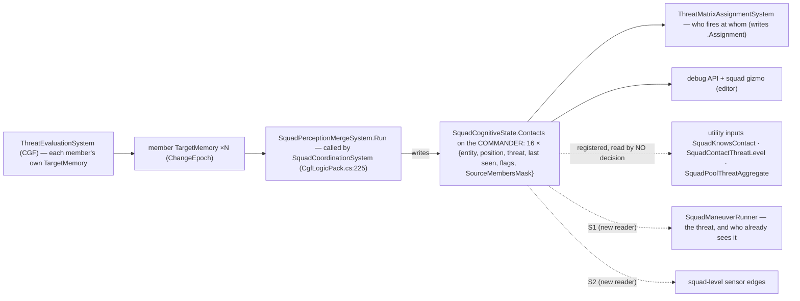

*What the picture shows that prose hid: the pool is a plain component on the commander (`SquadCognitiveState`, own `[ComponentId]`,
`DataPolicy.NoScenario` — not saved, not replicated), written by ONE system on CGF, and today read only for fire distribution and
debugging. Members never see it except through utility inputs no decision uses ⇒ a soldier knows only what IT has seen.*

## 3. S1 — one generic manoeuvre runner, and suppress-and-manoeuvre on it *(build-state: BUILT — as-built §3.6)*

### 3.1 Who runs what, each frame (CGF)

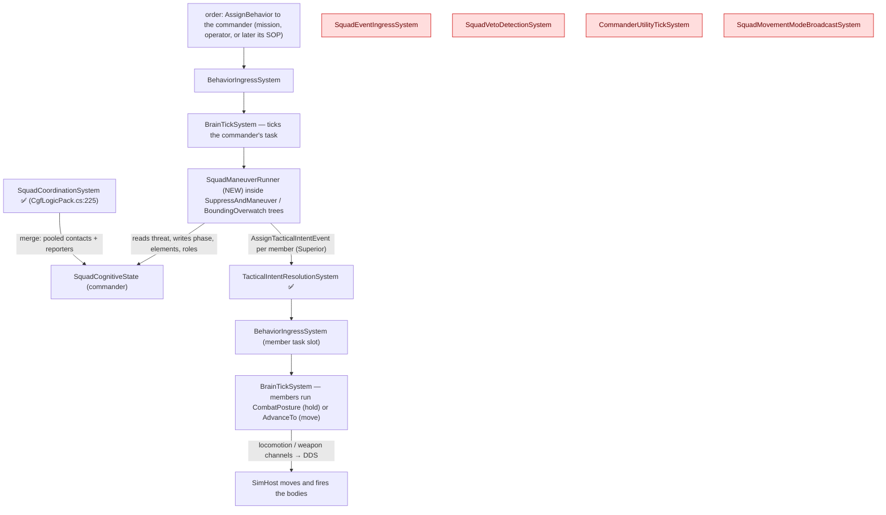

*What the picture shows that prose hid: everything S1 needs already ticks on CGF — the merge, the order rail, the member runners.
The four red systems have no production caller and S1 does not revive them: arrival is polled by the runner (Squad_Wiring §6
measured the ingress keys on intent ids the per-entity counter breaks).*

### 3.2 Classes

```mermaid
classDiagram
  class ISquadPlay { <<NEW interface, Hrot.AI.Behaviors/Brains/Squad>> ManeuverKind · Table · AbortPhase · ElementCount · IsSuccess(phase) · Start(ctx) PlayStart Go/Wait/Fail · OrderFor(ctx, member) MemberOrder · Completed(ctx) PhaseEvent? }
  class SquadManeuverRunner { <<NEW static>> +Tick(play, ref SquadPlayState, ctx) NodeStatus }
  class SquadPlayContext { <<NEW ref struct>> world · commander · roster · squad · now · Threat }
  class SquadPlayState { <<NEW — generalises BoundingOverwatchState>> Started · IssuedPhase · PhaseStartedAt · per-member target XYZ · Threat id + point }
  class MemberOrder { <<NEW struct>> Hold | AdvanceTo · Point · Speed · ArrivalRadius · RoleId }
  class AdvanceToBehavior { <<NEW library behaviour, Library/Infantry>> AdvanceTo: one StatefulAction over PostureNodes.AdvanceAndAttack }
  class CombatPosture { <<existing library behaviour>> }
  class BoundingOverwatchPlay { <<NEW adapter>> over BoundingOverwatchManeuver }
  class SuppressAndManeuverPlay { <<NEW adapter>> over SuppressAndManeuverManeuver }
  class BoundingOverwatchBehavior { <<existing, REWIRED>> tree + params unchanged; Run → runner }
  class SuppressAndManeuverBehavior { <<NEW>> [BTreeDefinition SuppressAndManeuver, Library/Squad] }
  class SuppressAndManeuverParamsJsonDto { <<NEW, Hrot.Core>> named by [Behavior(Params) Commander] (CE-2134) FlankSearchRadius 40 · Speed 3 · ArrivalRadius 8 · PhaseTimeoutSeconds 90 }
  class SquadHsmShell { <<existing>> Tick(ref state, events, tick) }
  class BoundingOverwatchManeuver { <<existing table>> }
  class SuppressAndManeuverManeuver { <<existing table, EXTENDED>> + PhaseAssaulting }
  class ElementPartitionPrimitive { <<existing>> }
  class SquadCognitiveState { <<existing>> Contacts (+ SourceMembersMask) · PhaseId · Elements · Roles }
  class AssignTacticalIntentEvent { <<existing>> → member CombatPosture (Superior) }
  ISquadPlay <|.. BoundingOverwatchPlay
  ISquadPlay <|.. SuppressAndManeuverPlay
  BoundingOverwatchPlay ..> BoundingOverwatchManeuver
  SuppressAndManeuverPlay ..> SuppressAndManeuverManeuver
  BoundingOverwatchBehavior ..> SquadManeuverRunner
  SuppressAndManeuverBehavior ..> SquadManeuverRunner
  SuppressAndManeuverBehavior ..> SuppressAndManeuverParamsJsonDto
  SquadManeuverRunner ..> ISquadPlay
  SquadManeuverRunner *-- SquadPlayState
  SquadManeuverRunner ..> SquadHsmShell : phase on Completed()
  SquadManeuverRunner ..> ElementPartitionPrimitive : on Start
  SquadManeuverRunner ..> SquadCognitiveState
  SquadManeuverRunner ..> AssignTacticalIntentEvent : MemberOrder → member order JSON
  AssignTacticalIntentEvent ..> CombatPosture : Hold
  AssignTacticalIntentEvent ..> AdvanceToBehavior : AdvanceTo
```

*What the picture shows that prose hid: the existing tables stay the source of phases and roles; the NEW code is one runner and
one small adapter per table — a sixth manoeuvre is an adapter, not a copy of a 216-line node. `BoundingOverwatch` keeps its name,
params and two rails (R-137: unifying may not cost a feature).*

### 3.3 Suppress-and-manoeuvre, one run

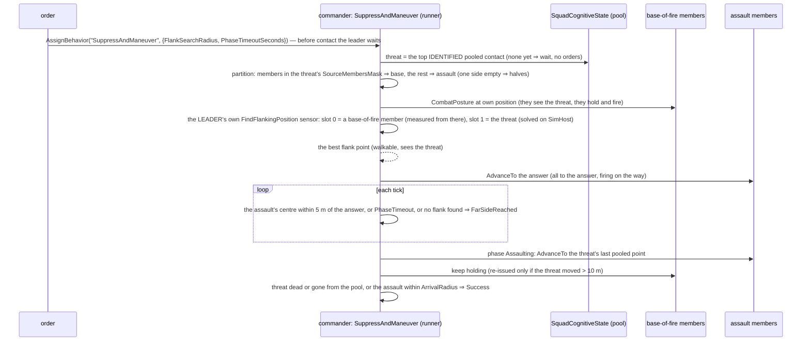

### 3.4 Decisions *(leans)*


| # | decision | ⭐ lean | why |
|---|---|---|---|
| **S1-A** | where the play logic lives | one runner + an `ISquadPlay` adapter per existing table, in `Hrot.AI.Behaviors` | orders are `CombatPosture` JSON (a `Hrot.Core` DTO), which `Fdp.Toolkits` must not see; the tables stay in the toolkit |
| **S1-B** | how the base of fire is chosen | the members that REPORTED the threat (`SourceMembersMask`) | they already see it, so "hold and fire" means firing; the rest have no line of sight to waste |
| **S1-C** | how the flank point is found | ⭐ **the LEADER queries the terrain**, as any unit can: its own child sensor with the existing `FindFlankingPosition` template, slot 0 (the unit it measures from) = a base-of-fire member (as built, §3.6), slot 1 = the threat entity; until it answers, the assault holds | 📐 measured: a point computed on CGF can land off the walkable area and the move then fails forever, and CGF has no navmesh (§2). The query is solved on SimHost and returns only walkable points that SEE the threat. `EqsContext.Self` takes slot 0 before the owner (`EqsContext.cs:22`), so a leader with no body still measures from a member; the sensor reaches SimHost when its owner and its slots are networked entities (`EqsSensorConfigEgressTranslator.cs:113-130`, `…IngressTranslator.cs:140,438`) |
| **S1-D** | does the drill end at the flank or assault through | ⭐ **assault through** — the doctrinal end of the drill: from the flank the assault element moves ONTO and THROUGH the enemy's position, firing, while the base of fire shifts or stops its fire, so the position is cleared, not just shot at. Add `PhaseAssaulting` to `SuppressAndManeuverManeuver` (Suppressing → FarSideReached → Assaulting → BoundComplete → AssaultComplete) | a flank alone is half the drill; ⚠ changes a library table, so its unit tests are updated in the same commit |
| **S1-E** | a mover that never arrives | the phase advances on `PhaseTimeoutSeconds`, as bounding's timeout does | a member pinned by its own SOP reaction must not freeze the squad |
| **S1-G** | after a pause (S2's reaction, an operator order) | the runner notices a gap in its own ticks and re-issues every member's current order | 📐 measured (§2): resume keeps the runner's state but sends nothing again |
| **S1-F** | members' own SOP reactions | the runner leaves ROE alone; the acceptance scenario gives members ROE `StayOnTask` (CombatPosture takes cover by itself) | the gate already lets a fresh Superior order end a reaction; squad-level control of member reactions is S2's job |

Rejected: **one node per manoeuvre** — six copies of one shape; **ordering the member `Flank` behaviour** — it fails on a threat the
member never saw (§2); **a flank point computed on CGF** — it can land off the walkable area and the move then fails forever (§2);
**the query on the lead member** — it works, but it would make a member own the squad's state; the leader can own it (`EqsContext.cs:20-30`).

### 3.5 Acceptance

| rail | where | asserts |
|---|---|---|
| the two existing `BoundingOverwatch` rails | `SquadManeuverTests` (the feature's suite) | unchanged and green after the rewire |
| `SuppressAndManeuver` partition / flank side / assault phase / success / no-threat Failure | `SquadManeuverTests` | per §3.3, on the same fake squad |
| `SuppressAndManeuverManeuverTests` | `Fdp.Toolkits.Tests` | the extended table |
| live: `tt-suppress-flank` on `test-town` | new `SquadTacticsScenarioTests` (cluster) | base members fire (ammo drops) and stay within 5 m; the assault ends ≥ 60° round the threat from the base's bearing; then the threat dies or the assault reaches it |

### 3.6 As built *(behaviors, `2026-10-11`; 🔒 user: "yes go to S1 please")*

| file | what |
|---|---|
| `Brains/SquadManeuverRunner.cs` | `ISquadPlay<TParams>`, `SquadPlayContext`, `SquadPlayState`, `MemberOrder`, `PlayStart`, `SquadManeuverRunner.Tick` |
| `Brains/BoundingOverwatchBehavior.cs` | REWIRED: same name, params, tree; `BoundingOverwatchPlay` over the runner (its state type is now `SquadPlayState`) |
| `Brains/SuppressAndManeuverBehavior.cs` | NEW behaviour `SuppressAndManeuver` (Library/Squad) + `SuppressAndManeuverPlay` + a deactivator that drops the flank query |
| `Brains/AdvanceToBehavior.cs` + `Hrot.Core/…/AdvanceToParamsJsonDto.cs` | NEW library behaviour `AdvanceTo` (Library/Infantry; Infantry · Insurgent): move to `Objective` at `Speed`, firing at what it sees on the way (`PostureNodes.AdvanceAndAttack`), Success on arrival — every runner MOVE order uses it |
| `Hrot.Core/…/SuppressAndManeuverParamsJsonDto.cs` | NEW contract (Commander): `FlankSearchRadius` 40 · `Speed` 3 · `ArrivalRadius` 8 · `PhaseTimeoutSeconds` 90 |
| `Fdp.Toolkits/Squad/Maneuvers/SuppressAndManeuverManeuver.cs` | `PhaseAssaulting = 3` added (no id renumbered); FarSideReached → Assaulting → BoundComplete → AssaultComplete |
| `Brains/AdvanceToBehavior.cs` rail: `TacticsTreesTests.CE2123_AdvanceTo_MovesToItsObjective_UnderContact_FiringOnTheWay` | a soldier ordered `AdvanceTo` with an enemy in sight moves AND fires |
| `Recipes/Scenarios/tt-suppress-flank` | a leader (rifleman) ordered `SuppressAndManeuver`, four riflemen, an armed idle hostile with 100 000 health on `test-town` |

**Deviations from §3.2–§3.4 — each measured, none silent:**

| planned | built | why |
|---|---|---|
| flank query slot 0 = the assault's lead member | slot 0 = the first live **base-of-fire** member | `FindFlankingPosition` scores side-on to the slot1→slot0 line (`StarterTemplates.cs:61`), so measuring from the base makes the answer a flank of the base→enemy axis — the doctrinal flank; and its threat-exposure test reads slot 0's memory, which the base has (it reported the enemy) and the assault may not |
| optional `Target` param | none — the squad's top identified pooled contact | no shipped commander contract carries an entity reference yet; added when a scenario needs a named target |
| no contact ⇒ Failure | no contact ⇒ **Wait** (`PlayStart.Wait`): Running, no orders, until the squad pools an identified enemy | a leader ordered at scenario load has no contact yet; "on contact, execute" is what an author means |
| moves are `CombatPosture` with an objective (`Assault=true`) | HOLD orders stay `CombatPosture` at the member's own position; MOVE orders (assault, bounding movers) are the NEW library `AdvanceTo`; `MemberOrder.Assault` removed | 📐 measured live (first cluster run): under contact `CombatPosture` picks Suppress (winner 3) and fires IN PLACE — the assault never left the base line (flank 2°) and the phase only advanced on its timeout. Its options choose WHAT to do about a threat; an order to GO somewhere needs a tree whose only job is to go (Decision Layer §3.3b) |
| each assault member at its own point | the flank is reached when the assault's CENTRE is within 5 m of the answer; every assault member is sent to the answer itself | offsets added to a walkable answer can land off the walkable area (§2: such moves fail forever); the answer and the enemy's own position are both walkable |

| rail | proves | red-proof |
|---|---|---|
| `SquadManeuverTests.CE507_BoundingOverwatch_*` (2, unchanged) | bounding kept every behaviour through the rewire (R-137) | — |
| `…CE2123_SuppressAndManeuver_TheSeersHold_TheRestFlankWhereTheLeaderAsks_ThenAssaultThrough` | reporters (members 2, 3 — not the first half) hold; the leader's query (slot 0 a seer, slot 1 the enemy); the assault goes to the answer, then through; Success | partition forced to halves ⇒ red |
| `…CE2123_SuppressAndManeuver_NoFlankPoint_TheAssaultGoesStraightThrough` | an empty answer skips the flank | — |
| `…CE2123_SuppressAndManeuver_EndsWhenTheEnemyIsDown_AndWaitsForContact` | enemy down ⇒ Success; ordered before contact ⇒ waits, then starts | — |
| `…CE2123_AfterAPause_TheRunnerReSendsEveryOrder` | S1-G | gap detection off ⇒ red |
| `SuppressAndManeuverManeuverTests.…TransitionsToAssaulting_ThenBoundComplete_ToAssaultComplete` | the extended table | — |
| `SquadTacticsScenarioTests` (cluster, `tt-suppress-flank`) | live: contact ⇒ start, the flank ≥ 45° round the enemy from the base, the base fires and holds (horizontally — a standing member's height followed the ground, z 0 → 9), the assault goes through | ✅ green `2026-10-11` (33 s): the flank came out **75°** round the enemy, the assault covered ~60 m, the base fired 150 → 113 rounds and held. The run before `AdvanceTo` failed at **2°**: the assault fired in place under `CombatPosture` |
| `CuratedBehaviorRegistrarTests` (CE3164 group, SR_R2 names) | `AdvanceTo` and `SuppressAndManeuver` are registered and sit in their picker folders | — |

## 4. S2 — react to contact *(build-state: BUILT `2026-10-11` — as-built §4.7; 🔒 user: "go to S2")*

⭐ **What S2 is, in one line:** when the squad meets the enemy, its LEADER notices (a squad-level sensing edge), its own
standing orders react (a squad SOP), it holds and returns fire for a moment, decides once — assault, break contact or hold —
runs that drill on the S1 runner, and when the drill ends the leader's interrupted task carries on.

### 4.0 Claims the design rests on *(measured `2026-10-11`; both columns)*

| claim | code — how it IS | design — how it was MEANT |
|---|---|---|
| a `SensorChangedEvent` lives one frame; published in frame N it is READ in N+1 | `FdpEventBus.cs:30` ("visible in the next frame (after SwapBuffers)") | Decision Layer §4.3 (R-195: the SOP wakes the next frame) |
| the SOP wake, `RecentSenses` and the HSM reserved events key on `evt.Unit` only — a commander's SOP works unchanged | `RecentSensesSystem.cs:21-26`; `BrainTickSystem.cs:227` | Sensors & Doctrine §7.3 |
| ⛔ `RecentSenses` records kinds 1–7 only, in a BYTE mask — a kind ≥ 8 is dropped (`default: return`), so the danger-area kinds 8–10 are never recorded today | `RecentSenses.cs:31-42` | Decision Layer §4.3 — "when each kind last happened": ALL kinds ⇒ the record is incomplete, not intended |
| adding a kind touches: the enum, the HSM name table (pinned by `BrainTickSystemHsmArmTests.CE3040_TheBuiltInNames_MatchTheRuntimeEnum`), `RecentSenses` | `SensorChangedEvent.cs:12`; `BuiltInHsmEvents.cs:19-23` | Sensors & Doctrine §7.3b ("the ids are ABI: 0xFF00 + SensorChange") |
| `SensorChangedEvent` is NOT replicated (no translator; its IDL is only generated) ⇒ new kinds change no wire contract in use | grep `Hrot/Network`: no `SensorChangedEvent` | R-134 (network kept apart from internal events) |
| producers publish through the command buffer | `ThreatEvaluationSystem.cs:178-188`, `NearMissSensingSystem.cs:24` | — |
| `SquadCoordinationSystem` is the one squad driver on CGF; the pool changes only on a merge (≈ 10 Hz, or at once on a member epoch change) | `SquadCoordinationSystem.cs:63-70`; `SquadPerceptionMergeSystem.cs:56-61` | Squad_Wiring §3; Squad_Coordination v1.1 |
| `SopActions.React` already running the same behaviour as a reaction ⇒ Success, nothing published ⇒ two rows naming one behaviour never restart it | `SopActions.cs:52-55` | Decision Layer §4.6 |
| a reaction pauses the task (unless ROE `StayOnTask`); when it ends the task RESUMES with its storage | `BehaviorIngressSystem.cs:246-252`, `PauseRecord` | Decision Layer §4.9a (CE-2081) |
| ⛔ **a resumed squad drill reads the squad state ANOTHER drill wrote**: `ManeuverKind`, `PhaseId`, `Elements` live on the commander, shared; a suppress drill that ended `Aborted` (2) leaves `PhaseId = 2` = bounding's `PhaseAborted` ⇒ the resumed bounding FAILS; any other end leaves the wrong partition | `SquadManeuverRunner.cs:174-190`; `SuppressAndManeuverManeuver.cs:34-38`; `BoundingOverwatchManeuver.cs:31-33` | ⛔ searched `docs/` + `.dev/`: no design covers two drills sharing one squad — new in S2 (S2-G) |
| `ChooseOption` re-scores EVERY tick | `UtilityNodes.cs:64-68` | Decision Layer §3 (hysteresis, no latch) |
| the existing squad decision `ManeuverSelectStarterDecision` answers "how to cross a danger area", reads only the active danger area (no producer) and is driven only by the dead `CommanderUtilityTickSystem` | `ManeuverSelectStarterDecision.cs:18-90` | Squad_Wiring §5 D3 (not wired) |
| `SquadStrengthRatio` (squad health) exists; the enemy side exists only per unit (`EnemyStrengthRatio` over the unit's own memory) | `SquadInputs.cs:130-148`; `StandardInputs.cs:271-284` | Decision Layer §3.3 (CE-3054 C) |
| the leader may own a `FindSafeRetreatPoint` query as it owns the flank query: grid around slot 0 that slot 1 cannot see, unreachable dropped | `StarterTemplates.cs:90-108`; §2 (EQS on any networked unit) | EQS v1.3 §19.6 |
| `BoundingOverwatchManeuver` alternates the two elements until the play reports an outcome | `BoundingOverwatchManeuver.cs:47-54` | Squad_Coordination v1.1 |
| no shipped TKB type sets a `DefaultSop`; a scenario sets the SOP per entity (`"Sop": {"Name": …}`) | grep `DefaultSop` in data: none; `tt-take-cover/scenario.json:43` | Decision Layer §4.5 (CE-2077) |
| nothing named ReactToContact / BreakContact / squad SOP exists | `search_graph` `.*React.*Contact.*` · `.*BreakContact.*` · `.*SquadSop.*` · `.*SquadHold.*`: 0 code nodes | Decision Layer §4 sequence names `ReactToContact` as the drill |

### 4.1 Who runs what, each frame (CGF)

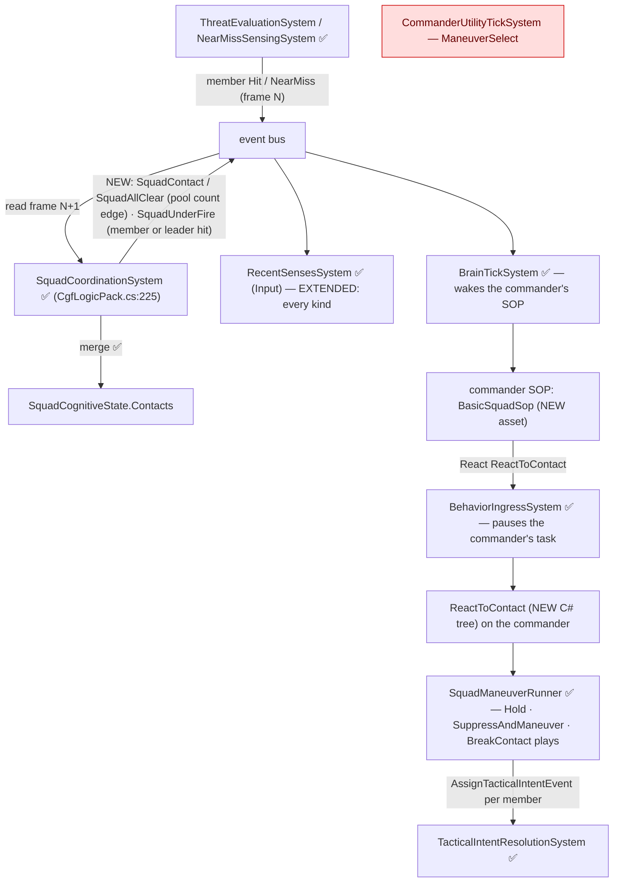

*What the picture shows that prose hid: the only NEW system code is the producer inside the driver that already merges the
pool; everything downstream of the event is the per-unit machinery, reached because the event's `Unit` is the commander. The
red box is the existing squad chooser — not revived (S2-D).*

### 4.2 Classes

```mermaid
classDiagram
  class SensorChange { <<existing enum, EXTENDED>> + SquadContact 11 · SquadUnderFire 12 · SquadAllClear 13 }
  class RecentSenses { <<existing, EXTENDED>> + AreaAhead..AreaCleared · SquadContact · SquadUnderFire · SquadAllClear · SeenMask ushort }
  class BuiltInHsmEvents { <<existing, EXTENDED>> + Sensor.SquadContact · Sensor.SquadUnderFire · Sensor.SquadAllClear }
  class SquadCoordinationSystem { <<existing, EXTENDED>> + squad edges after the merge }
  class SquadSensing { <<NEW static, Fdp.Toolkits/Squad>> Edges(repo, commander, countBefore) · UnderFire(repo, gate) }
  class SquadInputs { <<existing, EXTENDED>> + SquadEnemyStrengthRatio }
  class SquadContactResponseDecision { <<NEW [UtilityDecision], PostureSelect>> Assault 1 · BreakContact 2 · Hold 3 }
  class UtilityNodes { <<existing, EXTENDED>> + ChooseOptionOnce }
  class SquadManeuverRunner { <<existing, FIXED>> re-takes the squad when another drill used it (S2-G) }
  class SquadHoldPlay { <<NEW play>> all Hold · ends on time or no contact }
  class BreakContactPlay { <<NEW play over BoundingOverwatchManeuver>> leader's FindSafeRetreatPoint · bounds straight to the answer }
  class SuppressAndManeuverPlay { <<existing S1 play>> }
  class ReactToContactBehavior { <<NEW [BTreeDefinition ReactToContact, Library/Squad]>> one stateful action: hold · decide once · drill · hold until clear }
  class BreakContactBehavior { <<NEW [BTreeDefinition BreakContact, Library/Squad]>> }
  class SquadHoldBehavior { <<NEW [BTreeDefinition SquadHold, Library/Squad]>> }
  class BasicSquadSop { <<NEW asset Library/Sop>> UnderFire → React · Contact → React }
  class ParamsDtos { <<NEW, Hrot.Core>> ReactToContact · BreakContact · SquadHold }
  SquadCoordinationSystem ..> SquadSensing
  SquadSensing ..> SensorChange : publishes, Unit = commander
  RecentSenses ..> SensorChange
  BuiltInHsmEvents ..> SensorChange
  BasicSquadSop ..> RecentSenses : SensedFresh
  BasicSquadSop ..> ReactToContactBehavior : React
  ReactToContactBehavior ..> UtilityNodes : ChooseOptionOnce
  UtilityNodes ..> SquadContactResponseDecision
  SquadContactResponseDecision ..> SquadInputs
  ReactToContactBehavior ..> SquadHoldPlay
  ReactToContactBehavior ..> SuppressAndManeuverPlay
  ReactToContactBehavior ..> BreakContactPlay
  BreakContactBehavior ..> BreakContactPlay
  SquadHoldBehavior ..> SquadHoldPlay
  SquadHoldPlay ..> SquadManeuverRunner
  BreakContactPlay ..> SquadManeuverRunner
  SuppressAndManeuverPlay ..> SquadManeuverRunner
```

*What the picture shows that prose hid: S2 is three new plays-or-trees on the S1 runner plus one choice; the trigger is three
enum values and one producer. The runner FIX is load-bearing — without it a drill run as a reaction breaks the task it paused.*

### 4.3 One contact, end to end

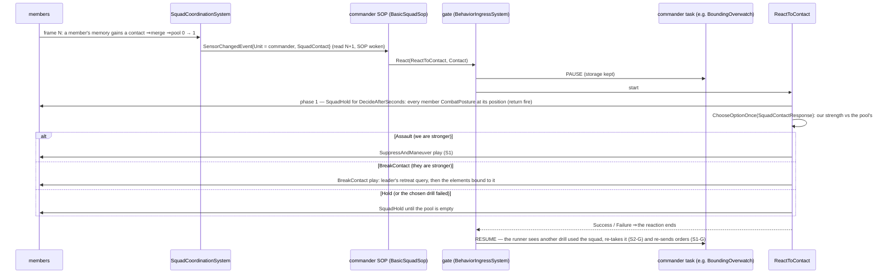

### 4.4 The alert, hop by hop *(each hop measured)*

| edge | produced when | the leader reads it |
|---|---|---|
| `SquadContact` | after a merge, the pool count went 0 → >0 | frame N+1 (merge runs in N, the bus delivers in N+1) |
| `SquadAllClear` | after a merge, the pool count went >0 → 0 | frame N+1 |
| `SquadUnderFire` | a `Hit` / `NearMiss` edge whose `Unit` is a roster member OR the commander itself (a soldier-leader is in the fight) | frame N+2 — the member's edge is published in N, read by the driver in N+1, re-published, read in N+2 |

⭐ One `SquadUnderFire` per member edge (no throttle) — the same grain as the per-unit `Hit`; `RecentSenses` only keeps the time.
⚠ Published only for a commander this node owns (the driver's `WithOwnedWhen` gate).

### 4.5 Decisions *(leans)*

| # | decision | ⭐ lean | why |
|---|---|---|---|
| **S2-A** | the trigger | three NEW kinds `SquadContact` 11 · `SquadUnderFire` 12 · `SquadAllClear` 13, `Unit` = commander, from `SquadCoordinationSystem` after its merge | a soldier-leader's OWN `FirstThreat` and its squad's must stay distinguishable; the driver already knows the pool changed |
| **S2-B** | `RecentSenses` | record EVERY kind (8–13 too) in a `ushort` mask | the byte mask cannot hold ≥ 8; the area kinds were silently dropped — round-out, same fix |
| **S2-C** | the leader's standing orders | `BasicSquadSop`, a JSON SOP asset (the twin of `BasicInfantrySop`): UnderFire fresh → React `ReactToContact` (UnderFire); Contact fresh → React `ReactToContact` (Contact); no idle row | SOPs are recipes an author copies and edits in the editor, as `BasicInfantrySop` is. ⚠ ONE SOP slot per entity ⇒ a soldier-leader given the squad SOP no longer runs its own soldier reactions — it is the squad's brain; splitting body and command is out of S2's scope |
| **S2-D** | the choice | NEW `SquadContactResponseDecision` (the option kind `PostureSelect` — as built, §4.7): Assault = our strength high × their share low; BreakContact = their share high; Hold = a floor | the existing `ManeuverSelectStarterDecision` answers another question, reads a dead provider and cannot be named by a tree |
| **S2-E** | when to decide | ONCE, after `DecideAfterSeconds` (3 s) of holding and returning fire — NEW shared node `ChooseOptionOnce` (keeps the first winner) | `ChooseOption` re-scores every tick; a flip mid-drill would restart the drill (new partition, new query) |
| **S2-F** | breaking contact | `BreakContactPlay` over `BoundingOverwatchManeuver`: the leader's own `FindSafeRetreatPoint` query (slot 0 = a live member, slot 1 = the top threat); each bound goes STRAIGHT to the answer; ends when both elements are within `ArrivalRadius`; no answer ⇒ Failure (the tree falls back to Hold) — ⛔ SUPERSEDED for open ground `2026-10-14` (R-3004, CE-2164): the retreat query no longer answers nothing when no point is hidden — it ranks the whole set (least exposed, farthest, reachable), so the squad bounds away instead of holding in the open ([EQS §19.6a](../eqs-2/EQS_Design_v1.3_final.md)); "no answer" now means only "no grid point at all" | bounding's geometric steps can land off the walkable area (S1 measured: such moves fail forever); the answer is walkable and hidden from the threat |
| **S2-G** | two drills on one squad | the runner remembers its own manoeuvre kind; on a tick where the squad's `ManeuverKind` is NOT its own (another drill ran while it was paused) it RE-TAKES the squad: re-partitions, restores its own kind and its last phase, re-issues | measured defect (§4.0): the resumed drill otherwise reads the other drill's phase — `Aborted` collides with its own abort id |
| **S2-H** | round-out | `BreakContact` and `SquadHold` are also Library/Squad behaviours an operator or mission can order | the reaction's options are drills a commander is ordered to do anyway; each is one attribute + one params contract |

Rejected: **reuse `FirstThreat`/`Hit` with `Unit` = commander** — a soldier-leader's own edges would read as the squad's;
**re-score the choice every tick** — drills restart on a flip; **bounding with geometric steps to break contact** — off-mesh
points fail forever (S1); **revive `CommanderUtilityTickSystem`** — every consideration it carries reads a provider nobody
writes (Squad_Wiring §5 D3); **a second SOP slot for the squad** — the gate, the wake and `RecentSenses` all key on one unit;
a body-less commander is the clean model and needs nothing new.

### 4.6 Acceptance

| rail | where | asserts |
|---|---|---|
| the edges | `SquadCoordinationSystemTests` (the driver's suite) | pool 0→1 ⇒ one `SquadContact` on the commander; 1→0 ⇒ `SquadAllClear`; a member `Hit` ⇒ `SquadUnderFire`; a commander this node does not own ⇒ nothing; still allocation-free |
| the record | `RoeAndRecentSensesTests` | every kind 1–13 is recorded and read back |
| the HSM names | `BrainTickSystemHsmArmTests.CE3040_TheBuiltInNames_MatchTheRuntimeEnum` (iterates the enum — covers the new kinds unchanged) | the three names, ids `0xFF0B`–`0xFF0D` |
| the input | `SquadInputs` rail | 1 armed enemy vs 4 healthy armed members = 0.2; empty pool = 0 |
| the choice | `SquadContactResponseDecision` rail | strong ⇒ Assault; outmatched ⇒ BreakContact |
| `ChooseOptionOnce` | `UtilityNodes` rail | keeps its first winner when the scores change |
| S2-G | `SquadManeuverTests` | bounding paused, a suppress drill runs and ends `Aborted`, bounding resumes ⇒ it keeps going with its own kind and partition |
| the reaction | `SquadManeuverTests` | `ReactToContact`: holds for `DecideAfterSeconds`, then a strong squad assaults, an outmatched one breaks contact to the leader's retreat answer; `BreakContact` with no answer falls back to hold |
| the SOP | `BasicSquadSop` rail | a fresh `SquadContact` on the commander ⇒ React `ReactToContact` pausing its task |
| live: `tt-react-contact` on `test-town` | `SquadTacticsScenarioTests` (cluster) | a squad bounding toward an objective meets an enemy ⇒ the leader's SOP pauses the bound, the squad holds, then runs a drill; when it ends, bounding resumes (`ManeuverKind` 2 → 3 → 2) |

### 4.7 As built *(behaviors, `2026-10-11`)*

| file | what |
|---|---|
| `Fdp.Toolkits/Perception/Events/SensorChangedEvent.cs` | `SquadContact` 11 · `SquadUnderFire` 12 · `SquadAllClear` 13 |
| `Fdp.Toolkits/Behavior/Shared/BuiltInHsmEvents.cs` | `Sensor.SquadContact` … — ids `0xFF0B`–`0xFF0D` |
| `Fdp.Toolkits/Behavior/Components/RecentSenses.cs` | records EVERY kind (8–13 added), `SeenMask` is a `ushort` |
| `Fdp.Toolkits/Squad/Systems/SquadSensing.cs` (NEW) + `SquadCoordinationSystem.cs` | the three edges on the commander, after the merge |
| `Fdp.Toolkits/Utility/Inputs/SquadInputs.cs` | `SquadEnemyStrengthRatio` |
| `Fdp.Toolkits/Utility/StarterPack/SquadContactResponseDecision.cs` (NEW) | Assault · BreakContact · Hold |
| `Fdp.Toolkits/Utility/Integration/UtilityNodes.cs` | `ChooseOptionOnce` |
| `Fdp.Toolkits/Squad/Maneuvers/SquadHoldManeuver.cs` (NEW) | `SquadHoldManeuver` (kind 7) · `BreakContactManeuver` (kind 8, the bounding phases) |
| `Brains/SquadManeuverRunner.cs` | S2-G re-take; `StartedAt`; the shared `AskTerrain` / `TopContact` / `FirstLive` (the S1 flank play now uses them) |
| `Brains/SquadContactBehaviors.cs` (NEW) | `SquadHold`, `BreakContact`, `ReactToContact` (Library/Squad) and their plays |
| `Hrot.Core/…/{SquadHold,BreakContact,ReactToContact}ParamsJsonDto.cs` (NEW) | the three Commander contracts |
| `Assets/BTrees/Library/Sop/BasicSquadSop.btree.json` (NEW) | the leader's standing orders; also offered as a recipe |
| `Recipes/Scenarios/tt-react-contact` (NEW) | a leader bounding its four riflemen toward an armed enemy, with `BasicSquadSop` |

**Deviations from §4.2–§4.5 — each measured, none silent:**

| planned | built | why |
|---|---|---|
| decision kind `ManeuverSelect` | `PostureSelect` | 📐 `UtilityScorer.ChooseOption` scores ONLY `PostureSelect` (the option-decision kind) and returns 0 for anything else — the first rail read winner 0 |
| `ReactToContact` as a tree of composites (hold → `ChooseOptionOnce` → selector of drills) | ONE stateful action stepping through its stages, calling `ChooseOptionOnce` and the runner | the interpreter keeps one running-node index and one Parallel register (`Interpreter.cs:84-131`, `:349`); a Sequence → Parallel → Selector nest is exactly where that bites. One action is one play at a time — one play state |
| the drill's own `Wait` (an assault ordered on a heard-only contact) | the reaction treats a drill that has not started as failed and holds until clear | a reaction must not wait for ever on a contact it cannot aim at |
| — | the flank query code moved into the runner (`AskTerrain`) and is shared by the flank and retreat plays | one implementation (ruling 9) |

📐 **Measured on the live runs — durable facts, not S2 defects:**

| fact | evidence | consequence |
|---|---|---|
| `BoundingOverwatch`'s GEOMETRIC bound steps can lead a squad onto a spot no move works from | the first `tt-react-contact` layout (squad 145 m south-west of the enemy): after its bounds all four riflemen stood at z = 9 near (274, 251) and NONE moved for 27 sim-seconds, although the leader's flank query had answered | the S2-F choice (break contact moves only to walkable EQS answers) is right; bounding's own steps share the S1 off-mesh hazard — its fix belongs with the formations/march work (`CE-2124`, §6.1), not here. The scenario now uses the S1 layout, proven walkable live |
| the cluster harness runs ~150 frames per sim-second | live probe: 500 frames ≈ 3.3 sim-s | a frame budget for a sim-time limit (a 90 s phase timeout) needs ~150 frames per second of it |


| rail | proves | red-proof |
|---|---|---|
| `SquadCoordinationSystemTests.CE2123_ThePoolCrossingZero_…` · `…_AMemberHitOrShotAt_…` · `…_WithTheGate_…` | the three edges, on the commander, gated | `PoolEdges` call removed ⇒ red |
| `RoeAndRecentSensesTests.CE2123_EveryKind_IsRecorded_AndReadBack` | kinds 1–13 recorded | — |
| `BrainTickSystemHsmArmTests.CE3040_TheBuiltInNames_MatchTheRuntimeEnum` (unchanged) | the HSM names follow the enum | — |
| `SquadInputsTests.CE2123_SquadEnemyStrengthRatio_…` · `…_SquadContactResponse_…` · `…_ChooseOptionOnce_…` | the input, the choice, deciding once | `ChooseOptionOnce` re-scoring ⇒ red |
| `SquadManeuverTests.CE2123_S2G_…` | a resumed drill re-takes the squad | re-take skipped ⇒ red |
| `SquadManeuverTests.CE2123_ReactToContact_…` (3) | hold → assault; outmatched → break contact element by element; no retreat point → hold until clear | — |
| `SquadManeuverTests.CE2123_ABoundingSquadReactsToContact_ThenResumesItsBound` | pause → react → drill → resume, on the commander | — |
| `SquadManeuverTests.CE2123_BasicSquadSop_…` | the shipped SOP reacts on a squad edge and is not restarted by the next one | — |
| `SquadTacticsScenarioTests.CE2123_ABoundingSquadMeetsTheEnemy_…` (cluster, `tt-react-contact`) | live: bound → hold → assault → bound resumes | ✅ green `2026-10-11` (38 s): drill kinds on the leader went 2 → 7 → 3 → 2, the bound paused under the reaction and resumed after it |

## 7. The unit commander — a body-less entity at the unit's centre; the leader is a member *(R-272 (behaviors), `2026-10-11`; build-state: BUILT — as-built §7.3)*

🔒 *User, `2026-10-11`: "each military unit in this engine needs its virtual commander entity intended to run the leader's logic like
coordination etc; while the leader soldier can still exist as the member of the squad and fighting as usual … The virtual commander has
no body and places himself into geomtric average of his unit members"* — and, on the two sub-questions (excluded from sight and
targeting; the centre over every live member, the leader included): *"yes to both"*.

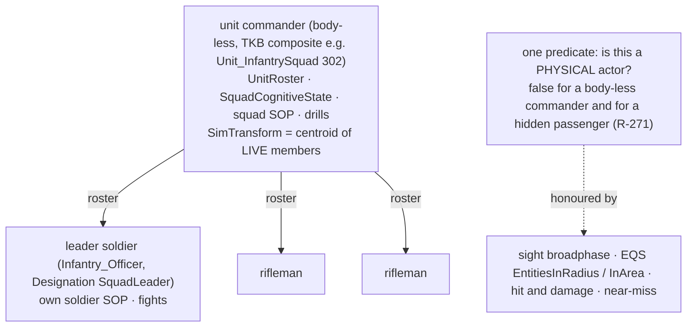

*What the picture shows that prose hid: command and body are two entities, so the one-SOP-per-entity conflict (S2-C) disappears; and the
commander's position is real (map symbol, editor overlay, danger-area route) yet it is never seen, hit or shot at — by the SAME check
that hides a passenger.*

| measured, `2026-10-11` | where |
|---|---|
| the TKB already models it: `Unit_InfantrySquad` is a composite of one `Infantry_Officer` (`SquadLeader`) + nine riflemen | `BdcTkbCatalog.cs:244-247` |
| a body-less commander already runs on the cluster (hill-attack "Tank Platoon", TKB 303: no Health, collider or weapon); it needs `NetworkIdentity` + `TkbIdentity` | `EntityMasterEgressTranslator.cs:62-67`, `GhostPromotionSystem.cs:196` |
| nothing writes a commander's position today | searched centroid / average writers: none |
| a positioned commander would be SEEN (`EntityInfo` is the only sight filter), found by EQS area searches (`SimTransform`), near-missed (`EntityInfo`), and never die (no Health) | `VisionBroadphase.cs:182`, `EntitiesInAreaGenerator.cs:66`, `BallisticsSystem.cs:256`, `CombatLife.cs:21-24` |

### 7.1 The build *(CE-2125 + CE-514; build-state: READY-TO-BUILD `2026-10-11`; 🔒 user: "approved, build them together with CE-2125")*

| measured, `2026-10-11` (both columns) | code — how it IS | design — how it was MEANT |
|---|---|---|
| a composite unit's position is the CREATOR's (CGF on a scenario load) and a CGF write replicates to SimHost / IG | no kinematics ⇒ no MuscleGround grant (`HrotOwnershipGroups.cs:68-73,113`); `GeoSpatialEgressTranslator.cs:136,174-182`; ingress skips an owned `SimTransform` (`GeoSpatialIngressTranslator.cs:90-94`) | ✅ R-175; ✅ CE-514 (user): *"the platoon position needs to be derived from the position of their members (averaging …), likely the platoon entity owner would be doing that"* |
| nothing writes a composite's position today | searched writers: none (CE-514) | CE-514 DEFERRED — built here |
| the composite description reaches NO component today; a TKB translator runs on the creator AND on every ghost promotion (all nodes) | `TkbTranslatorSet.cs:90-106`; `NetworkSpawningSystem.cs:141`; `GhostPromotionSystem.cs:271` | tkb-1 §6.6a (translators derive components per node) |
| who can be SEEN or found by an area search enters through the perception grid (visual, thermal, acoustic) and `EntitiesInAreaGenerator`; hit, near-miss and `EntitiesInRadius` read the COLLIDER hash, which a body-less unit is never in | `LocalGridBuilderSystem.cs:106`, `EqsModule.cs:56-80`; `EntitiesInAreaGenerator.cs:66`; `SpatialHashSystem.cs:73`, `BallisticsSystem.cs:64` | R-271 §7.2 names the same choke points for the passenger |
| a member's `Designation` written on CGF stays CGF-local unless marked dirty; a re-sent `CmdAssignSubordinate` appends a duplicate roster entry | `UnitSubordinate.cs:21,24`; `EntityInfoEgressTranslator.cs:116-121`; `UnitHierarchySystem.cs:117-149` | ⛔ searched: no design for succession ⇒ new here |
| `Unit_InfantrySquad` (302) has no `.WithBehavior` ⇒ no brain on it; `Infantry_Officer` (201) has no template | `BdcTkbCatalog.cs:234-251` | the TKB composite's own slot list (officer = `SquadLeader`) |

```mermaid
classDiagram
  class UnitEntity { <<NEW component, Fdp.Core.CommandHierarchy, NoScenario>> CommandDisruptionSeconds — "a unit, not a body" }
  class TkbCompositionDef { <<existing TKB descriptor, EXTENDED>> + CommandDisruptionSeconds = 6 }
  class CompositeUnitTkbTranslator { <<NEW, Hrot.Core>> TkbCompositionDef ⇒ UnitEntity (every node) }
  class PhysicalPresence { <<NEW static, Fdp.Toolkits>> IsHidden(view, e) — a UnitEntity (R-272 (behaviors)); I-2c adds the enclosed passenger (R-271) }
  class LocalGridBuilderSystem { <<existing, FILTERED>> skips IsHidden }
  class EntitiesInAreaGenerator { <<existing, FILTERED>> skips IsHidden }
  class UnitCentroidSystem { <<NEW, Fdp.Toolkits/Squad>> owned SimTransform of a UnitEntity = mean of LIVE members }
  class SquadLeadership { <<NEW component, CGF-only>> Leader · SilentUntil }
  class SquadSensing { <<existing, EXTENDED>> + Succession: leader dead ⇒ next by precedence, SquadLeaderDown edge, lull }
  class TacticalDesignation { <<existing enum, EXTENDED>> + TeamLeader 5 }
  class SensorChange { <<existing, EXTENDED>> + SquadLeaderDown 14 }
  class SquadManeuverRunner { <<existing, EXTENDED>> issues nothing while SilentUntil > now, re-sends after }
  class ReactToContactBehavior { <<existing, EXTENDED>> SquadLeaderDown during the drill ⇒ back to return fire + decide again }
  class BasicSquadSop { <<existing asset, EXTENDED>> + leader down ⇒ React ReactToContact }
  TkbCompositionDef <.. CompositeUnitTkbTranslator
  CompositeUnitTkbTranslator ..> UnitEntity
  PhysicalPresence ..> UnitEntity
  LocalGridBuilderSystem ..> PhysicalPresence
  EntitiesInAreaGenerator ..> PhysicalPresence
  UnitCentroidSystem ..> UnitEntity
  SquadSensing ..> SquadLeadership
  SquadSensing ..> TacticalDesignation
  SquadSensing ..> SensorChange
  SquadManeuverRunner ..> SquadLeadership
```

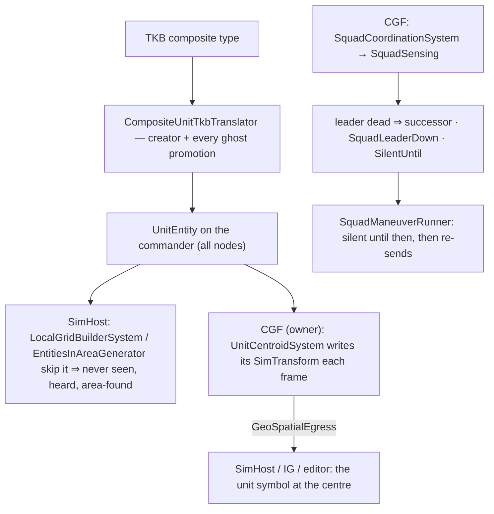

*What the pictures show that prose hid: ONE TKB fact (a composite) reaches every node as one component, and the two
consequences — "never sensed" on SimHost, "positioned at the centre" by the owner — key on it; succession and the lull live
entirely on CGF, next to the merge that already watches the members.*

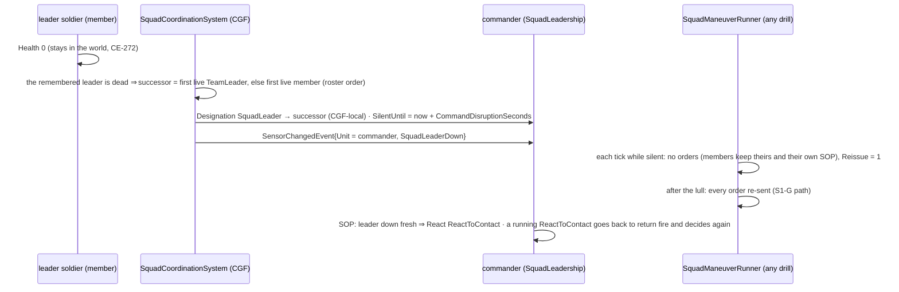

| # | decision | ⭐ lean |
|---|---|---|
| **C-1** | the marker | ONE component `UnitEntity` from the TKB composite description, carrying the per-type tunable — not a tag beside a profile |
| **C-2** | the predicate's home | `PhysicalPresence.IsHidden` (Fdp.Toolkits); the two entry points call it; R-271's I-2c adds the passenger case in the same method |
| **C-3** | the centroid | owner-side `UnitCentroidSystem` (CE-514's direction): live members only, X/Y/Z mean; none alive ⇒ unchanged; registered in the CGF pack (the creator of scenario units) |
| **C-4** | succession precedence | `SquadLeader` → the first live `TeamLeader` (NEW designation 5) → the first live member, in roster order; CGF-local (no replication — avoids the duplicate-roster path; only CGF reads it) |
| **C-5** | the lull | `SquadLeadership.SilentUntil` on the commander; the RUNNER honours it (every squad drill goes through it) |
| **C-6** | the squad type | `Unit_InfantrySquad` (302) gains `.WithBehavior`; scenarios use it for the commander and a rifleman with `Designation SquadLeader` for the leader (the officer template stays a gap) |

Rejected: **a tag derived from `UnitRoster`** — the roster is CGF-built and not replicated, SimHost may not have it; **filtering at
every consumer (vision, thermal, acoustic, EQS)** — the grid is their one door; **replicating the new designation** — the re-sent
EntityInfo path appends duplicate roster entries (measured), and nothing off CGF reads it yet.

| rail | asserts |
|---|---|
| `CompositeUnitTkbTranslator` rail | a composite type ⇒ `UnitEntity` with its seconds; a soldier type ⇒ none |
| `PhysicalPresence` + grid / area rails | a `UnitEntity` with a position is not in the perception grid nor in an area search; a soldier is |
| `UnitCentroidSystem` rail | the owned commander sits at the live members' mean; a dead member does not count; a non-owned one is untouched |
| succession rails (`SquadCoordinationSystemTests`) | leader dies ⇒ TeamLeader promoted (else first live), one `SquadLeaderDown`, `SilentUntil` set |
| runner rail (`SquadManeuverTests`) | no orders while silent, all re-sent after |
| `ReactToContact` rail | leader down during the drill ⇒ holds, decides again |
| live (`tt-react-contact`, migrated) | the commander's position on SimHost is the members' centre; no member's memory holds it; the S2 chain still runs |

### 7.2 When the leader soldier is killed *(✅ APPROVED `2026-10-11` — 🔒 user: "approved, build them together with CE-2125")*

📖 **Doctrine (infantry squad drills, general knowledge — no source in the corpus):** the succession is fixed in advance (squad
leader → senior team leader → the other team leader → senior rifleman) and taking over is IMMEDIATE; the fight goes on — return fire
and fire superiority first, the casualty is treated only when the situation allows; the new leader moves where he can control, checks
his men, ammunition and casualties, reports, and reorganises (a new team leader for the team he left, key kit such as the radio
cross-loaded). **What an observer would see:** a short lull in COORDINATED movement (men keep firing from where they are), one man
crawling to the casualty, the new leader moving and shouting, and afterwards a more cautious squad.

| # | lean | why |
|---|---|---|
| **L1** | **succession**: the `SquadLeader` designation passes at once to the next live member by an authored precedence (fallback: roster order) | cheap; the march's lead member, a future radio and the leader's place in a drill read it |
| **L2** | **command disruption**: for `CommandDisruptionSeconds` (≈ 5–10 s, TKB-tunable) the COMMANDER issues no new orders; members keep their current orders and their own SOP; then every order is re-sent (the S1-G resume path) | ⭐ the visible part — the lull; the brain survives (it is the commander) but the voice that carries it was lost |
| **L3** | a squad edge **`SquadLeaderDown`** on the commander, so its SOP / HSM can react — e.g. re-decide the running reaction with the weaker squad | the same machinery as S2's edges; an author decides what a squad does, not the engine |
| **L4** | casualty care (buddy aid, moving the casualty) waits for R-263's injury states (wounded / incapacitated) | a dead man needs no aid; the states that make it matter are decided but not built |

Rejected: **the commander dies with its leader** (the brain is the unit, not the man — and R-272 (behaviors) separated them); **re-forming the
whole squad on a leader loss** (doctrine keeps the teams and fills the gap; formation shape is `CE-2124`'s).

### 7.3 As built *(behaviors, `2026-10-11`)*

| file | what |
|---|---|
| `Fdp.Core/CommandHierarchy/UnitEntity.cs` (NEW, id 274) · `TacticalDesignation.TeamLeader = 5` | the unit marker + its command lull; the second in line |
| `Hrot.Core/…/Tkb/CompositeUnitTkbTranslator.cs` (NEW, in `TkbTranslatorSet.Base`) · `TkbCompositionDef.CommandDisruptionSeconds` (6) | a composite type ⇒ `UnitEntity` on every node |
| `Fdp.Toolkits/Perception/PhysicalPresence.cs` (NEW) · `LocalGridBuilderSystem` · `EntitiesInAreaGenerator` | the one hidden check, at the two doors |
| `Fdp.Toolkits/Squad/Systems/UnitCentroidSystem.cs` (NEW, in `CgfLogicPack`) | CE-514: the owned unit at its live members' mean |
| `Fdp.Toolkits/Squad/SquadLeadership.cs` (NEW, id 275) · `SquadSensing.Succession` (called by `SquadCoordinationSystem` each frame) | L1 successor (⭐ `2026-10-13`, R-e: the roster-order fallback passes over a `Medic` while anyone else can lead — §7.5.7) · L2 `SilentUntil` · L3 `SquadLeaderDown` (14, HSM `Sensor.SquadLeaderDown`) |
| `SquadManeuverRunner` · `ReactToContactBehavior` · `BasicSquadSop` (third row) | silent ⇒ no orders, re-sent after · the leader lost mid-drill ⇒ hold and decide again · leader down ⇒ React |
| `SquadSensing.UnderFire` | the commander's own Hit / NearMiss no longer counts (it is body-less) |
| `BdcTkbCatalog` 302 `.WithBehavior` | the squad commander can run the squad SOP and drills |
| scenarios `tt-suppress-flank`, `tt-react-contact`, `ua-fire-distribution` | a body-less "Squad" (302) holds the task and SOP; "Leader" is a member designated `SquadLeader` (in `ua-fire-distribution` it keeps fighting with its own `CombatPosture`) |

**Deviations from §7.1 — none in structure.** Two things measured while building: near-miss reads the COLLIDER hash
(`BallisticsSystem.cs:64`), so a body-less unit is never near-missed without any filter (an earlier sweep had said otherwise);
and ids 356–364 are the backend lane's — ours come from the squad block (274, 275).

| rail | proves | red-proof |
|---|---|---|
| `UnitCommanderTests.CE2125_ACompositeType_IsAUnit_ASoldierIsNot` | the translator, and that it is in the base set | — |
| `UnitCommanderTests.CE2125_AnAreaSearch_NeverFindsAUnitsCommander` · `LocalGridBuilderSystemTests.CE2125_AUnitsCommander_IsNeverInThePerceptionGrid` | the two doors | ✅ each filter removed ⇒ its rail red |
| `SquadCoordinationSystemTests.CE2125_TheLeaderFalls_…` · `…_NoTeamLeader_…` | succession, lull, one edge | ✅ `Succession` call removed ⇒ both red |
| `SquadCoordinationSystemTests.CE2125_AUnitStandsAtItsLiveMembersCentre_OnItsOwner` | CE-514 | ✅ liveness check removed ⇒ red |
| `SquadManeuverTests.CE2125_TheSilentCommander_…` · `…_TheLeaderFallsDuringTheDrill_…` · `…_BasicSquadSop_TheLeaderDown_…` | L2, L3, the SOP row | ✅ silence check removed ⇒ the silence rail red |
| `CgfLogicPackTests` (count 20 + contains `UnitCentroidSystem`) | the pack really runs it | — |
| live `SquadTacticsScenarioTests` ×2 + `FireDistributionScenarioTests` | the migrated scenarios; on SimHost the commander stands at its men's centre and the enemy never remembers it | ✅ live green `2026-10-11`: fire distribution 9 s (five members, the leader among them), S2 45 s, S1 41 s |

### 7.4 L4 — casualty care *(behaviors, `2026-10-13`, `CE-2152` C-b; build-state: DESIGN — K1–K6 ruled 2026-10-13 (R-2012: medic, cover point, covering fire); the coordination is open (§7.5); the carry actions it uses are [`DESIGN_Entity_Interactions.md`](../../DESIGN_Entity_Interactions.md) §7.4.10)*

📖 **Doctrine (§7.2's, general knowledge):** fire superiority first; the casualty is treated when the situation allows; one man goes to
him and moves him; the leader keeps control. **Now possible:** a man can be *down* (CE-2155) and a soldier can drag him (CE-2152 C-a, C-b).

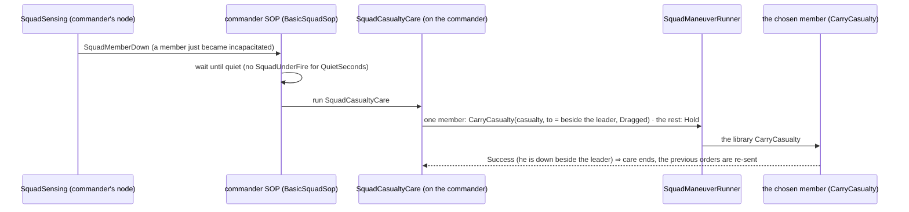

*What the picture shows: the squad decides (who, when, where); the member only runs the carry. Nothing new reaches the member but one
more order kind.*

| # | question | ⭐ lean | blast radius | what would change it |
|---|---|---|---|---|
| **K1** | how the squad learns a man is down | ⭐ a squad edge `SquadMemberDown` on the commander, the `SquadLeaderDown` way (`SquadSensing`, a per-commander "already down" mask so it fires once per man) | one `SensorChange` value, one HSM reserved event, one mask component | — |
| **K2** | when care starts | ⭐ only when QUIET: no `SquadUnderFire` for `QuietSeconds` (default 10 s); under fire the casualty waits and bleeds (120 s) | the SOP row's guard | a doctrine that drags under covering fire — a later "covered" variant |
| **K3** | who goes | ⭐ the nearest member still in the fight who is not the squad leader and carries nobody | one pick in `SquadCasualtyCare` | a designated medic / buddy pair (MED-2) |
| **K4** | to where | ⭐ beside the squad leader (his position, 2 m to his rear), dragged | none beyond the order | a casualty collection point from EQS (MED-3, "covered, reachable by vehicle") |
| **K5** | what the others do | ⭐ hold where they are (the existing `Hold` order), then every order is re-sent when care ends (the S1-G resume path, like L2) | the runner's existing resume | — |
| **K6** | a DOWN leader (found while measuring) | ⭐ counts as lost: `Succession` hands over when the leader is out of the fight, not only dead — today an incapacitated leader keeps the squad | `SquadSensing.Succession` + its `Designated` / `FirstLive` picks (`CombatLife.IsAlive` → `Injury.IsInTheFight`) | — |

⭐ **Ruled `2026-10-13` (R-2012)** — 🔒 user: *"I want a medic waiting in cover to come for the wounded and carry him to cover point, and
others giving covering fire. Otherwise approved."* ⇒ K1, K2, K5, K6 approved as leaned; **K3 → a MEDIC** (a designated member, waiting
in cover); **K4 → a COVER POINT** (not "beside the leader"); **K5 → the others give COVERING FIRE** (not merely hold). How the medic is
told, and how covering fire starts and ends, is designed in §7.5 (approved R-2013).

Rejected (one line each): **each soldier decides alone to help the nearest man down** — two men would go for one casualty, and nobody
weighs the fire; **care at once, under fire** — doctrine says fire first, and a dragger cannot shoot (C7); **a vehicle evacuation** — MED-3,
needs a collection point and a carrier that seats a casualty.

### 7.5 Casualty care — the coordination and the rescue decision *(behaviors, `2026-10-13`; build-state: DESIGN — ✅ approved 2026-10-13 (R-2013), NOT built; `CE-2152` C-c)*

⭐ **Status for whoever returns:** everything below was MEASURED on `2026-10-13` (file:line in §7.5.1), discussed and approved. Nothing in
§7.5 / §7.6 is built. Start the build at §7.5.6 slice R-a; the design needs no re-measurement unless a cited file changed since `abc5c4863`.

#### 7.5.1 What exists — measured `2026-10-13` (graph CLI + MCP `search_graph`, + reads)

| fact | code | so |
|---|---|---|
| squad edges are published ONLY on the commander (`Unit = commander`) and recorded only on `evt.Unit` | `Fdp.Toolkits/Squad/Systems/SquadSensing.cs:141` · `Behavior/Systems/RecentSensesSystem.cs:23-27` | a member never hears "man down"; the commander must order him |
| a soldier's SOP reacts to his OWN edges only (`Hit`, `FirstThreat`) | `Assets/BTrees/Library/Sop/BasicInfantrySop.btree.json:258,268` | no member-side trigger exists, and none is wanted (§7.4 rejected) |
| member orders: `MemberOrderKind { Hold, AdvanceTo, Disembark }`; `Hold` = the library CombatPosture at the member's own position | `Hrot.AI.Behaviors/Brains/SquadManeuverRunner.cs:34-44, :392-402` | ⛔ **no "suppress" order**: a holder fires only if HIS utility picks Suppress and he sees / remembers a target |
| a covering element with no enemy in sight does not fight | measured, this file §2 (line ~56) | "cover" today does not mean "fire" |
| the member picks his own target; the squad only BIASES it (`ThreatMatrixAssignmentSystem` → `IsAssignedTarget`, weight 0.9) | `Utility/Group/ThreatMatrixAssignmentSystem.cs` · `ThreatRankingDecision.cs:24` | the suppress order can name the squad's assigned contact |
| `PostureNodes.Suppress`: aimed fire when the target is seen, blind fire at its remembered place otherwise | `Brains/PostureNodes.cs:220` | the suppress order's body exists — only the forcing is missing |
| the runner's live test is `CombatLife.IsAlive` ⇒ a DOWN member still gets orders | `SquadManeuverRunner.cs:224` | ⛔ gap, fixed with K6 (§7.5.6 R-a) |
| no `Medic` value; designations are read in behaviour code only by succession | `Fdp.Core/CommandHierarchy/TacticalDesignation.cs:8-17` (Undefined, Commander, SquadLeader, Wingman, Support, TeamLeader); `SquadSensing.cs:93-128` | add `Medic = 6`; assigned like `SquadLeader` (scenario `"Designation"`, TKB child slot) |
| the commander can ask a terrain/EQS question | `SquadManeuverRunner.AskTerrain` (`:484`) | the cover point for the casualty |
| `FindCoverFromTarget`: cover points around query slot 0's entity, LoS-filtered against slot 1, scored by distance + `ThreatExposureTest` + path cost | `Spatial/Eqs/FindCoverFromTarget.cs:29-43` · `CoverPointsGenerator.cs:29-34` · `EqsContext.cs:20-23` | slot 0 = the CASUALTY, slot 1 = the top threat ⇒ "nearest cover to him, hidden from it" |
| the squad's contact decision: Assault (strength × ammo × inverse enemy strength) · BreakContact (enemy strength) · Hold (constant 0.25); decided ONCE per reaction | `Utility/StarterPack/SquadContactResponseDecision.cs:17, :34-41` | Rescue becomes its 4th option; the re-decide is new |
| squad inputs today: `SquadKnowsContact`, `SquadContactThreatLevel`, `SquadStrengthRatio`, `SquadEnemyStrengthRatio`, `SquadAmmoRollup`, `SquadPoolThreatAggregate`, `AssignedRole`, `AssignedSlot`, … | `Utility/Inputs/SquadInputs.cs:73-331` | three new inputs (§7.5.4) |
| `RecentSenses` holds the LAST time of each edge (`SquadUnderFire`, `SquadContact`, …), not a rate | `Behavior/Components/RecentSenses.cs:21-29` | "quiet seconds" = now − `SquadUnderFire` |
| bleed-out: `InjuryThresholds.BleedPerSecond` (fraction of Max per second) | `Combat/Components/InjuryThresholds.cs:22` | seconds left = (Current / Max) / BleedPerSecond |
| phase events `ShotFired`, `DefiladeReached` exist in the sequencer and are FED BY NOTHING | `Squad/Primitives/PhaseSequencer.cs:8-16` | the gates of §7.5.3 / §7.6 feed them |
| the carry is built: library `CarryCasualty` (pick up → move → put down), only a man down, the carrier cannot fire | `Brains/EmbarkBehaviors.cs` (`CarryCasualtyBehavior`) · `Brains/CarryNodes.cs` · `DESIGN_Entity_Interactions.md` §7.4.10 | the medic's order IS this behaviour |
| doctrine (casualty care under fire, fire and movement, "Moving!/Covering!") | — | ⛔ NOT in the corpus (searched `docs/` + `.dev/`); general military knowledge, used as such |

#### 7.5.2 Classes

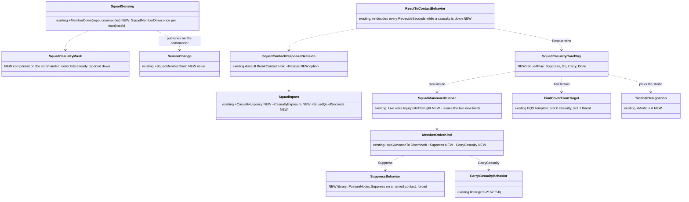

*What the picture shows: one new play and two new order kinds on the EXISTING runner; the decision is the existing squad decision with one
more option. Nothing reaches a member except an order.*

#### 7.5.3 Sequence — a man goes down, the squad decides, the medic goes

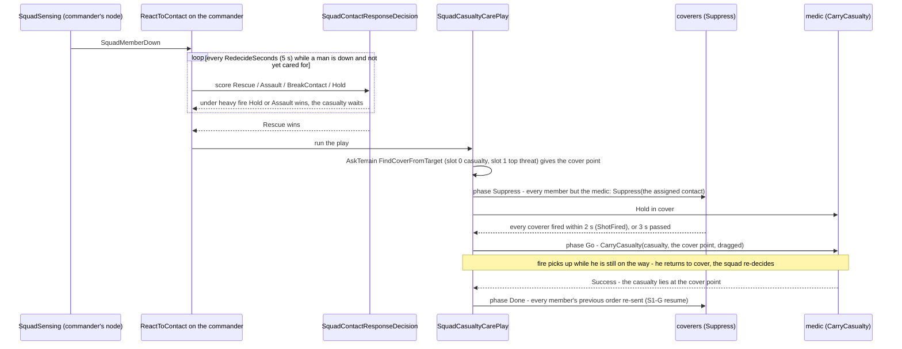

*What the picture shows: the "Covering!" → "Moving!" handshake is a phase GATE the commander reads (every coverer has fired), not a
message between members; "finished" is the commander re-issuing the previous orders.*

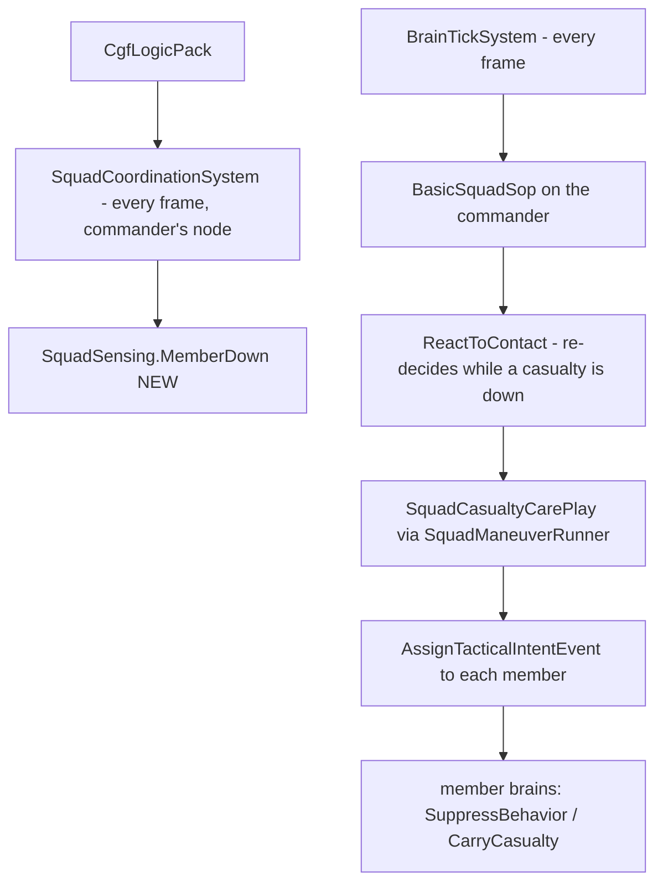

*Module point: everything runs where the squad already runs (CGF, the commander's node); a host without `CgfLogicPack` has no squad
and no care — as today for every play.*

#### 7.5.4 The rescue decision (approved, R-2013)

🔒 **User, `2026-10-13`:** *"Leans approved."* (medic carries to cover under covering fire, (a)–(c)) · *"Approved, write it into the design, do not start imolementing"* (the scored Rescue option, the re-decide, mid-rescue return).

`Rescue` = **WeightedProduct** of four considerations ⇒ any one near zero kills it, and Hold / Assault win as today:

| input (NEW) | what it reads | curve, lean | its job |
|---|---|---|---|
| `CasualtyUrgency` | the worst casualty's seconds left to bleed out, from `Health` and `InjuryThresholds.BleedPerSecond`, normalised by `BleedOutSeconds` (120) | rising as time runs out (inverse linear) | a man about to die under LIGHT fire is worth some risk |
| `CasualtyExposure` | how many pooled contacts (`SquadCognitiveState.Contacts`) have line of sight to the casualty and to the cover point (the `ThreatExposureTest` test, one sample each) | inverse: 0 seen ⇒ 1, all seen ⇒ 0 | heavy, aimed fire on the casualty's spot ⇒ no rescue |
| `SquadQuietSeconds` | now − `RecentSenses.SquadUnderFire` on the commander | rising, ~1 at ≥ 10 s (K2's quiet becomes this factor) | under fire now ⇒ no rescue |
| fire superiority | `SquadStrengthRatio` × inverse `SquadEnemyStrengthRatio` (existing) | as Assault's | we are winning the firefight |

- ⭐ **Re-decide**: `ChooseOptionOnce` decides once per reaction (`SquadContactResponseDecision.cs:17`) ⇒ while a casualty is down and
  uncared for, the reaction re-scores every `RedecideSeconds` (5 s) and on each `SquadMemberDown`.
- ⭐ **Mid-rescue**: a `SquadUnderFire` edge while the medic is still WALKING to him ⇒ the medic is ordered back to cover and the squad
  re-decides; once he is CARRYING ⇒ he keeps going (stopping in the open is worse).
- ⭐ **Fog**: exposure counts the squad's POOLED contacts, never the truth — an unseen sniper can still hit the medic.

#### 7.5.5 Decisions (all ✅ approved 2026-10-13)

| # | decision | why | rejected (one line) |
|---|---|---|---|
| K1 | `SquadMemberDown` on the commander, once per man | the `SquadLeaderDown` precedent; members never hear squad edges | — |
| K2′ | care starts when the scored `Rescue` option wins (§7.5.4); K2's "quiet ≥ 10 s" is one of its factors | a gate cannot weigh a dying man against light fire, nor exposure | the binary gate alone |
| K3′ | a designated **Medic** (`TacticalDesignation.Medic`); none in the squad ⇒ the nearest member in the fight who is not the leader | user R-2012; doctrine | the medic's own SOP hearing the edge (members never hear it; two would go) |
| K4′ | to the nearest **cover point** around the casualty hidden from the top threat (`FindCoverFromTarget`, slot 0 casualty) | user R-2012 | beside the leader (the K4 lean, replaced) |
| K5′ | the others **suppress** the squad's assigned contact (new `Suppress` order), then get their previous orders back | user R-2012; `Hold` does not make anyone fire (§7.5.1) | a timer-only switch; member-to-member messages |
| K6 | a DOWN leader hands over like a dead one; the runner's live test becomes "in the fight" | `SquadSensing.Succession` / `SquadManeuverRunner.cs:224` test `IsAlive` | — |
| (a) | a medic later also STOPS the bleeding (the drain stops once treated) — its own small slice | doctrine; `DESIGN_Injury_States.md` I3 already reserves "stabilised" | — |
| (c) | the suppress order names the squad's top / assigned contact; none ⇒ nothing to suppress (and Rescue is quiet anyway) | the existing assignment | waiting until the casualty's shooter is known |

#### 7.5.6 Slices *(R-a … R-d BUILT `2026-10-13` — §7.5.7; R-e live, passing — §7.5.7)*

| slice | what | rails |
|---|---|---|
| **R-a** | K6: `Succession` and the runner's `Live` on `Injury.IsInTheFight`; `TacticalDesignation.Medic`; `SquadMemberDown` + mask | a down leader hands over · a down member gets no order · one edge per man |
| **R-b** | `MemberOrderKind.Suppress` + library `SuppressBehavior` (forced `PostureNodes.Suppress` on a named contact) | a suppressor fires at a remembered contact it cannot see |
| **R-c** | `SquadCasualtyCarePlay` (Suppress → Go → Carry → Done) + `MemberOrderKind.CarryCasualty` | the medic waits until the coverers fired · he brings the man to the cover point · the orders return |
| **R-d** | the three inputs + `Rescue` option + the re-decide | heavy fire ⇒ Hold, the man waits · quiet + exposed-free ⇒ Rescue · a man about to bleed out under light fire ⇒ Rescue |
| **R-e** | a live scenario (`ua-casualty-care` + `-heavy` + `-leader`): a squad in contact, a man down, the medic drags him to cover under covering fire | §7.8.2, over HTTP |

#### 7.5.7 As built — R-a … R-d *(behaviors, `2026-10-13`, `CE-2152` C-c)*

| slice | as built | deviation from §7.5.2–§7.5.6 |
|---|---|---|
| **R-a** | `TacticalDesignation.Medic = 6` (CGF-local; ⚠ neither it nor `TeamLeader` is in the NED wire enum) · `SensorChange.SquadMemberDown = 15`, `Target` = the man, once per man, from `SquadSensing.MemberDown` (called beside `Succession`); recorded in `RecentSenses`; HSM event `Sensor.SquadMemberDown` (0xFF0F) · `Succession` and the runner's `Live` read `Injury.IsInTheFight` | ⚠ the "reported" mask is `SquadLeadership.DownReported`, not a new `SquadCasualtyMask` component — the leadership record is already the squad's CGF-local memory of its members' fate |
| **R-b** | library `Suppress` (`SuppressNodes.SuppressContact`): hold; aimed at the named contact when seen, blind at your own memory of him when hidden (`PostureNodes.Fire`, blind), at the squad's reported point (`FireAtPoint` action) when you never saw him; stops when he is down · `MemberOrderKind.Suppress` + `MemberOrder.Target` | the "never saw him" point fire is new: without it a coverer who never saw the contact would hold silently (the blind-fire executor needs a memory slot) |
| **R-c** | `SquadCasualtyCarePlay` (`CasualtyCareManeuver`, kind 11: Suppress → Go → Done; Go → Recall → Aborted) · the **covering gate** `SquadGates.Covering` (every coverer's rounds went down within 2 s; `FireGateMemory` in `SquadPlayState`) — ⭐ F-a's first half, built here · cover point by the commander's `FindCoverFromTarget` query (slot 0 casualty, slot 1 threat; no threat ⇒ where the medic waited) · `MemberOrderKind.CarryCasualty` · the man lying at the point ⇒ Done ⇒ `SquadLeadership.CaredFor` · fire while the medic WALKS ⇒ Recall to where he waited ⇒ Failure (re-decide) · library `CasualtyCare` runs the play alone | the cover query reads the casualty and threat only (not "the cover point is also hidden" — the query's own threat test scores that) · `CoveringSeconds` (3 s) sends the medic when nobody fires, traced as `Timeout` |
| **R-d** | inputs `CasualtyUrgency` (0 none · 0.8 fresh → 1 bleeding out), `CasualtyExposure` (share of identified pooled contacts with sight of the worst casualty — terrain LoS where this node holds terrain, else within 150 m), `SquadQuietSeconds` (0.2 under fire → 1 after 10 s; a casualty within 60 s of bleeding out lifts it, fully at 30 s) · `SquadContactResponse.Rescue = 4` · `ReactToContact`: re-decides every 5 s and on each `SquadMemberDown` while a casualty waits (a changed winner starts its drill; the same winner keeps running), runs the care play on Rescue, decides again when it ends; a man down with an EMPTY pool ⇒ Rescue without a decision · `BasicSquadSop` row: `SquadMemberDown` → `ReactToContact` | ⚠ **calibration**, measured against the existing options (`Assault` reaches ≈ 0.93 for a strong squad, `Hold` is 0.25): Rescue = product(urgency^0.5 · (1 − exposure) · quiet · (1 − enemy share)^0.5) — the floors and the dying-man lift exist because without them a fresh casualty in a quiet squad never beat Assault. ⚠ Exposure samples the casualty only, not the cover point (the cover query handles that) · ⚠ the no-terrain fallback (150 m) is a stand-in: on a node without terrain a close contact counts as seeing him |

**Calibration, as scored** (the rails in `SquadManeuverTests`): quiet + nobody sees him ⇒ Rescue (≈ 0.85) over Assault and Hold ·
under fire now with a contact close enough to see him ⇒ Rescue 0 ⇒ the man waits · same man, fire moved off, 10 s quiet ⇒ the
5-s re-decide picks Rescue · a man ~20 s from bleeding out, shot at 3 s ago, unseen ⇒ Rescue · a fresh man in the same light fire ⇒
the squad fights first · empty pool ⇒ Rescue at once.

**R-e, live (`2026-10-13`, `CE-2152`) — what the cluster taught, folded back:**

| measured | change |
|---|---|
| a killed enemy stays in the squad's pool until the members' memories fade (the pool is rebuilt from them), so "the pool is empty" came long after the last enemy fell (`ua-casualty-care-heavy`: the hostiles killed, no rescue in 20 s) | ⭐ "nothing to fight" = no pooled contact still alive (`CombatLife.IsAlive`; a heard contact counts as alive) — the re-decide and the empty-pool shortcut read it |
| a drill that is WON (`Assault` → Success when its enemy falls) ended the reaction with the man still down | ⭐ a won drill with a casualty waiting hands over to `Rescue` instead of ending |
| authoring the hostile's `"Roe"` crashed the whole cluster natively — pre-existing, `ua-universal-soldier` too, at base (`CE-2160`) | the demos' "holding fire" hostile has an empty weapon (`WeaponState.Ammo = 0`) instead |
| the winning drill under heavy fire (`Assault`) moves the whole squad, the Medic too | the `-heavy` check is "nobody is sent for him" (no `CarryCasualty`), not "the Medic stays put" |
| ⭐⭐ a bleeding man's every health drop is a `Hit` edge (`ThreatEvaluationSystem` reads any drop as a hit), and `SquadSensing.UnderFire` made each one `SquadUnderFire` — 📐 second-by-second probe: Rescue stuck at 0.29–0.38 (never quiet), and every care drill recalled the medic ~2 s after sending him, until the man bled out | ⭐ `UnderFire` ignores `Hit` edges from a member out of the fight; near misses, and hits on men still fighting, count (`CE2152_ADownMansBleeding_…`) |
| the leader down in `-leader`: the Medic, second in the roster, took command — and a leader is never sent, so a rifleman went | ⭐ succession passes over a `Medic` while anyone else can lead (§7.2 L1 deviation; `CE2152_SuccessionPassesOverTheMedic_…`) |
| the medic stopped 1.7 m from the man (his body nudged as he came) and `PickUp` failed on the first walk that ended out of reach; the drill then waited in `Go` for 60 s while the man bled out | ⭐ `PickUp` walks to him again (≤ 3 walks, within 6 m); the care play re-sends the carry every 2 s while the medic neither carries him nor still runs `CarryCasualty` |
| the casualty lay on the coverers' lines to the hostile, so the medic walking to him took their rounds | the scenario puts him out of every firing lane — ⚠ a squad with no friendly-fire awareness in its route choice is left open (the medic's walk does not avoid the base of fire's lanes) |

⭐ **Result `2026-10-13`:** `ua-casualty-care`, `-heavy` and `-leader` all PASS every check over HTTP (the `-heavy` "drill ended" read
needed a checker fix: the route keeps the last drill, inactive, when none runs).

Rails: `SquadManeuverTests.CE2152_Rescue_TheEnemyKilledButStillRemembered_TheSquadGoesForHim` (red only with BOTH fixes removed —
either one closes the case it pins).

⚠ **Measured calibration step** *(probe, `2026-10-13`)*: in the "quiet, hidden casualty" rail the inputs read urgency 0.6 · exposure 0 ·
quiet 1 · strength 0.81 · enemy share 0.09 · ammo 1 ⇒ Assault **0.888** vs Rescue **0.883** — a coin toss. The urgency floor went to
**0.8** (Rescue ≈ 0.95); under light fire a fresh casualty then scores ≈ 0.55 against Assault's 0.89, so the squad still fights first.

⚠ **§7.8.2 check ⑧ changed with the build**: "each member runs what he ran before ①" cannot hold — after the care the reaction DECIDES
AGAIN (the fight may have moved on). ⑧ is now *"the drill is no longer `CasualtyCare` and every member in the fight has an order of it"*.

### 7.6 Fire and movement — the same pattern *(behaviors, `2026-10-13`; build-state: F-a … F-d BUILT (§7.6.1, §7.6.2, §7.6.4), the Assault route BUILT (§7.6.3); F-e live — ✅ approved (R-2013, leans (b)))*

📖 **Doctrine (general knowledge, ⛔ not in the corpus):** two drills, not one. **Bounding overwatch** is used BEFORE contact: one element
watches, ready to fire, while the other bounds 20–50 m to the next cover; then they swap. **Fire and movement** is used IN contact: the
base of fire SUPPRESSES while the other element rushes 3–5 s (≈10–15 m: "I'm up, he sees me, I'm down") to cover, then fires so the first
can move; a mover goes only after "Covering!", and calls "Set!" when down in cover.

**Measured `2026-10-13`:** `BoundingOverwatchPlay` (`Brains/BoundingOverwatchBehavior.cs:88-150`) — half the squad `AdvanceTo` the
moving element's centre + `min(BoundMetres 30, distance)` toward the objective (`:126-147`), the other half `Hold`; the swap is the movers
within 3 m (`SquadManeuverRunner.ElementArrived`, XY) or `BoundTimeoutSeconds` 60 (`:119-124`); no cover query for the bound point. ⇒ the
coverers do not necessarily FIRE, the bound is geometric, the swap is distance-only. The other four tables (`DangerAreaCrossing`,
`HillCrestHullDown`, `StackAndRoomEntry`, `TravellingOverwatch`) have no play (graph: 10 `*Maneuver` classes, 6 `*Play` structs).

**The pattern (approved): the commander coordinates; a phase changes on a GATE it can read; it speaks only through orders.**

| gate | read as | feeds |
|---|---|---|
| **covering** | every coverer fired within the last 2 s (its `WeaponState.Ammo` dropped / its weapon channel ran a fire) | `PhaseEventKind.ShotFired` |
| **set** | every mover stopped (arrived) AND at a cover point (hidden from the top threat) or prone | `PhaseEventKind.DefiladeReached` |
| fallback | a timeout per phase | as today |

- ⭐ Order kinds: `Hold` (watch) · `Suppress` (§7.5) · **`RushTo(cover point)`** NEW — an `AdvanceTo` to an EQS cover point at most
  `RushMetres` (15 m) ahead, done when *set*.
- ⭐ **`FireAndMovementPlay`** NEW: two halves (lean (b): halves first, pairs later); phase A: half 1 suppresses, half 2 rushes; *set* and
  *covering* ⇒ swap. **`BoundingOverwatchPlay`** keeps `Hold` for its coverers until contact, then gives them `Suppress`; its bound point
  becomes a cover point.
- Casualty care (§7.5) is the same pattern with one mover (the medic) and one gate pair.

Rejected (one line each): **each pair coordinating peer-to-peer** — a new member-to-member channel, when the commander already reads
every member each frame on the same node · **time-only rushes** — they cannot tell whether the mover reached cover · **one drill for both** —
watching and suppressing are different jobs, and before contact there is nothing to suppress.

| slice | what |
|---|---|
| **F-a** | the *covering* and *set* gates feeding `ShotFired` / `DefiladeReached` |
| **F-b** | `RushTo` + `FireAndMovementPlay` (halves) |
| **F-c** | `BoundingOverwatchPlay`: suppress on contact, cover-point bounds |
| **F-d** | pairs (buddy teams) |
| **F-e** | the live scenarios `ua-bounding-overwatch` (after F-c) and `ua-fire-and-movement` (after F-b) — §7.8.3, over HTTP |

#### 7.6.1 F-a / F-b in detail *(behaviors, `2026-10-13`, `CE-2158`; build-state: BUILT — within the approved §7.6 pattern; as-built at the end of this section)*

**Measured `2026-10-13`** (graph CLI + reads): the *covering* gate is BUILT (`SquadGates.Covering`, R-c); there is no *set* gate;
`SquadManeuverRunner.AskTerrain` keeps only the TOP answer of the commander's query, while `EqsCognitiveBuffer` holds up to 16 ranked
answers; `FindCoverFromTarget` generates terrain cover points near slot 0, keeps those hidden from slot 1, and scores nearness and
how hidden each one is — it knows nothing about "ahead". ⇒ "ahead, and at most `RushMetres`" is the play's pick over the whole buffer.

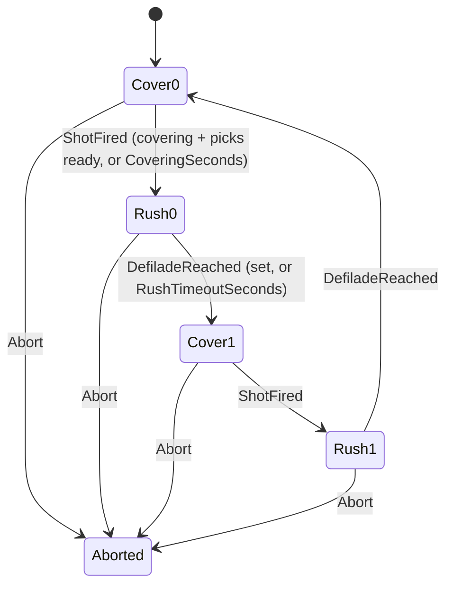
*What the picture shows that prose hid: a bound is TWO phases. The mover waits in `Cover_e` until the other half is firing AND its own
cover points are picked; only `Rush_e` moves anyone — so at no moment are both halves up.*

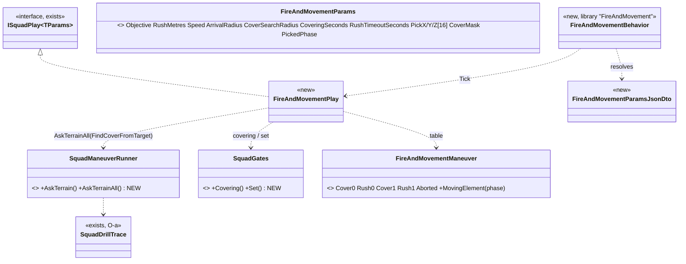

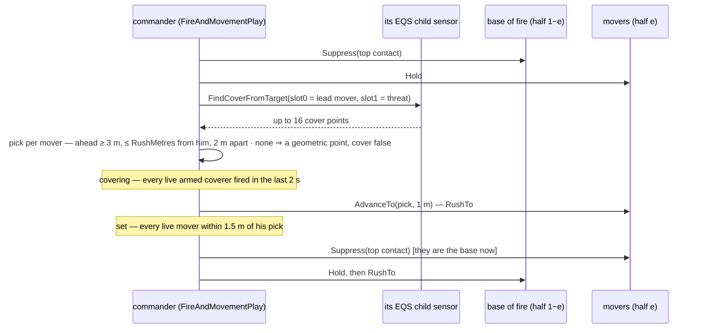

| decision | lean, as built | why |
|---|---|---|
| where "ahead" lives | the play's pick over the whole buffer (`AskTerrainAll`); `AskTerrain` becomes its one-answer wrapper | one query implementation; the template stays a plain cover query |
| a mover with no cover point ahead | a geometric point `min(RushMetres, distance)` toward the objective, `cover = false` | the drill must not stall in the open; the trace shows the point was not cover |
| *set* at a non-cover point | arrival counts | ⚠ deviation from §7.6's "or prone": no prone order exists for a play yet — the next phase's `Suppress` is the posture |
| no contact at all | the base of fire HOLDS (watches); *covering* then waits out `CoveringSeconds` | nothing to suppress (§7.6: before contact is bounding overwatch's job) |
| the end | both halves' centres within `ArrivalRadius` (20 m) of the objective ⇒ Success | as `BoundingOverwatchPlay`; the assault is the next drill |

Rejected: one query per mover — up to 8 sensors per phase for a pick the whole buffer already answers · the movers' own positions as
the cover-query centre each tick — a moving centre re-solves every frame and the pick flickers.

**As built `2026-10-13` (F-a second half + F-b, `CE-2158`):** `FireAndMovementManeuver` (kind 12, Cover0/Rush0/Cover1/Rush1/Aborted) ·
`FireAndMovementPlay` + library `FireAndMovement` (commander) · `SquadGates.Set` (every live mover within `SetMetres` 1.5 m of his order
point) · `SquadManeuverRunner.AskTerrainAll` (the whole buffer; `AskTerrain` is now its one-answer wrapper) · defaults `RushMetres` 15,
`Speed` 4, `ArrivalRadius` 20, `CoveringSeconds` 3, `RushTimeoutSeconds` 12, pick timeout 5 s · the movers' picks live in the play's
params — ⛔ SUPERSEDED by F-c: they moved to the shared `SquadCoverPicks` / `SquadCover` (§7.6.2), so `PickX/Y/Z` and `PickedPhase` are gone. Rails `SquadManeuverTests.CE2158_FireAndMovement_*` (4). ⚠ Not yet: the live
`ua-fire-and-movement` (F-e) and the SOP route into it (the contact reaction's `Assault` still runs `SuppressAndManeuver`) — ⛔ SUPERSEDED: both built (§7.8.3, §7.6.3).

#### 7.6.2 F-c — bounding overwatch on the same gates *(behaviors, `2026-10-13`, `CE-2158`; build-state: BUILT)*

**Measured before the build:** `BoundingOverwatchPlay` gave its coverers `Hold` whatever the contact, bounded to the formation shifted
`BoundMetres`, and swapped on `ElementArrived` (3 m) or the timeout; F-b's cover pick lived inside `FireAndMovementPlay`.

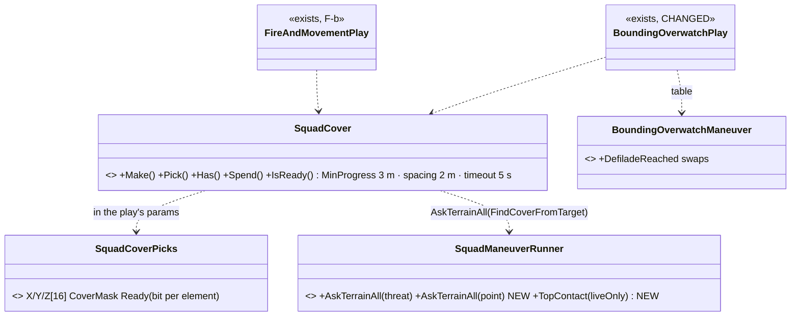
*What the picture shows that prose hid: there is ONE cover pick, used by both drills, so the "ahead, within one move, 2 m apart" rule
cannot drift between them.*

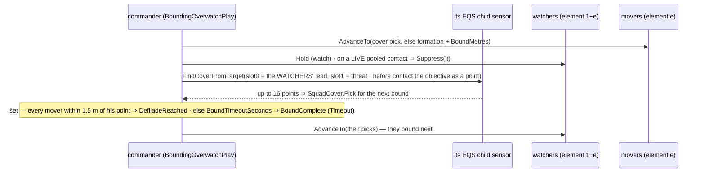

| decision | as built | why |
|---|---|---|
| when the next bound's cover is asked | while the current element bounds, around the WATCHERS' lead | the picks are ready when the swap comes; no stop between bounds |
| what the cover hides from before contact | the objective, as a context POINT (`EqsSensor.ContextPoint1`, `Point1Bit`) | the enemy is expected there; there is no entity to aim at |
| the swap event | *set* ⇒ `DefiladeReached` (new rows in the table), the clock ⇒ `BoundComplete` | the trace says which; `BoundComplete` on a timeout is O-a's "Timeout" |
| a pooled contact that is DEAD | skipped (`TopContact(…, liveOnly: true)`); when the threat goes, the watchers go back to `Hold` | the pool remembers the dead until they age out — 📌 measured: the resumed bound suppressed a body (`CE2123` red) |

Rejected: a cover pick per play — two copies of one rule · asking at swap time — the movers would stand while the query runs ·
`TopContact` live-only for every caller — `SuppressAndManeuver` and casualty care end on their own target's death; changing them is out of
F-c's scope.

Rails `SquadManeuverTests.CE2158_BoundingOverwatch_*` (2) and `CE2123_ABoundingSquadReactsToContact_ThenResumesItsBound` (the dead
contact). F-b rails unchanged after the move onto `SquadCover`.

**What the live runs taught (`2026-10-13`, folded in):**

| measured | so |
|---|---|
| on the open north-south street (the first `ua-bounding-overwatch` / `ua-fire-and-movement`) no bound and no rush ever ended in cover: the walls stand ~30 m to the side and give < 3 m of progress | ✅ correct refusal — the scenario, not the pick, was wrong. `ua-bounding-overwatch` now bounds north at x≈140 to Block B's 20 m south face |
| the 0.5 m Low Wall is NO cover for the query: a point candidate is judged at the CROUCHED eye (`CheapLineOfSightTest`, Viewer = Slot), and the movers are not ordered prone | rail `TerrainEqsTests.CE2158_FindCoverFromTarget_HiddenFromAPointOrAnEntity_FindsBlockBsSouthFace` pins both (a point and an entity agree) |
| 3 of 5 cover queries never answered: dropped after each answer and re-made on the same part id and epoch, `ScoreDelta` suppressed an unchanged (empty) answer | ⇒ `AskTerrainAll` asks with `AlwaysPush` (EQS §17.6.1) |
| the last bound started 34 m short of the face; the pick allowed one bound + 2 m | ⇒ a bound may stretch to `BoundMetres × 1.25` to end in cover (`CoverStretch`; "bound 20–50 m to the next cover"); fire and movement keeps rush + 2 m (`SquadCover.Make` takes the reach) |
| a pick could land where a man of the other element already stands | ⇒ `SquadCover.Pick` keeps 2 m from every other live member too |
| the hostile is seen ~150 m up the open street; a scripted move through `/attribute` answered ok and never moved him | the demo starts in sight of him; "watchers hold before contact" stays a rail (`CE2158_BoundingOverwatch_TheWatchersSuppressOnContact`) |
| the swap came while the cover movers were 2.6–3.9 m short (one 3 m gate), and the drill could end mid-bound once both centres were near the objective | ⇒ a man sent to cover is ordered to 1 m of it and is set within 1.5 m (`MoversSet`); the drill waits for a cover bound to finish. Live: the cover bounds now end 0.1–0.5 m from the point |
| ~~⚠ OPEN: both halves read as moving for 1.1–3.6 s right after a swap~~ ✅ **SOLVED `2026-10-14` — a CHECKER bug, not the drill:** check ① grouped the men into halves by the order their NAMES are listed (first three, last three), while the drill's elements come from the roster partition. Grouped by the drill's own element (the member's `role` in `/squad`), the longest overlap is **0.0 s** | `ua-bounding-overwatch` 9 of 9; the checker logs every overlap with who moved and how far from his point |

#### 7.6.3 The contact reaction's Assault closes by fire and movement first *(behaviors, `2026-10-14`, `CE-2158` F-e; build-state: BUILT)*

**Measured:** `ReactToContactBehavior.Run` ran `SuppressAndManeuverPlay` for `Assault` at any range (`SquadContactBehaviors.cs`, the drill
switch); its flank query is a `FlankSearchRadius` (40 m) circle around a base-of-fire member, so from 150 m the "flank" is 40 m out of
the base and the assault then walks the rest in the open. Fire and movement (§7.6.1) is the drill for closing IN contact.
**Design basis:** §7.6 ("fire and movement is used IN contact") and §3 (S&M = flank, then assault through); ⛔ searched `docs/` + `.dev/`
for a ruling on WHEN to close vs flank — none found; the lean below is mine.

```mermaid
stateDiagram-v2
    [*] --> Undecided
    Undecided --> Closing: top live contact farther than CloseMetres + one rush
    Undecided --> Flanking: nearer
    Closing --> Flanking: most of the squad within CloseMetres, or FireAndMovement ends
    Flanking --> [*]: SuppressAndManeuver Success or Failure
```

*What the picture shows that the prose hid:* the closing stage cannot END the reaction — every way out of it goes to the flank, because
the assault is what was decided; only the flank's own outcome reaches the reaction's success / hold-on handling.

| decision | as built | why |
|---|---|---|
| the threshold | `CloseMetres` 50 m; closing starts only beyond 50 + `RushMetres` 15 | the band stops a squad at 51 m from closing for one rush and flanking at once |
| when it is closed | **more than half of the live men within 50 m of the objective** (`MostWithin`), or fire and movement ends (its own "both halves' centres within 50 m", a half gone, could not start) | 📐 live (`tt-react-contact`, the cluster rail): the leader soldier stands on the z 9 spot no move works from (§6.1a); his half's centre stayed 60 m out, fire and movement never succeeded and the flank never came. ⛔ First build used fire and movement's own Success only — SUPERSEDED |
| the objective | where the top LIVE contact stood when the Assault began | fire and movement takes a point; the flank re-reads the contact |
| where it lives | `ReactToContactParams.Close` + `ReactToContactState.AssaultStage`, one play state (the play is reset between the two) | one play at a time on the S1 runner (§4.3); no new behaviour |

Rejected: **a new decision option ("Close")** — the decision picks WHAT (assault / break / hold), range picks HOW · **S&M with a bigger
flank radius** — a 150 m flank is still a walk in the open · **re-checking the range during the flank** — a squad pushed back would
oscillate between drills.

Rail `SquadManeuverTests.CE2158_ReactToContact_AFarContact_IsClosedByFireAndMovement_ThenFlanked` (one man left behind); the cluster rail
`SquadTacticsScenarioTests.CE2123_ABoundingSquadMeetsTheEnemy_…` now expects kinds 2 → 7 → 12 → 3 → 2; the near case stays
`CE2123_ReactToContact_HoldsAndReturnsFire_ThenAStrongSquadAssaults` (60 m ⇒ the flank at once).

#### 7.6.4 F-d — fire and movement in pairs *(behaviors, `2026-10-14`, `CE-2158`; build-state: BUILT `2026-10-14` — the approved slice F-d, lean (b) "halves first, pairs later"; as-built at the end)*

📖 **Doctrine (general knowledge):** inside a fire team the rush is by BUDDY PAIRS — one man up while his buddy fires, then the buddy.
**Measured:** `FireAndMovementPlay` moves a whole half per `Rush_e` (`SquadGates.Set` over `SquadGates.Element(e)`); the halves come from
`BoundingOverwatchManeuver.ComputePartitionInputs` (first half, second half of the roster).

```mermaid
stateDiagram-v2
    [*] --> Cover_e
    Cover_e --> RushA_e: covering
    state "Rush_e (one phase of the table)" as R {
        RushA_e --> RushB_e: the A buddies set
    }
    RushB_e --> Cover_1minus_e: the B buddies set - the halves swap
```

*What the picture shows that the prose hid:* the buddy step is INSIDE one table phase — the phase table, its events and the trace are
unchanged; only who moves inside `Rush_e` changes.

| decision | ⭐ as designed | why |
|---|---|---|
| the switch | `FireAndMovementParams.Pairs` (authored `Pairs`, default false) | the halves drill stays the default; a demo or an order turns pairs on |
| who is A, who is B | the moving half's members by rank: even = A, odd = B | rank order is the roster order the author controls; a casualty re-pairs the rest |
| who covers a moving buddy | the other half suppresses as before, AND the waiting buddies of the moving half suppress | "one man up while his buddy fires" |
| the gates | *covering* before A (as before); A *set* ⇒ B goes (a re-issue, not a phase change); B *set* ⇒ the halves swap | no new table rows; the trace shows `DefiladeReached` once per swap as today |
| runtime memory | `FireAndMovementParams.Buddy` (0 = A moving, 1 = B moving) | the play's own memory lives in its params (the cover picks do too) |

Rejected: **pairs as four elements** — the table and both gates are written for two elements · **a new phase table** — the A/B step is
not a squad phase, nobody outside the half needs to see it.

**As built `2026-10-14`:** `FireAndMovementParams.Pairs` / `.Buddy` · authored `Pairs` (bool) · `FireAndMovementPlay.Buddies(ctx, element,
buddy)` (the live men of the half by rank parity) · in `Rush_e` the set gate is over the up buddies only; A set (or the rush timeout)
⇒ `Buddy = 1` and a re-issue; B set ⇒ the swap (`DefiladeReached`, as before). The waiting buddy gets the covering order (`Suppress`, or
`Hold` with no threat). The diagram above is TRUE as built. ⚠ The contact reaction's closing stage (§7.6.3) keeps halves (`Pairs` 0) —
pairs are an authored choice for now. Rail `SquadManeuverTests.CE2158_FireAndMovement_InPairs_OneBuddyUpWhileTheOtherFires_ThenTheOther`
(red-proved: pairs ignored ⇒ red); the four halves rails unchanged.

### 7.7 Danger-area crossing — the squad drill *(behaviors, `2026-10-13`; build-state: BUILT (§7.7.6; X-a … X-d, `-contact` §7.8.4) — ✅ approved 2026-10-13 (R-2014))*

⭐ **Status for whoever returns:** measured `2026-10-13` (§7.7.1), approved; nothing built. It reuses §7.6's pattern (the commander reads
gates and speaks only through orders) and §7.5's `Suppress` order; build after F-a (the gates). No re-measurement needed unless a cited file
changed since this commit.

📖 **Doctrine (general knowledge, ⛔ not in the corpus):** halt short of the area; near-side security watches left and right along it; a small
team crosses first, clears the far side and takes overwatch there; the rest cross fast, in pairs, spaced, at the narrowest point; near-side
security crosses last, covered from the far side; reform beyond. Everyone covering WATCHES (ready to fire), nobody fires before contact.
Contact mid-crossing ⇒ a fight with the squad split across the area.

#### 7.7.1 What exists — measured `2026-10-13`

| fact | code | so |
|---|---|---|
| the phase table: `SetSecurity` (0) →`DefiladeReached`→ `CrossElement` (1) →`FarSideReached`→ `FarSideCover` (2) →`ShotFired`→ `CollapseSecurity` (3) →`FarSideReached`→ `Reform` (4); roles Crossing = 1, Security = 2; elements 0 crossing / 1 security; partition = front half / back half | `Fdp.Toolkits/Squad/Maneuvers/DangerAreaCrossingManeuver.cs` (kind 1) | the drill exists as data; ⛔ phase 2's `ShotFired` gate is wrong for overwatch (D2) |
| the intent: phases as above; overwatch positions from an EQS cover query; elements cross one / a pair at a time with exposed-slot rotation across lanes; first-across is reassigned to cover; last element crosses last | `Squad_Coordination_Design_v1_1.md` §8.1 (:314-321) | the design this builds |
| no play runs the table; nothing feeds `DefiladeReached` / `FarSideReached` / `ShotFired` | graph: 10 `*Maneuver` classes, 6 `*Play` structs (none for crossing); `Squad/Primitives/PhaseSequencer.cs:8-16` | X-b is the play |
| lane rotation: `SlotRotation.AcquireSlot / ReleaseSlot / BurnSlot` | `Squad/Primitives/SlotRotation.cs:27-52` | the crossing lanes (D1) |
| the area: `DangerAreaDescriptor { FeatureId, ThreatRating, Kind (OpenGround, StreetCrossing, Intersection, ChokePoint, CrestLine), Center, ExtentsXY, AngleRad, ZFloor, ZCeiling, NearSideHandle, FarSideHandle, DistanceAlongRoute }` in `DangerAreaCognitiveBuffer` | `Squad/DangerArea/DangerAreaDescriptor.cs:10-91`, `DangerAreaCognitiveBuffer.cs` | near / far points are given; lanes are offsets across `ExtentsXY` |
| the sensor is BUILT: areas along a route (route sources: own move · a handle · to a point), rated every tick from the unit's memory (or the squad's pool), edges `AreaAhead` / `AreaThreatened` / `AreaCleared` | `Squad/Systems/DangerAreaSensorSystem.cs` (CE-3072); `DESIGN_Utility_AI_Demo_Scenarios.md` §10.2–§10.7 (R-213) | the trigger (D4) |
| `RecentSenses` records the area edges (`AreaAhead`, `AreaThreatened`, `AreaCleared`) | `Behavior/Components/RecentSenses.cs:25` | ⭐ the earlier "kinds ≥ 8 dropped" row (§3, line ~247) is superseded by this field |
| the single-unit `DangerCrossing` tree: hold while threatened, cross, walk on | `Hrot.AI.Behaviors/Assets/BTrees/Library/Tactics/DangerCrossing.btree.json` | stays for a lone soldier / vehicle |
| the squad "how to cross" decision: options `DangerAreaCross` (0), `BoundOverwatch` (1), `Hold` (2) over strength, feature kind, threat rating, ammo — driven by nothing | `Squad/StarterPack/ManeuverSelectStarterDecision.cs:6-90`; this file §3 (line ~256) | D3: wired later |
| doctrine | — | ⛔ none in the corpus (searched `docs/` + `.dev/`) |

#### 7.7.2 Classes

```mermaid
classDiagram
  class DangerAreaCrossingManeuver { existing table; phase 2 gate ShotFired becomes DefiladeReached CHANGED }
  class DangerCrossingPlay { NEW ISquadPlay over the table: positions, lanes, gates, orders }
  class SlotRotation { existing AcquireSlot ReleaseSlot BurnSlot - the crossing lanes }
  class DangerAreaCognitiveBuffer { existing - the area, NearSideHandle, FarSideHandle }
  class DangerAreaSensorSystem { existing - AreaAhead on the squad's route }
  class MemberOrderKind { existing Hold AdvanceTo Disembark +Watch NEW +RushTo (F-b) +Suppress (R-b) }
  class WatchBehavior { NEW library: hold a point, face a sector, fire only at a seen enemy }
  class FindCoverFromTarget { existing EQS: overwatch spots near each edge }
  class SquadManeuverRunner { existing }
  class ReactToContactBehavior { existing - takes over on contact }
  class BasicSquadSop { existing + a row: AreaAhead starts SquadDangerCrossing NEW }
  DangerCrossingPlay ..> DangerAreaCrossingManeuver
  DangerCrossingPlay ..> DangerAreaCognitiveBuffer : near and far handles
  DangerCrossingPlay ..> SlotRotation : lanes
  DangerCrossingPlay ..> FindCoverFromTarget : AskTerrain
  DangerCrossingPlay ..> SquadManeuverRunner : runs inside
  SquadManeuverRunner ..> MemberOrderKind
  MemberOrderKind ..> WatchBehavior : Watch
  BasicSquadSop ..> DangerAreaSensorSystem : AreaAhead edge
  BasicSquadSop ..> DangerCrossingPlay
  DangerCrossingPlay ..> ReactToContactBehavior : Abort on SquadContact
```

*What the picture shows: one new play over the EXISTING table and two existing primitives; the only new member order is `Watch` (`RushTo`
and `Suppress` come from §7.6 / §7.5).*

#### 7.7.3 Sequence

```mermaid
sequenceDiagram
  participant SN as DangerAreaSensorSystem
  participant SOP as BasicSquadSop on the commander
  participant P as DangerCrossingPlay
  participant S as security element
  participant X as crossing pairs
  SN->>SOP: AreaAhead on the squad's route
  SOP->>P: run SquadDangerCrossing (the area's FeatureId)
  P->>S: phase SetSecurity - RushTo overwatch spots near the near edge, then Watch along the area
  S-->>P: every security member set (DefiladeReached)
  P->>X: phase CrossElement - one pair at a time on a rotating lane: RushTo the far edge
  X-->>P: the element past the far handle (FarSideReached)
  P->>X: phase FarSideCover - RushTo far-side overwatch spots, then Watch
  X-->>P: every far-side member set (DefiladeReached - was ShotFired)
  P->>S: phase CollapseSecurity - security crosses by pairs, covered from the far side
  S-->>P: all past the far handle (FarSideReached)
  P->>P: Reform - the previous orders re-sent
  Note over P: SquadContact at any phase - Abort, ReactToContact fights with the squad split across the area
```

*What the picture shows: every phase change is a fact the commander reads (set, across); nobody fires unless an enemy is seen.*

```mermaid
graph TD
  CGF[CgfLogicPack] --> SCS[SquadCoordinationSystem - commander's node]
  CGF --> DAS[DangerAreaSensorSystem - the commander's route sensor]
  BT[BrainTickSystem] --> SOP[BasicSquadSop on the commander]
  SOP --> PLAY[DangerCrossingPlay via SquadManeuverRunner]
  PLAY --> ORD[AssignTacticalIntentEvent per member]
  ORD --> MEM[members: RushTo / Watch]
```

*Module point: the commander needs a danger-area sensor of its own on the squad's route (route source "to a point" = the squad's
objective, rated from the squad's pool). ⛔ SUPERSEDED (measured, §7.7.6): "adds it to the commander's type, as the soldier types carry
theirs" — no path spawns a danger sensor from a type (the soldier's `DangerCrossing` ensures its own); the MARCH owns it.*

#### 7.7.4 Decisions (✅ approved 2026-10-13, R-2014)

| # | decision | why | rejected (one line) |
|---|---|---|---|
| D1 | cross **one pair at a time** on a rotating lane (`SlotRotation`; lanes = offsets across the area's width) | doctrine; the design's exposed-slot rotation (§8.1) | one whole element at a time — a bigger target, one line of crossing |
| D2 | the `FarSideCover` → `CollapseSecurity` gate is **set** (`DefiladeReached`), not `ShotFired` | overwatch watches; before contact nobody fires | keep `ShotFired` — the drill would stall until someone shot |
| D3 | the careful drill only, first; wiring `ManeuverSelectStarterDecision` (cross / bound / hold) comes later | it exists but is driven by nothing, and its inputs read only the active area | wire the choice now — two unknowns at once |
| D4 | trigger: the commander's own route sensor raises `AreaAhead`; a `BasicSquadSop` row starts the drill | the squad decides; members get orders; the single-unit tree stays for lone units | each member running `DangerCrossing` alone — no security, all cross at once |
| D5 | covering members get **`Watch`** (a sector, fire only at a seen enemy), not `Suppress` | before contact there is nothing to suppress, and fire gives the squad away | `Suppress` while crossing |
| D6 | contact at any phase ⇒ `Abort` ⇒ `ReactToContact` (with §7.6: fire and movement across the split squad) | the existing reaction; each side keeps its element | a special in-crossing fight |
| D7 | plain bounding overwatch is NOT used over the area | it leapfrogs 30 m geometric steps with no near / far security and no edges | — |

🔒 **User, `2026-10-13`:** *"Leans approved, write the danger crossing into the design"*.

#### 7.7.5 Slices *(not started; after §7.6 F-a)*

| slice | what | rails |
|---|---|---|
| **X-a** | the commander's route sensor (type data + route "to the objective", pool rating); `Watch` order + library `WatchBehavior` | `AreaAhead` reaches the commander · a watcher fires only at a seen enemy |
| **X-b** | `DangerCrossingPlay` + the D2 table change; lanes by `SlotRotation`; overwatch spots by `FindCoverFromTarget` | security sets before anyone crosses · pairs cross one at a time on different lanes · far side sets before security collapses · all across ⇒ reform |
| **X-c** | the `BasicSquadSop` row; contact ⇒ abort ⇒ `ReactToContact` | a contact mid-crossing hands over to the reaction |
| **X-d** | a live scenario (`ua-squad-danger-crossing` + `-contact`): a squad crosses a street; a variant with a hostile on the far side. ⚠ NOT `ua-danger-crossing` — that name is the BUILT single-soldier demo (`DESIGN_Utility_AI_Demo_Scenarios.md` §10.3) | §7.8.4, over HTTP |
| later | wire `ManeuverSelectStarterDecision` (cross / bound / hold) | D3 |

#### 7.7.6 X-a … X-c in detail *(behaviors, `2026-10-13`, `CE-2159`; build-state: BUILT — within R-2014; the deviations are named; as-built at the end)*

**Measured `2026-10-13`** (graph CLI + reads), with the design cell for each:

| the build rests on | code — how it IS | design — how it was MEANT |
|---|---|---|
| a danger-area sensor is spawned by a behaviour RUN, never by type data | ✅ `SensorKindBaker`: "a TKB perception kind is read, not spawned" (`SpawnSensorTests.cs:59`); the one production `Ensure` caller is `DangerAreaNodes.EnsureSensor` | ⛔ §7.7.3's caption says "add it to the commander's type, as the soldier types carry theirs" — **wrong**: the soldier's `DangerCrossing` ensures its own |
| a reaction that PAUSES a task keeps the task's owned parts (its sensors) | ✅ `BehaviorIngressSystem.cs:563-572` (`keepsTask`) | ✅ CE-2081 (§4.9a resume) |
| a play can read a sensor another run owns | ✅ `UnitSensors.Of` / `Read<T>` — the unit's sensor of a kind, whoever owns it (`UnitSensors.cs`) | ✅ CE-2071 ("for READING a sensor someone else already runs") |
| a body-less commander can carry a route sensor | ✅ the route starts at the carrier's self (`DangerAlongRouteSolve.cs:35`), the commander stands at the centroid (`UnitCentroidSystem`); no plan ⇒ a straight leg | ⛔ searched, none found |
| a contact reaction replaces a running crossing reaction | ✅ a reaction replaces a reaction only when MORE urgent (`AdmitsWithReactions` ③): crossing at `Alert` (1) < `Contact` (2) / `UnderFire` (3) | ✅ D6 |
| `AreaAhead` fires once, when an area first appears on the route — often 100 m+ out | ✅ `DangerAreaSensorSystem.Rate` (edge on a new `FeatureId`) | ⛔ D4 named the edge as the trigger; the drill needs the area NEAR ⇒ the row reads STATE (below) |
| a standing soldier cannot be told where to face | ✅ graph + grep: no writer of a stationary soldier's heading in any behaviour | ⛔ D5 "face a sector" — **not built**: `Watch` = hold at a point, fire only at a seen enemy |
| the crossing table has no abort phase; the runner needs one | ✅ `DangerAreaCrossingManeuver.cs:47-55` | — |
| overwatch spots: a cover query hides FROM a point; overwatch must SEE along the area | ✅ `CheapLineOfSightTest` Require = Hidden | ⛔ §7.7.4 named `FindCoverFromTarget` — **deviation**: the spots are geometric (beside the crossing point, back from the edge) |

```mermaid
classDiagram
  class SquadMarchPlay { <<exists, CHANGED>> +DangerAreas: ensures the commander's route sensor (ToPoint objective) · re-points it on resume }
  class DangerAreaSensorSystem { <<exists, CHANGED>> +rates from the squad pool when the unit has one }
  class SquadDangerCrossingBehavior { <<new, library "SquadDangerCrossing">> }
  class DangerCrossingPlay { <<new ISquadPlay>> lanes · spots · pairs }
  class DangerCrossingParams { <<new>> Near Far Feature · Lanes SlotRotationState · Crossed Pair masks }
  class DangerAreaCrossingManeuver { <<exists, CHANGED>> FarSideCover gate DefiladeReached · +Aborted }
  class MemberOrderKind { <<exists>> +Watch NEW }
  class SquadSopConditions { <<exists>> +DangerAreaAhead NEW }
  class SopAreaParams { <<new>> WithinMetres }
  class BasicSquadSop { <<exists>> +row: area ahead → React SquadDangerCrossing (Alert) }
  class UnitSensors { <<exists>> +Read~DangerAreaCognitiveBuffer~ }
  class SlotRotation { <<exists>> }
  SquadDangerCrossingBehavior ..> DangerCrossingPlay : Tick
  DangerCrossingPlay ..> DangerAreaCrossingManeuver : table
  DangerCrossingPlay ..> UnitSensors : the area, at Start
  DangerCrossingPlay ..> SlotRotation : lanes
  DangerCrossingPlay ..> MemberOrderKind : Watch / AdvanceTo
  BasicSquadSop ..> SquadSopConditions
  SquadSopConditions ..> UnitSensors
  SquadSopConditions ..> SopAreaParams
  SquadMarchPlay ..> UnitSensors : owns the sensor it reads
```
*What the picture shows that prose hid: nothing new holds the area — the paused march's own sensor is read by both the SOP row and the
crossing play, so there is one route, one answer, and no second query.*

```mermaid
sequenceDiagram
  participant M as SquadMarch (paused)
  participant SOP as BasicSquadSop
  participant P as DangerCrossingPlay
  participant S as security (element 1)
  participant X as crossers (element 0)
  M->>M: route sensor to the objective, on the commander
  SOP->>SOP: DangerAreaAhead — next area ≤ WithinMetres along the route, squad not past its far side
  SOP->>P: React SquadDangerCrossing (Alert) — the march pauses, keeps its sensor
  P->>P: Start — copy the area's near / far handles · lanes across the crossing line
  P->>S: Watch at spots beside the near side · X Watch short of it
  S-->>P: set ⇒ DefiladeReached (SetSecurity → CrossElement)
  loop one pair at a time, next lane each
    P->>X: AdvanceTo the far side on lane k
    X-->>P: the pair past the far handle ⇒ the next pair
  end
  P->>X: all across ⇒ FarSideReached · Watch at far-side spots
  X-->>P: set ⇒ DefiladeReached (FarSideCover → CollapseSecurity, D2)
  P->>S: pairs cross the same way · all across ⇒ FarSideReached
  P->>P: Reform beyond the far side · set or 15 s ⇒ Success
  P-->>M: the reaction ends · the march resumes and re-points its sensor
  Note over SOP,P: SquadContact / UnderFire at any phase — a more urgent reaction replaces the crossing (D6)
```

| decision | lean, as it will be built | why · rejected (one line) |
|---|---|---|
| who owns the route sensor | **the march**, opt-in (`SquadMarch.DangerAreas`) | the only place that knows the objective · ⛔ type data: no path spawns a danger sensor from a type |
| the trigger | **state**: an area ≤ `WithinMetres` (30) along the route AND the commander not past its far handle | stops a stale buffer re-starting the drill on the far side · ⛔ the `AreaAhead` edge: fires once, far out |
| the area | copied at Start (near / far handles, feature) | the buffer moves with the centroid while the squad crosses |
| lanes | `Lanes` (4) offsets `LaneSpacing` (4 m) across the crossing line, the next lane each pair (`SlotRotation`, reset when all used) | consecutive pairs ≥ 4 m apart (D1) |
| spots | security beside the near handle, alternating left / right 5 m + 3 m per pair, `BackMetres` (3) short of the edge; far side the same `BeyondMetres` (4) past it; reform 8 m further | overwatch must see along the area · ⛔ `FindCoverFromTarget`: hides from it |
| a pair "across" | its two members past the far handle along the crossing line | the line, not a radius: a wide road is crossed straight |
| `Watch` | `CombatPosture` holding at the point (fights what it sees) | ⛔ facing a sector: no facing control exists |
| timeouts | each phase `PhaseTimeoutSeconds` (40) ⇒ its event with `Timeout` in the trace | the drill must not stall on one man |

**As built `2026-10-13` (`CE-2159`):** `SquadMarch.DangerAreas` (opt-in) · `DangerAreaSensorSystem.ThreatOnFromPool` · `MemberOrderKind.Watch` (5) ·
`DangerCrossingPlay` + library `SquadDangerCrossing` (`SquadDangerCrossingParamsJsonDto`: `Lanes` 4, `LaneSpacing` 4, `BackMetres` 3,
`BeyondMetres` 4, `Speed` 2, `CrossSpeed` 4, `PhaseTimeoutSeconds` 40) · `DangerAreaCrossingManeuver`: D2 + `PhaseAborted` (5) ·
`SopAreaParams` + `SquadSopConditions.DangerAreaAhead` · the `BasicSquadSop` row (React, `Alert`). The diagrams above are TRUE as built.
Rails `SquadManeuverTests.CE2159_*` (7: security first · pairs on new lanes · far side set before security · reform ⇒ Success · no area ⇒
Failure · the condition · the march's sensor · the SOP row and a contact replacing it) + `DangerAreaSensorSystemTests.CE2159_*`, each
red-proved. ⚠ **Measured live:** the march from a diagonal line crawled (~0.3 m/s, the lead holding for stragglers) — the demo starts in
file ~40 m short of the road; the march's pace is not this slice's to fix.

#### 7.7.7 D3 — the squad chooses HOW to cross *(behaviors, `2026-10-14`, `CE-2159`; build-state: BUILT `2026-10-14` — the open decision of R-2014 D3; as-built at the end)*

**Measured `2026-10-14`** (graph CLI `search_graph name_pattern=.*(ManeuverSelect|CrossingDecision|ActiveFeature).*` → 35 rows,
+ reads): `ManeuverSelectStarterDecision` (`Squad/StarterPack/…:18-90`, Cross 0 / Bound 1 / Hold 2) is a `UtilityDecisionDef` of
kind `ManeuverSelect`, which `UtilityScorer.ChooseOption` does NOT score (it scores `PostureSelect`; `SquadContactResponseDecision.cs`
says so) — its only drivers are the dead `CommanderUtilityTickSystem` and `Phase3IntegrationTests`. Its two area inputs
(`SquadInputs.ActiveFeatureThreatRating` / `ActiveFeatureKindIs`, `SquadInputs.cs:313-350`) read a `DangerAreaCognitiveBuffer` ON THE
COMMANDER and `SquadCognitiveState.ActiveFeatureId` — both empty in production: the buffer lives on the commander's danger SENSOR
(§7.7.6, read through `UnitSensors`) and nothing writes `ActiveFeatureId` — its primitive `TacticalFeatureHandles.Acquire` exists, with a test, and no production caller.
`SquadInputsP3Tests.ActiveFeatureThreatRating_NoActiveFeature_Returns0` pins "no active area ⇒ 0".
**Design basis:** R-2014 D3 (*"wiring `ManeuverSelectStarterDecision` (cross / bound / hold) comes later"*); doctrine §7.6 (bounding
overwatch for OPEN ground before contact); [`Hrot.SquadCoordination.md`](../../projects/Hrot/Subsystems/Hrot.SquadCoordination.md) §8.0
(*"which maneuver the squad runs is a commander-tier utility decision … the same scoring core recursed one level"* — applies: this is
that decision; its kind `ManeuverSelect` does not, for the scoring reason above).

```mermaid
classDiagram
    class SquadDangerCrossingBehavior { Run() }
    class CrossingChoiceState { <<NEW>> Stage · Choice · Play · HeldSince }
    class SquadCrossingDecision { <<NEW, PostureSelect>> Cross 1 · Bound 2 · Hold 3 }
    class ManeuverSelectStarterDecision { <<RETIRED 2026-10-14>> }
    class SquadInputs { ActiveFeatureKindIs · ActiveFeatureThreatRating }
    class UnitSensors { TryGetResults~DangerAreaCognitiveBuffer~ }
    class TacticalFeatureHandles { <<existing, no caller>> Acquire() }
    class DangerCrossingPlay { <<existing>> }
    class BoundingOverwatchPlay { <<existing>> }
    class SquadHoldPlay { <<existing>> }
    SquadDangerCrossingBehavior --> CrossingChoiceState
    SquadDangerCrossingBehavior ..> SquadCrossingDecision : ChooseOptionOnce
    SquadCrossingDecision ..> SquadInputs : the starter's considerations
    SquadInputs ..> UnitSensors : the buffer - its own, else its danger sensor's (CHANGED)
    SquadDangerCrossingBehavior ..> TacticalFeatureHandles : Acquire the next area first
    SquadDangerCrossingBehavior --> DangerCrossingPlay : Cross
    SquadDangerCrossingBehavior --> BoundingOverwatchPlay : Bound - to beyond the far side
    SquadDangerCrossingBehavior --> SquadHoldPlay : Hold - then decide again
    ManeuverSelectStarterDecision ..> SquadCrossingDecision : superseded by - removed
```

*What the picture shows that the prose hid:* the three options are three EXISTING plays — the choice adds no drill, only a decision and
two corrected inputs. ⛔ SUPERSEDED: *"the starter decision is not deleted"* — retired `2026-10-14` (🔒 user: "Retiring the old starter
decision is ok if it is superseded by something else (better)" → approved): its only user was `Phase3IntegrationTests`, whose behaviour
cases the `CE2159_*` rails cover on the live path and whose tick-system cases `CommanderUtilityTickSystemTests` covers. ⚠ Kept:
`CommanderUtilityTickSystem` and the `ManeuverSelect` kind (`Hrot.SquadCoordination.md` §8.0 names it the intended mechanism;
`ForceManeuverMapper` and the authoring analyzer use it) — whether that path is dead is its owner's question.

```mermaid
sequenceDiagram
    participant SOP as BasicSquadSop
    participant B as SquadDangerCrossing
    participant D as SquadCrossingDecision
    participant P as the chosen play
    SOP->>B: React (Alert) - a danger area ahead
    B->>D: ChooseOptionOnce (area kind · area threat · strength · ammo)
    alt Cross
        B->>P: DangerCrossingPlay (security · pairs · far side · reform)
    else Bound
        B->>P: BoundingOverwatchPlay to the far side + BeyondMetres
    else Hold
        B->>P: SquadHoldPlay HoldSeconds 10
        P-->>B: done
        B->>D: decide again
    end
    P-->>B: Success / Failure ends the reaction
```

| decision | ⭐ as built | why |
|---|---|---|
| the decision | a NEW attributed `SquadCrossingDecision` (kind `PostureSelect`, options from 1), the starter's considerations, ONE change below | `ChooseOptionOnce` scores only `PostureSelect`; option 0 is "nothing scored" |
| ⚠ the one change | Cross weighs **NOT open ground** (`ActiveFeatureKindIs(OpenGround)`, InverseLinear) instead of **is a street** | the starter's Cross scored 0 on an Intersection, ChokePoint or CrestLine — and so did Bound ⇒ nothing won |
| the inputs' area | unchanged: the `ActiveFeatureId` one — the behaviour `Acquire`s the next area's id before it decides (the existing primitive); the BUFFER is the commander's own, else its danger sensor's (`UnitSensors`) | the buffer lives on the sensor (§7.7.6); "no active area ⇒ 0" stays true and tested |
| Bound's objective | the far handle + `BeyondMetres` along the crossing line | bounding overwatch takes a point; the same place the crossing reforms |
| Hold | `SquadHold` for `HoldSeconds` (10), then decide again | the area may quieten; the SOP row would only start the reaction again |

Rejected: **scoring `ManeuverSelect` in `ChooseOption`** — it changes what every other decision kind means · **editing the starter
in place** — its `UtilityDecisionDef` API is the dead tick system's, and its test pins the option ids 0/1/2 · **a new drill for open
ground** — bounding overwatch is the drill (§7.6).

**As built `2026-10-14`:** `Fdp.Toolkits/Utility/StarterPack/SquadCrossingDecision.cs` (`SquadCrossingChoice` Cross 1 / Bound 2 / Hold 3) ·
`SquadInputs.AreaBuffer` (own buffer, else the danger sensor's) · `SquadDangerCrossingBehavior`: the blackboard is now
`SquadDangerCrossingOrder { Cross, Choose, Bound, Hold }` + `SquadDangerCrossingState { Choice, Play }` (was the crossing params + one
play state); `Run` acquires the next area, decides once, ticks the chosen play; a Hold that ends clears the choice (decide again);
a deactivator drops the chosen play's query (bounding overwatch owns one). Bound's defaults: 20 m bounds at the crossing speed, arrival
6 m, timeout = the crossing's phase timeout. The class and sequence diagrams above are TRUE as built. Rails
`SquadManeuverTests.CE2159_D3_OpenGround_IsCrossedByBoundingOverwatch_ToBeyondTheFarSide` and
`…_AThreatenedArea_LowOnAmmo_Holds_ThenDecidesAgain` (red-proved: always-cross ⇒ both red; the inputs reading only the own buffer ⇒ the
open-ground rail red); the street case is every `CE2159_DangerCrossing_*` rail, unchanged. ⚠ Live: the road in `ua-squad-danger-crossing`
is a `StreetCrossing` (measured), so the demo's path is unchanged; open ground is a rail only (no scenario yet produces an `OpenGround`
area).

⭐ **`CE-2161` — the live Bound demo, BUILT `2026-10-14` (by backend, at the user's ask; CE-3081 OpenGround).** The march's
`OpenGround` flag (with `DangerAreas`) asks the commander's route sensor for OpenGround as well as the crossings
(`DangerAreaSettings.Kinds`, Utility demos §10.7b A5) — off by default, because D3 picks Bound on open ground even with NO threat
(Cross weighs NOT open ground ⇒ 0; Hold needs a threat; Bound's logistic threat factor is small, never 0), so a march with it on
bounds across every field ≥ 20 m. Scenario `ua-squad-bound-open-ground`: the squad in Shed Row's south cover (y 104), marching to
(175, 60) across test-town's open field. **Live PASS** (`utility-demo-check.py ua-squad-bound-open-ground --launch`, sim 95 s): the
field listed as OpenGround 18 m ahead (near (81, 100), far (175, 60)), D3 → `BoundingOverwatch`, 17 bounds with both halves never
moving together, the last bound's element 1–6 m past the far side, the march then gathers every man within 10 m of it, no rounds
fired. Rail `SquadManeuverTests.CE2161_TheMarch_AsksForOpenGround_OnlyWhenTheOrderSaysSo`. ⚠ The field's far side is the march's
objective here (no cover on test-town's south-west to end the field earlier).

### 7.8 The demos — one per drill, each checked over HTTP *(behaviors, `2026-10-13`; build-state: DESIGN — not built; the scenario slices R-e, F-e, X-d)*

⭐ **The rule for all three:** a demo is DONE when its checker in `scripts/utility-demo-check.py` passes against a fresh
`ClusterRunner --mode all` *(RUNBOOK_Cluster_Debugging_Over_Http §1, `localhost` not `127.0.0.1`, boots paused)*. Each check below is
one HTTP read and one pass condition. ⚠ The runs are NOT deterministic (RUNBOOK §8): the checks assert the ORDER of events and their
bounds, never exact positions or kill counts. Scenarios live in `scenarios/<name>/scenario.json` on test-town (the existing `ua-*` home);
the exact coordinates are picked when each scenario is authored and recorded in its as-built row.

#### 7.8.1 What the checks read — and the one thing that does not exist yet (slice **O-a**)

```mermaid
graph TD
  CHK["utility-demo-check.py — one run_* per demo"]
  CHK --> SQ["GET /entities/{cmdr}/squad — members, assignment, contact pool (CE-3087)"]
  CHK --> MV["NEW maneuver block on /squad — kind, phase, history, member orders, care (O-a)"]
  CHK --> UT["GET /entities/{cmdr}/utility — winner + per-consideration scores (CE-3069)"]
  CHK --> WP["GET /entities/{id}/weapons — ammo per mount (CE-3089)"]
  CHK --> SE["GET /entities/{id}/sensors + /memory — danger areas, what a unit sees (CE-3072, CE-3144)"]
  CHK --> EN["GET /entities/{id} — SimTransform, Health, IsEmbarkedTag, BehaviorState"]
  CHK --> HP["POST health / spawn — the scripted trigger (casualty, late hostile)"]
  MV -. reads .-> PS["SquadCognitiveState.ManeuverKind / PhaseId / Roles + SquadPlayState"]
  style MV fill:#fde2e2,stroke:#c0392b
```

*What the picture shows that prose hid: every check rides a route that exists today EXCEPT the red box. Without it a checker cannot
see the phase, the history or the orders, and would have to infer them from positions.*

| O-a — the `maneuver` block on `GET /entities/{commander}/squad` | why |
|---|---|
| `kind`, `kindName`, `phase`, `phaseName`, `phaseSince` | read straight from `SquadCognitiveState` (today's route ignores them, `DebugApiService.Squad.cs:48`) |
| `members[]`: `slot`, `networkId`, `role`, `order {kind, point, cover}`, `inTheFight` | the order the runner last issued; `cover` = the point came from a cover query |
| `history[]` (last 16): `{t, phase, event}` with `event` ∈ the `PhaseEventKind` that moved it, or `Timeout` / `Abort` | a fast phase (one pair crossing) is missed by polling; the history makes the order checkable. Lean: recorded by the observe switch, like the utility record (`observe_trace`), so it costs nothing unobserved — ⛔ where that recorder lives is not measured; measure it in O-a |
| `care {casualty, medic, coverPoint, stage}` while the care play runs | the rescue checks name the medic and the cover point |
| `gates {covering, set}` | the two F-a gates, as the commander reads them |

⭐ O-a goes first, with whichever demo is built first. Its own rail: the block lists a running `BoundingOverwatch` play's phase and orders.

**O-a as built** *(`2026-10-13`, `CE-2157`)*: the block reads `SquadDrillTrace` — a managed, transient component on the commander
(id 372, registered on first use like `SubordinateOrders`), immutable, written by `SquadManeuverRunner` at the play's start, each phase
change (the event that caused it; `Timeout` when the play set `SquadPlayState.CompletedByTimeout`), each issue (one order per roster slot,
`MemberOrder.Cover` new) and the end; `Gates(...)` and `CareChanged(...)` for the plays that have them. Names come from
`SquadDrillNames` (each manoeuvre's own constants). ⚠ **Deviation from the lean above**: always on, not armed by `observe_trace` —
it changes per phase and per issue (not per frame), and the plays' own rails read it, so a debug-only recorder would have been a second
source. ⚠ A drill CLEARED from outside (the commander's task replaced) leaves `active: true` until the next drill starts; its history
still ends at the last phase. Rails: `SquadManeuverTests.CE2157_TheDrillTrace_ShowsThePhase_TheHistoryWithItsCause_AndEachMembersOrder`,
`TheSquadRouteShowsTheDrillTests` (2).

#### 7.8.2 `ua-casualty-care` — the medic brings a man to cover (R-e; needs R-a … R-d)

**Cast:** a leader, a `Medic` (designation), four riflemen, in cover at a building edge; one hostile seen earlier, now with no sight of
the casualty's spot and holding fire. **Trigger:** once the squad's pool holds the contact, the checker sets rifleman 3's health to 25
(incapacitated, bleeding; he is 15 m out in the open). Why scripted: a hit is not deterministic; the health write is what the hit would do.

| # | check | read | pass |
|---|---|---|---|
| ① | the man is down, and the squad knows once | `/squad` history | one `SquadMemberDown` for his slot within 1 s of the write; none later |
| ② | Rescue wins | `/utility` "Squad contact response" | winner `Rescue` within 15 s; each of its four considerations > 0 |
| ③ | the Medic goes, nobody else | `/squad` care | `care.medic` = the Medic; no other member gets a `CarryCasualty` order |
| ④ | covering fire BEFORE the medic moves | `/weapons` per coverer + Medic's position | every coverer's ammo dropped before the Medic is 1 m from where he stood |
| ⑤ | he takes the man | `/entities/{casualty}` | `IsEmbarkedTag.VehicleEntity` = the Medic within 40 s |
| ⑥ | to a hidden cover point | `/squad` care + positions + `/entities/{hostile}/memory` (CE-3144) | both end within 2 m of `care.coverPoint`; the hostile's memory slot for the casualty is not refreshed after he arrives there |
| ⑦ | he puts him down, alive | `/entities/{casualty}` | the tag is gone; `Health.Current > 0` |
| ⑧ | everyone goes back to the fight | `/squad` maneuver | within 10 s of ⑦ the drill is no longer `CasualtyCare` (⚠ as built: the reaction decides again, so "what he ran before" is not the test — §7.5.7) |
| ⑨ | a down man gets no orders (R-a) | `/squad` members | the casualty's `order` never changes after ①; `inTheFight` false |

**Variant `-heavy` (the scoring):** three hostiles with sight of the casualty, firing at the squad.
① as above · ② for 30 s `Rescue` never wins, `lastPass` shows `CasualtyExposure` or `SquadQuietSeconds` near 0, the Medic stays
within 2 m of his start and the casualty is not carried · ③ the checker sets the three hostiles' health to 0 · ④ within 15 s (quiet
10 s + one 5 s re-decide) `Rescue` wins, then ④–⑦ as above.

**Variant `-leader` (succession, R-a):** the casualty is the LEADER. ① `/squad` on the next leader shows `role: commander` within 2 s,
on the old one `role: none` · ② then ②–⑦ as above, run by the new commander.

⛔ Not a demo, a rail only: the Medic called back mid-walk when fire starts (R-d) — the fire cannot be started at a chosen moment
without scripting the hostile's weapon, which would test the script.

#### 7.8.3 `ua-bounding-overwatch` and `ua-fire-and-movement` (F-e; need F-a, F-b, F-c)

**`ua-bounding-overwatch` (F-c):** a leader and five riflemen ordered `BoundingOverwatch` to an objective ~150 m away across
open ground and trees; one hostile at the objective, out of sight until the squad is ~70 m from it.

| # | check | read | pass |
|---|---|---|---|
| ① | one half moves, the other watches | positions every 0.5 s | never both halves moving (> 0.5 m/s) for more than 1 s at a time |
| ② | a bound ends in cover | `/squad` members' `order.cover` + positions | at each swap every mover is within 1.5 m of its point and `cover` is true |
| ③ | the swap is "set", not the clock | `/squad` history | ≥ 80 % of swaps carry `DefiladeReached`, the rest `Timeout` |
| ④ | nobody fires before contact | `/weapons` all members | ammo unchanged until the pool's `contactCount` ≥ 1 |
| ⑤ | on contact the watchers suppress | `/squad` orders + `/weapons` | within 3 s the watching half has `Suppress` orders; within 5 s their ammo drops |
| ⑥ | the movers do not stop in the open | positions | the bounding half ends its bound at its cover point |

**`ua-fire-and-movement` (F-b):** the same squad starts in contact, 120 m from two hostiles at a building edge, ordered
`FireAndMovement` toward them. The hostiles are tough and inaccurate (high health, low hit chance), so the drill runs long enough to watch.

| # | check | read | pass |
|---|---|---|---|
| ① | the halves split | `/squad` orders | half A `Suppress`, half B `RushTo` |
| ② | "Covering!" before "Moving!" | `/weapons` + positions | a mover starts only when every coverer fired within the last 2 s |
| ③ | short rushes into cover | orders + positions | each rush ≤ 17 m (15 + tolerance) and ends at a `cover` point or prone |
| ④ | the swap waits for "set" | `/squad` history + `gates` | ≥ 3 swaps in 90 s, each with `set` and `covering` true at the moment of the swap |
| ⑤ | it closes the distance | positions | after 4 rushes the squad's centre is ≥ 30 m nearer the hostiles |
| ⑥ | never both halves up | positions every 0.5 s | as ① above |

⛔ ~~Pairs (F-d) get no demo of their own~~ — SUPERSEDED `2026-10-14`: `ua-fire-and-movement-pairs` (F-d, `Pairs` on) has its own checks (rushes · ≤ 2 up · the other buddy fires · A→B hand-over · closes the distance) and PASSES 5/5, the centre 67 m nearer in 120 s, after **CE-2163** (a man's own rounds sat in the collider hash 1 m before his muzzle and pushed him back on every shot — [DESIGN_Entity_Interactions.md §7.2a](../../DESIGN_Entity_Interactions.md)). ⚠ ⑥ as built: halves are the drill's ELEMENTS and the measure is the longest overlap ≤ 1.5 s — as `ua-bounding-overwatch`'s ① (it grouped by name order and summed every overlap — 2.4 s live; by the drill's elements the overlap is 0.0 s, `ua-fire-and-movement` PASS 6/6 twice, 84–88 m nearer in 90 s).

#### 7.8.4 `ua-squad-danger-crossing` (X-d; needs X-a … X-c)

**Cast:** a leader and six riflemen on the route that `ua-danger-crossing` uses (south-west → objective `(285, 220)`, crossing the
vertical road `x 190–210`); no hostile. The road strip is read from the commander's danger sensor (`/sensors`: centre, extents, angle).

| # | check | read | pass |
|---|---|---|---|
| ① | the area is seen, the drill starts | `/sensors` + `/squad` maneuver | the road crossing listed; `kind` = DangerAreaCrossing within 5 s; nobody in the strip yet |
| ② | security first | positions + orders | the security half is stopped (< 0.3 m/s) within 3 m of its spots BEFORE the first crosser enters the strip |
| ③ | one pair at a time, on new lanes | positions + orders | never more than 2 members inside the strip; consecutive pairs enter ≥ 3 m apart along the road |
| ④ | far side set before security leaves | `/squad` history + positions | `FarSideCover` → `CollapseSecurity` by `DefiladeReached`; no security member enters the strip before that |
| ⑤ | security crosses last | positions | the last members to leave the strip are the security half |
| ⑥ | reform, then go on | `/squad` phase + positions | phase `Reform` reached; all within 10 m of each other on the far side; then the squad reaches the objective |
| ⑦ | watching, not shooting (D5) | `/weapons` all members | ammo unchanged for the whole run |
| ⑧ | it finishes | sim time | the crossing (① to `Reform`) takes ≤ 120 s |

**As built (`2026-10-13`):** ⚠ the route is NOT `ua-danger-crossing`'s — its objective `(285, 220)` also crosses the east-west road;
the squad marches east from `(150, 65)` to `(300, 100)` and meets the north-south road once (near handle ≈ `(186.6, 71.3)`, far ≈
`(214.3, 77.8)`). Measured: the drill ran SetSecurity → CrossElement → FarSideCover → CollapseSecurity → Reform in **70 s**, the pairs
crossed at 94 / 105 s (the third man alone) and security at 121 / 131 s, never more than 2 men in the strip, nobody fired, and the march
resumed (`Retake`).

**Variant `-contact` (D6)** — ⛔ SUPERSEDED plan: *"the checker spawns a hostile on the far side while the second pair is in the
strip"* (a scripted move or spawn does not reach a live soldier — §7.6.2's live table). **As built `2026-10-14`
(`ua-squad-danger-crossing-contact`):** the same march; a hostile stands at (345, 128), north-east beyond the road, **out of the
soldiers' 150 m vision from the near side and in it from the far side** (the line of sight passes south of the L-Block and north of the
High Wall's end), so the contact comes DURING the crossing, from the far side. Checks: ① the crossing starts · ② it is replaced before
it ends · ③ by `ReactToContact` · ④ the squad is split across the road when it is · ⑤ the far side fires · ⑥ the near side fires too
(each side keeps its element) · ⑦ the assault closes on the far contact by fire and movement (§7.6.3). The hostile has no task of its
own, as in every squad demo. 📐 First run: the first pair (Leader, Rifleman 1) was across when the hostile was seen; both sides
fired; the reaction's assault ran `FireAndMovement`. The D6 hand-over stays a rail too
(`CE2159_BasicSquadSop_ADangerAreaAhead_CrossesIt_AndAContactReplacesTheCrossing`).

#### 7.8.5 Order

O-a (with the first demo) → `ua-casualty-care` after R-d → `ua-fire-and-movement` after F-b → `ua-bounding-overwatch` after F-c →
`ua-squad-danger-crossing` after X-c. Each demo's checker is added to `SCENARIOS` in the same commit as its scenario.

## 5. Embark / disembark — as measured *(2026-10-11)*

```mermaid
graph LR
  AI["an AI decides to dismount"] -.->|"no BTree node, no library behaviour"| CH["InteractionChannel ActiveAction 3"]
  APC["APC HSM on MobilityLost (example only) / Blueprint EjectPassengers"] --> CH
  CH --> EJ["EjectPassengersExecutor ✅ — CGF + Editor only (CgfLogicPack.cs:184)"]
  EJ --> CGF["CGF world: passengers beside the hull, CanMove/CanShoot back, roster cleared"]
  CGF -.->|"no translator for PassengerBuffer / IsEmbarkedTag / capabilities"| SH["SimHost / viewers"]
  EMB["EmbarkExecutor"]:::dead
  CMD["Embark/DisembarkEntityCommand → EditorCargoSystem (Editor only)"]
  classDef dead fill:#fdd,stroke:#c00,color:#600
```

*What the picture shows that prose hid: the only live path ends in the CGF world — nothing tells SimHost the soldiers left the
vehicle — and boarding (`EmbarkExecutor`, red) is constructed only by its unit test.*

| fact | evidence |
|---|---|
| "inside" means only CanMove/CanShoot stripped: the passenger is not hidden, not carried with the vehicle, still targetable | no reader of `IsEmbarkedTag` outside its writers |
| capacity is a fixed 8; no seats or crew | `InteractionComponents.cs:14` |
| the planned fix exists and is approved: one `Embarkation` rules class applied on the vehicle's owner, `PassengerBuffer` replicated, passenger side derived (R-224, `CE-3110`) | Entity Interactions §7 |
| no test shows a dismount on SimHost; the cluster test that boots the APC demo never asserts an eject | `UrbanCombatFileLifecycleTests.cs:62` |

⭐ **Verdict:** usable today only as "the vehicle ejects everyone, on CGF". A squad that dismounts under fire (S3) needs R-224's
slice I-2a first (rules class + owner-applied commands + embark registered) and I-2b (replicate `PassengerBuffer`, derive the rest),
plus a library node to request it. The behaviors lane builds that as S3's first step, against Entity Interactions §7.

## 5a. Dismount — the squad gets out under fire *(build-state: BUILT `2026-10-12` — as built §5a.1, ui lane; HANDOFF_Embark_I2d_And_Unit_Orders.md §2 items 1–2 + its STEER; catalogue §11 S3 / P1 / D8)*

⭐ Built on Entity Interactions §7.3 (I-2d): a member leaves through the library `Disembark` (per passenger, the vehicle's owner
applies it). The squad half is one more play on the S1 runner and one more row in the squad SOP.

| claim the design rests on | code — how it IS | design — how it was MEANT |
|---|---|---|
| a play may give a member any library behaviour at Superior, released when the commander's run ends | ✅ `SquadManeuverRunner.Publish` / `SubordinateOrders` (CE-2141) | ✅ orders design §7 (A5) |
| the runner knows only Hold / Move | ✅ `MemberOrderKind` (`SquadManeuverRunner.cs:34-41`) | ⛔ searched: nothing plans a third kind ⇒ NEW `Disembark` |
| "squad under fire" = a MEMBER's Hit / NearMiss edge | ✅ `SquadSensing.UnderFire` (`SquadSensing.cs:36-50`) | ✅ §4 S2 |
| an enclosed passenger cannot be hit (the collider hash skips it) ⇒ an embarked squad never feels under fire | ✅ `PhysicalPresence.IsHidden` (I-2c) | ⛔ nothing says what an ambush on a carrier means to its passengers ⇒ NEW rule below |
| a Hit edge needs the unit's own `Health` drop on its brain node (`ThreatEvaluationSystem.cs:183-189`) | ✅ | — ⚠ a vehicle whose armour stops a rifle gets no Hit edge; the NearMiss edge is the backstop (measured live) |
| the squad SOP reacts to `SquadUnderFire` with `ReactToContact` | ✅ `BasicSquadSop.btree.json` | ✅ §4 S2 |
| units board nothing (R-272) — a platoon's squads are units, their soldiers board | ✅ `Embarkation.TryEmbark` | ✅ §7 |

```mermaid
classDiagram
  direction LR
  class SquadDismountBehavior { <<NEW library, Library/Squad>> resolver SquadDismountParamsJsonDto → SquadDismountPlay }
  class SquadDismountPlay { <<NEW, ISquadPlay>> one phase: Out · Outcome Success when nobody aboard · Failure on TimeoutSeconds }
  class SquadDismountManeuver { <<NEW, Fdp.Toolkits Squad>> ManeuverKind 10 · PhaseOut · PhaseAborted }
  class MemberOrderKind { <<existing + NEW value>> Hold · Move · Disembark }
  class SquadManeuverRunner { <<existing>> Issue: Disembark ⇒ Publish Disembark (a soldier) / SquadDismount (a unit member) }
  class SquadSensing { <<existing>> UnderFire: + a carrier's Hit / NearMiss ⇒ SquadUnderFire on each carried member's commander }
  class SquadNodes { <<NEW SharedAiAction condition>> AnyMemberAboard(commander) }
  class BasicSquadSop { <<existing recipe + a FIRST row>> under fire AND aboard → React SquadDismount }
  class DisembarkBehavior { <<NEW, §7.3 of Entity Interactions>> }
  SquadDismountBehavior ..> SquadDismountPlay
  SquadDismountPlay ..> SquadDismountManeuver
  SquadDismountPlay ..> SquadManeuverRunner : Tick
  SquadManeuverRunner ..> DisembarkBehavior : member order
  BasicSquadSop ..> SquadNodes
  BasicSquadSop ..> SquadDismountBehavior : React
  SquadSensing ..> BasicSquadSop : SquadUnderFire
```
*What the picture shows that prose hid: the dismount is NOT a new fight — it ends the moment everyone is out, and the SAME squad SOP
then picks `ReactToContact` (the members are now hittable and seeing). One drill, no copy of the battle drill inside it.*

```mermaid
sequenceDiagram
  participant E as insurgent fire
  participant V as the carrier (brain node)
  participant S as SquadSensing (CGF)
  participant SOP as BasicSquadSop (commander)
  participant D as SquadDismount play
  participant M as member (Disembark → DisembarkExecutor)
  participant O as EmbarkationSystem (vehicle's owner)
  E->>V: hit / near miss ⇒ Hit or NearMiss edge on the VEHICLE
  V->>S: the edge (next frame)
  S->>SOP: SquadUnderFire on each carried member's commander
  SOP->>SOP: row 1: under fire AND AnyMemberAboard ⇒ React SquadDismount
  SOP->>D: start (pauses the commander's task)
  D->>M: Disembark (Superior) to every member aboard
  M->>O: DisembarkEntityCommand ⇒ beside the hull, CanMove / CanShoot back
  D-->>SOP: nobody aboard ⇒ Success (its orders released)
  SOP->>SOP: next tick: under fire / contact ⇒ ReactToContact (the S2 drill)
```

```mermaid
graph TD
  CLP["CgfLogicPack (CGF + editor)"] -->|"interaction executors"| DX["DisembarkExecutor (action 2) NEW"]
  CLP -->|"Simulation"| SC["SquadCoordinationSystem → SquadSensing.UnderFire (+ carriers) CHANGED"]
  BT["BrainTickSystem (CGF, per brain)"] --> SOP["commander SOP: BasicSquadSop + row 1 NEW"]
  BT --> PLAY["SquadDismount → SquadManeuverRunner.Tick"]
  PLAY -->|"AssignTacticalIntentEvent, Superior"| TIR["TacticalIntentResolutionSystem → member Disembark"]
  INF["cap:infra:interactions (every host)"] --> ES["EmbarkationSystem — applies on the vehicle's owner"]
```
*What the module picture shows: every new piece runs where the brains run (CGF and the editor's `CgfLogicPack`); the only applier is
the existing cross-role `EmbarkationSystem`, so nothing is registered per host (trap ⑫).*

| decision | ⭐ chosen | rejected (one line each) |
|---|---|---|
| the drill's length | ONE phase: everyone out ⇒ Success; the SOP then runs the battle drill | a "take cover" phase inside: a second `ReactToContact`; `CombatPosture` already takes cover from the vehicle sides (CE-3142) |
| who triggers it | the squad SOP's FIRST row (under fire AND a member aboard) | the vehicle's brain ejecting: empties a mixed load and the vehicle cannot know the squad's state; inside `ReactToContact`: hides one drill in another |
| what "under fire" means aboard | a Hit / NearMiss edge on the CARRIER of a member ⇒ `SquadUnderFire` on that member's commander | passengers sensing through the hull: hidden passengers are not hit by design (R-271) |
| a unit member (a platoon's squad) | it gets `SquadDismount` itself (its soldiers board, not it) | `Order.Dismount`: no such order kind, and the orders design forbids new order DTOs outside Track D |
| timeout | `TimeoutSeconds` (default 10 s) ⇒ Failure (someone could not get out) | waiting forever: a refused disembark (the owner gone) would hang the SOP |

**Acceptance (catalogue P1, D8):** the shipped `tt-convoy-ambush` scenario on `test-town`: a squad aboard an APC, insurgents
fire on the APC ⇒ the squad dismounts (nobody aboard), then reacts to contact (its members fire back). Live rail in
`SquadTacticsScenarioTests` (the squad scenarios' suite, T-1).

### 5a.1 As built *(`2026-10-12`, ui lane, `CE-1056`)*

| file | what |
|---|---|
| `Hrot.AI.Behaviors/Brains/SquadDismountBehavior.cs` | `SquadDismount` (Library/Squad) + `SquadDismountPlay` + `SquadSopConditions.SensedFreshAboard`; `Aboard` recurses into a unit member's roster (depth ≤ 4) |
| `Fdp.Toolkits/Squad/Maneuvers/SquadDismountManeuver.cs` | ManeuverKind 10, one phase |
| `SquadManeuverRunner` | `MemberOrderKind.Disembark` → `Dismount` (a soldier: `Disembark`; a unit member: `SquadDismount`) |
| `SquadSensing.UnderFire` | a carrier's Hit / NearMiss ⇒ `SquadUnderFire` once per carried member's commander (a carrier may also be a member: its own rule still runs) |
| `BasicSquadSop.btree.json` | row 1 (before "under fire"): `SensedFreshAboard(underFire)` → React `SquadDismount` |
| `Recipes/Scenarios/tt-convoy-ambush` | APC 2001 at (300, 276) heading east with an authored empty `TargetMemory` (a Hit edge needs one); squad 302 + five soldiers aboard (`IsEmbarkedTag`); an RPG insurgent and a rifleman to the north-east, `CombatPosture` with the convoy as objective |

| rail | result |
|---|---|
| `SquadManeuverTests.CE1056_*` (3) | the drill orders and its end · a stuck passenger ⇒ Failure on the timeout · the SOP: mounted ⇒ `SquadDismount`, out ⇒ `ReactToContact` |
| `SquadCoordinationSystemTests.CE1056_*` | a carrier's near miss ⇒ ONE `SquadUnderFire`; an empty carrier ⇒ none — red-proved (rule removed ⇒ red) |
| ⭐ live `SquadTacticsScenarioTests.CE1056_AConvoyIsAmbushed_…` (`tt-convoy-ambush`) | ✅ green `2026-10-12`: hit at t = 2.6 s (APC 500 → 475; the RPG fired), everyone out by t = 2.8 s on CGF AND SimHost (`SquadDismount`, kind 10), a contact reaction paused the task by t = 5.2 s (kinds 7 → 10 → 7) |

**Deviations from §5a:** none in the classes, the sequence or the modules. Found while making the live rail pass (scenario
authoring, not the drill):

| found | done |
|---|---|
| a `CombatPosture` whose objective is where the unit stands ENDS at once when nothing is seen yet (it "advances", arrives, succeeds — R-208); the hostiles then ran nothing and never fired | their objective is the convoy; ⚠ a static ambusher has no library form today (`Sentry` never shoots) |
| a hostile given `FireAtTarget {targetNetworkId}` from the scenario also ran nothing (`run = 0`) although it saw the APC with its round loaded | not used. ⭐ **Cause found and fixed (`CE-1057`, 2026-10-12):** the load re-allocates network ids and the saved AI's params JSON was not remapped — [`DESIGN_Entity_Reference.md`](../../blueprints/DESIGN_Entity_Reference.md) §5 "CE-1057" |
| a unit Hit edge needs a `TargetMemory` on the hit unit (`ThreatEvaluationSystem.cs:76`); the APC type gets none by default | authored in the scenario; a vehicle type with no sensors never feels hits |

## 6. Formations — as measured *(2026-10-11)*

```mermaid
graph LR
  JF["BTree JoinFormation (CgfNodes.cs:592)"] -->|"params DTO EMPTY ⇒ leader id 0"| JFE["JoinFormationExecutor (CGF) ⇒ Failure"]
  JFE -.->|"vehicleApi = null in production"| CMD["CmdJoinFormation / CmdCreateFormation"]
  CMD -.->|"no CGF→SimHost transport; NAV_JOIN_FORMATION falls to Direct"| VCS["VehicleCommandSystem (SimHost) ✅"]
  VCS --> FTS["FormationTargetSystem ✅ — slot from leader pose / leader's path"]
  FTS --> CKS["CarKinematicsSystem ✅ FDP SimHost: steer straight at the slot, no navmesh"]
  FTS -.->|"no reader on Stride; infantry there have no VehicleState"| CROWD["crowd agent (Stride infantry)"]
```

*What the picture shows that prose hid: the engine half works (proven only in the standalone CarKinem example); every hop from an
AI decision to it is broken, and on Stride infantry nothing reads a slot at all.*

| fact | evidence |
|---|---|
| shapes: column / wedge / line, hard-coded 16 slots, 4–5 m spacing; `Spacing` and most params unused | `FormationTemplateManager.cs:20-65` |
| followers steer straight at their slot — no path round obstacles | `CarKinematicsSystem.cs:209-223` |
| no test moves a formation on any HROT host; no scenario uses `JoinFormation` | unit tests only |
| no formations design doc exists (Navigation v2 defers it to a doc never written) | `Navigation_Design_v2_0.md:1040,1666` |

⭐ **Verdict:** proper formation movement (vehicles and infantry, station keeping, wheeling, reforming, road and terrain shaping)
is its own programme — filed as `CE-2124`, not started. ⛔ Repairing `JoinFormation` for infantry is rejected: seven broken hops, a new
DDS command, and followers that still steer straight at a slot with no path finding.

### 6.1 A simple squad formation for now — `SquadMarch`, one more play on the S1 runner *(build-state: BUILT `2026-10-12` — as-built §6.1a; 🔒 user: "Pls pull and follow the handoff" — HANDOFF_Squad_Tactics_S3 item 1; infantry only)*

```mermaid
classDiagram
  class SquadMarchPlay { <<NEW, ISquadPlay>> one phase · Update re-orders ONE member at a time }
  class SquadMarchBehavior { <<NEW, Library/Squad>> resolver + tree + Run }
  class SquadMarchParamsJsonDto { <<NEW, Hrot.Core, Commander>> Objective · Shape 0 File 1 Wedge 2 Line · Spacing 5 · Speed 1.5 · ArrivalRadius 5 · MaxLagMetres 10 }
  class SquadMarchManeuver { <<NEW, Fdp.Toolkits Squad>> ManeuverKind 9 · Marching / Aborted · roles Lead / Follower }
  class MarchMemory { <<NEW, inside SquadPlayState>> Trail · Lead · halt state · per member progress, best distance, file-until }
  class SquadTrail { <<NEW>> 40 crumbs, one per 2 m (80 m) · Record · PointBehind · Heading }
  class SquadPlayState { <<S1, gains March>> }
  class FormationTemplate { <<existing CarKinem, reused read-only>> GetSlotPosition }
  class SquadManeuverRunner { <<S1>> Tick · Move · Hold }
  class AdvanceTo { <<S1>> every MOVE order }
  class CombatPosture { <<existing>> every HOLD order }
  SquadPlayState *-- MarchMemory
  MarchMemory *-- SquadTrail
  SquadMarchBehavior ..> SquadManeuverRunner : Tick of SquadMarchPlay
  SquadMarchPlay ..> SquadMarchManeuver : table, kind, roles
  SquadMarchPlay ..> FormationTemplate : Wedge / Line offsets x Spacing/5
  SquadMarchPlay ..> SquadManeuverRunner : Move / Hold one member
  SquadManeuverRunner ..> AdvanceTo
  SquadManeuverRunner ..> CombatPosture
```

```mermaid
sequenceDiagram
  participant R as runner + SquadMarchPlay
  participant L as lead (first live member)
  participant M as each follower
  R->>L: AdvanceTo the objective (Speed, ArrivalRadius)
  R->>M: AdvanceTo its slot, or Hold where it stands (File, trail not yet long enough)
  loop every tick (Update)
    R->>R: Trail.Record(lead) every 2 m · heading = the lead's last 5 m (before that: lead to objective)
    R->>R: slot k = lead + rotated template offset x Spacing/5 (File, or a member on file: Trail.PointBehind((k+1) x Spacing))
    R->>M: a slot that moved 3 m or more since that member's order ⇒ re-order THAT member only
    R->>R: no progress (0.5 m closer) for 3 s ⇒ that member walks on file for 10 s (its breadcrumb: the lead walked it)
    R->>L: a follower more than MaxLagMetres from its slot ⇒ the lead Holds (at most 15 s, then 15 s without halting)
  end
  R->>R: lead within ArrivalRadius and every follower within 3 m of its slot (or 20 s after the lead arrived) ⇒ Success
```

*What the pictures show that prose hid: every point a member is sent to is either a breadcrumb the lead actually walked (always
reachable) or a shape slot that is DROPPED for the breadcrumb the moment it does not work — so the walls, doorways and narrow streets
that make real formations hard collapse into "walk in file behind the lead", which is what a squad in a street does anyway. And the
re-orders go from `Update` to one member at a time — the runner's issue-all is used only at start, after a pause and when the lead
changes — so the path-request cost scales with how much each slot moves, not with squad size × ticks.*

| decision | ⭐ lean | why |
|---|---|---|
| where the march memory lives | `MarchMemory` inside `SquadPlayState` (≈ 680 bytes more for every play) | `ISquadPlay` hands a play only `ref SquadPlayState`; a second state parameter changes all five plays. Commander blocks are few and the 16 KB tier holds it |
| who is the lead | the first live member in roster order; it changes when the lead dies (the trail is kept — it is still walkable) | doctrine puts a point man in front, not the leader; roster order is what the author controls |
| slot index | the follower's RANK among live followers | a casualty closes the gap instead of leaving a hole |
| shapes | Wedge / Line from `FormationTemplate.GetSlotPosition` (reused), File from the trail | ⛔ no new shape table; Column is File done properly (on the walked path, not a straight line behind) |
| re-order threshold | 3 m | ≈ one order per member per 2 s at 1.5 m/s — the handoff's ≈ 4/s per 8-man squad estimate |

| simplified now | left to the formations programme (`CE-2124`) |
|---|---|
| slots re-issued as ordinary moves, members path-find on their own | station keeping (speed matching, catch-up gain per member) |
| heading from the lead's last 5 m; slots jump when it turns | wheeling / pivoting through a turn |
| stuck or unreachable ⇒ file slot | reshaping to fit the terrain, choosing the shape by terrain or danger |
| the lead waits for stragglers | per-member gaits and spacing by visibility |
| infantry only | vehicles, convoys, mounted ↔ dismounted transitions |

✅ **Measured** (live, `tt-squad-march`, `2026-10-12`): a re-order is one `AdvanceTo` → one `MoveTo` → one new PathToPoint intent,
which SimHost's `NavigationIntentBridgeSystem` turns into one `RequestPath` (an infantry move is a crowd path; it never appears as
a `PathRequestBatch`). **52 move orders while 5 men marched ~50 m in ~40 sim-seconds ≈ 1.3 a second, then none at rest** — under the
handoff's 4/s-per-8-men estimate. ⛔ ~~not measured: the path-request cost~~

#### 6.1a As built *(behaviors, `2026-10-12`; build-state: BUILT — live rail result below)*

| file | what |
|---|---|
| `Fdp.Toolkits/Squad/Maneuvers/SquadMarchManeuver.cs` | kind 9 · Marching / Aborted · roles Lead / Follower · shapes File 0 / Wedge 1 / Line 2 |
| `Hrot.Core/…/SquadMarchParamsJsonDto.cs` | the Commander contract (defaults Spacing 5 · Speed 1.5 · ArrivalRadius 5 · MaxLagMetres 10) |
| `Brains/SquadManeuverRunner.cs` | `SquadTrail` (40 crumbs, 2 m) and `MarchMemory` inside `SquadPlayState` |
| `Brains/SquadMarchBehavior.cs` | `SquadMarch` (Library/Squad) + `SquadMarchPlay` |
| `Recipes/Scenarios/tt-squad-march` | the S1 layout, no enemy, a Wedge march to (340, 300) |

**Deviations from §6.1's lean — each measured on the first live run, none silent:**

| planned | built | why (📐 live) |
|---|---|---|
| the lead = the first live member in roster order | the lead = the live member **nearest the objective** (a point man, not the leader), handed on after **5 s without 0.5 m of progress** | run 1: the first roster member (the leader soldier) stood at z 9 at (285, 268) — a spot no move works from (S2 found the same) — and the whole squad waited behind it for 349 sim-seconds |
| a shape slot at the lead's height | a shape slot at the **member's own** height; a file slot at the trail's | run 1: the lead's z 9 put every slot 9 m above the ground the others stood on — off the walkable area |
| the lead waits for stragglers from the start | only after it has walked `MaxLagMetres` | at the start every follower is "far from its slot" (they have not formed up yet) — the lead halted before anyone moved |
| scenario: the S1 layout as is | the leader soldier moved into the riflemen's line (293, 277) | its S1/S2 spawn is the unmovable z 9 spot — ⚠ **a finding for `tt-react-contact` / `tt-suppress-flank` too**: their leader soldier never moves; those rails pass because they assert on the riflemen |

| rail | proves | red-proof |
|---|---|---|
| `SquadManeuverTests.CE2123_SquadMarch_Wedge_…` | wedge slots turned to the heading; a follower re-ordered once per 3 m its slot moved, never the whole squad | re-order through issue-all ⇒ red |
| `…_File_FollowersWalkOnTheLeadsTrail_RoundItsCorner` | a file slot lies ON the walked path, round its corner | — |
| `…_AStuckFollowerFallsBackToFile_AndTheLeadWaitsForStragglers` | stuck 3 s ⇒ trail point; the lead holds, then goes on | no stuck fallback ⇒ red |
| `…_TheLeadFalls_TheNextMemberLeads_ThenEveryoneArrives` | lead hand-off on death; Success | — |
| `SquadTacticsScenarioTests.CE2123_ASquadMarchesInAWedge_…` (live) | everyone within 15 m of the objective, no two closer than 2.5 m, ≤ 5 move orders a sim-second | ✅ **run 3 green** (leader soldier moved into the line): all five arrived in **30 sim-seconds**, closest pair 4.4 m, **50 move orders = 1.65/s for 5 men**. Run 2 (lead hand-off + own height): the four riflemen arrived in a wedge (6–11 m round the point man) and stopped re-ordering; only the leader soldier on the z 9 spot stayed |

#### 6.1b Followers catch up *(behaviors, `2026-10-14`, `CE-2159`; build-state: BUILT — one item moved out of the `CE-2124` column above)*

**Measured live (`ua-squad-march-loose`, a 7-man file strung out on a 36 m diagonal, marching 91 m east):** a follower's file slot
is on the lead's trail and moves at the march speed, so a man sent to it AT the march speed never closes the gap — only the lead's
halts close it (15 s, then 15 s without), and the march went at **0.85 m/s of the asked 1.5** (earlier, from a worse start, ~0.3).
**As built:** a follower more than `CatchUpLagMetres` (4 m) behind his slot is sent at `CatchUpFactor` (1.6) × the speed
(`SquadMarchPlay.FollowerSpeed`, on both the re-order and the issue path); within 4 m, the march speed. ⇒ **1.00 m/s**, every man within
35 m of the objective at the end (one run each — run-to-run spread not measured). The halts stay as the brake. "Catch-up gain per
member" is now the simplest form of it; station keeping (speed MATCHING) stays `CE-2124`'s.

Rejected: **no halts at all** — a man stuck behind a wall would be left behind · **a faster march** — the lead's pace is the order's ·
**the speed per follower kept in `MarchMemory`** — the order is re-sent every 3 m of slot movement anyway, which re-reads the lag.
