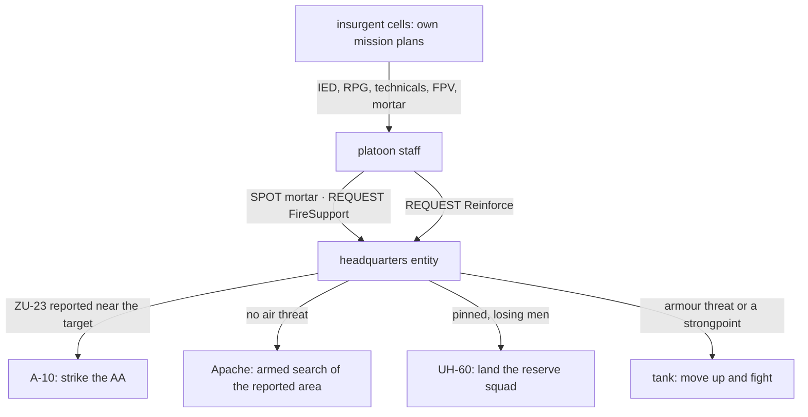

<!--STATUS
state: LIVE
updated: 2026-10-18
build-state: IDEA — recorded, not scheduled (R-2051); the infrastructure in §4 comes first, the demos after it
current-answer: §1 the scene · §2 INVENTORY (measured) · §3 the two routes · §4 the infrastructure it needs · §5 the order
stale-below: nothing.
known-rot: none.
known-conflict: none.
related-designs:
  - docs/designs/group-maneuvers/DESIGN_Command_Chain_Example.md — OWNS the request / report machinery route B escalates through (CC-A…CC-E)
  - docs/designs/group-maneuvers/DESIGN_Platoon_Attack_Defend_Clear.md — OWNS the platoon attack / defence plays the infantry fight uses; this scene is its final act
  - docs/designs/group-maneuvers/DESIGN_Defend_And_Attack_Position.md — OWNS defensive positions and proficiency tiers (the insurgents' side)
  - docs/designs/group-maneuvers/DESIGN_Squad_Tactics.md — OWNS the squad drills, dismount, ride (the convoy half)
  - docs/designs/air-attack/DESIGN_Air_Operations.md — OWNS aircraft attack, air defence, evasion, air assault
  - docs/designs/indirect-fire/DESIGN_Indirect_Fire.md — OWNS mortars, the observer loop, counter-battery (IF-6, designed)
  - docs/designs/vehicle-tactics/DESIGN_Urban_Armour_Tactics.md — OWNS the tank / IFV fight in streets and the AT compositions
  - docs/designs/vehicle-tactics/DESIGN_FPV_Drone.md — OWNS the FPV drone (launch by an operator is "later", R-263)
  - docs/DESIGN_Civilians_And_Crowd_Control.md — OWNS civilians, covert armed men, charges (AW-12 remote trigger)
  - docs/OVERVIEW_Rules_And_Demos.md — the index of every demo this one is assembled from
-->

# The urban battle — one unscripted combined-arms fight in demo-city *(an idea, recorded)*

🔒 User, `2026-10-18`: *"Some kind of urban scene with military fighting insurgens on the streets, insurgents having toyotas with
machine guns as well as anti aircraft guns and combatants with rpg, military squads arriving in apcs/cars convoy, ambushed by
insurgentas … Nothing being predetermined, all depending on netural non determinism of the simulation."* · *"Civilians on the street
panicking and running away"* · *"Insurgents also attacking with fpv drones."* · *"hopefully some mission plan sending behavior
instructions to other entitiea could make it?"* · and the decision: 
*"maybe we do not need to hurry and just record the idea and first build the necessary infraatructure allowing for your suggested implementation."*

## 1. The scene

| beat | what happens | who decides it — route B (§3) |
|---|---|---|
| 0 | demo-city on a market day: traffic, pedestrians, a few covert insurgents among them | the traffic node; civilians' routine |
| 1 | a convoy (Bradleys, Humvees) drives Main Street | the convoy's mission plan |
| 2 | an IED under the lead vehicle, or an RPG volley on it | the insurgent trigger man, when a vehicle is in his kill zone |
| 3 | the convoy halts, squads dismount, take cover, return fire; civilians panic and run into houses; cars are hit | the convoy halt drill, squad reactions, civilians — all on their own |
| 4 | fire from several houses and technicals (HMG); FPV drones dive on the vehicles; mortar rounds start to land | each insurgent cell's own plan; the insurgent spotter calls his mortar |
| 5 | the platoon reports contact and the mortar, and asks for help | the staff's SPOT and REQUEST FireSupport |
| 6 | headquarters sends what fits: the Apache against the mortars — unless a ZU-23 was reported near them, then the A-10 first | the headquarters play (§4 ①) weighing the request, its assets and the threat to them |
| 7 | the Apache searches the reported area and attacks; RPG men fire at it from roofs; the ZU-23 and an Igla fire at the A-10, which drops flares and breaks | armed search; air defence and evasion (built) |
| 8 | the platoon is pinned and losing men: it asks for reinforcement; a UH-60 lands a squad, a tank comes up the street | REQUEST Reinforce answered by headquarters |
| 9 | the tank meets NLAW / Javelin teams in the houses; the fight goes on until one side breaks | the tank's hide / fire cycle and the AT teams (built) |

⭐ No beat after 1 has a fixed time. Who survives the IED, which houses hold out, whether the helicopter is shot at and what
headquarters sends next all come out of the fight itself.

## 2. INVENTORY *(measured 2026-10-18 — two code + design sweeps, grep and the codebase graph; the live debug servers were down, so nothing was checked at runtime; `check_index_coverage` was not run)*

| piece | built? | where it is shown |
|---|---|---|
| civilians panic, shelter in houses, crowds spread fear; traffic-node people become our civilians when frightened | ✅ | `ua-civ-shelter`, `ua-civ-contagion`; demo-city's 34 houses (coordinator, CE-4028) |
| covert insurgent draws, fires, blends back among civilians | ✅ | `ua-armed-draw-aim`, `ua-armed-blend-back` |
| squad dismounts when its vehicle is hit, returns fire, assaults or breaks contact | ✅ | `tt-convoy-ambush` |
| RPG man between windows; IFVs fire on the move | ✅ | `ua-rpg-window` |
| tank hide / fire cycle against Javelin and NLAW teams | ✅ | `ua-tank-corner`, `ua-javelin-lock` |
| technicals (M2, DShK, minigun, Kornet, ZU-23) shoot and move | ✅ (the Kornet demo is parked, CE-2232) | `ua-technical-scoot` |
| ground air defence engages aircraft; aircraft drop flares and break | ✅ (evasion only while attacking) | `ua-air-defence` |
| A-10 bombs / strafes, Apache rockets + gun, UH-60 door-gun orbit | ✅ (a named target each) | `ua-air-attack`, `ua-air-strike` |
| UH-60 air assault; rescue of a downed pilot | ✅ | `ua-air-assault`, `ua-air-rescue` |
| FPV drone: searches ~150 m around a point, picks, dives | ✅ (placed by the scenario) | `ua-drone-shelter` |
| mortar adjusted by an observer; time on target; danger close | ✅ (target ordered) | `ua-indirect-fire` |
| mortar team type that can be Hostile; insurgent may crew a tube | ✅ data (`MortarTeam`, `ManWeapon`) | no live check |
| cover obstacles placed by a scenario: parked car, sandbag wall, concrete block, crate | ✅ (`TkbEntityTypes.Obstacles`, `StaticObstacleDto`, CE-3136) | — |
| mission plans: ≤ 8 phases on ONE unit; triggers timer · under attack · health · behaviour finished, all on that unit | ✅ operator-only | `MissionComponents.cs` |
| a behaviour ordering other units (`OrderSubordinate`, the blueprint *Send Behaviour Intent* node) | ✅ | Command Chain §2 |

## 3. Two routes

| | **A — a director entity** | ⭐ **B — requests answered by a headquarters** |
|---|---|---|
| how | one body-less entity runs a mission plan; each phase's behaviour orders other units (Send Behaviour Intent) | every unit fights by its own behaviours; the platoon's staff sends REQUESTs; a headquarters entity owning the support answers them |
| order of events | ⛔ fixed: the phases advance on the director's own timer / behaviour end — its triggers cannot see "the mortar was found" | ⭐ from the fight |
| buildable | mostly now, with the gaps of §4 ②–⑥ | after the Command Chain programme + §4 ① |
| use | ⭐ a stepping stone: the demo ladder of §5 with authored escalation | ⭐ the target (user: *"allowing for your suggested implementation"*) |

*What the picture shows that prose hid:* nothing in route B sends an asset by time. Every arrow into an asset leaves the headquarters
only because a report arrived. The insurgents' side is the only scripted part, and it scripts their *intent*, not the outcome.

## 4. The infrastructure it needs *(each one is a capability on its own, reusable beyond this demo)*

| # | item | lane | home |
|---|---|---|---|
| ① | **REQUEST reports + a headquarters play**: a body-less company HQ that owns support assets and answers FireSupport / Reinforce / Casevac by what fits, what is free and what threatens it | behaviors | the Command Chain programme (`CE-2291`…`CE-2295`) + a new play (not filed) |
| ② | **finding a mortar**: a firing sound on mortar tubes and guns (today they have none, so a launch is never heard) → a heard launch becomes a SPOT; counter-battery later | backend (data) · behaviors | Indirect Fire IF-6 (designed) |
| ③ | **armed search for aircraft**: attack an AREA — search it and pick targets, as the FPV drone already does (`DroneTargets.Pick`) | behaviors | Air Operations (new) |
| ④ | **an IED trigger man and an ambush**: a behaviour that sets off another entity's charge when a vehicle enters a kill zone; insurgents that hold an ambush position and fire (an un-ordered insurgent only hides today) | behaviors | Civilians AW-12 (remote trigger, designed) · Defend positions |
| ⑤ | **a convoy halt drill**: vehicles stop or push through on contact; dismount at a halt | behaviors | Squad Tactics (new) |
| ⑥ | **an insurgent mortar cell**: a spotter calls his mortar on enemies he sees (the observer adjust loop, started by the spotter himself) | behaviors | Indirect Fire (new) |
| ⑦ | ⭐ **demo-city gets QUARTERS** (§4a): residential, business and commercial, plus one battle street — multi-storey buildings with upper windows and reachable roofs, a walled compound, a landing square | ui | [hand-off UI-8…UI-12](../../blueprints/batches/HANDOFF_Behaviors_To_Ui_Demo_City_Quarters.md), after UI-1 / UI-2 |
| ⑧ | data fixes: the Humvee type has no health block; our generic APC is unarmed (the Bradley is fine) | backend | not filed |
| ⑨ | *(later)* FPV launch by an operator; aircraft evading outside an attack | behaviors | FPV R-263 · Air Operations |

## 4a. The stage — demo-city with quarters *(user, 2026-10-18)*

🔒 User, `2026-10-18`: *"The democity terrain was anyway too boring, adding building there to create some quarters like living ones and business onr and commercial ones would help. Obstacles to cover behing on the streets could be added as part of the scenario."*

🔒 User, `2026-10-18` (R-2053): *"That 'no procedural buikding' was related to the buildings from sumosharp own test project, not ported here to our 3d map. Our Building can be created in whatever suitable way."*

| | ⭐ decision | rejected — one line each |
|---|---|---|
| where | ⭐ **demo-city, given quarters** — it alone has the road net, traffic and crowds the scene needs; new buildings can be made in whatever way suits — authored placements (`demo-city.houses.json`, merged by the coordinator's `terrain-from-sumo.py --houses`), a generator, new templates (R-2053: R-4052's "no procedural buildings" is SumoSharp's viewer buildings only) | grow `cqb-village` (~330 × 232 m, no road net or traffic; its sight lines are pinned by the platoon demos' rails) · a third terrain (redoes demo-city's road and traffic work) |
| what | residential (2–3 storey houses, walled courtyard houses, alleys), business (office blocks, 3–4 storeys, stairs, windows on every storey, flat roofs), commercial (shops with flat roofs, a market square), and **one battle street** through them | — |
| street cover | ⭐ **in the scenario**, not the terrain: the existing static obstacles (cars, sandbags, concrete blocks, crates) | baked into the terrain: every demo on demo-city would inherit them |

## 5. The order

1. ⭐ **Infrastructure first** (R-2051): the Command Chain programme and the platoon programme as already planned, then §4 ①–⑥.
2. **The demo ladder** on demo-city, each rung its own live demo: street panic · convoy hit and dismount · tank against AT teams in
   the streets · A-10 against the ZU-23 · FPV attack on the convoy · UH-60 reinforcement · the request chain (route B) on one rung.
3. **The flagship** — §1 beat by beat, route B, judged by what must hold whatever happens (no civilian targeted, nothing sent without
   a report, every arrival explained by one), never by a fixed outcome.
