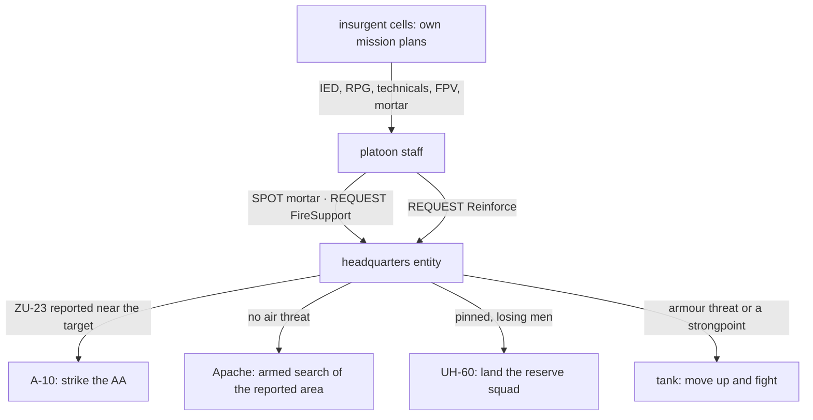
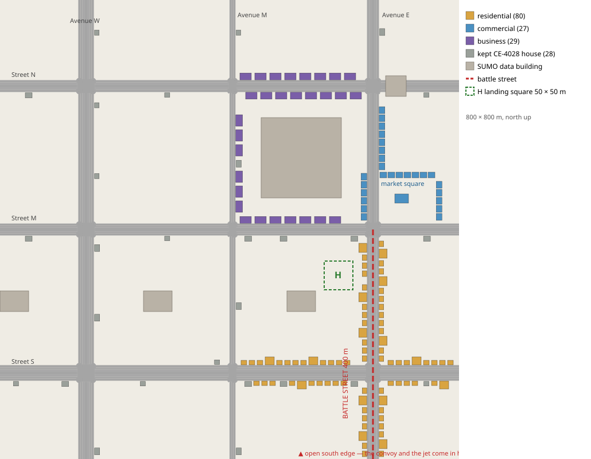
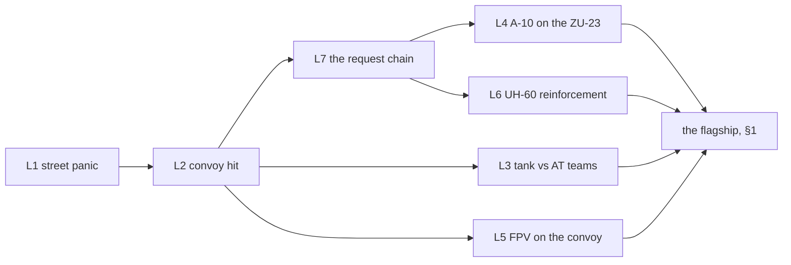

<!--STATUS
state: LIVE
updated: 2026-10-20 (§5 steps 1–7 built; §6 the ladder, step 8)
build-state: PLANNED — §5 is the approved order (R-2060, 2026-10-19); still the infrastructure first (R-2051), the demos after it
current-answer: §1 the scene · §2 INVENTORY (measured) · §3 the two routes · §4 the infrastructure it needs · §4a the stage · §4b the quarter plan (UI-8, built) · §5 the order · §6 the ladder (step 8)
stale-below: nothing.
known-rot: §2/§4 ② said a mortar launch has no sound — half true: the crewed tubes and guns have none, the MortarTeam person type has (500 m, since 97b751b3a); re-measured 2026-10-19, BR-14 filed.
known-conflict: none.
related-designs:
  - docs/DESIGN_Building_Interiors.md — OWNS the building templates the quarters place (§3g.1: the shared Recipes/Buildings folder, the roof storey)
  - docs/designs/group-maneuvers/DESIGN_Command_Chain_Example.md — OWNS the request / report machinery route B escalates through (CC-A…CC-E)
  - docs/designs/group-maneuvers/DESIGN_Platoon_Attack_Defend_Clear.md — OWNS the platoon attack / defence plays the infantry fight uses; this scene is its final act
  - docs/designs/group-maneuvers/DESIGN_Defend_And_Attack_Position.md — OWNS defensive positions and proficiency tiers (the insurgents' side)
  - docs/designs/group-maneuvers/DESIGN_Squad_Tactics.md — OWNS the squad drills, dismount, ride (the convoy half)
  - docs/designs/air-attack/DESIGN_Air_Operations.md — OWNS aircraft attack, air defence, evasion, air assault
  - docs/designs/indirect-fire/DESIGN_Indirect_Fire.md — OWNS mortars, the observer loop, counter-battery (IF-6, designed)
  - docs/designs/vehicle-tactics/DESIGN_Urban_Armour_Tactics.md — OWNS the tank / IFV fight in streets and the AT compositions
  - docs/designs/vehicle-tactics/DESIGN_FPV_Drone.md — OWNS the FPV drone (launch by an operator is "later", R-263)
  - docs/DESIGN_Civilians_And_Crowd_Control.md — OWNS civilians, covert armed men, charges (AW-12 remote trigger)
  - docs/OVERVIEW_Rules_And_Demos.md — the index of every demo this one is assembled from
-->

# The urban battle — one unscripted combined-arms fight in demo-city *(an idea, recorded)*

🔒 User, `2026-10-18`: *"Some kind of urban scene with military fighting insurgens on the streets, insurgents having toyotas with
machine guns as well as anti aircraft guns and combatants with rpg, military squads arriving in apcs/cars convoy, ambushed by
insurgentas … Nothing being predetermined, all depending on netural non determinism of the simulation."* · *"Civilians on the street
panicking and running away"* · *"Insurgents also attacking with fpv drones."* · *"hopefully some mission plan sending behavior
instructions to other entitiea could make it?"* · and the decision: 
*"maybe we do not need to hurry and just record the idea and first build the necessary infraatructure allowing for your suggested implementation."*

## 1. The scene

| beat | what happens | who decides it — route B (§3) |
|---|---|---|
| 0 | demo-city on a market day: traffic, pedestrians, a few covert insurgents among them | the traffic node; civilians' routine |
| 1 | a convoy (Bradleys, Humvees) drives Main Street | the convoy's mission plan |
| 2 | an IED under the lead vehicle, or an RPG volley on it | the insurgent trigger man, when a vehicle is in his kill zone |
| 3 | the convoy halts, squads dismount, take cover, return fire; civilians panic and run into houses; cars are hit | the convoy halt drill, squad reactions, civilians — all on their own |
| 4 | fire from several houses and technicals (HMG); FPV drones dive on the vehicles; mortar rounds start to land | each insurgent cell's own plan; the insurgent spotter calls his mortar |
| 5 | the platoon reports contact and the mortar, and asks for help | the staff's SPOT and REQUEST FireSupport |
| 6 | headquarters sends what fits: the Apache against the mortars — unless a ZU-23 was reported near them, then the A-10 first | the headquarters play (§4 ①) weighing the request, its assets and the threat to them |
| 7 | the Apache searches the reported area and attacks; RPG men fire at it from roofs; the ZU-23 and an Igla fire at the A-10, which drops flares and breaks | armed search; air defence and evasion (built) |
| 8 | the platoon is pinned and losing men: it asks for reinforcement; a UH-60 lands a squad, a tank comes up the street | REQUEST Reinforce answered by headquarters |
| 9 | the tank meets NLAW / Javelin teams in the houses; the fight goes on until one side breaks | the tank's hide / fire cycle and the AT teams (built) |

⭐ No beat after 1 has a fixed time. Who survives the IED, which houses hold out, whether the helicopter is shot at and what
headquarters sends next all come out of the fight itself.

## 2. INVENTORY *(measured 2026-10-18 — two code + design sweeps, grep and the codebase graph; the live debug servers were down, so nothing was checked at runtime; `check_index_coverage` was not run)*

| piece | built? | where it is shown |
|---|---|---|
| civilians panic, shelter in houses, crowds spread fear; traffic-node people become our civilians when frightened | ✅ | `ua-civ-shelter`, `ua-civ-contagion`; demo-city's 34 houses (coordinator, CE-4028) |
| covert insurgent draws, fires, blends back among civilians | ✅ | `ua-armed-draw-aim`, `ua-armed-blend-back` |
| squad dismounts when its vehicle is hit, returns fire, assaults or breaks contact | ✅ | `tt-convoy-ambush` |
| RPG man between windows; IFVs fire on the move | ✅ | `ua-rpg-window` |
| tank hide / fire cycle against Javelin and NLAW teams | ✅ | `ua-tank-corner`, `ua-javelin-lock` |
| technicals (M2, DShK, minigun, Kornet, ZU-23) shoot and move | ✅ (the Kornet demo is parked, CE-2232) | `ua-technical-scoot` |
| ground air defence engages aircraft; aircraft drop flares and break | ✅ (evasion only while attacking) | `ua-air-defence` |
| A-10 bombs / strafes, Apache rockets + gun, UH-60 door-gun orbit | ✅ (a named target each) | `ua-air-attack`, `ua-air-strike` |
| UH-60 air assault; rescue of a downed pilot | ✅ | `ua-air-assault`, `ua-air-rescue` |
| FPV drone: searches ~150 m around a point, picks, dives | ✅ (placed by the scenario) | `ua-drone-shelter` |
| mortar adjusted by an observer; time on target; danger close | ✅ (target ordered) | `ua-indirect-fire` |
| mortar team type that can be Hostile; insurgent may crew a tube | ✅ data (`MortarTeam`, `ManWeapon`) | no live check |
| cover obstacles placed by a scenario: parked car, sandbag wall, concrete block, crate | ✅ (`TkbEntityTypes.Obstacles`, `StaticObstacleDto`, CE-3136) | — |
| mission plans: ≤ 8 phases on ONE unit; triggers timer · under attack · health · behaviour finished, all on that unit | ✅ operator-only | `MissionComponents.cs` |
| a behaviour ordering other units (`OrderSubordinate`, the blueprint *Send Behaviour Intent* node) | ✅ | Command Chain §2 |

## 3. Two routes

| | **A — a director entity** | ⭐ **B — requests answered by a headquarters** |
|---|---|---|
| how | one body-less entity runs a mission plan; each phase's behaviour orders other units (Send Behaviour Intent) | every unit fights by its own behaviours; the platoon's staff sends REQUESTs; a headquarters entity owning the support answers them |
| order of events | ⛔ fixed: the phases advance on the director's own timer / behaviour end — its triggers cannot see "the mortar was found" | ⭐ from the fight |
| buildable | mostly now, with the gaps of §4 ②–⑥ | after the Command Chain programme + §4 ① |
| use | ⭐ a stepping stone: the demo ladder of §5 with authored escalation | ⭐ the target (user: *"allowing for your suggested implementation"*) |

*What the picture shows that prose hid:* nothing in route B sends an asset by time. Every arrow into an asset leaves the headquarters
only because a report arrived. The insurgents' side is the only scripted part, and it scripts their *intent*, not the outcome.

## 4. The infrastructure it needs *(each one is a capability on its own, reusable beyond this demo)*

| # | item | lane | home |
|---|---|---|---|
| ① | **REQUEST reports + a headquarters play**: a body-less company HQ that owns support assets and answers FireSupport / Reinforce / Casevac by what fits, what is free and what threatens it | behaviors | the Command Chain programme (`CE-2291`…`CE-2295`) + a new play (not filed) |
| ② | **finding a mortar**: a firing sound on mortar tubes and guns (📐 2026-10-19: the crewed tubes and guns have none; the `MortarTeam` person type has, 500 m) → a heard launch becomes a SPOT; counter-battery later | backend (data — **BR-14 ✅ built `CE-3273`**, [note](../../blueprints/batches/NOTE_Backend_To_Behaviors_Urban_Battle_Data.md); ✅ a soldier hears it past his ear range, `CE-3276` / R-3023) · behaviors | Indirect Fire IF-6 (designed) |
| ③ | **armed search for aircraft**: attack an AREA — search it and pick targets, as the FPV drone already does (`DroneTargets.Pick`) | behaviors | Air Operations (new) |
| ④ | **an IED trigger man and an ambush**: a behaviour that sets off another entity's charge when a vehicle enters a kill zone; insurgents that hold an ambush position and fire (an un-ordered insurgent only hides today) — 📐 2026-10-19: the engine half is built (a placed charge set off by its trigger holder, by phone: `Charges.Ask`, `CE-3233`/`CE-3234`) | behaviors | Civilians AW-12 · Defend positions |
| ⑤ | **a convoy halt drill**: vehicles stop or push through on contact; dismount at a halt | behaviors | Squad Tactics (new) |
| ⑥ | **an insurgent mortar cell**: a spotter calls his mortar on enemies he sees (the observer adjust loop, started by the spotter himself) | behaviors | Indirect Fire (new) |
| ⑦ | ⭐ **demo-city gets QUARTERS** (§4a): residential, business and commercial, plus one battle street — multi-storey buildings with upper windows and reachable roofs, a walled compound, a landing square — ✅ **BUILT** (`CE-1183`…`CE-1187`, §4b) | ui | [hand-off UI-8…UI-12](../../blueprints/batches/HANDOFF_Behaviors_To_Ui_Demo_City_Quarters.md) |
| ⑧ | data fixes: the Humvee type has no health block; our generic APC is unarmed (the Bradley is fine) — both re-measured 2026-10-19 | backend | **BR-15 ✅ `CE-3274`, BR-16 ✅ `CE-3275`** ([note](../../blueprints/batches/NOTE_Backend_To_Behaviors_Urban_Battle_Data.md)) |
| ⑨ | *(later)* FPV launch by an operator; aircraft evading outside an attack | behaviors | FPV R-263 · Air Operations |

## 4a. The stage — demo-city with quarters *(user, 2026-10-18)*

🔒 User, `2026-10-18`: *"The democity terrain was anyway too boring, adding building there to create some quarters like living ones and business onr and commercial ones would help. Obstacles to cover behing on the streets could be added as part of the scenario."*

🔒 User, `2026-10-18` (R-2053): *"That 'no procedural buikding' was related to the buildings from sumosharp own test project, not ported here to our 3d map. Our Building can be created in whatever suitable way."*

| | ⭐ decision | rejected — one line each |
|---|---|---|
| where | ⭐ **demo-city, given quarters** — it alone has the road net, traffic and crowds the scene needs; new buildings can be made in whatever way suits — authored placements (`demo-city.houses.json`, merged by the coordinator's `terrain-from-sumo.py --houses`), a generator, new templates (R-2053: R-4052's "no procedural buildings" is SumoSharp's viewer buildings only) | grow `cqb-village` (~330 × 232 m, no road net or traffic; its sight lines are pinned by the platoon demos' rails) · a third terrain (redoes demo-city's road and traffic work) |
| what | residential (2–3 storey houses, walled courtyard houses, alleys), business (office blocks, 3–4 storeys, stairs, windows on every storey, flat roofs), commercial (shops with flat roofs, a market square), and **one battle street** through them | — |
| street cover | ⭐ **in the scenario**, not the terrain: the existing static obstacles (cars, sandbags, concrete blocks, crates) | baked into the terrain: every demo on demo-city would inherit them |

### 4b. The quarter plan *(UI-8 — ui, `2026-10-18`; [hand-off](../../blueprints/batches/HANDOFF_Behaviors_To_Ui_Demo_City_Quarters.md); built by `scripts/demo-city-quarters.py`)*

*What the picture shows that prose could not:* the battle street (Avenue E, red) runs 400 m from the open south edge between two
rows of houses into the market square; the business quarter wraps the existing tower; the landing square **H** sits one row behind
the battle street, reached by a gap in its west row. Everything west of Avenue M stays the coordinator's CE-4028 suburb (grey).

| | ⭐ decision | rejected — one line each |
|---|---|---|
| the battle street | ⭐ **Avenue E** (x ≈ 650): two lanes each way, sidewalks on BOTH sides, from the open south edge to Street M (400 m), into the square at its NE corner | Avenue M (x ≈ 405, narrower) — **measured: one-way, a sidewalk on its EAST side only** (`demo-city.net.xml`, edge `e_d_4_2_d_4_3`), so a west row's front doors could face no sidewalk (fence §2) |
| residential | rows of `house-2f` / `house-3f` / `courtyard-house` along both sides of the battle street and both sides of Street S east of Avenue M, 4 m alleys between them; every front door (a compound's gate) on the sidewalk | an inner-block back row — its doors would face no sidewalk |
| commercial | the **market square** (x 661..758, y 411..488): `shop-2f` round its east and north sides facing it, a `market-hall` in it, shop rows facing it across Avenue E and north of it | ⚠ the square's shops face the **square** (a pedestrian plaza), not a sidewalk — the one place the fence's wording bends; the shelter promise is unaffected (checked over every SUMO sidewalk point) |
| business | `office-4f` round the tower (`bldg_office_10`): Street M north side, Avenue M east side, Street N both sides | offices on Avenue E — it is the battle street |
| replaced CE-4028 houses | six, where a quarter stands: `house-1f-26`, `house-1f-13` (battle street), `house-1f-23`, `house-1f-1` (square / Avenue E), `shop-1f-8`, `house-1f-22` (Street N) | keeping them — each sat on a quarter lot |
| landing square | **H** = x 565..615, y 295..345 (50 × 50 m), open ground, entered by the gap at y 304..318 in the battle street's west row | in the market square — the hall and the crowd |

**Placements by quarter** (labels are `<quarter>-<street side>-<n>`; the script's `--table` prints this):

| quarter | street side | buildings |
|---|---|---|
| residential | battle street, west side | `res-bw-01` … `res-bw-21` — 11 × house-2f, 5 × house-3f, 5 × courtyard-house |
| residential | battle street, east side | `res-be-01` … `res-be-22` — 12 × house-2f, 5 × house-3f, 5 × courtyard-house |
| residential | Street S, north side, west of the battle street | `res-sgn-01` … `res-sgn-13` — 8 × house-2f, 3 × house-3f, 2 × courtyard-house |
| residential | Street S, south side, west of the battle street | `res-sgs-01` … `res-sgs-10` — 7 × house-2f, 2 × house-3f, 1 × courtyard-house |
| residential | Street S, north side, east of the battle street | `res-shn-01` … `res-shn-08` — 5 × house-2f, 2 × house-3f, 1 × courtyard-house |
| residential | Street S, south side, east of the battle street | `res-shs-01` … `res-shs-06` — 4 × house-2f, 1 × house-3f, 1 × courtyard-house |
| commercial | market square, east side · north side | `com-se-01` … `05`, `com-sn-01` … `07` — 12 × shop-2f |
| commercial | the market square | `com-hall` — market-hall |
| commercial | Avenue E, east side north of the square · west side facing it | `com-ee-01` … `08`, `com-ew-01` … `06` — 14 × shop-2f |
| business | Street M north · Avenue M east · Street N south · Street N north | `biz-ms-01` … `07`, `biz-mw-01` … `06`, `biz-ns-01` … `08`, `biz-nn-01` … `08` — 29 × office-4f |
| **total** | | **136 new** (80 residential, 27 commercial, 29 business) + 28 CE-4028 houses kept + the 5 SUMO data buildings |

The battle street's own promises (§1): buildings on both sides with upper windows facing it (every `house-2f` / `house-3f` front
has two upper windows) · walled compounds on it (`res-bw-03`, `-07`, `-12`, `-16`, `-20` and five on the east side) · roofs that see
along it (`res-bw-01` at the south end, `res-be-22` at the north end, both `house-3f`) — the last two and the landing square are rows
of `demo-city/premises.json`.

**As built** (`CE-1183` … `CE-1187`): `scripts/demo-city-quarters.py` holds the rows and writes `demo-city.houses.json` + the world
file (`--check` re-verifies the fences and that the files are current — rerun it after editing a row, never hand-edit the files) ·
templates in [Building Interiors §3g.1](../../DESIGN_Building_Interiors.md) · rails: `UI10_DemoCity_EveryQuarterBuilding_IsEnteredFromItsStreet_ThroughItsFrontDoor`
(135 front doors / gates entered from 3 m outside; the infantry navmesh of the whole terrain bakes in **14.4 s** in that run, uncached) ·
`UI11_DemoCity_TheLandingSquareIsClear_…` · `CE4028_DemoCity_EverySidewalkPoint_…` (the shelter promise, unchanged and green) ·
`DemoPremisesTests.UI12_ADemoCityPremise_Holds_…` (6 rows) · `ShippedTerrainFilesAreDeployedTests` (the world loads from the build
output). ⚠ Not measured: a live cluster load of demo-city with the quarters (the vehicle layer's bake and the tile cache on a node).

## 5. The order *(✅ approved 2026-10-19 — R-2060)*

🔒 User, `2026-10-19`: *"Make the suggested order the plan (starting with the window lean and the stuff agreed before). The goal is to have the attack+defend and the urban battle at the end."*

| # | step | what it brings | home |
|---|---|---|---|
| 1 ✅ | the frame lean (D-2l) — built 2026-10-19 | a trained man watches and fires from beside the window frame | Defend & Attack §8c D-2l |
| 2 ✅ | battle positions from the survey — built 2026-10-19 (Defend & Attack §8d E-4) | a platoon defends an AREA — buildings and open ground, one position per squad (R-2060's area rule) | Defend & Attack §8d, Platoon §5a |
| 3 ✅ | `ClearBuilding` (`CE-2259`) — built 2026-10-19 | the room-by-room drill; then the Veteran counterattack (DA-75) is one switch | Building Clearing §7 |
| 4 ✅ | the request round trip, Casevac first (`CE-2305`) — built 2026-10-19 | a squad asks, the platoon answers, the request closes — the seed of ① | Platoon §4 Answer, §5 DAnswer |
| 5 ✅ | the scene's reactions: ④ trigger man + ambush (`CE-2306`) · ⑤ convoy halt (`CE-2307`) · ⑥ insurgent spotter (`CE-2308`) — built 2026-10-19 | the ladder's convoy rungs | §4 |
| 6 ✅ | ① the headquarters play (`CE-2312`) · ③ armed search (`CE-2311`) · ② (`CE-2309`, `CE-2310`) — built 2026-10-19 | route B: assets sent only because a report arrived | §3, §4 |
| 7 ✅ | `AttackPosition` (`CE-2277`) over an AREA — built; ✅ `pc-attack-dry` live 12/12, ✅ `pc-defend-house` live (found AT-13 and DA-98) | attack + defend, platoon against platoon | Platoon §4, §5a, §12 |
| 8 | the demo ladder on demo-city, then the flagship | the urban battle | below |

Backend's BR-14 (a launch heard), BR-15 (the HMMWV killable), BR-16 (the APC armed) run in parallel, filed 2026-10-19.

**Then, on demo-city** — the ladder, each rung its own live demo: street panic · convoy hit and dismount · tank against AT teams in
the streets · A-10 against the ZU-23 · FPV attack on the convoy · UH-60 reinforcement · the request chain (route B) on one rung —
and **the flagship**: §1 beat by beat, route B, judged by what must hold whatever happens (no civilian targeted, nothing sent without
a report, every arrival explained by one), never by a fixed outcome.

⛔ HISTORY — before 2026-10-19 the order was three lines (infrastructure first · the ladder · the flagship), not scheduled (R-2051).

## 6. The ladder — step 8, one live demo per rung *(behaviors, 2026-10-20; built under the user's "go ahead autonomously")*

*What the picture shows that prose hid:* every rung after L2 starts from L2's convoy on Avenue E, and L7 is the hub — the A-10 and
the UH-60 rungs are two answers of the SAME headquarters to two requests. So L2 then L7 come first; the others are ports of demos
that already pass on other terrains.

| rung | cast on demo-city (Avenue E, x ≈ 650, south → north) | must hold | new code it is the first live run of |
|---|---|---|---|
| **L2** ✅ `uc-convoy-hit` (live 8/8, 2026-10-20 — the APC is immobilised by any hit, so it halts and the squad dismounts; ✅ the Bradley variant `uc-convoy-hit-ifv` pushes through live — after `CE-2313`: the brain node read every moving vehicle as standing) | an APC (2001) with a squad aboard follows a route north up Avenue E; a placed charge (618) on the road at y 200; a trigger man (2003, phone) at the west row's front, his kill zone 10 m; an RPG man and a rifleman in the east row | ① the charge goes off only with the APC in its kill zone · ② the carrier, hit with troops aboard, pushes through (a mobile carrier) or halts and its squad dismounts (one that cannot move) · ③ the squad fights | `CE-2306` TriggerIed · `CE-2307` PushThrough / dismount from a halt |
| **L7** 🟡 `uc-request-chain` (live 2026-10-20: ✅ 9/9 once — rounds land, the launch heard at 1075 m ⇒ SPOT IndirectFire 16 m off the tubes, FireSupport, the AH-64 sent — and ✗ twice: no SPOT. ⚠ demo-city's grids are fitted to its ~850 m built area (CE-3018), so the separation cannot exceed ~1.1 km, and HQ-1's ≥ 1 km rule is judged on the HEARD ESTIMATE (±15 %): the rung is a coin-flip on this terrain. ✅ `uc-request-chain-dry` (the SPOT faked) 9/9 incl. the attack: the AH-64 found the cell and killed its crew) | a Blue platoon in the market quarter; an insurgent mortar 1–1.5 km off with its spotter; a body-less HQ (`SupportCommand`) owning an AH-64 and a battery | ① the spotter's own mission lands rounds · ② a Blue man hears the launch ⇒ SPOT IndirectFire · ③ the platoon asks FireSupport · ④ the HQ sends the free AH-64 on an armed search of the point · nothing sent without a report | `CE-2308`…`CE-2312` |
| L1 `uc-street-panic` | civilians on the battle street; shots | they shelter in the houses | — (`ua-civ-shelter` port) |
| L3 `uc-tank-street` | an M1 up Avenue E; NLAW / Javelin teams in the rows | the hide / fire cycle in a street | — (`ua-tank-corner` port) |
| L4 ✅ `uc-a10-zu23-dry` (live 7/7, 2026-10-20: two faked SPOTs ⇒ the platoon relays the air defence and asks FireSupport, the HQ sends its orbiting A-10 at the ZU-23 first, the AH-64 waits) | L7 + a ZU-23 technical near the mortar | the HQ sends the A-10 on the ZU-23 first, the AH-64 waits | `CE-2312` HQ-7 |
| L5 `uc-fpv-convoy` | L2's convoy; an FPV drone near the route | the drone searches, picks the APC, dives | — (`ua-drone-shelter` port) |
| L6 `uc-reinforce` | L7's platoon losing men | Reinforce ⇒ a free unit sent to defend at the requester | `CE-2310` HQ-5 · `CE-2312` HQ-9 |

**The flagship** `uc-urban-battle` (built 2026-10-20; 44 entities, nothing faked or timed; `scripts/utility-demo-check.py uc-urban-battle`)
asserts only what must hold: ① the charge goes off only with a vehicle in its kill zone · ② no Blue round aimed at a civilian · ③ nothing sent
without a REQUEST · ④ both sides fight. **First run (1200 sim s): ①②③ held, ④ did not** — the Bradley saw the fire team on the open sidewalks
from 230 m at 9 s and destroyed it from cover before it fired (Blue 238 rounds, Red 0); ⚠ the same charge burst THREE times (37, 229, 256 s);
⚠ the reserve squad SPOTted "an element at (0, 0)" every ~17 s from 547 s. Being measured.

⛔ Not in a rung: a fixed outcome. Each rung asserts what must hold whatever happens; a rung whose fight goes either way records
which way it went.

