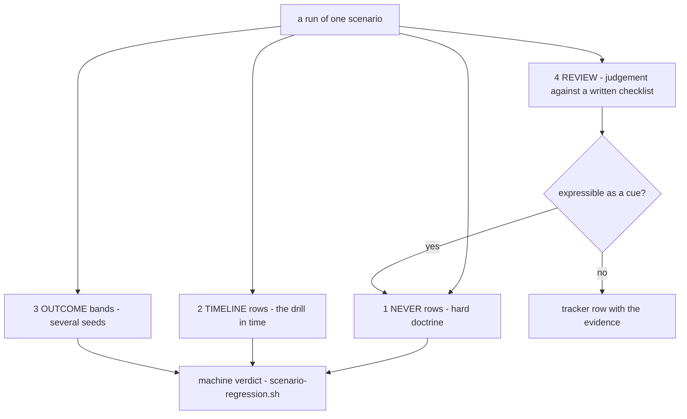
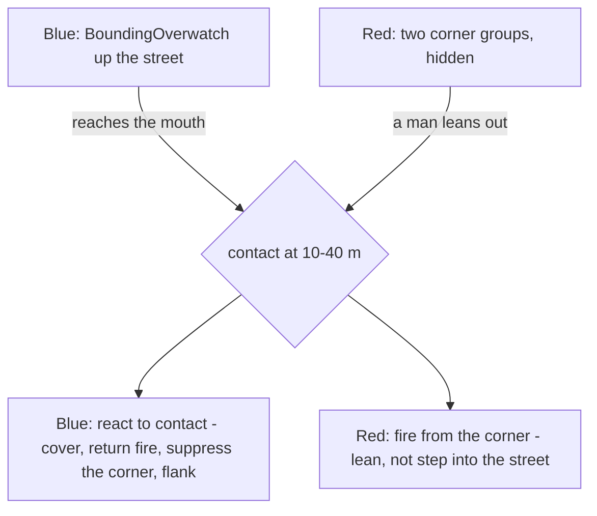

<!--STATUS
state: LIVE
build-state: BUILDING — the grammar (CE-2455) BUILT; U1, U2 being built; U3–U6 DESIGN
updated: 2026-11-20 (first version — behaviors, on the user's request)
current-answer: §1 the rubric · §3 the suite · §4 U1 · §5 U2
stale-below: nothing
known-rot: none
known-conflict: none
related-designs:
  - DESIGN_Open_Field_Suite.md — the OPEN-ground twin (OF1–OF5): squads and platoons across a field with scattered cover, the same rubric
  - ../../DESIGN_Scenario_Regression.md — OWNS the check grammar (§3) these scenarios are judged by; CE-2455 added still / for / fighting for this suite
  - DESIGN_Squad_Tactics.md — OWNS the squad plays the suite exercises (contact reaction §7.6.3, fire and movement, bounding, danger crossing)
  - DESIGN_Building_Clearing.md — OWNS the room drill and ClearBuilding U3 judges
  - DESIGN_Defend_And_Attack_Position.md — OWNS SquadDefend (posts, frames, the lone man's round) U3 / U5 / U6 judge
  - DESIGN_City_Battle_Showcase.md — §12 the test ladder: this suite is a tier-③ set at SQUAD scale (the ladder covers scale, not squad realism)
  - ../../../scenarios/tests/pc-corridor-fight — the PLATOON precedent of "REALISM" rows (cover within a minute, never wholly in the open, not bunched); this suite reuses them at squad scale in a dense town
-->

# DESIGN — the urban fight suite: squad against squad in a town, judged for REALISM

🔒 **User, `2026-11-20`:** *"2 or 3 squads that are fighting the same amount of enemies in a dense urban environment, but in different situations"* ·
*"not just the scenarios, but the success conditions to check how realistic the behavior is … it might need your judgment"* · *"Go ahead"*.

## 1. The rubric — how a run is judged realistic

*What the picture shows that prose hid:* judgement is the INPUT of the machine checks, not a parallel verdict — every defect found by eye becomes a
never / timeline row when the grammar can say it, so the automatic share grows with every review.

| layer | catches | judged by | the yardstick |
|---|---|---|---|
| **1 · never** | what no trained soldier does | a `never` row | doctrine (ATP 3-06 urban operations; the squad battle drills — react to contact, break contact, enter and clear a room) |
| **2 · timeline** | the right reaction, in time | a row with a window (`after` / `before` an anchor) | the same drills' timings (return fire at once; in cover within seconds; rushes of 3–5 s) |
| **3 · outcome** | plausible totals | a band over several seeds | rules of thumb: a defended building costs the attacker ~2–3× · urban engagements mostly at 10–50 m |
| **4 · review** | facing, side of cover, robotic timing | me, a fixed checklist per scenario (§4), a verdict per item | "would an instructor say *that's wrong*?" |

⭐ **The tells** every scenario's rows hunt (from what the live runs of `2026-11-20` exposed): frozen in the open · seeing an armed enemy and not
shooting · ignoring cover · bunching · a stalemate that never ends · perfect accuracy. ⚠ **A downed man is not idle** — every row about men judges
`fighting: true` (📌 the stair "stand-off" of `2026-11-20` was a dead man).

⚠ **One sample is not a band.** The deterministic run gives layers 1–2 one honest sample; layer 3 needs several seeds — added when layer 3 is.

## 2. INVENTORY *(2026-11-20)*

| query | result |
|---|---|
| `search_graph` `.*(ConditionBook\|AnchorBook\|ExpectRow\|CueDefinition\|ScenarioCheck).*` Class | 4 — `ConditionBook`, `AnchorBook`, `ScenarioChecks`, `ScenarioChecksTests` |
| scenarios whose checks use `cover` | 1 — `pc-corridor-fight` (platoon, wide-corridor, CE-4672) |
| urban / house / car scenarios (folder sweep) | `bc-house-*`, `bt-window-duel`, `ia-*`, `sq-defend-house`, `ts-house-defenders`, `pc-*` (platoons), `rf-car-squads` (cars, OPEN desert), `rf-house-obstacle`, `rf-wall-hugger` — ⛔ none squad-vs-squad in a dense town |
| dense terrains | `demo-city` (169 enterable buildings, SUMO streets) · `city-battle` (472) · `cqb-village` (9) |

⚠ Coverage of the graph could not be checked through the CLI.

## 3. The suite *(squad 6 v 6, `demo-city`, the squads' default SOP unless said)*

| # | situation | exercises (attack · defend) | state |
|---|---|---|---|
| **U1** | **car shootout** *(✅ 12/12 `2026-11-20`)* — both squads behind parked cars on opposite kerbs, ~70 m apart down a 22 m street | cover use, peek and fire, suppression, moving to better cover, casualty care under fire | ⏳ building (§4) |
| U2 | **corner fight** *(§5)* — one squad holds an intersection corner, the other comes down the cross street | leaning round a corner, slicing the pie, suppress and flank through a parallel street / building | ⏳ building (§5) |
| U3 | **house defence v clearing** — a squad defends a 2–3 storey house, the other clears it with a fire-support half outside | window posts, falling back upstairs, suppressing windows, the stack, room by room, the stair | DESIGN |
| U4 | **meeting engagement** — two squads advancing down one street meet at ~80 m | the contact reaction, cover (cars, doorways), fire and movement, the side-street flank | DESIGN |
| U5 | **window to window** — both hold facing houses; one then crosses the street | window duels, smoke, crossing under covering fire | DESIGN |
| U6 | **street ambush** — a squad in buildings ambushes one moving down the street | return fire, assault into the near building or break contact, casualty extraction | DESIGN |

Rejected: **one scenario with all situations at once** — a failure cannot be told to one situation (a sampler can come later) · **immortal men**
(as `rf-car-squads`) — the fight must be decided, and casualty care needs casualties · **`cqb-village`** — 9 buildings, not dense.

## 4. U1 — the car shootout *(build-state: BUILDING)*

**Site** — `demo-city`'s street on y ≈ 400 between the office row (front wall y 410.8, `biz-ms-03…07`) and the shop row (front y 388.4):
Blue's three cars on the south kerb (x 470–494, y 392), Red's on the north kerb (x 540–564, y 407.5) — ~72 m on the diagonal. Six men
each (leader, rifle and grenadier, mortal), no order: the default squad SOP fights.

| row | layer | cue |
|---|---|---|
| both sides fire; each within 10 s of the other's first round | 2 | `shot` by `*Blue ` / `*Red `, `before` the other's first + 10 |
| nobody in the fight stands UPRIGHT in an enemy's sight 15 s once the shooting starts | 1 | `never` `exposed` `by` the other squad `upright` `fighting` `m` 2.5 `for` 15 (CE-2459: in the OPEN — no cover within 2.5 m), after the first round — ⛔ was `cover` `open`: 📐 the first run's "open" men were inside or behind buildings (no cover point within 2.5 m, yet unseen); exposure is the sin, not distance from a marker |
| no knot of the squad (all within 3 m) held 10 s after the first half minute | 1 | `never` `bunched` `fighting` `for` 10 |
| no friendly hits | 1 | `never` `shot` `by` `*Blue ` `hit` `*Blue ` (and Red) |
| both sides take losses (the fight is real, not two walls) | 3 | `shot` `hit` each side |

**Review checklist (layer 4)** — read from the recording and the probes, a verdict per item: ① who peeks from which side of the car (the
side away from the enemy?) · ② does anyone fire from the open while cover is 2 m away · ③ are rounds aimed at men or at cars · ④ does a
squad move (bound, flank along the shop fronts) or both just trade fire for 4 min · ⑤ is a wounded man dragged behind cover · ⑥ how long
the first exchange takes to settle who is winning.

### 4.1 U1 — what the first runs found *(2026-11-20)*

| # | finding | kind | outcome |
|---|---|---|---|
| U1-1 | a man crouched behind a parked car read "in the open" | ⛔ JUDGE — the `cover` cue read only the terrain's database; a car's cover is read LIVE (`VehicleCover.StandingPoints`) | ✅ `CE-2456`: the cue reads the same live points |
| U1-2 | the "open" men were inside or behind buildings — safe, no cover point near | ⛔ JUDGE — distance from a marker is not exposure | ✅ `CE-2456`: the `exposed` cue (an enemy SEES him, `SightNow.Sees`); U1's L1 rows use it |
| U1-2b | `exposed` broken by Red / Blue Rifleman 6: measured live — crouched, SUPPRESSING (the posture's D-15 "lowest stance that clears") behind or beside cover, seen while firing | ⛔ JUDGE — seen while firing from cover is a firing position | ✅ `CE-2459`: `exposed` with `m` counts only a man with no cover within m |
| U1-3 | after both squads broke contact (~120 s) the survivors stood idle in the street 60–120 s, a wounded man among them | ⭐ BEHAVIOUR — no squad SOP row for "no task, enemy known" | ✅ `CE-2457`: the squad SOP's last row holds ([Squad Tactics §7.6.3](DESIGN_Squad_Tactics.md)) |
| U1-6 | Blue's BREAK CONTACT: one ~50 m bound straight to the retreat answer, across the open in Red's sight (`exposed` broken by Blue Rifleman 6, 45–60 s) | ⭐ BEHAVIOUR — S2-F bounds straight; doctrine bounds cover to cover | ✅ `CE-2460`: cover to cover by fire and movement's picker, a 15 m rush where there is no cover ([Squad Tactics S2-F](DESIGN_Squad_Tactics.md)) |
| U1-4 | both squads went straight into drills (Blue suppress-and-flank, Red fire-and-movement) and lay prone to fire | ✅ realistic | — |
| U1-5 | a squad member ~1 s with no task at the start | ✅ order latency (a frame), not a defect | — |

## 5. U2 — the corner fight *(build-state: BUILDING)*

**Site** — the junction of `demo-city`'s residential street (x 639–661, between the `res-bw` and `res-be` rows) and the shop street (y ≈ 400).
Blue (6 men) is ordered `BoundingOverwatch` up the residential street from y ≈ 280 to (650, 430) — through the junction. Red (6 men, no order:
the default SOP) holds the junction's two near corners: three behind `res-bw-21`'s front (x 627–633, y 384) and three behind `res-be-22`'s
(x 666–671, y 386) — the buildings hide them from the street until a man leans out. Contact comes at 10–40 m.

*What the picture shows that prose hid:* contact is decided by who leans out first, and both reactions run from the same SOP rows U1 judged — U2
adds the corner's geometry, not new rows.

| row | layer | cue |
|---|---|---|
| both sides fire; each within **5 s** of the other's first round (close range) | 2 | as U1, window 5 s |
| nobody in the fight stands upright in the open **10 s** in an enemy's sight | 1 | `never` `exposed` `upright` `fighting` `m` 2.5 `for` 10 |
| no squad knot (three or more men) held 10 s · no friendly hits · Red hits Blue | 1 / 3 | as U1, + `men` 3 (CE-2466 — 📐 the last two Red sharing a corner 2.8 m apart is a buddy pair, not a knot) |
| ⭐ Blue, ambushed from the corners, gets out of Red's sight: from 30 s after Red's first round no Blue man stays in a Red man's sight 10 s (user `2026-11-21`: a squad that breaks contact need not score). ⛔ SUPERSEDED for U2: "Blue hits a Red man" (U2-2) | 3 | `never` `exposed` `for 10`, `after: "Red fires+30"` |

**Review checklist (layer 4)** — ① does Red lean out from the corner or step into the street · ② does Blue keep to the walls, or walk the
middle of the street in a column · ③ once Red is found, is the corner suppressed while a team moves · ④ does Blue flank (through the shop street
or a building) or only trade fire · ⑤ does the bound stop at the mouth, or does a team bound into the junction under Red's guns.

### 5.1 U2 — what the runs found *(2026-11-20: 10/12, then 11/12 after CE-2461)*

| # | finding | kind | outcome |
|---|---|---|---|
| U2-3 | Blue's rear element advanced ~10 m per 40 s bound (live probe): a mover's move ended 6 m short of an unreachable cover point and the bound waited out its timeout, the element standing; picks at Z = 3 on a ledge | ⭐ BEHAVIOUR | ✅ `CE-2461`: a bound ends once its movers stopped; no picks off the mover's level ([Squad Tactics §7.6.2](DESIGN_Squad_Tactics.md)) |
| U2-4 | after breaking contact Blue never ends it: no rally, no report, no next move | 📐 measured `2026-11-21` (the deterministic run held to 420 s, probed every 6 s): break contact from 97 s; from ~140 s to 420 s (280 s) the 5 live men stand UPRIGHT and still in two groups 33 m apart — B1 alone at (632, 321), the leader + 3 at (624, 288) — the play stuck on phase 0, its outcome (each element's centre at the retreat answer) never met. Doctrine (what should follow): rally out of sight and reorganise (count men, ammunition, casualties) · report the contact to the platoon · then bypass, wait for support, or come back with a deliberate attack (suppress the corners, flank through a side street or building) — never the same street into the same corners · recover a man in the kill zone only under suppression | 🟡 the stall fixed (`CE-2465`). 📐 Then (420 s, `2026-11-21`): the bound resumes up the same street at 121 s, a second contact, a frontal assault into Red's corner at 242 s — four dead by 291 s, the lone leader resumes the bound and dies at 388 s; Red unhurt. ⚠ The 240 s judge window misses it. ⏳ `CE-2466` (what follows a broken contact), `CE-2467` (the urban assault's flank) |
| U2-1 | Red fires first at 107 s (Blue's bounding reached the junction then); Blue's first round 5.3 s later — 0.3 s outside the 5 s window | ✅ gone with U2-3: contact at 92 s, Blue fires at 92.0, Red at 92.8 | — |
| U2-2 | Blue never hits a Red man; Red hits Blue at once | 📐 measured (the deterministic run, probed over its debug API): Blue's point man walked up the middle of the street, Red's west corner group saw him at 35 m and killed him in 5 s (4 rounds); Blue fired once (a miss) and BROKE CONTACT — outmatched by a hidden force, doctrinally sound. Its break contact then stood 60 s (fixed: `CE-2461`), and after it nobody saw anybody: a stand-off | ⏳ open. ⛔ SUPERSEDED: "the point man walked the middle of the street" — measured 1.8–5 m off the wall. 📐 `2026-11-21`: `CE-2462` gave the bound the crossing drill, but its route sensor reports **no** area here (`CE-2463`: the route runs ALONG the street into junction `d_5_4`, and a road run over 40 m is dropped whole); and Red holds the corners looking DOWN Blue's street, so even a junction halt would stand past them. Contact now at 92 s; Red's first burst kills the east point man at 31 m (head). ⇒ the row likely expects the wrong thing — an ambushed squad that breaks contact need not score |

