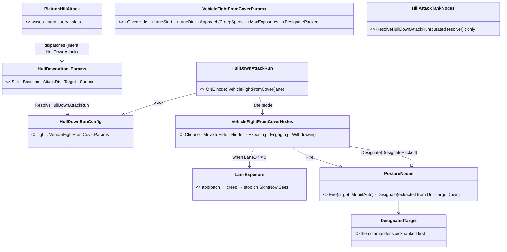
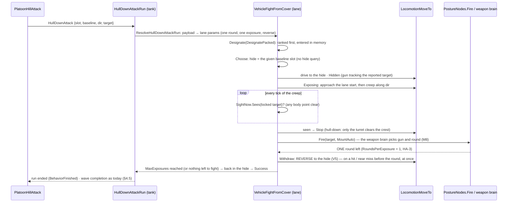
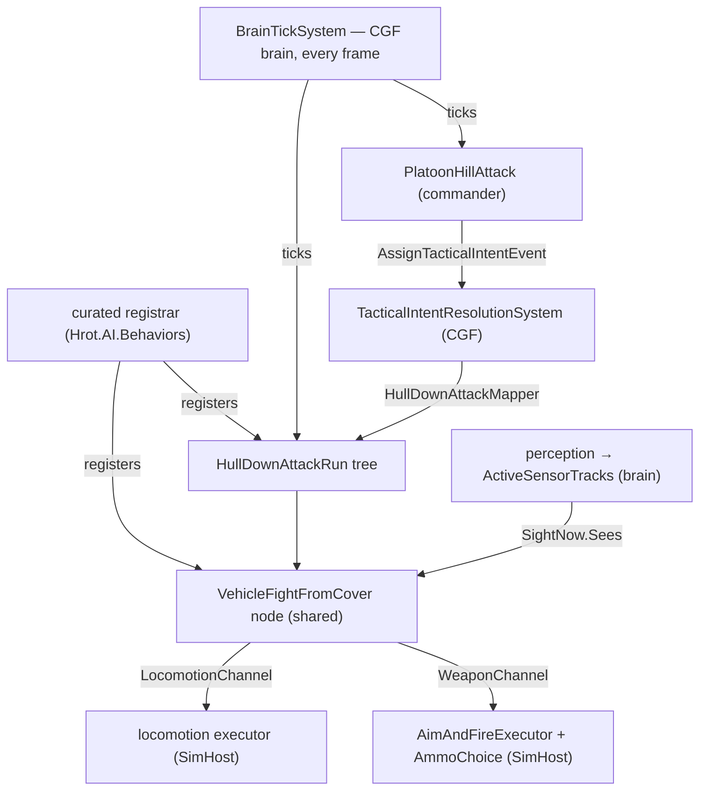

<!--STATUS
state: LIVE
updated: 2026-10-13 (R-2006)
current-answer: ⭐ §0 (CE-2230, DESIGN 2026-10-16 — the tank run rebuilt on the vehicle exposure cycle; HA-3 ruled by the user: one round then back, pairs alternate; HA-1/2/4/5/6 as leaned). Until it is built, §1–§6 describe the running build; §4.1/§4.2 carry the CE-459 end-of-attack return to baseline.
stale-below: nothing.
known-rot: ⛔ `PlatoonHillAttackBp` and its scenario `hill-attack-close-bp` are RETIRED (R-2006, 2026-10-13: "we prefer csharp hardcoded version"); the C# `PlatoonHillAttack` is the hill attack. Its node usages live on in `SubordinateForEachDemo` (DESIGN_Orders_Params_Entity_Classes.md §13.5) (the `PlatoonHillAttackBpAuthoring` mention near §4 is history) · ⚠ CE-466 (2026-09-30) replaced every combat-death IsAlive with CombatLife.IsAlive — see the note in the
  destruction paragraph; any older text saying "IsAlive detects destruction" is superseded. ⚠ §2.3 / §4.4 baseline-slot selection ("closest unreserved") cannot give distinct slots when the baseline has
  fewer slots than the platoon has tanks, and the staging reservation fills the mask — every attacker then retreats to the
  same slot mid-run (CE-460 — WON'T FIX 2026-09-30; SUPERSEDED 2026-10-07: the user reopened it and CE-2118 fixed the
  C# commander — staging reserves nothing, see §2.3. The blueprint twin keeps the old behaviour by user ruling).
known-conflict: none.
queued: ⭐ CE-2230 (user, 2026-10-16) — a ground-up rework on the current sensors and standard behaviours: the creep stops where the tank first sees its targets, full AI reverse, standard target / weapon choice and fire to the kill, the exposure cycle reused. This document describes the build being replaced.
related-designs:
  - docs/designs/vehicle-tactics/DESIGN_Vehicle_Exposure_Cycle.md — BUILD design of the repeatable vehicle exposure (the hill attack is re-pointed at it later); ⚠ measured: AI reverse is clamped to ≥ 0 (BicycleModel.cs:34), so ReverseToBaseline is assumed not to reverse — V5
  - docs/designs/vehicle-tactics/DESIGN_Urban_Armour_Tactics.md — generalises HullDownAttackRun's one exposure into a repeatable urban hide / expose / reverse cycle (V4)
  - ../brain-split/BS-1-DESIGN.md — §5.1a: the generic AimAndFireExecutor's no-fire guards (CE-321), which reuse CombatLife.
  - ../../blueprints/DESIGN_Entity_Reference.md — §6.1's `TargetAreaNetworkId` is an `EntityRef` (2026-10-03), no longer `long` + attributes.
  - docs/designs/brain-death/BD1-DESIGN.md — §1.0b: a finished behaviour is terminal and is cleared (CE-449); why the
    return to baseline must be an explicit step here.
  - docs/blueprints/Architect_Question_8_Wave_Core.md — the wave core rulings this doctrine's blueprint twin follows.
  - docs/blueprints/Architect_Question_78_Hill_Attack_The_Blueprint_Node_Way.md — owns the blueprint rebuild of this
    doctrine (CE-464); this document stays its spec, CE-460 quirk included.
-->
# Hill Attack Group Behavior — Design

## Overview

This workstream implements a platoon-level hill attack tactical doctrine.
A platoon commander directs a group of subordinate tanks through a sequenced attack
procedure: deploying to a baseline, executing alternating attack waves that crest a hill,
engaging enemies in a designated target area, and cycling until the area is cleared.

The design adheres strictly to the FDP engine's CQRS boundaries, Data-Oriented Design
(DOD) constraints, occurrence-scoped storage, and the 256 component-type limit.

---

## §0 — CE-2230: the tank run rebuilt on the vehicle exposure cycle *(DESIGN, `2026-10-16`, leans awaiting the user)*

> 🔒 **User, `2026-10-16`:** *"Hill attack needs Complete ground-up rework … the tanks that are creeping forward, they should stop as
> soon as they see the targets that are supposed to be under the hill, so the tanks are not exposed in full to enemy fire. They go just
> as far as they can start firing at the targets. They could also use the full reverse capability now. And they should use the usual
> behaviors when seeing enemy entities, so picking the targets and picking the correct weapon and firing until the enemy is
> eliminated. using standard behaviors."*

`build-state: DESIGN` — the phases below (§3–§4) are the build being replaced; this section is the replacement.

### §0.1 INVENTORY *(codebase-memory, `2026-10-16`)*

| query | total | what it found |
|---|---|---|
| `search_graph .*(HullDown\|HillAttack\|HillCrest\|Crest).*` (Class) | 21 | `HillAttackCommanderNodes`, `HillAttackTankNodes`, `HillAttackMutableState`, `HullDownAttackParams/Blackboard/IntentDto/Mapper`, `PlatoonHillAttackParams(+JsonDto)`, `HillAttackGizmo`, `HillCrestHullDownManeuver` (+ tests) |
| `search_graph .*(HullDown\|HillCrest\|SightHeight\|TurretHeight\|FirstSight\|Crest).*` (Method) | 7 | the tank tree, its params parser, two terrain rails — ⛔ **no "first sight" query exists anywhere** |
| `grep HillCrestHullDownManeuver\.` (non-test) | 1 | `SquadDrillNames` only — a config stub with **no runner** (`DESIGN_Squad_Tactics`: "nothing runs them") |
| the engagement path the rework reuses | — | `VehicleFightFromCoverNodes` (hide / expose / engage / reverse, exposure budget, near-miss cut) · `PostureNodes.Fire` (the ONE aimed step, `MountAuto` ⇒ the weapon brain picks weapon and round, M8) · `PostureNodes.UntilTargetDown` + `DesignatedTarget` (a named target ranked first and entered in memory) · `SightNow.Sees` (seen THIS frame) · `LocomotionMoveTo.Issue(reverseAllowed)` (V5 reverse) |

### §0.2 What the build does today — measured

| claim | code — how it IS | design basis — how it was MEANT |
|---|---|---|
| the creep stops only for the ONE assigned target, and never looks during the approach | ✅ `HillAttackTankNodes.cs:220-222` (`!isFarPhase && …TargetNetworkId`) | ✅ §3.1 "until the assigned target enters line of sight"; `.dev/_DONE/hill-attack/initial-idea.md`: *"until it sees the target well"* |
| fire is a bespoke node at a fixed target, ONE round per run | ✅ `:328` `Action_AimAndFireSpecific`; `HillAttackCommanderNodes.cs:476` `MaxRounds = 1` | ⛔ R-261 *"the behaviour names the target; the weapon brain picks weapon and ammo"* — the bespoke node predates it |
| the reverse works now | ✅ V5 (`DESIGN_Vehicle_Exposure_Cycle` §5): `hill-attack-close` tank 1002 backed 115 m at −10 m/s | ✅ §3.1 phase 4 |
| the scenarios have NO hill | ✅ `berlin` has no height grid; live `2026-10-16`: `/perception/los` 1001→1006 clear from t = 0; memory stays empty until a tank is ~100 m off (t ≈ 24 s) | ✅ CE-174 ruling: `VisionRange` 100 stands in for the hill; ⛔ the user's `scenarios/hill-attack/` is not to be changed |
| a real crest exists | ✅ `basic-desert` ridge: x 220–330, crest y = 210 at 10 m, foot y ≈ 160 / 260 (`basic-desert.height.asc`) | ✅ `DESIGN_Terrain_Height` H2 (a hill blocks sight and fire), H4 |
| stopping at first sight IS hull-down | ✅ sight runs from the TKB eye (`SensorMount`, tank 2.5 m — `/perception/los` `eyeHeight`) and is one segment both ways | ✅ R-246 *"if your eye sees out, your head shows"* — at the first sight only the turret top clears the crest |

### §0.3 The design — **one cycle, a second way to expose**

The hill run IS the exposure cycle (`R-256` L1(d): one implementation per concept), with the commander supplying what the cycle
otherwise searches for: the **hide** is the tank's baseline slot, and the **exposure** is a drive along a LANE (from the firing slot,
along the attack direction) that ends the moment the tank SEES a target — instead of a drive to an EQS firing point.


*What the picture shows that prose hid: nothing new beside one private step — the commander, the cycle, the fire step and the
designation all exist; the tank's five bespoke nodes go.*


*What the picture shows: the stop is a sight test on EVERY creep tick (today: none during the approach), and the run ends through the
cycle's own withdraw — no separate retreat node.*


*Who calls it each frame: `BrainTickSystem` on the CGF brain ticks both trees; the SimHost executors act on the channels. No new
system, no new registration — the only edge that changes is HullDownAttackRun → VehicleFightFromCover.*

### §0.4 Decisions — lean per item *(the user approves or names the one to change)*

| # | question | ⭐ lean | blast radius | what would change it |
|---|---|---|---|---|
| **HA-1** | where the tank run lives | ⭐ **inside the exposure cycle**: `VehicleFightFromCover` gains a LANE exposure (given hide + lane start + direction) and `MaxExposures`; `HullDownAttackRun` becomes `Sequence{ Parallel(1){UntilTargetDown ‖ cycle(lane, 1 exposure)}, reverse home }` | the shared cycle gains 4 params, all zero = today's behaviour (every existing vehicle demo unchanged); the 5 tank nodes and their 2 deactivator test classes are deleted | if the cycle's urban rules (hide heat, scoot, relocate) fight the lane — then a sibling node reusing the cycle's steps |
| **HA-2** | when the creep stops | ⭐ **the first tick the tank SEES its locked target** (`SightNow.Sees` — any body point clear), checked through the WHOLE drive, approach included; the 50 m overshoot cap stays (CE-174) | lane mode only | if "first sight" proves too early (one pixel of the target) — then require ≥ 2 body points, a one-line change |
| **HA-3** | how long it stays up | ✅ **USER, `2026-10-16` — ONE ROUND, THEN BACK INTO COVER** (shoot and duck): the cycle's `RoundsPerExposure = 1` at its target, then the reverse; a hit or near miss before the round sends it back at once, and the cycle's exposure budget stays ON (the standard rule). The PAIRS alternate — one pair comes up, fires, goes back; the next pair comes up — until every target is dead. 🔒 *"the tank doesn't stay up until there is anything to fire at. The tank is firing just one round and then moving back to cover. Because if it would stay, it would be exposed to enemy fire, which is the goal not to be. So the tanks go in pairs, usually. They reach the crest of the hill, they fire at their target and they go back. And another pair comes up the hill and does the same procedure. And they alternate like that until all targets are dead."* ⛔ SUPERSEDED lean: *"until nothing it SEES is alive"* | lane mode only | — |
| **HA-4** | target and weapon | ⭐ **the commander's pick is a DESIGNATION** (ranked first, entered in memory so the tank tracks it from behind the crest); the weapon brain picks the gun and the round (`MountAuto`, M8); the ONE round is the cycle's `RoundsPerExposure = 1` (HA-3), counted by the executor | the commander's dispatch DTO drops `MaxRounds`/`RoundsFired`/`LastObservedAmmo` (the bespoke ammo-diff counter) | none expected — R-261 |
| **HA-5** | the commander | ⭐ **kept as it is** — its waves ARE the alternating pairs (HA-3): `Entity.Index` parity splits a platoon of four into two pairs (§4.4), each wave one exposure per tank, the loop runs until the area query finds no live target; area query, slots, burned slots, return to baseline unchanged — only its dispatch payload changes | `HillAttackCommanderNodes` dispatch only | if you want the squad-manoeuvre runner instead — it does not exist (`HillCrestHullDownManeuver` is a stub); that is its own programme |
| **HA-6** | the demo | ⭐ **a new `ua-hill-attack` on `basic-desert`'s ridge** (platoon south of it, two enemy tanks north, beyond the crest), with a live check: no tank's hull above the crest when it fires, every tank reverses, both enemies die; `hill-attack` / `hill-attack-close` stay untouched (CE-174) and keep running | a new scenario + checker entry | if you would rather the existing scenarios move to the ridge |

**Rejected:** a new hill-only fire node — duplicates `PostureNodes.Fire` (R-256 L1(d)) · the squad-manoeuvre `HillCrestHullDown` —
no runner exists · an EQS "hull-down point" query — the lane already gives the line, and the sight test is exact where a sampled
query is not · moving `hill-attack` to a real hill — CE-174 keeps the user's scenario as it is.

**Design docs checked:** `DESIGN_Vehicle_Exposure_Cycle` — applies: owns the cycle, already says the hill attack is re-pointed at it,
and asks for "the nearest point that sees the target" to be designed once (§6 open point) — the LANE is that answer on open ground,
the town keeps its EQS ring · `DESIGN_Urban_Armour_Tactics` — applies: D-I (the behaviour never names a round), D-J (a tank reverses) ·
`DESIGN_Missiles_And_Ammo` §2a — applies: M8 round choice inside the executor · `DESIGN_Peek_And_Fire` G8 — does not: infantry only,
"hull-down is its own manoeuvre" · `Squad_Coordination_Design_v1_1` §8.4 — does not: a manoeuvre table with no runner ·
`REVIEW_Behaviour_Library_Genericity` L5/§6 — superseded in part: it kept the hill fire and reverse demo-local; this retires them into
the library cycle.

### §0.5 Slices *(after approval)*

| slice | what | rails |
|---|---|---|
| **H-1** ✅ BUILT `2026-10-16` | the cycle's lane mode: `UseGivenHide`/`GivenHide`, `LaneStart`/`LaneDir`, `ApproachSpeed`/`CreepSpeed`/`MaxOvershootMetres`, `MaxExposures`; the lane step `LaneStatus`; a lane attempt with no sight still counts as the run; with a given hide "nothing left to fight" backs into the hide first; a given hide asks no hide query, a lane no firing-point query; `LocomotionMoveTo.Issue(onSurface)` for 2-D slots | `VehicleFightFromCoverNodesTests`: the creep stops on first sight (approach included) · one round, then the reverse to the given hide · a near miss sends it back · one exposure then Success · lane off = every existing rail green |
| **H-2** ✅ BUILT `2026-10-16` | `HullDownAttackRun.btree.json` is ONE node — `VehicleFightFromCover` bound to `Params.fight` of the new block `HullDownRunConfig`; the curated resolver `HillAttackTankNodes.ResolveHullDownAttackRun` turns the commander's `HullDownAttackParams` into the lane run (baseline = given hide, slot + attack dir = lane, network id → `DesignatePacked`, one round, one exposure, reverse); `HullDownAttackParams` trimmed to 40 bytes; the 5 tank nodes, their deactivators, parser, constants and code tree deleted. ⚠ **Deviation from HA-1's sketch** *(`Sequence{Parallel(1){UntilTargetDown ‖ cycle}, reverse home}`)*: the cycle carries the designation (`DesignatePacked`, through the extracted `PostureNodes.Designate`) and backs into the given hide itself when nothing is left — so the tree needs no decorator, no Parallel and no second reverse node | `HillAttackNodeTests.CE304_TheCommandersPayload_LandsInTheRootSlot_AsTheLaneRun` (the real chain: event → ingress → resolver → root slot) · `SC_HA013_4` (the cycle node is resource-owning) · `HillAttackIntegrationTests` (the feature's own suite) · `CE472` / `BTreeCallShapeTests` / `HillAttackDtosTests` re-homed |
| **H-3** ✅ BUILT `2026-10-16` | `scenarios/ua-hill-attack` (basic-desert: four M1s south of the ridge, baseline y 140, firing line y 180; two idle T-72s north at y 380–395 inside the target area) + `run_hill_attack` in `scripts/utility-demo-check.py`; the runbook row | 📐 live, first run: PASS — 6 rounds, every one from y≈205 (crest 210: hull-down); 6 exposures, ONE round each; every finished exposure backed home nose-north (reverse); both T-72s dead at 136 s, no tank hit |
| **H-5** ⏳ FOUND live `2026-10-16` | ⚠ **the pair does not crest TOGETHER.** 📐 Measured: the wave (index parity) is dispatched together, but each tank first drives along the baseline to the slot nearest its RANDOM firing slot (`Action_DispatchWaveWithTargets`, the deliberate scatter, CE-202) — so the two crested 12–20 s apart, never two up at once. 🔒 R-2022: *"another pair comes up the hill and does the same procedure"*. ⭐ Lean: a two-step wave in the commander — send the wave to its hides first (the existing `AreAllAtBaseline` gate), then release the runs together; the slot scatter stays | live: two up at once in every wave, within ~3 s of each other |
| **H-4** | fold the as-built here; this section's §3–§4 to HISTORY | — |

---

## Architectural Context

### Existing Engine Mechanisms Used

| Mechanism | Purpose in This Feature |
|---|---|
| `FastBTree` (`BrainTierBTree = 2`) | Sequential multi-phase logic for both commander and tank behaviors |
| `UnitRoster` / `UnitSubordinate` (Fdp.Core) | Native commander-subordinate relationships; no custom roster components |
| Node working-state occurrence slot (`BlueprintBlackboard{256,1024,4096,16384}` tier ladder) | Commander mutable working memory, allocated as an occurrence slot and projected at the slot's `PayloadOffset` |
| `AssignTacticalIntentEvent` | Top-down order dispatch from commander to subordinates |
| `TacticalIntentResolutionSystem` (Hrot.CGF) | Bridges intent strings to `AssignBehaviorEvent` via `ITacticalOrderMapper` |
| `BehaviorIngressSystem` (Fdp.Toolkits) | Atomically updates `BehaviorState`, resets BTree execution pointer, parses JSON params |
| `BehaviorFinishedEvent` | Native terminal-state notification from `BrainTickSystem` to mission layer |
| `LocomotionChannel` / `WeaponChannel` | CQRS actuator channels; behaviors write intents, muscle tier executes |
| `[WritesChannel]` attribute | Roslyn source generator emits failure-reset wrappers preventing zombie actions |
| `PathfindingBatchData` / `RaycastBatchData` | Pattern reference for the new EQS batch singleton |
| `SpatialGridData` singleton | Spatial hash grid on Muscle node, queried by the EQS solver |

### Invariants

- Behavior nodes never mutate physics transforms or ECS structure directly.
- All working state that does not fit in the root params occurrence slot is held in a node working-state occurrence slot in the Blueprint tier ladder.
- No custom channel types beyond the three standard CQRS actuator channels.
- No phantom/satellite entities. Spatial awareness is provided by the EQS infrastructure.
- No managed heap allocations in hot-path behavior nodes.

---

## Phase 1: EQS Infrastructure (Area Query System)

**Goal:** Provide a generic, reusable capability for Brain-tier AI to query which entities
of a given force affiliation are located inside a polygon area entity.

The organic `TargetMemory` component (capped at 4 entries, `PerceptionConstants.MaxTrackedTargets`)
cannot serve area-wide reconnaissance. Spawning dummy observer entities is an anti-pattern.
Instead, the engine's established batch-singleton pattern (`PathfindingBatchData`,
`RaycastBatchData`) is extended with a new `AreaQueryBatchData` singleton.

### 1.1 Batch Singleton Types

Three unmanaged types are defined in `Fdp.Toolkits` (in a new `Spatial/Eqs` sub-folder)
and registered in `GlobalComponentIds` at ID 202:

**`AreaQueryRequest`** — submitted by a Brain BTree node:
- `long RequestId` — uniquely identifies this request, constructed from entity index + batch slot.
- `Entity TargetAreaEntity` — the area polygon entity whose `EditablePolyline` bounds the query.
- `ForceId TargetForce` — filters results to entities with this force affiliation.
- `int SourceNodeId` — network source node, used by translators for routing.

**`AreaQueryResult`** — written by the EQS solver:
- `long RequestId` — matches the corresponding request.
- `bool IsReady` — set to true when the solver has written results.
- `int TargetCount` — number of enemies found.
- `int TargetGroupHandle` — integer handle into an unmanaged `EqsTargetPool`, analogous to
  the `RouteHandle` in pathfinding.
- `int SourceNodeId` — for network routing on ingress.

**`AreaQueryBatchData`** (component ID 202, singleton) — holds pre-allocated
`NativeArray<AreaQueryRequest>` and `NativeArray<AreaQueryResult>` buffers at a fixed
capacity (initially 64 requests). Identical layout pattern to `PathfindingBatchData`.

**`EqsTargetPool`** (companion unmanaged singleton) — a fixed-capacity inline pool
that holds packed `Entity` values for resolved targets, addressed by `TargetGroupHandle`.
This avoids managed `List<Entity>` and keeps the entire pipeline allocation-free.

### 1.2 AreaQueryBatchHelper

A static helper class in `Fdp.Toolkits`, identical in style to `PathfindingBatchHelper`:
- `RequestAreaQuery(EntityRepository, entity, targetAreaEntity, ForceId)` — appends to
  `AreaQueryBatchData.Requests` and returns the `RequestId` (or -1 if batch full).
  The `RequestId` is packed as `((long)entityIndex << 32) | (uint)batchSlot`. The
  explicit cast to `long` before the shift is mandatory — a 20-bit shift on a 32-bit
  `int` silently truncates any entity index above 4095.
- `GetAreaQueryResult(EntityRepository, requestId)` — polls `AreaQueryBatchData.Results`
  and returns the matching `AreaQueryResult` (or `default` if not ready).
- `GetTargetFromPool(EntityRepository, targetGroupHandle, index)` — retrieves the packed
  `Entity` at the given index from `EqsTargetPool`.

Pool chunk lifetime is managed globally by `AreaQueryInitializationSystem` (see 1.4),
which resets the entire pool at the start of each Brain frame. Behavior nodes never
call a manual free function.

### 1.3 AreaQuerySolverSystem (Muscle Tier, SoD Module)

An `IEcsModule` named `EqsModule` runs on the Muscle node using
`ExecutionPolicy.SlowBackground(10)`. It processes pending `AreaQueryRequest` entries
against a background snapshot.

The solver:
1. Iterates the `AreaQueryBatchData.Requests` array up to `Count`.
2. Resolves the polygon from `EditablePolyline` on the `TargetAreaEntity`.
3. Queries `SpatialGridData` with a bounding circle broadphase, then does a precise
   2D point-in-polygon test for each candidate.
4. Filters by `EntityInfo.ForceId` matching the requested `TargetForce`.
5. Allocates a chunk in `EqsTargetPool`, writes packed entity handles.
6. Writes the `AreaQueryResult` into `AreaQueryBatchData.Results` with `IsReady = true`.

The solver runs against a read-only snapshot; all writes go through the
`IEntityCommandBuffer` harvested on the main thread by `ModuleHostKernel`.

In a networkless single-process environment (Editor), the solver runs in the same process
and the result is available within a few frames (no network latency).

### 1.4 AreaQueryInitializationSystem (Brain Tier, CGF)

An `IEcsModuleSystem` registered in `Hrot.CGF` at `SystemPhase.PreInput`. It runs at
the start of each simulation frame to reset the EQS batch state, mirroring how
`RaycastBatchData.Count` is zeroed globally each frame.

Responsibilities:
- Resets `AreaQueryBatchData.Count = 0` to accept new requests for the upcoming frame.
- Resets the `EqsTargetPool` free list so all pool chunks are available for the solver.

Because `Condition_IsAreaQueryResolved` and `Action_DispatchWaveWithTargets` execute in
the same BTree tick once a result becomes ready, all target handles are consumed before
the next frame's reset. Behavior nodes therefore require no manual pool-free calls;
the initialization system provides automatic lifetime management without risk of leaking
unmanaged memory under BTree branch preemption.

The singleton lives on whichever node hosts the ECS world being queried. In a distributed
deployment the Brain node has its own `AreaQueryBatchData` replica maintained by the
network translator pair (see 1.5).

### 1.5 EQS Network Translators

Four translator classes in `Hrot.Network.NED`, mirroring the pathfinding translator pattern:

- `AreaQueryBrainEgressTranslator` — drains `AreaQueryBatchData.Requests` on the Brain
  node, converts entity handles to network IDs via `NetworkEntityMap`, publishes DDS
  topic `AreaQueryRequestBatch`, and clears the batch count.
- `AreaQueryMuscleIngressTranslator` — on the Muscle node, reads `AreaQueryRequestBatch`,
  maps network IDs to local entities, writes into the Muscle node's `AreaQueryBatchData`.
- `AreaQueryMuscleEgressTranslator` — after the solver runs, drains completed results on
  the Muscle node, packages target entity IDs as network IDs, publishes
  `AreaQueryResponseBatch`.
- `AreaQueryBrainIngressTranslator` — on the Brain node, reads `AreaQueryResponseBatch`,
  maps network IDs back to local entities, writes `TargetGroupHandle` entries into
  `EqsTargetPool`, writes `AreaQueryResult` into `AreaQueryBatchData.Results`.

---

## Phase 2: Hill Attack Data Contracts

**Goal:** Define the unmanaged DTOs that govern both behaviors' memory layouts, fitting
all static configuration within the behaviour's root params occurrence slot
and all mutable working state into a node working-state occurrence slot in the Blueprint tier ladder.

### 2.1 Commander DTOs

**`PlatoonHillAttackParams`** (52 bytes):
- Firing line segment: `StartX`, `StartY`, `EndX`, `EndY` (16 bytes).
- Baseline segment: `BaselineStartX`, `BaselineStartY`, `BaselineEndX`, `BaselineEndY`
  (16 bytes).
- Attack trajectory: `AttackDirX`, `AttackDirY`, `TankSpacing` (12 bytes).
- Target area: `TargetAreaEntity` (`Entity`, 8 bytes).

**`PlatoonHillAttackBlackboard`** — single-field wrapper used as `TBlackboard` type in
the `BTreeBuilder` expression-binding overloads. Contains one field: `Params`.

**`HillAttackMutableState`** (a node working-state occurrence slot, keyed `{fqn}@{offset}@{slotKey}` in the Blueprint tier ladder):
- `int TotalSlots` — computed from segment length / `TankSpacing`.
- `byte CurrentWave` — 0 or 1.
- `long CachedEqsRequestId` — stores the request ID between `Action_RequestAreaQuery`
  and `Condition_IsAreaQueryResolved`.
- `int CachedTargetGroupHandle` — stores the `TargetGroupHandle` from the EQS result
  between `Condition_IsAreaQueryResolved` and `Action_DispatchWaveWithTargets`;
  initialized to -1.
- `ushort BurnedSlotsMask` — permanently blocked firing-line slot indices (wrecks).
- `ushort WaveUsedSlotsMask` — firing-line slots occupied in the current wave.
- `ushort BaselineReservedMask` — baseline slots currently reserved by live tanks.
- `int ActiveAttackerCount` — number of tanks currently executing the attack run.
- `fixed long ActiveEntityPacked[8]` — packed entity handles (SoA, decoupled from `UnitRoster`).
- `fixed byte ActiveSlotIndex[8]` — firing-line slot index per attacker.
- `fixed byte ReturnBaselineSlotIndex[8]` — baseline slot index per attacker.
- `fixed byte HasStartedRun[8]` — per-attacker flag initialized to 0 at dispatch time;
  set to 1 by `Condition_IsWaveCompleted` the first tick it observes the attacker's
  `BehaviorState.ActiveBehaviorHash` matching `HullDownAttackRun`. Only after this flag
  is 1 does a subsequent hash mismatch indicate a completed retreat. Prevents false
  completion detection during the one-frame window while `TacticalIntentResolutionSystem`
  and `BehaviorIngressSystem` process the `AssignTacticalIntentEvent`.

The SoA arrays use 8 entries because the maximum wave size is
`UnitRoster.MaxSubordinates / 2 = 8` (odd-indexed or even-indexed roster entries from
a 16-subordinate platoon).

### 2.2 Subordinate Tank DTOs

**`HullDownAttackParams`** (40 bytes):
- Firing slot: `SlotX`, `SlotY` (8 bytes).
- Baseline slot: `BaselineX`, `BaselineY` (8 bytes).
- Attack direction: `AttackDirX`, `AttackDirY` (8 bytes).
- Kinematic limits: `ApproachSpeed`, `CreepSpeed` (8 bytes).
- Assigned target: `TargetNetworkId` (`long`, 8 bytes) — the network-stable replication
  ID of the assigned target. Resolved to a local ECS `Entity` via `NetworkEntityMap`
  inside behavior nodes at runtime; the unmanaged params struct never stores a local
  generational entity pointer.

**`HullDownAttackBlackboard`** — single-field wrapper containing `Params`.

### 2.3 Architectural Notes on 1D Slot Parameterization

Firing-line and baseline slots are never pre-computed as Cartesian coordinates. They are
stored as 1D indices into the segment. Absolute coordinates are computed just-in-time
during dispatch using linear interpolation:

    t = slotIndex / (float)(TotalSlots - 1)
    X = Lerp(SegmentStartX, SegmentEndX, t)
    Y = Lerp(SegmentStartY, SegmentEndY, t)

This eliminates the need for `fixed float` arrays in the working state, dramatically
reducing the memory footprint and simplifying randomization to a bitmask operation.

Randomization of firing-line slot assignment: a random available bit index is selected
from `~(BurnedSlotsMask | WaveUsedSlotsMask)` (constrained to `TotalSlots`).

Baseline slot assignment per attacker: the commander iterates all baseline indices and
picks the one closest (by Euclidean distance-squared) to the assigned firing slot, from
those not already reserved in `BaselineReservedMask`.

⭐ **As built (`CE-2118`, `2026-10-07`, C# commander):** `BaselineReservedMask` is in the FIRING-LINE slot
space (`TotalSlots` bits). The staging dispatch (`DispatchAllToBaseline`) spaces tanks by ROSTER count and
therefore **reserves nothing** — only a returning attacker reserves the slot it was given. ⛔ HISTORY: staging
used to set one bit per roster index, which filled the mask whenever the platoon outnumbered the slots and made
every attacker of a wave return to the same slot (`CE-460`). ⚠ The blueprint twin
(`PlatoonHillAttackBpAuthoring.BuildOrderAll`) still does that, by user ruling.

---

## Phase 3: HullDownAttackRun Behavior (Subordinate Tank)

**Goal:** Implement the subordinate tank behavior and its tactical intent mapper.

### 3.1 Behavior Summary

The `HullDownAttackRun` behavior drives a single tank through a four-phase attack run:

1. **Approach** — navigate at `ApproachSpeed` toward the rough firing slot.
2. **Creep and Scan** — slow tactical creep along the attack direction vector, continuing
   past the rough slot until the assigned target enters line of sight. If the tank
   overshoots the slot by more than a defined tactical limit (default 50 m) without
   acquiring the target, `Action_CreepToAndBeyondSlot` returns `NodeStatus.Failure`,
   aborting the engagement attempt. The BTree topology guarantees `Action_ReverseToBaseline`
   still executes via an overshoot fallback node (see 3.2).
3. **Engagement** — halt forward movement, aim, and fire at the specific assigned target.
4. **Retreat** — reverse to the assigned baseline slot using `ReverseAllowed`.

Phases 1 and 2 are handled by a single action (`Action_CreepToAndBeyondSlot`) with an
internal distance check, interrupted by a `Selector` the moment `Condition_HasTarget`
succeeds. The tank never scans opportunistically. `Condition_HasTarget` resolves
`p.TargetNetworkId` to a local ECS entity via `NetworkEntityMap`, then scans
`TargetMemory` for that entity.

### 3.2 BTree Topology

```
Sequence
  Selector
    // Engagement path: creep until target visible, then fire
    Sequence
      Selector
        Condition_HasTarget          // succeeds when assigned target is in TargetMemory
        Action_CreepToAndBeyondSlot  // Running while creeping; Failure when overshoot limit exceeded
      Action_AimAndFireSpecific      // [WritesChannel(Weapon)]
    // Overshoot fallback: engagement path failed; proceed unconditionally to reverse
    Action_AbortEngagement           // always returns NodeStatus.Success immediately
  Action_ReverseToBaseline           // [WritesChannel(Locomotion)] — guaranteed to run
```

The outer `Selector` has two children. The first (the engagement `Sequence`) succeeds
when a target was found and fired upon. If it fails for any reason — including
`Action_CreepToAndBeyondSlot` returning `Failure` on overshoot — the second child
`Action_AbortEngagement` succeeds immediately, ensuring the outer `Selector` always
succeeds and `Action_ReverseToBaseline` always executes.

The Roslyn-generated failure-reset wrapper on `Action_CreepToAndBeyondSlot` (via
`[WritesChannel(Locomotion)]`) clears the `LocomotionChannel` automatically whenever the
action is preempted or returns `Failure`.

`Action_AbortEngagement` is a trivial one-line node with no channel writes:
`return NodeStatus.Success;`

`Action_AimAndFireSpecific` resolves `p.TargetNetworkId` via `NetworkEntityMap` to a
local `Entity`, writes it to `WeaponChannel`, then returns `NodeStatus.Running` while
the weapon channel reports the engagement in progress. It returns `NodeStatus.Success`
when either the weapon channel confirms the engagement concluded OR
the target is knocked out (`!CombatLife.IsAlive`, `CE-466`) — because standard executors do not natively detect target
destruction and would leave the node stuck in `Running` indefinitely.

`Action_ReverseToBaseline` writes the reverse locomotion intent to `LocomotionChannel`.
It returns `NodeStatus.Running` while `LocomotionChannel.Status == NodeStatus.Running`
and `NodeStatus.Success` when `LocomotionChannel.Status == NodeStatus.Success`.

### 3.3 ITacticalOrderMapper: HullDownAttackMapper

Registered in `TacticalIntentMapperRegistry` in `Hrot.CGF`. Maps the intent string
`"HullDownAttack"` to an `AssignBehaviorEvent` targeting the `HullDownAttackRun` behavior
name, passing `JsonParams` through unchanged.

The mapper checks that the entity has `TkbIdentity` with a tank entity type before
mapping. Non-tank entities silently return `false`, leaving the intent unhandled.

---

## Phase 4: PlatoonHillAttack Behavior (Commander)

**Goal:** Implement the platoon commander behavior that orchestrates the full hill attack.

### 4.1 Behavior Summary

The commander receives static geometry parameters (firing line, baseline, attack direction,
tank spacing, target area) and drives the platoon through:

1. **Preparation** — compute slot counts; dispatch all subordinates to baseline staging
   positions; wait until all are staged.
2. **Attack loop (infinite until area cleared)** — alternating waves:
   a. Request EQS area query.
   b. Poll for EQS result; terminate the loop if 0 targets remain.
   c. Distribute targets (round-robin) and randomized firing/baseline slots to the active
      wave; dispatch `AssignTacticalIntentEvent` ("HullDownAttack") for each tank.
   d. Monitor the wave until all dispatched tanks have finished their run or died.
   e. Toggle the wave index.

If a tank is knocked out mid-wave, its firing slot is permanently burned
(`BurnedSlotsMask`) and its baseline slot is freed (`BaselineReservedMask`).
The SoA tracker detects it via `CombatLife.IsAlive` (`Fdp.Toolkit.Combat`) with O(1)
swap-remove.

> ⭐ **`CE-466` (`2026-09-30`) — "alive" means `Health.Current > 0`, not ECS existence.** Since the `CE-267`
> revert (`2026-09-13`) a knocked-out unit keeps its body in the world, so `EntityRepository.IsAlive` stays true
> for it. `CombatLife.IsAlive(view, e)` is both halves: the entity exists **and**, if it has `Health`, HP is
> above zero. Used at every doctrine site that means combat death — dispatch to baseline, the arrived check
> (a knocked-out tank counts as arrived), wave candidates, the target and the attacker tracker — and by the tank's
> `Action_AimAndFireSpecific` (a knocked-out target ends the engagement). The target AREA stays a plain existence
> check: an area is not a unit. ⛔ HISTORY: every one of these used `IsAlive`, which after the revert could no
> longer see a knocked-out tank — the "burn the slot" branch was unreachable. Rails: `CE466_*` in
> `HillAttackNodeTests`.

When no targets remain, the Repeater propagates `NodeStatus.Failure`; a `ForceSuccess` around it turns that normal exit
into Success, the commander sends every subordinate back to its baseline staging slot (`Action_DispatchAllToBaseline`
again) and waits for arrival (`Condition_AreAllAtBaseline`), then the tree ends with Success and `BrainTickSystem`
publishes `BehaviorFinishedEvent`.

> ⭐ **`CE-459` (`2026-09-30`) — why the return is explicit.** Measured live (`hill-attack-close`, `--mode all`): before
> `CE-449` the platoon ended "on the baseline" only because a finished tree RE-RAN from its root, and the re-run's
> `DispatchAllToBaseline` re-staged every tank. `CE-449` made finishing terminal (user ruling), so nothing re-staged the
> platoon and it stopped wherever the last retreat left it. The return is now a step of the doctrine, not a side effect.

### 4.2 BTree Topology

```
Sequence
  Action_CalculateSegments          // computes TotalSlots, inits masks
  Action_DispatchAllToBaseline      // sends MoveToLocation intent to all subordinates
  Condition_AreAllAtBaseline        // blocks until all tanks report NavigationStatus.Result == Arrived
  ForceSuccess                      // CE-459: area clear (the loop's Failure) is the normal exit
    Repeater(-1)
      Sequence
        Action_RequestAreaQuery       // submits EQS request; caches RequestId in mutable state
        Condition_IsAreaQueryResolved // polls batch; Running->Success (targets found) / Failure (0 targets)
        Action_DispatchWaveWithTargets // distributes targets + slots, dispatches HullDownAttack intents
        Condition_IsWaveCompleted     // blocks until all active attackers done/dead
  Action_DispatchAllToBaseline      // CE-459: return every subordinate to its baseline staging slot
  Condition_AreAllAtBaseline        // CE-459: wait until all are back, then the behaviour finishes
```

### 4.3 Node Attribute Requirements

| Node | Attribute |
|---|---|
| `Action_CalculateSegments` | `[SharedAiAction]` (4-arg: `ref PlatoonHillAttackParams`, `ref HillAttackMutableState` from its own occurrence slot, `ref BehaviorTreeState`, `ref BTreeContext`) |
| `Action_DispatchAllToBaseline` | `[SharedAiHeavyAction]` |
| `Condition_AreAllAtBaseline` | `[SharedAiCondition]` (reads UnitRoster + NavigationStatus via repo) |
| `Action_RequestAreaQuery` | `[SharedAiHeavyAction]` (writes CachedEqsRequestId) |
| `Condition_IsAreaQueryResolved` | `[SharedAiHeavyCondition]` |
| `Action_DispatchWaveWithTargets` | `[SharedAiHeavyAction]` |
| `Condition_IsWaveCompleted` | `[SharedAiHeavyCondition]` |

### 4.4 Wave Dispatch Algorithm

For wave dispatch, the commander iterates `UnitRoster.Count`. Wave assignment is derived
from the stable `Entity.Index % 2` of each subordinate entity — NOT from the volatile
roster position `i`. When `UnitHierarchySystem` compacts the roster on entity destruction,
survivors shift left and their roster indices change, but their `Entity.Index` values
are immutable for the entity's lifetime. Using roster index parity would corrupt the
wave doctrine after any tank death.

A tank with `subordinate.Index % 2 == 0` belongs to wave 0; `% 2 == 1` belongs to
wave 1. If `roster.Count <= 3` all tanks are dispatched in a single wave (no alternation).

For each dispatched tank:
- Select a random firing slot from `~(BurnedSlotsMask | WaveUsedSlotsMask)`.
- Find the closest unreserved baseline slot using distance-squared comparison.
- Update `WaveUsedSlotsMask` and `BaselineReservedMask`.
- Record the tank and its slots in the SoA tracker.
- Compute JIT coordinates via linear interpolation.
- Query `NetworkIdentity.NetworkId` for each assigned target entity to obtain the
  network-stable ID; serialize it as `TargetNetworkId` in the JSON payload (never
  use the local packed entity handle, which is invalid across the network boundary).
- Publish `AssignTacticalIntentEvent { IntentId = "HullDownAttack", JsonParams = ... }`.
- Reset `state.CachedTargetGroupHandle = -1`. Pool chunk cleanup is automatic via
  `AreaQueryInitializationSystem` at the start of the next frame.

After dispatch, toggle `CurrentWave`.

### 4.5 Wave Completion Check

`Condition_IsWaveCompleted` iterates the SoA tracker backwards:
- If `!CombatLife.IsAlive(attacker)` (knocked out or gone — `CE-466`): permanently set `BurnedSlotsMask` bit; clear
  `BaselineReservedMask` bit; swap-remove the entry from the SoA arrays.
- If alive and `HasStartedRun[i] == 0`: check if
  `BehaviorState.ActiveBehaviorHash == HullDownAttackRun` hash. If so, set
  `HasStartedRun[i] = 1`. Do NOT remove the entry yet — the tank has just started.
  If the hash still doesn't match this tick, do nothing (intent is still in flight
  through `TacticalIntentResolutionSystem` / `BehaviorIngressSystem`).
- If alive and `HasStartedRun[i] == 1`: check `BehaviorState.ActiveBehaviorHash` — if
  it no longer matches the `HullDownAttackRun` hash, the run has finished (tank
  completed the retreat or aborted via overshoot). Swap-remove the entry; clear
  `BaselineReservedMask` bit.

Returns `NodeStatus.Success` when `ActiveAttackerCount == 0`.
Returns `NodeStatus.Running` otherwise.

---

## Phase 5: TKB Blueprint and Integration Validation

**Goal:** Ensure the commander entity carries the required ECS components and validate
end-to-end behavior correctness through scenario-based integration tests.

### 5.1 TKB Blueprint Requirements

The commander entity blueprint (TKB definition) must include:
- `BehaviorState` — carries `ActiveBehaviorHash`, which locates the root params occurrence slot (`RootParamsAccess.KeyFor`); already present on AI entities.
- A `BlueprintBlackboard{256,1024,4096,16384}` tier component (chosen by the partition allocator) — holds the `HillAttackMutableState` node working-state occurrence slot.
- `UnitRoster` — commander-subordinate hierarchy (already standard on platoon commanders).
- `TargetMemory` — required if the commander also has a perception role; not needed for
  hill attack commander logic itself.

Subordinate tank entities must include:
- `BehaviorState`, plus a `BlueprintBlackboard*` occurrence-store tier component (the root tree
  cursor and the behaviour's params are keyed slots inside it, not components of their own)
- `LocomotionChannel`, `WeaponChannel`
- `NavState` (for `ReverseAllowed` support in reverse locomotion)
- `NavigationStatus` (CQRS feedback component read by `Condition_AreAllAtBaseline`;
  replicated to the Brain node from the Muscle tier)
- `TargetMemory` (for `Condition_HasTarget` evaluation)
- `UnitSubordinate` (linking back to the commander)

### 5.2 Integration Validation

A scenario-based integration test in `Hrot.SimHost.Tests` or `Hrot.CGF` tests should:
1. Spawn a 4-tank platoon with 1 commander in a test zone.
2. Assign the `PlatoonHillAttack` behavior to the commander with valid geometry params.
3. Spawn 2 enemy entities inside the target polygon area.
4. Run the simulation for N frames and verify:
   - All subordinates receive and execute `HullDownAttackRun` with distinct firing slots.
   - Both enemies are engaged (weapon channel events observed).
   - After all enemies are eliminated, `BehaviorFinishedEvent` is published for the commander.
   - No duplicate slot assignments (bitmask invariant).
5. Test the destruction case: kill one tank mid-wave and verify the slot is burned and
   the wave still completes with the surviving tanks.

---

## Architectural Decisions

| Decision | Rationale |
|---|---|
| EQS uses `NativeArray` batch singleton, not managed components | Consistent with `PathfindingBatchData`/`RaycastBatchData`; zero GC pressure; no structural ECS mutations |
| 1D slot indices stored, not 2D coordinates | Eliminates `fixed float` arrays; bitmask suffices for 16 slots; JIT interpolation at dispatch |
| SoA tracker decoupled from `UnitRoster` | `UnitHierarchySystem` compacts `UnitRoster` on entity destruction; SoA tracker remains stable |
| Node working-state occurrence slot reused (not a new component) | Preserves the 256 component-type budget |
| Wave assignment by `Entity.Index % 2`, not roster index | `UnitHierarchySystem` compacts `UnitRoster` on death, shifting indices; `Entity.Index` is immutable for the entity lifetime |
| `HasStartedRun` flag guards wave completion | `AssignTacticalIntentEvent` takes one frame to propagate through ingress pipeline; a premature hash check would falsely signal completion before the behavior starts |
| `Action_AbortEngagement` no-op in BTree | Guarantees `Action_ReverseToBaseline` runs even when `Action_CreepToAndBeyondSlot` fails on overshoot; avoids stranded tanks |
| `Repeater(-1)` terminates on child Failure | Standard FastBTree semantics; zero custom termination logic |
| `ReverseAllowed` flag on locomotion params | Delegated to muscle tier kinematics; cognitive tier writes intent only |
| `NavigationStatus` for baseline arrival check | `NavState` is Muscle-tier-only; Brain reads the CQRS feedback replica `NavigationStatus` |
| `TargetNetworkId` in `HullDownAttackParams` | Local ECS entity handles are node-local and invalid across network boundary; network ID is resolved at runtime via `NetworkEntityMap` |
| `AreaQueryInitializationSystem` owns pool lifetime | Prevents unmanaged pool leaks on BTree branch preemption; no manual free calls in behavior nodes |

---

## Phase 6: JSON Authoring DTO and ParseParams Delegate

**Goal:** Bridge the mission authoring tier (WGS-84 geodetic coordinates, network entity
IDs) to the simulation tier (`PlatoonHillAttackParams`, ENU Cartesian floats, local ECS
handles) without leaking managed or network-aware types into the behavior hot path.

### 6.1 Managed JSON DTO

`PlatoonHillAttackParamsJsonDto` lives in `Hrot.Map.Definitions.Behavior`. It exposes
five geographic parameters authored via the mission editor:
- `FiringLineStart`, `FiringLineEnd` — `PickableGeoPoint` values (map-pickable clicks).
- `BaselineStart`, `BaselineEnd` — `PickableGeoPoint` values.
- `TankSpacing` — float, default 30f.
- `TargetAreaNetworkId` — ⭐ an `EntityRef` *(`2026-10-03`, [DESIGN_Entity_Reference](../../blueprints/DESIGN_Entity_Reference.md))*:
  the TYPE makes it pickable and remapped at scenario load; `[MapPickableEntity("tactical_graphics")]` only narrows the
  picker to area overlay entities. ⛔ SUPERSEDED: *"long, decorated with `[RemapNetworkId]`"* — that attribute is deleted.

The attack direction is NOT a user-authored field. It is computed at parse time as the
left-hand perpendicular of the normalized firing line vector so the facing is always
consistently derived from line geometry.

### 6.2 ParseParams Delegate

`ParsePlatoonHillAttackParams(string json, byte* ptr, IGeographicTransform, NetworkEntityMap)`
is a static unsafe method placed alongside the BTree node definitions. It runs on the
cold ingress path only (never in the BTree tick hot path).

Responsibilities:
1. Deserialize `PlatoonHillAttackParamsJsonDto` from JSON.
2. Convert all four `PickableGeoPoint` values to ENU Cartesian via `geoTransform.ToCartesian`.
3. Compute `AttackDir` as the left-hand perpendicular of the normalized firing line vector.
4. Resolve `TargetAreaNetworkId` to a local ECS entity via `NetworkEntityMap`
   (writes `Entity.Null` on failure; does not throw).
5. Write the fully populated `PlatoonHillAttackParams` directly to the root params slot
   memory region via `Unsafe.Write(ptr, p)`.

### 6.3 Registry Binding

In `AiBehaviorFactory`, the `PlatoonHillAttack` `BehaviorDefinition` binds the delegate
as a closure capturing DI-injected `geoTransform` and `entityMap`:

```
ParseParams = (json, ptr) => ParsePlatoonHillAttackParams(json, ptr, geoTransform, entityMap)
```

`geoTransform` and `entityMap` are injected into `AiBehaviorFactory` at construction
time from the DI container.
