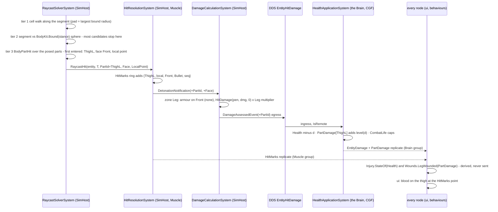
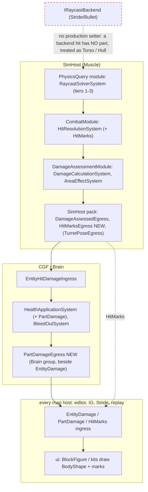

<!--STATUS
state: LIVE
updated: 2026-10-15 (HL-12: body profiles by DIS class + sparse per-type overrides, user-approved)
build-state: BUILDING — S1a BUILT 2026-10-16 (§7, CE-3209); 🔒 user, 2026-10-15: "approved, write the design" (S1 = people first: "Especially people will benefit from more precise collisions, i need it in slice 1"); ruling R-3010
current-answer: §2 classes · §3 sequence · §4 modules · §5 decisions · §6 slices and rails · §7 S1a as built. §1 is the measured ground.
stale-below: nothing.
known-rot: none.
known-conflict: none.
related-designs:
  - docs/DESIGN_Terrain_Combat_Tuning.md — OWNS the resolution chain and provenance (§2, §2a); HL-12 is the first real use of its reserved ReferenceByDis step, for body profiles
  - docs/designs/vehicle-tactics/DESIGN_Armour_Hit_Model.md — OWNS the armour formula (R-212), the face rule (D-A) and D-G "no hull / turret split"; this file replaces ITS face rule (the face entered) and lifts D-G in S2, never the formula
  - docs/DESIGN_Injury_States.md — OWNS the four human states derived from Health (I1–I3, R-2011); this file adds limb wounds DERIVED the same way, and fills its open "wounded AIM"
  - docs/DESIGN_Operations_Behaviour_Catalogue.md — §10.1 D1 OWNS the ruling (R-263): vehicles' mobility kill · firepower kill · destroyed from per-compartment damage; S2 here is its build design
  - docs/DESIGN_Map_3D_Mode.md — OWNS the drawing: the block figure and the family kits (§6, §6o), blood (§6p, CE-1098 — "the real hit point is a follow-up if backend ever puts it on the hit message": HitMarks is that), picking with an oriented box (M17)
  - docs/designs/weapons/DESIGN_Weapon_Systems.md — §6's CE-2182 row ("a direct hit on a DEPLOYED weapon needs a real collider first"): S2 gives weapon systems their parts
  - docs/DESIGN_Terrain_World.md — §4.4 OWNS the collider grid (W9, CE-2193); this file changes how a ROUND queries it (a cell walk), not the grid
  - docs/DESIGN_Weapon_Layers.md — OWNS TurretPose (W-9), the replicated pose S2's turret and gun parts are posed by
-->

# Body parts and hit location — one part list for drawing, colliding and damage

**What it does:** a round meets the **part** it actually crosses — a man's head, torso or limb; a tank's hull, turret or engine — through
three test tiers (grid → bounding sphere → parts). The part carries a fixed **part id**; the hit carries it to damage, which reads that
part's armour and consequence; the Brain keeps a per-part damage level (`PartDamage`, the wound and the compartment are one thing); the
Muscle keeps where the rounds struck (`HitMarks`, part-local) so every renderer draws blood and holes where they really are.

🔒 **User, `2026-10-15`:** *"Cant we use the same rendered geometry as collision geometry … animated in same way?"* · *"Collision checking
should be optimized - first overall bounding box, then detailed ones inside"* · *"The wounds component and the vehicle compartment damage is
likely the same thing … Each bone or compartment can have some fixed enumerated id (part id, also good for the network) … Zone = set of
bones"* · *"Bullet holes or shrapnel fragment hit points could be published and replicated in a fixed size array component … owned by
muscle"* · *"approved, write the design."*

## 1. What exists — measured `2026-10-15`

| fact | where |
|---|---|
| a round's broad phase queries a CIRCLE around its segment's midpoint (½ length + 5 m) in the 5 m collider grid, at most **64** candidates (silently truncated) | `RaycastSolverSystem.cs:122-130`, `PhysicsConstants.cs:24,32` |
| narrow phase: a person = circle + the stance band; a vehicle = circle + height band (a cylinder, radius ½·max(L, W)); a weapon system is skipped for rounds | `RaycastSolverSystem.cs:136-185`, `:154` |
| the face is chosen from the ARRIVAL ANGLE against the hull's heading, never from the point struck; no turret / hull split (D-G) | `ArmorModel.cs:52`, `DamageCalculationSystem.cs` |
| the damage chain: `HitResolutionSystem` (SimHost) → `DetonationNotification` → `DamageCalculationSystem` (SimHost, `DamageAssessmentModule`) → `DamageAssessedEvent` → DDS `EntityHitDamage {HitEntityId, TotalDamage}` → `HealthApplicationSystem` (the Brain, CGF pack) → `Health` → DDS `EntityDamage` to every node | the files named; `SimHostCoreLogicPack.cs:115`, `CgfLogicPack.cs` |
| one `Health` pool; `Injury` DERIVES ok / wounded / incapacitated / dead from it (never stored, I1); `BleedOutSystem`; `CombatLife.ApplyHitCapabilities` strips move / fire | `Injury.cs`, `HealthApplicationSystem.cs`, `CombatLife.cs:47` |
| the drawing is a **shape kit**: boxes / cylinders / cones as fractions of the TKB size, with roles (Hull, Turret, Gun, limbs…) and a pure-math pose (`KitPart.BodyTransform(size, pivots, ArticulationPose, MotionPose)`) — `System.Numerics` only | `Hrot.Presentation/Map3D/ShapeKit.cs:83-200` (ui) |
| the block figure's parts in a SHARED ORDER: thighs 0 / 2, shins 1 / 3, torso 4, head 5, upper arms 6 / 8, forearms 7 / 9, weapon 10 — per stance and weapon posture | `ShapeKit.cs:512-1299` (`BlockFigure.Parts(stance, soldier, posture)`) |
| blood is drawn at REPEATABLY RANDOM spots on those parts, by health (no hit point reaches a viewer) | `ShapeKit.cs:560-590`, Map 3D §6p |
| a raycast BACKEND seam (`IRaycastBackend`, Stride/Bullet) — ⚠ no production host sets it (measured: no `RaycastBackend =` outside tests) | `StrideRaycastBackend.cs`, `RaycastSolverSystem.cs:60-95` |
| `DamageSystem` (reads `HitEvent`) is an EXAMPLE path only — production runs `DamageCalculationSystem` | `DamageAssessmentModule.cs:29` vs `Fdp.Examples.*` |

### INVENTORY — the queries run

`search_graph(name_pattern=".*(Collider|HitResolution|Raycast|Damage|Injury|Wound|HitMark|Stain|BodyPart|BodyProfile|BlockFigure).*", label="Class")`
→ **71** (tests and examples included). Production classes on the path: `PhysicsCollider`, `PhysicsColliderReaders`, `RaycastSolverSystem`,
`RaycastHit`, `RaycastRequestEvent`, `RaycastResultEvent`, `HitResolutionSystem`, `DamageCalculationSystem`, `DamageAssessedEvent`,
`DamageAssessmentModule`, `DamageAssessedEgressTranslator`, `EntityHitDamage`, `EntityHitDamageIngressTranslator`, `EntityDamage` (+ its two
translators), `Injury`, `InjuryThresholds`, `InjuryDefDto`, `InjuryTkbTranslator`, `BodyProfile`, `ColliderIndex`, `ColliderOcclusion`,
`BlockFigure`, `Stain`, `StrideRaycastBackend`. ⛔ **`Wound`, `HitMark`, `BodyPart`: 0** — nothing exists to extend.
`search_graph(name_pattern=".*(Kit|Articulation|ShapeKit|BodyPart).*", label="Class")` → **11**: `ShapeKit`, `ShapeKits`, `KitPart`, `KitPivots`,
`ArticulationPose`, `KitFromTkb`, `WeaponKits` (ui, `Hrot.Presentation`). ⚠ `check_index_coverage` not run (CLI gap) — corroborated by grep.

## 2. Classes

*What the picture shows that prose hid: ONE geometry (`BodyShape`) serves the drawing (`KitPart` keeps only the look) and the hit test;
ONE id (`BodyPartId`) joins geometry, damage rules, the Brain's damage level and the Muscle's marks — no table maps one id space to another.*

## 3. Sequence — a round strikes a man's leg

## 4. Modules — who registers it, who calls it each frame

*What the picture shows that prose hid: the part travels across ONE existing wire hop (SimHost → Brain, `EntityHitDamage`); the two NEW
replicated components are written by the two nodes that already own the facts — the Brain owns damage (beside `Health`, CE-523), the
Muscle owns where rounds struck. The dashed red edge is the dead seam: the Stride raycast backend is unset in production; if a host sets
it, its hits carry no part.*

## 5. Decisions — 🔒 approved `2026-10-15` (R-3010) unless marked lean

| id | decision | why | rejected |
|---|---|---|---|
| **HL-1** | ⭐ the kit's GEOMETRY half (`BodyShape`, `BodyKit`, the pose math) moves to `Fdp.Toolkits` (Physics.BodyParts); ui's `KitPart` keeps the LOOK (colour, face, stains) and draws the shared geometry | one description, so the hit lands where the part is drawn; the pose math is already graphics-free | hit-testing render meshes (the SimHost has none; Raylib kit, Stride and IG each have a different one) · hand-authored collision boxes (a second description that drifts) |
| **HL-2** | **three tiers**: ① a cell WALK along the segment, padded by the grid's largest bound radius, no 64 cap ② one bounding SPHERE per type × pose class (each stance; a turret's whole sweep), precomputed ③ the parts | the sphere rejects most candidates in ~20 operations before 12–16 part tests; the walk visits the cells the segment crosses, not a 40 m disc | an axis-aligned box mid-tier (changes with rotation ⇒ per-frame work) · a BVH (rebuilt every frame for movers) · per-frame posed bounds |
| **HL-3** | ⭐ **part ids are fixed per BODY PLAN** (a byte); a type names its plan in the TKB; several shapes may share one id (a hull of three boxes is Hull). Person ids = the block figure's shared order (0–9) | stable across types and on the wire; the drawing already uses that order | one global enum per type (grows with every type) |
| **HL-4** | **zones are data**: `BodyZonesDto` (`Combat.BodyZones`) per plan, overridable per type — a zone = a set of part ids + armour per face + damage multiplier + effect + threshold | your "zone = set of bones"; a new type is a TKB entry | zone rules in code |
| **HL-5** | the face is the one the round ENTERS (the part's side), replacing the arrival-angle rule for a part hit; the angle rule stays for a hit with no part (area effects, a backend hit) | a corner hit or a roof hit is scored right | — |
| **HL-6** | ⭐ **`PartDamage`**: one component for people AND vehicles — a damage level 0–255 per part id, written by the `Health` owner (the Brain), replicated beside `EntityDamage`. `Health` stays the overall pool | your "the wounds component and the compartment damage are the same thing"; every reader of `Health` / `Injury` keeps working | a health pool per limb (multiplies state; the four injury states already carry the consequence) · stored derived states (two sources for one fact) |
| **HL-7** | **consequences are DERIVED** (`Wounds`, like `Injury`, I1): leg zone over threshold ⇒ the wounded speed factor and no running; arm zone ⇒ aim dispersion × factor (Injury States' open "wounded AIM"); head ⇒ its multiplier makes it lethal or incapacitating through `Health`. S2: Mobility zone ⇒ `CanMove` off, Firepower ⇒ `CanShoot` off, Catastrophic ⇒ destroyed (R-263) | every node derives the same answer from replicated levels | — |
| **HL-8** | ⭐ **`HitMarks`**: a fixed ring (24 slots of PartId · part-local point 3×int16 · face · kind (bullet / fragment / burn / penetration) · sequence), added on the first hit, written by the MUSCLE, replicated like `TurretPose` (BestEffort, TransientLocal, KeepLast 1, on change, once a frame); viewers ACCUMULATE by sequence | your fixed-size, muscle-owned array; part-local so a hole turns with the turret and moves with the arm; a late joiner gets the last 24 | an event stream of hits (unbounded, a late joiner cannot rebuild) · world-space points (break on any articulation) · marks only derived from damage (kept as the fallback when a mark was evicted) |
| **HL-9** (lean) | **S1's person pose = logical stance + weapon posture**, no gait swing, no aim twist / lean, no transition blend | the gait is cosmetic (no node shares its phase); twist is a refinement once the aim reaches the sim side | — |
| **HL-10** (lean) | fragments stay WHOLE-BODY for damage until S3; their HitMarks are SAMPLED (deterministic, seeded by the burst) on the parts facing it, as many as the hits AE5 scored | fragments are counts and probabilities, not rays (AE5) — a ray per fragment is S3's cost question | — |
| **HL-12** | ⭐ **zones are defined ONCE PER CLASS and overridden per type only where needed** — 🔒 user, `2026-10-15`: *"not for each tkb type separately (class templates?), but customizable per tkb type if really needed (overrides?)"* → *"approved"*. Three layers through the resolver chain that already exists ([Terrain Combat Tuning §2](../../DESIGN_Terrain_Combat_Tuning.md)): ① the type's own SPARSE `BodyZonesDto` (only the fields that differ: *"M1: turret front 800"*, *"militia: no vest"*) ② a **body profile** in the Reference Library's `bodies.json`, matched by the type's **DIS class**, most specific wildcard first (`1.1.*.1.*` MBT · `1.1.*.2.*` armoured carrier · `1.1.*.*` land vehicle · `3.1.*` soldier / civilian · `1.2.*` aircraft) ③ the plan's engine fallback. Merged FIELD BY FIELD; every value carries its provenance (`Explicit` / `ReferenceByDis:<profile>` / `EngineFallback`) into `/tkb/resolve` and the inspector. The type's existing `ArmorFront/Side/Rear/Top` ARE its explicit Hull values (no number is lost). ⛔ A profile never ADDS combat to a type: it applies only to a type that already has a combat platform (the risk §2b deferred DIS matching for) | one entry serves every tank; the provenance answers "why did this head shot not kill?" | C# inheritance between TKB types (none exists — a second layering beside the resolver) · zones copied into every catalog type (~30 copies that drift) · matching profiles by name (names are arbitrary; DIS is on every platform) |
| **HL-11** (lean) | starting person zones: Head (helmet on every face but the face's front; × 4), Torso (vest front / back; × 1), Arm (× 0.4), Leg (× 0.5); thresholds: a limb wounded at level 64 | public-medicine shape, starter numbers — tuning starts here | — |

## 6. Slices, items and rails

| slice | lane · id | builds | rails (in the features' own suites) |
|---|---|---|---|
| **S1a** people collide by parts | backend · **CE-3209** | HL-1 (person plan only), HL-2, HL-3, HL-5; `RaycastHit` + `DetonationNotification` appended; the **benchmark** (a crowded street, a burst through it: before / after) in `Fdp.ModuleHost.Benchmarks` | `RaycastSolverSystemTests`: a round between a standing man's legs misses; one at head height hits Head; a prone man is hit only by a low round; the sphere rejects without part tests (a counter); a 70 m segment finds a man its midpoint circle missed; no candidate cap |
| **S1b** people's damage by part | backend · **CE-3210** | HL-4, HL-6, HL-7 (people), HL-8, HL-10's marks, **HL-12** (the resolver + `bodies.json` with the soldier and civilian profiles first); `EntityHitDamage.PartId` (R-169 appended); `PartDamage` + `HitMarks` descriptors and translators; `BodyZonesDto` for the soldier and civilian | `DamageCalculationSystemTests`: a head hit through a helmet vs without; `HealthApplicationSystemTests`: `PartDamage` written on the owner only; `InjuryTests`: a leg wound slows, an arm wound widens σ; translator round trips; the ring evicts the oldest and keeps the sequence |
| **S1c** the drawing | ui (its id) | `BlockFigure` draws from `BodyKit`; blood and holes from `HitMarks` (seeded spots as the fallback); a debug overlay of the colliding parts | ui's suites |
| **S2** vehicles and weapon systems | backend · **CE-3211** (ui draws) | the TrackedVehicle / WheeledVehicle / Rotorcraft / WeaponSystem plans; the family kits' geometry moves; turret and gun parts posed by `TurretPose`; compartments ⇒ mobility / firepower / destroyed (R-263); D-G lifted; weapon systems hittable when not embarked (supersedes CE-2182's skip) | a round over a turret's roof meets the roof; a side shot at a turned turret meets the turret's side armour; an engine hit stops it; a gun hit stops it firing |
| **S3** fragments per part | backend · **CE-3212** | fragment damage spread over the exposed parts (and its cost measured) | AE5's rails per part |

⚠ **Blast radius:** hit rates change in every fight — the live demos' scores move (S1 for infantry fights, S2 for armour). The wire grows by
one byte on `EntityHitDamage` and two new descriptors. `Health`, `Injury`, `CombatLife` and every reader of them keep their meaning.

## 7. S1a as built — `CE-3209` *(backend, `2026-10-16`)*

The design carries 17 classes (§2) and 1 sequence (§3); S1a builds the person half of tiers ①–③ and the hit's part. Deviations, each argued:

| as designed | as built | why |
|---|---|---|
| HL-1: the kit's geometry MOVES to `Fdp.Toolkits`; the drawing reads it | ⚠ **the sim's person table is GENERATED from the drawn figure** (`PersonBody.Tables.g.cs`: 11 poses × 10 `BodyBox`es, centre / half-size / rotation in metres for a 1.8 m figure), and a rail in ui's suite (`PersonBodyParityTests`) fails the moment the two differ; `HROT_GEN_PERSON_BODY=1` regenerates. ⏭ S1c: `BlockFigure` reads its geometry from `PersonBody` (one description, the rail then trivially true) | moving `KitPart` (geometry and look interleaved, ~800 lines of poses, transitions, faces and stains) is a large edit of ui's live code; generation + parity gives one source of truth NOW without it |
| `BodyShape` / `BodyKit` | `BodyBox` (oriented box: part, centre, half, rotation) + `PersonBody` (poses, bounds, `PoseOf`) + `BodyPartHit` (sphere and slab tests) in `Fdp.Toolkits/Physics/BodyParts` | the figure is boxes only; cylinders and cones come with S2's vehicles |
| HL-9: stance × posture | `PersonPose`: standing / crouched × AtEase / Ready / Aimed, prone, the civilian three, **Downed** (incapacitated or dead — the figure's dead pose). Armed = has a `WeaponState` | a down man lies; a civilian's arms hang |
| tier ① cell walk, no cap | `SpatialHashGrid.QuerySegment` (cells within pad + ½ diagonal of the segment), pad = max(`SpatialGridData.MaxRadius` — NEW, measured by `SpatialHashSystem` — , `PersonBody.MaxBoundRadius`); 512 candidates, an overflow COUNTED (`CandidateOverflows`) | a cap that can be reached must say so |
| — | `RaycastSolverSystem.PersonParts` / `CellWalk` (default on) switch the old paths back **for the benchmark only** | the before / after must be measurable in one build |
| the hit carries the part | `RaycastHit` and `DetonationNotification` APPEND `HasBodyPart`, `BodyPart`, `Face` (+ `LocalPoint` on the hit, for S1b's marks); `DamageCalculationSystem` uses the face ENTERED when there is a part (HL-5); `/combat/shots` reports `hitPart` / `hitFace` | in-process events: no wire change in S1a |
| — | the P2 rail's standing shot moved 0.9 → 1.2 m | at 0.9 m the round now passes between his legs — the precision this slice exists for |

**Rails** (`RaycastSolverSystemTests`, the feature's suite): `CE3209_ARound_MeetsThePartItCrosses_AndTheFaceItEntered` (head, torso, thigh; rear from behind, front from ahead; parts off ⇒ no part) · `CE3209_ARoundBetweenHisLegs_OrPastHisShoulder_MissesHim` (+ prone: over at 0.4 m, torso at 0.15 m; the old band hit between the legs) · `CE3209_TheBoundingSphere_RejectsARoundThatPassesBy_BeforeAnyPartTest` · `CE3209_InACrowd_TheManOnTheLine_IsStillFound` (100 men off the line, no overflow); `PersonBodyParityTests` (ui's suite, cross-lane).
**Benchmark:** `CrowdRaycastBenchmark` (`Fdp.ModuleHost.Benchmarks`, `-- crowd`): 300 people in a 100 × 20 m street, 500 rounds of a 40 m step — numbers below.

