<!--STATUS
state: LIVE
updated: 2026-10-19 (§13: lean — a man leaning round a corner, CE-3257); 2026-10-16 (§9b: a vehicle part's face is the armour ARC, CE-2217 — supersedes HL-5 / S2-7 for vehicles)
build-state: BUILDING — S1a BUILT 2026-10-16 (§7, CE-3209); S1b BUILT 2026-10-16 (§8, CE-3210); S2 (ground vehicles) BUILT 2026-10-16 (§9a, CE-3211); S3 BUILT 2026-10-16 (§10a, CE-3212); S2b (weapon systems) BUILT 2026-10-16 (§11a, CE-3214); S2c (aircraft) BUILT 2026-10-16 (§12a, CE-3215); §13 lean BUILT 2026-10-19 (CE-3257); 🔒 user, 2026-10-15: "approved, write the design" (S1 = people first: "Especially people will benefit from more precise collisions, i need it in slice 1"); ruling R-3010
current-answer: §2 classes · §3 sequence · §4 modules · §5 decisions · §6 slices and rails · §7 S1a as built · §8 S1b as built · §9 S2 (ground vehicles) design · §9a S2 as built · §10 S3 (fragments per part) · §10a S3 as built · §11 S2b (weapon systems by part) · §11a S2b as built · §12 S2c (aircraft by part) · §12a S2c as built · §13 lean (BR-5). §1 is the measured ground.
stale-below: nothing.
known-rot: HL-5 and S2-7 below say a VEHICLE part is scored on "the face entered" and that "no armour number moves" — SUPERSEDED for vehicles by §9b (CE-2217): a vehicle part's face is the armour model's arc in the part's frame. People keep HL-5.
known-conflict: none.
related-designs:
  - docs/DESIGN_Entity_Control.md — §8g: the FPS crosshair meets these same parts through BodyPartRay (CE-1126), the function the solver's narrow phase is routed through
  - docs/designs/airborne/DESIGN_Airborne_Insertion.md — §9: a descending man (rope, canopy) is still a person target (IsPerson keys on VehicleParams — keep it there, not on Locomotions.Of), collides in his stance pose; canopy and rope are not parts (D-10)
  - docs/DESIGN_Terrain_Combat_Tuning.md — OWNS the resolution chain and provenance (§2, §2a); HL-12 is the first real use of its reserved ReferenceByDis step, for body profiles
  - docs/designs/vehicle-tactics/DESIGN_Armour_Hit_Model.md — OWNS the armour formula (R-212), the face rule (D-A) and D-G "no hull / turret split"; this file replaces ITS face rule (the face entered) and lifts D-G in S2, never the formula
  - docs/DESIGN_Injury_States.md — OWNS the four human states derived from Health (I1–I3, R-2011); this file adds limb wounds DERIVED the same way, and fills its open "wounded AIM"
  - docs/DESIGN_Operations_Behaviour_Catalogue.md — §10.1 D1 OWNS the ruling (R-263): vehicles' mobility kill · firepower kill · destroyed from per-compartment damage; S2 here is its build design
  - docs/DESIGN_Map_3D_Mode.md — OWNS the drawing: the block figure and the family kits (§6, §6o), blood (§6p, CE-1098 — "the real hit point is a follow-up if backend ever puts it on the hit message": HitMarks is that), picking with an oriented box (M17)
  - docs/designs/weapons/DESIGN_Weapon_Systems.md — §6's CE-2182 row ("a direct hit on a DEPLOYED weapon needs a real collider first"): S2 gives weapon systems their parts
  - docs/DESIGN_Terrain_World.md — §4.4 OWNS the collider grid (W9, CE-2193); this file changes how a ROUND queries it (a cell walk), not the grid
  - docs/DESIGN_Weapon_Layers.md — OWNS TurretPose (W-9), the replicated pose S2's turret and gun parts are posed by
  - docs/designs/group-maneuvers/DESIGN_Building_Clearing.md — OWNS CB-21 (why a man leans, the SliceThePie behaviour that leans him — behaviors); §13 here is the engine of it
  - docs/designs/look-direction/DESIGN_Look_Direction_And_FOV.md — OWNS where the eyes POINT (LookState, the FOV cone); §13's lean moves where they SIT
  - ../../DESIGN_Civilians_And_Crowd_Control.md — CV-1: the new civilian family carries body zones (HL-12) and uses the civilian poses (HL-9).
-->

# Body parts and hit location — one part list for drawing, colliding and damage

**What it does:** a round meets the **part** it actually crosses — a man's head, torso or limb; a tank's hull, turret or engine — through
three test tiers (grid → bounding sphere → parts). The part carries a fixed **part id**; the hit carries it to damage, which reads that
part's armour and consequence; the Brain keeps a per-part damage level (`PartDamage`, the wound and the compartment are one thing); the
Muscle keeps where the rounds struck (`HitMarks`, part-local) so every renderer draws blood and holes where they really are.

🔒 **User, `2026-10-15`:** *"Cant we use the same rendered geometry as collision geometry … animated in same way?"* · *"Collision checking
should be optimized - first overall bounding box, then detailed ones inside"* · *"The wounds component and the vehicle compartment damage is
likely the same thing … Each bone or compartment can have some fixed enumerated id (part id, also good for the network) … Zone = set of
bones"* · *"Bullet holes or shrapnel fragment hit points could be published and replicated in a fixed size array component … owned by
muscle"* · *"approved, write the design."*

## 1. What exists — measured `2026-10-15`

| fact | where |
|---|---|
| a round's broad phase queries a CIRCLE around its segment's midpoint (½ length + 5 m) in the 5 m collider grid, at most **64** candidates (silently truncated) | `RaycastSolverSystem.cs:122-130`, `PhysicsConstants.cs:24,32` |
| narrow phase: a person = circle + the stance band; a vehicle = circle + height band (a cylinder, radius ½·max(L, W)); a weapon system is skipped for rounds | `RaycastSolverSystem.cs:136-185`, `:154` |
| the face is chosen from the ARRIVAL ANGLE against the hull's heading, never from the point struck; no turret / hull split (D-G) | `ArmorModel.cs:52`, `DamageCalculationSystem.cs` |
| the damage chain: `HitResolutionSystem` (SimHost) → `DetonationNotification` → `DamageCalculationSystem` (SimHost, `DamageAssessmentModule`) → `DamageAssessedEvent` → DDS `EntityHitDamage {HitEntityId, TotalDamage}` → `HealthApplicationSystem` (the Brain, CGF pack) → `Health` → DDS `EntityDamage` to every node | the files named; `SimHostCoreLogicPack.cs:115`, `CgfLogicPack.cs` |
| one `Health` pool; `Injury` DERIVES ok / wounded / incapacitated / dead from it (never stored, I1); `BleedOutSystem`; `CombatLife.ApplyHitCapabilities` strips move / fire | `Injury.cs`, `HealthApplicationSystem.cs`, `CombatLife.cs:47` |
| the drawing is a **shape kit**: boxes / cylinders / cones as fractions of the TKB size, with roles (Hull, Turret, Gun, limbs…) and a pure-math pose (`KitPart.BodyTransform(size, pivots, ArticulationPose, MotionPose)`) — `System.Numerics` only | `Hrot.Presentation/Map3D/ShapeKit.cs:83-200` (ui) |
| the block figure's parts in a SHARED ORDER: thighs 0 / 2, shins 1 / 3, torso 4, head 5, upper arms 6 / 8, forearms 7 / 9, weapon 10 — per stance and weapon posture | `ShapeKit.cs:512-1299` (`BlockFigure.Parts(stance, soldier, posture)`) |
| blood is drawn at REPEATABLY RANDOM spots on those parts, by health (no hit point reaches a viewer) | `ShapeKit.cs:560-590`, Map 3D §6p |
| a raycast BACKEND seam (`IRaycastBackend`, Stride/Bullet) — ⚠ no production host sets it (measured: no `RaycastBackend =` outside tests) | `StrideRaycastBackend.cs`, `RaycastSolverSystem.cs:60-95` |
| `DamageSystem` (reads `HitEvent`) is an EXAMPLE path only — production runs `DamageCalculationSystem` | `DamageAssessmentModule.cs:29` vs `Fdp.Examples.*` |

### INVENTORY — the queries run

`search_graph(name_pattern=".*(Collider|HitResolution|Raycast|Damage|Injury|Wound|HitMark|Stain|BodyPart|BodyProfile|BlockFigure).*", label="Class")`
→ **71** (tests and examples included). Production classes on the path: `PhysicsCollider`, `PhysicsColliderReaders`, `RaycastSolverSystem`,
`RaycastHit`, `RaycastRequestEvent`, `RaycastResultEvent`, `HitResolutionSystem`, `DamageCalculationSystem`, `DamageAssessedEvent`,
`DamageAssessmentModule`, `DamageAssessedEgressTranslator`, `EntityHitDamage`, `EntityHitDamageIngressTranslator`, `EntityDamage` (+ its two
translators), `Injury`, `InjuryThresholds`, `InjuryDefDto`, `InjuryTkbTranslator`, `BodyProfile`, `ColliderIndex`, `ColliderOcclusion`,
`BlockFigure`, `Stain`, `StrideRaycastBackend`. ⛔ **`Wound`, `HitMark`, `BodyPart`: 0** — nothing exists to extend.
`search_graph(name_pattern=".*(Kit|Articulation|ShapeKit|BodyPart).*", label="Class")` → **11**: `ShapeKit`, `ShapeKits`, `KitPart`, `KitPivots`,
`ArticulationPose`, `KitFromTkb`, `WeaponKits` (ui, `Hrot.Presentation`). ⚠ `check_index_coverage` not run (CLI gap) — corroborated by grep.

## 2. Classes

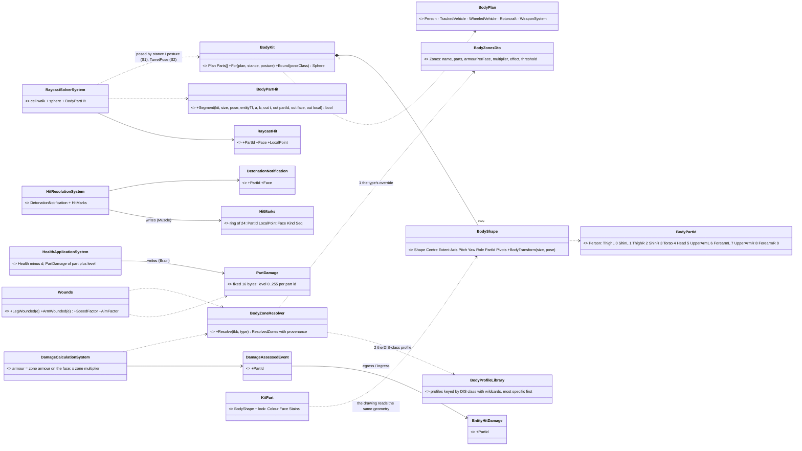
*What the picture shows that prose hid: ONE geometry (`BodyShape`) serves the drawing (`KitPart` keeps only the look) and the hit test;
ONE id (`BodyPartId`) joins geometry, damage rules, the Brain's damage level and the Muscle's marks — no table maps one id space to another.*

## 3. Sequence — a round strikes a man's leg

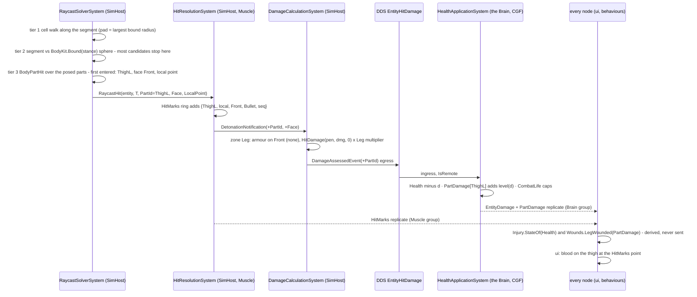

## 4. Modules — who registers it, who calls it each frame

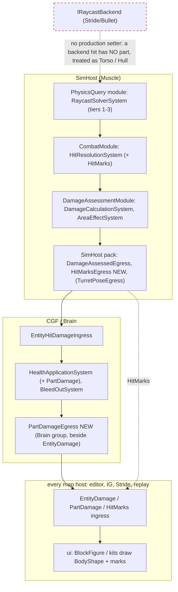
*What the picture shows that prose hid: the part travels across ONE existing wire hop (SimHost → Brain, `EntityHitDamage`); the two NEW
replicated components are written by the two nodes that already own the facts — the Brain owns damage (beside `Health`, CE-523), the
Muscle owns where rounds struck. The dashed red edge is the dead seam: the Stride raycast backend is unset in production; if a host sets
it, its hits carry no part.*

## 5. Decisions — 🔒 approved `2026-10-15` (R-3010) unless marked lean

| id | decision | why | rejected |
|---|---|---|---|
| **HL-1** | ⭐ the kit's GEOMETRY half (`BodyShape`, `BodyKit`, the pose math) moves to `Fdp.Toolkits` (Physics.BodyParts); ui's `KitPart` keeps the LOOK (colour, face, stains) and draws the shared geometry | one description, so the hit lands where the part is drawn; the pose math is already graphics-free | hit-testing render meshes (the SimHost has none; Raylib kit, Stride and IG each have a different one) · hand-authored collision boxes (a second description that drifts) |
| **HL-2** | **three tiers**: ① a cell WALK along the segment, padded by the grid's largest bound radius, no 64 cap ② one bounding SPHERE per type × pose class (each stance; a turret's whole sweep), precomputed ③ the parts | the sphere rejects most candidates in ~20 operations before 12–16 part tests; the walk visits the cells the segment crosses, not a 40 m disc | an axis-aligned box mid-tier (changes with rotation ⇒ per-frame work) · a BVH (rebuilt every frame for movers) · per-frame posed bounds |
| **HL-3** | ⭐ **part ids are fixed per BODY PLAN** (a byte); a type names its plan in the TKB; several shapes may share one id (a hull of three boxes is Hull). Person ids = the block figure's shared order (0–9) | stable across types and on the wire; the drawing already uses that order | one global enum per type (grows with every type) |
| **HL-4** | **zones are data**: `BodyZonesDto` (`Combat.BodyZones`) per plan, overridable per type — a zone = a set of part ids + armour per face + damage multiplier + effect + threshold | your "zone = set of bones"; a new type is a TKB entry | zone rules in code |
| **HL-5** | the face is the one the round ENTERS (the part's side), replacing the arrival-angle rule for a part hit; the angle rule stays for a hit with no part (area effects, a backend hit). ⛔ **SUPERSEDED for VEHICLE parts by §9b (CE-2217)** — people keep it | a corner hit or a roof hit is scored right | — |
| **HL-6** | ⭐ **`PartDamage`**: one component for people AND vehicles — a damage level 0–255 per part id, written by the `Health` owner (the Brain), replicated beside `EntityDamage`. `Health` stays the overall pool | your "the wounds component and the compartment damage are the same thing"; every reader of `Health` / `Injury` keeps working | a health pool per limb (multiplies state; the four injury states already carry the consequence) · stored derived states (two sources for one fact) |
| **HL-7** | **consequences are DERIVED** (`Wounds`, like `Injury`, I1): leg zone over threshold ⇒ the wounded speed factor and no running; arm zone ⇒ aim dispersion × factor (Injury States' open "wounded AIM"); head ⇒ its multiplier makes it lethal or incapacitating through `Health`. S2: Mobility zone ⇒ `CanMove` off, Firepower ⇒ `CanShoot` off, Catastrophic ⇒ destroyed (R-263) | every node derives the same answer from replicated levels | — |
| **HL-8** | ⭐ **`HitMarks`**: a fixed ring (24 slots of PartId · part-local point 3×int16 · face · kind (bullet / fragment / burn / penetration) · sequence), added on the first hit, written by the MUSCLE, replicated like `TurretPose` (BestEffort, TransientLocal, KeepLast 1, on change, once a frame); viewers ACCUMULATE by sequence | your fixed-size, muscle-owned array; part-local so a hole turns with the turret and moves with the arm; a late joiner gets the last 24 | an event stream of hits (unbounded, a late joiner cannot rebuild) · world-space points (break on any articulation) · marks only derived from damage (kept as the fallback when a mark was evicted) |
| **HL-9** (lean) | **S1's person pose = logical stance + weapon posture**, no gait swing, no aim twist / lean, no transition blend | the gait is cosmetic (no node shares its phase); twist is a refinement once the aim reaches the sim side | — |
| **HL-10** (lean) | fragments stay WHOLE-BODY for damage until S3; their HitMarks are SAMPLED (deterministic, seeded by the burst) on the parts facing it, as many as the hits AE5 scored | fragments are counts and probabilities, not rays (AE5) — a ray per fragment is S3's cost question | — |
| **HL-12** | ⭐ **zones are defined ONCE PER CLASS and overridden per type only where needed** — 🔒 user, `2026-10-15`: *"not for each tkb type separately (class templates?), but customizable per tkb type if really needed (overrides?)"* → *"approved"*. Three layers through the resolver chain that already exists ([Terrain Combat Tuning §2](../../DESIGN_Terrain_Combat_Tuning.md)): ① the type's own SPARSE `BodyZonesDto` (only the fields that differ: *"M1: turret front 800"*, *"militia: no vest"*) ② a **body profile** in the Reference Library's `bodies.json`, matched by the type's **DIS class**, most specific wildcard first (`1.1.*.1.*` MBT · `1.1.*.2.*` armoured carrier · `1.1.*.*` land vehicle · `3.1.*` soldier / civilian · `1.2.*` aircraft) ③ the plan's engine fallback. Merged FIELD BY FIELD; every value carries its provenance (`Explicit` / `ReferenceByDis:<profile>` / `EngineFallback`) into `/tkb/resolve` and the inspector. The type's existing `ArmorFront/Side/Rear/Top` ARE its explicit Hull values (no number is lost). ⛔ A profile never ADDS combat to a type: it applies only to a type that already has a combat platform (the risk §2b deferred DIS matching for) | one entry serves every tank; the provenance answers "why did this head shot not kill?" | C# inheritance between TKB types (none exists — a second layering beside the resolver) · zones copied into every catalog type (~30 copies that drift) · matching profiles by name (names are arbitrary; DIS is on every platform) |
| **HL-11** (lean) | starting person zones: Head (helmet on every face but the face's front; × 4), Torso (vest front / back; × 1), Arm (× 0.4), Leg (× 0.5); thresholds: a limb wounded at level 64 | public-medicine shape, starter numbers — tuning starts here | — |

## 6. Slices, items and rails

| slice | lane · id | builds | rails (in the features' own suites) |
|---|---|---|---|
| **S1a** people collide by parts | backend · **CE-3209** | HL-1 (person plan only), HL-2, HL-3, HL-5; `RaycastHit` + `DetonationNotification` appended; the **benchmark** (a crowded street, a burst through it: before / after) in `Fdp.ModuleHost.Benchmarks` | `RaycastSolverSystemTests`: a round between a standing man's legs misses; one at head height hits Head; a prone man is hit only by a low round; the sphere rejects without part tests (a counter); a 70 m segment finds a man its midpoint circle missed; no candidate cap |
| **S1b** people's damage by part | backend · **CE-3210** | HL-4, HL-6, HL-7 (people), HL-8, HL-10's marks, **HL-12** (the resolver + `bodies.json` with the soldier and civilian profiles first); `EntityHitDamage.PartId` (R-169 appended); `PartDamage` + `HitMarks` descriptors and translators; `BodyZonesDto` for the soldier and civilian | `DamageCalculationSystemTests`: a head hit through a helmet vs without; `HealthApplicationSystemTests`: `PartDamage` written on the owner only; `InjuryTests`: a leg wound slows, an arm wound widens σ; translator round trips; the ring evicts the oldest and keeps the sequence |
| **S1c** the drawing | ui (its id) | `BlockFigure` draws from `BodyKit`; blood and holes from `HitMarks` (seeded spots as the fallback); a debug overlay of the colliding parts | ui's suites |
| **S2** vehicles and weapon systems | backend · **CE-3211** (ui draws) | the TrackedVehicle / WheeledVehicle / Rotorcraft / WeaponSystem plans; the family kits' geometry moves; turret and gun parts posed by `TurretPose`; compartments ⇒ mobility / firepower / destroyed (R-263); D-G lifted; weapon systems hittable when not embarked (supersedes CE-2182's skip) | a round over a turret's roof meets the roof; a side shot at a turned turret meets the turret's side armour; an engine hit stops it; a gun hit stops it firing |
| **S3** fragments per part | backend · **CE-3212** | fragment damage spread over the exposed parts (and its cost measured) | AE5's rails per part |

⚠ **Blast radius:** hit rates change in every fight — the live demos' scores move (S1 for infantry fights, S2 for armour). The wire grows by
one byte on `EntityHitDamage` and two new descriptors. `Health`, `Injury`, `CombatLife` and every reader of them keep their meaning.

## 7. S1a as built — `CE-3209` *(backend, `2026-10-16`)*

The design carries 17 classes (§2) and 1 sequence (§3); S1a builds the person half of tiers ①–③ and the hit's part. Deviations, each argued:

| as designed | as built | why |
|---|---|---|
| HL-1: the kit's geometry MOVES to `Fdp.Toolkits`; the drawing reads it | ⚠ **the sim's person table is GENERATED from the drawn figure** (`PersonBody.Tables.g.cs`: 11 poses × 10 `BodyBox`es, centre / half-size / rotation in metres for a 1.8 m figure), and a rail in ui's suite (`PersonBodyParityTests`) fails the moment the two differ; `HROT_GEN_PERSON_BODY=1` regenerates. ⏭ S1c: `BlockFigure` reads its geometry from `PersonBody` (one description, the rail then trivially true) | moving `KitPart` (geometry and look interleaved, ~800 lines of poses, transitions, faces and stains) is a large edit of ui's live code; generation + parity gives one source of truth NOW without it |
| `BodyShape` / `BodyKit` | `BodyBox` (oriented box: part, centre, half, rotation) + `PersonBody` (poses, bounds, `PoseOf`) + `BodyPartHit` (sphere and slab tests) in `Fdp.Toolkits/Physics/BodyParts` | the figure is boxes only; cylinders and cones come with S2's vehicles |
| HL-9: stance × posture | `PersonPose`: standing / crouched × AtEase / Ready / Aimed, prone, the civilian three, **Downed** (incapacitated or dead — the figure's dead pose). Armed = has a `WeaponState` | a down man lies; a civilian's arms hang |
| tier ① cell walk, no cap | `SpatialHashGrid.QuerySegment` (cells within pad + ½ diagonal of the segment), pad = max(`SpatialGridData.MaxRadius` — NEW, measured by `SpatialHashSystem` — , `PersonBody.MaxBoundRadius`); 512 candidates, an overflow COUNTED (`CandidateOverflows`) | a cap that can be reached must say so |
| — | `RaycastSolverSystem.PersonParts` / `CellWalk` (default on) switch the old paths back **for the benchmark only** | the before / after must be measurable in one build |
| the hit carries the part | `RaycastHit` and `DetonationNotification` APPEND `HasBodyPart`, `BodyPart`, `Face` (+ `LocalPoint` on the hit, for S1b's marks); `DamageCalculationSystem` uses the face ENTERED when there is a part (HL-5); `/combat/shots` reports `hitPart` / `hitFace` | in-process events: no wire change in S1a |
| — | the P2 rail's standing shot moved 0.9 → 1.2 m | at 0.9 m the round now passes between his legs — the precision this slice exists for |

**Rails** (`RaycastSolverSystemTests`, the feature's suite): `CE3209_ARound_MeetsThePartItCrosses_AndTheFaceItEntered` (head, torso, thigh; rear from behind, front from ahead; parts off ⇒ no part) · `CE3209_ARoundBetweenHisLegs_OrPastHisShoulder_MissesHim` (+ prone: over at 0.4 m, torso at 0.15 m; the old band hit between the legs) · `CE3209_TheBoundingSphere_RejectsARoundThatPassesBy_BeforeAnyPartTest` · `CE3209_InACrowd_TheManOnTheLine_IsStillFound` (100 men off the line, no overflow); `PersonBodyParityTests` (ui's suite, cross-lane).
**Benchmark:** `CrowdRaycastBenchmark` (`Fdp.ModuleHost.Benchmarks`, `-- crowd`): 300 people in a 100 × 20 m street, 500 rounds of a 40 m step,
one solver pass. 📐 Measured `2026-10-16` (BenchmarkDotNet ShortRun, 3 iterations — the confidence intervals are wide):

| path | mean per burst |
|---|---|
| Old — the midpoint disc + the circle and band | 11.3 ms |
| CellWalk — the new broad phase, the old narrow phase | 11.0 ms |
| Parts — cell walk + sphere + parts (shipped) | 13.0 ms |

⇒ the part test costs ≈ 2 ms per 500 rounds in a dense crowd (≈ 4 µs a round); most of a burst is the event publish / playback every path
shares. The cell walk's gain is small at a 40 m step (the old disc was 25 m); its real value is correctness — no silent 64 cap, the pad sized
to the largest body. ⏭ If a fight ever spends real time here, the sphere's reject rate (`SphereRejects` / `PartTests`) is the first thing to read.

## 8. S1b as built — `CE-3210` *(backend, `2026-10-16`)*

S1b builds §2's damage half for people: the zones (HL-4, HL-12), `PartDamage` (HL-6), the derived wounds (HL-7), `HitMarks` (HL-8) and
HL-10's fragment marks. It matches §2/§3 except:

| as designed | as built | why |
|---|---|---|
| `BodyZoneResolver` + `BodyProfileLibrary` | ONE static `BodyZones` (`Fdp.Toolkits/Physics/BodyParts/BodyZones.cs`): `Of(template)` (cached per template) · `Of(world, entity)` · `Parameters(template)` for `/tkb/resolve`; the library is the embedded `Tkb/Reference/Data/bodies.json` (profiles `Soldier` `3.1.*.1`, `Person` `3`) | one resolver, one cache; the library is a file, not a class |
| `EntityHitDamage.PartId` | `EntityHitDamage.BodyPart` carries the part id **+ 1, 0 = none** | ⚠ an appended byte reads 0 from a sender that never sets it: 255 = none would have read every such hit as ThighL |
| `DamageAssessedEvent.PartId` | `HasBodyPart` + `BodyPart` (the in-process form `DetonationNotification` already uses) | one shape for every in-process hit event |
| HL-12 ② "the type's armour is its Hull values" | for a PERSON, the type's own `ArmorFront/Side/Rear/Top` are its **Torso**'s, marked `Explicit` | a person has no hull; the body armour a type states is a vest |
| `Wounds.SpeedFactor` | the leg wound feeds `Injury.SpeedFactor` (one speed rule for every mover): the type's `WoundedSpeedFactor`, else `Wounds.WoundedLegSpeedFactor` 0.6; the arm wound × `Wounds.WoundedAimFactor` 1.6 in `HitModel.Sigma` | the existing readers (`CarKinematicsSystem`, the fire chain) pick it up with no new call site |
| — | a snapshot view (no TKB) judges wounds by the engine's person body | `Wounds` must answer on every view; the live world uses the type's zones |
| HL-10 marks "on the parts facing it" | up to `AreaEffectSystem.MaxFragmentMarks` (6) per man per burst, on parts drawn from a hash of the burst sequence and the body, on the face toward the burst | a man's parts nearly all face a burst; ⏭ S3 resolves fragments per part |
| — | the `Insurgent` type carries the first sparse override (`Combat.BodyZones`: no helmet, no vest) | HL-12's worked example, in a real catalog |

**Ids:** components `PartDamage` 390 (Brain group) and `HitMarks` 391 (Muscle group, `NoScenario`); descriptors `dtPartDamage` 135 and
`dtHitMarks` 136 (`EntityPartDamage`, `EntityHitMarks` with a `[DdsManaged] List<DdsHitMark>`); translators in
`Hrot.Network.NED/Replication/Map/EntityBodyPartTranslators.cs`, registered in `SharedTranslatorPack` / `EntityStatesIngressPack`.
**Rails:** `BodyPartDamageTests` (the feature's suite — zones and provenance, head ×4, the helmet, `PartDamage` on the owner only, the
leg and arm wounds, the ring, the bullet and fragment marks) · `BodyPartReplicationTests` (both translators round trip, the ring after it
wrapped) · `DamageAssessedEgressTranslatorTests` / `EntityHitDamageIngressTranslatorTests` (the part on the wire, an unset field = no
part). ⚠ §6 named `DamageCalculationSystemTests` / `HealthApplicationSystemTests` / `InjuryTests`; the rails need a TKB with body
profiles those fixtures do not build, so they live in the one body-part suite.
⏭ **S1c (ui):** draw `HitMarks` (part-local points on the posed part) and switch `BlockFigure` to read `PersonBody`. ✅ **`HitMarks` DRAWN `2026-10-16` (ui, CE-1122)** — [Map 3D §6y](../../DESIGN_Map_3D_Mode.md): each mark a stain on its part, flat on the face it entered, sized in metres by kind; the seeded spots stay the fallback. ⛔ **`BlockFigure` NOT switched to read `PersonBody` (§6y HM-4):** the figure has ~20 more poses than the sim's 11, so the generated table + `PersonBodyParityTests` stays the one description.

## 9. S2 — ground vehicles by part, `CE-3211` *(backend, designed `2026-10-16`; decisions taken autonomously under the user's overnight mandate)*

🔒 **User, `2026-10-15`:** *"go ahead. I would like you to work on that autonomously overnight, taking decision automatically."* S2's
decisions below are therefore **leans taken, not user rulings** — each says what would change it.

```mermaid
classDiagram
  direction LR
  class VehicleKit { <<NEW generated table, VehicleBody.Tables.g.cs>> Name · DefaultSize · TurretPivot · Trunnion · Parts[] }
  class VehicleKitPart { <<NEW>> Part id · Shape · Centre · Extent (fractions) · Axis · Pitch · Yaw · Role (Hull/Turret/Gun) · EngineBox }
  class VehiclePart { <<NEW byte ids, every vehicle plan>> Hull 0 · Turret 1 · Gun 2 · RunningGearL 3 · RunningGearR 4 · Engine 5 }
  class VehicleBody { <<NEW static>> +Of(world, e) VehicleShape? · +Pose(shape, TurretPose, Span~BodyBox~) · MaxBoundRadius }
  class VehicleShape { <<NEW, cached per template>> Kit · Size · Pivots (from TurretDto, KitFromTkb's rule) · KitToBody · Bound · EngineEnd }
  class BodyZones { <<S1b, grows>> profile names its kit + engine end; vehicle zones inherit the platform armour }
  class RaycastSolverSystem { <<grows>> vehicle branch: sphere, posed boxes, Engine region }
  class TurretParts { <<existing>> +PoseOf(view, e, 0) TurretPose }
  class CombatLife { <<existing, grows>> ApplyHitCapabilities: Mobility zone ⇒ CanMove off · Firepower ⇒ CanShoot off }
  class ShapeKits { <<existing ui>> Tank · Afv · SpArtillery · WheeledCar · WheeledUtility }
  class VehicleBodyParityTests { <<NEW ui suite>> generates the table; fails when sim and drawing differ, per catalog type }
  VehicleBody ..> VehicleShape
  VehicleShape ..> VehicleKit
  VehicleKit "1" *-- "many" VehicleKitPart
  VehicleKitPart ..> VehiclePart
  VehicleBody ..> TurretParts : turret 0's pose
  VehicleShape ..> BodyZones : kit + engine end from the DIS-class profile
  RaycastSolverSystem ..> VehicleBody
  VehicleBodyParityTests ..> ShapeKits : reads
  VehicleBodyParityTests ..> VehicleKit : writes / compares
  CombatLife ..> BodyZones
```
*What the picture shows that prose hid: the vehicle's shape is NOT a second description — the table is generated from ui's kits and a rail
compares the posed boxes with the drawing per catalog type; the only new runtime state is a per-template cache. The kit is picked by the
SAME DIS-class profile that gives the zones, so one `bodies.json` entry says what a vehicle is made of and what each part does.*

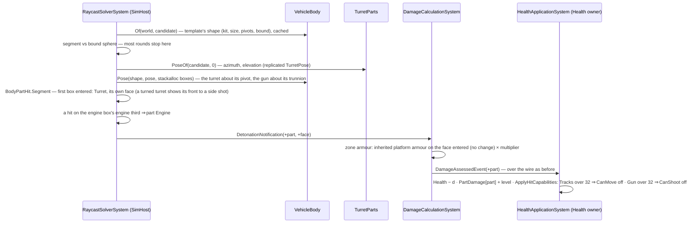

The modules do not change (§4): the solver, damage and health systems are where they were; `TurretPose` is already replicated to the
SimHost (W-9). ✅ **The drawing and the sim pose the gun from ONE pose:** a `ui` SpArtillery is drawn by `LaidPose`, which reads the
replicated `TurretPose` as published — azimuth AND elevation, a level gun included (`EntityBodyLayer3D.cs:613`, ui's CE-1114); the
fallback elevation is only for a gun with no turret part. *(⛔ SUPERSEDED `2026-10-16` — this caption said "one dead edge stays dead: the
two agree only once the howitzer publishes its lay"; backend's P2 lays the gun before it fires and CE-1114 draws that lay — ui steer.)*

| id | decision (lean) | why | rejected · what would change it |
|---|---|---|---|
| **S2-1** | scope = the **tracked** (Tank, Afv, SpArtillery) and **wheeled** (Car, WheeledUtility) kits. Weapon systems → **S2b `CE-3214`**, aircraft → **S2c `CE-3215`** | the ground vehicles share one shape (hull, turret, gun, running gear) and carry the R-263 states; weapon kits blend stowed/deployed, aircraft rotate rotors — each its own slice | one slice for all (too large to verify overnight) |
| **S2-2** | the kit geometry is GENERATED into `VehicleBody.Tables.g.cs` by `VehicleBodyParityTests` (ui suite, `HROT_GEN_VEHICLE_BODY=1`), and the same rail compares the sim's posed boxes with ui's `KitPart.BodyTransform` for every catalog type of those families, at three turret poses | S1a's pattern (HL-1 as built): one source, checked | moving `ShapeKit` into `Fdp.Toolkits` (a large edit of ui's live code) |
| **S2-3** | part ids by the generator's rule: role `Turret` → 1, `Gun` → 2; a `Dark` hull part low and to one side (track, wheel) → RunningGear L/R by its side; other hull parts → Hull 0; spokes, rotors and gear do not collide. A cylinder collides as its bounding box | the kits carry the roles already; a rule keeps the generated ids honest | hand-numbered parts per kit (drift) |
| **S2-4** | **Engine = a region**, not a box: a round entering the kit's largest hull box in the third at the profile's `engine` end (`rear` tank; `front` AFV, howitzer, wheeled) is part Engine 5 | the kits draw no engine; the user's *"compartment"* is where it sits, not a shape | an invisible engine box (never entered first — the hull is in front of it) |
| **S2-5** | the kit is chosen by the DIS-class profile's `kit` (Tank `1.1.*.1`, Afv `1.1.*.2`, SpArtillery `1.1.*.4`, WheeledUtility `1.1.*.3/6/7`, Car `1.1.*.81` — ui's `EntityClassTable` masks); a vehicle with no `CombatPlatformDef` has no body (HL-12: a profile never adds combat) | the sim cannot see ui's class table; the rail proves the choice agrees per catalog type | a hook from Hrot.Core (a silent default when unset) |
| **S2-6** | size as ui's `Resolve` minus `SimVehicleDef` (which only ui reads): `Body.Geometry` (all three) → L/W from `VehicleParametersDto` + H from the Stride shape height or `Body.Geometry` → the kit's default; the entity's `VehicleParams` L/W win (ui's `SizeOf`) | the BDC builder writes `Body.Geometry` + `VehicleParametersDto` from `SimVehicleDef` — the rail checks every catalog type | reading `SimVehicleDef` (Hrot.Core) |
| **S2-7** | vehicle zones (profiles): Hull ×1 · Turret ×1, Firepower at 160 · Gun ×0.2, Firepower at 32 · RunningGear ×0.3, Mobility at 32 · Engine ×0.8, Mobility at 96. Armour **inherited** (`inheritArmour`): the platform's on the face entered — HL-12 ② | no armour number moves; the turret's own face is the D-G lift | per-zone armour numbers now (no source data — a TKB override can state them) |
| **S2-8** | the consequences are applied where the capability bits already are: `CombatLife.ApplyHitCapabilities` on the Health owner strips `CanMove` (Mobility) / `CanShoot` (Firepower), like the opt-in `MobilityKill`; destroyed stays Health ≤ 0 | one rule, one place (CE-3092); the bits replicate | a derived read in every dispatcher · a Catastrophic zone (no ammo geometry yet — ⏭ a TKB `Combat.BodyZones` can add one) |
| **S2-9** | the cell walk's pad grows to `max(grid radius, PersonBody, VehicleBody.MaxBoundRadius)`; the vehicle's bound sphere covers every turret pose (part distance to the pivot + the pivot's distance) | no candidate is lost to a turret swung out past the collider circle | per-pose bounds (work per frame) |

### 9b. A vehicle part's face is the armour ARC — `CE-2217` *(backend, `2026-10-16`; supersedes HL-5 / S2-7 for vehicles)*

📐 **Measured** (the M1 kit, a line from 190 m to its middle, turret 0° and 90°): the face the danger model PREDICTS (`ArmorModel.FacingOfArrival`,
eye → middle: front within 60°) and the face of the box the round ENTERED disagreed from **16° to 58° off the nose** — Front predicted, Side
entered. The live `ua-javelin-lock` shot (19° off the nose, rated 0.11, scored 3000 → 1500 on the side) was this, with nobody moving.

| | |
|---|---|
| why the entered face was wrong for a vehicle | its armour is stated per ARC (Armour Hit Model D-A): the front value covers ±60°. A shot 30° off the nose enters the side PLATE at 60° obliquity — the box face drops that angle, so S2-7's *"no armour number moves"* was false |
| ⭐ the rule now | a vehicle part's face is the arc the round ARRIVES from, read in the struck PART's frame (`BodyPartHit.ArcFaceOf`, `Segment(..., arcFaces: true)` in the solver's vehicle branch): Top when it enters the roof or descends ≥ 45°; else < 60° front, > 120° rear, else side. ⇒ a turned turret still shows its front to a side shot (the D-G lift), a roof entry stays Top, and on the hull the score equals the prediction |
| kept | people's parts: the face entered (a vest has front and back plates) |
| rejected | ① obliquity on the entered plate (`armour / cos θ`) — a second armour formula beside R-212's per-arc values · ② the predictor reading the boxes — it would agree, and keep the side-plate-without-obliquity error |
| rail | `RaycastSolverSystemTests.CE2217_ARound30DegreesOffTheNose_IsScoredOnTheFrontArc_70DegreesOnTheSide` (red-proved); the CE-3211 face rails unchanged |

### 9a. S2 as built — `CE-3211` *(backend, `2026-10-16`)*

Built as §9 draws it (`VehicleKit`, `VehicleKitPart`, `VehiclePart`, `VehicleShape`, `VehicleBody` in
`Fdp.Toolkits/Physics/BodyParts/VehicleBody.cs`; the table `VehicleBody.Tables.g.cs`; `VehicleBodyParityTests` in ui's suite). Deviations:

| as designed | as built | why |
|---|---|---|
| the solver asks `TurretParts.PoseOf` per candidate | the parent → main-turret map is built ONCE per tick before the parallel narrow phase; the loop only reads it | `PoseOf` walks a query per call, and the narrow phase is `Parallel.For` |
| the face of a turret part "in its own frame" | `BodyBox` gains `FaceYaw` (the turret's azimuth); `BodyPartHit` judges the face after turning the normal back by it | one field, no second hit routine |
| `VehicleShape.KitToBody` places the kit | two offsets, ported apart: `KitToBody` (ui's `kitToBody`: whenever a `Body.Geometry` exists) and `PivotShift` (`KitFromTkb`'s: only for a whole Body.Geometry box) | a faithful port; the parity rail checks both |
| — | `/combat/shots` names a vehicle's parts (`VehiclePart.NameOf`) | the S1a person names were wrong for a hull |
| — | the inherited armour shows in `/tkb/resolve` as the platform's KE number with source `inherited: Combat.PlatformDef.Armor…` | NaN is not JSON; the damage step still uses `ArmorModel` (the CE column for a shaped charge) |

**Rails:** `RaycastSolverSystemTests` — `CE3211_ARound_MeetsTheTankPartItCrosses` (track, hull side, turret, the engine from the side and from
behind, the hull's front; parts off ⇒ none) · `CE3211_ATurnedTurret_ShowsASideShotItsFront_AndARoundOverItMisses` (turret front, roof, the
gun pointing at the shooter, the barrel across; the old band hit the round over the tank) · `CE3211_TheVehicleBoundSphere_RejectsARoundThatPassesBy`;
`BodyPartDamageTests` — the tank profile and inherited armour, the turret / gun damage, the mobility and firepower kills; ui's
`VehicleBodyParityTests` — the generated kits = `ShapeKits`, and for EVERY catalog type of the five families: the kit, the size and the
posed boxes at three turret poses (and inside the bound sphere). ⏭ S2b `CE-3214` weapon systems, S2c `CE-3215` aircraft.

## 10. S3 — fragments land on the parts that face the burst, `CE-3212` *(backend, designed `2026-10-16`, leans under the overnight mandate)*

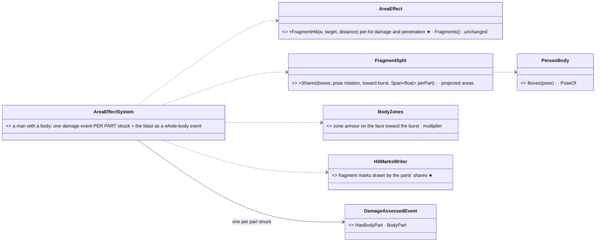
*What the picture shows that prose hid: no new state and no new wire — the fragment law (§3k.1 of Building Interiors) still counts the hits;
S3 only decides WHICH PARTS they land on and what each part's zone does to them, and reuses S1b's per-part event, so `PartDamage`, the
wounds and the marks follow with no new code downstream.*

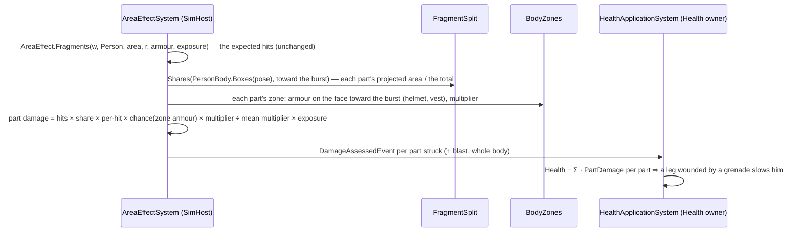

| id | decision (lean) | why | rejected · what would change it |
|---|---|---|---|
| **S3-1** | the expected hits split over the parts by their **projected area toward the burst** (the pose's boxes: `4·(h_y h_z |d·x| + h_x h_z |d·y| + h_x h_y |d·z|)`) | a prone man shows the burst his head and shoulders; a standing one his whole side — the same boxes the rounds meet | a ray per fragment (the cost S3 was told to measure: thousands of rays per burst) · occlusion between his own parts (second order) |
| **S3-2** | each part's hits meet its ZONE's armour on the face toward the burst (helmet, vest); this **replaces the 35 % plate coverage** for a man with a body | the vest covers exactly the torso's share, which is now computed, not assumed | keeping the 35 % on top (double-counted armour) |
| **S3-3** | the zone multipliers are **normalised by their area-weighted mean**, so an unarmoured man's expected total is the calibrated §3k.1 value | the fragment law was calibrated against published radii as a WHOLE-body dose; S3 moves where it lands, it does not re-tune it | raw multipliers (a standing man's mean is below 1: every grenade would get weaker) |
| **S3-4** | one `DamageAssessedEvent` per part struck (`HasBodyPart`), the blast as one whole-body event; the detonation log keeps the per-target totals | S1b's chain (`PartDamage`, wounds) then takes fragments with no new code | a new event type |
| **S3-5** | fragment `HitMarks` are drawn by the parts' shares (HL-10's uniform draw is superseded) | the marks then sit where the fragments landed | — |
| **S3-6** | a hull keeps its whole-body fragment law in S3 | a fragment that beats a hull's facing armour is rare; S2's per-part hull is for rounds | per-part hull fragments (⏭ if a measurement shows it matters) |

### 10a. S3 as built — `CE-3212` *(backend, `2026-10-16`)*

As §10 draws it: `FragmentSplit.Shares` (`Physics/BodyParts/FragmentSplit.cs`), `AreaEffect.FragmentHit` (the per-hit damage and penetration
the law already used, exposed), `AreaEffectSystem.SplitOverParts` (a man with a person body — every typed or untyped person) and the marks
drawn by the shares (`MarkFragments(…, shares)`). Notes:

| | |
|---|---|
| the burst's direction | from the pose's bound-sphere centre (scaled by the collider height) to the burst, in the body's frame; ONE face for every part (the face toward the burst) |
| the platform armour | an unstated or inherited zone face keeps the armour the whole-body law used; a person's own platform armour is already its Torso's (S1b) |
| the 35 % plate coverage | no longer applies to a man with a body (S3-2); it remains for a hand-built world with no TKB and no person body — never in production, where every person resolves at least the engine's |
| the cost | ten boxes' silhouettes (≈ 30 multiply-adds each) per man per burst, beside his three exposure traces; ⚠ estimated by operation count, not benchmarked |
| calibration | the §3k.1 radii rails (`W6pp_…`) pass unchanged: an unarmoured man's total is the law's by construction (S3-3) |

**Rails** (`AreaEffectSystemTests`, the feature's suite): `CE3212_AnUnarmouredMan_TakesTheLawsTotal_SpreadOverHisParts` (the total equals
hits × per-hit × exposure, eight or more parts struck, the torso more than a forearm) · `CE3212_TheVest_StopsFragmentsOnTheTorso_TheLimbsAreOpen`
(3.5 mm fragments from behind: the soldier's torso untouched, the civilian's struck, their thighs equal).

## 11. S2b — weapon systems by part, `CE-3214` *(backend, designed `2026-10-16`, leans under the overnight mandate)*

🔒 Basis: §6's S2 row (R-3010, user-approved) — *"weapon systems hittable when not embarked (supersedes CE-2182's skip)"*; this
resolves [Weapon Systems §6](../weapons/DESIGN_Weapon_Systems.md)'s open *"a direct hit on a DEPLOYED weapon needs a real collider
first"*. Leans below are taken under the user's overnight mandate; each says what would change it.

#### INVENTORY — the queries run *(codebase-memory CLI, `2026-10-16`)*

| query | total | what it found |
|---|---|---|
| `search_graph name_pattern=".*WeaponKit.*" label=Class` | 1 | ui's `WeaponKits` (Presentation) — the stowed and deployed kits per `WeaponKind`, `Blend`, `Deployment`, `DefaultElevation` |
| `search_graph name_pattern=".*WeaponSystem.*" label=Class` | 11 | `WeaponSystemParams` / `WeaponSystemState` / `WeaponSystemTkbTranslator`, `WeaponSystems` (`IsWeaponSystem`, `CanFire`, `IsBroken`), the NED state + translators, tests |
| `search_graph name_pattern=".*Deploy.*" label=Class` | 5 | `WeaponDeploySystem`, `WeaponDeployment` (owner of the deploy clock) — and no sim-side deploy FRACTION (it lived in ui only) |
| grep `IsWeaponSystem` in `RaycastSolverSystem` | 1 | CE-2182's skip — the one site to narrow |
| `EntityClassTable` (`Hrot.Core`) | 9 classes | `1.1.*.50.{1…7}`, Mortar `1.1.*.10`, TowedArtillery `1.1.*.5` — what ui's `KindOf` walks |
⚠ `check_index_coverage` is not available through the CLI, so these counts are not proven exhaustive; grep confirmed the solver site.

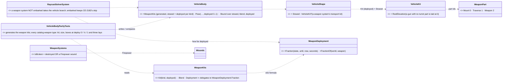
*What the picture shows that prose hid: a weapon system is NOT a new body type — it is a vehicle-shaped body with a second (stowed) kit;
the solver branch, the bound sphere, the face rule, the zones, `PartDamage` and the parity rail are the ones S2 built. The only new
runtime read is how far the weapon is deployed — one formula, moved down from ui so the drawing and the hit cannot disagree.*

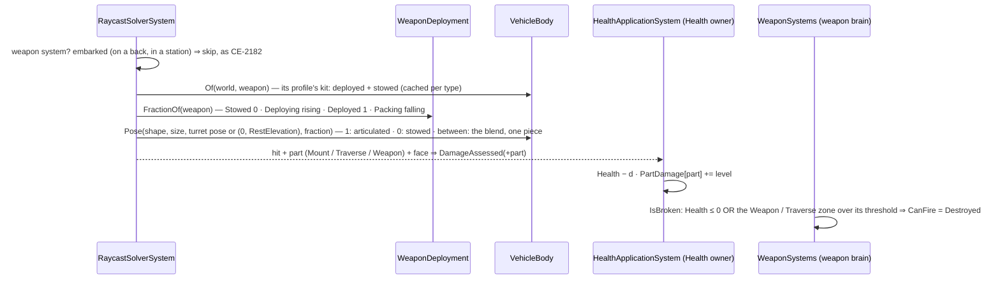

| id | decision (lean) | why | rejected · what would change it |
|---|---|---|---|
| **S2b-1** | a weapon system with a body is met by a round when it is NOT embarked (`IsEmbarkedTag` absent: placed, deployed or lying stowed); embarked (carried on a back, in a host's station) it keeps CE-2182's skip — the carrier or the host is what the round meets, and fragments still reach it (§5b C4) | a weapon on a man's back drawn and hit would steal his hits; in a station it sits inside the host's own boxes | hitting embarked weapons too (needs the carriage frames — ui's `OnBack`, the station pose — in the sim) · a user wanting a carried launcher shot off a back |
| **S2b-2** | the kits are GENERATED from ui's `WeaponKits` (stowed + deployed, every `WeaponKind`) into `VehicleBody.WeaponKits.g.cs` by the S2 rail (`HROT_GEN_VEHICLE_BODY=1`), and that rail compares, for EVERY catalog weapon type, the kind, the size and the posed boxes at deploy 0, ½ and 1 (and three lays when deployed) | S2-2's pattern: one source, checked | a hand-written collision kit |
| **S2b-3** | part ids by INDEX from the deployed kit (both kits list the same parts in the same order — ui's blend rule): role `Turret` → Traverse 1, `Gun` → Weapon 2, else Mount 0; a kit with no articulated part (Launcher, Manpads: the tube IS the weapon) → Weapon for every part | a stowed HMG's receiver lying on the ground is still the weapon | ids from the stowed kit (it has no roles) |
| **S2b-4** | the kit by a body profile per kind, matched by DIS class (`1.1.*.50.1`…`.7`, the generic `1.1.*.50` ⇒ Hmg, Mortar `1.1.*.10`, TowedGun `1.1.*.5`), plan `WeaponSystem`, `inheritArmour` (the casing, §5b) | S2-5's mechanism: ui's `KindOf` walks the same classes | — |
| **S2b-5** | zones: Mount ×0.5 (no effect) · Traverse ×1, Firepower at 128 · Weapon ×1, Firepower at 64 | a tripod leg shot off leaves a gun that fires; the receiver or the sight does not | starter numbers (HL-11's spirit) — tuning starts here |
| **S2b-6** | the Firepower consequence is read where a weapon's fire gate is: `WeaponSystems.IsBroken` (⇒ `CanFire` = `Destroyed`), NOT `CanShoot` — a weapon system has no `ActorCapabilityState` | one gate the weapon brain already reads (§5b) | adding capability bits to every weapon |
| **S2b-7** | the deploy fraction is ONE formula, `WeaponDeployment.Fraction` (Fdp.Toolkits); ui's `WeaponKits.Deployment` delegates to it (cross-lane, ui file) | the drawing and the hit read the same blend | two copies of a 6-line formula |
| **S2b-8** | the lay: the weapon's turret part's `TurretPose` when it has one; otherwise azimuth 0 and the kit's `RestElevation` (Mortar 60°, TowedGun 25°) — ui's `LaidPose` | ui draws exactly that | — |
| **S2b-9** | the bound sphere covers the stowed kit, every blend (a part's centre runs on a line between its two ends, its size between its two sizes) and every deployed lay | no candidate lost while a weapon is set up | a per-frame bound |

### 11a. S2b as built — `CE-3214` *(backend, `2026-10-16`)*

Built as §11 draws it: `WeaponPart`, `VehicleKit.RestElevation`, `VehicleShape.Stowed`, `VehicleBody.WeaponKits` (generated,
`VehicleBody.WeaponKits.g.cs`), `VehicleBody.Blend` + the `Pose(…, deployed, …)` overload, the bound over stowed and blends,
`WeaponDeployment.Fraction` / `FractionOf` (ui's `WeaponKits.Deployment` delegates — cross-lane), the solver's skip narrowed to embarked
weapons, `WeaponSystems.IsBroken` + the Firepower wound, nine `bodies.json` weapon profiles. Deviations:

| as designed | as built | why |
|---|---|---|
| — | `VehicleBody.MaxBoxes` 16 → **24** | 📐 the ZU-23-2's kit has 17 parts: the parity rail caught the 17th silently dropped |
| the generator prints like S2's (5 decimals) | the weapon kits print round-trip (`R`) | they are COMPUTED (metres ÷ size), so 5 decimals were not ui's parts exactly — the rail's part-by-part equality caught it |
| — | a weapon kit is NOT placed from the TKB turret (`VehicleShape.Turret` null) | ui draws a weapon kit at its own pivots (`EntityBodyLayer3D` does not run `KitFromTkb` for a weapon) |
| — | `/combat/shots` names a weapon's parts (`WeaponPart.NameOf`) | the vehicle names were wrong for a tripod |

**Rails:** `RaycastSolverSystemTests.CE3214_ADeployedHmg_IsMetByItsParts` (the receiver and barrel are the Weapon from the side, a round
between the tripod's legs and one over it miss, the parts off ⇒ CE-2182's skip) · `.CE3214_AStowedHmg_LiesLow_AndAnEmbarkedOne_IsNeverMet` ·
`BodyPartDamageTests.CE3214_AWeaponType_GetsItsKindsProfile_ByDis` · `.CE3214_AWrecked_Weapon_Part_BreaksTheWeapon_ATripodLegDoesNot` ·
ui's `VehicleBodyParityTests.CE3214_…_ForEveryCatalogWeapon` (the generated kits = `WeaponKits`, and for every catalogue weapon type the kind,
the size and the posed boxes stowed, half-deployed and deployed at three lays, inside the bound sphere).

## 12. S2c — aircraft by part, `CE-3215` *(backend, designed `2026-10-16`, leans under the overnight mandate)*

🔒 Basis: §6's S2 row (R-3010) names the Rotorcraft plan; the tracker row asks for *"fuselage, tail, wings, engines, the chin turret; rotors
do not collide; a tail or engine zone ⇒ the crash (CE-2184)"*. A crash is `Health ≤ 0` (`RotorcraftModel` / `FixedWingModel`, CE-2184), and
HL-7 already says *"Catastrophic ⇒ destroyed"* — so the crash is a zone effect that empties `Health` in the one damage chain.

#### INVENTORY — what was measured *(`2026-10-16`)*

| query | found |
|---|---|
| ui's `ShapeKits` (`ShapeKit.cs`) | five air kits — Helicopter, Jet, CargoPlane, AttackJet, AttackHelicopter (+ Drone); their parts carry NO roles that name a fuselage, wing, engine or tail (all `Hull`), only Rotor / TailRotor / Gear, and the AH-64's Turret / Gun |
| `EntityClassTable` | Helicopter `1.2.*.20-25` (20 = AttackHelicopter) · Jet `1.2.*.1,2,6,7,40,47,50` (2 = AttackAircraft, 50 = Uav) · CargoPlane `1.2.*.3,4,5,8,57` |
| catalogue aircraft with a combat platform | UH-60 ×2 (`1.2.225.21`), AH-64 (`.20`), A-10 (`.2`), the FPV drone (`1.2.0.50`, drawn as a Drone); ⛔ F-16 and C-130 have none (no body — HL-12) |
| the crash | `RotorcraftModel` / `FixedWingModel` fall when `Health ≤ 0` (CE-2184) · `EjectionSystem` ejects at ≤ 20 % while alive (B-9) |
| `WoundEffect` | None · Slow · Aim · Mobility · Firepower — no destroying effect yet |

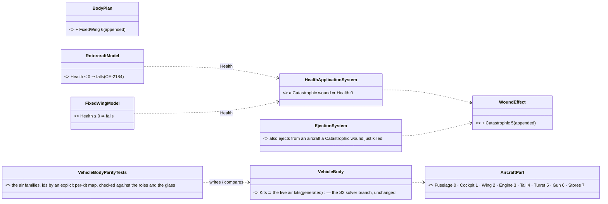
*What the picture shows that prose hid: no new hit path and no new crash path — the air kits join the S2 table, and "the tail is shot off"
reaches the existing fall through the one value every reader already obeys (`Health`).*

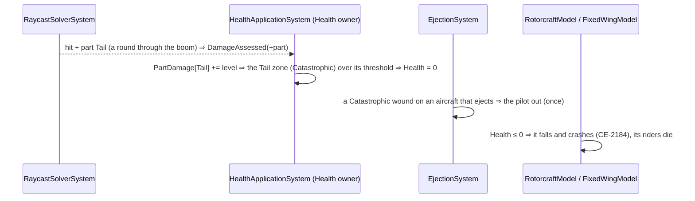

| id | decision (lean) | why | rejected · what would change it |
|---|---|---|---|
| **S2c-1** | scope: the Helicopter, AttackHelicopter, Jet, AttackJet and CargoPlane kits; the **Drone stays whole** (an FPV drone is 0.6 m — one box is its body) | the kits exist; the drone's collider is already its size | parts for a drone (no measurable gain) |
| **S2c-2** | part ids by an EXPLICIT per-kit map in the generator (the air kits carry no roles to derive them from), checked by the rail: a `Glass` part is the Cockpit, a `Turret` / `Gun` role is the Turret / Gun, and the map's length is the kit's colliding parts | S2-3's rule needs roles the air kits do not have; the checks catch a kit edit | a geometric rule (an AH-64 rocket pod and an engine nacelle are both dark cylinders along x) |
| **S2c-3** | plans: Rotorcraft (helicopters), **FixedWing** (jets, cargo — appended `= 6`) | the plan is the `PartDamage` header; one id set serves both | one Aircraft plan (the plan enum already says Rotorcraft) |
| **S2c-4** | zones (one profile per family, by DIS): Fuselage ×1 · Cockpit ×1.5, Catastrophic at 160 · Wing ×0.6, Catastrophic at 192 · **Engine ×1, Catastrophic at 96** · **Tail ×0.7, Catastrophic at 128** · Turret ×1, Firepower at 64 · Gun ×0.3, Firepower at 32 · Stores ×0.5; `inheritArmour` | the tracker's "a tail or engine zone ⇒ the crash"; the cockpit and a wing too, harder | starter numbers — tuning starts here |
| **S2c-5** | **Catastrophic** (`WoundEffect` 5, appended) ⇒ `Health` = 0 on the Health owner, in `HealthApplicationSystem`, right after the part's level is added | HL-7 / R-263's "destroyed"; every reader of a killed aircraft (the fall, the riders, the drawing) follows `Health` | a separate crash flag (a second death) |
| **S2c-6** | `EjectionSystem` also ejects from an aircraft a Catastrophic wound has just killed (once, the same latch) | B-9 ejects on damage; a tail shot off is the textbook ejection | the pilot dying with every catastrophic hit |
| **S2c-7** | the profiles' DIS lists: Helicopter `1.2.*.21…25`, AttackHelicopter `1.2.*.20`, Jet `1.2.*.1,6,7,40,47` (⛔ not 50 — the drone), AttackJet `1.2.*.2`, CargoPlane `1.2.*.3,4,5,8,57` | `bodies.json` takes a list, not a range; the rail checks every catalogue aircraft draws as its sim kit | — |

### 12a. S2c as built — `CE-3215` *(backend, `2026-10-16`)*

Built as §12 draws it: `AircraftPart`, `BodyPlan.FixedWing` (6), `WoundEffect.Catastrophic` (5), the five air kits in the generated
`VehicleBody.Kits` (explicit id maps in ui's `VehicleBodyParityTests`, checked against the glass and the roles), five `bodies.json`
profiles, `HealthApplicationSystem`'s Catastrophic ⇒ Health 0, `EjectionSystem`'s wreck ejection, `/combat/shots` naming an aircraft's
parts. Deviations:

| as designed | as built | why |
|---|---|---|
| — | ⭐ `VehicleBody.Prime(db)`: every TKB type's shape built once per database, before the solver's parallel loop | 📐 found by the rail: `MaxBoundRadius` grew only when a type's shape was first built — in the narrow phase, AFTER the cell walk chose its pad — so the first rounds at a new helicopter type could miss its tail (~10 m from its point) |
| the generator prints 5 decimals | round-trip (`R`) for every kit | the AH-64's kit is computed (its metres ÷ its box); the ground kits print the same strings either way (byte-identical regeneration) |

**Rails:** `RaycastSolverSystemTests.CE3215_ARound_MeetsTheHelicopterPartItCrosses_TheRotorDiscIsEmpty` (cabin, glass, boom 5.5 m off its
point, mast; the blades' height empty; parts off ⇒ one body) · `BodyPartDamageTests.CE3215_AnAircraft_GetsItsFamilysProfile_ByDis` ·
`.CE3215_AShotOffTail_IsTheCrash_AFuselageHitIsNot` · `EjectionSystemTests.CE3215_AJetWreckedByItsTail_StillEjects_Once` · ui's
`VehicleBodyParityTests` (every catalogue aircraft with a combat platform — both UH-60s, the AH-64, the A-10 — kit, size and posed boxes).

## 13. Lean — a man leans round a corner, `CE-3257` *(backend, behaviors' BR-5; Building Clearing CB-21, R-2032; designed and built `2026-10-19`, leans under the overnight mandate; build-state: BUILT)*

### INVENTORY — the queries run *(2026-10-19)*

| query | total | what it found |
|---|---|---|
| `search_graph name_pattern=.*(Eye\|Silhouette\|Lean).*` (Method, Class, Field; `*.cs`) | ~60 | no sim `Lean` type; `MotionPose.Lean` (ui, FORWARD pitch, `ShapeKit.cs:72`) and `CarryLean`/`WoundedLean` (ui); eye HEIGHT rules `EyeHeightFor` / `SensorMount` / `EngineFallbacks`; `ShotOrigin.Eye` |
| grep `EyeHeightFor\|EyeHeight(\|ShotOrigin.Eye` | 9 sites | the eye POSITION is built per caller (`pos.Z += EyeHeightFor(...)`): `TerrainWorldLosStrategy.IsVisible` / `.Explain`, `ShotOrigin.Eye` (the round, `LineOfFire.MuzzleMasked`, `AimPoint.For`), `AmmoChoice.ArmourFacing`, `GuidedRoundSystem`, ui `PossessionStation.EyeOf` (fallback) — ⛔ no one function returns the eye |
| grep `BodyProfile.Points\|Fractions` | 5 sites | being SEEN: `Points` (Explain, `AimPoint.For`, `AreaEffectSystem`) and two inline copies of its loop (`IsVisible`, EQS `CheapLineOfSightTest`) — every point on the man's vertical, no lateral term |
| read `BodyPartRay.Person` / `BodyPartHit.Segment` | 1 | being HIT: the ONE person part test (the round's narrow phase AND the FPS crosshair, CE-1126) — sphere then boxes, in the body frame (x fwd, y LEFT, z up) |
| `Gesture` recipe (`c194d559e`) | 17 files | the small brain-written replicated body state to copy: component · Brain group · `dt` · egress/ingress · pack · rails |
| other lanes' `GlobalComponentIds` / `AllDescriptors` | — | 415 and `dt` 149 free on `behaviors`, `ui`, `coordinator` at design time — ⚠ behaviors took 415 the same day (`CombatProficiency`); `Lean` moved to 416, then — behaviors took 416 for `EngagementArea` too — to **417** at the merges |

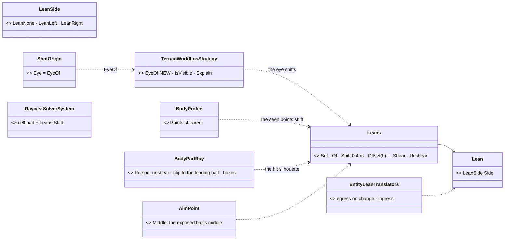
*What the picture shows that prose hid:* ONE geometric rule (`Leans`) feeds the three places a man is a point in space — where he looks
FROM (the eye), where he is SEEN (the profile) and where he is HIT (the part boxes) — so "he sees round the corner", "he is seen round it"
and "a round meets him there" cannot disagree. Before, there was no shared eye function: `EyeOf` is new and the five eye sites go through it.

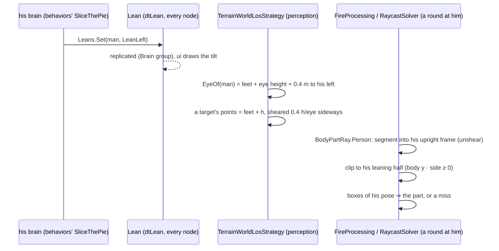

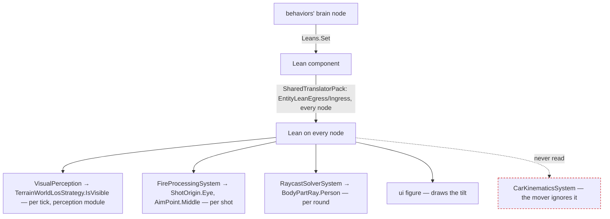
*The dashed edge is deliberate:* the mover never reads the lean (the frame: "ignored by the mover").

| id | decision (lean) | why | rejected — one line each |
|---|---|---|---|
| **LN-1** | `Lean { LeanSide Side }` on the person, **Brain group** (written by his brain, like `Gesture`), `dtLean` 149, NoScenario; `Leans.Set` / `Leans.Of` | the frame: replicated, written by his brain; the `Gesture` recipe is the measured one | a stance value (the fence: a man leans crouched too) · a Muscle-owned state (the brain writes it) |
| **LN-2** | ⭐ the lean is a **SHEAR about his feet** across his own left axis: a point `h` above his feet moves `Shift · h / eye` sideways (`Shift` = 0.4 m), so the EYE moves exactly 0.4 m and the feet do not move. Standing and crouched only — prone and downed do not lean | one rule for the eye, the seen points and the boxes; linear, so a segment stays a segment (the box test needs no new shapes) | a roll about the hip (needs per-pose hip heights, and rotated boxes) · moving the whole body 0.4 m (his feet would leave the corner) |
| **LN-3** | ⭐ **`TerrainWorldLosStrategy.EyeOf(view, e, stance)`** — the ONE eye position: feet + `EyeHeightFor` + the lean. `IsVisible`, `Explain`, `ShotOrigin.Eye` (so the round, `LineOfFire.MuzzleMasked` and `AimPoint.For` too), `AmmoChoice`, `GuidedRoundSystem` go through it | the eye was rebuilt at each site; a lean added at three of five would let a man see round a corner and not shoot round it | the lean at the LOS sites only (he would see and not hit) |
| **LN-4** | being SEEN: `BodyProfile.Points` and `IsVisible`'s loop shear their points the same way — his eye-height point is where his eye is | R-246: "if your eye sees out, your head shows" | an unchanged profile (a man looking round a corner would be invisible from where he looks) |
| **LN-5** | ⭐ being HIT: `BodyPartRay.Person` takes the segment into his UPRIGHT frame (unshear), clips it to the **leaning half** (body-frame y · side ≥ 0 — the frame's "only the leaning side's half of his silhouette"), tests the pose's boxes, and maps the hit's `t` back. The bounding sphere and the solver's cell pad grow by `Shift` | the ONE person part test — the round and the crosshair both get it; no new pose tables (the generated-table parity rail stays green) | new leaning poses in the tables (needs the ui `BlockFigure` to lean first — HL-1's single geometry) · a damage multiplier (a hit he cannot take would still land) |
| **LN-6** | `AimPoint.Middle` aims at the middle of the EXPOSED half: the sheared centreline at the aim height plus `ExposedHalf` (0.1 m) into the leaning side | a shooter aims at what he sees; the frame's rail aims at the CENTRE on purpose, to measure the smaller target | the unshifted centre (an AI shooter would fire at the wall beside him) |
| **LN-7** | the mover ignores it; fragments (`AreaEffectSystem`'s split, HL-10's sampled marks) do NOT shear | the frame; fragments are counts, not rays | — |
| **LN-8** | ui receives `Lean` (replicated, every node) and draws the sideways tilt — `MotionPose.Lean` is a FORWARD pitch, so ui needs a roll | the frame: "ui receives the state" | — |

**Rails** *(`CE-3257`)*: `LeanTests` (Toolkits) — `CE3257_ALeaningMan_SeesRoundTheCorner_AManHeCannotSeeUpright` (a pillar hides a man; leaning
left the eye, 0.4 m to his left, clears it; prone does not lean) · `.CE3257_HeShootsFromHisLeaningEye_AndIsAimedAtOnTheHalfHeShows`
(`ShotOrigin.Eye`, `AimPoint.Middle`) · `.CE3257_ARoundMeetsOnlyTheHalfHeShows_AndHisHeadWhereItLeansTo` (the right shoulder misses, the head
0.4 m out is the Head, `t` on the original segment) · `.CE3257_RoundsAimedAtHisCentre_MissALeaningManMoreOften_AMeasuredRatio` (the frame's
ratio, 4000 rounds, σ 0.3 m at 50 m: 📐 **0.28** of the upright hits — half the silhouette, its upper part sheared off the centre line;
aiming at `AimPoint.Middle`'s exposed half does > 1.3× better) · `BodyPartReplicationTests.CE3257_*` (SimHost) and both descriptor-map rails.
