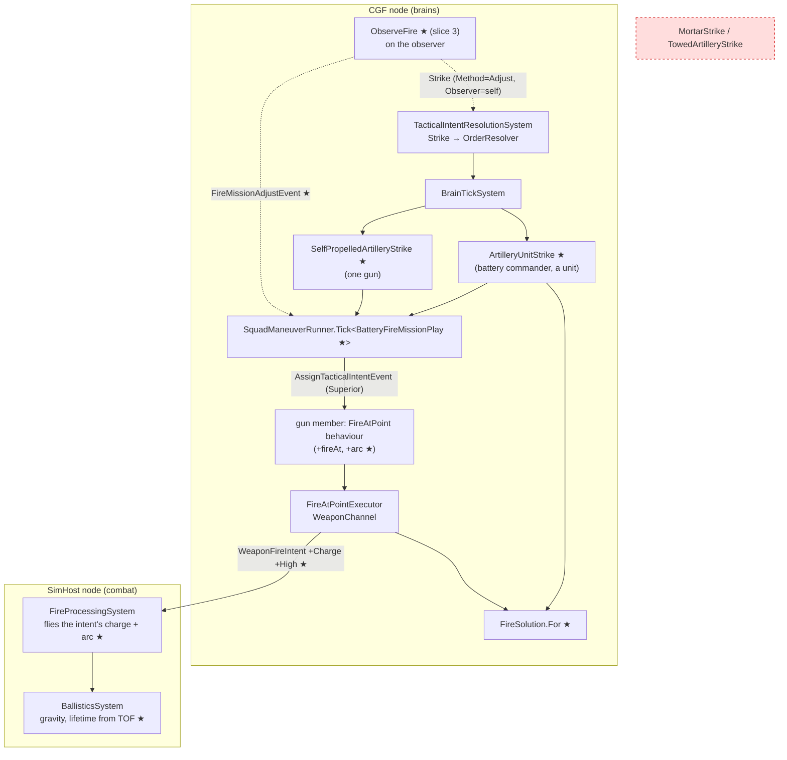
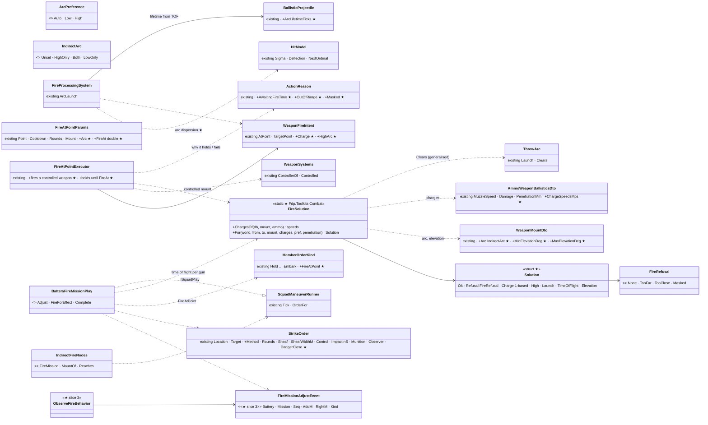
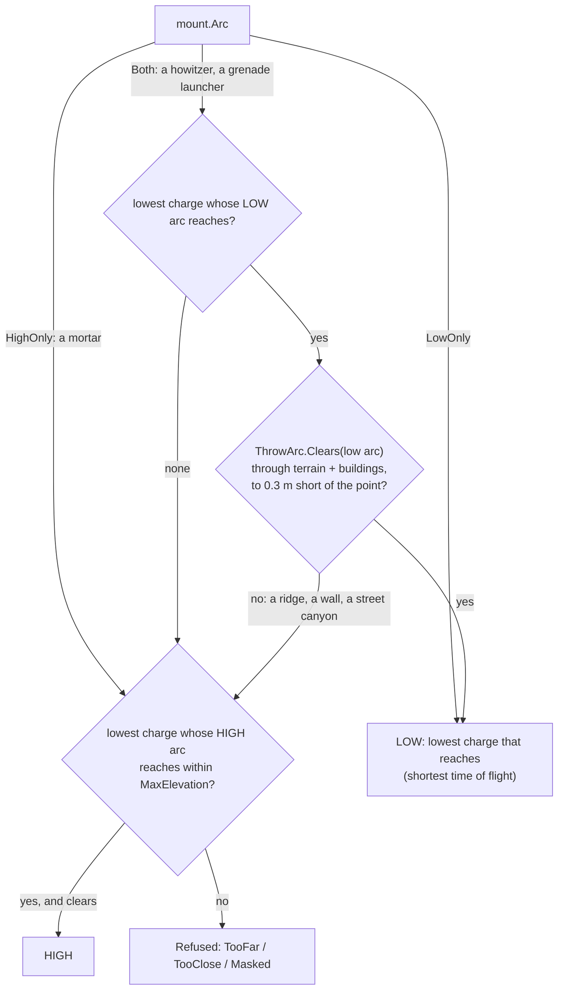
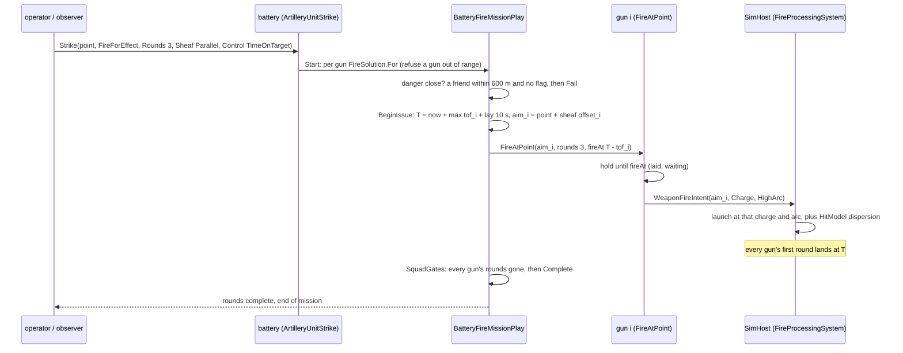
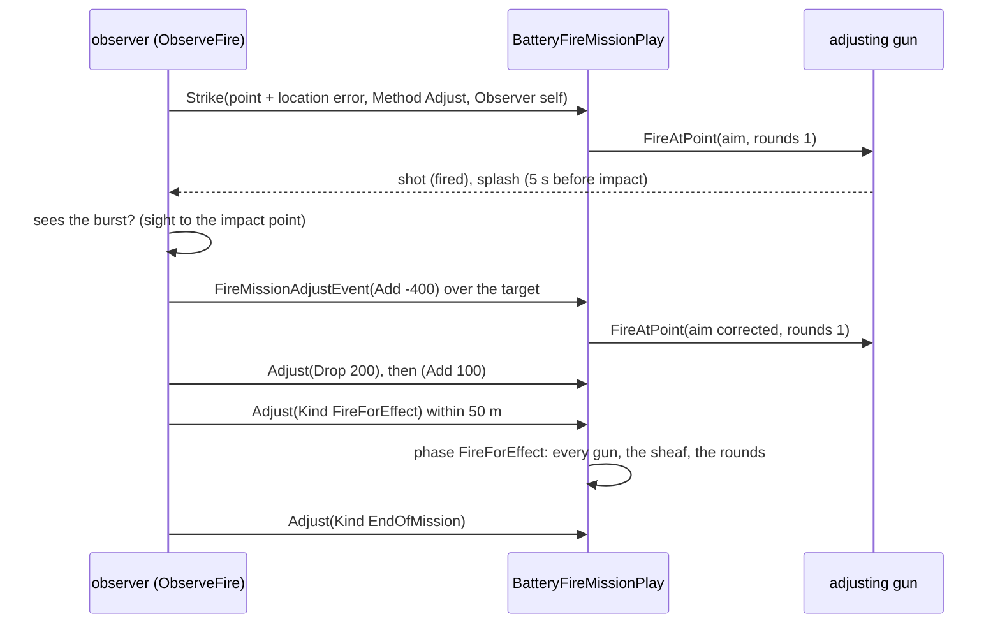

<!--STATUS
state: LIVE
updated: 2026-10-15
build-state: IF-1 BUILT (backend, 2026-10-15 — §3.6 as built); IF-2 BUILT (behaviors, 2026-10-15 — §3.7); IF-3, IF-4 READY-TO-BUILD (behaviors); IF-5 smoke and IF-6 counter-battery are DESIGN
current-answer: §4 decisions (IF-A…IF-G, FM-1…FM-8), §3.6 IF-1 as built, §3.7 IF-2 as built, §5 slices, §6 the demo
stale-below: nothing
known-rot: none
known-conflict: none
related-designs:
  - docs/designs/weapons/DESIGN_Weapon_Systems.md — OWNS the weapon-as-an-entity, the Station / Gunner seats and ControllerOf (a ground mortar is a weapon system its gunner controls)
  - docs/DESIGN_Entity_Interactions.md — §7.5 OWNS the team carry (the 81 / 120 mm tubes are TwoMan loads)
  - docs/designs/air-attack/DESIGN_Air_Operations.md — OWNS the Strike order (§7) this design extends; mortars and artillery fulfil it here
  - docs/DESIGN_Building_Interiors.md — §3k OWNS the indirect warhead and the arc flight (Stage 6, W-8); who calls fire is this design
  - docs/DESIGN_Weapon_Layers.md — §5f OWNS the L-1 lob (ThrowArc) for hand weapons; this design adds the gun's fire solution beside it
  - docs/designs/vehicle-tactics/DESIGN_Missiles_And_Ammo.md — OWNS munitions and loadouts; the mortar and artillery rounds here are new entries
  - docs/DESIGN_Orders_Params_Entity_Classes.md — OWNS OrderResolver (<Class><Order>) and the designations (§13.3) an operator's call for fire uses
  - docs/designs/group-maneuvers/DESIGN_Squad_Tactics.md — §3 OWNS SquadManeuverRunner / ISquadPlay; the battery is one more play
  - docs/designs/vehicle-tactics/DESIGN_Armour_Hit_Model.md — OWNS the roof hit a falling round makes on a vehicle
  - docs/DESIGN_Operations_Behaviour_Catalogue.md — lists CallFireMission (AIR-1, SQD-9), built here
-->

# DESIGN — Indirect fire: mortars, artillery and the fire mission

🔒 **User, `2026-10-14`:** *"I think we might already start thinking about the mortars and artillery - new ammo, new high arc ballistic mode and
automatic selection between low arc and high arc based on visibility and similar stuff - carrying and deploying and operating using a seat is
already covered."* · *"Maybe also how a typical fire mission could be executed - if a behavior of a virtual commander entity of a group of
artillery guns, commander telling individual guns how/where to fire (your subject matter expetise needed again)"* → the leans →
*"Artillery approved including demo acenario please write design"* (**R-2018**, tracker **CE-2176**).

## 1. What exists — measured `2026-10-14` (after merging backend WS-2 / WS-3)

| fact | where |
|---|---|
| an INDIRECT warhead flies a gravity arc: `ArcLaunch(from, to, speed, high)` is a closed form at ONE speed; out of reach ⇒ 45° (falls short) | `FireProcessingSystem.cs:344` |
| the arc is chosen by speed: ≥ 40 m/s ⇒ always high; slower tries low and lobs high when `Clears` (12 samples through `TerrainPenetration.Carry`) says the low arc is stopped | `ThrowArc.cs:24-56`, `CombatConstants.HighArcMinMuzzleVelocity = 40` |
| ⛔ an indirect round's launch REPLACES the dispersed direction — **arc rounds have no dispersion today** | `FireProcessingSystem.cs:151-158` (σ, θ) then `:177` (`velocity = ThrowArc.Launch(...)`) |
| dispersion is replayable: σ from the mount's `DispersionMils` × state, deflection `d(k) = 2·frac(k·φ⁻¹) − 1` on the shooter's shot ordinal — no random source | `HitModel.cs:41-70` (AQ85, R-216) |
| ⛔ an arc round lives **60 s** (`ArcRoundLifetimeTicks = 3600`) — a high-angle howitzer round flies longer | `CombatConstants.cs:88`, `BallisticsSystem.cs:133` |
| gravity acts only on Arc rounds; no drag anywhere | `BallisticsSystem.cs:130` |
| the round's speed per ammo × weapon pair already has a home: `AmmoWeaponBallisticsDto { WeaponGuid, MuzzleSpeed, Damage, PenetrationMm }` on the AMMO template, read for damage and penetration | `AmmoWeaponBallisticsDto.cs:12`, `ArmorModel.cs:220`, `ParameterResolver.cs:233` |
| `WeaponCategory.Mortar` exists, but no mount declares it (2005's mount has no Category) — the Weapon Layers inventory says *"no `MachineGun` / `Mortar` mount yet"* | `DESIGN_Weapon_Layers.md:180, 871` |
| mortar content: one munition (81 mm HE, 6002) and `MortarTeam` 2005 — a soldier with a built-in mount, 60 m/s, 360 m | `MunitionTkbCatalog.cs:22`, `UrbanCombatTkbCatalog.cs:114, 215-229` |
| the reference library lists 60 / 81 / 120 mm mortar HE; no howitzer, smoke or illumination | `Tkb/Reference/Data/ammo.json` |
| `FireAtPoint` (executor + library behaviour): N rounds at a point, cooldown, ROE, an indirect round exempt from the friendly-on-line hold; params 21 of the channel's 32 bytes | `FireAtPointExecutor.cs:14-130`, `FireAtPointParamsJsonDto.cs`, `FireAtPointBehavior.cs:25-38` |
| ⛔ `FireAtPoint` cannot fire a CONTROLLED weapon: `MountEntity(owner, 32+k)` falls back to the owner (WS-3 taught only `AimAndFireExecutor`) | `WeaponMountQuery.cs:88-97`, commit `f656cb38b` |
| a ground-manned weapon's controller is the man in its Gunner seat; his mount list gains it at index 32+k | `WeaponSystems.cs` `ControllerOf`, `ControlledMountBase = 32` |
| an order resolves to `<Class><Order>` for the most specific class first, then broader ones | `OrderResolver.cs:37-55` (R-278) |
| classes exist: `SelfPropelledArtillery` 1.1.*.4 · `TowedArtillery` 1.1.*.5 · `Mortar` 1.1.*.10 · `ArtilleryUnit` 11.1.*.4 | `EntityClassTable.cs:130-131, 136, 184` |
| `StrikeOrder { Location, Target }`; only `AirPlatformStrike` fulfils it | `OrderDtos.cs:72`, `AirAttackBehaviors.cs:199-227` |
| a commander drives members through `ISquadPlay` + `SquadManeuverRunner`, sending each a behaviour by `AssignTacticalIntentEvent` (Superior); `SquadGates.Track` counts each member's rounds | `SquadManeuverRunner.cs:274-330, 534-540`, `SquadPlayState.Gate` |
| the designation store is OPERATOR UI state per station — an operator's call for fire fills Strike from it; an AI never reads it | `OrderDesignations.cs:17-22` |
| the demo terrains are flat ground plus buildings and walls (no relief; ≤ 400 m of features) | `Recipes/Terrain/*/…world.geojson` (`height` on buildings only) |

## 2. INVENTORY

| query | total | relevant |
|---|---|---|
| `search_graph name_pattern=.*(Arc\|Ballistic\|Indirect\|FireMission\|Battery\|Artillery\|Mortar\|Howitzer\|Charge\|Observer\|CallFor).* label=Class` | 76 (case-insensitive; most are `Hierarchy`/`Archive`/`Search` noise) | `AmmoWeaponBallisticsDto`, `BallisticAim`, `BallisticProjectile`, `BallisticsSystem`, `BombBallistics`, `ThrowArc` — **no fire mission, battery, observer or charge class** |
| same, `label=Interface` / `label=Enum` | 9 / 3 | none relevant |
| grep `FireMission\|CallForFire\|Battery` over `Hrot/ FDP/` (`*.cs`) | 0 | — |
| corpus: `docs/`, `.dev/` for mortar, artillery, fire mission, indirect | see §7 | — |

⚠ `check_index_coverage` is not reachable through the CLI this session; the "no class" claim rests on graph + grep.

## 3. The design — diagrams first

### 3.1 Modules — who runs it, on which node, each frame

*What the picture shows that prose hid: nothing new runs on SimHost except the flight honouring the brain's choice — the decision
(charge, arc, when) is made ONCE on the brain node and carried in the intent. The red box is deliberately absent: a ground-manned tube or
towed gun has no brain of its own (W-D), so a `MortarStrike` on the weapon would never tick — fire missions go to the battery unit, or to a
self-propelled gun, which is a vehicle with a brain.*

### 3.2 Classes

*As built (IF-1, `2026-10-15`): `IndirectArc` gained `Unset` = 0 (today's `ThrowArc` rule — every pre-IF-1 mount), `FireRefusal`, three
`ActionReason`s and `BallisticProjectile.ArcLifetimeTicks` — §3.6.*

*What the picture shows that prose hid: the only new runtime type on the combat side is `FireSolution` (a pure function); the charge table
lives on the EXISTING ammo × weapon profile, the arc mode on the EXISTING mount, the timing in the EXISTING `FireAtPoint` params (32 bytes
exactly: 12 + 4 + 4 + 1 + 1 + pad 2 + 8). The battery is one more `ISquadPlay`, not a new runner.*

### 3.3 Low or high — the choice (`FireSolution.For`, pref = Auto)

*What the picture shows: "visibility" is the ARC's clearance, not the gun's sight line — a gun firing indirect rarely sees the target, and
the straight sight line is not the trajectory. A target in a courtyard or a street fails the low arc's last samples against the walls around
it, so it falls to high without a special rule.*

### 3.4 Fire for effect, time on target

### 3.5 Adjust fire (slice 3)

### 3.6 IF-1 as built — backend, `2026-10-15`

| item | where it landed | deviation from §3.2 / §5, and why |
|---|---|---|
| **I1** `FireSolution` | `Fdp.Toolkits/Combat/FireSolution.cs` — `ChargesOf` (the weapon's own ammo × weapon profile first, else the round's generic one) and `For` (low then high, charges ascending, `ArcLaunch` per charge, elevation window, `ThrowArc.Clears` sampled every 25 m, 12–400 samples) | ⭐ a masked LOW arc stops the low search (a faster low arc is flatter — it will not clear either), a masked HIGH arc tries the next charge (a faster high arc is steeper). `Clears` gained a `samples` overload; hand throws keep 12 |
| **I2** mount / ammo fields | `WeaponMountDto.Arc / MinElevationDeg / MaxElevationDeg`; `AmmoWeaponBallisticsDto.ChargeSpeedsMps` | ⭐ `IndirectArc.Unset = 0` added: the field defaults to "no solution, `ThrowArc` as today", so no existing mount moved. ⛔ named `Unset`, not `Default` — `default` is an IDL keyword and the IDL generator scopes a descriptor file's enum members together |
| **I3** intent | `WeaponFireIntent.Charge` (1-based, 0 = none) + `HighArc`; the wire `WeaponFireRequest` APPENDS both (R-169) | — |
| **I4** arc dispersion | `FireProcessingSystem`: an indirect round's launch = the charge's `ArcLaunch` (or `ThrowArc` when Charge = 0), then rotated by θ = `HitModel.Deflection` and scaled by `1 + ½·σ·HitModel.RangeSequence(k)` (a second Weyl stream on √2 − 1) | ⭐ every existing indirect mount (M67, 2005) has `DispersionMils = 0` ⇒ σ = 0 ⇒ no number moved |
| **I5** lifetime | `FireProcessingSystem.ArcLifetimeTicks` = max(60 s, time of flight + 10 s) onto `BallisticProjectile.ArcLifetimeTicks`; `BallisticsSystem` honours it | never shorter than the 60 s it was |
| **I6** `FireAtPoint` | a controlled weapon (32 + k, or mount 0 on a unit with no weapon of its own = its primary) fires AS ITSELF (shooter = the tube, mount 0), behind `SystemHold` + the station arc; holds Running + `AwaitingFireTime` until `FireAt`; a mount with an `Arc` gets a solution or fails `OutOfRange` / `TooClose` / `Masked` | `FireAtPointParams` = 32 bytes (12 + 4 + 4 + 1 + 1 + pad 2 + 8). ⛔ the shared node `FireAtPointNodeParams` and the behaviour DTO `fireAt` / `arc` are **IF-2** (behaviors lane) — not touched |
| **I7** rounds | `MunitionTkbCatalog` 6026 60 mm · 6002 81 mm (charges added) · 6027 120 mm · 6028 105 mm · 6029 155 mm HE; `ammo.json` + "105mm howitzer HE", "155mm howitzer HE"; charges `v = √(g·R)` per charge range table | charges on the round's GENERIC profile (each round has one gun today) |
| **I8** guns | weapon systems 609 60 mm (OneMan) · 610 81 mm · 611 120 mm (TwoMan) — Mortar 1.1.*.10, HighOnly 45–85° · 612 105 mm towed (Static) — TowedArtillery 1.1.*.5, Both −5–70°; vehicle 107 M109 — 1.1.225.4, turret, Both −3–75°, crew of five; unit 304 Artillery Battery — 11.1.225.4, three M109s | ⭐ `WeaponCategory.Howitzer = 10` appended (a howitzer is neither `Mortar` nor `Cannon`: per-shot brain, no fire on the move). `MortarTeam` 2005 unchanged |

Rails: `FireSolutionTests` (4) · `BallisticsSystemTests.IF1_*` · `FireProcessingSystemTests.IF1_*` · `AimAndFireExecutorTests.IF1_*` (the
weapon-systems fixture: a gunner fires the mortar he mans, nothing before `FireAt`; no solution fails with why; params ≤ 32) ·
`NedTkbBuilderCombatTests.IF1_*` · `HrotEnvironmentTests.IF1_*` · the LR-1 explosive set and the type-picker golden re-pinned on purpose.
Report: [`REPORT_Backend_Indirect_Fire.md`](../../blueprints/batches/REPORT_Backend_Indirect_Fire.md).

### 3.7 IF-2 as built — behaviors, `2026-10-15`

| piece | where it landed | deviation from §3.2 / §5, and why |
|---|---|---|
| Strike fields (IF-D) | `StrikeOrder.Method / Rounds / Sheaf / SheafWidthM / Control / ImpactInS / Observer / DangerClose` + enums `FireMissionMethod`, `FireMissionSheaf`, `FireMissionControl` (`Orders/OrderDtos.cs`) | ⚠ `Munition` not added yet (one round per gun today); ⚠ `Method = Adjust` fires for effect with a warning until IF-3 |
| the member order (FM-2) | `MemberOrderKind.FireAtPoint = 7`; `MemberOrder.Rounds / FireAt / Mount / Arc`; `SquadManeuverRunner.Fire` publishes the library `FireAtPoint` (a unit member holds) | — |
| the shared node | `FireAtPointNodeParams.Arc / FireAt` (appended after `Started`) → the executor's params; `FireAtPointParamsJsonDto.fireAt / arc` | — |
| the battery (FM-1) | `ArtilleryUnitStrike` → `BatteryFireMissionPlay` over `SquadManeuverRunner`, maneuver `BatteryFireMissionManeuver` (kind 14: Firing · Aborted) | ⭐ the plan (each gun's mount, aim, time of flight, rounds at the start) lives in the play's PARAMS (`BatteryFireParams`), made once at Start; every issue gives each gun only the rounds it has LEFT (a resumed mission never fires twice) |
| sheaf / TOT / danger close (FM-3/4/5) | `IndirectFireNodes.AimPoint`, `BatteryFireMissionPlay.Plan`, `IndirectFireNodes.DangerClose` (= `HiddenTargetThrow.FriendlyInBurst` at 600 m — reused, not rewritten) | an aim point out of reach falls back to the point; open-sheaf width defaults to guns × max(2 × injury radius, 20 m) |
| the mount | `IndirectFireNodes.MountOf`: the gun's own first mount with an `IndirectArc`, else the first controlled weapon that has one (32 + k) | — |
| one gun (FM-1) | `SelfPropelledArtilleryStrike` → the library `FireAtPoint` node (danger close or no indirect weapon ⇒ Failure at once) | no sheaf, no TOT across guns — `ImpactInS` only delays its first round |
| rails | `SquadManeuverTests.CE2176_*` ×4 (TOT, sheafs, out of range + danger close, resumed mission + rounds complete) · `TacticalIntentResolutionSystemTests.CE2176_*` | red-proofed by four mutants (§5 IF-2) |

## 4. Decisions — approved `2026-10-14` (R-2018)

| # | decision | rejected (one line each) |
|---|---|---|
| **IF-A** | ammunition first: **HE for 60 / 81 / 120 mm mortars and 105 / 155 mm howitzers** (reference `ammo.json` gains the howitzer rows); **smoke** in IF-5 (a sight-blocking cloud); illumination later | all natures at once — smoke needs a cloud the sight model reads, a design of its own |
| **IF-B** | **charges**: `AmmoWeaponBallisticsDto.ChargeSpeedsMps` — a speed per charge for this round from this weapon. ⭐ The speeds are *vacuum-equivalent* (`v = √(g · R_max)` per charge) so the RANGE table is right without drag; the time of flight is short of a real one — accepted. `FireSolution.For` picks the lowest charge that reaches on the chosen arc and returns the time of flight from the same closed form | a fixed speed per tube (today: one range for every distance, 45° when short) · drag (a numeric integrator for a number nobody reads) |
| **IF-C** | **low or high per mount**: `WeaponMountDto.Arc` — `HighOnly` for a mortar, `Both` for a howitzer and a grenade launcher (⭐ `ThrowArc` stays for hand throws); `Auto` takes low when the low arc clears to the point (§3.3), else high, else refused with a reason | choosing by the gun's sight line (the trajectory is not the sight line) · a separate "dead ground" query (the arc's own clearance already answers it) |
| **IF-D** | **Strike is the fire mission.** `StrikeOrder` gains optional fields: `Method` (FireForEffect · Adjust), `Rounds` (default 3), `Sheaf` (Converged · Parallel · Open) + `SheafWidthM`, `Control` (WhenReady · TimeOnTarget) + `ImpactInS`, `Munition` (0 = the gun's own), `Observer`, `DangerClose`. RTS defaults: fire for effect, when ready, converged, 3 rounds. An aircraft reads only `Location` / `Target` | a separate `FireMission` order (two orders for "hit that place"; the menu would offer both) |
| **IF-E** | **the observer** (slice 3): `ObserveFire` on any soldier who sees the point — it sends Strike(Method Adjust, Observer self) to a battery and corrections as `FireMissionAdjustEvent`; the battery waits for corrections, and an observer who is killed or loses sight ends the mission (*"observer lost"*). An operator calls fire from the menu: Strike filled from the designations | the battery computing the corrections itself (kill the observer and the adjust goes on — no observer) |
| **IF-F** | **error, replayable**: gun dispersion on the ARC (azimuth θ from `HitModel.Deflection`, range error as a speed factor on a second ordinal stream; the mount's `DispersionMils`) — fixing the measured loss at `FireProcessingSystem.cs:177`; target-location error on the observer's call from `d(k)` with k = the mission id, scaled by how it was located (laser ~10 m, map/eye ~150 m) | a random generator (none exists; replay would diverge) · perfect first rounds (no reason to adjust) |
| **IF-G** | **the guns**: 60 mm a `OneMan` weapon system; 81 / 120 mm `TwoMan` (team carry, §7.5) — all class `Mortar` 1.1.*.10, crewed through the Gunner seat; a 105 mm towed howitzer `TowedArtillery` 1.1.*.5, an emplaced weapon system (no towing yet); a 155 mm self-propelled howitzer `SelfPropelledArtillery` 1.1.*.4, a vehicle with a turret and a preset crew (W-I) | howitzers as soldiers with built-in mounts (the `MortarTeam` 2005 shape — nothing to crew, carry or kill separately) |
| **FM-1** | **a virtual battery commander**: a unit entity of class `ArtilleryUnit` (11.1.*.4) whose roster is its guns (or their gunners); Strike resolves to **`ArtilleryUnitStrike`**, which runs `BatteryFireMissionPlay` over `SquadManeuverRunner`. A Strike to a self-propelled gun resolves to **`SelfPropelledArtilleryStrike`** — the same play with a roster of one | every gun deciding for itself (no sheaf, no time on target) · `MortarStrike` on a manned tube (the weapon has no brain — W-D) |
| **FM-2** | **one new member order**: `MemberOrderKind.FireAtPoint { Point, Rounds, FireAt, Arc }` → the library `FireAtPoint` behaviour, whose params DTO gains `fireAt` and `arc`; the member's mount is its first INDIRECT mount, own or controlled (`IndirectFireNodes.MountOf`) | a gun-specific behaviour (`FireAtPoint` already is the mechanism) |
| **FM-3** | **the sheaf**: Converged — every gun at the point; Parallel — each gun's aim offset by its own lateral offset in the battery, perpendicular to the line of fire; Open — guns spread evenly over `SheafWidthM` (default guns × 2 × the warhead's burst radius) | one aim point always (a 6-gun sheaf on one spot) |
| **FM-4** | **time on target**: T = now + the longest time of flight + a lay time (10 s); gun i fires at T − tof_i, so every first round lands together; `WhenReady` fires on arrival of the order | a fixed delay per gun (wrong as soon as two guns stand at different ranges) |
| **FM-5** | **danger close**: a friendly unit within 600 m of the point (any gun's round) and `DangerClose` not set ⇒ the play fails with *"danger close"*; set ⇒ fire, and the adjust (slice 3) creeps in by 100 m steps | firing regardless (a fire mission is the easiest way to kill your own platoon) |
| **FM-6** | **adjusting**: one adjusting gun (the one nearest the battery's centre), one round per correction, bracketing 800 → 400 → 200 → 100 → 50 m along the observer–target line; within 50 m ⇒ fire for effect with every gun | adjusting with the whole battery (wastes rounds, warns the target) |
| **FM-7** | **messages**: the play reports `shot` (fired), `splash` (5 s before impact), `rounds complete` and `end of mission` on the behaviour log and to the observer | silent missions (nobody can follow one live) |
| **FM-8** | **one mission at a time**: a new Strike replaces the running one (same rank, Superior); the replaced observer gets *"end of mission"* | a mission queue (later, when a scenario needs priorities of fire) |

## 5. Slices

| # | lane | what | rails (the features' own suites) |
|---|---|---|---|
| **IF-1** ✅ BUILT `2026-10-15` (§3.6) | backend | `FireSolution` + `Solution`; `WeaponMountDto.Arc / Min/MaxElevationDeg`; `AmmoWeaponBallisticsDto.ChargeSpeedsMps`; `WeaponFireIntent.Charge / HighArc` (APPENDED, R-169); `FireProcessingSystem` flies the intent's charge and arc, adds arc dispersion (IF-F); an arc round lives its time of flight + 10 s; `FireAtPointExecutor` fires a CONTROLLED weapon as itself and holds until `FireAt`; the munitions (IF-A) and the guns (IF-G) | `ThrowArcTests` / a new `FireSolutionTests` in the same folder: lowest charge, low vs high by clearance, too far / too close / masked; `FireProcessingSystemTests`: the round lands at the point within the dispersion, a 90 s flight still lands; `FireAtPointExecutorTests`: a gunner fires his ground mortar, nothing before `FireAt` |
| **IF-2** | behaviors | `StrikeOrder` fields (IF-D); `MemberOrderKind.FireAtPoint`; `FireAtPoint` DTO `fireAt` / `arc`; `BatteryFireMissionPlay` (fire for effect, sheaf, time on target, danger close, rounds complete); `IndirectFireNodes`; `ArtilleryUnitStrike`, `SelfPropelledArtilleryStrike` | `SquadManeuverTests` (the play's own suite): three guns' first rounds land within one tick of T; a parallel sheaf's aim points; a gun out of range is left out; danger close refuses · `TacticalIntentResolutionSystemTests`: Strike on a battery / SP gun resolves, on a rifleman does not |
| **IF-3** | behaviors | `ObserveFire`, `FireMissionAdjustEvent`, the adjust phase, target-location error, observer lost. ⛔ **measure first**: how the observer learns where a round burst (no detonation event a brain reads was found — `Combat/Events`, `Perception` searched; hearing exists in `HeardTraces`) and whether the adjust event crosses nodes the way `AssignTacticalIntentEvent` does | `SquadManeuverTests`: the bracket closes 800 → 50 and turns to fire for effect; observer killed ⇒ end of mission |
| **IF-4** | behaviors | the demo `ua-indirect-fire` (§6) + its range terrain; `utility-demo-check.py` entry | the live check |
| **IF-5** | both | smoke: a cloud the sight model reads; the play's `Munition` picks it | — (DESIGN) |
| **IF-6** | both | counter-battery: a radar that locates a gun from its rounds' arcs; a battery that fires back and moves (shoot and scoot) | — (DESIGN) |
| ui | ui | draw the tubes, the towed and SP howitzers, the gunners in their seats, a shell in flight, the burst; the sheaf's aim points on the map overlay (after IF-1) | — |

⛔ **Order**: IF-1 needs the weapon-systems batch (WS-1…WS-4, two steers) and the air-weapons handoff to land first; IF-2 builds on IF-1
(the gun's mount and the time of flight). IF-2's play can be red-proved with a stand-in gun before IF-1 lands only for the sheaf and danger
close — time on target needs `FireSolution`.

## 6. The demo — `ua-indirect-fire`

📐 The world has no relief (§1), so the range is a new small terrain `indirect-fire-range`: open ground, a **20 m-high, 300 m-long block
standing in for a ridge**, and a **walled compound** (a courtyard with 6 m walls).

| vignette | who | what it shows |
|---|---|---|
| **① adjust, then fire for effect** | an observer (soldier) on a 10 m roof; an 81 mm mortar section of three `TwoMan` tubes and gunners, 2 km back | Strike(Adjust) from the observer; one tube adjusts — over, short, over, within 50 m (FM-6); then all three in a **parallel sheaf** on infantry **behind the ridge block** (high arc, the only one a mortar has) |
| **② time on target** | a 155 mm SP battery of three, 4 km back, staggered at different ranges | Strike(FireForEffect, TimeOnTarget) from the operator menu on a vehicle group in the open: **low arc**, three first rounds land in the same second (FM-4) |
| **③ low or high** | the same battery | a second Strike into the **courtyard**: the low arc fails `Clears` on the wall, the guns go **high** (§3.3) — the HTTP log shows `High` |
| **④ danger close** | a friendly squad 400 m from vignette ①'s point | the first Strike refuses *"danger close"*; the observer resends with `DangerClose` and the adjust creeps in |

The live check (`utility-demo-check.py`): each vignette's shot, splash and rounds-complete lines; the three impact times of ② within one tick;
③'s solution `High`; ④'s refusal line.

## 7. Design docs checked

| doc | applies? |
|---|---|
| `DESIGN_Building_Interiors.md` §3k | ✅ owns the indirect warhead and the arc flight this extends; line 1282 hands *who calls fire* to the behaviours lane — this design |
| `DESIGN_Weapon_Layers.md` §5f | ✅ the L-1 lob (`ThrowArc`) — kept for hand throws; its *"no Mortar mount yet"* (line 871) is what IF-1 builds |
| `DESIGN_Weapon_Systems.md` | ✅ a tube and a towed howitzer are weapon systems; `ControllerOf` decides who fires (§1) — and why `MortarStrike` cannot exist (FM-1) |
| `DESIGN_Entity_Interactions.md` §7.5 | ✅ the 81 / 120 mm tubes are `TwoMan` loads |
| `DESIGN_Air_Operations.md` §7 | ✅ owns Strike; its line 393 *"mortars / artillery can fulfil Strike later"* is IF-D |
| `DESIGN_Orders_Params_Entity_Classes.md` §8, §13.3 | ✅ `<Class><Order>` resolution (FM-1); the designations fill an operator's Strike, never an AI's |
| `DESIGN_Squad_Tactics.md` §3 | ✅ the runner and the play shape; the battery adds a member order, not a runner |
| `DESIGN_Missiles_And_Ammo.md` | ✅ the munitions home; ⚠ it says a mortar mount has no loadout and does not fire on the move — unchanged here |
| `DESIGN_Armour_Hit_Model.md` line 183 | ✅ a falling round hits a vehicle's roof — the top-attack path, no new rule |
| `DESIGN_Operations_Behaviour_Catalogue.md` line 193 | ✅ `CallFireMission(point, effect)` (AIR-1, SQD-9) is IF-2 + IF-3 |
| `DESIGN_Terrain_Combat_Tuning.md` | ⚠ its 60 / 81 / 120 numbers calibrate effect radii, not ranges — IF-1 takes ranges from the reference table |
| `DESIGN_Visual_Effects.md` | ⚠ every round already has a TKB type to draw; the shell in flight is a ui item, not a rule |
