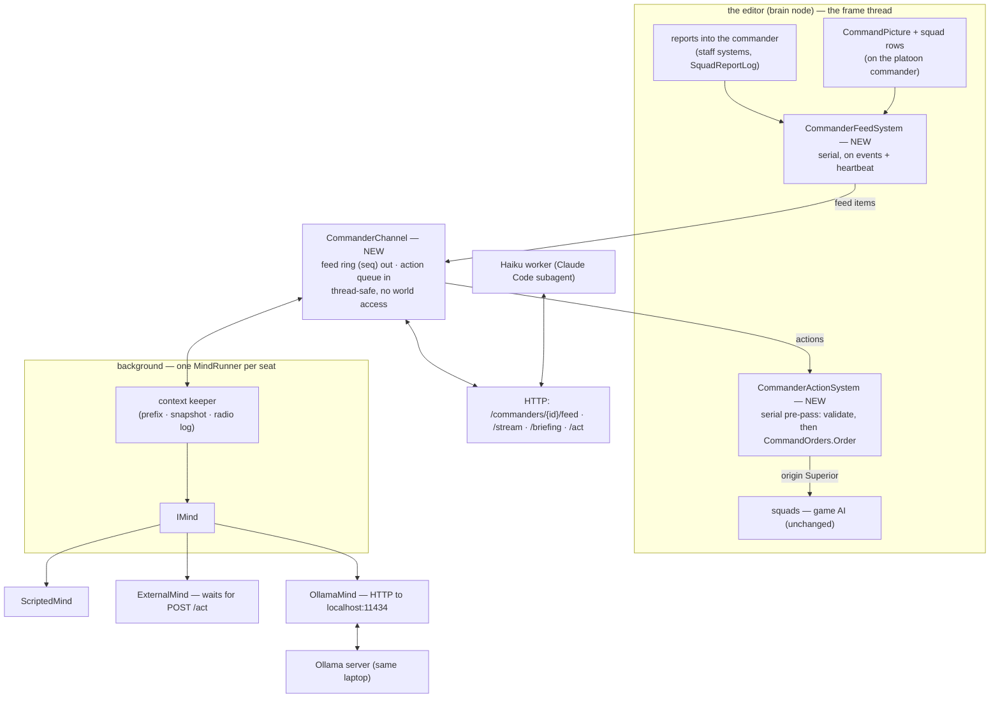
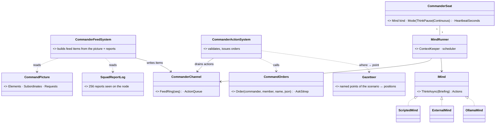
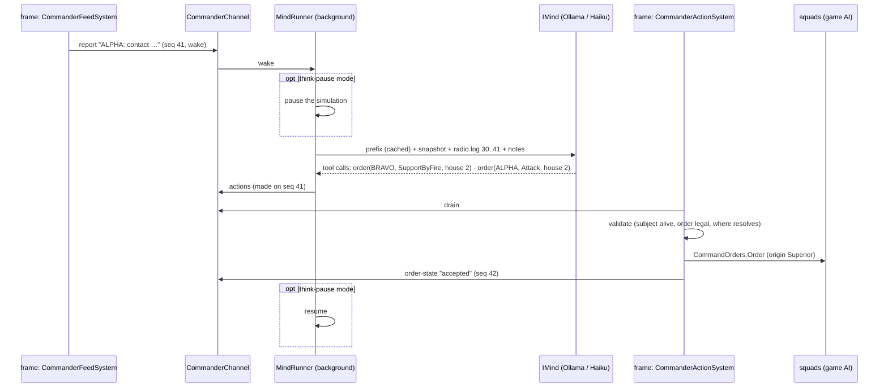

<!--STATUS
state: LIVE — PRELIMINARY IDEA (user, 2026-11-22: "write it as a preliminary idea")
updated: 2026-11-22 (rev 2 — the bridge INSIDE HROT, a platoon commander first, the feed stream, three minds: scripted · Haiku worker · Ollama; fairness dropped)
build-state: READY-TO-BUILD for L-1 (CE-4676, backend) — the §12 leans APPROVED (R-4298, user 2026-11-22: "leans approved, write handoff for L-1"); L-2…L-4 DESIGN
current-answer: §1 the test · §2–§5 the in-HROT commander bridge and its stream · §6 the laptop · §11 the slices
stale-below: the ⛔ HISTORY section at the bottom (rev 1: an external bridge, a company first, fairness)
known-rot: none
known-conflict: none
related-designs:
  - ../../DESIGN_Entity_Control.md — OWNS the "AI player" seam: C-9 the side-filtered sitrep, C-10 the side lock, C-11 HTTP orders at origin Operator
  - ../group-maneuvers/DESIGN_Command_Chain_Example.md — OWNS the reports (§6), the commander's reported picture CommandPicture (§8b), the order a commander gives (§7a CC-9)
  - ../../DESIGN_Orders_Params_Entity_Classes.md — OWNS the order catalogue (GET /orders), the params DTOs and the receiver-side resolution (§8, §9)
  - ../../blueprints/Architect_Question_83_Doctrine_And_Order_Origin.md — OWNS the order origins and their rank
  - ../../DESIGN_Node_Extensions.md — OWNS how an extra joins a node (INodeExtension → INodeCapability); the commander pack is composed the same way
  - ../../UX/DESIGN_Mission_Plan_Editor.md — OWNS a unit's mission plan — a later way to hand down a whole phase
  - ../../DESIGN_Scenario_Rules.md — OWNS objectives and their status
-->

# An LLM as a commander — preliminary idea

🔒 **User, `2026-11-22`:** *"they should play the role of a commander, not controlling every individual unit"* · *"I need this to run
continuously … the information might need to be streamed into the LLM"* · *"start with platoon commander commanding squads on a little
scenario … one side … full game AI and other side by large language model, simulated by Haiku worker as the first iteration, and later … a real
local language model using Ollama"* · *"build the commander bridge into the HROT … so the commander bridge could talk to the LLMs directly"* ·
*"one notebook … Ollama … 8 gigabytes … RTX 3070"* · *"This is not at all about fairness … I need to develop the way how the HROT units can be
controlled via LLMs."*

## 0. What "today's side summary" is

`GET /sitrep?side=Friend` (`DebugApiService.Orders.cs:392`, built for the "AI player" — [Entity Control](../../DESIGN_Entity_Control.md) C-9).
**Computed on each call** on the brain node: it walks every live entity, lists the side's own units (position, health, ammo, current order) and
merges every own unit's **`TargetMemory`** — what each soldier has seen or heard — into one contact list, freshest first; a heard contact has no
id. ⚠ It knows more than a commander (raw memory of every man, not what was reported), and one field leaks truth (`alive` of a contact is read
from the world). ⇒ **for a platoon commander the better source is his own `CommandPicture`** — the reported elements, his squads' rows and their
requests (Command Chain §6). In the editor (one process) it is local, so its missing replication does not matter for the test.

## 1. The test

| | |
|---|---|
| **Blue** | ONE body-less platoon commander (TKB 305), **its brain replaced by an LLM**, over 2–3 squads that keep the game AI |
| **Red** | a squad (or two) under the full game AI — defending a house or a hill |
| **Terrain / host** | `test-town`, in the **editor** (one process, no network) — a new scenario on the pattern of `cc-platoon-bound` (a body-less platoon, two squads, reports up) |
| **Minds, in order** | ① **scripted** (fixed rules, for the rails) → ② **Haiku worker** (a Claude Code subagent on the HTTP mailbox, §4) → ③ **Ollama** on the same laptop |

⭐ The platoon commander gives **squad orders** (`Move`, `Hold`, `Attack`, `Defend`, `BreakContact`, the squad plays `BoundingOverwatch`,
`SuppressAndManeuver`, `ClearBuilding`), asks for SITREPs, and later calls fire. The squads fight with HROT's AI.

## 2. The module view — the bridge lives inside HROT

*What the picture shows that prose hid: the frame thread never waits for a model — it only writes feed items and drains actions; the model runs
on a background thread and never touches the world; and the Haiku worker and Ollama are two minds on the SAME channel, so moving from one to the
other changes nothing in HROT's simulation.*

## 3. The stream — what flows, and how

**Feed items** (out of HROT, each with a sequence number and a sim time):

| kind | from | when |
|---|---|---|
| `snapshot` | `CommandPicture`, the squads' rows (strength, ammo colour, task, position, last report age), objectives | at seat start, every few minutes, and when the radio log grows long |
| `report` | each report addressed to the commander (contact, SPOT, SITREP, LACE, progress, request) | as it arrives (`SquadReportLog` entry to the commander) |
| `order-state` | an order he gave started / ended / was refused | as it changes |
| `event` | a squad leader down, an objective changed, a squad under fire (sense change on a subordinate) | as it happens |
| `heartbeat` | sim time | every N s, when nothing else came |

⭐ **Text, not raw state.** Each item carries both a JSON form (for rails and tools) and **one radio line** (*"14:02:10 ALPHA: contact, 3
enemy, house 2, 120 m NE of the church, engaging"*). Positions go through a **gazetteer** — named points of the scenario (objectives, buildings,
the church) and a coarse grid — because a small model reasons badly about coordinates.

**The context keeper** (per seat, background) — what the model sees on each call:

| part | content | why |
|---|---|---|
| **prefix** (stable) | role, rules, the tools, the gazetteer, the order of battle | ⭐ Ollama reuses the cached prefix ⇒ each call pays only for the new lines |
| **snapshot** | the last `snapshot` as text | the board |
| **radio log** | every radio line since that snapshot | the continuous update |
| **his notes** | what he wrote with `note()` | his running estimate survives a new snapshot |

**When the mind is called** (the scheduler): at once on a *wake* item (a contact, a request, a leader down, an order refused or done, an
objective change), else on the heartbeat (30–60 s). One call at a time; items that arrive meanwhile wait for the next call.

**Two run modes, one stream:**
- ⭐ **think-pause** (development) — the seat pauses the simulation while the mind thinks and resumes when the actions are in. ⇒ the Haiku
  worker's tens of seconds per call do not matter; a run is repeatable.
- ⭐ **continuous** (the target) — the simulation never stops; an action carries the feed seq it was made on, and the action system refuses one
  whose subject is gone (a dead squad, a released order) and feeds the refusal back.

**The HTTP surface** (so any outside mind — the Haiku worker first — and a person debugging see exactly what the model sees):

| route | |
|---|---|
| `GET /commanders` | the seats: commander, side, mind, mode |
| `GET /commanders/{id}/briefing` | the context as the model would get it now (prefix + snapshot + log + notes) |
| `GET /commanders/{id}/feed?after=<seq>&wait=<s>` | the items after a seq — ⭐ long-poll: returns at once if there are any, else waits up to `wait` |
| `GET /commanders/{id}/stream` | the same as server-sent events, for a live view |
| `POST /commanders/{id}/act {seq, actions:[…]}` | the ExternalMind's answer; validated like a model's tool calls |
| `POST /commanders/{id}/mind {kind, model, mode}` | switch mind / mode at run time |

⭐ The orders themselves are the existing ones (`CommandOrders.Order` at origin **Superior**, as if the platoon commander's own play gave them),
so a squad's reaction, its SOPs and the rank rules (AQ83) stay as they are, and the orders are in the recording like any other.

## 4. The three minds

| mind | how it answers | for |
|---|---|---|
| **ScriptedMind** | fixed rules (*"on SPOT: the nearest squad attacks, the other holds"*) | the rails: the channel, the action system and the stream are proven without any model |
| **ExternalMind** | waits for `POST /act`; the call times out to "no orders" | ⭐ the **Haiku worker**: a Claude Code subagent (model haiku) loops `GET …/feed?wait=` → reads the briefing → `POST …/act` — in **think-pause** mode. Cheap to start; any other outside agent can use it later |
| **OllamaMind** | `POST /api/chat` to `localhost:11434` with the briefing as messages and the actions as **tools** (JSON schema); a malformed or illegal call goes back as a tool error, once | the real thing — continuous mode, on the laptop |

⭐ **The actions** (tools), few on purpose (a small model handles few tools well): `order(squad, kind, where|target)` · `hold(squad)` ·
`ask_sitrep(squad)` · `note(text)` · later `request_fire(where)`. `where` is a gazetteer name or "N m <dir> of <name>"; the action system turns it
into the order's params.

## 5. Classes and the sequence

*What the picture shows that prose hid: only two NEW systems touch the world, both serial; everything a model does goes through one channel;
the existing `CommandOrders` is the only way an order leaves — no second order path.*

## 6. The laptop — RTX 3070, 8 GB *(to measure, not measured)*

| | ⭐ lean |
|---|---|
| **model** | a 7–8 B instruct model with tool calling, 4-bit (about 5 GB): Qwen 2.5 7B Instruct, Llama 3.1 8B Instruct or Qwen3 8B — try all three on the same scenario |
| **context** | 8–16 k tokens (the KV cache must fit the remaining ~3 GB); the briefing kept to ~2–4 k |
| **HROT on the same GPU** | run the editor headless or on the 2-D map during a test; the 3-D map competes for video memory |
| **small-model care** | few tools, strict schemas, gazetteer names instead of coordinates, one retry with the error; expect some bad calls — the action system refuses them, the run goes on |
| **speed** | a reply in seconds at this size — fast enough for a platoon commander in continuous mode |

## 7. Rules this respects

| rule | how |
|---|---|
| hot path, no allocation per frame | the feed system acts only on a report, an event or the heartbeat — an allocation there is "on an event", allowed |
| parallel behaviour code | the two systems are serial (the action system in the serial pre-pass); the background thread never reads or writes the world |
| one order path (shared, never duplicated) | every order goes through `CommandOrders.Order` — the same call the platoon plays use |
| a feature works when its scenarios pass (R-4277) | each slice ships its scenarios with machine checks (§11) |
| replay | the orders are recorded like any other; the model's input and output go to a log beside the recording, never into the simulation |

## 8. Several commanders on one model

Every commander is a **seat** with its own context; seats may share ONE model (Ollama serves them in turn). ⭐ A **stronger model above** —
a company commander over three LLM platoon commanders — is the chain of command HROT already has. ⚠ One context answering for several peers sees
all their pictures, so it is really their superior: build it as that seat, honestly named.

## 9. What HROT lacks (for this test)

| # | gap | ⭐ lean |
|---|---|---|
| ① | no way to take a commander's brain away from its play and hand it to a mind | `CommanderSeat`: no task + **`InertSop`** — ✅ measured `2026-11-22`: an idle platoon runs only `BasicPlatoonSop` (two picture rows: clear a building that fired, or hold every squad on a reported element), and `InertSop` is the existing explicit none; the squads keep their own reactions (they pause his order, then it resumes) |
| ② | the order-by-name check on the HTTP route probably refuses echelon orders | not on the path: the action system calls `CommandOrders.Order` directly |
| ③ | no push from HROT | the feed ring + long-poll + server-sent events (§3) |
| ④ | the squads send a routine SITREP only when asked a rate | the seat asks it at start (`CommandOrders.AskSitrep`) |
| ⑤ | no gazetteer | ⭐ the scenario's named **Point** map graphics (TKB 8816, drawn by `NamedPointGizmo`) and **tactical areas**, + a coarse grid — they exist; the gazetteer only reads them |
| ⑥ | the sitrep leaks the `alive` truth of a contact | fix it (it is the AI player's fog of war) — independent of this |

## 10. Rejected — one line each

- **The bridge outside HROT** — the user wants no external program; inside, it reads the picture directly and gives orders on the one path.
- **The LLM drives every soldier** — too slow and too many tokens; the squads' AI already fights better.
- **The sitrep as the source** — it knows what every man remembers, not what was reported to the commander.
- **The model call on the frame thread** — it would stall the simulation; it runs in the background.
- **Free-text orders parsed by HROT** — ambiguous; tool calls against a schema are checkable.

## 11. Slices

| slice | builds | done when (scenario checks) |
|---|---|---|
| **L-1** | the seat, the feed system, the channel, the action system, the gazetteer, ScriptedMind; the scenario `llm-platoon-attack` (Blue platoon vs a Red squad in a house, test-town) | scripted mind: the right orders land within 1 s of the SPOT; every order goes out at origin Superior; Red is beaten or the platoon breaks contact |
| **L-2** | the HTTP surface (`/feed` long-poll, `/stream`, `/briefing`, `/act`), ExternalMind, think-pause mode | a Haiku worker plays the scenario to the end; no illegal action is accepted; the run is repeatable from its recording |
| **L-3** | OllamaMind (tools, retry), the context keeper's prefix / snapshot / log | an 8 B model on the laptop plays it in think-pause, then continuous; the model log beside the recording |
| **L-4** | continuous scheduler (wake + heartbeat), stale-action refusal; a second seat | two platoon seats on one model; a company seat above them |

## 12. Decisions — ✅ APPROVED `2026-11-22` (R-4298: *"leans approved"*)

1. **Where the seat is set:** a scenario field on the commander (*"mind: ollama:qwen2.5:7b"*) — lean — or only at run time over HTTP? ⭐ Both, the field as the default.
2. **The first Red:** a squad defending a house (lean — `sq-defend-house` exists) or one on a hill (`hill-attack-close`)?
3. **The model log:** a file beside the recording (lean) or rows in the recording itself?
4. **Fire support in L-1** or later? ⭐ Later — a platoon commander's first job is his squads.

---

## ⛔ HISTORY — rev 1 (2026-11-22, superseded the same day)

Rev 1 put the bridge OUTSIDE HROT (a separate program on the HTTP API), started at a COMPANY commander, used `GET /sitrep` as the picture, and
weighed fairness between two models (same hardware or a delay floor). The user moved all four: the bridge inside HROT, a platoon commander first,
the commander's own reported picture, and *"not at all about fairness"*.
