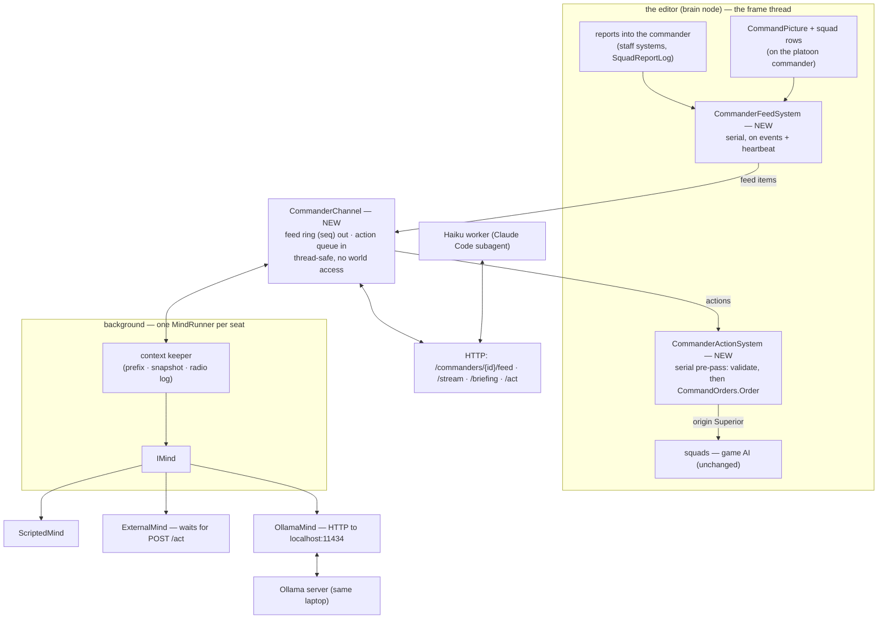
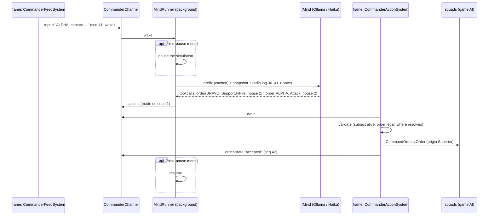
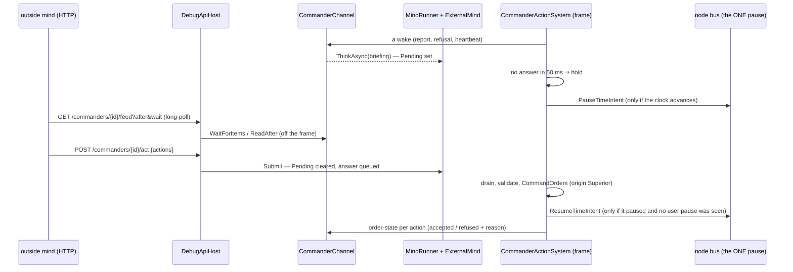

<!--STATUS
state: LIVE — PRELIMINARY IDEA (user, 2026-11-22: "write it as a preliminary idea")
updated: 2026-11-22 (rev 2 — the bridge INSIDE HROT, a platoon commander first, the feed stream, three minds: scripted · Haiku worker · Ollama; fairness dropped)
build-state: BUILDING — L-1 (CE-4676, backend): built, as built in §5a; — the §12 leans APPROVED (R-4298, user 2026-11-22: "leans approved, write handoff for L-1"); L-2 (CE-4679, backend): built, as built in §5a-2; L-2b DISPATCHED (CE-4680, backend, after L-2 — §5b); L-3…L-4 DESIGN · L-3 DISPATCHED (CE-4681, backend, on the cloud VM with the Haiku relay); L-3b (the laptop) next
current-answer: §1 the test · §2–§5 the in-HROT commander bridge and its stream · §6 the laptop · §11 the slices
stale-below: the ⛔ HISTORY section at the bottom (rev 1: an external bridge, a company first, fairness)
known-rot: none
known-conflict: none
related-designs:
  - ../../DESIGN_Entity_Control.md — OWNS the "AI player" seam: C-9 the side-filtered sitrep, C-10 the side lock, C-11 HTTP orders at origin Operator
  - ../group-maneuvers/DESIGN_Command_Chain_Example.md — OWNS the reports (§6), the commander's reported picture CommandPicture (§8b), the order a commander gives (§7a CC-9)
  - ../../DESIGN_Orders_Params_Entity_Classes.md — OWNS the order catalogue (GET /orders), the params DTOs and the receiver-side resolution (§8, §9)
  - ../../blueprints/Architect_Question_83_Doctrine_And_Order_Origin.md — OWNS the order origins and their rank
  - ../../DESIGN_Node_Extensions.md — OWNS how an extra joins a node (INodeExtension → INodeCapability); the commander pack is composed the same way
  - ../../UX/DESIGN_Mission_Plan_Editor.md — OWNS a unit's mission plan — a later way to hand down a whole phase
  - ../../DESIGN_Scenario_Rules.md — OWNS objectives and their status
-->

# An LLM as a commander — preliminary idea

🔒 **User, `2026-11-22`:** *"they should play the role of a commander, not controlling every individual unit"* · *"I need this to run
continuously … the information might need to be streamed into the LLM"* · *"start with platoon commander commanding squads on a little
scenario … one side … full game AI and other side by large language model, simulated by Haiku worker as the first iteration, and later … a real
local language model using Ollama"* · *"build the commander bridge into the HROT … so the commander bridge could talk to the LLMs directly"* ·
*"one notebook … Ollama … 8 gigabytes … RTX 3070"* · *"This is not at all about fairness … I need to develop the way how the HROT units can be
controlled via LLMs."*

## 0. What "today's side summary" is

`GET /sitrep?side=Friend` (`DebugApiService.Orders.cs:392`, built for the "AI player" — [Entity Control](../../DESIGN_Entity_Control.md) C-9).
**Computed on each call** on the brain node: it walks every live entity, lists the side's own units (position, health, ammo, current order) and
merges every own unit's **`TargetMemory`** — what each soldier has seen or heard — into one contact list, freshest first; a heard contact has no
id. ⚠ It knows more than a commander (raw memory of every man, not what was reported), and one field leaks truth (`alive` of a contact is read
from the world). ⇒ **for a platoon commander the better source is his own `CommandPicture`** — the reported elements, his squads' rows and their
requests (Command Chain §6). In the editor (one process) it is local, so its missing replication does not matter for the test.

## 1. The test

| | |
|---|---|
| **Blue** | ONE body-less platoon commander (TKB 305), **its brain replaced by an LLM**, over 2–3 squads that keep the game AI |
| **Red** | a squad (or two) under the full game AI — defending a house or a hill |
| **Terrain / host** | `test-town`, in the **editor** (one process, no network) — a new scenario on the pattern of `cc-platoon-bound` (a body-less platoon, two squads, reports up) |
| **Minds, in order** | ① **scripted** (fixed rules, for the rails) → ② **Haiku worker** (a Claude Code subagent on the HTTP mailbox, §4) → ③ **Ollama** on the same laptop |

⭐ The platoon commander gives **squad orders** (`Move`, `Hold`, `Attack`, `Defend`, `BreakContact`, the squad plays `BoundingOverwatch`,
`SuppressAndManeuver`, `ClearBuilding`), asks for SITREPs, and later calls fire. The squads fight with HROT's AI.

## 2. The module view — the bridge lives inside HROT

*What the picture shows that prose hid: the frame thread never waits for a model — it only writes feed items and drains actions; the model runs
on a background thread and never touches the world; and the Haiku worker and Ollama are two minds on the SAME channel, so moving from one to the
other changes nothing in HROT's simulation.*

## 3. The stream — what flows, and how

**Feed items** (out of HROT, each with a sequence number and a sim time):

| kind | from | when |
|---|---|---|
| `snapshot` | `CommandPicture`, the squads' rows (strength, ammo colour, task, position, last report age), objectives | at seat start, every few minutes, and when the radio log grows long |
| `report` | each report addressed to the commander (contact, SPOT, SITREP, LACE, progress, request) | as it arrives (`SquadReportLog` entry to the commander) |
| `order-state` | an order he gave started / ended / was refused | as it changes |
| `event` | a squad leader down, an objective changed, a squad under fire (sense change on a subordinate) | as it happens |
| `heartbeat` | sim time | every N s, when nothing else came |

⭐ **Text, not raw state.** Each item carries both a JSON form (for rails and tools) and **one radio line** (*"14:02:10 ALPHA: contact, 3
enemy, house 2, 120 m NE of the church, engaging"*). Positions go through a **gazetteer** — named points of the scenario (objectives, buildings,
the church) and a coarse grid — because a small model reasons badly about coordinates.

**The context keeper** (per seat, background) — what the model sees on each call:

| part | content | why |
|---|---|---|
| **prefix** (stable) | role, rules, the tools, the gazetteer, the order of battle | ⭐ Ollama reuses the cached prefix ⇒ each call pays only for the new lines |
| **snapshot** | the last `snapshot` as text | the board |
| **radio log** | every radio line since that snapshot | the continuous update |
| **his notes** | what he wrote with `note()` | his running estimate survives a new snapshot |

**When the mind is called** (the scheduler): at once on a *wake* item (a contact, a request, a leader down, an order refused or done, an
objective change), else on the heartbeat (30–60 s). One call at a time; items that arrive meanwhile wait for the next call.

**Two run modes, one stream:**
- ⭐ **think-pause** (development) — the seat pauses the simulation while the mind thinks and resumes when the actions are in. ⇒ the Haiku
  worker's tens of seconds per call do not matter; a run is repeatable.
- ⭐ **continuous** (the target) — the simulation never stops; an action carries the feed seq it was made on, and the action system refuses one
  whose subject is gone (a dead squad, a released order) and feeds the refusal back.

**The HTTP surface** (so any outside mind — the Haiku worker first — and a person debugging see exactly what the model sees):

| route | |
|---|---|
| `GET /commanders` | the seats: commander, side, mind, mode |
| `GET /commanders/{id}/briefing` | the context as the model would get it now (prefix + snapshot + log + notes) |
| `GET /commanders/{id}/feed?after=<seq>&wait=<s>` | the items after a seq — ⭐ long-poll: returns at once if there are any, else waits up to `wait` |
| `GET /commanders/{id}/stream` | the same as server-sent events, for a live view |
| `POST /commanders/{id}/act {seq, actions:[…]}` | the ExternalMind's answer; validated like a model's tool calls |
| `POST /commanders/{id}/mind {kind, model, mode}` | switch mind / mode at run time |

⭐ The orders themselves are the existing ones (`CommandOrders.Order` at origin **Superior**, as if the platoon commander's own play gave them),
so a squad's reaction, its SOPs and the rank rules (AQ83) stay as they are, and the orders are in the recording like any other.

## 4. The three minds

| mind | how it answers | for |
|---|---|---|
| **ScriptedMind** | fixed rules (*"on SPOT: the nearest squad attacks, the other holds"*) | the rails: the channel, the action system and the stream are proven without any model |
| **ExternalMind** | waits for `POST /act`; the call times out to "no orders" | ⭐ the **Haiku worker**: a Claude Code subagent (model haiku) loops `GET …/feed?wait=` → reads the briefing → `POST …/act` — in **think-pause** mode. Cheap to start; any other outside agent can use it later |
| **OllamaMind** | `POST /api/chat` to `localhost:11434` with the briefing as messages and the actions as **tools** (JSON schema); a malformed or illegal call goes back as a tool error, once | the real thing — continuous mode, on the laptop |

⭐ **The actions** (tools), few on purpose (a small model handles few tools well): `order(squad, kind, where|target)` · `hold(squad)` ·
`ask_sitrep(squad)` · `note(text)` · later `request_fire(where)`. `where` is a gazetteer name or "N m <dir> of <name>"; the action system turns it
into the order's params.

## 5. Classes and the sequence

*What the picture shows that prose hid: only two NEW systems touch the world, both serial; everything a model does goes through one channel;
the existing `CommandOrders` is the only way an order leaves — no second order path.*

### 5a. ✅ As built — L-1 (CE-4676, backend, `2026-11-22`)

The §5 diagrams hold, with these as-built facts and deviations (obligation ⑤):

| piece | as built — `Hrot/Subsystems/Hrot.CGF/Commander/` |
|---|---|
| where | ⭐ in the CGF pack (`CgfLogicPack`), so every brain node — the editor and the CGF node — has it; the code CALLS the command chain and changes nothing in it (behaviors' code) |
| `CommanderSeat` | unmanaged, component id 217, a scenario field (`{"Mind": "Scripted", "Mode": "ThinkPause", "HeartbeatSeconds": 30, "SnapshotSeconds": 120}`), saved with the scenario. ⭐ The feed system ENFORCES §9 ① when it opens a seat: `AssignSopEvent(InertSop, Superior)` if the SOP is not already InertSop, and a clear of any running task — so a seat added at run time is safe too |
| the frame order | `CommanderActionSystem` before `TacticalIntentResolutionSystem` (an order lands this frame, as a play's does) · `CommanderFeedSystem` after `StaffInboxSystem` (this frame's reports are in). Both serial, `TickMode(WhenTimeAdvances)` |
| reports into the commander | read from his `CommandReportHistory` (32, newest first — on every commander with a roster), not from `SquadReportLog`: a steady frame is ONE compare of the newest entry (0 B, rail) |
| ⚠ the first snapshot WAKES the mind | ⛔ deviation from §3's table (a snapshot was not a wake): otherwise a mind's first orders would wait for the first heartbeat |
| the orders L-1 takes | Move · Hold · Attack (`CommandOrders.Order`, by the squad's class) · SupportByFire (Attack + `HoldBack`, R-8303) · Defend / BreakContact (`CommandOrders.Route` with `SquadDefend` / `BreakContact`, as the platoon plays send them). ⛔ BoundingOverwatch / SuppressAndManeuver / ClearBuilding are refused with the list — no measured params path from a platoon to a squad for them yet |
| validation | the squad must be in the commander's roster (that is how another side's unit is refused), alive and in the fight (`CombatEffective.IsInTheFight`); the order one of the list; `where` (or `target`, read as a place in L-1) must resolve in the gazetteer. A refusal is an `order-state` item with the reason (a wake) and changes nothing |
| think-pause | ⚠ deviation: the FRAME holds (`CommanderChannel.WaitAnswered`, at most 2 s of wall time) until the mind answered every wake — the scripted mind answers in microseconds, so a run repeats. ⇒ L-2 must pause the CLOCK instead (a held frame would freeze the editor for a model's seconds) |
| the gazetteer | the scenario's Point graphics (TKB 8816) and tactical areas (TKB 8803, at their centre) by name; `"N m <dir> of <name>"` (8 directions); `"grid E<i> N<j>"` (100 m). A radio line names the nearest place within 400 m ("30 m N of house") |
| the mind's thread | `MindRunner` — a background thread per seat; it sees only feed items (the `Briefing`: prefix · snapshot · radio log · notes · the new items) and writes actions; ⛔ no reference to the world (the seat rails run under `HROT_WORLD_GUARD=1`) |
| the radio log in the node's log | every feed item is also an INFO line `[Commander] #<seq> <radio line>` |
| the checks | ⭐ a new `report` cue in the scenario grammar (`DESIGN_Scenario_Regression.md` §3) — the done-when checks ①③ could not be said without it; it reads the brain node's report log through the debug service (`GET /squad/reports`), not the UI's mirror world |

Rails — `SquadManeuverTests.CE4676_*` (the command chain's own suite, on its `Platoon` fixture): the feed says each report once with its radio line ·
an illegal action is refused with its reason and changes nothing · the scripted mind sends the nearest squad at the spot, at origin Superior, off
the frame thread · 0 B per steady frame. `ScenarioChecksTests.CE4676_TheReportCue_*`. The scenario `llm-platoon-attack` (§1).

### 5a-2. ✅ As built — L-2 (CE-4679, backend, `2026-11-22`)

*What the picture shows that prose hid: the HTTP reads never touch the world (the channel is the only meeting point); the clock is paused and
resumed by the frame thread only, on the same bus ⏸ uses.*

| piece | as built |
|---|---|
| think-pause | ⭐ HYBRID (DECISIONS_Backend CE-4679 #1): the frame waits up to `FastAnswer` (50 ms) — the scripted mind lands on its wake's frame as in L-1; a slower mind gets the CLOCK held through the one pause path, and resumed when its answer is in. ⛔ It never resumes a pause it did not make, nor one a user asked for during the hold (it counts the `PauseTimeIntent`s it reads, minus its own). Bound: `MaxHold` = `ExternalMind`'s 120 s + 10 s ⇒ "no answer — the clock runs on". `CommanderActionSystem` is `TickMode(EveryFrame)` (a held clock is paused and the hold must still end). ⚠ The pause lands on the barrier: sim time stops a few frames after the wake. ⭐⭐ **A STEPPED clock** (a verify run, run-to, `/sim/step`; the master in `Deterministic`) **is never paused or resumed by a seat** — 📌 found by the proof run: `ResumeTimeIntent` switches the master to CONTINUOUS (`MasterSyncController.cs:191`), which would end the stepping; and a stepped clock ignores a pause, so the verify run's sim time ran on while the External mind waited. ⇒ the host says whether the clock runs free (`CommanderSeats.ClockRunsFree`; the editor: the master's mode), and in a stepped run the seat only MARKS its hold (`AnyHoldsClock`) and the stepper withholds its next step (`ScenarioVerifyRun.HoldsStep` → `IVerifyWorld.CommanderHoldsClock`) |
| the seats | ⛔ SUPERSEDED: L-1's seats on the pack. ⭐ Kept WITH the world (`CommanderSeats.For(world)`, as `SquadReportLog`), so the HTTP surface finds them; `Snapshot` / `ByNetworkId` are safe from any thread. A seat's id is its commander's `NetworkIdentity` |
| the routes | §3's table, plus `GET /commanders/{id}/tools` (the JSON-schema list: order · hold · ask_sitrep · note). The briefing is `Briefing.Text()` of the pending call — byte for byte what the mind is given. The feed long-poll waits at most 60 s; `/stream` is server-sent events (`id:` seq, `data:` the item, a keep-alive every 15 s). `/act` on a non-External seat is 409; a malformed list 400 (nothing changes); an answer when nothing waits 409. `/mind` runs on the main thread (it writes the component and replaces the runner) |
| `ExternalMind` | holds the pending briefing until `POST /act`; a refusal is a wake, so the outside mind is asked again and may correct itself |
| the heartbeat | ⭐ counted from the last WAKE (a wake item or a heartbeat), never from the last item — ⛔ SUPERSEDED: L-1's "no item for N s". 📌 Found by the Haiku run: routine SITREPs every 30 s kept the 30 s heartbeat from ever firing, so before contact an outside mind was asked once and its squads stood at the start for 7 minutes (§3's scheduler: *"at once on a wake item, else on the heartbeat"*) |
| the model log | `<recording>.commander-<netId>.jsonl` (the host's `RecordingPath`; the editor wires it from the one recorder): a `call` line per mind call (the new radio lines, the actions, the raw answer) and a `verdict` line per action (accepted / refused + reason) |
| CE-4677 | `GET /sitrep` no longer reads `alive` from the world for a contact: a contact killed out of sight reads as the side last knew it |

Rails — `SquadManeuverTests.CE4679_*` (the hold: a 10 s mind holds the clock while frames run on, and its answer resumes it · a user pause during the
hold outlives it) · `DebugApiCommandersTests` (the routes on a real loopback host, the illegal action refused over HTTP, the stream, the model log) ·
`DebugApiOrdersTests.CE4677_*`.
### 5b. L-2b — the commander gets what a decision needs, and the plays as his tools *(DESIGN, user `2026-11-22`: "Yes")*

🔒 User, `2026-11-22`: *"what our game ai platoon commander now do? can his LLM replacement bring something interesting? what info are we going to
share with the LLM?"* → the answer (chat, same day): the game-AI platoon commander is an EXECUTOR — it runs the task it is given
(`PlatoonAttack`, `PlatoonDefend`, `PlatoonBound`, `SupportByFire`) and its SOP has two reactions (`BasicPlatoonSop`); nothing CHOOSES the task
during a run. ⭐ The LLM's value is the deciding: picking the play and its objective, re-planning when it goes wrong, reading an uncertain picture,
variety, and saying why. ⚠ L-1 lets him give only SQUAD orders, so he would have to re-create the plays' choreography (support SET, then the
assault) that the game AI already does better.

| # | L-2b adds | source (exists) |
|---|---|---|
| B-1 | ⭐ **`run_play(play, objective…)`** — the commander's OWN task is one of the platoon plays (`PlatoonAttack`, `PlatoonDefend`, `PlatoonBound`, `PlatoonHold`); the play gives the squad orders, the mind decides which play and when to change it. **`stop_play()`** ends it. ⭐ A direct squad order while a play runs **ends the play first** (its orders released), said in an `order-state` item — no tug of war between the play and the mind | the plays (behaviors' code, CALLED not changed) — ⚠ to measure: how a play is assigned to a body-less commander as its task, and that ending it releases its squad orders |
| B-2 | **the mission and intent** in the prefix — *"Task: … · Purpose: … · Constraints: … · Time: until …"* — an authoring-only brief on the seat, set in the scenario | new: a managed `CommanderBrief` (`[DataPolicy(NoReplay)]`, authoring-only — CLAUDE.md "NEW COMPONENTS") |
| B-3 | **the objectives line** in every snapshot — each objective the side may see: its name, state, owner, progress | `ObjectiveStatus` filtered by `VisibleSides` (Scenario Rules) |
| B-4 | **each squad's task and progress** in the snapshot — the order it is on (its kind, where), its latest progress (Set, Foothold, FallingBack…), strength / ammo colour, the age of its last report | `CommandPicture.Subordinates` (Progress, Strength, Ammo, LastReportAt, OrderedAt) + `SubordinateOrders` |
| B-5 | **the enemy as a commander hears it** — size, ACTIVITY, EQUIPMENT, the report's AGE, seen or only heard | the reported elements (`CommandReport`: Size, Activity, Equipment, ObservedAt) |
| B-6 | **one-line terrain notes on the named places** — *"house: two storeys, windows on the street"*, *"field: open, 150 m, no cover"* — shown in the prefix's places list | new: an optional `Note` on a named Point / tactical area (a scenario field; authoring-only) |

#### 5b.1 ✅ As built — B-1 `run_play` / `stop_play` (CE-4680, backend, `2026-11-22`)

| piece | as built |
|---|---|
| the tools | `run_play {play, where, support?}` — play one of `PlatoonAttack` · `PlatoonDefend` · `PlatoonBound` · `PlatoonHold` (`CommanderActionSystem.Plays`); `stop_play {}`; both in `/tools` and the prefix |
| giving the play | ⭐ an `AssignTacticalIntentEvent { Entity = the commander, IntentId = the play, Origin = Superior }` — what `CommandOrders.Assign` publishes for a superior, minus the giver's `SubordinateOrders` record (the seat has no giver entity). Params: Attack / Defend `{"Position", "SearchRadius": 30}`; Bound `{"SupportPoint", "Objective"}` (the support point defaults to the objective); Hold `{}` |
| ending it | `stop_play` or a new play: a `ClearBehaviorEvent` at origin Superior — the run ends and `SubordinateOrders.Release` clears its squad orders (behaviors' code) |
| ⭐ a direct order mid-play | ends the play first (an `order-state` `play-ended` item), and the order waits in `SeatRuntime.AfterPlay` until the play's run is gone AND its orders are released. 📌 measured on the rail: the behaviour hash changes BEFORE the release, and `CommandOrders.Order` records under the CURRENT run (`BehaviorOwnedParts.OwnerOf`) ⇒ an order given in between was cleared with the play's. Later direct orders queue behind it, in order |

Rail `SquadManeuverTests.CE4680_RunPlay_ThePlaysChoreographyRuns_ADirectOrderEndsItFirst_AndLands` (the support SET before the assault — the
play's choreography; the direct order lands and is still held 10 frames later).

#### 5b.2 ✅ As built — B-2 … B-6 (CE-4680, backend, `2026-11-22`)

| # | as built |
|---|---|
| B-2 | `CommanderBrief` (Hrot.CGF; UNMANAGED, four `FixedString128`, `NoReplay`, component 320 — auto-serialized with the scenario; ⛔ SUPERSEDED: a managed record, which never loaded: a managed component needs a scenario translator — 📌 found by the Haiku run, whose briefing had no mission) — `{"Task", "Purpose", "Constraints", "Time"}` on the commander; one prefix line *"Mission — Task: … · Purpose: … · Constraints: … · Time: …"* |
| B-3 | the snapshot's *"OBJECTIVES: <title> <state> <cur>/<need>"* — every `ObjectiveStatus` with Role Objective whose `VisibleSides` is 0 / 0xFF or holds the seat's ForceId bit |
| B-4 | each squad's row: its TASK (*"FireAndMovement → 50 m NE of house"*), latest PROGRESS, strength / ammo, the age of its last report. ⚠ The task comes from the commander's `SubordinateOrders`, else the SEAT's own last direct order — 📌 measured on the rail: a commander with no running task (run 0) records no `SubordinateOrders` at all |
| B-5 | the report lines and the snapshot's elements carry ACTIVITY, EQUIPMENT and the report's AGE (*"Firing, MachineGun, 20 s old"*). ⛔ "seen or only heard" is NOT shown — `CommandReport` has no such bit (`Radius` is a seen group's spread or a sound's uncertainty) ⇒ asked of behaviors, `NOTE_Backend_To_Behaviors_Squad_Attack_Stalls.md` §2 |
| B-6 | `PlaceNote` (unmanaged `FixedString128`, `NoReplay`, component 321) — `{"Text"}` on a named Point / area; the prefix lists *"  <place>: <note>"* |
| the scripted mind | `ScriptedMind.UsePlays` (on in production): on a SPOT it runs `PlatoonAttack` on the reported place instead of ordering each squad (L-1's rule stays for its rail). The prefix's size is logged at seat open: `llm-platoon-attack` **614 chars** with the brief and four notes |

⭐ The briefing stays SHORT (a small model's context): the prefix grows by the brief and the place notes; the snapshot by one line per squad and
one per objective. ⛔ Still no ground truth: every new line comes from what was reported to him or what his scenario told him.

## 6. The laptop — RTX 3070, 8 GB *(to measure, not measured)*

| | ⭐ lean |
|---|---|
| **model** | a 7–8 B instruct model with tool calling, 4-bit (about 5 GB): Qwen 2.5 7B Instruct, Llama 3.1 8B Instruct or Qwen3 8B — try all three on the same scenario |
| **context** | 8–16 k tokens (the KV cache must fit the remaining ~3 GB); the briefing kept to ~2–4 k |
| **HROT on the same GPU** | run the editor headless or on the 2-D map during a test; the 3-D map competes for video memory |
| **small-model care** | few tools, strict schemas, gazetteer names instead of coordinates, one retry with the error; expect some bad calls — the action system refuses them, the run goes on |
| **speed** | a reply in seconds at this size — fast enough for a platoon commander in continuous mode |

## 7. Rules this respects

| rule | how |
|---|---|
| hot path, no allocation per frame | the feed system acts only on a report, an event or the heartbeat — an allocation there is "on an event", allowed |
| parallel behaviour code | the two systems are serial (the action system in the serial pre-pass); the background thread never reads or writes the world |
| one order path (shared, never duplicated) | every order goes through `CommandOrders.Order` — the same call the platoon plays use |
| a feature works when its scenarios pass (R-4277) | each slice ships its scenarios with machine checks (§11) |
| replay | the orders are recorded like any other; the model's input and output go to a log beside the recording, never into the simulation |

## 8. Several commanders on one model

Every commander is a **seat** with its own context; seats may share ONE model (Ollama serves them in turn). ⭐ A **stronger model above** —
a company commander over three LLM platoon commanders — is the chain of command HROT already has. ⚠ One context answering for several peers sees
all their pictures, so it is really their superior: build it as that seat, honestly named.

## 9. What HROT lacks (for this test)

| # | gap | ⭐ lean |
|---|---|---|
| ① | no way to take a commander's brain away from its play and hand it to a mind | `CommanderSeat`: no task + **`InertSop`** — ✅ measured `2026-11-22`: an idle platoon runs only `BasicPlatoonSop` (two picture rows: clear a building that fired, or hold every squad on a reported element), and `InertSop` is the existing explicit none; the squads keep their own reactions (they pause his order, then it resumes) |
| ② | the order-by-name check on the HTTP route probably refuses echelon orders | not on the path: the action system calls `CommandOrders.Order` directly |
| ③ | no push from HROT | the feed ring + long-poll + server-sent events (§3) |
| ④ | the squads send a routine SITREP only when asked a rate | the seat asks it at start (`CommandOrders.AskSitrep`) |
| ⑤ | no gazetteer | ⭐ the scenario's named **Point** map graphics (TKB 8816, drawn by `NamedPointGizmo`) and **tactical areas**, + a coarse grid — they exist; the gazetteer only reads them |
| ⑥ | the sitrep leaks the `alive` truth of a contact | fix it (it is the AI player's fog of war) — independent of this |

## 10. Rejected — one line each

- **The bridge outside HROT** — the user wants no external program; inside, it reads the picture directly and gives orders on the one path.
- **The LLM drives every soldier** — too slow and too many tokens; the squads' AI already fights better.
- **The sitrep as the source** — it knows what every man remembers, not what was reported to the commander.
- **The model call on the frame thread** — it would stall the simulation; it runs in the background.
- **Free-text orders parsed by HROT** — ambiguous; tool calls against a schema are checkable.

## 11. Slices

| slice | builds | done when (scenario checks) |
|---|---|---|
| **L-1** | the seat, the feed system, the channel, the action system, the gazetteer, ScriptedMind; the scenario `llm-platoon-attack` (Blue platoon vs a Red squad in a house, test-town) | scripted mind: the right orders land within 1 s of the SPOT; every order goes out at origin Superior; Red is beaten or the platoon breaks contact |
| **L-2** | the HTTP surface (`/feed` long-poll, `/stream`, `/briefing`, `/act`), ExternalMind, think-pause mode | a Haiku worker plays the scenario to the end; no illegal action is accepted; the run is repeatable from its recording |
| **L-2b** | §5b: `run_play` / `stop_play`, the mission brief, the objectives line, each squad's task and progress, the enemy's activity / equipment / age, terrain notes on named places | the scripted mind runs `PlatoonAttack` on the house and the play's choreography happens (support SET before the assault); the briefing carries every §5b line; the Haiku worker plays the scenario again — its orders cite the mission |
| **L-3** | ⭐ on the CLOUD VM (CE-4681, user `2026-11-23`): `ChatModelMind` (Ollama's `/api/chat`, tools, one retry), a byte-stable prefix, checks per mind, a stand-in server, the **Haiku relay** answering HROT's exact chat requests; the laptop recipe ready, not run | the relay run plays `llm-platoon-attack` to the end; every exchange in the model log; counts of accepted / refused / malformed calls and the briefing's tokens per call |
| **L-3b** | the real model on the user's laptop (RTX 3070, 8 GB): the three 7–8 B models through the L-3 recipe | an 8 B model plays it in think-pause, then continuous; a per-model summary |
| **L-4** | continuous scheduler (wake + heartbeat), stale-action refusal; a second seat | two platoon seats on one model; a company seat above them |

## 12. Decisions — ✅ APPROVED `2026-11-22` (R-4298: *"leans approved"*)

1. **Where the seat is set:** a scenario field on the commander (*"mind: ollama:qwen2.5:7b"*) — lean — or only at run time over HTTP? ⭐ Both, the field as the default.
2. **The first Red:** a squad defending a house (lean — `sq-defend-house` exists) or one on a hill (`hill-attack-close`)?
3. **The model log:** a file beside the recording (lean) or rows in the recording itself?
4. **Fire support in L-1** or later? ⭐ Later — a platoon commander's first job is his squads.

---

## ⛔ HISTORY — rev 1 (2026-11-22, superseded the same day)

Rev 1 put the bridge OUTSIDE HROT (a separate program on the HTTP API), started at a COMPANY commander, used `GET /sitrep` as the picture, and
weighed fairness between two models (same hardware or a delay floor). The user moved all four: the bridge inside HROT, a platoon commander first,
the commander's own reported picture, and *"not at all about fairness"*.
