<!--STATUS
state: LIVE — PRELIMINARY IDEA (user, 2026-11-22: "write it as a preliminary idea")
updated: 2026-11-25 (§5c C-2 CE-4687 a condition that can never hold) · 2026-11-24 (§5d.1 CE-4686 the four findings) · 2026-11-24 (§5d the seat over aggregated units, CE-4685) · 2026-11-23 (§5a-5 the duel) · 2026-11-22 (rev 2 — the bridge INSIDE HROT, a platoon commander first, the feed stream, three minds: scripted · Haiku worker · Ollama; fairness dropped)
build-state: BUILDING — L-1 (CE-4676) §5a · L-2 (CE-4679) §5a-2 · L-2b (CE-4680) §5b · L-3 on the cloud VM (CE-4681) §5a-3 · L-3a the briefing budget (CE-4683) §5a-4 · the duel §5a-5 — all BUILT by backend; the §12 leans APPROVED (R-4298, user 2026-11-22: "leans approved, write handoff for L-1"); NEXT L-3c the decision contract (CE-4684, §5c), then L-3b (the real model on the user's laptop); L-4 DESIGN
current-answer: §1 the test · §2–§5 the in-HROT commander bridge and its stream · §6 the laptop · §11 the slices
stale-below: the ⛔ HISTORY section at the bottom (rev 1: an external bridge, a company first, fairness)
known-rot: none
known-conflict: none
related-designs:
  - ../../DESIGN_Entity_Control.md — OWNS the "AI player" seam: C-9 the side-filtered sitrep, C-10 the side lock, C-11 HTTP orders at origin Operator
  - ../group-maneuvers/DESIGN_Command_Chain_Example.md — OWNS the reports (§6), the commander's reported picture CommandPicture (§8b), the order a commander gives (§7a CC-9)
  - ../../DESIGN_Orders_Params_Entity_Classes.md — OWNS the order catalogue (GET /orders), the params DTOs and the receiver-side resolution (§8, §9)
  - ../../blueprints/Architect_Question_83_Doctrine_And_Order_Origin.md — OWNS the order origins and their rank
  - ../../DESIGN_Node_Extensions.md — OWNS how an extra joins a node (INodeExtension → INodeCapability); the commander pack is composed the same way
  - ../../UX/DESIGN_Mission_Plan_Editor.md — OWNS a unit's mission plan — a later way to hand down a whole phase
  - ../../DESIGN_Scenario_Rules.md — OWNS objectives and their status
-->

# An LLM as a commander — preliminary idea

🔒 **User, `2026-11-22`:** *"they should play the role of a commander, not controlling every individual unit"* · *"I need this to run
continuously … the information might need to be streamed into the LLM"* · *"start with platoon commander commanding squads on a little
scenario … one side … full game AI and other side by large language model, simulated by Haiku worker as the first iteration, and later … a real
local language model using Ollama"* · *"build the commander bridge into the HROT … so the commander bridge could talk to the LLMs directly"* ·
*"one notebook … Ollama … 8 gigabytes … RTX 3070"* · *"This is not at all about fairness … I need to develop the way how the HROT units can be
controlled via LLMs."*

## 0. What "today's side summary" is

`GET /sitrep?side=Friend` (`DebugApiService.Orders.cs:392`, built for the "AI player" — [Entity Control](../../DESIGN_Entity_Control.md) C-9).
**Computed on each call** on the brain node: it walks every live entity, lists the side's own units (position, health, ammo, current order) and
merges every own unit's **`TargetMemory`** — what each soldier has seen or heard — into one contact list, freshest first; a heard contact has no
id. ⚠ It knows more than a commander (raw memory of every man, not what was reported), and one field leaks truth (`alive` of a contact is read
from the world). ⇒ **for a platoon commander the better source is his own `CommandPicture`** — the reported elements, his squads' rows and their
requests (Command Chain §6). In the editor (one process) it is local, so its missing replication does not matter for the test.

## 1. The test

| | |
|---|---|
| **Blue** | ONE body-less platoon commander (TKB 305), **its brain replaced by an LLM**, over 2–3 squads that keep the game AI |
| **Red** | a squad (or two) under the full game AI — defending a house or a hill |
| **Terrain / host** | `test-town`, in the **editor** (one process, no network) — a new scenario on the pattern of `cc-platoon-bound` (a body-less platoon, two squads, reports up) |
| **Minds, in order** | ① **scripted** (fixed rules, for the rails) → ② **Haiku worker** (a Claude Code subagent on the HTTP mailbox, §4) → ③ **Ollama** on the same laptop |

⭐ The platoon commander gives **squad orders** (`Move`, `Hold`, `Attack`, `Defend`, `BreakContact`, the squad plays `BoundingOverwatch`,
`SuppressAndManeuver`, `ClearBuilding`), asks for SITREPs, and later calls fire. The squads fight with HROT's AI.

## 2. The module view — the bridge lives inside HROT

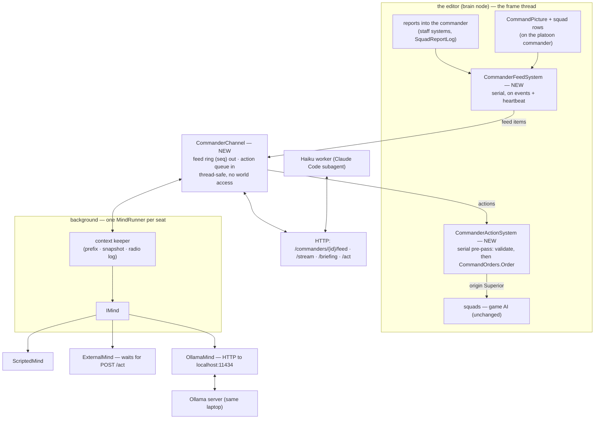

*What the picture shows that prose hid: the frame thread never waits for a model — it only writes feed items and drains actions; the model runs
on a background thread and never touches the world; and the Haiku worker and Ollama are two minds on the SAME channel, so moving from one to the
other changes nothing in HROT's simulation.*

## 3. The stream — what flows, and how

**Feed items** (out of HROT, each with a sequence number and a sim time):

| kind | from | when |
|---|---|---|
| `snapshot` | `CommandPicture`, the squads' rows (strength, ammo colour, task, position, last report age), objectives | at seat start, every few minutes, and when the radio log grows long |
| `report` | each report addressed to the commander (contact, SPOT, SITREP, LACE, progress, request) | as it arrives (`SquadReportLog` entry to the commander) |
| `order-state` | an order he gave started / ended / was refused | as it changes |
| `event` | a squad leader down, an objective changed, a squad under fire (sense change on a subordinate) | as it happens |
| `heartbeat` | sim time | every N s, when nothing else came |

⭐ **Text, not raw state.** Each item carries both a JSON form (for rails and tools) and **one radio line** (*"14:02:10 ALPHA: contact, 3
enemy, house 2, 120 m NE of the church, engaging"*). Positions go through a **gazetteer** — named points of the scenario (objectives, buildings,
the church) and a coarse grid — because a small model reasons badly about coordinates.

**The context keeper** (per seat, background) — what the model sees on each call:

| part | content | why |
|---|---|---|
| **prefix** (stable) | role, rules, the tools, the gazetteer, the order of battle | ⭐ Ollama reuses the cached prefix ⇒ each call pays only for the new lines |
| **snapshot** | the last `snapshot` as text | the board |
| **radio log** | every radio line since that snapshot | the continuous update |
| **his notes** | what he wrote with `note()` | his running estimate survives a new snapshot |

**When the mind is called** (the scheduler): at once on a *wake* item (a contact, a request, a leader down, an order refused or done, an
objective change), else on the heartbeat (30–60 s). One call at a time; items that arrive meanwhile wait for the next call.

**Two run modes, one stream:**
- ⭐ **think-pause** (development) — the seat pauses the simulation while the mind thinks and resumes when the actions are in. ⇒ the Haiku
  worker's tens of seconds per call do not matter; a run is repeatable.
- ⭐ **continuous** (the target) — the simulation never stops; an action carries the feed seq it was made on, and the action system refuses one
  whose subject is gone (a dead squad, a released order) and feeds the refusal back.

**The HTTP surface** (so any outside mind — the Haiku worker first — and a person debugging see exactly what the model sees):

| route | |
|---|---|
| `GET /commanders` | the seats: commander, side, mind, mode |
| `GET /commanders/{id}/briefing` | the context as the model would get it now (prefix + snapshot + log + notes) |
| `GET /commanders/{id}/feed?after=<seq>&wait=<s>` | the items after a seq — ⭐ long-poll: returns at once if there are any, else waits up to `wait` |
| `GET /commanders/{id}/stream` | the same as server-sent events, for a live view |
| `POST /commanders/{id}/act {seq, actions:[…]}` | the ExternalMind's answer; validated like a model's tool calls |
| `POST /commanders/{id}/mind {kind, model, mode}` | switch mind / mode at run time |

⭐ The orders themselves are the existing ones (`CommandOrders.Order` at origin **Superior**, as if the platoon commander's own play gave them),
so a squad's reaction, its SOPs and the rank rules (AQ83) stay as they are, and the orders are in the recording like any other.

## 4. The three minds

| mind | how it answers | for |
|---|---|---|
| **ScriptedMind** | fixed rules (*"on SPOT: the nearest squad attacks, the other holds"*) | the rails: the channel, the action system and the stream are proven without any model |
| **ExternalMind** | waits for `POST /act`; the call times out to "no orders" | ⭐ the **Haiku worker**: a Claude Code subagent (model haiku) loops `GET …/feed?wait=` → reads the briefing → `POST …/act` — in **think-pause** mode. Cheap to start; any other outside agent can use it later |
| **OllamaMind** | `POST /api/chat` to `localhost:11434` with the briefing as messages and the actions as **tools** (JSON schema); a malformed or illegal call goes back as a tool error, once | the real thing — continuous mode, on the laptop |

⭐ **The actions** (tools), few on purpose (a small model handles few tools well): `order(squad, kind, where|target)` · `hold(squad)` ·
`ask_sitrep(squad)` · `note(text)` · later `request_fire(where)`. `where` is a gazetteer name or "N m <dir> of <name>"; the action system turns it
into the order's params.

## 5. Classes and the sequence


*What the picture shows that prose hid: only two NEW systems touch the world, both serial; everything a model does goes through one channel;
the existing `CommandOrders` is the only way an order leaves — no second order path.*

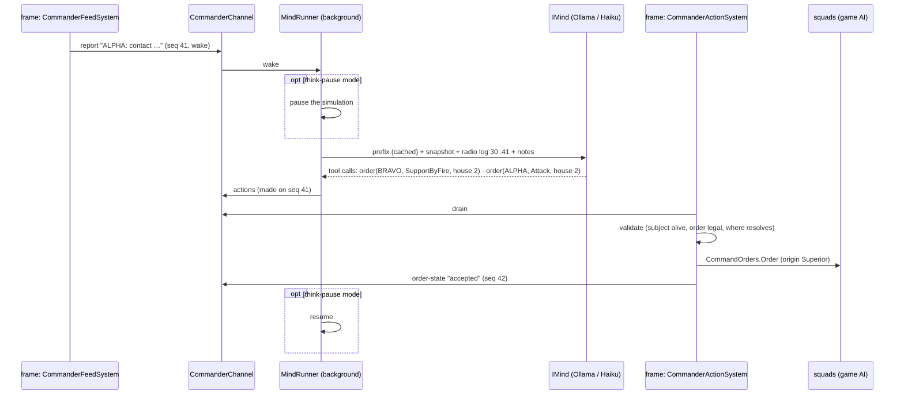

### 5a. ✅ As built — L-1 (CE-4676, backend, `2026-11-22`)

The §5 diagrams hold, with these as-built facts and deviations (obligation ⑤):

| piece | as built — `Hrot/Subsystems/Hrot.CGF/Commander/` |
|---|---|
| where | ⭐ in the CGF pack (`CgfLogicPack`), so every brain node — the editor and the CGF node — has it; the code CALLS the command chain and changes nothing in it (behaviors' code) |
| `CommanderSeat` | unmanaged, component id 217, a scenario field (`{"Mind": "Scripted", "Mode": "ThinkPause", "HeartbeatSeconds": 30, "SnapshotSeconds": 120}`), saved with the scenario. ⭐ The feed system ENFORCES §9 ① when it opens a seat: `AssignSopEvent(InertSop, Superior)` if the SOP is not already InertSop, and a clear of any running task — so a seat added at run time is safe too |
| the frame order | `CommanderActionSystem` before `TacticalIntentResolutionSystem` (an order lands this frame, as a play's does) · `CommanderFeedSystem` after `StaffInboxSystem` (this frame's reports are in). Both serial, `TickMode(WhenTimeAdvances)` |
| reports into the commander | read from his `CommandReportHistory` (32, newest first — on every commander with a roster), not from `SquadReportLog`: a steady frame is ONE compare of the newest entry (0 B, rail) |
| ⚠ the first snapshot WAKES the mind | ⛔ deviation from §3's table (a snapshot was not a wake): otherwise a mind's first orders would wait for the first heartbeat |
| the orders L-1 takes | Move · Hold · Attack (`CommandOrders.Order`, by the squad's class) · SupportByFire (Attack + `HoldBack`, R-8303) · Defend / BreakContact (`CommandOrders.Route` with `SquadDefend` / `BreakContact`, as the platoon plays send them). ⛔ BoundingOverwatch / SuppressAndManeuver / ClearBuilding are refused with the list — no measured params path from a platoon to a squad for them yet |
| validation | the squad must be in the commander's roster (that is how another side's unit is refused), alive and in the fight (`CombatEffective.IsInTheFight`); the order one of the list; `where` (or `target`, read as a place in L-1) must resolve in the gazetteer. A refusal is an `order-state` item with the reason (a wake) and changes nothing |
| think-pause | ⚠ deviation: the FRAME holds (`CommanderChannel.WaitAnswered`, at most 2 s of wall time) until the mind answered every wake — the scripted mind answers in microseconds, so a run repeats. ⇒ L-2 must pause the CLOCK instead (a held frame would freeze the editor for a model's seconds) |
| the gazetteer | the scenario's Point graphics (TKB 8816) and tactical areas (TKB 8803, at their centre) by name; `"N m <dir> of <name>"` (8 directions); `"grid E<i> N<j>"` (100 m). A radio line names the nearest place within 400 m ("30 m N of house") |
| the mind's thread | `MindRunner` — a background thread per seat; it sees only feed items (the `Briefing`: prefix · snapshot · radio log · notes · the new items) and writes actions; ⛔ no reference to the world (the seat rails run under `HROT_WORLD_GUARD=1`) |
| the radio log in the node's log | every feed item is also an INFO line `[Commander] #<seq> <radio line>` |
| the checks | ⭐ a new `report` cue in the scenario grammar (`DESIGN_Scenario_Regression.md` §3) — the done-when checks ①③ could not be said without it; it reads the brain node's report log through the debug service (`GET /squad/reports`), not the UI's mirror world |

Rails — `SquadManeuverTests.CE4676_*` (the command chain's own suite, on its `Platoon` fixture): the feed says each report once with its radio line ·
an illegal action is refused with its reason and changes nothing · the scripted mind sends the nearest squad at the spot, at origin Superior, off
the frame thread · 0 B per steady frame. `ScenarioChecksTests.CE4676_TheReportCue_*`. The scenario `llm-platoon-attack` (§1).

### 5a-2. ✅ As built — L-2 (CE-4679, backend, `2026-11-22`)

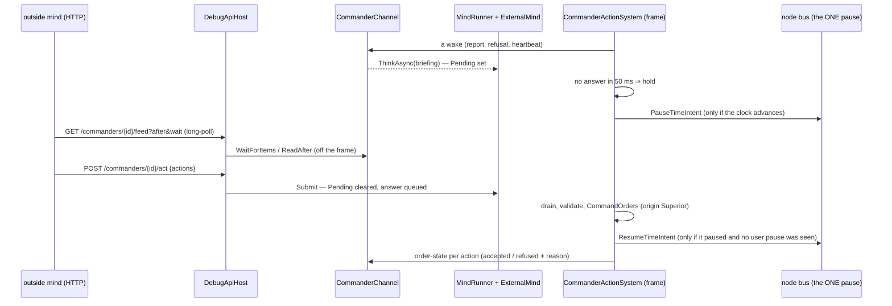
*What the picture shows that prose hid: the HTTP reads never touch the world (the channel is the only meeting point); the clock is paused and
resumed by the frame thread only, on the same bus ⏸ uses.*

| piece | as built |
|---|---|
| think-pause | ⭐ HYBRID (DECISIONS_Backend CE-4679 #1): the frame waits up to `FastAnswer` (50 ms) — the scripted mind lands on its wake's frame as in L-1; a slower mind gets the CLOCK held through the one pause path, and resumed when its answer is in. ⛔ It never resumes a pause it did not make, nor one a user asked for during the hold (it counts the `PauseTimeIntent`s it reads, minus its own). Bound: `MaxHold` = `ExternalMind`'s 120 s + 10 s ⇒ "no answer — the clock runs on". `CommanderActionSystem` is `TickMode(EveryFrame)` (a held clock is paused and the hold must still end). ⚠ The pause lands on the barrier: sim time stops a few frames after the wake. ⭐⭐ **A STEPPED clock** (a verify run, run-to, `/sim/step`; the master in `Deterministic`) **is never paused or resumed by a seat** — 📌 found by the proof run: `ResumeTimeIntent` switches the master to CONTINUOUS (`MasterSyncController.cs:191`), which would end the stepping; and a stepped clock ignores a pause, so the verify run's sim time ran on while the External mind waited. ⇒ the host says whether the clock runs free (`CommanderSeats.ClockRunsFree`; the editor: the master's mode), and in a stepped run the seat only MARKS its hold (`AnyHoldsClock`) and the stepper withholds its next step (`ScenarioVerifyRun.HoldsStep` → `IVerifyWorld.CommanderHoldsClock`) |
| the seats | ⛔ SUPERSEDED: L-1's seats on the pack. ⭐ Kept WITH the world (`CommanderSeats.For(world)`, as `SquadReportLog`), so the HTTP surface finds them; `Snapshot` / `ByNetworkId` are safe from any thread. A seat's id is its commander's `NetworkIdentity` |
| the routes | §3's table, plus `GET /commanders/{id}/tools` (the JSON-schema list: order · hold · ask_sitrep · note). The briefing is `Briefing.Text()` of the pending call — byte for byte what the mind is given. The feed long-poll waits at most 60 s; `/stream` is server-sent events (`id:` seq, `data:` the item, a keep-alive every 15 s). `/act` on a non-External seat is 409; a malformed list 400 (nothing changes); an answer when nothing waits 409. `/mind` runs on the main thread (it writes the component and replaces the runner) |
| `ExternalMind` | holds the pending briefing until `POST /act`; a refusal is a wake, so the outside mind is asked again and may correct itself |
| the heartbeat | ⭐ counted from the last WAKE (a wake item or a heartbeat), never from the last item — ⛔ SUPERSEDED: L-1's "no item for N s". 📌 Found by the Haiku run: routine SITREPs every 30 s kept the 30 s heartbeat from ever firing, so before contact an outside mind was asked once and its squads stood at the start for 7 minutes (§3's scheduler: *"at once on a wake item, else on the heartbeat"*) |
| the model log | `<recording>.commander-<netId>.jsonl` (the host's `RecordingPath`; the editor wires it from the one recorder): a `call` line per mind call (the new radio lines, the actions, the raw answer) and a `verdict` line per action (accepted / refused + reason) |
| CE-4677 | `GET /sitrep` no longer reads `alive` from the world for a contact: a contact killed out of sight reads as the side last knew it |

Rails — `SquadManeuverTests.CE4679_*` (the hold: a 10 s mind holds the clock while frames run on, and its answer resumes it · a user pause during the
hold outlives it) · `DebugApiCommandersTests` (the routes on a real loopback host, the illegal action refused over HTTP, the stream, the model log) ·
`DebugApiOrdersTests.CE4677_*`.
### 5b. L-2b — the commander gets what a decision needs, and the plays as his tools *(DESIGN, user `2026-11-22`: "Yes")*

🔒 User, `2026-11-22`: *"what our game ai platoon commander now do? can his LLM replacement bring something interesting? what info are we going to
share with the LLM?"* → the answer (chat, same day): the game-AI platoon commander is an EXECUTOR — it runs the task it is given
(`PlatoonAttack`, `PlatoonDefend`, `PlatoonBound`, `SupportByFire`) and its SOP has two reactions (`BasicPlatoonSop`); nothing CHOOSES the task
during a run. ⭐ The LLM's value is the deciding: picking the play and its objective, re-planning when it goes wrong, reading an uncertain picture,
variety, and saying why. ⚠ L-1 lets him give only SQUAD orders, so he would have to re-create the plays' choreography (support SET, then the
assault) that the game AI already does better.

| # | L-2b adds | source (exists) |
|---|---|---|
| B-1 | ⭐ **`run_play(play, objective…)`** — the commander's OWN task is one of the platoon plays (`PlatoonAttack`, `PlatoonDefend`, `PlatoonBound`, `PlatoonHold`); the play gives the squad orders, the mind decides which play and when to change it. **`stop_play()`** ends it. ⭐ A direct squad order while a play runs **ends the play first** (its orders released), said in an `order-state` item — no tug of war between the play and the mind | the plays (behaviors' code, CALLED not changed) — ⚠ to measure: how a play is assigned to a body-less commander as its task, and that ending it releases its squad orders |
| B-2 | **the mission and intent** in the prefix — *"Task: … · Purpose: … · Constraints: … · Time: until …"* — an authoring-only brief on the seat, set in the scenario | new: a managed `CommanderBrief` (`[DataPolicy(NoReplay)]`, authoring-only — CLAUDE.md "NEW COMPONENTS") |
| B-3 | **the objectives line** in every snapshot — each objective the side may see: its name, state, owner, progress | `ObjectiveStatus` filtered by `VisibleSides` (Scenario Rules) |
| B-4 | **each squad's task and progress** in the snapshot — the order it is on (its kind, where), its latest progress (Set, Foothold, FallingBack…), strength / ammo colour, the age of its last report | `CommandPicture.Subordinates` (Progress, Strength, Ammo, LastReportAt, OrderedAt) + `SubordinateOrders` |
| B-5 | **the enemy as a commander hears it** — size, ACTIVITY, EQUIPMENT, the report's AGE, seen or only heard | the reported elements (`CommandReport`: Size, Activity, Equipment, ObservedAt) |
| B-6 | **one-line terrain notes on the named places** — *"house: two storeys, windows on the street"*, *"field: open, 150 m, no cover"* — shown in the prefix's places list | new: an optional `Note` on a named Point / tactical area (a scenario field; authoring-only) |

#### 5b.1 ✅ As built — B-1 `run_play` / `stop_play` (CE-4680, backend, `2026-11-22`)

| piece | as built |
|---|---|
| the tools | `run_play {play, where, support?}` — ⭐ **since CE-4685 (§5d) `play` is an order KIND to his whole unit** — `Attack` · `Defend` · `Bound` · `Hold` (`CommanderActionSystem.OwnOrders`); ⛔ ~~one of `PlatoonAttack` · `PlatoonDefend` · `PlatoonBound` · `PlatoonHold`~~ (SUPERSEDED `2026-11-24`, user: *"We cannot call directly a behavior name"*); `stop_play {}`; both in `/tools` and the prefix |
| giving the play | ⭐ an `AssignTacticalIntentEvent { Entity = the commander, IntentId = ~~the play~~ ⭐ `Order.<kind>` (CE-4685 — the routing table picks the play for his class), Origin = Superior }` — what `CommandOrders.Assign` publishes for a superior, minus the giver's `SubordinateOrders` record (the seat has no giver entity). Params: Attack / Defend `{"Position", "SearchRadius": 30}`; Bound `{"SupportPoint", "Objective"}` (the support point defaults to the objective); Hold `{}` |
| ending it | `stop_play` or a new play: a `ClearBehaviorEvent` at origin Superior — the run ends and `SubordinateOrders.Release` clears its squad orders (behaviors' code) |
| ⭐ a direct order mid-play | ends the play first (an `order-state` `play-ended` item), and the order waits in `SeatRuntime.AfterPlay` until the play's run is gone AND its orders are released. 📌 measured on the rail: the behaviour hash changes BEFORE the release, and `CommandOrders.Order` records under the CURRENT run (`BehaviorOwnedParts.OwnerOf`) ⇒ an order given in between was cleared with the play's. Later direct orders queue behind it, in order |

Rail `SquadManeuverTests.CE4680_RunPlay_ThePlaysChoreographyRuns_ADirectOrderEndsItFirst_AndLands` (the support SET before the assault — the
play's choreography; the direct order lands and is still held 10 frames later).

#### 5b.2 ✅ As built — B-2 … B-6 (CE-4680, backend, `2026-11-22`)

| # | as built |
|---|---|
| B-2 | `CommanderBrief` (Hrot.CGF; UNMANAGED, four `FixedString128`, `NoReplay`, component 320 — auto-serialized with the scenario; ⛔ SUPERSEDED: a managed record, which never loaded: a managed component needs a scenario translator — 📌 found by the Haiku run, whose briefing had no mission) — `{"Task", "Purpose", "Constraints", "Time"}` on the commander; one prefix line *"Mission — Task: … · Purpose: … · Constraints: … · Time: …"* |
| B-3 | the snapshot's *"OBJECTIVES: <title> <state> <cur>/<need>"* — every `ObjectiveStatus` with Role Objective whose `VisibleSides` is 0 / 0xFF or holds the seat's ForceId bit |
| B-4 | each squad's row: its TASK (*"FireAndMovement → 50 m NE of house"*), latest PROGRESS, strength / ammo, the age of its last report. ⚠ The task comes from the commander's `SubordinateOrders`, else the SEAT's own last direct order — 📌 measured on the rail: a commander with no running task (run 0) records no `SubordinateOrders` at all |
| B-5 | the report lines and the snapshot's elements carry ACTIVITY, EQUIPMENT and the report's AGE (*"Firing, MachineGun, 20 s old"*). ⛔ "seen or only heard" is NOT shown — `CommandReport` has no such bit (`Radius` is a seen group's spread or a sound's uncertainty) ⇒ asked of behaviors, `NOTE_Backend_To_Behaviors_Squad_Attack_Stalls.md` §2 |
| B-6 | `PlaceNote` (unmanaged `FixedString128`, `NoReplay`, component 321) — `{"Text"}` on a named Point / area; the prefix lists *"  <place>: <note>"* |
| the scripted mind | `ScriptedMind.UsePlays` (on in production): on a SPOT it runs `PlatoonAttack` on the reported place instead of ordering each squad (L-1's rule stays for its rail). The prefix's size is logged at seat open: `llm-platoon-attack` **614 chars** with the brief and four notes |

⭐ The briefing stays SHORT (a small model's context): the prefix grows by the brief and the place notes; the snapshot by one line per squad and
one per objective. ⛔ Still no ground truth: every new line comes from what was reported to him or what his scenario told him.

### 5a-3. L-3 — the chat-model mind on the cloud VM *(CE-4681, backend, `2026-11-23`; build-state: BUILT `2026-11-23` — as-built rows at the end of this section; the run in `STATUS_Backend_LLM_Commander.md` §L-3)*

🔒 User, `2026-11-23`: *"running on cloud VM (not my physical machine) - the run on my machine would be a next phase once we test whatever we
could without it, using Haiku"*.

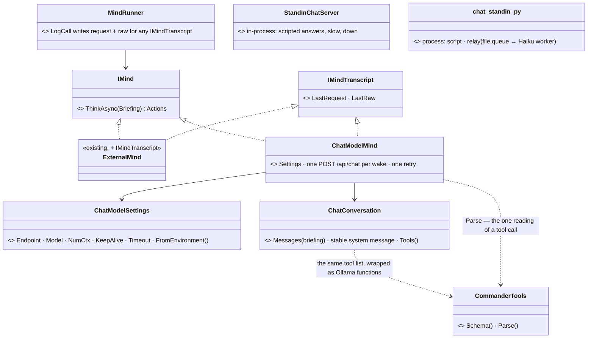
*What the picture shows that prose hid:* the model's answer is read by the SAME `CommanderTools.Parse` as `POST /act`, and the tools are the SAME
`Schema()` list — wrapped, not re-declared — so an order from a model and an order from the Haiku worker reach `CommanderActionSystem` identically.

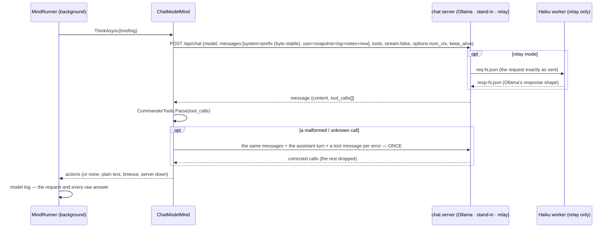
*What it shows:* at most two HTTP calls per wake, both inside the think-pause hold; a refused ORDER is not retried here — it comes back as an
`order-state` wake, as for every mind.

| piece | decision (why) |
|---|---|
| the name | ⭐ `CommanderMind.ChatModel` — the design's *OllamaMind* renamed (Roslyn): it speaks Ollama's chat API, but any server that does (the stand-in, the relay) answers it |
| the conversation | `system` = the seat's prefix + a fixed instruction line — built ONCE per seat, so it is byte-identical on every call (a server reuses its cache); `user` = the snapshot, the radio log, the notes, the new items, the sim time. ⛔ No history of earlier calls: the briefing IS the memory (§3) |
| the tools | `CommanderTools.Schema()` wrapped as `{type: function, function: {…}}` — one list for every mind |
| the answer | `message.tool_calls[].function {name, arguments}` (arguments an object or a JSON string) → `CommanderTools.Parse`. `message.content` with no call ⇒ no orders (logged) |
| the retry | a malformed / unknown call ⇒ ONE more request: the first answer as the assistant turn + one `tool` message per error, saying which calls were taken; the second answer's well-formed calls are added, its bad ones dropped. ⛔ Never a second retry |
| no answer | a timeout (`Timeout`, default 120 s — the think-pause hold waits for it) or a refused connection ⇒ no orders, the run goes on; the model log says why |
| the settings | `HROT_COMMANDER_ENDPOINT` (default `http://localhost:11434`), `HROT_COMMANDER_MODEL` (`qwen2.5:7b-instruct`), `HROT_COMMANDER_NUM_CTX` (8192), `HROT_COMMANDER_KEEP_ALIVE` (`30m`), `HROT_COMMANDER_TIMEOUT_S` (120) — read when the seat opens. ⭐ `HROT_COMMANDER_MIND` overrides the scenario's mind for a run (the laptop script runs one scenario per model) and writes the seat so the checks see it |
| the model log | every call writes the full request and each raw answer (`IMindTranscript`, shared with `ExternalMind`); with no recording the log goes to `HROT_COMMANDER_LOG_DIR` (a verify run has no recording) |
| checks per mind | no grammar change: an anchor `scriptedMind` (a `field` cue on `CommanderSeat.Mind`) and `"if": "scriptedMind"` on the two scripted-only rows — a model run SKIPS them |
| two stand-ins | ⚠ a NECESSARY difference: the rails need an in-process server they control (a hang, a refused port) with no process; the VM run and the laptop recipe need a PROCESS the editor reaches and that can relay to an agent. Both answer the same Ollama shape |
| ⭐ as built — the anchor | ⚠ deviation: `scriptedMind` holds `"for": 1` — 📌 the first form sampled the SCENARIO's mind at t = 0, before the run's `HROT_COMMANDER_MIND` override rewrote the seat, so a model run was judged on the scripted rows (found by the laptop dry run) |
| ⭐ as built — the answer time | the model log's `call` line carries `ms` (the mind's wall time), for every mind |
| ⭐ measured (the Haiku relay run) | 48 wakes · 65 tool calls · 0 malformed · answers 6 s mean / 10 s max · ONE system message for all 48 calls · the request 4 014 → 29 398 chars (≈ 7 350 tokens), ⭐ **18 KB of it the notes** ⇒ CE-3501 (bound the notes before L-3b) |
| ⛔ not run | ⑦ a small model on the VM — the hosts answered; starting the downloaded server was refused by the session's permission check |

### 5a-4. L-3a — the briefing a small model can live with *(CE-4683, backend, `2026-11-23`; build-state: BUILT `2026-11-23` — as-built rows at the end of this section; the run in `STATUS_Backend_LLM_Commander.md` §L-3a)*

The three findings of the L-3 Haiku relay run, fixed before the laptop (L-3b), plus a budget.

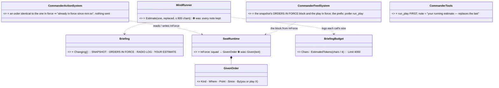
*What the picture shows that prose hid:* the in-force record is ONE table on the seat — the snapshot shows it, the action system checks against it;
no second copy of "what each squad is doing".

| # | decision (why) |
|---|---|
| ① | ⭐ a note is the commander's **running estimate**: the last answer's notes (joined) REPLACE it, capped at 800 chars (`…[cut]`). ⛔ The note is no longer echoed into the feed — it was in the briefing twice (the radio log AND the notes). The runner's own failures and an outside mind's timeout are NO LONGER notes (they would overwrite his estimate) — the model log and the node log say them |
| ② | ⭐ `SeatRuntime.InForce` — per squad: the order kind, where (as he said it), the resolved point, since, by (you / play X). Written when a direct order is accepted; a play's squad orders are read from `SubordinateOrders` (the play's run) and their *since* is when the seat first saw them (snapshot granularity — the entries carry no time). The snapshot ends with *"ORDERS IN FORCE: ALPHA SQUAD SupportByFire → house since 00:02:08 (you), Set; … PLAY IN FORCE: PlatoonAttack → house since 00:01:18"* |
| ② | ⭐ an order IDENTICAL to the one in force (same kind, a point within 2 m — so *"house"* and *"House"* match) is a no-op: an `order-state` item *"already in force since mm:ss"*, NOT a wake, nothing sent, and a play is NOT ended by it. ⚠ *In force* = the seat's record; a squad that has finished its Move is still "in force" for a repeat of the same Move — harmless (it is there) |
| ③ | the prefix: *"PREFER run_play — the play coordinates both squads (support set, then the assault); a direct order to a squad ENDS the play."*; `run_play` first in `/tools`, its description says the same; the snapshot names the play in force |
| ④ | the budget: each `call` line logs `chars` and `tokens` (≈ chars / 4) of the request; a rail runs a long scripted seat (many reports, a 700-char note every call) and holds the briefing + tools under 4 000 tokens. The parts that can still grow: the radio log between snapshots (bounded by the snapshot period) — the budget says it |
| ⭐ as built — ask_sitrep | ⚠ deviation found by the run: asking a squad for a SITREP no longer goes through the direct-order path, so it never ends a play (it did since B-1: the L-3a run's `ask_sitrep` ended PlatoonAttack at 0:59) |
| ⭐ measured (the L-3a Haiku relay run vs L-3) | the request **1 110 → 1 438 tokens** (L-3: 1 003 → 5 929, max 7 349); the estimate **366 chars** (L-3: 17 958 of notes); **0** identical orders re-sent (L-3: 4); `run_play` twice, the SPOT row PASSES; the house still not taken — the squad-attack stall CE-4682 |

### 5a-5. The duel — two seats, one per side *(backend, `2026-11-23`, user: "can we let 2 haiku workers play against each other?" · "yes please"; build-state: BUILT — the run in `STATUS_Backend_LLM_Commander.md` §Duel)*

⭐ `llm-platoon-duel` = `llm-platoon-attack` with Red under a seat too: **Red Platoon** (TKB 305, Hostile) over the **Defenders** (at the sheds) and a
**Reserve** (4 men just west of them), a `rear` place. Two seats on ONE chat endpoint; the relay (`chat_standin.py --mode relay --per-commander`) files
each request under the commander it names (*"You are &lt;name&gt;, …"*), so one Haiku worker answers each side and never sees the other's requests. The
checks judge the PLUMBING of two seats (each side's squads report to their own commander, never the other's; both fight; the fight lasts) — not who wins.

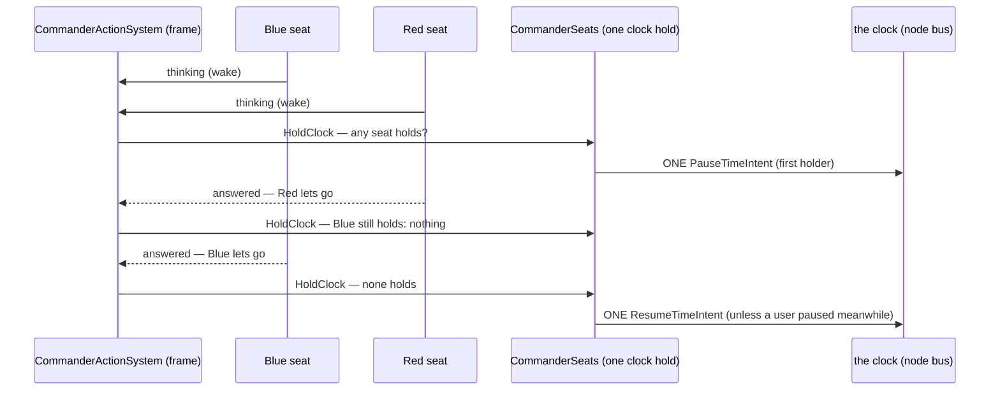

*What the picture shows that the prose hid:* the clock belongs to the SEATS, not to a seat — the pause and the resume are each said once, by whoever is
first and last. Per seat (as L-2 built it) the two seats each took the other's pause for a user's, and nobody resumed.

| # | what the duel found (each fixed, railed, red-proved) | rail |
|---|---|---|
| D-1 | ⛔ **two seats thinking at once froze the clock for good** — each seat paused and resumed on its own and read the other's pause as a USER's (which a seat must never resume). ⭐ Now `CommanderSeats` holds the clock: one pause when the first seat holds, one resume when none does; a user's pause still outlives it. A gone seat lets go. ⚠ Free-running clock only — a stepped run (verify) waits on `AnyHoldsClock` and was never affected | `TwoSeats_TheClockRunsAgain_OnlyWhenBothMindsHaveAnswered` (red before the fix: "both answered: the clock runs again") · `TwoSeats_AUserPauseDuringBothHolds_OutlivesThem` |
| D-2 | ⛔ **Red was told Blue's plan** — the gazetteer listed every named place, so Red read Blue's `start` / `objective` / `support` with Blue's notes. ⭐ A place drawn for a side (its `EntityInfo.ForceId`) is only that side's; `Neutral` (the default — every existing scenario) is everybody's | `TwoSeats_EachSeatIsToldOnlyItsOwnSidesPlaces` |
| D-3 | the play advice spoke only to an attacker (*"support set, then the assault"*) — a defending seat read it too. ⭐ *"PlatoonAttack: support set, then the assault · PlatoonDefend: the squads hold an area together"* | the same rail |
| D-4 | ⛔ **a repeated play restarted the play** — Blue re-ran `PlatoonAttack → house` at 01:05 and Bravo, 50 m past the objective, was sent back to the start. ⭐ The same play on the same place (2 m) while it runs is a NO-OP (*"PLAY … already in force since"*), as an order is since CE-4683 | `Duel_ARepeatedPlayInForce_IsANoOp_AndTheSnapshotSaysItsAge` (red-proved: the no-op dropped ⇒ two intents) |
| D-5 | why Blue re-ran it: the snapshot (every 120 s) still said *"ORDERS IN FORCE: none"* — taken before his own play — and the model read it as now, over the radio line *"ORDER PlatoonAttack → house: given"*. ⭐ The snapshot now says its age (*"SNAPSHOT (65 s ago — the radio log below is newer)"*) and the prefix says the radio log carries what was given since | the same rail |
| D-6 | the heartbeat said *"(no news — your squads await orders)"* while orders were in force — an invitation to give new ones. ⭐ *"(heartbeat — nothing new; the orders in force stand unless you change them)"* | `Duel_ARepeatedPlayInForce_…` (the heartbeat line) |
| ⭐ measured (the duel's run, before the fixes) | Blue 48 calls / Red 63, 0 malformed, max 1 685 / 2 018 tokens, 6–7 s per answer; Red held the sheds with its Reserve, Blue's squads stalled near `start` (CE-4682) and were beaten. ⚠ The checks' cross-side `never` rows were wrong, not the seats: a LIST in `by` reads as anyone (CE-3502) |


### 5c. L-3c — the decision contract *(BUILT `2026-11-23` — as built §5c.1; CE-4684; user `2026-11-23`: "yes. and pls use haiku at lowest effort so it is closest to local LLMs")*

🔒 The user brought an outside proposal (a SITREP, an order schema and an example decision for a company attack) and asked to compare. The
comparison (chat, `2026-11-23`): HROT already does half of it the same way — ids instead of coordinates, a perceived enemy, executor feedback,
the previous estimate, a static-then-dynamic prompt, compact text, CONTINUE by default, tasks = behaviours, validate / repair once / fall back /
log. ⭐ The other half is an OUTPUT CONTRACT that a small model needs most; L-3c adopts it BEFORE the laptop run (L-3b), so the 8 B models are
measured on the contract we keep.

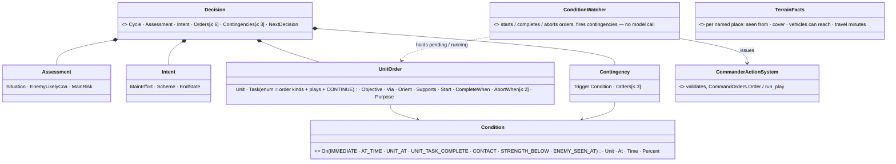

*What the picture shows that prose hid: the model's answer becomes DATA that HROT keeps acting on between wakes (the watcher) — the orders'
timing and the contingencies run without a model call, which is what covers the thinking gap in continuous mode.*

| # | L-3c adds | why |
|---|---|---|
| C-1 | ⭐ **one decision object per wake**, decoded against a JSON schema (Ollama `format`; the relay returns the same object); fields in the order assessment → intent → orders → contingencies → next decision; replaces the free tool calls for the chat-model mind | reasoning before committing; the "why" for review is in the record; grammar-forced output is never malformed |
| C-2 | **orders that carry their own timing** — `start`, `complete_when`, `abort_when` — and **≤ 3 contingencies**, run by a serial `ConditionWatcher` with no model call | sequences between decisions; covers the thinking gap |
| C-3 | **`next_decision`** (not later than + ≤ 3 wake conditions) replacing the fixed heartbeat for this mind; the **cycle echo** — a decision made on an old cycle is refused | the model sets its own pace; stale decisions never land |
| C-4 | **precomputed terrain facts** per named place in the static block: which places see it, cover (covered / partial / open), whether vehicles can reach it, travel minutes between neighbours | the model chooses between options instead of doing geometry — HROT already has sight and navigation |
| C-5 | **enemy confidence** per contact (HIGH / MED / LOW from how many squads reported it and its age; "heard" when behaviors adds the bit) | something real to reason about, never truth |
| C-6 | ⛔ positions only as ids: the "N m dir of" and grid forms leave the CHAT mind's vocabulary (kept for the scripted mind and the routes) | the proposal's strongest rule; geometry is HROT's job |

⚠ Fire requests and mission-constraint checks (no-go areas, phase lines) are LATER — no fire support at platoon level yet.

#### 5c.1 ✅ As built — L-3c (CE-4684, backend, `2026-11-23`; the run in `STATUS_Backend_LLM_Commander.md` §L-3c)

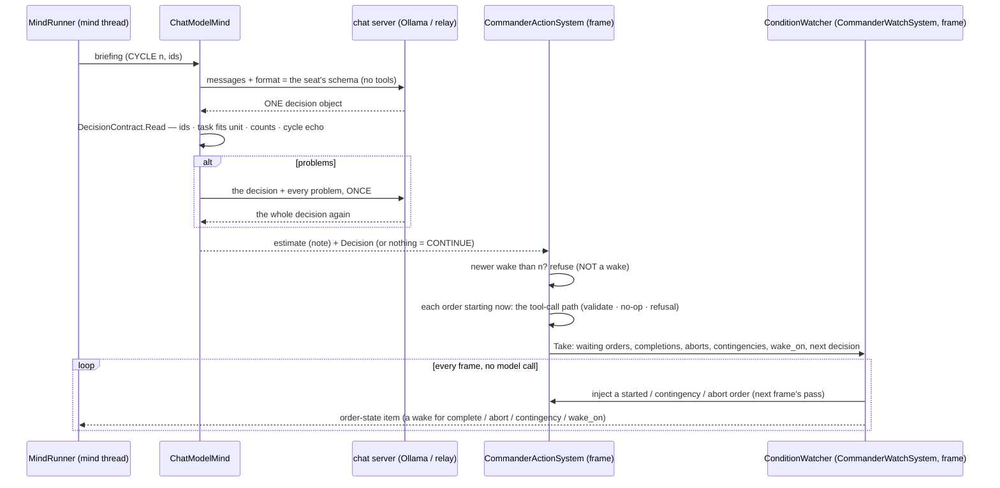

*What the picture shows that the prose hid: two loops — the model's (a decision per wake) and HROT's (every frame) — meet only at the seat's queue;
the watcher gives its orders through the SAME action path as the model, so a contingency's order is validated, a repeat is a no-op, a refusal a wake.*

| | as built |
|---|---|
| classes | `Decision` · `UnitOrder` · `Condition` (one flat shape) · `Contingency` · `SeatVocabulary` · `DecisionContract` (schema · read · validate) · `IDecisionMind` / `IDecisionTranscript` · `ConditionWatcher` + `CommanderWatchSystem` (Simulation, WhenTimeAdvances, after the action system) · `TerrainFacts` |
| C-1 | the seat's schema (its units / places as enums) is Ollama's `format`; no tools. All or nothing: any problem sends the WHOLE decision back once with every problem named, a second failure is CONTINUE. A play AND a squad order now is a problem (a squad order ends the play). The model log keeps per call: request · raw · `validation` · `repaired` · `fallback` · the `decision`. `HROT_COMMANDER_FORMAT=tools` keeps L-3a's tool calls |
| C-2 | `start` / `complete_when` / `abort_when[≤2]` per order, `contingencies[≤3]` with ≤ 3 orders; conditions read the squad's position, the commander's PICTURE (progress, strength colour, reported elements) and the clock — never the enemy's truth. An abort holds the squad (a play: stop_play); each fired / completed / aborted / woken one is an order-state WAKE. ⭐ **CE-4687:** a condition that can NEVER hold — it waits on a unit OUT OF THE FIGHT to arrive (UNIT_AT), finish (UNIT_TASK_COMPLETE) or make contact (CONTACT), or names nothing — is dropped and said in ONE order-state wake (*"CANNOT START"*), on the feed's out-of-the-fight event (`ConditionWatcher.UnitLeft`) and when a decision arms it (`CannotStart`); a waiting order is not given (its unit keeps what it has); STRENGTH_BELOW stays armed (a fall is when it should fire). 📌 Haiku: `1st Platoon Attack, start UNIT_AT 2nd Platoon support` waited silently after 2nd Platoon was destroyed |
| C-3 | `next_decision.not_later_than_s` (10–300) + `wake_on[≤3]` replace the fixed heartbeat for a decision seat, held ≥ 10 s and ≤ 300 s after the last wake. ⭐ The cycle = the briefing's newest seq; a decision on an older cycle than the newest wake is refused — ⛔ NOT as a wake (📌 measured: as a wake it staled the next answer, 15 refusals in a row) |
| C-4 | in EVERY seat's static block: seen from (eye 1.7 m → chest 1.0 m, `EqsTerrainSight` — perception's occluder) · cover (a building / ≥ 4 cover points covered / 1–3 partial / 0 open) · vehicles (the vehicle navmesh within 15 m) · minutes on foot to the 3 nearest places (`PathCost` ÷ 1.4 m/s). A standable place is judged at its spot, a building at the standable points around its walls (📌 a 6 m ring read the objective behind the Low Wall as "seen from the house") |
| C-5 | per reported element: the squads that reported an enemy within 30 m of it and the newest report's age — ≥ 2 squads fresh (≤ 60 s) HIGH · one fresh or two stale MED · one stale LOW |
| C-6 | a decision seat's prefix lists places as ids only; the schema enumerates them; "N m dir of" / grid stay for the other minds and the routes |
| ⚠ deviations | the design's `Via` / `Orient` are not in the schema (no order on this path takes them); `Supports` became `support_at` (a place — the play's support position); the C-4 hand check left one pair open: the `house` point reads "seen from: none" while its note says `support` sees the sheds' south side — the point sits among the sheds, the note speaks of the wall (a building place aimed at its walls is the follow-up if it matters) |
| ⭐ measured — `llm-platoon-attack`, Haiku at the LOWEST effort | baseline (L-3a tools): 26 calls · 9 orders · 0 malformed · tokens 1 159 / 1 468 / 1 465 (first / median / last) · 6/6 judged PASS (Red beaten). Contract: 58 calls · 47 decisions · 11 stale refused · 1 repaired · 0 CONTINUE fallbacks · 11 contingencies armed, 1 fired · 10 own wakes · tokens 1 776 / 2 539 / 2 150, max 3 429 · 6/6 judged PASS. ⚠ The contract costs more calls (the model chose 15–20 s deadlines) and ~600 tokens per request (the schema) |
| ⭐ measured — `llm-platoon-duel`, the contract on both sides, lowest effort | ✅ 10/10 checks (the cross-side rows included). Blue 63 calls / 56 decisions / 7 stale / 29 no-ops; Red 66 / 57 / 9; 0 CONTINUE fallbacks; tokens max 3 448 / 3 690. Red held the sheds. 📌 A contingency re-armed with every decision fires again once its trigger already holds (Blue's fired 3 times; the repeat was a no-op) — the lean is an edge trigger (fires on BECOMING true after it is armed), not built in L-3c |


### 5d. L-agg — the seat over AGGREGATED units *(CE-4685, backend, `2026-11-24`; user: "Please match the coordinator and read the note about LLM Commander for aggregate entities"; handoff `HANDOFF_Coordinator_To_Backend_LLM_Commander_Aggregates.md`; build-state: BUILT — the runs in `STATUS_Backend_LLM_Commander.md` §Aggregates)*

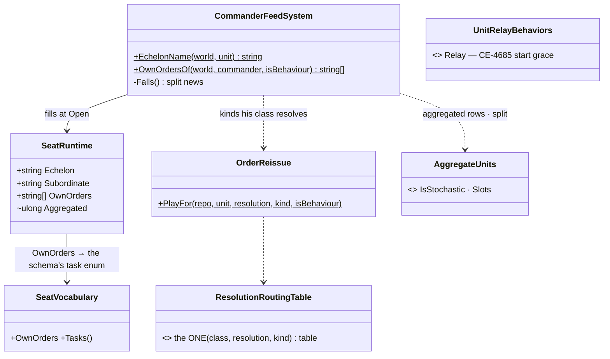

*What the picture shows that the prose hid: nothing new decides what a company may do — the seat gives a KIND and asks the SAME routing table its
orders resolve through (`OrderReissue.PlayFor`) which kinds his class takes, so a seat and a scripted brain can never disagree about a class's plays — and
the seat never names one.*

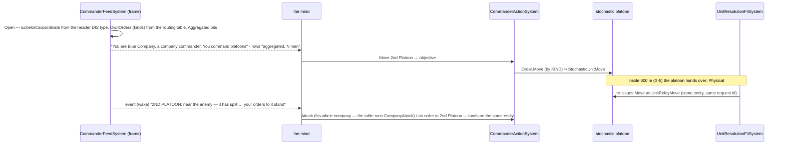

| | as built |
|---|---|
| A-1 | `SeatRuntime.Echelon` / `Subordinate` from the CLASS — the entity header's DIS type (`UnitDis`, what the routing table reads), else the TKB type's, else `AggregateUnit.Echelon`; the prefix's first lines, the contract's `Tasks` / `PREFER` lines and the snapshot JSON (`echelon`) use them. A stochastic subordinate's row: `aggregated` + `N men` from its slot table — ⛔ only once the table holds slots (📌 the first run said "0 men" at t = 0: the table is filled from the TKB composite after the seat opens) |
| A-2 | ⭐⭐ **ORDER KINDS, never behaviour names** (user `2026-11-24`: *"We need to introduce the order kinds to higher level echelons. We cannot call directly a behavior name"*). `SeatRuntime.OwnOrders` = the kinds of Attack / Defend / Bound / Hold that `OrderReissue.PlayFor` resolves for his class at his resolution — a platoon takes all four, a company Attack and Defend (no company Bound / Hold play is registered). The seat gives his whole unit `Order.<kind>` (`AssignTacticalIntentEvent`, origin Superior) and `TacticalIntentResolutionSystem` runs his class's play through THE routing table (`ResolutionRoutingTable`: InfantryPlatoon Attack ⇒ `PlatoonAttack`, InfantryCompany Attack ⇒ `CompanyAttack`, a stochastic unit ⇒ `StochasticUnitAttack`) — the same path a superior's `CommandOrders.Order` takes. "Is it still running" reads `CurrentOrders.Of(commander).Kind` (by kind, never the behaviour hash). The decision contract: the same kind for a subordinate or for himself (`unit` = himself) — `unit` decides, not a play name; a kind his unit does not take as a whole is refused (*"'Bound' is not an order your company takes as a whole"*). Params: Attack / Defend the neutral order (R-8300, every echelon's play reads it); ⚠ Bound has no neutral DTO yet — it carries `PlatoonBound`'s own `SupportPoint` / `Objective`. ⛔ SUPERSEDED same day: the seat named the play (`PlatoonAttack`, `CompanyAttack`) |
| A-3 | `SeatRuntime.Aggregated` — a bit per roster slot that was stochastic at Open; `Falls` (each 1 s) clears it on the hand-over and publishes ONE waking event (`"event":"split"`). The platoon is the SAME entity, so the seat's orders keep landing; `UnitResolutionFitSystem` re-issues its standing order at the new resolution |
| A-4 | `llm-company-aggregated` (berlin; ⚠ inside BOTH grids — collider ±750 m and perception [0..1000]: 📌 the first placements put Red outside the perception grid and nobody could see it) — a seated company over three stochastic platoons, Red's squad 650 m south |
| ⭐ found by A-4, fixed (cross-lane, the AGG lane's CE-8307) | `UnitRelayBehaviors.Relay` ended `Success` two frames after ordering — a child GIVEN the order is not `Busy` until its `BehaviorState` picks it up — and ending the relay cleared the children's fresh moves (*"StochasticUnitMove cleared by Superior"*). ⇒ every split platoon stopped where it split. Now a child given the order but not yet seen running is busy for `StartGraceSeconds` (3 s sim); a child that never starts still lets the relay end. Rail: `CE8307_ASplitPlatoonsMove_IsRelayedToEverySquad_ByKind_SameParams` (extended, red-proved) |
| ⛔ not in this slice | a battalion seat over companies; the stochastic Recover row (`PlatoonAttackBehavior.cs:977` assigns `SquadRecover`, no stochastic row) — not reached in the run |

#### 5d.1 ✅ As built — CE-4686, the four findings *(backend, `2026-11-24`; handoff `HANDOFF_Coordinator_To_Backend_LLM_Commander_Aggregates_2.md`; ① and ④ user-authorised cross-lane edits; the runs in `STATUS_Backend_LLM_Commander.md` §Aggregates 2)*

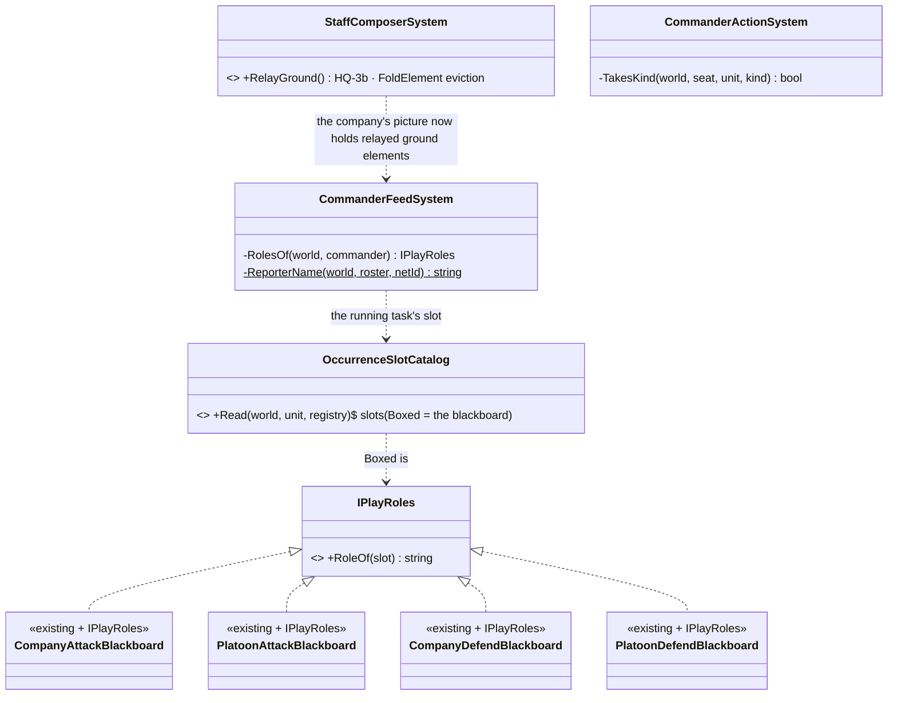

*What the picture shows that the prose hid: no new reader was built — the roles come through the one read-only way into a running behaviour
(`OccurrenceSlotCatalog`), and each play names its own roles; the seat never learns a play's layout.*

| | as built |
|---|---|
| ① the company hears the enemy | the command chain's HQ-3b (`DESIGN_Command_Chain_Example.md` §8d): a commander of units relays its subordinates' ground SPOTs up (≤ 2 groups, own age) and a full picture keeps its support elements. The seat's snapshot names an element's SOURCE: `enemy 4 (Team), … reported by 2nd Platoon` (json `reportedBy`), next to its age |
| ② the roles | `IPlayRoles.RoleOf(slot)` on the four role-giving plays' blackboards (`PlatoonAttack`, `CompanyAttack`, `PlatoonDefend`, `CompanyDefend` — read-only, the play unchanged); the snapshot reads the running task's blackboard once per snapshot and shows `role assault / base of fire / reserve … in your company's Attack` per unit (json `role`); both prefixes say a role's orders are the whole unit's order's, not a mistake to undo |
| ③ SupportByFire | ROOT CAUSE (claim table in the report): the base of fire was told to STAND on the decision's objective (Red's position — with HoldBack the Position is where it stands, CE-8302) and a physical platoon has no hold-back Attack play (R-8392). Now `support_at` is where it stands (else the objective) and the objective what it fires at; the form is the subordinate's: a physical platoon gets the KIND SupportByFire (`PlatoonSupportByFire` {Position, Post1}); a squad (the kind resolves to nothing — its play is named plain `SupportByFire`) or a stochastic unit (the generic attack reads only `HoldBack`) keeps Attack + HoldBack at the stand point. The prefix says what objective / support_at mean per order |
| ④ Bound | the whole unit's Bound sends the neutral `BoundOrder { Position, SupportPoint }` (`DESIGN_Orders_Params_Entity_Classes.md` §16) |
| ③ the split (measured, second half) | the first CE-4686 Haiku run measured the real stall: the stochastic platoon's support by fire was CLEARED at its split (`its order has no play at Physical`, R-8392) — TaskFailed 150 m short — and the model's re-issue was swallowed as "already in force". Fixed: `OrderReissue.PlayFor(json)` re-resolves a hold-back attack at Physical to the kind SupportByFire's play (`PlatoonSupportByFire`; a company still waits) — cross-lane, `DESIGN_Split_One_Level.md` §10 F1 amended; the seat drops an order its unit reported failed from the in-force table |
| ⚠ not done | a whole unit's Attack takes no support position (the plays pick their own base of fire) — the prefix says so · a company's hold-back attack still waits at its split (no company support-by-fire play) |

## 6. The laptop — RTX 3070, 8 GB *(to measure, not measured)*

| | ⭐ lean |
|---|---|
| **model** | a 7–8 B instruct model with tool calling, 4-bit (about 5 GB): Qwen 2.5 7B Instruct, Llama 3.1 8B Instruct or Qwen3 8B — try all three on the same scenario |
| **context** | 8–16 k tokens (the KV cache must fit the remaining ~3 GB); the briefing kept to ~2–4 k |
| **HROT on the same GPU** | run the editor headless or on the 2-D map during a test; the 3-D map competes for video memory |
| **small-model care** | few tools, strict schemas, gazetteer names instead of coordinates, one retry with the error; expect some bad calls — the action system refuses them, the run goes on |
| **speed** | a reply in seconds at this size — fast enough for a platoon commander in continuous mode |

### 6a. The laptop recipe (L-3b) — ⭐ READY, NOT RUN *(CE-4681, `2026-11-23`)*

```bash
# once: Ollama (Windows: winget install Ollama.Ollama · Linux: curl -fsSL https://ollama.com/install.sh | sh), then `ollama serve`
dotnet build Hrot/Runner/Hrot.ClusterRunner                          # the editor the runs use (headless: no 3-D map on the GPU)
python scripts/llm/laptop_run.py                                     # pulls qwen2.5:7b-instruct, llama3.1:8b, qwen3:8b; one run each
python scripts/llm/laptop_run.py --models qwen3:8b --num-ctx 16384   # one model, a bigger context
```

| step | what the script does |
|---|---|
| ① the server | checks `GET /api/tags` at `--endpoint` (default `http://localhost:11434`); none ⇒ it says how to install / start Ollama |
| ② the models | `ollama pull <model>` for each (4-bit is Ollama's default for these tags); `--no-pull` skips |
| ③ one run per model | `HROT_COMMANDER_MIND=ChatModel` + `_ENDPOINT` / `_MODEL` / `_NUM_CTX` (12 288) / `_KEEP_ALIVE` (30m) / `_TIMEOUT_S` (120) / `_LOG_DIR`, then `Hrot.ClusterRunner --mode editor --headless --verify llm-platoon-attack` — think-pause, so a slow answer only slows the run |
| ④ the summary | per model: wakes, tool calls, accepted / refused, malformed, retried, answer time (mean / max), the request's size, checks passed (the scripted-only rows SKIPPED) → `summary.json` + a table |

⭐ Proven on the VM end to end against `scripts/llm/chat_standin.py --mode script` (`--endpoint http://localhost:11500 --models stand-in
--no-pull`) — the result is in the status report. ⛔ Not run on the laptop: that is L-3b.

## 7. Rules this respects

| rule | how |
|---|---|
| hot path, no allocation per frame | the feed system acts only on a report, an event or the heartbeat — an allocation there is "on an event", allowed |
| parallel behaviour code | the two systems are serial (the action system in the serial pre-pass); the background thread never reads or writes the world |
| one order path (shared, never duplicated) | every order goes through `CommandOrders.Order` — the same call the platoon plays use |
| a feature works when its scenarios pass (R-4277) | each slice ships its scenarios with machine checks (§11) |
| replay | the orders are recorded like any other; the model's input and output go to a log beside the recording, never into the simulation |

## 8. Several commanders on one model

Every commander is a **seat** with its own context; seats may share ONE model (Ollama serves them in turn). ⭐ A **stronger model above** —
a company commander over three LLM platoon commanders — is the chain of command HROT already has. ⚠ One context answering for several peers sees
all their pictures, so it is really their superior: build it as that seat, honestly named.

## 9. What HROT lacks (for this test)

| # | gap | ⭐ lean |
|---|---|---|
| ① | no way to take a commander's brain away from its play and hand it to a mind | `CommanderSeat`: no task + **`InertSop`** — ✅ measured `2026-11-22`: an idle platoon runs only `BasicPlatoonSop` (two picture rows: clear a building that fired, or hold every squad on a reported element), and `InertSop` is the existing explicit none; the squads keep their own reactions (they pause his order, then it resumes) |
| ② | the order-by-name check on the HTTP route probably refuses echelon orders | not on the path: the action system calls `CommandOrders.Order` directly |
| ③ | no push from HROT | the feed ring + long-poll + server-sent events (§3) |
| ④ | the squads send a routine SITREP only when asked a rate | the seat asks it at start (`CommandOrders.AskSitrep`) |
| ⑤ | no gazetteer | ⭐ the scenario's named **Point** map graphics (TKB 8816, drawn by `NamedPointGizmo`) and **tactical areas**, + a coarse grid — they exist; the gazetteer only reads them |
| ⑥ | the sitrep leaks the `alive` truth of a contact | fix it (it is the AI player's fog of war) — independent of this |

## 10. Rejected — one line each

- **The bridge outside HROT** — the user wants no external program; inside, it reads the picture directly and gives orders on the one path.
- **The LLM drives every soldier** — too slow and too many tokens; the squads' AI already fights better.
- **The sitrep as the source** — it knows what every man remembers, not what was reported to the commander.
- **The model call on the frame thread** — it would stall the simulation; it runs in the background.
- **Free-text orders parsed by HROT** — ambiguous; tool calls against a schema are checkable.

## 11. Slices

| slice | builds | done when (scenario checks) |
|---|---|---|
| **L-1** | the seat, the feed system, the channel, the action system, the gazetteer, ScriptedMind; the scenario `llm-platoon-attack` (Blue platoon vs a Red squad in a house, test-town) | scripted mind: the right orders land within 1 s of the SPOT; every order goes out at origin Superior; Red is beaten or the platoon breaks contact |
| **L-2** | the HTTP surface (`/feed` long-poll, `/stream`, `/briefing`, `/act`), ExternalMind, think-pause mode | a Haiku worker plays the scenario to the end; no illegal action is accepted; the run is repeatable from its recording |
| **L-2b** | §5b: `run_play` / `stop_play`, the mission brief, the objectives line, each squad's task and progress, the enemy's activity / equipment / age, terrain notes on named places | the scripted mind runs `PlatoonAttack` on the house and the play's choreography happens (support SET before the assault); the briefing carries every §5b line; the Haiku worker plays the scenario again — its orders cite the mission |
| **L-3** | ⭐ on the CLOUD VM (CE-4681, user `2026-11-23`): `ChatModelMind` (Ollama's `/api/chat`, tools, one retry), a byte-stable prefix, checks per mind, a stand-in server, the **Haiku relay** answering HROT's exact chat requests; the laptop recipe ready, not run | the relay run plays `llm-platoon-attack` to the end; every exchange in the model log; counts of accepted / refused / malformed calls and the briefing's tokens per call |
| **L-3a** | the briefing a small model can live with (CE-4683, user `2026-11-23`: "backend fix"): `note` one running estimate (CE-3501) · an ORDERS IN FORCE block, an identical order a no-op · prefer `run_play` said plainly · a per-call budget ≤ ≈ 4 000 tokens | the Haiku relay run again, side by side with L-3's: bounded notes, no re-sent orders, the budget held |
| **L-3c** | §5c the decision contract (CE-4684): one schema-decoded decision per wake, conditions and contingencies run by HROT, next decision + cycle echo, terrain facts per place, enemy confidence, ids only | the Haiku relay at the LOWEST effort plays `llm-platoon-attack` AND `llm-platoon-duel` with the contract, side by side with L-3a's format at the same effort |
| **L-agg** | the seat over AGGREGATED units (CE-4685, user `2026-11-24`): a company commander over stochastic platoons, `CompanyAttack` / `CompanyDefend` as plays, the split on contact as news (§5d) | `llm-company-aggregated`: orders by kind reach the stochastic platoons, a split platoon's squads fight, the seat keeps commanding after the split |
| **L-3b** | the real model on the user's laptop (RTX 3070, 8 GB): the three 7–8 B models through the L-3 recipe | an 8 B model plays it in think-pause, then continuous; a per-model summary |
| ⭐ **duel** | §5a-5 (backend, `2026-11-23`): a seat on each side, one Haiku worker each through the per-commander relay — the L-4 "second seat" pre-tested | the clock held for both and released once; each side told only its own places; a repeated play a no-op |
| **L-4** | continuous scheduler (wake + heartbeat), stale-action refusal; a second seat (⭐ the clock for many seats BUILT in §5a-5) | two platoon seats on one model; a company seat above them |

## 12. Decisions — ✅ APPROVED `2026-11-22` (R-4298: *"leans approved"*)

1. **Where the seat is set:** a scenario field on the commander (*"mind: ollama:qwen2.5:7b"*) — lean — or only at run time over HTTP? ⭐ Both, the field as the default.
2. **The first Red:** a squad defending a house (lean — `sq-defend-house` exists) or one on a hill (`hill-attack-close`)?
3. **The model log:** a file beside the recording (lean) or rows in the recording itself?
4. **Fire support in L-1** or later? ⭐ Later — a platoon commander's first job is his squads.

---

## ⛔ HISTORY — rev 1 (2026-11-22, superseded the same day)

Rev 1 put the bridge OUTSIDE HROT (a separate program on the HTTP API), started at a COMPANY commander, used `GET /sitrep` as the picture, and
weighed fairness between two models (same hardware or a delay floor). The user moved all four: the bridge inside HROT, a platoon commander first,
the commander's own reported picture, and *"not at all about fairness"*.
