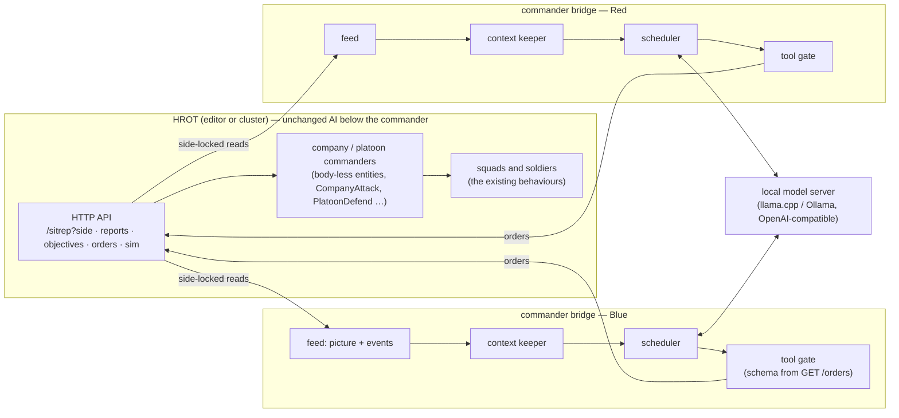
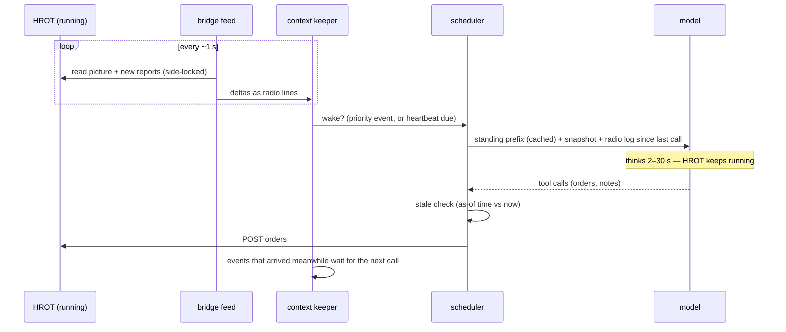

<!--STATUS
state: LIVE — PRELIMINARY IDEA (user, 2026-11-22: "write it as a preliminary idea")
updated: 2026-11-22
build-state: DESIGN — not ready to build; the open questions in §7 come first
current-answer: §1 the shape · §3 continuous streaming (the target) · §4 several commanders on one model · §6 what HROT lacks
stale-below: nothing
known-rot: none
known-conflict: none
related-designs:
  - ../../DESIGN_Entity_Control.md — OWNS the "AI player" seam this builds on: C-9 the side-filtered sitrep, C-10 the side lock, C-11 HTTP orders at origin Operator
  - ../group-maneuvers/DESIGN_Command_Chain_Example.md — OWNS the reports (§6), the commander's reported picture CommandPicture and its approved-not-built replication (§8b), the HQ that answers requests (§8d)
  - ../../DESIGN_Orders_Params_Entity_Classes.md — OWNS the order catalogue (GET /orders), the params DTOs and the receiver-side resolution (§8, §9)
  - ../../blueprints/Architect_Question_83_Doctrine_And_Order_Origin.md — OWNS the order origins and their rank (who may replace whose order)
  - ../../UX/DESIGN_Mission_Plan_Editor.md — OWNS a unit's mission plan (tasks + triggers) — a later way for the LLM to hand down a whole phase
  - ../../DESIGN_Scenario_Rules.md — OWNS objectives and their status, the score the commander is told about
-->

# An LLM as the commander of a side — preliminary idea

🔒 **User, `2026-11-22`:** *"two large language models. Each one is controlling his side … they should play the role of a commander, not controlling
every individual unit … maybe they should work on the level of platoons … the squads can still operate on their own using the game AI"* ·
*"I need this to run continuously … the information might need to be streamed into the LLM as the simulation goes"* · *"maybe in some
configuration we could take a stronger model and control multiple commanders at the same level at once"*.

⭐ **The idea in one line:** a local LLM takes the seat of a **company (or battalion) commander**; a **commander bridge** outside HROT turns the side's
reported picture into radio-style text, and the model's tool calls into the orders HROT already understands. Below the commander, HROT's own AI
fights unchanged.

## 1. The shape

*What the picture shows that prose hid: the model never talks to HROT — every read passes the side lock and every order passes a schema check
in the bridge; and both sides may share ONE model server (§4) while keeping separate contexts.*

| piece | what it does | exists? |
|---|---|---|
| side-filtered picture | own units + contacts the side's units hold | ✅ `GET /sitrep?side=` (Entity Control C-9) |
| side lock | orders to the other side refused | ✅ `POST /orders/side-lock` (C-10) — ⚠ reads other than the sitrep are NOT locked (§6) |
| platoon / company plays | split an order into squad orders | ✅ `CompanyAttack`, `CompanyDefend`, `PlatoonAttack/Defend/Bound/SupportByFire/Hold` |
| reports up the chain | contact, SPOT, SITREP, LACE, progress, requests | ✅ (Command Chain §6) |
| fire support | `Strike`, `ObserveFire`; the HQ answers requests | ✅ (Command Chain §8d) |
| the bridge | feed, context, scheduler, tool gate | ⛔ new, outside HROT |

## 2. What the commander is told, and what he can do

**Told** (text, never raw state):
- **Standing part** (rarely changes): his mission and intent from above, the order of battle down to platoon, a **gazetteer** — objectives, phase
  lines, named villages and hills, a coarse grid. ⭐ Positions are said relative to it (*"500 m NE of Hill 312"*): models reason badly about raw
  coordinates.
- **Situation:** each subordinate's strength and ammo colour, task, position, last report's age; the enemy as SPOT lines — size, activity,
  where, how old, seen or only heard; the objectives and their state.
- **Radio log:** the reports and events since the last look, as a radio operator would pass them on.

**Can do** (tool calls, checked against the schema `GET /orders` publishes):
`order(unit, kind, params)` · `request_fire(target, effect)` · `set_reporting(unit, rate)` · `hold(unit)` / `release(unit)` ·
`ask(unit)` (a SITREP now) · `note(text)` (his own running estimate, kept in his context — §3).

⭐ **The echelon:** he orders his **direct subordinates only** (platoons, the fire-support asset). The play under each platoon is HROT's.

## 3. Continuous operation — the target

Turn-based pausing stays as the **development mode** (deterministic, fair whatever the model's speed). The product runs **without pauses**: the
picture streams in, the model is woken when it matters, and its orders land while the battle goes on.

*What the picture shows that prose hid: the model is woken by EVENTS, not by the clock, and it is always answering a picture a few seconds old —
so the orders must be robust to that delay.*

| ⭐ mechanism | why |
|---|---|
| **The context as a battle board + radio log** — a compact snapshot re-written every few minutes, then an append-only log of radio lines; when the log grows, a fresh snapshot replaces it (and the model's own `note`s carry his estimate across) | the model "updates its context continuously" without the context growing without bound |
| **A stable prefix first** (role, mission, gazetteer, ORBAT), the changing part after | a local server reuses the cached prefix (llama.cpp prompt cache / KV reuse) ⇒ each wake costs only the new lines |
| **Wake on events, with a heartbeat** — contact, a request, a casualty threshold, an objective changing, a leader down wake at once; otherwise every 30–90 s | a commander's decision cycle is minutes; the AI below handles the seconds |
| **One call at a time per commander** — events arriving during a call are coalesced into the next | no overlapping, contradicting answers |
| **Orders at intent level** (attack objective X, defend line Y, fire on grid Z) — the platoon plays pick routes, cover and targets | an order stays valid while the model thinks; *"shoot that tank"* would not |
| **Stale check** — an order carries the picture time it was made on; the bridge refuses one whose target has gone, and tells the model why | latency without nonsense |
| **Command delay is realistic** — the model's thinking time stands in for staff time; for fairness both sides get the same hardware or a delay floor | two models of different speed must not decide the battle |
| **Everything is logged beside the recording** — each wake's input, the model's reasoning and its orders | the after-action review shows *why* an order was given; and replay stays deterministic because the orders are in the recording |

⚠ **A streaming feed needs a push from HROT** — today the bridge would poll (`/squad/reports`, `/entities/{id}/reports`, `/objectives`, `/sitrep`
at ~1 Hz). A per-side event stream (server-sent events) is the clean form — §6 ⑤.

## 4. Several commanders on one model

Two meanings — both possible, and different:

| configuration | what it is | ⭐ verdict |
|---|---|---|
| **A. one model server, one CONTEXT per commander** | three company commanders of Blue are three sessions on the same server (llama.cpp parallel slots / batching); each knows only his own picture; peers talk through lateral reports the bridge routes | ⭐⭐ **the default** — realistic (each commander has his own fog), cheap (one set of weights), and it scales by slots |
| **B. one CONTEXT for several peer commanders** | one prompt holds three companies' pictures and answers for all three | ⚠ it is no longer three peers: it sees the union and coordinates perfectly — it **is** the battalion commander. ⇒ build it as **C**, honestly named |
| **C. a stronger model ABOVE weaker ones** | a strong model as battalion commander (intent, boundaries, priorities of fire, the reserve) ordering company commanders that are smaller models (or A's slots) | ⭐⭐ **the hierarchy the chain of command already has** — the strong model does what only it can (the plan), the small ones keep up with the tempo |

⭐ **Lean:** A for peers, C when a stronger model is available; B only as a cheap test rig, labelled as a battalion seat. The bridge treats every
commander as a seat with its own context, side lock and echelon — so A, B and C are configurations, not code paths.

## 5. Rejected — one line each

- **The LLM drives every unit** — too slow and too many tokens; HROT's AI already fights better at that level.
- **Inference inside HROT** — it would block the frame and allocate on the hot path; the model runs in its own process.
- **Free-text orders parsed by HROT** — ambiguous; structured tool calls checked against the order schema are reliable.
- **Real time with turns hidden inside** (pause briefly on every call) — the battle stutters and the opponent waits on the slower model.
- **An MCP server in HROT** — it was removed; HTTP is the interface. The bridge may offer MCP to its model if the client wants it.

## 6. What HROT lacks (measured `2026-11-22`)

| # | gap | ⭐ lean |
|---|---|---|
| ① | the side lock covers orders and `/sitrep` only — `/objectives`, `/entities`, `/combat`, `/events`, `/squad/reports` show ground truth | a **commander seat** whose every read is side-filtered |
| ② | `/sitrep` merges every unit's own memory — more than a commander knows | start with it; move to the commander's **reported** picture (`CommandPicture`) once its replication (Command Chain §8b ②, approved) is built |
| ③ | ordering a platoon or company by order name is probably refused on the sending side (the check does not use the echelon routing rows); several orders have no params DTO (Bound, FireAndMovement, ClearBuilding, March, SupportByFire …) | fix the sender check; until then the bridge sends `{kind:"behavior", behavior:"PlatoonAttack", …}` — ⚠ read, not run |
| ④ | HTTP orders carry origin **Operator** — no superior can replace them, and they clear a mission plan | the LLM IS the top commander and orders its direct subordinates at **Superior** (AQ83's rank) |
| ⑤ | no push — the bridge must poll; the squad "arrived" events are broken | a per-side event stream (reports, order done / failed, objective changes) |
| ⑥ | a routine SITREP is sent only when a superior asked for a rate — by default only on Red/Black | the bridge sets the rate at start (`set_reporting`) |

## 7. Open questions (for the next round)

1. **Picture source:** the sitrep now, the reported picture later (lean) — or build the reported picture first?
2. **Echelon of the first slice:** company commander ordering platoons (lean) or battalion ordering companies?
3. **Fairness rule for continuous play:** same hardware, or a fixed decision-delay floor per side?
4. **Where the bridge lives:** a separate program in the repo (lean — Python or C#, it only speaks HTTP) or a HROT node extension?

## 8. A first slice (when it is taken up)

The bridge alone against today's API, one company per side in the editor, turn-based (§3's development mode); then the continuous scheduler on
the same feed; then gaps ①–⑤. ⭐ It ships with its scenarios (R-4277): e.g. two models fight `cc-battalion`-sized forces and the checks judge
that every order was legal, no read crossed the side lock, and the battle ends.
