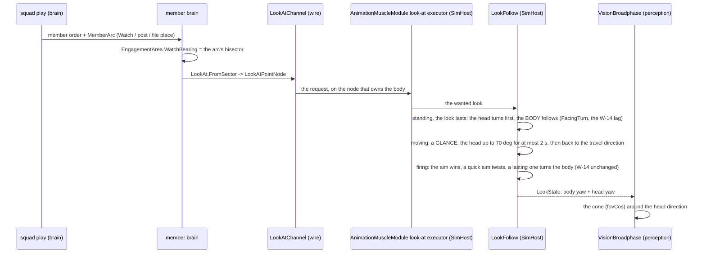
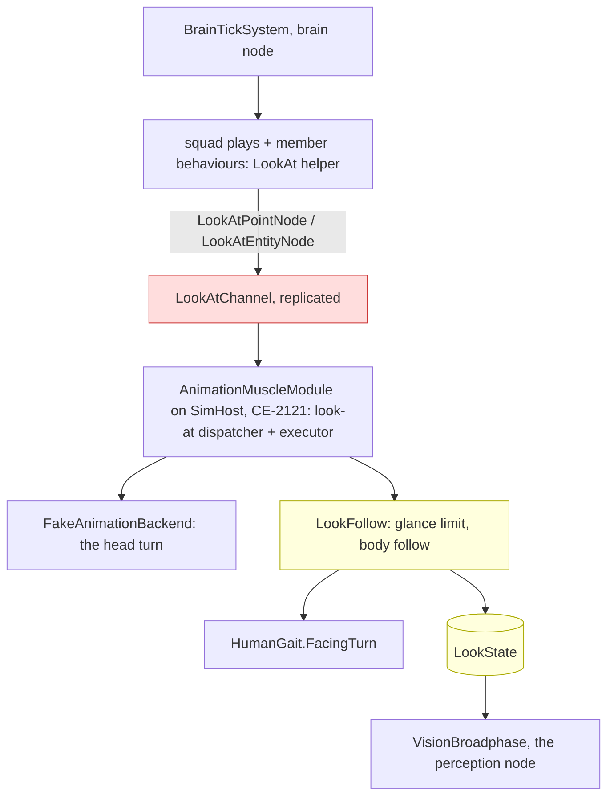

<!--STATUS
state: LIVE
updated: 2026-10-18
build-state: READY-TO-BUILD — the lean ✅ APPROVED 2026-10-18 (R-2048); LD-A…LD-D ✅ (R-2049, LD-B / LD-C as amended by the user) and brought into the platoon programme (§3); LD-1 / LD-2 backend (its step 1: confirm §3.2's reuse of the look-at channel), LD-3 / LD-5 behaviors (CE-2297, CE-2298), LD-4 last
current-answer: §3 (in the platoon programme: inventory, the diagrams, who points the eyes, the demos) · §2 (the programme) — §1 is the measured ground it stands on, so nobody re-derives it.
stale-below: nothing.
known-rot: none.
known-conflict: none.
related-designs:
  - docs/designs/group-maneuvers/DESIGN_Platoon_Attack_Defend_Clear.md — the programme LD now belongs to (§6b PC-16 watch the last window, §12 demos, §13 the lane split)
  - docs/DESIGN_Peek_And_Fire.md — OWNS the expose / hide / relocate cycle; LD-3 makes the watcher keep his eyes on the last window (PC-16)
  - docs/designs/group-maneuvers/DESIGN_Defend_And_Attack_Position.md — DA-20 / DA-24: EngagementArea.WatchBearing and MemberArc are what LD-3 points the eyes at
  - docs/designs/vehicle-tactics/DESIGN_Urban_Armour_Tactics.md — urban tank tactics; tanks keep 360° there
  - docs/DESIGN_Sensors_And_Doctrine.md — OWNS vision (the broadphase, the visual sensor, Optics); this programme changes WHICH direction its cone points and the shipped FOV value
  - docs/DESIGN_Weapon_Layers.md — W-14 (CE-3195, backend): a person's body follows a lasting aim (HumanGait.MaxAimTwist, AlignGain); the body-turn mechanism LD-1 extends from "turn to the aim" to "turn to a look direction"
  - docs/designs/group-maneuvers/DESIGN_Squad_Tactics.md — OWNS the squad orders (Watch, overwatch, march slots) that LD-3 makes face a sector; §7.7.6 records "no facing control exists"
  - docs/designs/group-maneuvers/DESIGN_Building_Clearing.md — OWNS the building-clearing drill (Battle Drill 6: stack, breach, points of domination, sectors, controlling and searching civilians, room order) — its sectors (CB-4) become a look direction once LD-1 lands
-->

# Look direction and a realistic field of view — now part of the platoon programme

🔒 User, `2026-10-14`: *"Backend added soldier body turning to the firing direction. It also found the FOV of humans is 360 which I don't
know how it is used"* · *"record tasks related to look direction control and FOV reduction to realistic values as a small programme for
later, include all what you found now so no rederiving necessary."*

**The decision (lean, not yet approved):** keep 360° until a soldier's eyes can be pointed. Then narrow humans to **~200°**. Order:
look-direction control (LD-1) → the vision cone follows it (LD-2) → behaviours point it (LD-3) → narrow the TKB value (LD-4) → demos (LD-5).
**Rejected:**
- *Narrow to 200° now:* a standing man would look wherever he last walked, blind to his assigned sector — worse than all-seeing.
- *Keep 360° forever:* nobody can ever be surprised from behind, and W-14's body turning buys sight nothing.
- *A separate head sensor:* more machinery than one look direction on top of the body cone, and no demo needs it yet.

## 1. What exists — measured `2026-10-14` (do not re-derive)

### 1.1 How vision uses the FOV

| fact | where |
|---|---|
| ONE cone test: `dot(forward, dirToTarget) >= fovCos`; forward = the BODY rotation (`SimTransform.Rotation`, X-forward), 2-D | `FDP/Toolkits/Fdp.Toolkits/Perception/Systems/VisionBroadphase.cs:59-91` |
| `fovCos = cos(FieldOfViewDegrees / 2)`, computed at spawn into `PerceptionReceptor.FieldOfViewCos` | `Perception/Translators/PerceptionTkbTranslator.cs:38-47` |
| ⇒ **360° ⇒ fovCos = −1 ⇒ the test always passes: the FOV is OFF** | — |
| the implicit visual sensor reads the receptor; an explicit sensor reads its `SensorCapability` visual record | `Perception/Sensors/VisualPerception.cs` `Optics` (~l.60-80) |
| thermal has its own FOV; radar's DTO has one | `Perception/Sensors/ThermalPerception.cs:47` · `Tkb/Domain/SensorEntryDto.cs:71,78,97` |
| the FOV can already be retuned at runtime over the wire (`SensorConfig.FovDegrees` → `FieldOfViewCos` on ingress) | `Hrot.Network.NED/SimDescriptors.cs:470` · `SimHost/PerceptionTranslators.cs:74,391` |
| the map draws the cone | `Hrot.Common/Diagnostics/Gizmos/VisibilityConeGizmo.cs:32` |
| hearing has NO cone (a range only; an implicit acoustic sensor, part 1001) | `PerceptionComponents.cs:18` · `PerceptionTkbTranslator.cs:92-95` |

### 1.2 Where 360° comes from

| fact | where |
|---|---|
| the DTO default is 360 ("360 = omnidirectional") | `Tkb/Domain/SensorCapabilitiesDto.cs:25-30`; the sensor-entry DTOs too |
| every shipped soldier and civilian sets 360 | `Hrot.Core/Tkb/UrbanCombatTkbCatalog.cs:129` (civilian), `:170` (soldier) · `MapDefinitions/Tkb/BdcTkbBuilder.cs:270` · examples `DemoTkbSetup.cs:67,174,223` |
| ⚠ **seven scenarios already author `PerceptionReceptor.FieldOfViewCos: 0` = a 180° FOV** — the TKB translator does not overwrite a receptor the scenario already has (`!HasComponent`) | `hill-attack` (6), `hill-attack-close` (6), `tt-nav-los` (4), `hsm-channel-e2e` (3), `mission-demo-bp` (2), `test-fire` (2), `test-move` (1) — likely a saved default, not a choice. Not measured whether intended |
| design basis | ⛔ searched `docs/` + `.dev/`: no design states 360 models "he can turn freely / scans". `.dev/_DONE/tkb-2/design-talk.md` sets 360 as a default with no rationale; `DESIGN_Sensors_And_Doctrine.md:1677` uses 360 only as a benchmark setting |

### 1.3 What turns a person's body today

| writer | where |
|---|---|
| travel: `HumanGait.Integrate` turns only while moving | `CarKinem/Systems/CarKinematicsSystem.cs:458` (`FinishMove`) |
| ⭐ a lasting aim: W-14 — one twist limit `HumanGait.MaxAimTwist` 75°, `BodyAim.HoldsFire`, `AlignGain`, `HumanGait.FacingTurn` (Stride uses it too) | backend `5871b2ac0` (CE-3195), `DESIGN_Weapon_Layers.md` W-14 |
| the operator (`ManualMotion.Person`), the Stride motor (from velocity), a passenger takes the vehicle's (`EmbarkedStateSystem.cs:120`) | — |
| ⛔ **no behaviour writes a heading** (nothing in `Hrot.AI.Behaviors`); the squad `Watch` order has no facing (Squad Tactics §7.7.6: "no facing control exists") | — |
| an animation `LookAt*` channel exists — drawing only, unplayed (CE-3010) | backend W-14 inventory |

### 1.4 Human numbers (for LD-4)

Horizontal visual field ≈ **200–220°** with both eyes; the head turns ≈ **±70–80°**, so scanning covers 360° over a few seconds.

## 2. The programme

| id | owner | what | lean |
|---|---|---|---|
| **LD-1** | backend | a **look direction** for a person: an intent (a yaw or a point) a behaviour can set; a standing man turns his body to it with W-14's `FacingTurn` (no new turn code). Later, optionally, a head yaw (±70°) on top that does not move the body | one component/intent, last writer = the active behaviour; aim (W-14) wins while firing |
| **LD-2** | backend | the vision cone points along the look direction (the head yaw when it exists, else the body) instead of the raw body rotation | change `VisionBroadphase`'s forward only; the cone test stays; ⭐ *(added 2026-10-18, hand-off audit)* the map's `VisibilityConeGizmo` reads the same forward (it draws the body rotation today), and `LookState` replicates from the muscle so LD-D answers on every node |
| **LD-3** | behaviors | who points it: `Watch` faces its sector (crossing security, overwatch watchers); `CombatPosture` hold faces the threat, else its sector; march flank men face outward; an idle soldier / Sentry scans slowly (±60°) | one helper per order kind; the look comes from the order, not from type data |
| **LD-4** | backend (data) | narrow humans to **~200°** in `UrbanCombatTkbCatalog` / `BdcTkbBuilder`; decide the seven scenarios' authored `FieldOfViewCos: 0` (re-save without the receptor, or keep 180° on purpose) | only after LD-1..LD-3 |
| **LD-5** | behaviors | demos + checks: an ambush from behind is not seen until it fires or is heard; a security man sees his sector, not the road behind him | new `ua-*` scenarios in `scripts/utility-demo-check.py` |
| LD-6 *(open, later)* | — | peripheral vision slower than central (detection time grows toward the cone edge); vehicle crew FOV per seat | not needed for LD-1..LD-5 |

**Interim option (only if a demo needs rear surprise before LD-1):** narrow the cone for MOVING units only, keep 360° while standing — a
small rule in the cone test, to be retired by LD-2.

⚠ Before building, per CLAUDE.md: an INVENTORY (`search_graph` for facing / heading / look / aim writers), UML for LD-1/LD-2, and the
user's approval of the lean above.

## 3. In the platoon programme *(✅ the lean approved 2026-10-18, R-2048)*

🔒 User, `2026-10-18`: *"Yes bring it to the plan, and add its own demo scenarios (or update existing ones) to make sure it works
live."* — on the question whether LD-1 is in the platoon plan (it was not: the sectors (DA-20), the room sectors (CB-4) and PC-16's "watch
the last window" all wait on it).

### 3.1 INVENTORY *(2026-10-18 — codebase-memory CLI `search_graph` `.*(Look|Facing|Heading|Gaze|WatchBearing|FieldOfView).*`, Class and Method; grep `LookDirection|LookIntent` over `FDP/` `Hrot/`: 0; `check_index_coverage` NOT run — CLI only)*

| found | where | ⇒ |
|---|---|---|
| ⭐ an **animation look-at CHANNEL**: `LookAtChannel` (replicated component, the action-channel shape: action id, behaviour instance, action instance, 32-byte params), `LookAtChannelIntent` / `Status` translators on the wire, behaviour nodes **`LookAtPointNode`**, **`LookAtEntityNode`**, **`ReleaseLookNode`**, a muscle `LookAtDispatcherSystem` and `LookAtPointExecutor` | `Hrot.MuscleCharacter.Animation` (components, nodes, registrar, executors) | ⭐ **the look request already exists end to end on the behaviour side and on the wire** |
| ⭐ **`AnimationMuscleModule` IS composed on SimHost and the editor** over the **`FakeAnimationBackend`** (`AnimationMuscleCapability`, `CE-2121` — it carries the stance transition); its remark: *"Montage / look-at requests stay unconsumed until their components are registered"* | `Hrot.SimHost/AnimationMuscleCapability.cs`; `Hrot.MuscleCharacter.Animation.Fake` | ⇒ the executor RUNS on the right node already; ⛔ only the look-at components are not registered. ⚠ `CE-3010`'s *"no production host composes the Muscle animation pipeline"* is stale for SimHost (it predates `CE-2121`) |
| `HumanGait.FacingTurn` · `FacingSpeedFactor` (W-14) | `CarKinem/Controllers/HumanGait.cs` | the body turn LD-1 reuses (§1.3) |
| `VisionBroadphase` forward = the body rotation | §1.1 | LD-2 changes only this |
| no `LookDirection` / `LookIntent` anywhere | grep | nothing to merge |

### 3.2 The classes and the flow *(LD-A, LD-D ✅ approved; LD-B, LD-C as amended by the user — R-2049)*

🔒 User, `2026-10-18`: *"Reusing animation channel is ok. There was planned an existing fake animation module on the sim host already. So
this one could be reused or replaced with something. Actually, turning the body to the aiming direction is probably the most intuitive
pose, so we should not force the soldier to aim plus minus 70 degrees from his forward direction of the body, because this is
unrealistic. The watching, yes, but only short time as turning head quickly gets unpleasant and inconvenient. Aiming yes, but again only
for a short time, quick aim. If it takes longer, the body should turn to the aiming direction as it is now. Checking over HTTP accepted."*

```mermaid
classDiagram
  direction LR
  class LookAtChannel { <<EXISTING replicated channel>> ActiveAction · BehaviorInstanceId · ActionInstanceId · Params }
  class LookNodes { <<EXISTING nodes>> LookAtPointNode · LookAtEntityNode · ReleaseLookNode }
  class LookAt { <<NEW pure helper, behaviors LD-3>> FromOrder · FromSector · LastWindow · Scan }
  class AnimationMuscleModule { <<EXISTING, composed on SimHost CE-2121>> LookAtDispatcherSystem · LookAtPointExecutor }
  class FakeAnimationBackend { <<EXISTING, SimHost default>> the head turn it reports }
  class LookFollow { <<NEW, backend LD-1>> head glance up to 70 deg for a short time · a lasting look turns the body }
  class LookState { <<NEW component, backend LD-1>> HeadYaw · Source · GlanceSince }
  class HumanGait { <<EXISTING W-14>> FacingTurn · MaxAimTwist 75 · AlignGain }
  class BodyAim { <<EXISTING W-14>> a quick aim twists, a lasting aim turns the body }
  class VisionBroadphase { <<EXISTING, forward changed LD-2>> }
  class EngagementArea { <<Defend DA-20>> Allow · WatchBearing }
  LookAt ..> EngagementArea : WatchBearing
  LookAt ..> LookNodes : writes the request
  LookNodes --> LookAtChannel
  LookAtChannel ..> AnimationMuscleModule : register the look-at components, CE-3010's half
  AnimationMuscleModule ..> FakeAnimationBackend
  AnimationMuscleModule ..> LookFollow
  LookFollow --> LookState
  LookFollow ..> HumanGait : FacingTurn toward a lasting look
  BodyAim ..> LookFollow : firing, the aim wins
  VisionBroadphase ..> LookState : body yaw + head yaw
```

*What the picture shows that prose hid:* the request path AND the executor already exist and the executor's module already runs on
SimHost over the fake backend; what is missing is registering the look-at components, the small `LookFollow` step (how long the head may
stay turned, when the body follows) and the cone reading the result. ⭐ The fake backend can later be replaced by a real 3D backend
playing the same request — the look never depends on which one draws it.

*What the picture shows that prose hid:* the head never stays turned for long — a lasting look ends with the BODY facing it, exactly as
a lasting aim already does (W-14); only a glance while walking keeps the body on its travel direction.

*Caption:* who runs it each frame. ⚠ **The red box is the gap today:** the look-at components are not registered on SimHost, so the
module that already runs there consumes nothing; registering them is the remaining half of `CE-3010` for this use.

| id | decision | ✅ ruled / ⭐ lean | rejected — one line each |
|---|---|---|---|
| **LD-A** ✅ | what carries the look | ✅ **the existing `LookAtChannel`**, executed by the existing look-at executor inside `AnimationMuscleModule`, **already composed on SimHost over the `FakeAnimationBackend`** (`CE-2121`); register the look-at components; the fake backend may be reused or replaced by a real one later (user) | a new `LookIntent` component: a second producer for "where he looks" |
| **LD-B** ✅ *(as amended — ⭐ already ruled 2026-10-14, **R-3003**: *"Firing with high angle difference should be possible (like quick fire on suddenly appearing target) but i think The motion should try to align the body smoothly to the firing direction if that situation (target behind) lasts longer"*)* | the aim and the body | ✅ **W-14 / R-3003 unchanged** — this row restates it, it does not rule anew: a **quick aim** may twist the upper body (up to 75°) for a short time; **a lasting aim turns the body** to it (the existing lag, 95 % in 3 s). ⛔ No soldier is kept aiming ±70° off his body. Who owns the look otherwise: the running behaviour's last request (a reaction's replaces the task's while it runs, the task's returns after); nothing requested ⇒ a slow scan around the last look | aiming far off the body for long: unrealistic (user) |
| **LD-C** ✅ *(as amended)* | the head | ✅ the head turns only for a **GLANCE** — ⭐ lean: up to ±70° for **at most 2 s**, then back toward the body's direction for at least 1 s; **a lasting look turns the BODY** (standing: `FacingTurn` toward it, the same lag as a lasting aim); **moving**: the body keeps its travel and an off-axis sector is watched by repeated glances, never a long stare over the shoulder | a fixed head turn while walking: "turning head quickly gets unpleasant and inconvenient" (user) · stopping to look: a march would crawl |
| **LD-D** ✅ | reading it back | ✅ `GET /entities/{id}/state` gains `look` { bodyYaw, headYaw, source: order / aim / scan / reaction / glance, fovDegrees }; "was he seen" stays `GET /entities/{id}/memory`'s modalities | a new route |

### 3.3 Who points the eyes, in every play of the programme *(LD-3)*

| play / order | the look | source |
|---|---|---|
| `Watch` (crossing security, overwatch) | the sector's bisector, scanning its width | the member order's arc |
| `SquadDefend` post | his arc (`MemberArc` → `WatchBearing`); after a contact: the threat | DA-20 / DA-24 |
| `SupportByFire` | his window faces; on a lift / shift: the new sector | the order |
| ⭐ **watch the last window** (PC-16, Regular+) | the window an element last showed at (the squad's SPOT storey + the member's own last sighting) while hidden | `PeekAndFire`'s remembered spot |
| `SquadMarch` / `UrbanMovement` | by file place: point man ahead, then alternating left / right building faces, every second man the upper storeys, the last man the rear — ⭐ as **repeated glances** (≤ 2 s each, LD-C) while walking; at a halt the body turns to the sector | DA-17, LD-C |
| `ClearBuilding` | at his point of domination: his room sector (CB-4); in the stack: the danger area his number covers | Building Clearing |
| `CombatPosture` hold | the threat, else his sector | today's posture |
| Sentry / idle | scan ±60° | LD-B |

### 3.4 The demos — make sure it works live *(LD-5, `CE-2298`)*

⭐ All on **`bt-range`**, so they wait on nothing from the ui lane; each authors the people's field of view (`PerceptionReceptor.FieldOfViewCos`
for 200°) explicitly, so they run **before LD-4** narrows the TKB. Each has an HTTP live check and an in-process twin.

| demo | proves | cast | must end with *(read over HTTP)* |
|---|---|---|---|
| ⭐ `ld-sentry-surprise` | LD-1 + LD-2: an order points the eyes, the cone follows them | a sentry at the low wall, `Watch` facing north (200° FOV); hostile **A** walks across his sector 150 m out; hostile **B** walks up behind him (south) to 40 m, then fires | ① standing, a lasting look: `look.bodyYaw` within 10° of north within 4 s (the body turned, not just the head; `/entities/{id}/state`) · ② A in his memory, **visual**, within 2 s of entering the cone (`/memory`) · ③ B **absent** from his memory while it walks · ④ B's shot ⇒ a **heard** contact, a head glance first (`look.source` = glance), B **visual** within 1.5 s, and the body faces B within 4 s if he keeps it as his threat · ⑤ the control run with 360° sees B at once (the demo's own proof that the cone mattered) |
| `ld-crossing-security` | LD-3 for `Watch` | the danger-crossing drill (`ua-squad-danger-crossing`'s cast) with 200° FOV; a hostile far down the road on the left; one behind the squad on the path it came by | ① the two security men face left and right along the road · ② the left hostile seen by the left man first · ③ the one behind seen by nobody until the rear man's file sector (or a shot) · ⭐ the existing `ua-squad-danger-crossing` check unchanged (360° there) |
| `ld-watch-last-window` | PC-16: switching beats a watcher | `house-2f` (House A), one Regular defender at the windows; two Regular attackers behind the low wall, 60 m; run twice — defender switching (Regular) and not switching (Militia) | ① while the defender is down, the attackers' `look` stays on the window he last showed at · ② the attackers' time from his exposure to their first shot is **≥ 0.5 s longer at a new window** than at the watched one (`/combat/shots` × his exposures) · ③ the switching defender is hit less · ⚠ needs BR-7 (acquisition by exposure) for ② |
| `ld-room-sectors` | LD-3 for the clearing | `bc-room-clear`'s cast | at each point of domination every man's `look` within 20° of his sector's bisector (CB-4) — ⭐ added to `bc-room-clear`'s check |

**Updates to the platoon demos** (DESIGN_Platoon_Attack_Defend_Clear §12): `sq-defend-house` + every defender's `look` inside his arc
before contact · `sq-support-by-fire` + each man faces his windows · `pc-urban-ambush` + each marcher glances at his file-place sector at least every 5 s and **no glance lasts over 2 s** while he walks
(DA-17, LD-C), and the ambush is SEEN first by the man whose sector it is in · `pc-defend-house` + the Red squad facing the EA does not see
Blue's west-flank bound until it fires or comes into an arc.

