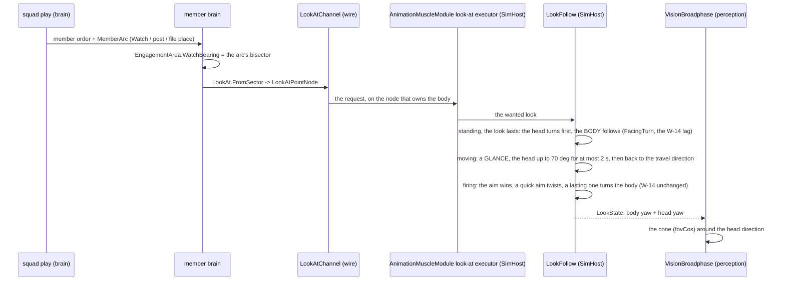
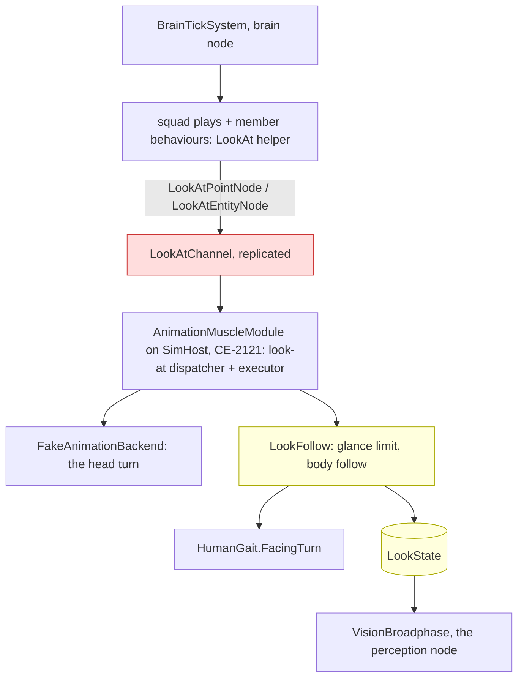
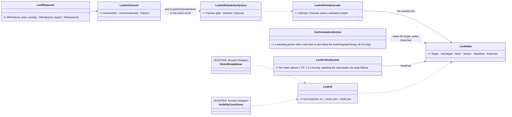
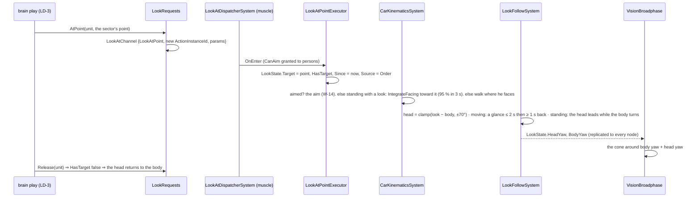
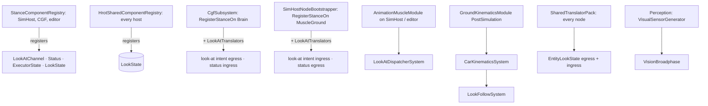
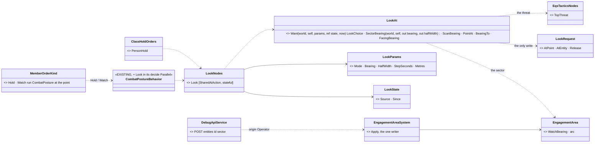
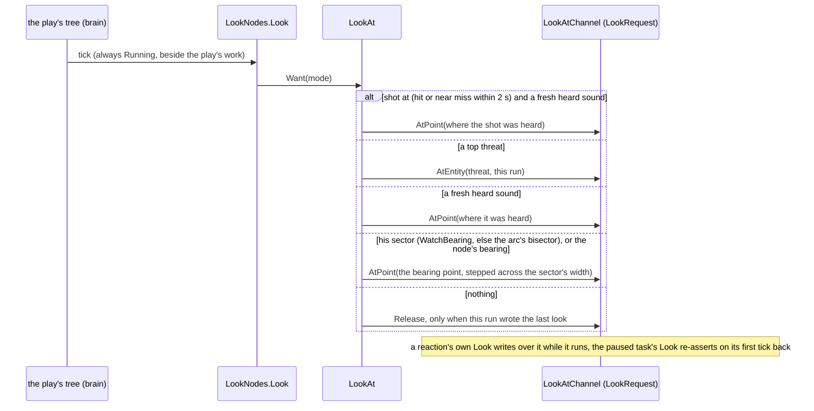

<!--STATUS
state: LIVE
updated: 2026-10-19
build-state: BUILT (LD-1 / LD-2, backend CE-3252, 2026-10-19 — as-built §3.2b) · LD-3 slice 1 BUILT (behaviors CE-2297, 2026-10-19 — §3.3a: the Look node in CombatPosture and PersonHold; slice 2 waits on MemberArc) · LD-3 rest / LD-5 behaviors, LD-4 last — the lean ✅ APPROVED 2026-10-18 (R-2048); LD-A…LD-D ✅ (R-2049, LD-B / LD-C as amended by the user) and brought into the platoon programme (§3); LD-1 / LD-2 backend (its step 1: confirm §3.2's reuse of the look-at channel), LD-3 / LD-5 behaviors (CE-2297, CE-2298), LD-4 last
current-answer: §3.2b (LD-1 / LD-2 AS BUILT — the classes, the wire, the rails) · §3.3a (LD-3 slice 1 — who points the eyes, as built) · §3 (in the platoon programme: inventory, the diagrams, who points the eyes, the demos) · §2 (the programme) — §1 is the measured ground it stands on, so nobody re-derives it.
stale-below: §3.2a's class names `LookRequests`, `LookOf.EyeYaw`, `LookState.Since` / `BodyYaw` — the plan; §3.2b names what was built.
known-rot: none.
known-conflict: none.
related-designs:
  - docs/designs/group-maneuvers/DESIGN_Platoon_Attack_Defend_Clear.md — the programme LD now belongs to (§6b PC-16 watch the last window, §12 demos, §13 the lane split)
  - docs/designs/hit-location/DESIGN_Body_Parts_And_Hit_Location.md — §13 OWNS the LEAN (CE-3257, BR-5): it moves where the eyes SIT (TerrainWorldLosStrategy.EyeOf, 0.4 m sideways); this file owns where they POINT
  - docs/DESIGN_Peek_And_Fire.md — OWNS the expose / hide / relocate cycle; LD-3 makes the watcher keep his eyes on the last window (PC-16)
  - docs/designs/group-maneuvers/DESIGN_Defend_And_Attack_Position.md — DA-20 / DA-24: EngagementArea.WatchBearing and MemberArc are what LD-3 points the eyes at
  - docs/designs/vehicle-tactics/DESIGN_Urban_Armour_Tactics.md — urban tank tactics; tanks keep 360° there
  - docs/DESIGN_Sensors_And_Doctrine.md — OWNS vision (the broadphase, the visual sensor, Optics); this programme changes WHICH direction its cone points and the shipped FOV value
  - docs/DESIGN_Weapon_Layers.md — W-14 (CE-3195, backend): a person's body follows a lasting aim (HumanGait.MaxAimTwist, AlignGain); the body-turn mechanism LD-1 extends from "turn to the aim" to "turn to a look direction"
  - docs/designs/group-maneuvers/DESIGN_Squad_Tactics.md — OWNS the squad orders (Watch, overwatch, march slots) that LD-3 makes face a sector; §7.7.6 records "no facing control exists"
  - docs/designs/group-maneuvers/DESIGN_Building_Clearing.md — OWNS the building-clearing drill (Battle Drill 6: stack, breach, points of domination, sectors, controlling and searching civilians, room order) — its sectors (CB-4) become a look direction once LD-1 lands
-->

# Look direction and a realistic field of view — now part of the platoon programme

🔒 User, `2026-10-14`: *"Backend added soldier body turning to the firing direction. It also found the FOV of humans is 360 which I don't
know how it is used"* · *"record tasks related to look direction control and FOV reduction to realistic values as a small programme for
later, include all what you found now so no rederiving necessary."*

**The decision (lean, not yet approved):** keep 360° until a soldier's eyes can be pointed. Then narrow humans to **~200°**. Order:
look-direction control (LD-1) → the vision cone follows it (LD-2) → behaviours point it (LD-3) → narrow the TKB value (LD-4) → demos (LD-5).
**Rejected:**
- *Narrow to 200° now:* a standing man would look wherever he last walked, blind to his assigned sector — worse than all-seeing.
- *Keep 360° forever:* nobody can ever be surprised from behind, and W-14's body turning buys sight nothing.
- *A separate head sensor:* more machinery than one look direction on top of the body cone, and no demo needs it yet.

## 1. What exists — measured `2026-10-14` (do not re-derive)

### 1.1 How vision uses the FOV

| fact | where |
|---|---|
| ONE cone test: `dot(forward, dirToTarget) >= fovCos`; forward = the BODY rotation (`SimTransform.Rotation`, X-forward), 2-D | `FDP/Toolkits/Fdp.Toolkits/Perception/Systems/VisionBroadphase.cs:59-91` |
| `fovCos = cos(FieldOfViewDegrees / 2)`, computed at spawn into `PerceptionReceptor.FieldOfViewCos` | `Perception/Translators/PerceptionTkbTranslator.cs:38-47` |
| ⇒ **360° ⇒ fovCos = −1 ⇒ the test always passes: the FOV is OFF** | — |
| the implicit visual sensor reads the receptor; an explicit sensor reads its `SensorCapability` visual record | `Perception/Sensors/VisualPerception.cs` `Optics` (~l.60-80) |
| thermal has its own FOV; radar's DTO has one | `Perception/Sensors/ThermalPerception.cs:47` · `Tkb/Domain/SensorEntryDto.cs:71,78,97` |
| the FOV can already be retuned at runtime over the wire (`SensorConfig.FovDegrees` → `FieldOfViewCos` on ingress) | `Hrot.Network.NED/SimDescriptors.cs:470` · `SimHost/PerceptionTranslators.cs:74,391` |
| the map draws the cone | `Hrot.Common/Diagnostics/Gizmos/VisibilityConeGizmo.cs:32` |
| hearing has NO cone (a range only; an implicit acoustic sensor, part 1001) | `PerceptionComponents.cs:18` · `PerceptionTkbTranslator.cs:92-95` |

### 1.2 Where 360° comes from

| fact | where |
|---|---|
| the DTO default is 360 ("360 = omnidirectional") | `Tkb/Domain/SensorCapabilitiesDto.cs:25-30`; the sensor-entry DTOs too |
| every shipped soldier and civilian sets 360 | `Hrot.Core/Tkb/UrbanCombatTkbCatalog.cs:129` (civilian), `:170` (soldier) · `MapDefinitions/Tkb/BdcTkbBuilder.cs:270` · examples `DemoTkbSetup.cs:67,174,223` |
| ⚠ **seven scenarios already author `PerceptionReceptor.FieldOfViewCos: 0` = a 180° FOV** — the TKB translator does not overwrite a receptor the scenario already has (`!HasComponent`) | `hill-attack` (6), `hill-attack-close` (6), `tt-nav-los` (4), `hsm-channel-e2e` (3), `mission-demo-bp` (2), `test-fire` (2), `test-move` (1) — likely a saved default, not a choice. Not measured whether intended |
| design basis | ⛔ searched `docs/` + `.dev/`: no design states 360 models "he can turn freely / scans". `.dev/_DONE/tkb-2/design-talk.md` sets 360 as a default with no rationale; `DESIGN_Sensors_And_Doctrine.md:1677` uses 360 only as a benchmark setting |

### 1.3 What turns a person's body today

| writer | where |
|---|---|
| travel: `HumanGait.Integrate` turns only while moving | `CarKinem/Systems/CarKinematicsSystem.cs:458` (`FinishMove`) |
| ⭐ a lasting aim: W-14 — one twist limit `HumanGait.MaxAimTwist` 75°, `BodyAim.HoldsFire`, `AlignGain`, `HumanGait.FacingTurn` (Stride uses it too) | backend `5871b2ac0` (CE-3195), `DESIGN_Weapon_Layers.md` W-14 |
| the operator (`ManualMotion.Person`), the Stride motor (from velocity), a passenger takes the vehicle's (`EmbarkedStateSystem.cs:120`) | — |
| ⛔ **no behaviour writes a heading** (nothing in `Hrot.AI.Behaviors`); the squad `Watch` order has no facing (Squad Tactics §7.7.6: "no facing control exists") | — |
| an animation `LookAt*` channel exists — drawing only, unplayed (CE-3010) | backend W-14 inventory |

### 1.4 Human numbers (for LD-4)

Horizontal visual field ≈ **200–220°** with both eyes; the head turns ≈ **±70–80°**, so scanning covers 360° over a few seconds.

## 2. The programme

| id | owner | what | lean |
|---|---|---|---|
| **LD-1** | backend | a **look direction** for a person: an intent (a yaw or a point) a behaviour can set; a standing man turns his body to it with W-14's `FacingTurn` (no new turn code). Later, optionally, a head yaw (±70°) on top that does not move the body | one component/intent, last writer = the active behaviour; aim (W-14) wins while firing |
| **LD-2** | backend | the vision cone points along the look direction (the head yaw when it exists, else the body) instead of the raw body rotation | change `VisionBroadphase`'s forward only; the cone test stays; ⭐ *(added 2026-10-18, hand-off audit)* the map's `VisibilityConeGizmo` reads the same forward (it draws the body rotation today), and `LookState` replicates from the muscle so LD-D answers on every node |
| **LD-3** | behaviors | who points it: `Watch` faces its sector (crossing security, overwatch watchers); `CombatPosture` hold faces the threat, else its sector; march flank men face outward; an idle soldier / Sentry scans slowly (±60°) | one helper per order kind; the look comes from the order, not from type data |
| **LD-4** | backend (data) | narrow humans to **~200°** in `UrbanCombatTkbCatalog` / `BdcTkbBuilder`; decide the seven scenarios' authored `FieldOfViewCos: 0` (re-save without the receptor, or keep 180° on purpose) | only after LD-1..LD-3 |
| **LD-5** | behaviors | demos + checks: an ambush from behind is not seen until it fires or is heard; a security man sees his sector, not the road behind him | new `ua-*` scenarios in `scripts/utility-demo-check.py` |
| LD-6 *(open, later)* | — | peripheral vision slower than central (detection time grows toward the cone edge); vehicle crew FOV per seat | not needed for LD-1..LD-5 |

**Interim option (only if a demo needs rear surprise before LD-1):** narrow the cone for MOVING units only, keep 360° while standing — a
small rule in the cone test, to be retired by LD-2.

⚠ Before building, per CLAUDE.md: an INVENTORY (`search_graph` for facing / heading / look / aim writers), UML for LD-1/LD-2, and the
user's approval of the lean above.

## 3. In the platoon programme *(✅ the lean approved 2026-10-18, R-2048)*

🔒 User, `2026-10-18`: *"Yes bring it to the plan, and add its own demo scenarios (or update existing ones) to make sure it works
live."* — on the question whether LD-1 is in the platoon plan (it was not: the sectors (DA-20), the room sectors (CB-4) and PC-16's "watch
the last window" all wait on it).

### 3.1 INVENTORY *(2026-10-18 — codebase-memory CLI `search_graph` `.*(Look|Facing|Heading|Gaze|WatchBearing|FieldOfView).*`, Class and Method; grep `LookDirection|LookIntent` over `FDP/` `Hrot/`: 0; `check_index_coverage` NOT run — CLI only)*

| found | where | ⇒ |
|---|---|---|
| ⭐ an **animation look-at CHANNEL**: `LookAtChannel` (replicated component, the action-channel shape: action id, behaviour instance, action instance, 32-byte params), `LookAtChannelIntent` / `Status` translators on the wire, behaviour nodes **`LookAtPointNode`**, **`LookAtEntityNode`**, **`ReleaseLookNode`**, a muscle `LookAtDispatcherSystem` and `LookAtPointExecutor` | `Hrot.MuscleCharacter.Animation` (components, nodes, registrar, executors) | ⭐ **the look request already exists end to end on the behaviour side and on the wire** |
| ⭐ **`AnimationMuscleModule` IS composed on SimHost and the editor** over the **`FakeAnimationBackend`** (`AnimationMuscleCapability`, `CE-2121` — it carries the stance transition); its remark: *"Montage / look-at requests stay unconsumed until their components are registered"* | `Hrot.SimHost/AnimationMuscleCapability.cs`; `Hrot.MuscleCharacter.Animation.Fake` | ⇒ the executor RUNS on the right node already; ⛔ only the look-at components are not registered. ⚠ `CE-3010`'s *"no production host composes the Muscle animation pipeline"* is stale for SimHost (it predates `CE-2121`) |
| `HumanGait.FacingTurn` · `FacingSpeedFactor` (W-14) | `CarKinem/Controllers/HumanGait.cs` | the body turn LD-1 reuses (§1.3) |
| `VisionBroadphase` forward = the body rotation | §1.1 | LD-2 changes only this |
| no `LookDirection` / `LookIntent` anywhere | grep | nothing to merge |

### 3.2 The classes and the flow *(LD-A, LD-D ✅ approved; LD-B, LD-C as amended by the user — R-2049)*

🔒 User, `2026-10-18`: *"Reusing animation channel is ok. There was planned an existing fake animation module on the sim host already. So
this one could be reused or replaced with something. Actually, turning the body to the aiming direction is probably the most intuitive
pose, so we should not force the soldier to aim plus minus 70 degrees from his forward direction of the body, because this is
unrealistic. The watching, yes, but only short time as turning head quickly gets unpleasant and inconvenient. Aiming yes, but again only
for a short time, quick aim. If it takes longer, the body should turn to the aiming direction as it is now. Checking over HTTP accepted."*

*What the picture shows that prose hid:* the request path AND the executor already exist and the executor's module already runs on
SimHost over the fake backend; what is missing is registering the look-at components, the small `LookFollow` step (how long the head may
stay turned, when the body follows) and the cone reading the result. ⭐ The fake backend can later be replaced by a real 3D backend
playing the same request — the look never depends on which one draws it.

*What the picture shows that prose hid:* the head never stays turned for long — a lasting look ends with the BODY facing it, exactly as
a lasting aim already does (W-14); only a glance while walking keeps the body on its travel direction.

*Caption:* who runs it each frame. ⚠ **The red box is the gap today:** the look-at components are not registered on SimHost, so the
module that already runs there consumes nothing; registering them is the remaining half of `CE-3010` for this use.

| id | decision | ✅ ruled / ⭐ lean | rejected — one line each |
|---|---|---|---|
| **LD-A** ✅ | what carries the look | ✅ **the existing `LookAtChannel`**, executed by the existing look-at executor inside `AnimationMuscleModule`, **already composed on SimHost over the `FakeAnimationBackend`** (`CE-2121`); register the look-at components; the fake backend may be reused or replaced by a real one later (user) | a new `LookIntent` component: a second producer for "where he looks" |
| **LD-B** ✅ *(as amended — ⭐ already ruled 2026-10-14, **R-3003**: *"Firing with high angle difference should be possible (like quick fire on suddenly appearing target) but i think The motion should try to align the body smoothly to the firing direction if that situation (target behind) lasts longer"*)* | the aim and the body | ✅ **W-14 / R-3003 unchanged** — this row restates it, it does not rule anew: a **quick aim** may twist the upper body (up to 75°) for a short time; **a lasting aim turns the body** to it (the existing lag, 95 % in 3 s). ⛔ No soldier is kept aiming ±70° off his body. Who owns the look otherwise: the running behaviour's last request (a reaction's replaces the task's while it runs, the task's returns after); nothing requested ⇒ a slow scan around the last look | aiming far off the body for long: unrealistic (user) |
| **LD-C** ✅ *(as amended)* | the head | ✅ the head turns only for a **GLANCE** — ⭐ lean: up to ±70° for **at most 2 s**, then back toward the body's direction for at least 1 s; **a lasting look turns the BODY** (standing: `FacingTurn` toward it, the same lag as a lasting aim); **moving**: the body keeps its travel and an off-axis sector is watched by repeated glances, never a long stare over the shoulder | a fixed head turn while walking: "turning head quickly gets unpleasant and inconvenient" (user) · stopping to look: a march would crawl |
| **LD-D** ✅ | reading it back | ✅ `GET /entities/{id}/state` gains `look` { bodyYaw, headYaw, source: order / aim / scan / reaction / glance, fovDegrees }; "was he seen" stays `GET /entities/{id}/memory`'s modalities | a new route |

### 3.2a LD-1 / LD-2 — backend detail *(backend, `CE-3252`, `2026-10-18`; step 1 of the frame: §3.2's reuse CONFIRMED, and what it does not yet do)*

**INVENTORY** *(codebase-memory CLI `search_graph` `.*(LookAt|Look|Head|Gaze|Facing).*` Class — 75 hits, agrees with grep; one read-only
sweep, every answer opened at the file. `check_index_coverage` NOT run — CLI only)*. ⭐ §3.2's reuse holds, but the look-at path is
**inert end to end**, six gaps, not one:

| # | gap | where |
|---|---|---|
| G1 | `LookAtChannel` (221), `LookAtChannelStatus` (227), `LookAtExecutorState` (237) are registered on NO host | `StanceComponentRegistry` registers the stance set only |
| G2 | `AnimationTkbTranslator` adds them only when the def has an `AimConfig` — the shipped mannequin def has none | `AnimationTkbTranslator.Inject`; `UrbanCombatTkbCatalog.BuildMannequinAnimationDef` |
| G3 | `LookAtDispatcherSystem` fails every request without `ActorCapabilities.CanAim` — `BehaviorTkbTranslator` never sets it | `LookAtDispatcherSystem.cs:70-73`; `BehaviorTkbTranslator.cs:64-74` |
| G4 | nothing on the brain writes `LookAtChannel` (the node structs are registered only by tests) | `AnimationNodeRegistrar` |
| G5 | the look-at translators are on no host (only the stance pair is wired) | `AnimationReplicationModule.BuildTranslators` |
| G6 | the executors stage a target and produce NO yaw; nothing turns a body or a head | `LookAtExecutors.cs` |

*What the picture shows that prose hid:* the look reaches the FDP layer through ONE new component, `LookState`, written on the muscle by
the existing executor (its target) and by the two FDP systems (body, head); vision and the map read it through ONE helper. The aim
(W-14) never touches `LookState` — `CarKinematicsSystem` keeps its aim branch first, so the aim wins by construction.

| id | decision | ⭐ lean | rejected — one line each |
|---|---|---|---|
| **LD-E** | where the look lands in FDP | ⭐ ONE component `LookState` (FDP, Perception), muscle group, replicated (`dtLookState`): the executor writes the TARGET, the gait / follow systems the yaws | the Hrot `LookAtExecutorState` — FDP's kinematics and vision cannot reference Hrot types · two components (target, result) — two descriptors for one fact |
| **LD-F** | G1–G3, G5 | ⭐ register the look-at trio wherever the stance set is registered (brain AND muscle registries); inject it for every PERSON type (a `VehicleClass.Pedestrian` body) regardless of `AimConfig`; grant `CanAim` to persons in `BehaviorTkbTranslator`; wire the look-at translator pair by role exactly as the stance pair (`RegisterStanceOn`'s twin) | an `AimConfig` on the mannequin def — it would also start the montage aim path nobody plays |
| **LD-G** | G4 — the brain's write | ⭐ `LookRequests` (`Hrot.MuscleCharacter.Animation`, brain-side static): `AtPoint`, `AtEntity`, `Release` write `LookAtChannel` with a fresh `ActionInstanceId` and the owning behaviour's instance — the one writer behaviors' `LookAt` helper (LD-3) calls | behaviors writing the channel bytes themselves: the 32-byte params layout would leak into every play |
| **LD-H** | nothing requested | ⭐ v1: the head returns to the body (no scan) — ⛔ LD-B's "slow scan around the last look" is left to behaviors' LD-3 (`Scan` writes points; it is a behaviour, not physiology) | a scan in `LookFollowSystem`: a second producer of "where he looks" |
| **LD-I** | `look` on HTTP | ⭐ `GET /entities/{id}/state` → `look { bodyYawDeg, headYawDeg, eyeYawDeg, source, hasTarget, targetX/Y/Z, fovDegrees }` from the replicated `LookState` (LD-D) | — |

### 3.2b LD-1 / LD-2 — AS BUILT *(backend, `CE-3252`, 2026-10-19)*

```mermaid
classDiagram
  direction LR
  class LookRequest { <<BUILT static, Hrot.MuscleCharacter.Animation.Look>> AtPoint · AtEntity · Release · CanCarry }
  class LookAtChannel { <<EXISTING 221, Brain group>> now on every person (G2) }
  class LookAtDispatcherSystem { <<EXISTING>> CanAim now granted to every person (G3) }
  class LookAtExecutors { <<EXISTING, grown>> OnEnter LookOf.Want · OnExit / Release LookOf.Release }
  class LookState { <<BUILT FDP 413, Muscle group, dtLookState 147>> Target · TargetEntity local · HasTarget · Source · HeadYaw · GlanceSince / RestUntil local }
  class LookOf { <<BUILT FDP pure>> YawOf · HeadYaw · EyeForward · Want · Release · Wrap }
  class LookFollowSystem { <<BUILT FDP, GroundKinematicsModule after CarKinematicsSystem>> }
  class CarKinematicsSystem { <<EXISTING, grown>> lookingPerson: standing, no aim, a look ⇒ IntegrateFacing to it }
  class EntityLookStateTranslators { <<BUILT NED, SharedTranslatorPack>> egress on news ≥1° / ≥0.25 m · ingress }
  class LookAtChannelIntentEgressTranslator { <<EXISTING, fixed G7>> target index ⇒ network id }
  class VisionBroadphase { <<EXISTING>> forward = LookOf.EyeForward }
  class VisibilityConeGizmo { <<EXISTING>> yaw + LookOf.HeadYaw }
  class DebugApiService { <<EXISTING>> GET entity state, look }
  LookRequest --> LookAtChannel
  LookAtChannel ..> LookAtChannelIntentEgressTranslator : brain ≠ muscle
  LookAtChannel ..> LookAtDispatcherSystem
  LookAtDispatcherSystem ..> LookAtExecutors
  LookAtExecutors ..> LookOf : Want / Release
  LookOf --> LookState
  CarKinematicsSystem ..> LookState : reads the target
  LookFollowSystem --> LookState : HeadYaw · Source · follows TargetEntity
  LookState ..> EntityLookStateTranslators
  VisionBroadphase ..> LookOf
  VisibilityConeGizmo ..> LookOf
  DebugApiService ..> LookOf
```

*What the picture shows that prose hid:* every write of the look goes through `LookOf` (`Want` / `Release` from the executors, the head
from `LookFollowSystem`) and every read through it too — one component, one helper; the wire is the existing look-at channel brain →
muscle and the new `dtLookState` muscle → everyone.

*Caption:* who runs it each frame. Nothing new needs a new host hook: the look-at pair rides `RegisterStanceOn`, the head rides the
gait's module, `LookState` rides the shared pack — so every host that moves a person or reads vision already has it.

| gap (§3.2a) | as built | rail |
|---|---|---|
| G1 registered nowhere | `StanceComponentRegistry` registers the look-at trio + `LookState`; `HrotSharedComponentRegistry` registers `LookState` | `LookPipelineTests` |
| G2 needs `AimConfig` | every character def gets the channel, its report, the executor state and `LookState` | `TranslatorAndCacheTests.CE3252_Inject_WithoutAimConfig_StillAddsLookAtComponents` (re-homed: the old rail pinned the gate) |
| G3 no `CanAim` | `BehaviorTkbTranslator`: a body with an animation def gets `CanAim` | `LookPipelineTests.CE3252_WithoutCanAim_TheLookIsRefused` (the gate still holds) |
| G4 nothing writes the channel | `LookRequest` (fresh `ActionInstanceId` per NEW request; the same point within 5 cm / the same target ⇒ nothing) | `LookPipelineTests` |
| G5 translators on no host | `AnimationReplicationModule.LookAtTranslators`, registered by `RegisterStanceOn` beside the stance pair | cluster `EqsDistributedTests` / `EntityOrdersAcrossNodesTests` boot SimHost + CGF with it |
| ⭐ **G5b — found while building** | the look-at DDS structs had NO generated serialiser (`[DdsTopic]` missing — the stance pair got it in `CE-2121`, the look-at pair stayed test-only): the first live reader threw *"does not have a public static GetDescriptorOps()"* and the SimHost boot failed. Now `[DdsTopic]` + `[DdsKey]` + State QoS on `DdsLookAtChannelIntent` / `DdsLookAtChannelStatus` | the same cluster rails (they reddened, 12/29, until it was fixed) |
| G6 no yaw | `LookOf.Want` from the executors; `LookFollowSystem` the head; `CarKinematicsSystem` the body | `LookFollowSystemTests` ×4, `CarKinematicsSystemTests.CE3252_*` |
| ⭐ **G7 — found while building** | the brain's look-at egress sent the target's raw entity INDEX where the ingress reads a NETWORK id; now remapped, an unmapped target held back (`UnmappedTargetCount`) | `AnimationChannelTranslatorTests.CE3252_*` |
| LD-2 the cone | `VisionBroadphase` forward = `LookOf.EyeForward`; the map's cone adds `LookOf.HeadYaw` | `VisionBroadphaseTests.CE3252_TheConeIsAroundTheEyes_NotTheChest` |
| LD-I HTTP | `GET /entities/{id}/state` → `look {bodyYawDeg, headYawDeg, eyeYawDeg, source, hasTarget, target, fovDegrees}` | `EntityStateLookTests.CE3252_*` (Hrot.Editor.Tests — the DebugApi harness rails are excluded, DEBT-MCP-001) |
| the wire | `dtLookState` 147, Muscle group, `EntityLookState` (target, has, source, head) on news only | `BodyPartReplicationTests.CE3252_*` |

**Deviations from §3.2a, argued:**
- ⛔ `LookState.BodyYaw` / `Since` dropped — the body's yaw is the replicated transform's (a second copy would publish every frame of a
  turn); `Since` had no reader. `TargetEntity`, `GlanceSince`, `RestUntil` are the muscle's own and never cross.
- `LookRequests` → `LookRequest`; `LookOf.EyeYaw` → `EyeForward` (vision wants a vector), plus `Want` / `Release` so the executors do
  not each spell the write.
- The body follows a look only when the gait asks for NO speed (`targetSpeed ≤ 0.01`): a man walking keeps his way and glances (LD-C).
- ⚠ Not here: LD-3 (behaviors point the eyes — `LookRequest` is their one call), LD-4 (the 200° FOV), LD-5 (demos).

### 3.3 Who points the eyes, in every play of the programme *(LD-3)*

| play / order | the look | source |
|---|---|---|
| `Watch` (crossing security, overwatch) | the sector's bisector, scanning its width | the member order's arc |
| `SquadDefend` post | his arc (`MemberArc` → `WatchBearing`); after a contact: the threat | DA-20 / DA-24 |
| `SupportByFire` | his window faces; on a lift / shift: the new sector | the order |
| ⭐ **watch the last window** (PC-16, Regular+) | the window an element last showed at (the squad's SPOT storey + the member's own last sighting) while hidden | `PeekAndFire`'s remembered spot |
| `SquadMarch` / `UrbanMovement` | by file place: point man ahead, then alternating left / right building faces, every second man the upper storeys, the last man the rear — ⭐ as **repeated glances** (≤ 2 s each, LD-C) while walking; at a halt the body turns to the sector | DA-17, LD-C |
| `ClearBuilding` | at his point of domination: his room sector (CB-4); in the stack: the danger area his number covers | Building Clearing |
| `CombatPosture` hold | the threat, else his sector | today's posture |
| Sentry / idle | scan ±60° | LD-B |

### 3.3a LD-3 slice 1 — the one look node, in the posture every holding man runs *(behaviors, `CE-2297`, 2026-10-19)*

**INVENTORY** *(2026-10-19 — codebase-memory CLI `search_graph` `.*(Look|Watch|Scan|Glance).*` Class: 97, Method: 708 (paged; the
look rows below are all of them outside tests); grep `LookAt\b|LookWant|class Watch` over `Hrot/` `FDP/`: 0; `check_index_coverage` NOT
run — CLI only)*

| found | ⇒ |
|---|---|
| `LookRequest` `AtPoint` / `AtEntity` / `Release` / `CanCarry` (backend, `CE-3252`) — the one write, stamps `BehaviorInstanceId`, a repeat within 5 cm is a no-op | ⭐ the only call LD-3 makes |
| `LookAtPointNode` / `LookAtEntityNode` / `ReleaseLookNode` (blueprint action structs, `Hrot.MuscleCharacter.Animation/Nodes`) | the blueprint author's road; ⛔ a C# tree does not go through them |
| `EngagementArea.WatchBearing` / `WatchSet` and the arc (`CE-2282`) | the member's sector — the look's second source |
| `EqsTacticsNodes.TopThreat` (the threat every fire step and hide uses) | the look's first source |
| `BehaviorState.InstanceId` — a paused task keeps its id (`BehaviorIngressSystem.cs:468`) | the arbitration key |
| plays that exist today: `CombatPosture` (and `PersonAttack`, the same tree), `SquadMarch`, `SquadDangerCrossing`, `DefendArea`, `BoundingOverwatch` | ⛔ `Sentry`, `SquadDefend`, `SupportByFire`, `ClearBuilding` are not built |
| `Sentry` (a JSON tree, `Assets/BTrees/Library/Tactics/Sentry.btree.json`, CE-3079 H2: watch until a dangerous contact is within 90 m, then wait 15 s and end) and `PersonHold` (`ClassHoldOrders`: one Idle state) — 📌 the first `search_graph` pattern (`Look|Watch|Scan|Glance`) did NOT name the Sentry; grep of the suite did | ⭐ `PersonHold` gets the look (the operator's Hold); ⚠ the Sentry is a JSON tree — a stateful node with its own params needs the asset's slot binding, so it is slice 2 |
| ⭐ **`MemberOrderKind.Watch`** (Squad Tactics §7.7.6 D5, `CE-2159`) — the runner's `Hold` path: the member runs `CombatPosture` holding at the point; used by the danger crossing and the three airborne drills; its own row says *"⛔ facing a sector: no facing control exists"* | ⭐ **the Watch order already exists** — LD-3 gives it eyes through `CombatPosture`; ⛔ no second `Watch` behaviour |

*What the picture shows that the prose hid:* the brain side adds ONE node and one helper, and putting it in `CombatPosture` reaches
every holding man at once — an operator's Hold, a squad's Hold and Watch members — because they all run that one tree. Nothing below
the node is new: the threat, the sector and the channel all exist.

*What the picture shows that the prose hid:* the arbitration is the channel's own `BehaviorInstanceId` — no new owner field. The paused
task keeps its run id, so "the task's look returns after the reaction" is just its node ticking again.

| id | decision | ⭐ lean (built) | rejected — one line each |
|---|---|---|---|
| **LD-3a** | where the look is chosen | ⭐ **one stateful node `LookNodes.Look`** each play puts beside its work (CombatPosture: in its decide Parallel) | a default-look SYSTEM over every man: it cannot tell a behaviour's own request from a stale one, and LD-H rules no look when nothing asked · a call inside every fire step: the eyes would move only while firing |
| **LD-3b** | the order of sources | ⭐ SHOT AT (hit or near-missed within 2 s, `RecentSensesOf`) with a fresh heard sound ⇒ the sound of the shot first · then the top threat → a fresh HEARD sound (an anonymous memory slot stamped within `HeardWindowTicks` 300, the `KnownCombatants` clock) → his sector (`WatchBearing`, else the arc's bisector) → the node's own bearing → nothing; mode `SectorOnly` skips the threat and the sound (a security man keeps his sector) | the threat always first: a crossing's security man would turn to the fight behind him and leave his road |
| **LD-3c** | the scan | ⭐ STEPPED: five fixation points, `StepSeconds` (2 s) each, ping-pong — one request per step; the width is the node's `HalfWidth` when set, else the sector's own (half the arc, ≤ 60°; ±30° around a bare `WatchBearing`) | a continuous sweep: a new request (and a channel sample on the wire) every tick |
| **LD-3d** | release | ⭐ only when the channel's last look is this run's (`BehaviorInstanceId`) | releasing always: a task would clear the reaction's look under it |
| **LD-3e** | the `Watch` order, and where an order's facing comes from | ⭐ the EXISTING `MemberOrderKind.Watch` gets its eyes through `CombatPosture`'s `Look`; ⭐ a facing comes from the man's SECTOR (`EngagementArea.WatchBearing` / arc) — set by a superior's play through `SetEngagementAreaEvent` (`MemberArc`, slice 2) or by the operator over `POST /entities/{id}/sector` — or from `CombatPostureParamsJsonDto.watchTowards` (a behaviour param, scanned ±30°) | a new person behaviour `Watch`: a second implementation of the order that exists (the first draft proposed it; the inventory retired it) · `HoldOrder.Towards`: Hold is one order with three fulfillers (`PersonHold`, `InfantrySquadHold`, `WeaponSystemHold`) and `SopParamsRoundTripTests.CE2079` requires each to read what it is sent — a squad passing a facing to its men is `MemberArc`'s work (slice 2), so the order stays empty |

**As built** *(2026-10-19, `CE-2297`)*: `Hrot.AI.Behaviors/Brains/LookNodes.cs` — `LookAt`, `LookNodes.Look` (`[SharedAiAction]`, always
Running), `LookParams` {`Mode`, `BearingSet`, `Bearing`, `HalfWidth`, `StepSeconds`, `Metres` (0 = 100)}, `LookNodeState` {`Source`,
`Threat`, `Bearing`}, the enum `LookChoice` (named apart from backend's `Fdp.Toolkit.Perception.Look.LookSource`). `CombatPosture`'s
decide Parallel carries the `Look` (its blackboard gains `Look` / `LookState`); `CombatPostureParamsJsonDto.watchTowards` (local
metres) becomes the node's bearing, scanned ±30°; `PersonHold` becomes a one-state HSM with the `Look` activity
(`ClassHoldOrders.PersonHoldBlackboard`, the order still empty). `POST /entities/{networkId}/sector` (`DebugApiService.Sector.cs`, MCP
`set_entity_sector`) lets the operator set a sector — the ROE twin, origin Operator, through `EngagementAreaSystem.Apply`; on a node
that does not run his brain it publishes the event and backend's kind 4 (`CE-3261`) carries it there (answer `forwarded`). Deviations from the first draft of this section: no `Watch` behaviour, no `HoldOrder.Towards` (LD-3e); the sector gives its
own scan width (LD-3c); a heard sound is LD-3b's second source. Rails `TacticsTreesTests.CE2297_*` (8, CombatPosture's suite): the
compass and the scan · CombatPosture looks at its top threat, stamped with its run · no threat ⇒ the sector, scanning, then released
when withdrawn · a look another run wrote is not released · `SectorOnly` keeps the sector · a heard shot takes the eyes while fresh ·
PersonHold looks at its sector. Red-proofs: six mutants, each reddening its rail (the tracker row). ⭐ The heard source was added while
planning `ld-sentry-surprise` (LD-5 ④): `TopThreat` ranks entities only, so a shot heard from behind never turned the sentry.
📌 The demo's live runs then found the ORDER wrong for a man shot at: with hostile A in sight in front, B's shots from behind never
turned the sentry (A, the top threat, kept his eyes) — a hit or near miss within 2 s (`UnderFire`) now puts the sound of the shot
first (rail `CE2297_ShotAt_*`).

⚠ **Not in this slice** (LD-3 slice 2, waits on `MemberArc` in the member order — DA-24, and on backend's kind 4 for a sector to cross
nodes): the march's file-place glances, the crossing's security sides, `ClearBuilding` room sectors, PC-16's last window,
`SquadDefend` / `SupportByFire` (not built).

### 3.4 The demos — make sure it works live *(LD-5, `CE-2298`)*

⭐ All on **`bt-range`**, so they wait on nothing from the ui lane; each authors the people's field of view (`PerceptionReceptor.FieldOfViewCos`
for 200°) explicitly, so they run **before LD-4** narrows the TKB. Each has an HTTP live check and an in-process twin.

| demo | proves | cast | must end with *(read over HTTP)* |
|---|---|---|---|
| ⭐ `ld-sentry-surprise` | LD-1 + LD-2: an order points the eyes, the cone follows them | a sentry at the low wall, `Watch` facing north (200° FOV); hostile **A** walks across his sector 150 m out; hostile **B** walks up behind him (south) to 40 m, then fires | ① standing, a lasting look: `look.bodyYaw` within 10° of north within 4 s (the body turned, not just the head; `/entities/{id}/state`) · ② A in his memory, **visual**, within 2 s of entering the cone (`/memory`) · ③ B **absent** from his memory while it walks · ④ B's shot ⇒ a **heard** contact, a head glance first (`look.source` = glance), B **visual** within 1.5 s, and the body faces B within 4 s if he keeps it as his threat · ⑤ the control run with 360° sees B at once (the demo's own proof that the cone mattered) |
| `ld-crossing-security` | LD-3 for `Watch` | the danger-crossing drill (`ua-squad-danger-crossing`'s cast) with 200° FOV; a hostile far down the road on the left; one behind the squad on the path it came by | ① the two security men face left and right along the road · ② the left hostile seen by the left man first · ③ the one behind seen by nobody until the rear man's file sector (or a shot) · ⭐ the existing `ua-squad-danger-crossing` check unchanged (360° there) |
| `ld-watch-last-window` | PC-16: switching beats a watcher | `house-2f` (House A), one Regular defender at the windows; two Regular attackers behind the low wall, 60 m; run twice — defender switching (Regular) and not switching (Militia) | ① while the defender is down, the attackers' `look` stays on the window he last showed at · ② the attackers' time from his exposure to their first shot is **≥ 0.5 s longer at a new window** than at the watched one (`/combat/shots` × his exposures) · ③ the switching defender is hit less · ⚠ needs BR-7 (acquisition by exposure) for ② |
| `ld-room-sectors` | LD-3 for the clearing | `bc-room-clear`'s cast | at each point of domination every man's `look` within 20° of his sector's bisector (CB-4) — ⭐ added to `bc-room-clear`'s check |

**`ld-sentry-surprise` — as built** *(2026-10-19, `CE-2298`; ✅ PASSES LIVE, and its 360° control `ld-sentry-surprise-360` passes)*:
on bt-range's clear east strip — the sentry (type 2002, Regular, 200°: `PerceptionReceptor.FieldOfViewCos` −0.1736) holds at
(185, 80) faced north-east; the check gives him his sector over `POST /entities/{id}/sector` (`watch` 0); hostile A crosses at
y = 150 (**≈ 70 m**, not 150 m); hostile B walks from (185, 5) to 40 m behind him, then is ordered to attack him. End conditions as
built: ① his BODY within 10° of north within 8 s · ② A seen (visual) · ③ B in his memory NOT AT ALL while it walks · ④ B's shots
turn his eyes behind him (`look.eyeYawDeg`) and B is seen · ⑤ the control sees B while it walks (and turns to him — so the control
is not asked ①). Deviations: A's 150 m became ≈ 70 m — 📌 at ≈ 113 m A was never acquired in 20 s, even at 360°, cause not found
(asked of backend: [the note](../../blueprints/batches/NOTE_Behaviors_To_Backend_Sight_Beyond_100m.md)); bt-range is 200 m across, so
the spec's 150 m never fitted. The live runs changed the look order twice (§3.3a: the heard source; then a man SHOT AT turns to the
shot over a threat in sight). ⛔ No in-process twin yet. `ld-crossing-security`, `ld-watch-last-window`, `ld-room-sectors` wait on LD-3
slice 2 (`MemberArc`, the clearing drill, PC-16).

**Updates to the platoon demos** (DESIGN_Platoon_Attack_Defend_Clear §12): `sq-defend-house` + every defender's `look` inside his arc
before contact · `sq-support-by-fire` + each man faces his windows · `pc-urban-ambush` + each marcher glances at his file-place sector at least every 5 s and **no glance lasts over 2 s** while he walks
(DA-17, LD-C), and the ambush is SEEN first by the man whose sector it is in · `pc-defend-house` + the Red squad facing the EA does not see
Blue's west-flank bound until it fires or comes into an arc.

