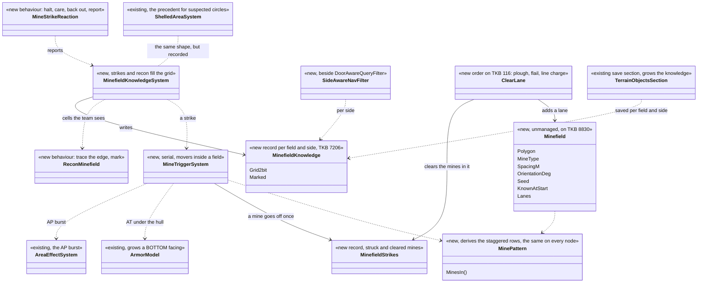
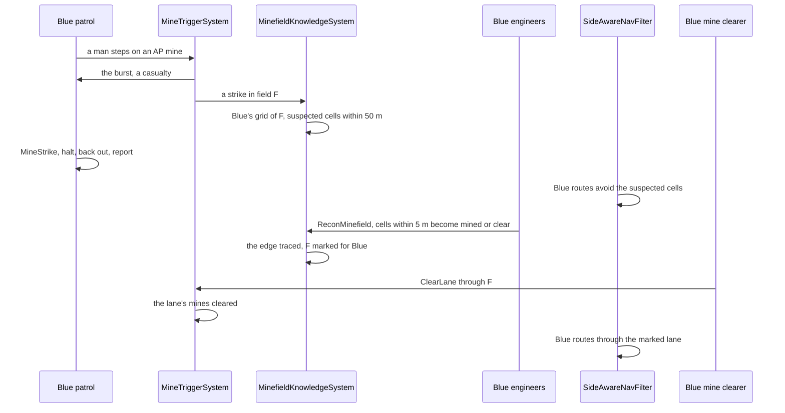
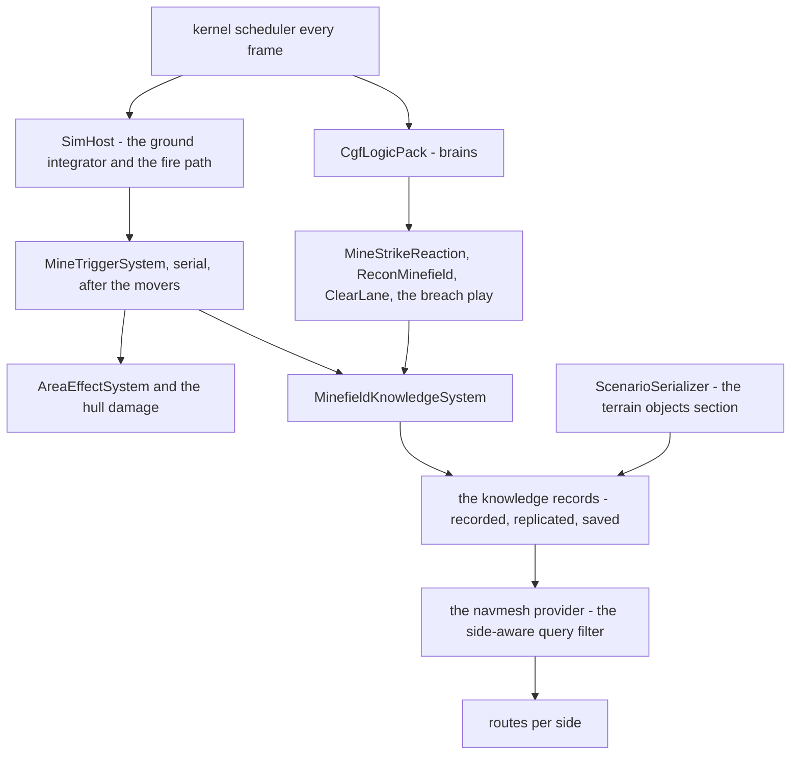

<!--STATUS
state: LIVE
updated: 2026-11-16
build-state: DESIGN — COMPLETE: MF-1…MF-16 approved (R-4270, R-4271); ids §3a; UML §3b; ⏳ the review (§8) before READY-TO-BUILD
current-answer: §3 decisions (approved) · §3a the fixed ids · §3b UML · §4 slices
stale-below: nothing
known-rot: none
known-conflict: none
related-designs:
  - ../../DESIGN_Ground_Patches_And_Road_Blockage.md — OWNS `GroundDamage` (a replicated record of what blasts did to the ground) and the navmesh areas (crater area) — the minefield's record and area follow both
  - ../../DESIGN_Vehicle_Breaching.md — OWNS the bulldozer's clear order (B-4, CE-4601) and the breach-record pattern the mine-clearing vehicle reuses
  - ../vehicle-tactics/DESIGN_Urban_Armour_Tactics.md — M1 plans a BOTTOM facing "for mines later" — an AT mine strikes it
  - ../../DESIGN_Terrain_Authoring.md — OWNS the scatter's deterministic placement inside a polygon (the pattern MF-2 follows)
  - ../../DESIGN_Civilians_And_Crowd_Control.md — OWNS charges and `TriggerIed` (an IED is a single, command-fired mine)
-->

# DESIGN — minefields: laid, struck, avoided, breached

🔒 User, `2026-11-16`: *"mines and mine fields and behaviors regarding to them. Mine field is a zone, and the mines have some density inside and must
be deterministically and equidistantly placed. And when someone or something steps on the mine and explodes, this is an indication that that area is
actually dangerous and that the units needs to avoid it. And there needs to be some kind of mine removal vehicle … and an action to clear a passage
through a minefield, which will basically cut the zone into parts."*

## 1. INVENTORY *(measured `2026-11-16`; graph: `search_graph name_pattern=".*(Mine|Minefield|DangerArea|Hazard|Avoid|Clearance|Lane|Breach).*" label=Class` ⇒ the danger-area family, `BreachDoor*`, `HullClearance` — no mine class; `docs/` + `.dev/` searched (minefield / landmine / mine clearing): only `CAPABILITIES.md:442` "Minefields … ⏳" and Urban Armour M1's "Bottom for mines later"; index coverage could not be checked through the CLI)*

| exists | where | used as |
|---|---|---|
| ⭐ **"a blast here ⇒ this area is dangerous"**: `ShelledAreaSystem` notes every burst, merges them, marks a SHELLED danger area units avoid, forgets it later | `ShelledAreas.cs:23, :132` (CE-4583), `DangerAreaKind.Shelled` | ⭐ MF-6's exact precedent — a mine strike is a danger area of kind Minefield |
| the danger-area family: a sensor, kinds (crossings, open ground, gas, shelled), replicated results, the crossing manoeuvre | `DangerAreaSettings.cs:28-40`, `DangerAreaSensorSystem`, `DangerAreaCrossingManeuver` | units sense and avoid / cross danger areas |
| navmesh AREAS priced per mover (door 2, woods 3, crater 4), a per-mover filter | `NavDoorways.cs:19-68`, `NavLayerSelection.cs:20` | MF-7: a minefield area; ⚠ a filter PER SIDE is not measured to exist |
| a replicated, recorded damage record per node (`GroundDamage` craters, `BuildingDamage` breaches) | Ground Patches P-4, Breaching B-2 | MF-3: the record of struck and cleared mines |
| deterministic placement inside a polygon from a seed (the scatter) | Terrain Authoring §18g, `FeatureKinds.cs:216` | MF-2's pattern |
| charges, a burst's area effect, the vehicle damage parts (mobility kill) | `Charges.cs`, `AreaEffectSystem`, Body Parts | the detonation |
| ⛔ an armour BOTTOM facing (planned in Urban Armour M1) | `ArmorModel` | MF-4 needs it for an AT mine |
| the bulldozer's clear order (cut a wall / fell a tree at a point) | B-4, CE-4601 | MF-9's pattern for clearing a lane |
| ⛔ a mine, a minefield, a mine-clearing vehicle, a per-side known-area filter | — | built here |

## 2. The proven pattern *(engineer doctrine and constructive simulations — each piece adopted for a reason, §3)*

| piece | practice | why it fits |
|---|---|---|
| a minefield laid in **ROWS at fixed spacing, staggered** (a standard pattern), density = mines per metre of front | doctrine (row mining, the "standard pattern") | deterministic and equidistant by construction — the user's requirement |
| two families: **anti-personnel** (pressure, a few kg) and **anti-tank** (a vehicle's weight, attacks the BELLY / tracks) | doctrine | different triggers, different victims |
| a field is DISCOVERED by a strike, by seeing marking, or by reconnaissance; until then it is invisible | doctrine | knowledge is PER SIDE |
| on a strike: **halt, do not move, back out on your own tracks**, call engineers | battle drill | the victim's reaction |
| **breaching**: a mine plough or flail vehicle clears a LANE (~4–5 m wide) at walking pace; a line charge (MICLIC) clears ~100 m × 8 m at once; infantry prodding is slow | doctrine | the user's clearing action; the lane is then MARKED |
| one minefield = ONE object in constructive simulations; mines are its derived points | JCATS / OneSAF practice | thousands of mines must not be thousands of entities |

## 3. Decisions *(✅ MF-1…MF-12 APPROVED `2026-11-16`, R-4270 — 🔒 user: *"minefields approved, one field with lanes cut out"*; ✅ MF-13…MF-16 APPROVED, R-4271 — 🔒 user: *"Minefields approved. Please record design and run the review."*)*

| # | question | ⭐ lean | why · blast radius |
|---|---|---|---|
| **MF-1** | what is a minefield? | ⭐ ONE entity: a closed polyline, a mine TYPE (AP / AT / mixed), a SPACING (or density), a ROW ORIENTATION, a seed, and per side whether it is KNOWN at start (own fields are known and marked; enemy fields usually not) | thousands of mines cost one entity; saved, replicated, recorded once |
| **MF-2** | how are mines placed? | ⭐ DERIVED, never stored one by one: rows at the spacing along the orientation, each row offset by half a spacing (staggered), clipped to the polygon — the SAME points on every node from the field's parameters (a seed only for an optional small jitter, 0 by default) | 🔒 user: *"deterministically and equidistantly placed"* |
| **MF-3** | struck and cleared mines | ⭐ a replicated, recorded per-field RECORD of the mine indices that went off or were cleared (a bitset, the `GroundDamage` / breach-record pattern) — a struck mine never goes off twice | every node agrees; replay restores it |
| **MF-4** | the trigger | ⭐ one serial system: for each mover INSIDE a field's bounds, the derived mines under its footprint (a per-field point grid built once); AP ⇒ any person or vehicle; AT ⇒ a vehicle over a weight only (a man walks over it). The burst: AP = a small area effect at the foot; AT = under the hull — the BOTTOM facing (Urban Armour M1, built here), a track / wheel ⇒ mobility kill | the user's *"steps on the mine and explodes"*; cheap (only movers inside a field) |
| **MF-5** | the victim's reaction | ⭐ a reaction **MineStrike**: halt, do not move, the casualty cared for in place, back out along the unit's OWN recent track; report a SPOT of the field to the chain (the existing report path) | the battle drill; the conduct gate (R-4263) keeps a "Dash" from overriding it? — no: a struck unit HALTS (a mine is not fire) |
| **MF-6** | ⭐ "this area is dangerous" | ⭐ a danger area of a new kind **Minefield**, made by a strike exactly as `ShelledAreaSystem` makes a shelled one: a circle round the blast that GROWS with further strikes (merged); known to the VICTIM'S SIDE (its own units and the reported chain); never forgotten (unlike shelling) | reuses the precedent; knowledge is per side |
| **MF-7** | avoiding it | ⭐ units route AROUND known minefield area: a navmesh area **Minefield** stamped for every field, priced per mover by its side's KNOWLEDGE (unknown ⇒ walks in; known ⇒ closed, or a high cost when the order says so) — ⚠ needs a per-SIDE filter: measure `NavLayerSelection` first | the user's *"units need to avoid it"* |
| **MF-8** | a known field and marking | the known extent is what the side has learned (the grown circles, a reconnaissance report, or the whole polygon when marked); a MARKED field (own, or an enemy field found and marked) is known in full | the doctrine's marking |
| **MF-9** | ⭐ the mine-clearing vehicle | ⭐ a new type — an engineering tank with a **mine plough / flail** (and, as a second option, a **line charge**) and an order **ClearLane { start, end, width ~4.5 m }** (the bulldozer's clear-order pattern, B-4): it drives the lane at ~1–2 m/s; the mines in its swept width DETONATE harmlessly (flail) or are turned aside (plough) and are recorded CLEARED (MF-3); the line charge clears ~100 × 8 m at once | 🔒 user: *"some kind of mine removal vehicle … an action to clear a passage"* |
| **MF-10** | ⭐ "cutting the zone into parts" | ⭐ a cleared LANE is a corridor polyline + width SUBTRACTED from the field: the field stays ONE entity with its list of lanes; its mines inside a lane are cleared, the navmesh area is re-stamped without the lane (a passage), the lane is MARKED and known to the clearing side | the user's intent ("parts") without splitting the entity — its identity, record and replay stay one; ⚠ if the user wants literally separate fields, a split is possible but loses the one record |
| **MF-11** | the breach behaviour | the company's breach play (clear the lane under cover — suppression on the far side, smoke, then the lane) and units crossing in single file through the marked lane | the assault design's breach, applied |
| **MF-13** | ⭐ **how does the victim side LEARN the field?** (🔒 user: *"if the single explosion will reveal the whole minefield somehow magically as a simplification, or if the danger area is just around the single exploded mine And the victim side needs to send scouts/engineers … in some simplified way"*) | ⭐ **neither magic nor a dead end — a per-side KNOWLEDGE GRID over each field, filled in three ways**: ① a STRIKE marks the cells within a CONSERVATIVE radius (~50 m) around the blast as **SUSPECTED** — the side avoids them at once (doctrine: a unit that hits a mine assumes it is IN a minefield); ② an **ENGINEER or SCOUT** team on a `ReconMinefield { suspected area }` task walks at detector pace (~0.5 m/s) and, within its detection radius (~5 m), turns cells into **KNOWN-MINED** (the field covers them) or **KNOWN-CLEAR** (it does not) — following the boundary it finds (a deterministic edge-trace on the grid), so the field's extent appears as it walks; ③ when the trace closes (or the team is ordered to **MARK** it), the field becomes **MARKED** — known in full to that side and drawn as the marked minefield. Further strikes add suspected circles; a recon DRONE may reveal a SURFACE-laid field from the air later (an option, not now) | realistic doctrine (minefield reconnaissance and marking) made SIMPLE: one grid per field per side (a few hundred bytes, 10 m cells), no per-mine detection; navigation avoids suspected + known-mined cells; the knowledge is replicated to the side's nodes |
| **MF-14** | ⭐ **where the knowledge LIVES, how it is recorded and saved** (🔒 user: *"Where would the mine knowledge grid be stored? Is that part of some world singleton … How would it be stored, recorded to the scenario? Because it has to be"*) | ⭐ **NOT a world singleton** — 📐 the shelled area IS node-level (`ShelledAreas.cs:9-16`: "no component id: a restore forgets"), which is right for shelling and WRONG here (knowledge must survive a restore, a replay and a save). ⭐ It follows the **runtime damage-record pattern** the engine already uses for craters, felled trees and breaches (`CellRecordSystem.cs:17-23`, `TreeDamage.cs:21`, `BuildingDamage`): ONE small **record entity per (field, side)** carrying an unmanaged **`MinefieldKnowledge`** component — the field's link, the side, the cell size, the grid at 2 bits per cell (unknown · suspected · known-mined · known-clear) and a **Marked** flag — owned by the node that decides (where the strike or the recon happens), **recorded** (keyframes, seek, replay), **replicated** to every node, and **SAVED** into the scenario through a section keyed by the field's stable id + side, the way `TerrainObjectsSection` saves the breaches (`TerrainObjectsSection.cs:8-20`; the record entity itself transient, rebuilt at load). ⭐ Size: ≤ 1024 B per component (the engine's cap) ⇒ up to 4096 cells — a field up to ~640 × 640 m at 10 m cells; a larger field coarsens its cells (≤ 64 × 64) — fields are rarely larger | one proven pattern, nothing new; runtime knowledge is recorded and saved like runtime damage |
| **MF-15** | ⭐ **OWN minefields** (🔒 user: *"Own minefields should be also avoided by everyone who knows"*) | the field's per-side **known-at-start** flags (MF-1) create that side's record already **Marked** (known in full) — no grid needed until something changes; every unit of a side that knows a field avoids it exactly as an enemy field it has learned: **knowledge is per SIDE, not per field owner** (a field laid by Blue is known to Blue, and to Red only by what Red learns). ⭐ Knowledge is SHARED by the whole side (its common picture — reports travel the chain at once, a simplification) | one rule for own and enemy fields |
| **MF-16** | ⭐ **MANY minefields** (🔒 user: *"what if there are multiple minefield entities? How the knowledge grid will be structured to cover that?"*) | ⭐ there is NO global grid: each field has its OWN records, one per side that knows anything about it (absent ⇒ that side knows nothing). Fields are independent — a strike near two fields marks suspected cells in each field's own grid; a recon team traces whichever field it is on. Avoidance asks every field: a route for a unit of side S is priced through a side-aware navmesh **query filter** (📐 the engine already has a custom filter — `DoorAwareQueryFilter`, `NavDoorways.cs:194` — that is the seam) over the minefield navmesh area: a polygon of field F is closed / costly for S where S's record of F says suspected or known-mined, open otherwise (an unknown field is walked into); the march's danger-area sensor shows known fields ahead per side | per-field state scales with the number of fields; the route filter is the one place sides differ |
| **MF-12** | authoring and drawing | a Minefield tool (a closed polyline, type, spacing, orientation, seed, known-to sides); drawn as the tactical graphic (a hatched area, mine symbols) ONLY where the viewer's side knows it; the instructor sees all; lanes drawn as marked corridors; individual mines invisible except to the instructor | the user's map; per-side display |

## 3a. The fixed ids — for EVERY lane *(measured free on `coordinator`, `backend`, `ui`, `behaviors`, `terrain`, `2026-11-16`)*

| what | the value | note |
|---|---|---|
| the minefield entity | TKB **8830** `Minefield`, DIS **5 · 0 · 0 · 91** (cultural feature, HROT — beside the scenario macro's `5.0.*.90`), class **`"Minefield"`** = `5.0.*.91` | the authored field (polygon, type, spacing, orientation, seed, known-at-start per side, its lanes) |
| the knowledge record | TKB **7206** `MinefieldKnowledgeRecord` (the record block 7201–7205: ground / tree damage …) | one per (field, side), transient, saved through the section (MF-14) |
| the mines (rounds) | munitions **6051** `TkbMineAntiPersonnel` · **6052** `TkbMineAntiTank` · **6053** `TkbLineCharge` | 6047–6049 smoke, 6050 the radar SAM |
| the mine-clearing vehicle | TKB **116** `Engineer_MineClearer`, DIS **1 · 1 · \* · 9 · 2** (large tracked utility, beside the bulldozer `1.1.*.9.1`), class **`"MineClearer"`** = `1.1.*.9.2` | plough / flail + a line charge mount |
| the navmesh area | **`MinefieldArea = 5`** (door 2, woods 3, crater 4) | per-mover, priced per side by the query filter (MF-16) |
| the danger kind | **`DangerAreaKind.Minefield = 8`** | ⚠ the kinds' bitmask is a SIGNED byte with every bit used (`Shelled` already sits on bit 0) — the review decides how to widen it |
| the components | **`Minefield`** (on 8830; the parameters, a lanes list), **`MinefieldStrikes`** (the struck / cleared mine bitset, MF-3), **`MinefieldKnowledge`** (on 7206, MF-14) — unmanaged, recorded, replicated; ids allocated by backend at build | ⚠ the strike bitset of a big field may pass 1024 B — chunked like the knowledge |

## 3b. UML

*What it shows that prose hid: the field's mines are never stored — they are DERIVED; the only runtime state is two records (what went off, what
each side knows), both following the damage-record pattern, and the ONE place sides differ is the route filter.*

*What it shows: knowledge grows in three steps — a strike, a recon, a mark — and every step is a write to ONE record that is recorded, replicated
and saved; the lane then opens a passage for that side only.*

*What it shows: the trigger runs where the movers move, the decisions where the brains run, and the knowledge travels between them as a record —
no node writes another node's entity.*

## 4. Slices *(lean — after the rulings: ids, UML, the review)*

| # | builds | lanes |
|---|---|---|
| MF-S1 | the field entity, the derived pattern, the record, the trigger, the bursts (+ the armour BOTTOM facing) | backend |
| MF-S2 | knowledge per side: the danger kind Minefield from strikes, marking, the per-side navmesh filter | backend + behaviors |
| MF-S3 | the MineStrike reaction and avoidance in routing | behaviors |
| MF-S4 | the mine-clearing vehicle, ClearLane, the line charge, lanes cutting the field | backend + behaviors |
| MF-S5 | the authoring tool and the per-side drawing | ui |
| MF-S6 | the breach play and crossing the lane | behaviors |
