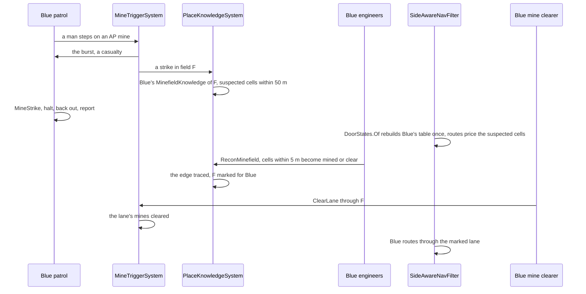
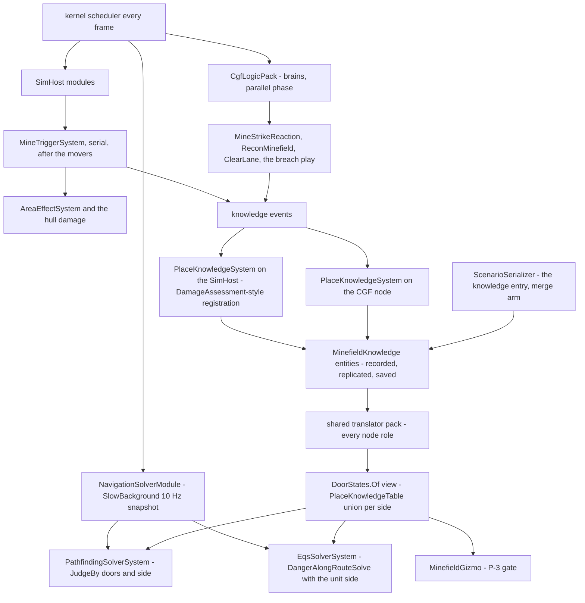
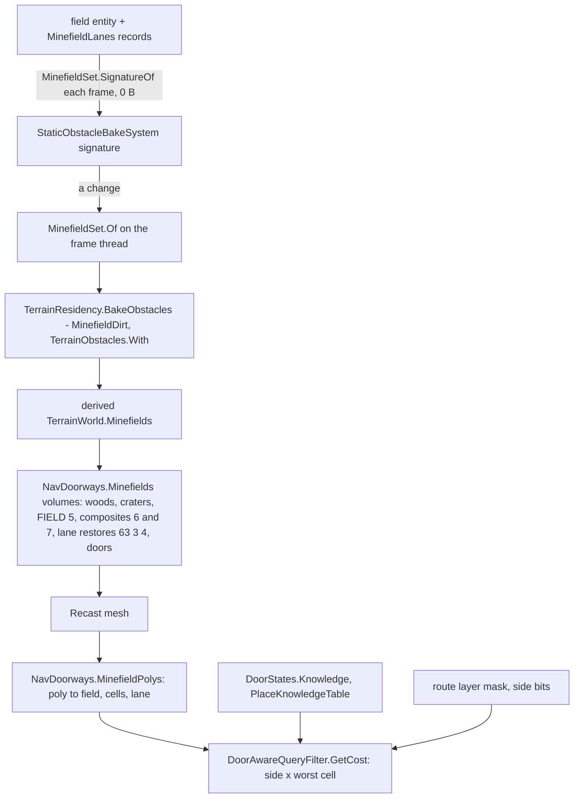
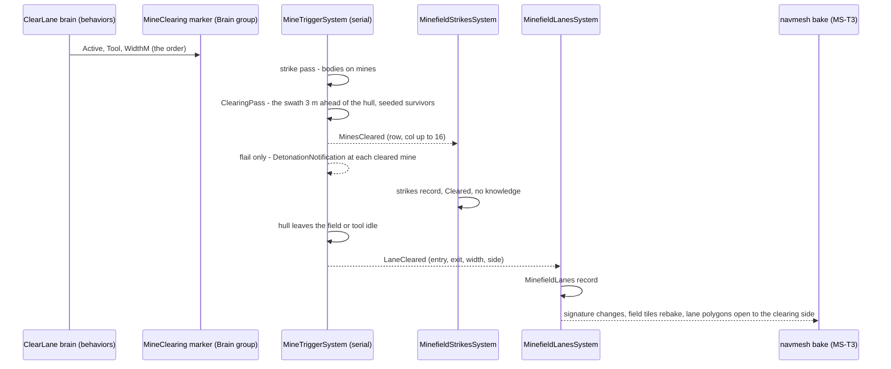

<!--STATUS
state: LIVE
updated: 2026-11-17
build-state: READY-TO-BUILD (R-4270…R-4274; reviews §8 and §10 approved and folded) — dispatched 2026-11-16 to terrain, behaviors, ui (§4)
current-answer: §3 decisions · §11 behaviors as built · §12 the approved deviations (R-4278) · §3a the fixed ids · §3b UML · §4 slices per lane · §6.1 the contract · §8 + §10 the reviews (approved) · §9 the generalization's reasoning
stale-below: nothing
known-rot: none
known-conflict: none
related-designs:
  - ../../reference/NED_DDS_Protocol.md — OWNS the wire as an outsider sees it: this design's messages and descriptors are listed there (kept current by scripts/protocol-doc-check.py)
  - ../../DESIGN_Ground_Patches_And_Road_Blockage.md — OWNS `GroundDamage` (a replicated record of what blasts did to the ground) and the navmesh areas (crater area) — the minefield's record and area follow both
  - ../../DESIGN_Vehicle_Breaching.md — OWNS the bulldozer's clear order (B-4, CE-4601) and the breach-record pattern the mine-clearing vehicle reuses
  - ../vehicle-tactics/DESIGN_Urban_Armour_Tactics.md — M1 plans a BOTTOM facing "for mines later" — an AT mine strikes it
  - ../../DESIGN_Terrain_Authoring.md — OWNS the scatter's deterministic placement inside a polygon (the pattern MF-2 follows)
  - ../../DESIGN_Civilians_And_Crowd_Control.md — OWNS charges and `TriggerIed` (an IED is a single, command-fired mine)
  - ../../DESIGN_Utility_AI_Demo_Scenarios.md — OWNS the danger-area sensor along a route (§10, R-213) that reports a Minefield area here (KG-7, KG-9)
  - ../../blueprints/Architect_Question_101_Shelling_Fear_And_Shelled_Areas.md — OWNS the shelled area (cross or hold, never avoided) — kept apart from PlaceKnowledge (KG-8)
  - ../../PLAN_Training_And_Gameplay_Engine.md — P-3 OWNS side knowledge of ENTITIES on the 2-D map; PlaceKnowledge is the PLACE half and shares its display filter
-->

# DESIGN — minefields: laid, struck, avoided, breached

🔒 User, `2026-11-16`: *"mines and mine fields and behaviors regarding to them. Mine field is a zone, and the mines have some density inside and must
be deterministically and equidistantly placed. And when someone or something steps on the mine and explodes, this is an indication that that area is
actually dangerous and that the units needs to avoid it. And there needs to be some kind of mine removal vehicle … and an action to clear a passage
through a minefield, which will basically cut the zone into parts."*

## 1. INVENTORY *(measured `2026-11-16`; graph: `search_graph name_pattern=".*(Mine|Minefield|DangerArea|Hazard|Avoid|Clearance|Lane|Breach).*" label=Class` ⇒ the danger-area family, `BreachDoor*`, `HullClearance` — no mine class; `docs/` + `.dev/` searched (minefield / landmine / mine clearing): only `CAPABILITIES.md:442` "Minefields … ⏳" and Urban Armour M1's "Bottom for mines later"; index coverage could not be checked through the CLI)*

| exists | where | used as |
|---|---|---|
| ⭐ **"a blast here ⇒ this area is dangerous"**: `ShelledAreaSystem` notes every burst, merges them, marks a SHELLED danger area units avoid, forgets it later | `ShelledAreas.cs:23, :132` (CE-4583), `DangerAreaKind.Shelled` | ⭐ MF-6's exact precedent — a mine strike is a danger area of kind Minefield |
| the danger-area family: a sensor, kinds (crossings, open ground, gas, shelled), replicated results, the crossing manoeuvre | `DangerAreaSettings.cs:28-40`, `DangerAreaSensorSystem`, `DangerAreaCrossingManeuver` | units sense and avoid / cross danger areas |
| navmesh AREAS priced per mover (door 2, woods 3, crater 4), a per-mover filter | `NavDoorways.cs:19-68`, `NavLayerSelection.cs:20` | MF-7: a minefield area; ⚠ a filter PER SIDE is not measured to exist |
| a replicated, recorded damage record per node (`GroundDamage` craters, `BuildingDamage` breaches) | Ground Patches P-4, Breaching B-2 | MF-3: the record of struck and cleared mines |
| deterministic placement inside a polygon from a seed (the scatter) | Terrain Authoring §18g, `FeatureKinds.cs:216` | MF-2's pattern |
| charges, a burst's area effect, the vehicle damage parts (mobility kill) | `Charges.cs`, `AreaEffectSystem`, Body Parts | the detonation |
| ⛔ an armour BOTTOM facing (planned in Urban Armour M1) | `ArmorModel` | MF-4 needs it for an AT mine |
| the bulldozer's clear order (cut a wall / fell a tree at a point) | B-4, CE-4601 | MF-9's pattern for clearing a lane |
| ⛔ a mine, a minefield, a mine-clearing vehicle, a per-side known-area filter | — | built here |

## 2. The proven pattern *(engineer doctrine and constructive simulations — each piece adopted for a reason, §3)*

| piece | practice | why it fits |
|---|---|---|
| a minefield laid in **ROWS at fixed spacing, staggered** (a standard pattern), density = mines per metre of front | doctrine (row mining, the "standard pattern") | deterministic and equidistant by construction — the user's requirement |
| two families: **anti-personnel** (pressure, a few kg) and **anti-tank** (a vehicle's weight, attacks the BELLY / tracks) | doctrine | different triggers, different victims |
| a field is DISCOVERED by a strike, by seeing marking, or by reconnaissance; until then it is invisible | doctrine | knowledge is PER SIDE |
| on a strike: **halt, do not move, back out on your own tracks**, call engineers | battle drill | the victim's reaction |
| **breaching**: a mine plough or flail vehicle clears a LANE (~4–5 m wide) at walking pace; a line charge (MICLIC) clears ~100 m × 8 m at once; infantry prodding is slow | doctrine | the user's clearing action; the lane is then MARKED |
| one minefield = ONE object in constructive simulations; mines are its derived points | JCATS / OneSAF practice | thousands of mines must not be thousands of entities |

## 3. Decisions *(✅ MF-1…MF-12 APPROVED `2026-11-16`, R-4270 — 🔒 user: *"minefields approved, one field with lanes cut out"*; ✅ MF-13…MF-16 APPROVED, R-4271 — 🔒 user: *"Minefields approved. Please record design and run the review."*)*

| # | question | ⭐ lean | why · blast radius |
|---|---|---|---|
| **MF-1** | what is a minefield? | ⭐ ONE entity: a closed polyline, a mine TYPE (AP / AT / mixed), a SPACING (or density), a ROW ORIENTATION, a seed, and per side whether it is KNOWN at start (own fields are known and marked; enemy fields usually not) | thousands of mines cost one entity; saved, replicated, recorded once |
| **MF-2** | how are mines placed? | ⭐ DERIVED, never stored one by one: rows at the spacing along the orientation, each row offset by half a spacing (staggered), clipped to the polygon — ✏ CE-4655 `2026-11-18`: ⭐ **and kept `max(spacing/2, 1 m)` INSIDE the outline** (`MinePattern.Laid`, the ONE test the pattern, the trigger and the clearing pass share; a laid field's mines keep off its marked edge). 📐 Before, clipped to the outline itself: a squad skirting a struck field along its edge (the route the ×20 / ×200 pricing gives) walked onto the edge mines (user observation). ⚠ The route itself still hugs the outline — the inset is what makes that safe; a clearance band in the pricing was not needed for it — the SAME points on every node from the field's parameters (a seed only for an optional small jitter, 0 by default) | 🔒 user: *"deterministically and equidistantly placed"* |
| **MF-3** | struck and cleared mines | ⭐ a replicated, recorded per-field RECORD of the mine indices that went off or were cleared (a bitset, the `GroundDamage` / breach-record pattern) — a struck mine never goes off twice | every node agrees; replay restores it |
| **MF-4** | the trigger | ⭐ one serial system: for each mover INSIDE a field's bounds, the derived mines under its footprint (a per-field point grid built once); AP ⇒ any person or vehicle; AT ⇒ a vehicle over a weight only (a man walks over it). The burst: AP = a small area effect at the foot; AT = under the hull — the BOTTOM facing (Urban Armour M1, built here), a track / wheel ⇒ mobility kill | the user's *"steps on the mine and explodes"*; cheap (only movers inside a field) |
| **MF-5** | the victim's reaction | ⭐ a reaction **MineStrike**: halt, do not move, the casualty cared for in place, back out along the unit's OWN recent track; report a SPOT of the field to the chain (the existing report path) | the battle drill; the conduct gate (R-4263) keeps a "Dash" from overriding it? — no: a struck unit HALTS (a mine is not fire) |
| **MF-6** | ⭐ "this area is dangerous" | ⭐ a danger area of a new kind **Minefield**, made by a strike exactly as `ShelledAreaSystem` makes a shelled one: a circle round the blast that GROWS with further strikes (merged); known to the VICTIM'S SIDE (its own units and the reported chain); never forgotten (unlike shelling) | reuses the precedent; knowledge is per side |
| **MF-7** | avoiding it | ⭐ units route AROUND known minefield area: a navmesh area **Minefield** stamped for every field, priced per mover by its side's KNOWLEDGE (unknown ⇒ walks in; known ⇒ closed, or a high cost when the order says so) — ⚠ needs a per-SIDE filter: measure `NavLayerSelection` first | the user's *"units need to avoid it"* |
| **MF-8** | a known field and marking | the known extent is what the side has learned (the grown circles, a reconnaissance report, or the whole polygon when marked); a MARKED field (own, or an enemy field found and marked) is known in full | the doctrine's marking |
| **MF-9** | ⭐ the mine-clearing vehicle | ⭐ a new type — an engineering tank with a **mine plough / flail** (and, as a second option, a **line charge**) and an order **ClearLane { start, end, width ~4.5 m }** (the bulldozer's clear-order pattern, B-4): it drives the lane at ~1–2 m/s; the mines in its swept width DETONATE harmlessly (flail) or are turned aside (plough) and are recorded CLEARED (MF-3); the line charge clears ~100 × 8 m at once | 🔒 user: *"some kind of mine removal vehicle … an action to clear a passage"* |
| **MF-10** | ⭐ "cutting the zone into parts" | ⭐ a cleared LANE is a corridor polyline + width SUBTRACTED from the field: the field stays ONE entity with its list of lanes; its mines inside a lane are cleared, the navmesh area is re-stamped without the lane (a passage), the lane is MARKED and known to the clearing side | the user's intent ("parts") without splitting the entity — its identity, record and replay stay one; ⚠ if the user wants literally separate fields, a split is possible but loses the one record |
| **MF-11** | the breach behaviour | the company's breach play (clear the lane under cover — suppression on the far side, smoke, then the lane) and units crossing in single file through the marked lane | the assault design's breach, applied |
| **MF-13** | ⭐ **how does the victim side LEARN the field?** (🔒 user: *"if the single explosion will reveal the whole minefield somehow magically as a simplification, or if the danger area is just around the single exploded mine And the victim side needs to send scouts/engineers … in some simplified way"*) | ⭐ **neither magic nor a dead end — a per-side KNOWLEDGE GRID over each field, filled in three ways**: ① a STRIKE marks the cells within a CONSERVATIVE radius (~50 m) around the blast as **SUSPECTED** — the side avoids them at once (doctrine: a unit that hits a mine assumes it is IN a minefield); ② an **ENGINEER or SCOUT** team on a `ReconMinefield { suspected area }` task walks at detector pace (~0.5 m/s) and, within its detection radius (~5 m), turns cells into **KNOWN-MINED** (the field covers them) or **KNOWN-CLEAR** (it does not) — following the boundary it finds (a deterministic edge-trace on the grid), so the field's extent appears as it walks; ③ when the trace closes (or the team is ordered to **MARK** it), the field becomes **MARKED** — known in full to that side and drawn as the marked minefield. Further strikes add suspected circles; a recon DRONE may reveal a SURFACE-laid field from the air later (an option, not now) | realistic doctrine (minefield reconnaissance and marking) made SIMPLE: one grid per field per side (a few hundred bytes, 10 m cells), no per-mine detection; navigation avoids suspected + known-mined cells; the knowledge is replicated to the side's nodes |
| **MF-14** | ⭐ **where the knowledge LIVES, how it is recorded and saved** (🔒 user: *"Where would the mine knowledge grid be stored? Is that part of some world singleton … How would it be stored, recorded to the scenario? Because it has to be"*) | ⭐ **NOT a world singleton** — 📐 the shelled area IS node-level (`ShelledAreas.cs:9-16`: "no component id: a restore forgets"), which is right for shelling and WRONG here (knowledge must survive a restore, a replay and a save). ⭐ It follows the **runtime damage-record pattern** the engine already uses for craters, felled trees and breaches (`CellRecordSystem.cs:17-23`, `TreeDamage.cs:21`, `BuildingDamage`): ONE small **record entity per (field, side)** carrying an unmanaged **`MinefieldKnowledge`** component — the field's link, the side, the cell size, the grid at 2 bits per cell (unknown · suspected · known-mined · known-clear) and a **Marked** flag — owned by the node that decides (where the strike or the recon happens), **recorded** (keyframes, seek, replay), **replicated** to every node, and **SAVED** into the scenario through a section keyed by the field's stable id + side, the way `TerrainObjectsSection` saves the breaches (`TerrainObjectsSection.cs:8-20`; the record entity itself transient, rebuilt at load). ⭐ Size: ≤ 1024 B per component (the engine's cap) ⇒ up to 4096 cells — a field up to ~640 × 640 m at 10 m cells; a larger field coarsens its cells (≤ 64 × 64) — fields are rarely larger | one proven pattern, nothing new; runtime knowledge is recorded and saved like runtime damage |
| **MF-15** | ⭐ **OWN minefields** (🔒 user: *"Own minefields should be also avoided by everyone who knows"*) | the field's per-side **known-at-start** flags (MF-1) create that side's record already **Marked** (known in full) — no grid needed until something changes; every unit of a side that knows a field avoids it exactly as an enemy field it has learned: **knowledge is per SIDE, not per field owner** (a field laid by Blue is known to Blue, and to Red only by what Red learns). ⭐ Knowledge is SHARED by the whole side (its common picture — reports travel the chain at once, a simplification) | one rule for own and enemy fields |
| **MF-16** | ⭐ **MANY minefields** (🔒 user: *"what if there are multiple minefield entities? How the knowledge grid will be structured to cover that?"*) | ⭐ there is NO global grid: each field has its OWN records, one per side that knows anything about it (absent ⇒ that side knows nothing). Fields are independent — a strike near two fields marks suspected cells in each field's own grid; a recon team traces whichever field it is on. Avoidance asks every field: a route for a unit of side S is priced through a side-aware navmesh **query filter** (📐 the engine already has a custom filter — `DoorAwareQueryFilter`, `NavDoorways.cs:194` — that is the seam) over the minefield navmesh area: a polygon of field F is closed / costly for S where S's record of F says suspected or known-mined, open otherwise (an unknown field is walked into); the march's danger-area sensor shows known fields ahead per side | per-field state scales with the number of fields; the route filter is the one place sides differ |
| **MF-17** | ⭐ **the knowledge is GENERIC — knowledge of a PLACE per side** (🔒 user: *"maybe this is something which is more generic, the knowledge about some part of the world"*) | ⭐ ✅ R-4273 — §9 KG-1…KG-9 folded: ONE record `PlaceKnowledge` (subject, side, kind, chunk; a common header + a kind-owned payload), ONE writer (events → the serial `PlaceKnowledgeSystem`, the kind's lattice max), ONE set of sharing rules, ONE display filter and ONE `Knows(side, subject, kind)`; the planner's ONE per-side area-cost table, VERSIONED (rebuilt only when a record changes, the `DoorStates.Of` precedent); avoid (planner) vs cross-with-care (danger sensor) kept distinct; only the Minefield kind is built | entity knowledge (contacts, last-known markers) stays out; shelled / gas may later price the same table |
| **MF-12** | authoring and drawing | a Minefield tool (a closed polyline, type, spacing, orientation, seed, known-to sides); drawn as the tactical graphic (a hatched area, mine symbols) ONLY where the viewer's side knows it; the instructor sees all; lanes drawn as marked corridors; individual mines invisible except to the instructor | the user's map; per-side display |

## 3a. The fixed ids — for EVERY lane *(measured free on `coordinator`, `backend`, `ui`, `behaviors`, `terrain`, `2026-11-16`)*

| what | the value | note |
|---|---|---|
| the minefield entity | TKB **8830** `Minefield`, DIS **5 · 0 · 0 · 91** (cultural feature, HROT — beside the scenario macro's `5.0.*.90`), class **`"Minefield"`** = `5.0.*.91` | the authored field (polygon, type, spacing, orientation, seed, known-at-start per side, its lanes) |
| the knowledge record | TKB **7206** `MinefieldKnowledgeRecord` (the record block 7201–7205: ground / tree damage …) | ⭐ MF-17 + KR-7: the minefield KIND of place knowledge (`PlaceKnowledgeKind.Minefield = 1`, 0 = none); one entity per (field, side, chunk, deciding node); transient, saved in the scenario's `knowledge` entry (KR-15) |
| the mines (rounds) | munitions **6051** `TkbMineAntiPersonnel` · **6052** `TkbMineAntiTank` · **6053** `TkbLineCharge` | 6047–6049 smoke, 6050 the radar SAM |
| the mine-clearing vehicle | TKB **116** `Engineer_MineClearer`, DIS **1 · 1 · \* · 9 · 2** (large tracked utility, beside the bulldozer `1.1.*.9.1`), class **`"MineClearer"`** = `1.1.*.9.2` | plough / flail + a line charge mount |
| the navmesh area | **`MinefieldArea = 5`** (door 2, woods 3, crater 4) | per-mover, priced per side by the query filter (MF-16) |
| the danger kind | **`DangerAreaKind.Minefield = 8`** | ⚠ the kinds' bitmask is a SIGNED byte with every bit used (`Shelled` already sits on bit 0) — the review decides how to widen it |
| the components *(✅ R-4274, KR-1…KR-7)* | **`Minefield`** (on 8830: type, spacing, orientation, seed, known-at-start side mask, the lanes — the OUTLINE is the field's ONE `EditablePolyline`, MR-8) · **`MinefieldStrikes`** (per FIELD, ground truth: struck / cleared mines as a list of lattice (row, col), chunked — MR-1, KR-3) · **`MinefieldKnowledge`** (on 7206: the shared **`PlaceKnowledgeHeader`** + the 2-bit grid ≤ **60 × 64**, size asserted by a rail — KR-2, KR-7) — unmanaged, recorded, replicated through the SHARED translator pack (every node role, KG-9); ⭐ the ENGINE lane (terrain) allocates the component ids and DDS ordinals FIRST and publishes them in a NOTE (§6.1) | `PlaceKnowledgeHeader` = subject (`SubjectKind` byte: 1 entity, 2 terrain object · a 16-byte `EntityGuid` or a terrain-object index), side + 1 (0 = none, KR-13), kind, chunk, state, source, `Marked`, `LearnedAt` (`SimInstant`) |
| the side in a route *(KR-9, KR-13, MR-4)* | `RouteQuery.Side` and the path request's pad byte = **ForceId + 1** (0 = no knowledge applied) | the solver AND the danger solve read the carrier's replicated `ForceId` |

## 3b. UML

*What it shows that prose hid: the field's mines are never stored — they are DERIVED; the only runtime state is two records (what went off, what
each side knows), both following the damage-record pattern. ⭐ The knowledge record is GENERIC (`PlaceKnowledge`, MF-17): the minefield is only
its first kind (KR-7: a shared HEADER, a shared writer core and a shared union table; each kind its own small component). Struck mines are
ground truth per FIELD, never per side (KR-3). The side table rides on `DoorStates` like the craters, so every route / sight caller gets it with
no new parameter and 0 B on a steady frame (KR-8).*

*What it shows: knowledge grows in three steps — a strike, a recon, a mark — and every step is a write to ONE record that is recorded, replicated
and saved; the lane then opens a passage for that side only.*

*What it shows: the trigger runs where the movers move, the decisions where the brains run; BOTH nodes write their own knowledge entities and every
reader takes the union (KR-5); the navigation solver and the danger solve run on the 10 Hz snapshot and read the same `DoorStates` view table — no
node writes another node's entity.*

### 3c. As built — MS-T1 trigger *(`2026-11-16`, terrain, CE-4624)*

| piece | as built | decision · what would change it |
|---|---|---|
| `MineTriggerSystem` (`FDP/Toolkits/Fdp.Toolkits/Terrain/Minefields/`) | one serial system, registered in `SimHostCoreLogicPack` AFTER the ground kinematics' simulation systems (the movers moved), never in a replay; 0 B a steady frame (R-2084), rail-proved | placed in the pack, not `DamageAssessmentModule` (the movers' systems are listed after that module's); a CGF-hosted mover would need the same registration |
| bodies | `SimTransform` + `PhysicsCollider` + a GROUND locomotion (pedestrian · wheeled · tracked · amphibious · quadruped); never a bird / flock (locomotion AND `AnimalState.Species`), an embarked passenger, a static obstacle, a body another node owns (`Embarkation.OwnsPosition`) | |
| the test (MR-14) | the SEGMENT from the body's last position (a per-body field; a step over 60 m is a teleport ⇒ a point) to this one; candidates by LATTICE ARITHMETIC in the field frame (per row crossed, the column range) — never a scan of the mines; the mine's point from `MinePattern.At` (jitter included), `Inside` the outline, not `InLane` | ⭐ NO per-field mine list is cached: a mine's existence is exactly `Inside && !InLane` at its lattice point, so the cache holds only the outline, bounds and parameters (rebuilt when they change) — cheaper than the listed `MinesIn` lookup and identical in answer; revisit only if a field's outline becomes huge |
| AP / AT | AP: a person's foot within `FootRadius` 0.4 m of the segment; a vehicle's footprint (`EntityFootprint.Dimensions`, turned by its heading, swept along the step) covering the mine (MF-4: any person or vehicle). AT: a vehicle whose footprint covers it AND mass ≥ 1500 kg (read once through the TKB `VehicleParametersDto.Mass`, as `ContactBreach` does); a man walks over it; livestock: AP yes, AT with a hash chance 5 % per (mine, animal) (MR-16) | 1500 kg and 5 % are starter values (the user's call on animals, R-4272); a vehicle setting off AP is the approved MF-4 lean |
| once per mine | a per-frame fired set, a pending set (struck, its record not yet landed; 20 sim s) and a memo of mines found in a strikes record (`MinefieldStrikesSystem.IsGone`, cold) | the pending window is the record's latency across nodes; a record that never lands lets the mine fire again after 20 s |
| the burst (MR-17) | `MineStruck { Field, Row, Col, By, X, Y, At }` AND a `DetonationNotification` at the mine: Ammo 6051 (AP: no target, the area effect at the foot) / 6052 (AT: Target = the vehicle, the round travelling UP so the armour model reads the BOTTOM; Penetration 120 mm / Damage 250 from the munition's TKB entry); effects, sound, hearing and craters follow from that path | `ammo.json` gains "anti-personnel mine" (frag 0.1 kg), "anti-tank mine" (HE 7.5 kg), "line charge" (HE 60 kg per ~8 m detonation, MS-T4): starter blasts |
| ✏ CE-2446 `2026-11-18` the burst's DAMAGE | each mine munition's own `WarheadDto` (6051 / 6052 / 6053, `MunitionTkbCatalog`) states its blast radii AND `BlastLethalDamage` = the reference library's one blast value (`ReferenceLibrary.BlastLethalDamage`, `coefficients.json` `blast.lethalDamage` 150); ⛔ no `ExplosiveKg` (that would add craters, breaches and felled trees — the line charge's lane must stay drivable) | 📐 the warheads of `0573b3a82` had radii and 0 damage ⇒ an AP mine under a man hurt nobody (`mf-strike-and-halt`); rail `MineClearerTkbTests.AnAntiTankMine_*` (≥ 100 at 0.3 m) |
| MR-10 the armour BOTTOM | `Facing.Bottom` (4); `ArmorModel.FacingOfArrival` returns it for a round travelling UP ≥ 45° (so the area-effect path's burst under a hull reads it too); `CombatPlatformDefDto.ArmorBottom` / `ArmorBottomCe` (0 ⇒ the rear / the belly's kinetic value), `SimCombatDef.ArmorBottom`; zones carry five faces (`Armour[4]`, 0 ⇒ the zone's rear; `bottom` in `bodies.json`, `ArmourBottom` in `BodyZonesDto`); `BodyPartHit.FaceOf` (a normal pointing DOWN) and `ArcFaceOf` (travelling UP) return it | ⚠ a steep round FROM BELOW at any target (an AA gun at close range) now reads the belly — the rear value by default, so only a platform that states `ArmorBottom` changes; `ThreatDanger`'s thinnest face keeps its four faces (nothing aims at a belly) |
| registration | components `Minefield` / `MinefieldStrikes` / `MinefieldKnowledge` and the four events in `HrotSharedComponentRegistry`; TKB 8830 "Minefield" (DIS 5.0.0.91, a map graphic like a terrain feature) in `NedTkbCatalog`; bare record types 7206 / 7207 in `MinefieldRecordTkb` (beside `GroundDamageTkb`, called from `HrotEnvironment`); munitions 6051–6053 in `MunitionTkbCatalog` | the `Minefield` component is added when a field is placed / loaded (no translator DTO yet: the authoring tool, MS-U, adds it) |

*Rails (`MineTriggerTests`, `ArmorModelTests`, `DamageCalculationSystemTests`, `BodyPartDamageTests`): a man on AP ⇒ one strike and one burst at the mine; a man over AT ⇒ nothing; a tank over AT ⇒ strike, burst on its BOTTOM, a light car nothing; a fast step across a mine ⇒ fires (a point test would not); birds never, livestock AP; livestock AT rarely and the same every run; once per mine; a body another node owns ⇒ nothing; a turned jittered field; 0 B steady frames.*

### 3d. As built — MS-T2 save *(`2026-11-16`, terrain, CE-4624, KR-15)*

| piece | as built | decision · what would change it |
|---|---|---|
| the section | a top-level scenario section **`Knowledge`** (`PlaceKnowledgeSection`, `FDP/Toolkits/Fdp.Toolkits/Terrain/Minefields/PlaceKnowledgeSection.cs`), NOT `TerrainObjects` (a field is an entity, KR-15): `"<guid>\|<side+1>\|<kind>\|<chunk>": { "cells": [[row, col, level], …], "marked", "learnedAt", "source" }` · `"<guid>\|strikes": { "mines": [[row, col, how]] }` · `"<guid>\|lanes": { "lanes": [[ax, ay, bx, by, width, side+1]] }` | ⭐ only the non-unknown cells are written (a 60 × 64 grid is 1 KB, a typical field a few cells); strikes and lanes of ALL chunks of a field are ONE entry (the chunking is a record limit, not a file shape); a future kind or a missing record is ignored / absent |
| save | `ScenarioSerializer` writes it beside `TerrainObjects`: every knowledge / strikes / lanes record this host OWNS (the record writer's own `OwnsRecord` gate — a distributed save writes each entity once), merged per key | known-at-start is not a record (R-5046) so it is not saved: the field's own `KnownAtStartSides` is |
| merge | `ScenarioMergeCore` merges two slices carrying one key by the kind's policy (`PlaceKnowledgeSection.MergeInto`: lattice max per cell, `Marked` OR, `LearnedAt` max; strikes — union, `cleared` outranks `struck`; lanes — union by endpoints) and **never throws on a duplicate key** (two deciding nodes writing one (field, side) is the normal case, MR-2); the merged section is written in the single-node save's key order | KR-4: a future non-monotone kind (a bridge) adds a `case` to `MergeInto` (newest `LearnedAt` wins) |
| load | `ScenarioLoadStep` reads it on `Prepare` (a malformed entry refuses the load on every node, naming its key) and, on `Commit`, publishes one transient untargeted creation request per saved record (`TerrainObjectRequests.ForPlaceKnowledge`: TKB 7206 / 7207 / 7208; strikes re-chunked by 96, lanes by 8) — the loading node owns them, as the craters; a family that already has an entity is not loaded twice | a record the loader owns stays the loader's (a muscle's NEW strike opens its own record beside it — the same rule as the breaches, R-4196) |
| recorded | the three records are unmanaged: a keyframe restored over a live world serves the keyframe's knowledge, strikes and lanes (the `BuildingBreachTests` seek precedent) | — |

*Rails (`MinefieldSaveTests` 11 in `Fdp.Toolkits.Tests`, `TerrainObjectRequestsTests.CE4624_SavedPlaceKnowledge_…` in `Hrot.Core.Tests`): the round trip through TEXT (owned only, blanks and replicas absent), the two-slice merge in both orders (no throw), seven malformed entries, a future kind ignored, a seek B → A → B, the load requests and the re-commit guard.*

### 3e. As built — MS-T3 navmesh stamping + pricing *(`2026-11-16`, terrain, CE-4624, MR-3, MR-4, MR-20, KR-10, KR-14)*

*What it shows that prose hid: the field reaches the navmesh by the SAME frame-thread gather as the obstacles (no query ever sees a live entity); what the SIDE knows is read at QUERY time from the view's table, never baked — so a strike, a recon sweep or a seek changes a route with no rebake; only the GEOMETRY (an outline edit, a lane added or lost) rebakes tiles.*

| piece | as built | decision · what would change it |
|---|---|---|
| the data | `MinefieldSet` (`Terrain/Minefields/MinefieldSet.cs`): per field its guid, parameters, world outline and lanes (authored + every node's `MinefieldLanes` record, side + 1); `TerrainWorld.Minefields` on the derived world; `TerrainObstacles.With(…, MinefieldSet?)` | gathered only on a node that does world queries (`TerrainResidency.BakesDamage`, the building damage's rule): a display node's terrain is never queried |
| bake signature, dirty region | `MinefieldSet.SignatureOf(world)` (cached queries, index loops — 0 B) joins `StaticObstacleBakeSystem`'s input hash; `TerrainResidency.MinefieldDirt` adds the box (±3 m) of every field new, gone or changed (old and new place, by `TerrainMinefield.Hash`): only those tiles rebake | a lane record gone in a seek changes the hash ⇒ the same rebake |
| ✏ CE-4655 `2026-11-18` the CLEARANCE RING | ⭐ a field's navmesh area reaches `MinePattern.RouteClearance` = max(spacing, 5 m) OUTSIDE its outline: `NavDoorways.AddClearanceRing` adds per edge the outward band and per vertex the corner parallelogram to the field's pieces (so the wood / crater composites and the lane restores apply to it too); a lane's strip runs on through it (`LaneStrip(lane, clearance)`, `LaneAt(…, extend)`); a ring polygon takes the knowledge of the nearest edge cells (`CellsOf` clamps); the field hash and the dirty box include the clearance | 📐 behaviors' measurement (`NOTE_Behaviors_To_Terrain_NoWayRound_EdgeClearance.md`): the route round a known field hugged the outline (y 110.1 vs 110) and the squad trailed inside it. With the mines' edge inset (MF-2) a man ON the edge is safe; the ring keeps the route off it. Rail `MinefieldNavTests.CE4655_ARouteRoundAKnownField_KeepsItsClearance`. What would change it: a doctrine distance per field (an authored clearance) |
| composite areas | `MinefieldArea 5` (plain), **`MinefieldWoodsArea 6`**, **`MinefieldCraterArea 7`** (ids 6 and 7 measured free: only 2, 3, 4, 5 and Recast's 63 are used). ⚠ A Recast area is per SPAN and a later stamp wins, so a composite needs the underlying area known at stamp time: **cut by geometry** — the field's ear-clipped triangles clipped against each wood triangle / crater (and ditch) piece (convex ∩ convex, `NavDoorways.Clip`) | a masked `RcAreaModification` cannot do it (ground is 63, all bits set); a per-span "if area == X" stamp does not exist in DotRecast. Cost: field triangles × wood triangles at bake time, bbox-rejected |
| stamp order | woods · craters + ditches · **field 5 · composites 6 (wood), 7 (crater, wins over wood) · lane restores (63, then 3, 4)** · doorways | a crater wins over a wood as the plain stamps do |
| every area test | `NavDoorways.IsWoods / IsCrater / IsMinefield`; `PassFilter` (wheels out of a wood and of a mined wood; every vehicle out of a crater and a mined crater) and `GetCost` (the wood factor) use them | a new area that is "a kind of X" must add itself there, one place |
| a lane | a STRIP (segment ± width / 2) ∩ the field's triangles stamped as the underlying area again: a passage in the mesh whose polygons the filter can tell apart | who may USE it is the filter's job (below), never the mesh |
| polygon → map | `NavDoorways.MinefieldPolys` after the bake (the `DoorPolys` precedent): every polygon with a minefield area, or in a lane strip of the field it is inside → `MinePoly { Field, Lane, Cells }`; the cells (row × 60 + col, KR-14) are those holding a vertex, an edge midpoint or the centre, plus every cell whose centre is inside; `DoorAwareQueryFilter` carries the map | a polygon on the outline whose centre is just outside takes the field whose box (+2 m) holds it |
| pricing | `MinefieldPolyMap.FactorFor(poly, DoorStates.Knowledge, side + 1)`: the WORST cell — known-mined ×**200** (`KnownMinedCost`), suspected ×**20** (`SuspectedCost`), unknown / known-clear ×1; a lane polygon ×1 to the side that cleared it and the sides its known-to mask names, the field's price to the rest; side 0 (no side in the mask) and a query without the view's `DoorStates` apply no knowledge; **never closed** (KR-10): a route goes round when it can and through when it must, and the danger sensor then reports the area | 200 / 20 are tuning values: with them a 30 m crossing (+570 m suspected, +5 970 m mined) is cheaper than a ~1 km detour when suspected and dearer when known-mined. `PlaceKnowledgeTable.Knows(side, Guid field, col, row)` was added beside the entity overload (the map holds guids) |

*Rails (`MinefieldNavTests` 9 in `Fdp.Toolkits.Tests`; `MinefieldBakeTests` 2 in `Hrot.SimHost.Tests`): the stamping and the lane polygons, a field over a wood keeps wheels out, the crater composite and the stamp order, a side that knows it goes round / one that does not walks through, known-mined dearer than suspected dearer than unknown, a lane opens the field to its clearing side only, 0 B per priced query, the filter arithmetic and every area test on a composite; the bake: a field's dirty rectangle, a lane record rebakes, a seek back restores the detour, a display node bakes none.*

### 3f. As built — MS-T4 the muscle *(`2026-11-16`, terrain, CE-4624, MR-11, MR-15, MR-17, MF-9)*

*What it shows: the brain only switches its tool (the bulldozer's `BladeCut` pattern); every write to another entity's state is an event the serial writers apply (R-4212); the lane is a record, so the navmesh opens it by the MS-T3 path with no new seam.*

| piece | as built | decision · what would change it |
|---|---|---|
| where | `MineTriggerSystem.ClearingPass`, AFTER the strike pass of the same `Execute` (the movers moved, the strikes decided); a body with `MineClearing` + `SimTransform` this node owns the position of (`Embarkation.OwnsPosition`); never in a replay | the trigger's own field cache (outline, bounds, parameters) is reused — no second per-field cache |
| the swath (plough, flail) | every live mine within `WidthM / 2` of the segment last position → current position **extended half the hull's length + `ClearAheadMetres` (3 m) ahead**, i.e. 3 m beyond the hull's FRONT, in the field the hull is inside OR the tool already reaches; candidates by the trigger's lattice arithmetic; not in an authored lane; each mine rolled ONCE per pass by `Survives` (a hash of the field's seed, id, row, col): plough `PloughSurvival` 5 %, flail `FlailSurvival` 2 % — a survivor survives every pass and every run, and what is under the hull then strikes it (the trigger) | ⭐ the lookahead is what keeps mines OUT from under the hull and a flail's bursts off it (rail: no strike but a survivor's). 📌 First built as 3 m from the hull's CENTRE: a 7 m hull covers mines 3.5 m ahead of its centre, so the first mine at the field's edge was struck before it was cleared (the red-proof of the plough's survival chance showed it). Starter chances. The survival hash uses the field's STABLE id — a test field must give it a fixed one |
| the flail's bursts | each cleared mine: a `DetonationNotification` at the mine with its own munition (AP 6051 / AT 6052), `Shooter` = the field, **`Target` = null — never the flail** (MR-17); the plough turns mines aside in silence (rail: bursts == strikes) | the area effect still reaches any `Health` entity near a burst (`AreaEffectSystem` has no "skip the shooter"); the 3 m offset and the vehicle's blast susceptibility are what keep the flail safe |
| the record | a cleared mine is a **`MinesCleared { Field, ≤ 16 × (Row, Col) }`** event (id **5109**, free on `coordinator`, `behaviors`, `ui`, `backend` by `git grep`, `2026-11-16`), registered in the shared registry; `MinefieldStrikesSystem` reads it as `MineGone.Cleared`: gone for every node and a fresh trigger, **no knowledge, no burst of its own** (`PlaceKnowledgeSystem` does not read it) | pending set (20 s) covers the record's latency, as for a strike |
| the lane | per clearer: the hull's entry point while it is inside a field; when the hull leaves, or the tool goes idle, **ONE `LaneCleared { Field, Lane = 255, SidePlus1 = ForceId + 1, A = entry, B = exit, Width = WidthM }`** (a run under `MinLaneMetres` 2 m is no lane) → `MinefieldLanesSystem` → the MS-T3 bake | a lane through TWO fields is two lanes (one per field) |
| the line charge | on the activation EDGE (`Active` 0 → 1, tool 3): `floor(len / 8)` bursts of munition 6053 at 8 m, 16 m … from the vehicle toward `LineTo` (≤ 100 m, `Target` null, `Shooter` the launcher), every mine within `WidthM / 2` (default 8 ⇒ 4 m) of the line cleared with **no survival roll**, one `LaneCleared` per field the line touches; staying active fires nothing more | the first burst is 8 m from the launcher: its blast susceptibility, not geometry, protects it |
| TKB 116 | `DefineMineClearer` in `NedTkbCatalog`: tracked, no weapon, 58 t (the dozer's 49), armour 70 / 50 / 50 / 40, health 1500, class **`MineClearer`** (DIS 1.1.*.9.2, `EntityClassTable`); the picker lists it | ⭐ it carries **no `MineClearing` at birth** — the brain adds it on its first `ClearLane` order, exactly as the dozer's brain adds `BladeCut` (the catalogue has no "initial component" seam; adding one would be a shared change). If behaviors want it pre-existing, the type needs that seam |
| catalogue | the three munitions got a relative cost (10 / 60 / 400) and the class table the `Minefield` class (5.0.*.91): two pre-existing reds of MS-T1 in `Hrot.Core.Tests` (`CE2186_EveryBuiltInMunition_HasACost…`, `CE2138_EveryBuiltInType_ResolvesToANamedClassPath`) | |

*Rails (`MineTriggerTests` 4 new, `PlaceKnowledgeTests.AMinesCleared_…`, `MineClearerTkbTests`): a flail leaves only seeded survivors, bursts at every cleared mine and never at the flail, one lane with the right segment / side / width, the same set on a second run, a man on a cleared mine ⇒ nothing; a plough clears silently; a line charge ⇒ 11 bursts 8 m apart, its whole strip cleared, on the edge only; 0 B steady frames with clearers; a `MinesCleared` is recorded as Cleared and teaches nobody; TKB 116 in the catalogue, heavier than the dozer.*

## 4. Slices — ✅ dispatched `2026-11-16` *(backend busy with the animals ⇒ the ENGINE work goes to `terrain`, which built the record family, the crater table on `DoorStates` and the navmesh areas)*

| lane | slices | needs first |
|---|---|---|
| ⭐ **terrain** (engine) | **MS-T1** the field entity + pattern + `MinefieldStrikes` + the trigger (segment test, every body but birds, livestock AT rarely) + the bursts (munitions 6051–6053) + the armour BOTTOM facing · **MS-T2** the place-knowledge core (header, `RecordWriterCore` extracted, `PlaceKnowledgeSystem` on both nodes, the union `PlaceKnowledgeTable` on `DoorStates`, save / merge arm, translators) · **MS-T3** routing: composite navmesh areas + polygon → field map, the side in `RouteQuery` and the path request, known-mined priced very high, suspected priced, road edges priced, the danger kind `Minefield` (kinds widened to `ushort`) from the side's knowledge, SUMO closure · **MS-T4** lanes and clearing: lanes as segments with `ClearedBy`, the serial swath clear for an active plough / flail (seeded survival, proofing), the line charge every ~8 m, the clearer type TKB 116 | ⭐ the ids NOTE (§6.1) published as its FIRST commit |
| **behaviors** | **MS-B1** `MineStrike` (Halts \| LeavesRoute, breadcrumbs back-out, care in place, report, the vehicle drill) · **MS-B2** `ReconMinefield` (left-hand trace on known-clear cells, detector pace, marking) · **MS-B3** `ClearLane` order + the breach play + crossing a lane single file · **MS-B4** the march asks for the `Minefield` danger kind; halt + call engineers | the terrain NOTE; until then stand-ins behind the names in §6.1 |
| **ui** | **MS-U1** the mockup (R-4143) ✅ [`minefields-visuals.svg`](minefields-visuals.svg) (generated by `scripts/gen-minefields-mockup.py`; the mines are MF-2's pattern) · **MS-U2** `MinefieldGizmo` (P-3 gate, the instructor sees all, mine dots from a per-field cache) · **MS-U3** authoring: the area tool's minefield arm (outline, type, spacing, orientation, known-at-start), *Add lane* / *Delete lane*, a struck field's shape refused · **MS-U4** the clearer's kit (TKB 116: plough / flail / line-charge launcher), icons, the flail loop sound and the burst effects | the terrain NOTE; until then stand-ins |
| *(backend)* | — nothing now | |

## 6.1 The contract every lane builds against *(fixed `2026-11-16`; terrain publishes the numeric component ids / DDS ordinals in `NOTE_Terrain_To_All_Minefield_Contract.md` as its FIRST commit)*

| name | shape | owner |
|---|---|---|
| `Minefield` | `MineType` (byte: 1 AP, 2 AT, 3 mixed) · `SpacingM` · `OrientationDeg` · `Seed` · `KnownAtStartSides` (ushort, bit = ForceId) · `AntiHandling` (byte) · lanes (≤ 8: start, end, width, `ClearedBy` side+1, `KnownToSides`) | terrain |
| `MinefieldStrikes` | field guid + chunk + ≤ N lattice (row, col, `How`: 1 struck, 2 cleared) | terrain |
| `MinefieldKnowledge` | `PlaceKnowledgeHeader` + 2-bit cells (0 unknown, 1 suspected, 2 known-clear, 3 known-mined) ≤ 60 × 64 | terrain |
| events | `MineStruck { field, row, col, by, at }` · `MinefieldCellsSwept { field, side, cells }` · `MinefieldMarked { field, side }` · `LaneCleared { field, lane }` — through the batch buffer | terrain declares, behaviors raises |
| reads | `PlaceKnowledgeTable.Of(view).Knows(side, field, row, col)` · `MinePattern.MinesIn(field)` · `MinefieldKnowledgeOps.CellOf(field, point)` | terrain |
| `DangerAreaKind.Minefield = 8` · `DangerAreaKinds` → `ushort` | the march asks for it | terrain + behaviors |
| conduct | `MineStrike` declares `Halts \| LeavesRoute` (R-4263) | behaviors |

## 8. ⛔ The review — `2026-11-16` *(three independent reviewers: doctrine + behaviour, engine fit, authoring / display / the clearer; ✔ = re-measured by the coordinator)* — ✅ APPROVED on every lean (R-4272, `2026-11-16`); livestock set off AT mines rarely; a struck field's shape is not editable

⭐ 32 raw findings merged into 20. NOT buildable as drawn until MR-1…MR-8 are ruled.

| # | sev | the defect | evidence | ⭐ lean |
|---|---|---|---|---|
| MR-1 | ⛔ BLOCKER | the knowledge record breaks the 1024 B cap (4096 cells × 2 bits = 1024 B before its header); a struck-mine BITSET of a large AP field is ~12 KB | `EntityCommandBuffer.cs:39, :87, :122` | the grid capped at 62 × 64 cells (or tiles); NO strike bitset — mines inside a LANE are cleared by geometry, STRUCK mines (sparse) are a capacity-N list of lattice (row, col) indices, more entities past capacity (the cell-record shape, keyed by field) — a lattice index survives a polygon edit |
| MR-2 | ⛔ BLOCKER | the record pattern is "one entity per key per DECIDING node": strikes decided on the SimHost, recon on the CGF ⇒ two entities per (field, side) and a save that throws on a key in two slices | `CellRecordSystem.cs:26-31, :65-96`, `ScenarioMergeCore.cs:183-207` | the union as a LATTICE MAX (unknown < suspected < known-clear < known-mined; Marked OR-ed), order-independent; a sibling of `CellRecordSystem` keyed by (field, side); save / load / merge arms; the saved key the field's stable scenario id |
| MR-3 | ⛔ BLOCKER | ONE navmesh area per span, "a later mark wins": a minefield area stamped over woods lets wheels into the wood, over craters lets vehicles through them — and area 5 cannot tell WHICH field | ✔ `RecastNavmeshFactory.cs:186-197`, `NavDoorways.cs:282-283` | COMPOSITE area ids (Minefield, Minefield + Woods, Minefield + Crater — 64 ids exist); a polygon → field map after the bake (the `DoorPolys` precedent); a lane as a later "open" volume; fields and lanes in the static-obstacle bake's signature (a 0.5–2 s rebake of touched tiles, never a live mesh write) |
| MR-4 | ⛔ BLOCKER | no path request knows the mover's SIDE; road legs bypass the navmesh filter | ✔ `PathfindingEvents.cs:30` (`_pad2`), `RoutePlanner.cs:113` | a side byte in the request (in the pad; a wire row); the solver keeps a per-side area-cost table, ⭐ VERSIONED — rebuilt only when that side's knowledge changes (KG-6, the `DoorStates.Of` precedent) — and re-points the filter; road edges priced by the same table |
| MR-5 | ⛔ BLOCKER | the MineStrike drill has no track to back out on (only a march lead's 80 m breadcrumbs), the medic carries the casualty back ACROSS the field, and the side's own filter traps the struck unit inside closed cells | `SquadManeuverRunner.cs:197-266`, ✔ `CasualtyCareBehavior.cs:39, :98` | a per-mover BREADCRUMB record kept only inside a field's bounds; backing out and the medic follow it (safe by construction: what was under it has gone off); care IN PLACE; a unit's own breadcrumbs are open to its filter |
| MR-6 | ⛔ BLOCKER | MF-5's "a mine is not fire, a Dash halts" cannot be built — the conduct gate refuses ANY forbidden conduct, the only escape is "cannot comply" | ✔ `BehaviorConduct.cs:89-97` | MineStrike declares Halts \| LeavesRoute honestly ⇒ a dismounted squad on a Dash presses on (realistic), a mobility-killed vehicle yields (CD-5); MF-5 rewritten |
| MR-7 | ⛔ BLOCKER | the recon trace is not specified (start, rule, ties, end), and the team would set off the mines it traces; 5 m detection on 10 m cells marks half-swept cells clear | — | the team walks ONLY on its known-clear cells or breadcrumbs; start at the cell nearest the strike, left-hand rule on the 4-neighbourhood, stop at the start or after N cells; a cell known only when FULLY swept; detector pace a tuning value (~0.1–0.3 m/s) |
| MR-8 | ⛔ BLOCKER | per-side DISPLAY is defeated: the area tool gives every area a style and the generic overlay draws it for every viewer; the outline is stored twice (unmanaged `Polygon` + the editable polyline) and an edit re-indexes struck mines | ✔ `MapOverlayGizmo.cs:11-16`, `AreaAuthoringArm.cs:193-199`, `EditablePolyline.cs:18-40` | the outline is the ONE `EditablePolyline`; `Minefield` holds only parameters; the field is born WITHOUT a visible overlay style and ONE `MinefieldGizmo` draws it, filtered by the viewer's side ✔ `StationMode.SideOf` (`StationMode.cs:59`; the instructor = every side); editing a struck field's shape is refused |
| MR-9 | SHOULD | the danger kind: the byte mask is full AND the danger solve has no side; MF-6's circles would be a SECOND store of the knowledge | `DangerAreaSettings.cs:28-58`, `ShelledAreas.cs:12-20` | the kinds widened to `ushort` (bit-0 hack dropped); Minefield footprints DERIVED from the requesting side's record (no circle store); a minefield is NO-ENTER (like gas), never "crossable" |
| MR-10 | SHOULD | the armour BOTTOM silently reads Top (`float[4]` clamped); a downward normal maps to Side | `ArmorModel.cs:13, :74-89`, `BodyZones.cs:24, :33`, `BodyPartHit.cs:98-104` | the array to 5, bottom armour fields defaulting to rear, Bottom in `FaceOf`, an explicit mine path, a rail per consumer |
| MR-11 | SHOULD | `ClearLane` writes the field (another entity, another node's) | `ClearObstacleBehavior.cs:30-39` | lanes in a RECORD owned by the deciding node (like breaches); the serial trigger clears the blade's swath for any mover whose plough / flail is active; the brain only switches its equipment (the bulldozer's outlet pattern) |
| MR-12 | SHOULD | the recon brain and the SimHost strike write the record from the parallel phase / another node | R-4212 | observations as events through the batch buffer, applied by the serial `PlaceKnowledgeSystem` (MF-17) on the owning node; the DDS descriptor ordinals and translators fixed in §3a now |
| MR-13 | SHOULD | knowledge with no witness; marking is per side though physical | — | a strike teaches the side only if a living member is within ~300 m, or when the report is sent; a MARKED field is learned by ANY side (civilians too) whose unit sees its edge |
| MR-14 | SHOULD | a point test lets a fast mover step over a mine at high time scale | — | test the SEGMENT from the last footprint to this one; candidate mines by lattice arithmetic (O(1), 0 B) |
| MR-15 | SHOULD | the breach is 100 % reliable; generic speeds; no follow-up | — | a seeded per-mine survival chance for plough / flail; a proofing pass; tool speeds (flail ~0.3–0.8 m/s); an `AntiHandling` flag per field |
| MR-16 | SHOULD | civilians, animals, SUMO, a vehicle drill | `TrafficBodies.cs:83`, `BridgeClosureSystem` | the trigger over every BODY (birds excluded; livestock sets off AP — AT ⚠ the user's call, lean: rarely); SUMO cars triggered through their bodies and a known / marked road field CLOSED to them; a vehicle drill (halt, crew stays, followers reverse in their tracks) |
| MR-17 | SHOULD | detonation unstated; the flail's own blasts | `Charges.cs:57-70` | each mine publishes the munition's detonation (effects, sound, hearing, crater free); a line charge = detonations every ~8 m; the flail immune to its own; a flail loop sound |
| MR-18 | SHOULD | the lane: no side, no authoring, straight vs polyline | — | lanes are straight segments with `ClearedBy` and a known-to mask, drawn from the lane list; *Add lane* / *Delete lane* through the area tool in line mode |
| MR-19 | SHOULD | slices leave decided pieces homeless; no acceptance; no mockup | R-4143 | a test per slice; a demo (a patrol strikes, engineers trace and mark, the clearer cuts a lane, a squad crosses); the mockup; ui owns TKB 116's kit; the breach play written explicitly |
| MR-20 | NIT | polygon-level filter vs cells; the shared lane; the instructor's dots | `NavDoorways.cs:279` | PassFilter closes a polygon with a known-mined cell, `GetCost` prices suspected cells along a segment; a lane opens per side through the filter; the mine dots from a per-field cache; 7206 renamed in one test |

⭐ **Found sound:** derived mines, one field per entity, own fields known at start and the AP / AT split match doctrine and the constructive
practice; all ids are free; vehicle mass is available; the record pattern stops in replay and records by bytes; the tile-hash rebake covers new
volumes; MF-14's reason against a singleton holds; the ClearLane order needs no new UI (the order form picks two points).

## 9. ✅ Generalize the knowledge — `2026-11-16` *(KG-1…KG-9 APPROVED, R-4273; folded into §3 MF-17, §3a, §3b; this section keeps the reasoning)*

🔒 User, verbatim: *"Approved. An additional question: the knowledge information about the fields. Now it is designed for the fields only, but maybe this is something which is more generic, the knowledge about some part of the world, of the terrain. There could be many things like reconnaissance reports and something. Maybe it could be generalized."*

**INVENTORY** *(graph: `search_graph` name `.*(Knowledge|Intel|Recon|Known|Explored|Fog|Belief|Awareness|Sighting|Spotted|Observed).*`, `.*(Contact|Picture|Memory).*`, `.*(CellRecord|Record(System|Section)|Damage(Record|Cell)|TerrainObjects).*`, label Class; grep for `side-knowledge`, `fog of war`, `CellRecordSystem`; ⚠ index coverage cannot be checked through the CLI)*

| what a side / unit knows today | about | where | saved? |
|---|---|---|---|
| `CommandPicture` (reported elements, subordinates) | ENTITIES, per commander | `Squad/Command/CommandComponents.cs` | no |
| `SquadContacts`, `TargetMemory`, `SensorContactList` | ENTITIES, per squad / unit | Perception, Squad/State | no |
| `KnownCombatantList` | ENTITIES (civilians who fired), per observer | `Combat/KnownCombatants.cs` | no |
| `FiringPositionMemory` (`[UnitMemory]`) | PLACES, per unit | `Combat/FiringPositionMemory.cs` | no |
| `RecentDetonations` | bursts, per node | `Combat/RecentDetonations.cs` | no |
| `ShelledAreas` | PLACES, node-level, no side | `Squad/DangerArea/ShelledAreas.cs` | no (cools in minutes) |
| `RoomKnowledge` | a room, computed from the squad's picture | `Brains/RoomGrenade.cs` | no (derived) |
| `CellRecordSystem<TRecord,TItem>` | the generic per-cell RECORD writer (craters, trees) — keyed by cell + deciding node, no side | `Terrain/CellRecordSystem.cs:16-56` | yes |
| P-3 side knowledge (`ui.side-knowledge`, last-known markers) | ENTITIES on the 2-D map — PLANNED, not designed | `PLAN_Training_And_Gameplay_Engine.md` P-3, `DESIGN_Entity_Control.md` C-9 | — |

⇒ Nothing today holds **per-side, persistent knowledge about a PLACE**. Entity knowledge exists (brain-local, ageing, unsaved) and is a different thing.

**The proven solution for this problem class:** constructive simulations and C2 systems keep GROUND TRUTH apart from each side's PERCEIVED picture, and
the perceived picture of terrain is a set of overlay entries (obstacle, minefield, route, area) — each with a subject, a state, a time, a source.
⭐ Adopted for the shape; ⛔ not as one per-side raster of the world (10 × 10 km at 10 m = 1 M cells per side, and a minefield's cells sit on the
field's own rotated lattice).

**⭐ Lean (KG-1…KG-5) — generalize the MACHINERY, keep the PAYLOAD per kind, build only the minefield kind now:**

| # | lean |
|---|---|
| KG-1 | one record, `PlaceKnowledge` (TKB 7206 kept): keyed by (SUBJECT, side, kind, chunk); the subject is a 64-bit stable scenario key — a field / area entity's scenario id, or a terrain-object key (a bridge, a building); a fixed header (kind, state, learned-at, source, marked) + a kind-owned payload within the 1 KB cap |
| KG-2 | ONE writer path for every kind: knowledge EVENTS through the batch buffer → one serial `PlaceKnowledgeSystem` on the owning node, merge by the kind's lattice max (order-free), the save / load / merge arms, the record's ownership — the `CellRecordSystem` shape, keyed by subject instead of cell |
| KG-3 | ONE set of sharing rules: a side learns by a witness within range or by a report; a MARKED subject is learned by every side that sees it; the instructor sees all |
| KG-4 | ONE display filter (`StationMode.SideOf`) and one query (`Knows(side, subject, kind)`) for the map, the path filter, the danger solve and the brains |
| KG-5 | kinds: **Minefield** built now (§3 + §8 unchanged, its cells the payload). Named, NOT built: obstacle / bridge / route state known, building cleared, area reconnoitred. ⛔ Entity knowledge stays out (contacts, the P-3 last-known markers): moving, ageing, brain-local, already homed |

### 9a. Routes, danger areas and the cost of the per-side table — `2026-11-16`

🔒 User: *"'built once per tick' - i hope it usually does not need to be done so often … how the route planning is working with the knowledge? … 'potentially dangerous areas on the road junctions' … 'areas under fire' … might need unification."*

**Measured today** *(graph: `search_graph` `.*(Danger|Shelled|UnderFire|Junction|Crossing|AreaCost|QueryFilter|RouteCost).*`, Class; grep)*:

| | as built | evidence |
|---|---|---|
| the planner avoids NOTHING but blocked terrain and closed doors | the path filter takes a layer mask and the door states only | `DotRecastNavmeshProvider.cs:90-102, :430-442`; AQ101 inventory: *"movement that avoids an area: none"* |
| danger areas are found ALONG an already-planned route, then the squad CROSSES or HOLDS | `DangerAlongRouteSolve` (the planner's own route) → `DangerAlongRouteClassifier` (street crossing, intersection, open ground) + gas + shelled footprints; the march asks every 2 s | `DangerAlongRouteSolve.cs:11-33`, `DangerAlongRouteClassifier.cs:7-26`, `SquadMarchBehavior.cs:207-224` |
| the shelled area ("under fire") is a danger kind like gas: crossed or held, never routed around; node-level, no side, cools in minutes | `ShelledAreas.cs:23-52` | AQ101 §R D (R-4227) |
| a per-view table rebuilt only when something changed | `DoorStates.Of` returns the same table while nothing changed — O(1) | R-220, `TerrainWorld.cs:232` |

**⭐ Lean (KG-6…KG-8):**

| # | lean |
|---|---|
| KG-6 | ⛔ NOT rebuilt every tick ⚠ *(reworded by KR-8: not a version — it rides on `DoorStates.Of`, which returns the previous table when nothing changed)*: the per-side minefield table is VERSIONED like `DoorStates.Of` — rebuilt only when a `PlaceKnowledge` record of that side changes (a strike, a swept cell: rare), otherwise the same table; a query's cost is one array lookup per polygon (MR-4 amended) |
| KG-7 | TWO mechanisms, kept distinct on purpose: **avoid** (the planner's per-side cost / closure — known-mined closed, suspected priced) and **cross with care** (the danger-area sensor along the planned route + the squad's cross-or-hold decision). A minefield uses both: the planner goes round it when it can; when it cannot (no way round, or the order goes through), the route's danger sensor reports a `Minefield` area and the squad halts and calls engineers (MR-9) |
| KG-8 | the UNIFICATION point is the planner's ONE per-side area-cost table, not the danger kinds: minefields fill it now; a shelled or gas area MAY later add a cost through the same table (go round when cheap, else cross with care) — ⛔ not built now (AQ101 ruled cross-or-hold). Junction / crossing / open-ground areas are route GEOMETRY, not knowledge: they stay in the sensor. The shelled area stays node-level and short-lived (not a `PlaceKnowledge` kind); ⚠ its missing SIDE (every side's squads see every shelling) is a gap, filed, not fixed here |
| KG-9 | ⭐ the navigation node (the Muscle, where the danger solve and the planner run) HAS the knowledge: `PlaceKnowledge` and `Minefield` replicate through the shared translator pack every node role installs — the `GroundDamage` precedent (`SharedTranslatorPack.cs:14-16, :86-87`); the sensor's unit side comes from the replicated affiliation (`EntityInfo`, the same pack). The solve adds a `Minefield` area when the route enters a cell the UNIT'S SIDE knows as mined or suspected; the march asks for the kind (`SquadMarchBehavior.cs:218-222`) |

## 10. ✅ The independent review of the generalization (MF-17) — `2026-11-16`

🔒 User, verbatim: *"approved, fold it in. Mark ready to build only after one more independent review of the knowledge generalization."*

⭐ One independent reviewer; 15 findings (3 blockers). ✔ = re-measured by the coordinator. ✅ APPROVED on every lean (R-4274, `2026-11-16`) — folded into §3a, §3b, §4, §6.1.

🔒 User, verbatim: *"approved both, fold it in and write the handoffs to the lanes that are free"*

| # | sev | the defect | evidence | ⭐ lean |
|---|---|---|---|---|
| KR-1 | ⛔ BLOCKER | no 64-bit stable scenario key exists: `EntityGuid` is a 128-bit `Guid`, a terrain-object key is a STRING | ✔ `EntityGuid.cs:18-20`, `TerrainObjects.cs:29-31`; precedent `BuildingDamage.cs:51-59` (an `int` building index, saved by the string) | the subject is (subject kind byte + a 16-byte `EntityGuid`, or a terrain-object index); saved as the guid or the string |
| KR-2 | ⛔ BLOCKER | header + 62 × 64 × 2 bits = ~1032 B > 1024 | `EntityCommandBuffer.cs:39`; `SimInstant` is 8 B | the grid ≤ 60 × 64; the size asserted by a rail (`Unsafe.SizeOf`) |
| KR-3 | ⛔ BLOCKER | the UML puts `StruckLattice` in the per-side payload — ground truth duplicated per side | §3b vs §3a / MR-1 | the payload is the 2-bit grid only; struck mines stay in the per-field `MinefieldStrikes` |
| KR-4 | SHOULD | "lattice max" is a minefield property; a bridge (intact → destroyed → repaired) or a building (cleared → re-occupied) is not monotone; the header has no merge rule | — | the merge is a per-kind POLICY (lattice max · newest by `LearnedAt`); the header: `LearnedAt` max, `Marked` OR |
| KR-5 | SHOULD | two deciding nodes ⇒ two entities per key; the diagrams show one writer | `CellRecordSystem.cs:26-31, :64-81`, `ScenarioLoadStep.cs:272-284` | `PlaceKnowledgeSystem` on EVERY deciding node (SimHost, CGF), writing its own entities; `Knows` and the table read the UNION (merge over every entity of a key); drawn |
| KR-6 | SHOULD | a THIRD copy of the record writer (`CellRecordSystem`, `BuildingDamageSystem` already duplicate the pending / drain / owns core) | `BuildingDamageSystem.cs:61-173` vs `CellRecordSystem.cs:41-125` | extract a key-generic record-writer core; the knowledge system uses it; folding the other two onto it filed as a tracker row |
| KR-7 | SHOULD | one union component with a raw payload costs ~1 KB per record for every future kind and makes readers reinterpret bytes | `CellRecordSystem<TRecord,TItem>` is generic over component TYPES | ⭐ the generic part is the shared HEADER struct, the writer core, the union reader, `Knows` and the table builder; each kind is its OWN unmanaged component — only `MinefieldKnowledge` (header + grid) is built (supersedes KG-1's single `PlaceKnowledge` component; the concept keeps the name) |
| KR-8 | SHOULD | "VERSIONED like `DoorStates.Of`" is wrong: it is never keyed on a version (a write in the tick would be stale); it re-reads per thread and returns the previous table when equal | ✔ `TerrainObjects.cs:108-111`; craters ride on it (`GroundDamage.cs:240-245`) | a `PlaceKnowledgeTable` (per side) rides on `DoorStates` like `Craters` — reaches every path / sight caller with no new parameter, 0 B on a steady frame; `JudgeBy(doors, side)`; KG-6 reworded |
| KR-9 | SHOULD | the danger solve plans its route with NO side, so it would watch a different route than the unit drives | ✔ `DangerAlongRouteSolve.cs:53-56` | the side in `RouteQuery`; the solver and the danger solve read the carrier's `ForceId` (replicated `EntityInfo`) |
| KR-10 | SHOULD | if known-mined cells are CLOSED, a plan through a field FAILS and the danger sensor never reports the field (KG-7 unreachable) | `DangerAlongRouteSolve.cs:57-61` | known-mined cells PRICED very high (not closed) ⇒ the route goes round when it can, and through only when nothing else exists — the sensor then reports the Minefield area and the squad halts |
| KR-11 | SHOULD | the per-side DISPLAY ignores P-3's feature gate (side-limited map is OFF by default, Zeus) | `PLAN_Training_And_Gameplay_Engine.md:39` | the minefield gizmo follows P-3's gate: off ⇒ every field drawn (as truth, Zeus); on ⇒ the seat's side knowledge; the AI always uses its side's knowledge |
| KR-12 | SHOULD | the module diagram omits the navigation solver (10 Hz snapshot), the EQS danger solve, the writer on both nodes, the table builder | `NavigationSolverModule.cs:28`, `DamageAssessmentModule.cs:32` | drawn |
| KR-13 | NIT | side 0 is `Neutral` — an unset pad would price with the civilians' knowledge | `ForceId.cs:13`, `PathfindingEvents.cs:30` | store side + 1; 0 = no knowledge applied |
| KR-14 | NIT | "one lookup per polygon" — the table knows no polygons | — | the polygon → (field, cells) map is static at bake; the side's cell state is read per cell |
| KR-15 | NIT | saved under `terrainObjects`, but a minefield guid is not a terrain object; a merge throws on a duplicate key | `ScenarioMergeCore.cs:181-206` | a `knowledge` entry keyed (subject, side, kind, chunk) with a merge arm applying the kind's policy |

⭐ **Found sound:** no prior art for per-side knowledge of a place (P-3 is entities and display only); the navigation node receives the
knowledge and the side through the shared pack; the record family (serial writer, stops in replay, recorded by bytes) fits; avoid vs cross-with-care
and the shelled area kept apart agree with AQ101; observations as events respect R-4212. ⚠ TKB 7206 is free in production (a test-local constant
in `EjectionSystemTests.cs:26` only).

## 11. As built — behaviors, `2026-11-16` (CE-4624 MS-B1…MS-B4; ⭐ lane decisions in `docs/blueprints/batches/STATUS_Behaviors_Minefields.md`)

| slice | as built | deviation from §3 / §8 |
|---|---|---|
| MS-B1 | `MineStrikeReflexSystem` (CGF pack, before the brain tick): a `MineStruck` ⇒ the drill as a REACTION (urgency Hit), once per (unit, field) a minute — a struck VEHICLE itself; a struck MAN's live commander, else the man. `MineStrike` (Halts \| LeavesRoute): every live man of the unit ordered to hold (`PersonHold`), the unit stops (a vehicle's crew stays aboard); Success once the side has MARKED the field (`PlaceKnowledgeTable.Marked`) or after `Hold` (120 s). The report up the chain is the knowledge path itself | ⛔ SUPERSEDED `2026-11-17` by the next row — R-2125's interim was: NO back-out along breadcrumbs (MR-5's per-mover record did not exist yet), the unit held in place; the followers of a struck vehicle do not reverse in its tracks (no convoy context) |
| CE-4654 / D-3 the casualty *(`2026-11-18`, behaviors — user: "the trigger man is MAIMED, not killed")* | ⭐ AS BUILT: an AP mine's burst (munition 6051) treats the man standing on it — the nearest living PERSON within 1.5 m of the burst (`AreaEffectSystem.TriggerManOf`) — by its own rule (`Maim`): his damage goes to his two SHINS (half each, `HasBodyPart`), leaving him at 0.75 of his incapacitation line (no thresholds: of 30 %) — out of the fight, alive, bleeding; the squad's casualty care carries him (MF-5). Everyone else near the burst gets the ordinary blast and fragments. ⛔ SUPERSEDED: the whole-body blast law killed him outright (measured after CE-2446: Health 0). Cross-lane edit in `AreaEffectSystem` (said in the commit) | rail `AreaEffectSystemTests.CE4654_AnApMine_MaimsTheManOnIt…` (red-proved) · `mf-strike-and-halt` rows (2b) + (2c), 8 / 8 · `mf-at-vs-vehicle`, `mf-recon-and-mark`, `mf-way-round` still pass |
| MS-B1 back-out *(MR-5, `2026-11-17`, behaviors — R-2125's interim ENDED on terrain's `MineBreadcrumbs`, MS-T2)* | ⭐ `TrailWalk` (one shared walker, fixed buffers, 0 B): copies the mover's OWN breadcrumbs once (newest first — the live trail keeps growing as it walks), cut after the first point OUTSIDE the struck field's outline; then one short leg (≤ ~2 m) per point, `MoveGait.Upright`, 1.2 m/s a man / 2 m/s a vehicle with REVERSE allowed (it keeps its facing), a failed leg skips to the next point (still on the safe trail); stops at the last. `MineStrike` orders every live man `BackOut {Field}` (he walks out, then holds there — never ends by itself; no track ⇒ holds where he stands); a unit with no roster (a struck VEHICLE, a lone man) walks itself inside the drill. The drill's end is unchanged (the field MARKED, or `Hold`) | ⚠ each leg is an ordinary move: the side's very high price on a KNOWN field (MS-T3) cannot route a 2 m leg elsewhere — a direct (unplanned) move for men does not exist in navigation, and was not needed. ⚠ Still not built: a struck vehicle's FOLLOWERS reversing in its tracks; the medic coming in along the casualty's trail (MR-5's second half) |

| MS-B2 | `ReconMinefield` (a man's behaviour; a commander orders it to his engineer): the field's parameters, outline (≤ 24 points) and knowledge grid read ONCE into the blackboard; **seek** — one 4-neighbour cell at a time toward `At`; every step a **probe** at detector pace (half a cell's length): a cell holding a live-by-geometry mine (the lattice inside the outline, not in a lane — arithmetic, 0 B) is KNOWN-MINED and never entered, else KNOWN-CLEAR and walked into; the first mined cell starts the **trace** (the mine on the LEFT; left · straight · right · back) on swept-clear cells only, until back at its start (closed ⇒ `MinefieldMarked`) or `MaxCells`; `Mark` marks an unclosed walk. Every probe raises `MinefieldCellsSwept` (one cell) through the batch buffer; `Minefield` is a declared brain read | the start is the man's OWN cell (seek toward the strike), not "the cell nearest the strike" — that cell is mined; a struck mine counts as a mine to the detector (conservative; `MinefieldStrikes` not read) |

| MS-B3 | `ClearLane` (the clearer): drive to the lane's mouth (5 m/s), the tool ON through ONE seam (`ClearerEquipment.SetActive`), the lane at the TOOL's pace (0.5 m/s), the tool OFF at the end and in the deactivator · `CrossLane` (a squad): all to the assembly point on the lane's axis 10 m short of its mouth, then one man at a time once the one ahead is 5 m on, each STRAIGHT down the axis to 10 m past the end · `Breach` (a commander): the roster's vehicle = the clearer, its last foot unit = the assault, every other = support; ① support `SupportByFire` on the far side (60 m past the end) + a SMOKE request there (`CompanyAttackBehavior.AskFires`), ② the clearer `ClearLane`, ③ once its order has ended, the assault `CrossLane` | ⚠ the equipment switch is a STAND-IN (terrain MS-T4 names it — `NOTE_Behaviors_To_Terrain_Minefield_Switch.md`); the line charge not driven; `LaneCleared` not raised by the brain (no lane geometry in the event — the engine's swath clear owns the lane) |

| MS-B4 | the march asks its route sensor for `Minefield` too (`SquadMarchPlay.WatchRoute`, every march with `DangerAreas`); `SquadSopConditions.MinefieldAhead` — the next area is a `Minefield` within 30 m along the route — and `DangerAreaAhead` is FALSE for a minefield (never crossed as a drill); the shipped `BasicSquadSop` row before the crossing row reacts `MinefieldAhead` (Alert, pauses the march): every live man holds (`PersonHold`), ONE `Engineers` request (`RequestKind.Engineers` = 6, appended) at the field's near side through the report queue; Success once the area is gone (the lane is cleared / the field marked and routed round) or after 900 s — the march resumes | ⚠ no HQ answers the request yet (CE-2442 — no engineer asset kind; the request carries no field id); the engineers are ordered by the scenario |

**Rails:** `MineStrikeBehaviorTests` (a man's squad holds, once per field, the hold ends · a vehicle stops, its crew aboard · the conduct is Halts \| LeavesRoute, a Dash refuses it) · `ReconMinefieldBehaviorTests` (from outside a 40 × 40 m field: the 12 edge cells probed and found mined, he walks round it never inside, the field marked once for his side) · `MinefieldBreachBehaviorTests` (the clearer's two legs and tool pace · single file five metres apart · the breach's order: far-side fire, the lane, then the crossing) · `SquadManeuverTests.CE4624_MS_B4_*` (a minefield is its own condition, never a crossing · the SOP halts the marching squad, holds every man, asks for engineers once at the near side, resumes the march when the area is gone) · `CE2161_TheMarch_AsksForOpenGround_…` (the march's kinds include `Minefield`).

## 12. As-built deviations approved — `2026-11-16` *(R-4278)*

🔒 User, verbatim: *"approved the work for the lanes (not yet RT-1…RT-9) but do not write handoff yet, firrst we finish the RT-1…RT-9 and then we write all at once"*

| lane decision | supersedes | now |
|---|---|---|
| terrain **R-5047** | KR-13 / MR-4's carrier (the path request's pad byte) | ⭐ the route's SIDE rides in the navmesh layer mask's spare bits 14…18; `NavLayerSelection.For` adds it, so every route caller and the wire carry it with no API or wire change. Side + 1, 0 = no knowledge, as KR-13 |
| terrain **R-5043** | MR-9's "drop the bit-0 hack" | `DangerAreaKinds` is `ushort`; `Shelled` stays on bit 0 — no recorded or saved value changes |
| terrain **R-5045 / R-5046 / R-5048** | §3a, MF-15, MR-11 | the strikes record has its own TKB 7207; known-at-start is the field's `KnownAtStartSides`, never a record; a runtime lane is the deciding node's `MinefieldLanes` record |
| behaviors **R-2125** | MR-5 (back out on breadcrumbs) — ✅ INTERIM ENDED `2026-11-17` | it held in place until terrain's per-mover breadcrumb record landed (MS-T2, `39ccdeb58`); now it backs out along it (§11 "MS-B1 back-out") — MR-5 stands |
| behaviors **R-2126 / R-2127** | MR-11, KG-7 | the clearer's tool switch is one seam (`ClearerEquipment.SetActive`) re-bound to terrain's switch; a minefield ahead is its own SOP row — halt, one `Engineers` request |

## 12. ui as built — `2026-11-16` *(CE-4624 MS-U1, MS-U2, MS-U4; status `STATUS_Ui_Minefields.md`)*

| piece | as built | rail |
|---|---|---|
| MS-U1 the mockup | [`minefields-visuals.svg`](minefields-visuals.svg), generated by `scripts/gen-minefields-mockup.py` (the mines are MF-2's pattern) | — |
| MS-U2 `MinefieldGizmo` | `[GizmoProjector(SimTransform, Minefield)]`, ONE drawing for 2-D and 3-D (`Hrot.Presentation/ScenarioEditor/Gizmos/MinefieldGizmo.cs`). ⭐ R-1054: the P-3 gate is a gizmo SETTING `map.sideLimited` (default OFF = the truth for everyone, KR-11) — P-3's own gate does not exist yet; with it ON a seat with a side sees its side, a station without one (the instructor) the truth. Truth = the dashed outline, every derived mine (AP cross, AT square; > 3000 ⇒ every n-th), a struck mine starred, a cleared one gone (from `MinefieldStrikes` by the field's `EntityGuid`), every lane. A side knowing the field IN FULL (known at start, or `PlaceKnowledgeTable.Marked`) = a light fill, the solid outline, a mine symbol every ~60 m of edge (2-D) / a picket with a red triangle sign (3-D), the label, the lanes known to it; ⛔ never a single mine. Otherwise only its knowledge CELLS (suspected / known-mined / known-clear) on the field's rotated lattice — no outline, no pick. Per-field cache rebuilt on a change of parameters, outline instance or position; 0 B a steady frame | `MinefieldGizmoRail` (4) |
| MS-U4 the clearer | `VisualFamily.MineClearer`, `ShapeKits.MineClearer`, the flail drum (`PartRole.FlailDrum`, `FlailActivity` — a stand-in reader until MS-T4), the flail loop — `DESIGN_Map_3D_Mode.md` §6al.4 | `MineClearerModelRail` (6) |
| MS-U2 as-built (frames) | the outline is SOLID in the 2-D map and DASHED in 3-D (two primitives by target); the ⊘ edge symbols (every ~60 m) and the light fill are `Map2D \| FlatOnly` (never in 3-D); 3-D marks the field with pickets 2.2 m tall carrying a red point-down sign; a mine mark is 1.8 m (AP cross) / 2 m (AT square). ⚠ vs the mockup: a tint, not a hatch · the label is plain text, not a boxed glyph · no cell grid lines | `MinefieldFrameRail` (2, xvfb) |
| MS-U3 authoring | `MinefieldOps` (`AddEntity/`): type · spacing 2…100 · orientation wrapped to [0,360) · seed · anti-handling · known-at-start side · `AddLane` (≤ 8, width 4.5) · `DeleteLane` (compacts) — each ONE undo step, no-op when unchanged; `ShapeLock` (a Struck entry of a `MinefieldStrikes` keyed by the field's `EntityGuid`) and `Counts` (cached per field, 0 B steady). The ONE area tool: `PlacementToolRegistry.Graphics` has "Minefield" (8830); `AreaAuthoringArm.BornWith` drops the `MapOverlayStyle` (MR-8) and adds `MinefieldOps.Default()` (Mixed, 10 m, 0°, seed 1). Form: `MinefieldDetailsView` (`details.minefield`, rank 39, `Hrot.Editor.AiShared/Shell`), the mockup's rows + Lanes (trash = `DeleteLane`) + Add lane. **Add lane = the area tool in LINE mode**: `ScenarioSpawnAdapter.StartLaneAuthoringMode` arms the same `AreaAuthoringArm` (MinPoints 2, open) with a sink that calls `AddLane` with the line's first and last points (click A, click B, Enter / ✓) — no entity is spawned. **Shape lock** through ONE hook, `OutlineEditPolicy` (`ScenarioEditor/Gizmos`): `VertexEditGizmo` asks `ReasonFor(world, entity)` before a move / centre drag / insert / delete and puts the reason on the hint line; the minefield registers `MinefieldOps.OutlineRefusal`. Cross-lane, one line each: `HrotSharedComponentRegistry` registers `Minefield` (terrain's MS-T1 had not); `Icons` keys `minefield/field` (FA land-mine-on, red) and `minefield/lanes` | `MinefieldOpsTests` (7) · `MinefieldDetailsViewTests` (3, frame rail under xvfb) |
| bound to terrain's MS-T1 / MS-T2 / MS-T4 (part), `2026-11-16` | `FlailActivity.IsOn` = the clearer's `MineClearing` active with the FLAIL (a plough / line charge never turns the drum) · the gizmo draws terrain's RUNTIME lanes (`MinefieldLanes` records, a cached query, 0 B): all for the truth, a side only those it cut (MF-10), known field or not · the mines' bursts (`EffectTkbCatalog`): AP → `ExplosionMedium` + a small scorch, AT and the line charge → `ExplosionHuge` + a large one · the knowledge cells are real (MS-T2) | `MinefieldGizmoRail.ARuntimeLane_…`, `MineClearerModelRail` (the switch) |
| re-bind ✅ DONE `2026-11-16` | `["MineClearer"]` in `FamilyOfClass`, type 116 through the real catalogue, the picker thumbnail (`Mine_Clearer__engineer_tank_`, atlas 91), the catalog goldens | `MineClearerModelRail.TheRealType116_…`, `EntityTypeCatalogTests` |
