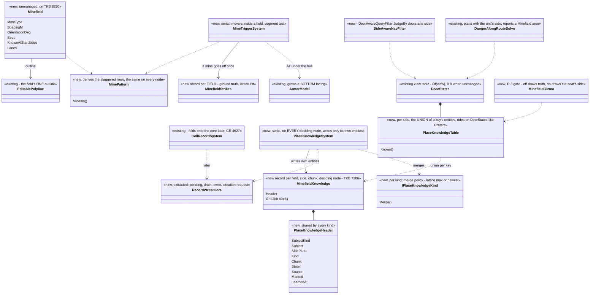
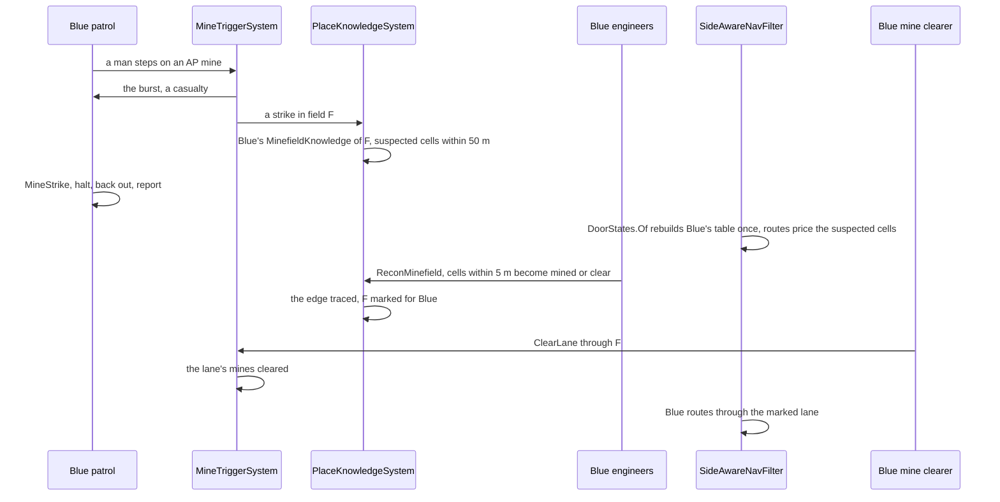
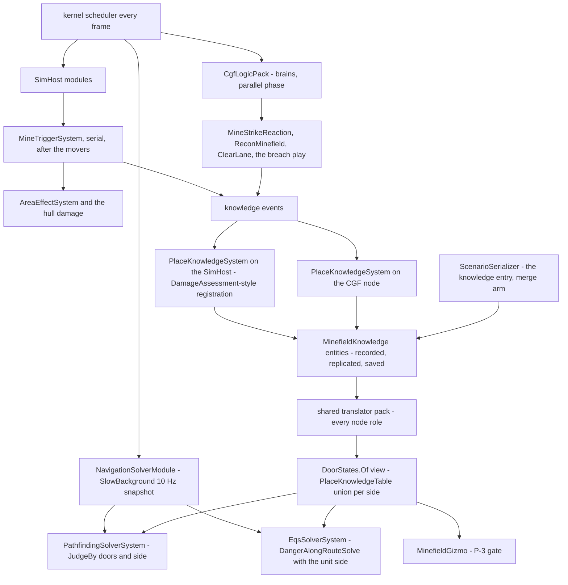

<!--STATUS
state: LIVE
updated: 2026-11-16
build-state: READY-TO-BUILD (R-4270…R-4274; reviews §8 and §10 approved and folded) — dispatched 2026-11-16 to terrain, behaviors, ui (§4)
current-answer: §3 decisions · §3a the fixed ids · §3b UML · §4 slices per lane · §6.1 the contract · §8 + §10 the reviews (approved) · §9 the generalization's reasoning
stale-below: nothing
known-rot: none
known-conflict: none
related-designs:
  - ../../DESIGN_Ground_Patches_And_Road_Blockage.md — OWNS `GroundDamage` (a replicated record of what blasts did to the ground) and the navmesh areas (crater area) — the minefield's record and area follow both
  - ../../DESIGN_Vehicle_Breaching.md — OWNS the bulldozer's clear order (B-4, CE-4601) and the breach-record pattern the mine-clearing vehicle reuses
  - ../vehicle-tactics/DESIGN_Urban_Armour_Tactics.md — M1 plans a BOTTOM facing "for mines later" — an AT mine strikes it
  - ../../DESIGN_Terrain_Authoring.md — OWNS the scatter's deterministic placement inside a polygon (the pattern MF-2 follows)
  - ../../DESIGN_Civilians_And_Crowd_Control.md — OWNS charges and `TriggerIed` (an IED is a single, command-fired mine)
  - ../../DESIGN_Utility_AI_Demo_Scenarios.md — OWNS the danger-area sensor along a route (§10, R-213) that reports a Minefield area here (KG-7, KG-9)
  - ../../blueprints/Architect_Question_101_Shelling_Fear_And_Shelled_Areas.md — OWNS the shelled area (cross or hold, never avoided) — kept apart from PlaceKnowledge (KG-8)
  - ../../PLAN_Training_And_Gameplay_Engine.md — P-3 OWNS side knowledge of ENTITIES on the 2-D map; PlaceKnowledge is the PLACE half and shares its display filter
-->

# DESIGN — minefields: laid, struck, avoided, breached

🔒 User, `2026-11-16`: *"mines and mine fields and behaviors regarding to them. Mine field is a zone, and the mines have some density inside and must
be deterministically and equidistantly placed. And when someone or something steps on the mine and explodes, this is an indication that that area is
actually dangerous and that the units needs to avoid it. And there needs to be some kind of mine removal vehicle … and an action to clear a passage
through a minefield, which will basically cut the zone into parts."*

## 1. INVENTORY *(measured `2026-11-16`; graph: `search_graph name_pattern=".*(Mine|Minefield|DangerArea|Hazard|Avoid|Clearance|Lane|Breach).*" label=Class` ⇒ the danger-area family, `BreachDoor*`, `HullClearance` — no mine class; `docs/` + `.dev/` searched (minefield / landmine / mine clearing): only `CAPABILITIES.md:442` "Minefields … ⏳" and Urban Armour M1's "Bottom for mines later"; index coverage could not be checked through the CLI)*

| exists | where | used as |
|---|---|---|
| ⭐ **"a blast here ⇒ this area is dangerous"**: `ShelledAreaSystem` notes every burst, merges them, marks a SHELLED danger area units avoid, forgets it later | `ShelledAreas.cs:23, :132` (CE-4583), `DangerAreaKind.Shelled` | ⭐ MF-6's exact precedent — a mine strike is a danger area of kind Minefield |
| the danger-area family: a sensor, kinds (crossings, open ground, gas, shelled), replicated results, the crossing manoeuvre | `DangerAreaSettings.cs:28-40`, `DangerAreaSensorSystem`, `DangerAreaCrossingManeuver` | units sense and avoid / cross danger areas |
| navmesh AREAS priced per mover (door 2, woods 3, crater 4), a per-mover filter | `NavDoorways.cs:19-68`, `NavLayerSelection.cs:20` | MF-7: a minefield area; ⚠ a filter PER SIDE is not measured to exist |
| a replicated, recorded damage record per node (`GroundDamage` craters, `BuildingDamage` breaches) | Ground Patches P-4, Breaching B-2 | MF-3: the record of struck and cleared mines |
| deterministic placement inside a polygon from a seed (the scatter) | Terrain Authoring §18g, `FeatureKinds.cs:216` | MF-2's pattern |
| charges, a burst's area effect, the vehicle damage parts (mobility kill) | `Charges.cs`, `AreaEffectSystem`, Body Parts | the detonation |
| ⛔ an armour BOTTOM facing (planned in Urban Armour M1) | `ArmorModel` | MF-4 needs it for an AT mine |
| the bulldozer's clear order (cut a wall / fell a tree at a point) | B-4, CE-4601 | MF-9's pattern for clearing a lane |
| ⛔ a mine, a minefield, a mine-clearing vehicle, a per-side known-area filter | — | built here |

## 2. The proven pattern *(engineer doctrine and constructive simulations — each piece adopted for a reason, §3)*

| piece | practice | why it fits |
|---|---|---|
| a minefield laid in **ROWS at fixed spacing, staggered** (a standard pattern), density = mines per metre of front | doctrine (row mining, the "standard pattern") | deterministic and equidistant by construction — the user's requirement |
| two families: **anti-personnel** (pressure, a few kg) and **anti-tank** (a vehicle's weight, attacks the BELLY / tracks) | doctrine | different triggers, different victims |
| a field is DISCOVERED by a strike, by seeing marking, or by reconnaissance; until then it is invisible | doctrine | knowledge is PER SIDE |
| on a strike: **halt, do not move, back out on your own tracks**, call engineers | battle drill | the victim's reaction |
| **breaching**: a mine plough or flail vehicle clears a LANE (~4–5 m wide) at walking pace; a line charge (MICLIC) clears ~100 m × 8 m at once; infantry prodding is slow | doctrine | the user's clearing action; the lane is then MARKED |
| one minefield = ONE object in constructive simulations; mines are its derived points | JCATS / OneSAF practice | thousands of mines must not be thousands of entities |

## 3. Decisions *(✅ MF-1…MF-12 APPROVED `2026-11-16`, R-4270 — 🔒 user: *"minefields approved, one field with lanes cut out"*; ✅ MF-13…MF-16 APPROVED, R-4271 — 🔒 user: *"Minefields approved. Please record design and run the review."*)*

| # | question | ⭐ lean | why · blast radius |
|---|---|---|---|
| **MF-1** | what is a minefield? | ⭐ ONE entity: a closed polyline, a mine TYPE (AP / AT / mixed), a SPACING (or density), a ROW ORIENTATION, a seed, and per side whether it is KNOWN at start (own fields are known and marked; enemy fields usually not) | thousands of mines cost one entity; saved, replicated, recorded once |
| **MF-2** | how are mines placed? | ⭐ DERIVED, never stored one by one: rows at the spacing along the orientation, each row offset by half a spacing (staggered), clipped to the polygon — the SAME points on every node from the field's parameters (a seed only for an optional small jitter, 0 by default) | 🔒 user: *"deterministically and equidistantly placed"* |
| **MF-3** | struck and cleared mines | ⭐ a replicated, recorded per-field RECORD of the mine indices that went off or were cleared (a bitset, the `GroundDamage` / breach-record pattern) — a struck mine never goes off twice | every node agrees; replay restores it |
| **MF-4** | the trigger | ⭐ one serial system: for each mover INSIDE a field's bounds, the derived mines under its footprint (a per-field point grid built once); AP ⇒ any person or vehicle; AT ⇒ a vehicle over a weight only (a man walks over it). The burst: AP = a small area effect at the foot; AT = under the hull — the BOTTOM facing (Urban Armour M1, built here), a track / wheel ⇒ mobility kill | the user's *"steps on the mine and explodes"*; cheap (only movers inside a field) |
| **MF-5** | the victim's reaction | ⭐ a reaction **MineStrike**: halt, do not move, the casualty cared for in place, back out along the unit's OWN recent track; report a SPOT of the field to the chain (the existing report path) | the battle drill; the conduct gate (R-4263) keeps a "Dash" from overriding it? — no: a struck unit HALTS (a mine is not fire) |
| **MF-6** | ⭐ "this area is dangerous" | ⭐ a danger area of a new kind **Minefield**, made by a strike exactly as `ShelledAreaSystem` makes a shelled one: a circle round the blast that GROWS with further strikes (merged); known to the VICTIM'S SIDE (its own units and the reported chain); never forgotten (unlike shelling) | reuses the precedent; knowledge is per side |
| **MF-7** | avoiding it | ⭐ units route AROUND known minefield area: a navmesh area **Minefield** stamped for every field, priced per mover by its side's KNOWLEDGE (unknown ⇒ walks in; known ⇒ closed, or a high cost when the order says so) — ⚠ needs a per-SIDE filter: measure `NavLayerSelection` first | the user's *"units need to avoid it"* |
| **MF-8** | a known field and marking | the known extent is what the side has learned (the grown circles, a reconnaissance report, or the whole polygon when marked); a MARKED field (own, or an enemy field found and marked) is known in full | the doctrine's marking |
| **MF-9** | ⭐ the mine-clearing vehicle | ⭐ a new type — an engineering tank with a **mine plough / flail** (and, as a second option, a **line charge**) and an order **ClearLane { start, end, width ~4.5 m }** (the bulldozer's clear-order pattern, B-4): it drives the lane at ~1–2 m/s; the mines in its swept width DETONATE harmlessly (flail) or are turned aside (plough) and are recorded CLEARED (MF-3); the line charge clears ~100 × 8 m at once | 🔒 user: *"some kind of mine removal vehicle … an action to clear a passage"* |
| **MF-10** | ⭐ "cutting the zone into parts" | ⭐ a cleared LANE is a corridor polyline + width SUBTRACTED from the field: the field stays ONE entity with its list of lanes; its mines inside a lane are cleared, the navmesh area is re-stamped without the lane (a passage), the lane is MARKED and known to the clearing side | the user's intent ("parts") without splitting the entity — its identity, record and replay stay one; ⚠ if the user wants literally separate fields, a split is possible but loses the one record |
| **MF-11** | the breach behaviour | the company's breach play (clear the lane under cover — suppression on the far side, smoke, then the lane) and units crossing in single file through the marked lane | the assault design's breach, applied |
| **MF-13** | ⭐ **how does the victim side LEARN the field?** (🔒 user: *"if the single explosion will reveal the whole minefield somehow magically as a simplification, or if the danger area is just around the single exploded mine And the victim side needs to send scouts/engineers … in some simplified way"*) | ⭐ **neither magic nor a dead end — a per-side KNOWLEDGE GRID over each field, filled in three ways**: ① a STRIKE marks the cells within a CONSERVATIVE radius (~50 m) around the blast as **SUSPECTED** — the side avoids them at once (doctrine: a unit that hits a mine assumes it is IN a minefield); ② an **ENGINEER or SCOUT** team on a `ReconMinefield { suspected area }` task walks at detector pace (~0.5 m/s) and, within its detection radius (~5 m), turns cells into **KNOWN-MINED** (the field covers them) or **KNOWN-CLEAR** (it does not) — following the boundary it finds (a deterministic edge-trace on the grid), so the field's extent appears as it walks; ③ when the trace closes (or the team is ordered to **MARK** it), the field becomes **MARKED** — known in full to that side and drawn as the marked minefield. Further strikes add suspected circles; a recon DRONE may reveal a SURFACE-laid field from the air later (an option, not now) | realistic doctrine (minefield reconnaissance and marking) made SIMPLE: one grid per field per side (a few hundred bytes, 10 m cells), no per-mine detection; navigation avoids suspected + known-mined cells; the knowledge is replicated to the side's nodes |
| **MF-14** | ⭐ **where the knowledge LIVES, how it is recorded and saved** (🔒 user: *"Where would the mine knowledge grid be stored? Is that part of some world singleton … How would it be stored, recorded to the scenario? Because it has to be"*) | ⭐ **NOT a world singleton** — 📐 the shelled area IS node-level (`ShelledAreas.cs:9-16`: "no component id: a restore forgets"), which is right for shelling and WRONG here (knowledge must survive a restore, a replay and a save). ⭐ It follows the **runtime damage-record pattern** the engine already uses for craters, felled trees and breaches (`CellRecordSystem.cs:17-23`, `TreeDamage.cs:21`, `BuildingDamage`): ONE small **record entity per (field, side)** carrying an unmanaged **`MinefieldKnowledge`** component — the field's link, the side, the cell size, the grid at 2 bits per cell (unknown · suspected · known-mined · known-clear) and a **Marked** flag — owned by the node that decides (where the strike or the recon happens), **recorded** (keyframes, seek, replay), **replicated** to every node, and **SAVED** into the scenario through a section keyed by the field's stable id + side, the way `TerrainObjectsSection` saves the breaches (`TerrainObjectsSection.cs:8-20`; the record entity itself transient, rebuilt at load). ⭐ Size: ≤ 1024 B per component (the engine's cap) ⇒ up to 4096 cells — a field up to ~640 × 640 m at 10 m cells; a larger field coarsens its cells (≤ 64 × 64) — fields are rarely larger | one proven pattern, nothing new; runtime knowledge is recorded and saved like runtime damage |
| **MF-15** | ⭐ **OWN minefields** (🔒 user: *"Own minefields should be also avoided by everyone who knows"*) | the field's per-side **known-at-start** flags (MF-1) create that side's record already **Marked** (known in full) — no grid needed until something changes; every unit of a side that knows a field avoids it exactly as an enemy field it has learned: **knowledge is per SIDE, not per field owner** (a field laid by Blue is known to Blue, and to Red only by what Red learns). ⭐ Knowledge is SHARED by the whole side (its common picture — reports travel the chain at once, a simplification) | one rule for own and enemy fields |
| **MF-16** | ⭐ **MANY minefields** (🔒 user: *"what if there are multiple minefield entities? How the knowledge grid will be structured to cover that?"*) | ⭐ there is NO global grid: each field has its OWN records, one per side that knows anything about it (absent ⇒ that side knows nothing). Fields are independent — a strike near two fields marks suspected cells in each field's own grid; a recon team traces whichever field it is on. Avoidance asks every field: a route for a unit of side S is priced through a side-aware navmesh **query filter** (📐 the engine already has a custom filter — `DoorAwareQueryFilter`, `NavDoorways.cs:194` — that is the seam) over the minefield navmesh area: a polygon of field F is closed / costly for S where S's record of F says suspected or known-mined, open otherwise (an unknown field is walked into); the march's danger-area sensor shows known fields ahead per side | per-field state scales with the number of fields; the route filter is the one place sides differ |
| **MF-17** | ⭐ **the knowledge is GENERIC — knowledge of a PLACE per side** (🔒 user: *"maybe this is something which is more generic, the knowledge about some part of the world"*) | ⭐ ✅ R-4273 — §9 KG-1…KG-9 folded: ONE record `PlaceKnowledge` (subject, side, kind, chunk; a common header + a kind-owned payload), ONE writer (events → the serial `PlaceKnowledgeSystem`, the kind's lattice max), ONE set of sharing rules, ONE display filter and ONE `Knows(side, subject, kind)`; the planner's ONE per-side area-cost table, VERSIONED (rebuilt only when a record changes, the `DoorStates.Of` precedent); avoid (planner) vs cross-with-care (danger sensor) kept distinct; only the Minefield kind is built | entity knowledge (contacts, last-known markers) stays out; shelled / gas may later price the same table |
| **MF-12** | authoring and drawing | a Minefield tool (a closed polyline, type, spacing, orientation, seed, known-to sides); drawn as the tactical graphic (a hatched area, mine symbols) ONLY where the viewer's side knows it; the instructor sees all; lanes drawn as marked corridors; individual mines invisible except to the instructor | the user's map; per-side display |

## 3a. The fixed ids — for EVERY lane *(measured free on `coordinator`, `backend`, `ui`, `behaviors`, `terrain`, `2026-11-16`)*

| what | the value | note |
|---|---|---|
| the minefield entity | TKB **8830** `Minefield`, DIS **5 · 0 · 0 · 91** (cultural feature, HROT — beside the scenario macro's `5.0.*.90`), class **`"Minefield"`** = `5.0.*.91` | the authored field (polygon, type, spacing, orientation, seed, known-at-start per side, its lanes) |
| the knowledge record | TKB **7206** `MinefieldKnowledgeRecord` (the record block 7201–7205: ground / tree damage …) | ⭐ MF-17 + KR-7: the minefield KIND of place knowledge (`PlaceKnowledgeKind.Minefield = 1`, 0 = none); one entity per (field, side, chunk, deciding node); transient, saved in the scenario's `knowledge` entry (KR-15) |
| the mines (rounds) | munitions **6051** `TkbMineAntiPersonnel` · **6052** `TkbMineAntiTank` · **6053** `TkbLineCharge` | 6047–6049 smoke, 6050 the radar SAM |
| the mine-clearing vehicle | TKB **116** `Engineer_MineClearer`, DIS **1 · 1 · \* · 9 · 2** (large tracked utility, beside the bulldozer `1.1.*.9.1`), class **`"MineClearer"`** = `1.1.*.9.2` | plough / flail + a line charge mount |
| the navmesh area | **`MinefieldArea = 5`** (door 2, woods 3, crater 4) | per-mover, priced per side by the query filter (MF-16) |
| the danger kind | **`DangerAreaKind.Minefield = 8`** | ⚠ the kinds' bitmask is a SIGNED byte with every bit used (`Shelled` already sits on bit 0) — the review decides how to widen it |
| the components *(✅ R-4274, KR-1…KR-7)* | **`Minefield`** (on 8830: type, spacing, orientation, seed, known-at-start side mask, the lanes — the OUTLINE is the field's ONE `EditablePolyline`, MR-8) · **`MinefieldStrikes`** (per FIELD, ground truth: struck / cleared mines as a list of lattice (row, col), chunked — MR-1, KR-3) · **`MinefieldKnowledge`** (on 7206: the shared **`PlaceKnowledgeHeader`** + the 2-bit grid ≤ **60 × 64**, size asserted by a rail — KR-2, KR-7) — unmanaged, recorded, replicated through the SHARED translator pack (every node role, KG-9); ⭐ the ENGINE lane (terrain) allocates the component ids and DDS ordinals FIRST and publishes them in a NOTE (§6.1) | `PlaceKnowledgeHeader` = subject (`SubjectKind` byte: 1 entity, 2 terrain object · a 16-byte `EntityGuid` or a terrain-object index), side + 1 (0 = none, KR-13), kind, chunk, state, source, `Marked`, `LearnedAt` (`SimInstant`) |
| the side in a route *(KR-9, KR-13, MR-4)* | `RouteQuery.Side` and the path request's pad byte = **ForceId + 1** (0 = no knowledge applied) | the solver AND the danger solve read the carrier's replicated `ForceId` |

## 3b. UML

*What it shows that prose hid: the field's mines are never stored — they are DERIVED; the only runtime state is two records (what went off, what
each side knows), both following the damage-record pattern. ⭐ The knowledge record is GENERIC (`PlaceKnowledge`, MF-17): the minefield is only
its first kind (KR-7: a shared HEADER, a shared writer core and a shared union table; each kind its own small component). Struck mines are
ground truth per FIELD, never per side (KR-3). The side table rides on `DoorStates` like the craters, so every route / sight caller gets it with
no new parameter and 0 B on a steady frame (KR-8).*

*What it shows: knowledge grows in three steps — a strike, a recon, a mark — and every step is a write to ONE record that is recorded, replicated
and saved; the lane then opens a passage for that side only.*

*What it shows: the trigger runs where the movers move, the decisions where the brains run; BOTH nodes write their own knowledge entities and every
reader takes the union (KR-5); the navigation solver and the danger solve run on the 10 Hz snapshot and read the same `DoorStates` view table — no
node writes another node's entity.*

## 4. Slices — ✅ dispatched `2026-11-16` *(backend busy with the animals ⇒ the ENGINE work goes to `terrain`, which built the record family, the crater table on `DoorStates` and the navmesh areas)*

| lane | slices | needs first |
|---|---|---|
| ⭐ **terrain** (engine) | **MS-T1** the field entity + pattern + `MinefieldStrikes` + the trigger (segment test, every body but birds, livestock AT rarely) + the bursts (munitions 6051–6053) + the armour BOTTOM facing · **MS-T2** the place-knowledge core (header, `RecordWriterCore` extracted, `PlaceKnowledgeSystem` on both nodes, the union `PlaceKnowledgeTable` on `DoorStates`, save / merge arm, translators) · **MS-T3** routing: composite navmesh areas + polygon → field map, the side in `RouteQuery` and the path request, known-mined priced very high, suspected priced, road edges priced, the danger kind `Minefield` (kinds widened to `ushort`) from the side's knowledge, SUMO closure · **MS-T4** lanes and clearing: lanes as segments with `ClearedBy`, the serial swath clear for an active plough / flail (seeded survival, proofing), the line charge every ~8 m, the clearer type TKB 116 | ⭐ the ids NOTE (§6.1) published as its FIRST commit |
| **behaviors** | **MS-B1** `MineStrike` (Halts \| LeavesRoute, breadcrumbs back-out, care in place, report, the vehicle drill) · **MS-B2** `ReconMinefield` (left-hand trace on known-clear cells, detector pace, marking) · **MS-B3** `ClearLane` order + the breach play + crossing a lane single file · **MS-B4** the march asks for the `Minefield` danger kind; halt + call engineers | the terrain NOTE; until then stand-ins behind the names in §6.1 |
| **ui** | **MS-U1** the mockup (R-4143) ✅ [`minefields-visuals.svg`](minefields-visuals.svg) (generated by `scripts/gen-minefields-mockup.py`; the mines are MF-2's pattern) · **MS-U2** `MinefieldGizmo` (P-3 gate, the instructor sees all, mine dots from a per-field cache) · **MS-U3** authoring: the area tool's minefield arm (outline, type, spacing, orientation, known-at-start), *Add lane* / *Delete lane*, a struck field's shape refused · **MS-U4** the clearer's kit (TKB 116: plough / flail / line-charge launcher), icons, the flail loop sound and the burst effects | the terrain NOTE; until then stand-ins |
| *(backend)* | — nothing now | |

## 6.1 The contract every lane builds against *(fixed `2026-11-16`; terrain publishes the numeric component ids / DDS ordinals in `NOTE_Terrain_To_All_Minefield_Contract.md` as its FIRST commit)*

| name | shape | owner |
|---|---|---|
| `Minefield` | `MineType` (byte: 1 AP, 2 AT, 3 mixed) · `SpacingM` · `OrientationDeg` · `Seed` · `KnownAtStartSides` (ushort, bit = ForceId) · `AntiHandling` (byte) · lanes (≤ 8: start, end, width, `ClearedBy` side+1, `KnownToSides`) | terrain |
| `MinefieldStrikes` | field guid + chunk + ≤ N lattice (row, col, `How`: 1 struck, 2 cleared) | terrain |
| `MinefieldKnowledge` | `PlaceKnowledgeHeader` + 2-bit cells (0 unknown, 1 suspected, 2 known-clear, 3 known-mined) ≤ 60 × 64 | terrain |
| events | `MineStruck { field, row, col, by, at }` · `MinefieldCellsSwept { field, side, cells }` · `MinefieldMarked { field, side }` · `LaneCleared { field, lane }` — through the batch buffer | terrain declares, behaviors raises |
| reads | `PlaceKnowledgeTable.Of(view).Knows(side, field, row, col)` · `MinePattern.MinesIn(field)` · `MinefieldKnowledgeOps.CellOf(field, point)` | terrain |
| `DangerAreaKind.Minefield = 8` · `DangerAreaKinds` → `ushort` | the march asks for it | terrain + behaviors |
| conduct | `MineStrike` declares `Halts \| LeavesRoute` (R-4263) | behaviors |

## 8. ⛔ The review — `2026-11-16` *(three independent reviewers: doctrine + behaviour, engine fit, authoring / display / the clearer; ✔ = re-measured by the coordinator)* — ✅ APPROVED on every lean (R-4272, `2026-11-16`); livestock set off AT mines rarely; a struck field's shape is not editable

⭐ 32 raw findings merged into 20. NOT buildable as drawn until MR-1…MR-8 are ruled.

| # | sev | the defect | evidence | ⭐ lean |
|---|---|---|---|---|
| MR-1 | ⛔ BLOCKER | the knowledge record breaks the 1024 B cap (4096 cells × 2 bits = 1024 B before its header); a struck-mine BITSET of a large AP field is ~12 KB | `EntityCommandBuffer.cs:39, :87, :122` | the grid capped at 62 × 64 cells (or tiles); NO strike bitset — mines inside a LANE are cleared by geometry, STRUCK mines (sparse) are a capacity-N list of lattice (row, col) indices, more entities past capacity (the cell-record shape, keyed by field) — a lattice index survives a polygon edit |
| MR-2 | ⛔ BLOCKER | the record pattern is "one entity per key per DECIDING node": strikes decided on the SimHost, recon on the CGF ⇒ two entities per (field, side) and a save that throws on a key in two slices | `CellRecordSystem.cs:26-31, :65-96`, `ScenarioMergeCore.cs:183-207` | the union as a LATTICE MAX (unknown < suspected < known-clear < known-mined; Marked OR-ed), order-independent; a sibling of `CellRecordSystem` keyed by (field, side); save / load / merge arms; the saved key the field's stable scenario id |
| MR-3 | ⛔ BLOCKER | ONE navmesh area per span, "a later mark wins": a minefield area stamped over woods lets wheels into the wood, over craters lets vehicles through them — and area 5 cannot tell WHICH field | ✔ `RecastNavmeshFactory.cs:186-197`, `NavDoorways.cs:282-283` | COMPOSITE area ids (Minefield, Minefield + Woods, Minefield + Crater — 64 ids exist); a polygon → field map after the bake (the `DoorPolys` precedent); a lane as a later "open" volume; fields and lanes in the static-obstacle bake's signature (a 0.5–2 s rebake of touched tiles, never a live mesh write) |
| MR-4 | ⛔ BLOCKER | no path request knows the mover's SIDE; road legs bypass the navmesh filter | ✔ `PathfindingEvents.cs:30` (`_pad2`), `RoutePlanner.cs:113` | a side byte in the request (in the pad; a wire row); the solver keeps a per-side area-cost table, ⭐ VERSIONED — rebuilt only when that side's knowledge changes (KG-6, the `DoorStates.Of` precedent) — and re-points the filter; road edges priced by the same table |
| MR-5 | ⛔ BLOCKER | the MineStrike drill has no track to back out on (only a march lead's 80 m breadcrumbs), the medic carries the casualty back ACROSS the field, and the side's own filter traps the struck unit inside closed cells | `SquadManeuverRunner.cs:197-266`, ✔ `CasualtyCareBehavior.cs:39, :98` | a per-mover BREADCRUMB record kept only inside a field's bounds; backing out and the medic follow it (safe by construction: what was under it has gone off); care IN PLACE; a unit's own breadcrumbs are open to its filter |
| MR-6 | ⛔ BLOCKER | MF-5's "a mine is not fire, a Dash halts" cannot be built — the conduct gate refuses ANY forbidden conduct, the only escape is "cannot comply" | ✔ `BehaviorConduct.cs:89-97` | MineStrike declares Halts \| LeavesRoute honestly ⇒ a dismounted squad on a Dash presses on (realistic), a mobility-killed vehicle yields (CD-5); MF-5 rewritten |
| MR-7 | ⛔ BLOCKER | the recon trace is not specified (start, rule, ties, end), and the team would set off the mines it traces; 5 m detection on 10 m cells marks half-swept cells clear | — | the team walks ONLY on its known-clear cells or breadcrumbs; start at the cell nearest the strike, left-hand rule on the 4-neighbourhood, stop at the start or after N cells; a cell known only when FULLY swept; detector pace a tuning value (~0.1–0.3 m/s) |
| MR-8 | ⛔ BLOCKER | per-side DISPLAY is defeated: the area tool gives every area a style and the generic overlay draws it for every viewer; the outline is stored twice (unmanaged `Polygon` + the editable polyline) and an edit re-indexes struck mines | ✔ `MapOverlayGizmo.cs:11-16`, `AreaAuthoringArm.cs:193-199`, `EditablePolyline.cs:18-40` | the outline is the ONE `EditablePolyline`; `Minefield` holds only parameters; the field is born WITHOUT a visible overlay style and ONE `MinefieldGizmo` draws it, filtered by the viewer's side ✔ `StationMode.SideOf` (`StationMode.cs:59`; the instructor = every side); editing a struck field's shape is refused |
| MR-9 | SHOULD | the danger kind: the byte mask is full AND the danger solve has no side; MF-6's circles would be a SECOND store of the knowledge | `DangerAreaSettings.cs:28-58`, `ShelledAreas.cs:12-20` | the kinds widened to `ushort` (bit-0 hack dropped); Minefield footprints DERIVED from the requesting side's record (no circle store); a minefield is NO-ENTER (like gas), never "crossable" |
| MR-10 | SHOULD | the armour BOTTOM silently reads Top (`float[4]` clamped); a downward normal maps to Side | `ArmorModel.cs:13, :74-89`, `BodyZones.cs:24, :33`, `BodyPartHit.cs:98-104` | the array to 5, bottom armour fields defaulting to rear, Bottom in `FaceOf`, an explicit mine path, a rail per consumer |
| MR-11 | SHOULD | `ClearLane` writes the field (another entity, another node's) | `ClearObstacleBehavior.cs:30-39` | lanes in a RECORD owned by the deciding node (like breaches); the serial trigger clears the blade's swath for any mover whose plough / flail is active; the brain only switches its equipment (the bulldozer's outlet pattern) |
| MR-12 | SHOULD | the recon brain and the SimHost strike write the record from the parallel phase / another node | R-4212 | observations as events through the batch buffer, applied by the serial `PlaceKnowledgeSystem` (MF-17) on the owning node; the DDS descriptor ordinals and translators fixed in §3a now |
| MR-13 | SHOULD | knowledge with no witness; marking is per side though physical | — | a strike teaches the side only if a living member is within ~300 m, or when the report is sent; a MARKED field is learned by ANY side (civilians too) whose unit sees its edge |
| MR-14 | SHOULD | a point test lets a fast mover step over a mine at high time scale | — | test the SEGMENT from the last footprint to this one; candidate mines by lattice arithmetic (O(1), 0 B) |
| MR-15 | SHOULD | the breach is 100 % reliable; generic speeds; no follow-up | — | a seeded per-mine survival chance for plough / flail; a proofing pass; tool speeds (flail ~0.3–0.8 m/s); an `AntiHandling` flag per field |
| MR-16 | SHOULD | civilians, animals, SUMO, a vehicle drill | `TrafficBodies.cs:83`, `BridgeClosureSystem` | the trigger over every BODY (birds excluded; livestock sets off AP — AT ⚠ the user's call, lean: rarely); SUMO cars triggered through their bodies and a known / marked road field CLOSED to them; a vehicle drill (halt, crew stays, followers reverse in their tracks) |
| MR-17 | SHOULD | detonation unstated; the flail's own blasts | `Charges.cs:57-70` | each mine publishes the munition's detonation (effects, sound, hearing, crater free); a line charge = detonations every ~8 m; the flail immune to its own; a flail loop sound |
| MR-18 | SHOULD | the lane: no side, no authoring, straight vs polyline | — | lanes are straight segments with `ClearedBy` and a known-to mask, drawn from the lane list; *Add lane* / *Delete lane* through the area tool in line mode |
| MR-19 | SHOULD | slices leave decided pieces homeless; no acceptance; no mockup | R-4143 | a test per slice; a demo (a patrol strikes, engineers trace and mark, the clearer cuts a lane, a squad crosses); the mockup; ui owns TKB 116's kit; the breach play written explicitly |
| MR-20 | NIT | polygon-level filter vs cells; the shared lane; the instructor's dots | `NavDoorways.cs:279` | PassFilter closes a polygon with a known-mined cell, `GetCost` prices suspected cells along a segment; a lane opens per side through the filter; the mine dots from a per-field cache; 7206 renamed in one test |

⭐ **Found sound:** derived mines, one field per entity, own fields known at start and the AP / AT split match doctrine and the constructive
practice; all ids are free; vehicle mass is available; the record pattern stops in replay and records by bytes; the tile-hash rebake covers new
volumes; MF-14's reason against a singleton holds; the ClearLane order needs no new UI (the order form picks two points).

## 9. ✅ Generalize the knowledge — `2026-11-16` *(KG-1…KG-9 APPROVED, R-4273; folded into §3 MF-17, §3a, §3b; this section keeps the reasoning)*

🔒 User, verbatim: *"Approved. An additional question: the knowledge information about the fields. Now it is designed for the fields only, but maybe this is something which is more generic, the knowledge about some part of the world, of the terrain. There could be many things like reconnaissance reports and something. Maybe it could be generalized."*

**INVENTORY** *(graph: `search_graph` name `.*(Knowledge|Intel|Recon|Known|Explored|Fog|Belief|Awareness|Sighting|Spotted|Observed).*`, `.*(Contact|Picture|Memory).*`, `.*(CellRecord|Record(System|Section)|Damage(Record|Cell)|TerrainObjects).*`, label Class; grep for `side-knowledge`, `fog of war`, `CellRecordSystem`; ⚠ index coverage cannot be checked through the CLI)*

| what a side / unit knows today | about | where | saved? |
|---|---|---|---|
| `CommandPicture` (reported elements, subordinates) | ENTITIES, per commander | `Squad/Command/CommandComponents.cs` | no |
| `SquadContacts`, `TargetMemory`, `SensorContactList` | ENTITIES, per squad / unit | Perception, Squad/State | no |
| `KnownCombatantList` | ENTITIES (civilians who fired), per observer | `Combat/KnownCombatants.cs` | no |
| `FiringPositionMemory` (`[UnitMemory]`) | PLACES, per unit | `Combat/FiringPositionMemory.cs` | no |
| `RecentDetonations` | bursts, per node | `Combat/RecentDetonations.cs` | no |
| `ShelledAreas` | PLACES, node-level, no side | `Squad/DangerArea/ShelledAreas.cs` | no (cools in minutes) |
| `RoomKnowledge` | a room, computed from the squad's picture | `Brains/RoomGrenade.cs` | no (derived) |
| `CellRecordSystem<TRecord,TItem>` | the generic per-cell RECORD writer (craters, trees) — keyed by cell + deciding node, no side | `Terrain/CellRecordSystem.cs:16-56` | yes |
| P-3 side knowledge (`ui.side-knowledge`, last-known markers) | ENTITIES on the 2-D map — PLANNED, not designed | `PLAN_Training_And_Gameplay_Engine.md` P-3, `DESIGN_Entity_Control.md` C-9 | — |

⇒ Nothing today holds **per-side, persistent knowledge about a PLACE**. Entity knowledge exists (brain-local, ageing, unsaved) and is a different thing.

**The proven solution for this problem class:** constructive simulations and C2 systems keep GROUND TRUTH apart from each side's PERCEIVED picture, and
the perceived picture of terrain is a set of overlay entries (obstacle, minefield, route, area) — each with a subject, a state, a time, a source.
⭐ Adopted for the shape; ⛔ not as one per-side raster of the world (10 × 10 km at 10 m = 1 M cells per side, and a minefield's cells sit on the
field's own rotated lattice).

**⭐ Lean (KG-1…KG-5) — generalize the MACHINERY, keep the PAYLOAD per kind, build only the minefield kind now:**

| # | lean |
|---|---|
| KG-1 | one record, `PlaceKnowledge` (TKB 7206 kept): keyed by (SUBJECT, side, kind, chunk); the subject is a 64-bit stable scenario key — a field / area entity's scenario id, or a terrain-object key (a bridge, a building); a fixed header (kind, state, learned-at, source, marked) + a kind-owned payload within the 1 KB cap |
| KG-2 | ONE writer path for every kind: knowledge EVENTS through the batch buffer → one serial `PlaceKnowledgeSystem` on the owning node, merge by the kind's lattice max (order-free), the save / load / merge arms, the record's ownership — the `CellRecordSystem` shape, keyed by subject instead of cell |
| KG-3 | ONE set of sharing rules: a side learns by a witness within range or by a report; a MARKED subject is learned by every side that sees it; the instructor sees all |
| KG-4 | ONE display filter (`StationMode.SideOf`) and one query (`Knows(side, subject, kind)`) for the map, the path filter, the danger solve and the brains |
| KG-5 | kinds: **Minefield** built now (§3 + §8 unchanged, its cells the payload). Named, NOT built: obstacle / bridge / route state known, building cleared, area reconnoitred. ⛔ Entity knowledge stays out (contacts, the P-3 last-known markers): moving, ageing, brain-local, already homed |

### 9a. Routes, danger areas and the cost of the per-side table — `2026-11-16`

🔒 User: *"'built once per tick' - i hope it usually does not need to be done so often … how the route planning is working with the knowledge? … 'potentially dangerous areas on the road junctions' … 'areas under fire' … might need unification."*

**Measured today** *(graph: `search_graph` `.*(Danger|Shelled|UnderFire|Junction|Crossing|AreaCost|QueryFilter|RouteCost).*`, Class; grep)*:

| | as built | evidence |
|---|---|---|
| the planner avoids NOTHING but blocked terrain and closed doors | the path filter takes a layer mask and the door states only | `DotRecastNavmeshProvider.cs:90-102, :430-442`; AQ101 inventory: *"movement that avoids an area: none"* |
| danger areas are found ALONG an already-planned route, then the squad CROSSES or HOLDS | `DangerAlongRouteSolve` (the planner's own route) → `DangerAlongRouteClassifier` (street crossing, intersection, open ground) + gas + shelled footprints; the march asks every 2 s | `DangerAlongRouteSolve.cs:11-33`, `DangerAlongRouteClassifier.cs:7-26`, `SquadMarchBehavior.cs:207-224` |
| the shelled area ("under fire") is a danger kind like gas: crossed or held, never routed around; node-level, no side, cools in minutes | `ShelledAreas.cs:23-52` | AQ101 §R D (R-4227) |
| a per-view table rebuilt only when something changed | `DoorStates.Of` returns the same table while nothing changed — O(1) | R-220, `TerrainWorld.cs:232` |

**⭐ Lean (KG-6…KG-8):**

| # | lean |
|---|---|
| KG-6 | ⛔ NOT rebuilt every tick ⚠ *(reworded by KR-8: not a version — it rides on `DoorStates.Of`, which returns the previous table when nothing changed)*: the per-side minefield table is VERSIONED like `DoorStates.Of` — rebuilt only when a `PlaceKnowledge` record of that side changes (a strike, a swept cell: rare), otherwise the same table; a query's cost is one array lookup per polygon (MR-4 amended) |
| KG-7 | TWO mechanisms, kept distinct on purpose: **avoid** (the planner's per-side cost / closure — known-mined closed, suspected priced) and **cross with care** (the danger-area sensor along the planned route + the squad's cross-or-hold decision). A minefield uses both: the planner goes round it when it can; when it cannot (no way round, or the order goes through), the route's danger sensor reports a `Minefield` area and the squad halts and calls engineers (MR-9) |
| KG-8 | the UNIFICATION point is the planner's ONE per-side area-cost table, not the danger kinds: minefields fill it now; a shelled or gas area MAY later add a cost through the same table (go round when cheap, else cross with care) — ⛔ not built now (AQ101 ruled cross-or-hold). Junction / crossing / open-ground areas are route GEOMETRY, not knowledge: they stay in the sensor. The shelled area stays node-level and short-lived (not a `PlaceKnowledge` kind); ⚠ its missing SIDE (every side's squads see every shelling) is a gap, filed, not fixed here |
| KG-9 | ⭐ the navigation node (the Muscle, where the danger solve and the planner run) HAS the knowledge: `PlaceKnowledge` and `Minefield` replicate through the shared translator pack every node role installs — the `GroundDamage` precedent (`SharedTranslatorPack.cs:14-16, :86-87`); the sensor's unit side comes from the replicated affiliation (`EntityInfo`, the same pack). The solve adds a `Minefield` area when the route enters a cell the UNIT'S SIDE knows as mined or suspected; the march asks for the kind (`SquadMarchBehavior.cs:218-222`) |

## 10. ✅ The independent review of the generalization (MF-17) — `2026-11-16`

🔒 User, verbatim: *"approved, fold it in. Mark ready to build only after one more independent review of the knowledge generalization."*

⭐ One independent reviewer; 15 findings (3 blockers). ✔ = re-measured by the coordinator. ✅ APPROVED on every lean (R-4274, `2026-11-16`) — folded into §3a, §3b, §4, §6.1.

🔒 User, verbatim: *"approved both, fold it in and write the handoffs to the lanes that are free"*

| # | sev | the defect | evidence | ⭐ lean |
|---|---|---|---|---|
| KR-1 | ⛔ BLOCKER | no 64-bit stable scenario key exists: `EntityGuid` is a 128-bit `Guid`, a terrain-object key is a STRING | ✔ `EntityGuid.cs:18-20`, `TerrainObjects.cs:29-31`; precedent `BuildingDamage.cs:51-59` (an `int` building index, saved by the string) | the subject is (subject kind byte + a 16-byte `EntityGuid`, or a terrain-object index); saved as the guid or the string |
| KR-2 | ⛔ BLOCKER | header + 62 × 64 × 2 bits = ~1032 B > 1024 | `EntityCommandBuffer.cs:39`; `SimInstant` is 8 B | the grid ≤ 60 × 64; the size asserted by a rail (`Unsafe.SizeOf`) |
| KR-3 | ⛔ BLOCKER | the UML puts `StruckLattice` in the per-side payload — ground truth duplicated per side | §3b vs §3a / MR-1 | the payload is the 2-bit grid only; struck mines stay in the per-field `MinefieldStrikes` |
| KR-4 | SHOULD | "lattice max" is a minefield property; a bridge (intact → destroyed → repaired) or a building (cleared → re-occupied) is not monotone; the header has no merge rule | — | the merge is a per-kind POLICY (lattice max · newest by `LearnedAt`); the header: `LearnedAt` max, `Marked` OR |
| KR-5 | SHOULD | two deciding nodes ⇒ two entities per key; the diagrams show one writer | `CellRecordSystem.cs:26-31, :64-81`, `ScenarioLoadStep.cs:272-284` | `PlaceKnowledgeSystem` on EVERY deciding node (SimHost, CGF), writing its own entities; `Knows` and the table read the UNION (merge over every entity of a key); drawn |
| KR-6 | SHOULD | a THIRD copy of the record writer (`CellRecordSystem`, `BuildingDamageSystem` already duplicate the pending / drain / owns core) | `BuildingDamageSystem.cs:61-173` vs `CellRecordSystem.cs:41-125` | extract a key-generic record-writer core; the knowledge system uses it; folding the other two onto it filed as a tracker row |
| KR-7 | SHOULD | one union component with a raw payload costs ~1 KB per record for every future kind and makes readers reinterpret bytes | `CellRecordSystem<TRecord,TItem>` is generic over component TYPES | ⭐ the generic part is the shared HEADER struct, the writer core, the union reader, `Knows` and the table builder; each kind is its OWN unmanaged component — only `MinefieldKnowledge` (header + grid) is built (supersedes KG-1's single `PlaceKnowledge` component; the concept keeps the name) |
| KR-8 | SHOULD | "VERSIONED like `DoorStates.Of`" is wrong: it is never keyed on a version (a write in the tick would be stale); it re-reads per thread and returns the previous table when equal | ✔ `TerrainObjects.cs:108-111`; craters ride on it (`GroundDamage.cs:240-245`) | a `PlaceKnowledgeTable` (per side) rides on `DoorStates` like `Craters` — reaches every path / sight caller with no new parameter, 0 B on a steady frame; `JudgeBy(doors, side)`; KG-6 reworded |
| KR-9 | SHOULD | the danger solve plans its route with NO side, so it would watch a different route than the unit drives | ✔ `DangerAlongRouteSolve.cs:53-56` | the side in `RouteQuery`; the solver and the danger solve read the carrier's `ForceId` (replicated `EntityInfo`) |
| KR-10 | SHOULD | if known-mined cells are CLOSED, a plan through a field FAILS and the danger sensor never reports the field (KG-7 unreachable) | `DangerAlongRouteSolve.cs:57-61` | known-mined cells PRICED very high (not closed) ⇒ the route goes round when it can, and through only when nothing else exists — the sensor then reports the Minefield area and the squad halts |
| KR-11 | SHOULD | the per-side DISPLAY ignores P-3's feature gate (side-limited map is OFF by default, Zeus) | `PLAN_Training_And_Gameplay_Engine.md:39` | the minefield gizmo follows P-3's gate: off ⇒ every field drawn (as truth, Zeus); on ⇒ the seat's side knowledge; the AI always uses its side's knowledge |
| KR-12 | SHOULD | the module diagram omits the navigation solver (10 Hz snapshot), the EQS danger solve, the writer on both nodes, the table builder | `NavigationSolverModule.cs:28`, `DamageAssessmentModule.cs:32` | drawn |
| KR-13 | NIT | side 0 is `Neutral` — an unset pad would price with the civilians' knowledge | `ForceId.cs:13`, `PathfindingEvents.cs:30` | store side + 1; 0 = no knowledge applied |
| KR-14 | NIT | "one lookup per polygon" — the table knows no polygons | — | the polygon → (field, cells) map is static at bake; the side's cell state is read per cell |
| KR-15 | NIT | saved under `terrainObjects`, but a minefield guid is not a terrain object; a merge throws on a duplicate key | `ScenarioMergeCore.cs:181-206` | a `knowledge` entry keyed (subject, side, kind, chunk) with a merge arm applying the kind's policy |

⭐ **Found sound:** no prior art for per-side knowledge of a place (P-3 is entities and display only); the navigation node receives the
knowledge and the side through the shared pack; the record family (serial writer, stops in replay, recorded by bytes) fits; avoid vs cross-with-care
and the shelled area kept apart agree with AQ101; observations as events respect R-4212. ⚠ TKB 7206 is free in production (a test-local constant
in `EjectionSystemTests.cs:26` only).

## 11. ui as built — `2026-11-16` *(CE-4624 MS-U1, MS-U2, MS-U4; status `STATUS_Ui_Minefields.md`)*

| piece | as built | rail |
|---|---|---|
| MS-U1 the mockup | [`minefields-visuals.svg`](minefields-visuals.svg), generated by `scripts/gen-minefields-mockup.py` (the mines are MF-2's pattern) | — |
| MS-U2 `MinefieldGizmo` | `[GizmoProjector(SimTransform, Minefield)]`, ONE drawing for 2-D and 3-D (`Hrot.Presentation/ScenarioEditor/Gizmos/MinefieldGizmo.cs`). ⭐ R-1054: the P-3 gate is a gizmo SETTING `map.sideLimited` (default OFF = the truth for everyone, KR-11) — P-3's own gate does not exist yet; with it ON a seat with a side sees its side, a station without one (the instructor) the truth. Truth = the dashed outline, every derived mine (AP cross, AT square; > 3000 ⇒ every n-th), a struck mine starred, a cleared one gone (from `MinefieldStrikes` by the field's `EntityGuid`), every lane. A side knowing the field IN FULL (known at start, or `PlaceKnowledgeTable.Marked`) = a light fill, the solid outline, a mine symbol every ~60 m of edge (2-D) / a picket with a red triangle sign (3-D), the label, the lanes known to it; ⛔ never a single mine. Otherwise only its knowledge CELLS (suspected / known-mined / known-clear) on the field's rotated lattice — no outline, no pick. Per-field cache rebuilt on a change of parameters, outline instance or position; 0 B a steady frame | `MinefieldGizmoRail` (4) |
| MS-U4 the clearer | `VisualFamily.MineClearer`, `ShapeKits.MineClearer`, the flail drum (`PartRole.FlailDrum`, `FlailActivity` — a stand-in reader until MS-T4), the flail loop — `DESIGN_Map_3D_Mode.md` §6al.4 | `MineClearerModelRail` (6) |
| MS-U3 authoring | `MinefieldOps` (`AddEntity/`): type · spacing 2…100 · orientation wrapped to [0,360) · seed · anti-handling · known-at-start side · `AddLane` (≤ 8, width 4.5) · `DeleteLane` (compacts) — each ONE undo step, no-op when unchanged; `ShapeLock` (a Struck entry of a `MinefieldStrikes` keyed by the field's `EntityGuid`) and `Counts` (cached per field, 0 B steady). The ONE area tool: `PlacementToolRegistry.Graphics` has "Minefield" (8830); `AreaAuthoringArm.BornWith` drops the `MapOverlayStyle` (MR-8) and adds `MinefieldOps.Default()` (Mixed, 10 m, 0°, seed 1). Form: `MinefieldDetailsView` (`details.minefield`, rank 39, `Hrot.Editor.AiShared/Shell`), the mockup's rows + Lanes (trash = `DeleteLane`) + Add lane. **Add lane = the area tool in LINE mode**: `ScenarioSpawnAdapter.StartLaneAuthoringMode` arms the same `AreaAuthoringArm` (MinPoints 2, open) with a sink that calls `AddLane` with the line's first and last points (click A, click B, Enter / ✓) — no entity is spawned. **Shape lock** through ONE hook, `OutlineEditPolicy` (`ScenarioEditor/Gizmos`): `VertexEditGizmo` asks `ReasonFor(world, entity)` before a move / centre drag / insert / delete and puts the reason on the hint line; the minefield registers `MinefieldOps.OutlineRefusal`. Cross-lane, one line each: `HrotSharedComponentRegistry` registers `Minefield` (terrain's MS-T1 had not); `Icons` keys `minefield/field` (FA land-mine-on, red) and `minefield/lanes` | `MinefieldOpsTests` (7) · `MinefieldDetailsViewTests` (3, frame rail under xvfb) |
| re-bind still open | `["MineClearer"]` in `FamilyOfClass` (MS-T4 declares the class) · `FlailActivity.IsOn` from MS-T4's flail state · the cells light up once MS-T2's `PlaceKnowledgeTable` is real (no ui change) | — |
