<!--STATUS
state: LIVE
updated: 2026-10-20 (§5g CE-3287 a wreck / a parked vehicle is never pushed · §5f CE-3286 decided and designed: the hull guard + the backing recovery, R-3025 · §5e measured) · 2026-10-16 (§5c CE-2206 a point inside the turning circle is reached · §5d CE-2211/CE-2213 the rotorcraft strike mode)
build-state: BUILT (§5f, live 2026-10-20) · BUILT (v1) — 🔒 user, 2026-10-14: "MD-A to MD-H approved"; MD-B's ownership half AMENDED the same day (R-3005, CE-3199): ONE Muscle role, MuscleGround, owns every body's position (§5a)
current-answer: ⭐ §5g (CE-3287: a wreck never moves, a vehicle not driving is never pushed, R-3026) · §5f (CE-3286: a hull never enters a building and backs out of a wall, R-3025) · §5e (its measurement) · §3 (the proposal), §4 (decisions), §5 (as-built), §5a (the ownership decision, R-3005) and §5b (the ground model's arrival and walls, CE-2198) — §1 measured ground, §2 the requirement. · §5c (a point inside the turning circle, CE-2206) · §5d (the rotorcraft strike mode, CE-2211)
stale-below: nothing.
known-rot: §4 MD-B's "one ownership role per domain" is SUPERSEDED by R-3005 (one Muscle role) — the module-per-domain half stands.
known-conflict: docs/designs/navig-2/Navigation_Design_v2_0.md §7.1 routes Naval / Flying as extra KinematicsMode values INSIDE CarKinematics ("impl TBD", never built); this proposal gives each domain its own module instead (MD-B) — reconcile on approval.
related-designs:
  - docs/designs/airborne/DESIGN_Airborne_Insertion.md — OWNS two new air classes (Rope, Parachute), their models (RopeSlideModel, ParachuteModel) and the replicated Descent component that makes a Pedestrian TYPE an air body for a descent (D-1…D-3)
  - docs/designs/air-attack/DESIGN_Air_Operations.md — OWNS the aircraft route follower (AirRoute / AirPath), FixedWingModel (this file's MD-H row, now designed) and RotorcraftModel's route, tilt, take-off and landing (R-2015)
  - docs/designs/navig-2/Navigation_Design_v2_0.md — OWNS NavigationIntent, the bridge, the path providers (ground navmesh, volumetric) and layer selection; this file decides which MOTION MODEL consumes the intent
  - docs/DESIGN_Entity_Control.md — OWNS possession and manual drive (R-270, R-271 (backend): ManualDrive, KinematicsMode.Manual, FPS = possession by one station); this file makes manual drive per locomotion class (MD-D)
  - docs/DESIGN_Body_Geometry_And_Ground_Contact.md — OWNS body geometry, resting pose and the future "flight / parked motion model" (§3.1, §5); MD-G uses it
  - docs/DESIGN_Ownership_Groups_And_Grants.md — OWNS ownership groups per ROLE (R-172) and the kinematic group (R-170); R-3005: a flyer joins that one MuscleGround group (no per-domain role)
  - docs/DESIGN_World_Query_Seam.md — OWNS "every engine capability behind an interface" (R-250, R-252; §4a: controllers "are motion models — exactly what the production engine will supply"); the motion-model interface is that seam for motion
  - docs/designs/vehicle-tactics/DESIGN_FPV_Drone.md — the first consumer: a rotorcraft on the Air domain, AI-flown and possessable
  - docs/designs/vehicle-tactics/DESIGN_Vehicle_Exposure_Cycle.md — V5 (AI reverse) is a fix inside the ground domain's wheeled / tracked models
-->

# Motion domains — one extendable architecture for people, vehicles, aircraft, boats and amphibians

## 2. The requirement

🔒 User, `2026-10-14`: *"We will need aircraft and boats and amphibious vehicles so we should design for that early, no ad hoc exceptions,
rather initially limited but extendable architecture. Motion needs to stay on muscle node."* · *"Drone will need to be controllable also
from FPS possess mode as any possessable movable entity."* · *"We can ignore stride completely."*

🔒 User, earlier (`.dev/_DONE/modularizing/design-talk.md:171`): *"I want to have different nodes playing the Sim's role, each taking care
of different kind of entities (like aircraft flight model Sim, ground vehicle Sim, human motion Sim etc.) Actually, i want these to be
separated on a ModuleHost's Module level."* — only `GroundKinematicsModule` and `NodeRole.MuscleGround` were ever built.

## 1. What exists — measured `2026-10-14`

| fact | where |
|---|---|
| routing to motion is by COMPONENT, no motion-model seam: `VehicleState + VehicleParams + NavState` ⇒ `CarKinematicsSystem`; `CrowdAgent` ⇒ crowd; else `SimTransform + SimVelocity` ⇒ `LinearKinematicsSystem` (today: projectiles) | `CarKinematicsSystem.cs:80-90`, `LinearKinematicsSystem.cs:91-111` |
| inside CarKinematics the model is an `if`: `Pedestrian ? HumanGait : BicycleModel`, and the same `if` picks `ManualMotion.Person / .Vehicle`; 2.5-D (yaw only, no vertical control) | `CarKinematicsSystem.cs:165-195,339-389,434-436` |
| `TerrainMobility { Tracked, Wheeled, Infantry, Air, Naval }` collapses to `VehicleClass` — **Air and Naval become PersonalCar** | `SimVehicleDef.cs:3-10`, `BdcTkbBuilder.cs:431-439` |
| `KinematicsMode.Crowd / Naval / Flying`, `NavAgentProfile.MobilityProfile`, `NavLayerMask.Naval / Air`: declared, never read or written in production; SimHost composes no volumetric provider | `NavigationEnums.cs:13-27`, `PathfindingSolverSystem.cs:185-192`, `SimHostNodeBootstrapper.cs:319` |
| commands Brain → Muscle: `NavigationIntent` (autonomous, Vector3 destination) and `ManualDrive { Forward, Lateral, Steer, Yaw, Gait, Seq }` (manual) — both Brain group, replicated | `NavigationComponents.cs:230-333`, `ManualDrive.cs`, `HrotOwnershipGroups.cs:45,70` |
| possession: station → `OperatorControlFrameEvent` → `PossessionSystem` (Brain) → `OperatorControl` behaviour → `NavigationIntent.Mode = Manual` + `ManualDrive` → the Muscle's Manual branch; the station knows only person vs vehicle (`FpsCameraDriver.IsVehicle`); "possessable" is no marker — any addressable, live unit | `Possession.cs:117-234`, `OperatorControlBehavior.cs:53-82`, `PossessionStation.cs:194` |
| ownership: one motion role, `MuscleGround` (kinematic group: `SimTransform, SimVelocity, VehicleState, VehicleParams, NavState, NavigationStatus, …`), granted when the template has `VehicleParametersDto` | `HrotOwnershipGroups.cs:78-123`, `NodeRole.cs:89` |
| no naval / boat / amphibious / flight code anywhere | graph + grep |

### INVENTORY — the queries run

| query | total | the set |
|---|---|---|
| `search_graph .*Kinematic.*` (Class) + grep `SimTransform` writers | 6 movers | CarKinematics (+HumanGait, BicycleModel, ManualMotion), CrowdAgentUpdate, LinearKinematics, Ballistics (gravity), EmbarkedState (passengers), DeadReckoningSync (ghosts) |
| `search_graph .*Naval.*\|.*Boat.*\|.*Ship.*\|.*Amphib.*\|.*Flight.*` (Class) | 0 | — |

## 3. The proposal

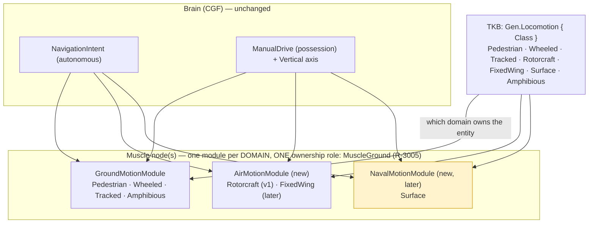

*What the picture shows that prose hid: the Brain side does not change at all — one autonomous command and one manual command for every
kind of mover; the domains differ only on the Muscle, each in its own module with its own ownership role, so one SimHost can hold all
three (the default) or three nodes can each hold one — the earlier requirement.*

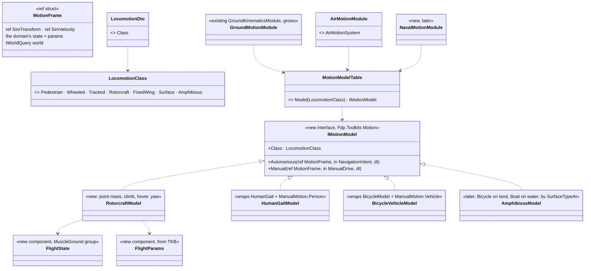

*What the picture shows: one interface, one table from class to model; a module per domain only SCHEDULES its classes' models. A new mover
is a new model + a table row, never a branch in someone else's system. Ground's existing `if Pedestrian` becomes two table rows.*

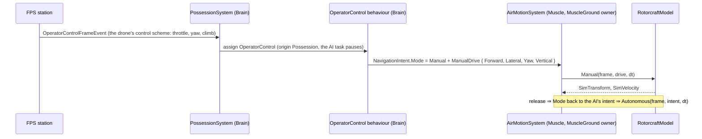

*Possession of a drone is the existing chain; only the axes and the model differ — the same holds for a boat later.*

## 4. Decisions — 🔒 APPROVED `2026-10-14` ("MD-A to MD-H approved")

| id | question | lean | blast radius / what would change it |
|---|---|---|---|
| **MD-A** | how a type says how it moves | a TKB `Gen.Locomotion { Class }` with the 7 classes; `VehicleClass` stays as the ground preset key; the lossy `Air/Naval → PersonalCar` mapping ends | TKB data + one translator; every existing type maps 1:1 (Infantry→Pedestrian, Wheeled, Tracked) |
| **MD-B** | where each domain runs | **one module per domain** (Ground = the existing module, Air new, Naval later). ⛔ ~~and one ownership role per domain (`MuscleGround`, `MuscleAir`, `MuscleNaval`) with its own kinematic group~~ — ⭐ **AMENDED `2026-10-14` (R-3005, CE-3199): ONE Muscle role, `MuscleGround` (name kept), owns every body's position;** the domain modules all run on the node holding it (§5a) | the earlier requirement; ownership groups + node plans; ⚠ supersedes Navigation v2 §7.1's "modes inside CarKinematics" |
| **MD-C** | the seam | `IMotionModel { Autonomous, Manual }` + a class → model table; new domains use it from day one; ground's two branches become `HumanGaitModel` / `BicycleVehicleModel` in its own slice (behaviour-identical, its rails unchanged) | R-250 (engine capability behind an interface); ground refactor is a slice of its own, not a prerequisite for Air |
| **MD-D** | commands and possession | the SAME two commands for every domain: `NavigationIntent` (autonomous, already 3-D) and `ManualDrive` + a `Vertical` axis (climb / dive); the FPS station picks a control scheme by locomotion class instead of `IsVehicle`; any unit with a motion model is possessable — no marker | one wire field; R-270 unchanged |
| **MD-E** | navigation per domain | ground: the navmesh layers (as today); air: the volumetric provider (v1 straight legs between waypoints, obstacles later); naval: the `Naval` navmesh layer (already in the bake parameters); layer selection by locomotion class | Navigation v2 owns the providers |
| **MD-F** | amphibious | ONE model in the Ground domain composing the wheeled and boat integrators, regime chosen each frame by the surface below (`SurfaceTypeAt`); the entity never changes domain on entering water (no ownership move) | needs the boat integrator (Naval) first |
| **MD-G** | grounding (R-249) | each model owns its Z: ground classes clamp to the surface, air never (it lands by `BodyGeometry.RestingPose`), surface rides the water level | ⚠ measured: `GroundClampingConfig` is registered only on IG, so SimHost clamps everything today (assumed, not run) |
| **MD-H** | v1 scope ("initially limited but extendable") | the interface + table, `Gen.Locomotion`, the Air module and role, `RotorcraftModel` (the drone: point mass, hover, climb, yaw, autonomous + manual), the station's air scheme; FixedWing / Surface / Amphibious are enum values and table rows that fail loudly until built | the drone needs exactly this; nothing ground changes in v1 |

⛔ **Rejected:**
- *More `KinematicsMode` values inside CarKinematics* (Navigation v2 §7.1) — every new mover becomes a branch in a ground system, and a
  per-domain node split becomes impossible.
- *The drone's own `PointMassFlightSystem`* (FPV design, first draft) — a one-off mover beside the architecture; it becomes
  `RotorcraftModel` in the Air module.
- *Flyers on `LinearKinematicsSystem`* — that is a projectile integrator with no control, manual or autonomous.

## 5. As-built `2026-10-14` (backend, handoff B10) — and the one decision it needs

The design carries **11 classes** (§3 class diagram), **1 sequence** (possession of a drone) and the domain graph. Built: `LocomotionClass`
+ `LocomotionDto` (`Gen.Locomotion`), the `Locomotion` component (id 375) and `LocomotionTkbTranslator`, `MotionDomain` + `Locomotions`,
`IMotionModel` + `MotionFrame` + `MotionModelTable`, `AirMotionSystem` + `AirMotionModule` (SimHost and the editor's Muscle, through
`SimHostCoreLogicPack`), `RotorcraftModel` (the drone's, B11), `ManualDrive.Vertical` end to end, the station's control scheme by class.
Not built: `GroundMotionModule`'s two-model refactor (MD-H: a later slice), `NavalMotionModule`, `AmphibiousModel` (table rows that fail loudly).

| design said | built | why |
|---|---|---|
| MD-B: ~~role `MuscleAir` with its own kinematic group~~ | ✅ **as decided by R-3005: the ONE `MuscleGround` group** — `HrotOwnershipGroups.HasKinematics` also applies to a template with `Gen.Flight` (`FlightParamsDto`), and `FlightParams` / `FlightState` sit in the group beside `VehicleParams` / `VehicleState`; rail `HrotOwnershipGroupsTests.CE3199_AFlyerIsMovedByTheOneMuscleRole_…` | 📐 before: the drone had no `VehicleParametersDto`, so no group applied and its position stayed with its creator — the SimHost's air module (gated `WithOwned<SimTransform>`) would not have moved it on a split cluster. `Locomotion` stays in no group: TKB classification, provisioned on every node, never written after spawn (like identity, Ownership §1.3) |
| the station picks a scheme by locomotion class | ✅ `ControlScheme { Person, Vehicle, Rotorcraft }` from `Locomotions.Of`; rotorcraft: W/S forward, A/D sideways, mouse yaw, Space / C vertical, the camera on the body | — |
| "one wire field" (`ManualDrive.Vertical`) | ✅ on `EntityManualDrive` **and** on `ControlFrameInteractionPayload` (appended) | ⚠ the station's frame reaches the brain through the interaction union, not the ManualDrive topic — the climb axis must ride both or it never reaches the `OperatorControl` behaviour. Same field, same feature |
| `MotionModelTable` (static) | ✅ a static switch: Rotorcraft → `RotorcraftModel`; ground classes → null (CarKinematics in v1); FixedWing / Surface / Amphibious → `NotSupportedException` | MD-H's "fail loudly" |
| — | `LinearKinematicsSystem` skips a body with a `Locomotion` | it integrated EVERY `SimTransform + SimVelocity` body without `VehicleState` — a drone would have moved twice |
| — | `NedTkbBuilder.WithPhysics` states `Gen.Locomotion` (Tracked / Wheeled / Pedestrian) and — B8 (M6) — the hull's `Body.Geometry`; `MapMobility(Air / Naval)` throws; `WithFlight` states an air type | MD-A: the lossy Air / Naval → PersonalCar mapping ends |

> ⭐ **`2026-10-14` (Air Ops slice 2):** `RotorcraftModel` grew a route follower (take-off, landing on the gear, holds, eased speed,
> pitch and roll) and `MotionFrame` carries the terrain; `AirMotionSystem.RouteSource` compiles the body's `AirPath`. 📄
> `docs/designs/air-attack/DESIGN_Air_Operations.md` §5b.

> ⭐ **`2026-10-14` (Air Ops slice 4):** MD-H's **FixedWing row is built** — `FixedWingModel` (kinematic `AirPath` follower ≥ stall,
> banked from the curvature, circles at the end); `MotionModelTable.Model(FixedWing)` no longer throws (Surface / Amphibious still do).
> 📄 `docs/designs/air-attack/DESIGN_Air_Operations.md` §6a.
>
> ⭐ **`2026-10-14` (Air Ops slice 6, backend half):** the manual side of both air models. `FixedWingModel.Manual` is the mouse-aim pilot
> on the same `ManualDrive` axes: `Yaw` = the look, `Vertical` = the climb angle, `Forward` = throttle. It makes a coordinated, self-banking
> turn and cannot stall. `RotorcraftModel.Manual` keeps its direct axes and gains the route's tilt and an explicit hover hold. No wire change.
> 📄 Air Ops §6b.
>
> ⭐ **`2026-10-14` (R-3007):** `Gen.Flight` + `AccelMps2` (per type; 0 ⇒ the model's own: rotorcraft 3, plane 5) and `DetonatesOnImpact`
> (only a munition-flyer bursts on impact). Manual rotorcraft flight now eases to the axes' velocity at that rate; the plane's throttle is held.

### 5a. The ownership decision — CE-3199 ✅ DECIDED `2026-10-14` (R-3005): option (A), one Muscle role

🔒 User, `2026-10-14`: *"lets drop the whole MuscleXXX (ground, air...) and use one single Muscle role, so all positions are owned by it,
as now."* · *"keep MuscleGround so we do not need to rename"*

| option | what it is | outcome |
|---|---|---|
| ✅ **(A) one kinematic group for every mover** | `MuscleGround` is "the Muscle" (name kept); `HasKinematics` also applies to a flyer; every domain module runs on the node holding it | **chosen** — one line in the table + two members; no wire, no rename |
| (B) domain-exclusive groups (my lean) | a component in several groups whose `AppliesTo` never both hold; `MuscleAir`, `MuscleNaval` | ⛔ rejected — the per-domain node split it kept is not wanted |
| (C) an air position descriptor | a separate dtAirPos | ⛔ a new wire descriptor |

⚠ What (A) gives up, stated so nobody rebuilds it by accident: a split deployment can no longer put the air module on a node of its own —
the earlier *"different nodes … aircraft flight model Sim, ground vehicle Sim"* requirement (§2) is withdrawn for ownership. The
module-per-domain structure (MD-B's first half, MD-C's table) stands.

## 5b. The ground model: a short move ARRIVES, a hull never enters a building — `CE-2198` (`2026-10-16`, backend)

📐 Measured live (`ua-tank-corner`, behaviors' handoff): an M1 sent 37 m at its top speed ran 9 m, then 26 m past its point, into a 4-storey
block, and was lifted onto its 15 m roof. Reproduced in `CarKinematicsSystemTests.CE2198_*`: the path mode drove **440 m** on a 37 m path.

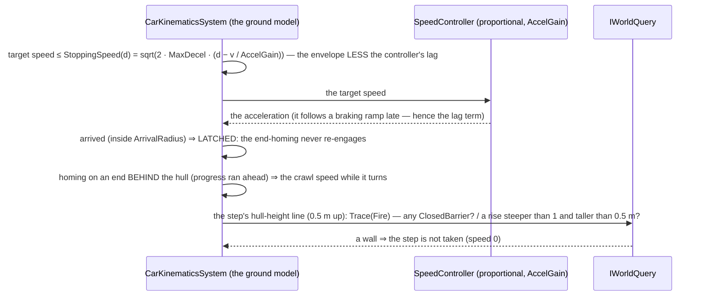

*Caption:* what the picture shows that the code comments hid — the overshoot was a FEEDBACK loop, not a braking constant: the controller's lag
carried the hull past the radius, the CE-2059 end-homing re-targeted a point now behind it at a speed capped only by DISTANCE, the hull could not
turn at speed, so the distance grew and the cap rose. Three cuts, one each; and the building is a wall to the MOVER (a ground vehicle), while
the surface sampler keeps its "a unit spawned inside a footprint stands on the roof" rule for spawns.

| decision (built) | where | rejected — one line each |
|---|---|---|
| one `StoppingSpeed(params, d, v)` for the three envelopes (direct, path end, end-homing), less the lag `v / AccelGain` | `CarKinematicsSystem` | a stronger gain — changes every vehicle's feel; a fixed margin — wrong at every speed but one |
| the arrival LATCHES the end-homing (`HasArrived == 0` to home) | `SampleCustomTrajectory` | re-homing after arrival — the runaway |
| a ground vehicle never takes a step through a `ClosedBarrier` or up a wall | the write-back (beside CE-3145's "a person never steps off a ledge") | the sampler refusing the roof — it would break a unit spawned inside a footprint; static colliders for buildings — a second geometry of the same walls |

## 5c. The ground model: a point inside the turning circle is REACHED, never orbited — `CE-2206` (`2026-10-16`, backend)

📐 Measured live (`ua-javelin-lock`, behaviors' [handoff](../../blueprints/batches/HANDOFF_Behaviors_To_Backend_Vehicle_Orbit.md)): an M1 sent
2.3 m to a cover point drove a ~5 m circle round it for 60 s; the move never ended.

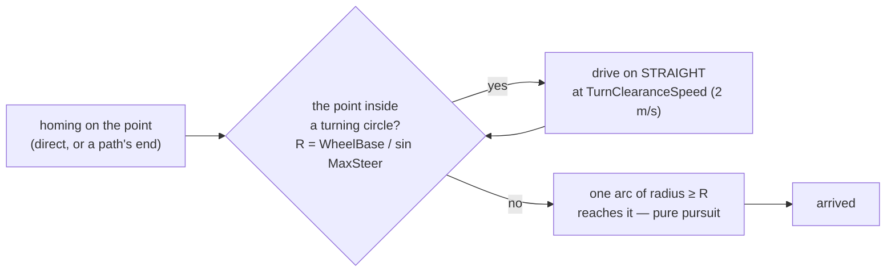

*Caption:* what the picture shows that the code hid — pure pursuit at full lock traces the hull's SMALLEST circle; a point inside it is never
on that circle, so the follower orbits for ever. Driving straight moves both circles off the point (a driver's U-turn), after which a single
arc reaches it. Neither reversing nor a looser arrival is needed.

| decision (built) | where | rejected — one line each |
|---|---|---|
| `InsideTurningCircle(params, pos, fwd, point)`: inside either circle of radius `WheelBase / sin MaxSteerAngle` (the bicycle model's, as the cornering limit uses) ⇒ head straight on at `TurnClearanceSpeed` until it is not | `CarKinematicsSystem` — Direct mode and a path's end-homing | reversing onto it — the circles mirror, a point to the side stays inside; success "as close as the circle allows" — a 2.3 m move could end ~7 m off; a loop detector — state, and it still circles once |

⭐ Rail: `CarKinematicsSystemTests.CE2206_AHullSentToAPointInsideItsTurningCircle_Arrives` (an M1 sent 2.3 m to its left, both modes:
arrives within 2.5 m, the excursion bounded) — red-proofed. Behaviors' CE-2205 (the cycle's 4 m arrival) stays: it serves that caller.

## 5d. The rotorcraft: a flyer that IS its warhead strikes its point — never brakes, never arrives — `CE-2211` (`2026-10-16`, behaviors, cross-lane)

📐 Measured on behaviors' rail `AirAttackNodesTests.S6e_ADroneDivesOnAFleeingTank_LeadsIt_AndHitsItFromAbove`: `RotorcraftModel`'s point move
brakes as √(2ad) and caps the descent at `ClimbMps` — right for a helicopter settling on a point, wrong for an FPV drone diving on a tank,
which slowed over a target that kept going and trailed it at 14 m height.

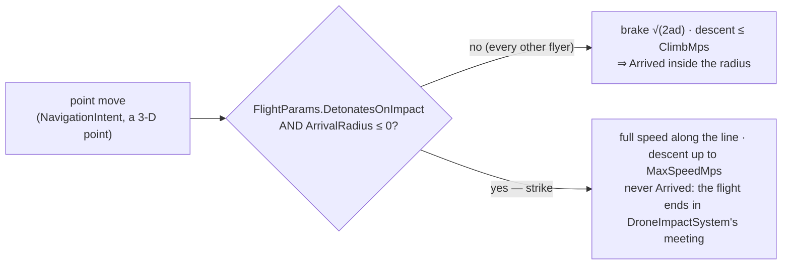

*Caption:* what the picture shows that the code hid — the drone and the helicopter share one point move, and the difference is not a
speed but whether the move is allowed to END. A radius of 0 already says "there is no arrival"; the warhead flag says "so do not slow for it".

| decision (built) | where | rejected — one line each |
|---|---|---|
| strike = `DetonatesOnImpact != 0 && ArrivalRadius <= 0` ⇒ no arrival test, no √(2ad) braking; ⭐ **CE-2213: it flies the STRAIGHT LINE to the point at its speed** — horizontal = speed × flat / distance, vertical = speed × dz / distance (clamped `−MaxSpeed … +ClimbMps`), each eased at the type's acceleration. ⛔ SUPERSEDED (CE-2211 as first built): *"full horizontal speed, vertical up to −MaxSpeed independently"* — measured live and on the real model in the rails: over an evading tank the drone could not shed its horizontal speed, overshot by 10 m and looped into the ground | `RotorcraftModel.Autonomous`, the point move | a dive-speed field on the intent — the braking was the defect, not the speed; a separate drone model — R-3005's one rotorcraft model; strike on the flag alone — a drone sent to a waypoint (radius > 0) must still arrive |

⭐ Rails: `RotorcraftModelTests.CE2211_AFlyerThatIsItsWarhead_StrikesItsPoint_ItDoesNotBrakeOrArrive` (a drone at 60 m sent to a ground point
40 m off reaches it within 4 s — the 72 m line from rest — and is not Arrived; the same body with radius 2 is still above 30 m) — red-proofed (strike off) · ⭐ `CE2213_AStrike_FliesTheLineToItsPoint_NotLevelThenDown` (at 30 m/s and 60 m, a ground point 30 m ahead: over it at 38.5 m — down the line — where CE-2211's rule is still at 52.9 m) — red-proofed (CE-2211's full horizontal). ⚠ Against a FIXED point neither rule overshoots (the one-frame cap stops the horizontal); the overshoot needs a MOVING point, which `AirAttackNodesTests`' evading and fleeing rails (on this model) red-prove. The
behaviour half: [Air Ops §9i](../air-attack/DESIGN_Air_Operations.md) D-3.

## 5e. MEASURED — a hull half inside a building, with no way out — `CE-2198`'s guard is the centre only (`CE-3286`, `2026-10-20`, backend)

📐 Measured live `2026-10-20` (`ua-tank-corner`, `ua-technical-scoot`, a 0.5 s trace of each vehicle's pose and move orders; test-town's
footprints from `test-town.world.geojson`):

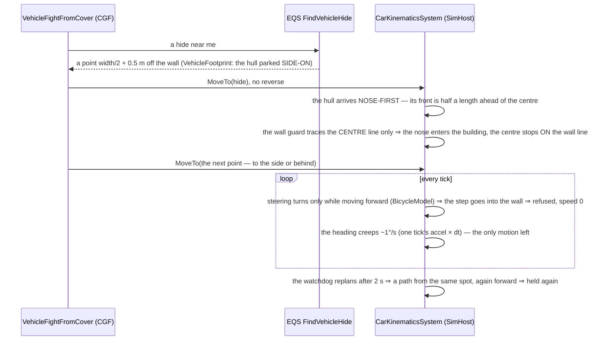

*Caption:* what the picture shows that the code hid — three separate rules each look right alone: the hide's clearance box assumes a
hull parked ALONG the wall, the follower drives to it nose-first, and the wall guard watches only the centre. Together they put the front
half of the hull inside the building, and a vehicle that can turn only while driving forward has no way out except reverse, which only the
cycle's withdrawal asks for.

| run | what the trace shows |
|---|---|
| `ua-tank-corner` (M1 preset 7.0 × 3.5 m, turn radius ~6.3 m) | hide answered at (251.2, 107.7), **2.25 m** off the L-Block's south wall (y 110); the tank drove north to it, its nose 0.2 m into the block; the next move (west, along the wall) turned it into the wall — **centre ON the wall line (249.8, 110.0), front half inside, held 37 s** (t 17–54) while four more moves were issued and one failed; freed only when the heading creep reached ~180° (parallel to the wall) |
| `ua-technical-scoot` (HMG technical) | at its hide (281.9, 227.3), 2.7 m off Block C's south face (y 230), facing NE; a scoot to (250.9, 219.9) — behind-left — turned it into the wall: **centre ON the wall (284.3, 230.0), front half inside, held 207 s to the end of the run**; the cycle then took its next hide (283.8, 228.6) as REACHED (inside the 4 m arrival radius) and sat "hidden" half inside the block |
| both | **no move asked for reverse** (the cycle allows it only on the withdrawal to the same hide, Exposure Cycle §4); the move status stayed `Running` most of the time |

| cause (measured) | where |
|---|---|
| the wall guard traces only the hull's centre at 0.5 m ⇒ the hull may stand with its centre on the wall line | `CarKinematicsSystem.cs:533-556` |
| a stopped hull cannot turn: yaw rate = speed / wheelbase × tan(steer); the guard zeroes the speed each tick | `BicycleModel.cs` |
| the hide's stand-off is width/2 + 0.5 m and its box lies length ALONG the wall — a side-on park the follower never makes | `VehicleFootprint.StandOff` / `Clear`, Exposure Cycle §3 |
| the firing-point query has no clearance check at all (a donut of points, path cost reachable within the navmesh's 2 m snap) | `VehicleTemplates.FindVehicleFiringPoint`, `DotRecastNavmeshProvider.cs:44` |
| the watchdog's replan starts from the held spot, forward again | `NavigationExecutionSystem` frustration guard |

✅ **Decided `2026-10-20` — A + B, the recovery made smart (R-3025): designed and built in §5f.**

## 5f. A hull never enters a building, and one held at a wall BACKS OUT until its way on is clear — `CE-3286` (`2026-10-20`, backend; R-3025)

🔒 User, `2026-10-20`: *"just stopping the vehicle is good but not enough, vehicle it needs to recover, so a+b, and the replan must be smart to avoid ending up in similar situation one meter away"*

### INVENTORY — the queries run

| query | total | the set |
|---|---|---|
| `search_graph` `.*(Unstick\|Recover\|KTurn\|ThreePoint\|BackUp\|Reverse\|Stuck\|Frustration\|HullClear\|Footprint\|Rollout\|Feasib).*` over `CarKinem`, `Navigation`, `Spatial`, `AI.Behaviors.Brains` | 34 | no motion-side recovery or hull clearance exists. Reused: `FrustrationTicks` (the watchdog's never-sent muscle state), `NavigationExecutionSystem`'s `IsBlocked` skip, `NavState.ReverseAllowed` / V5 reverse, `PathLookahead` + `CapLookaheadByChord`, `TrajectoryPoolManager.SampleTrajectory`. ⛔ Not reused: `VehicleFootprint` (EQS — a box at a candidate POINT, not a moving hull), `PeekAndFireNodes.Recover` (a behaviour's retry, not motion) |

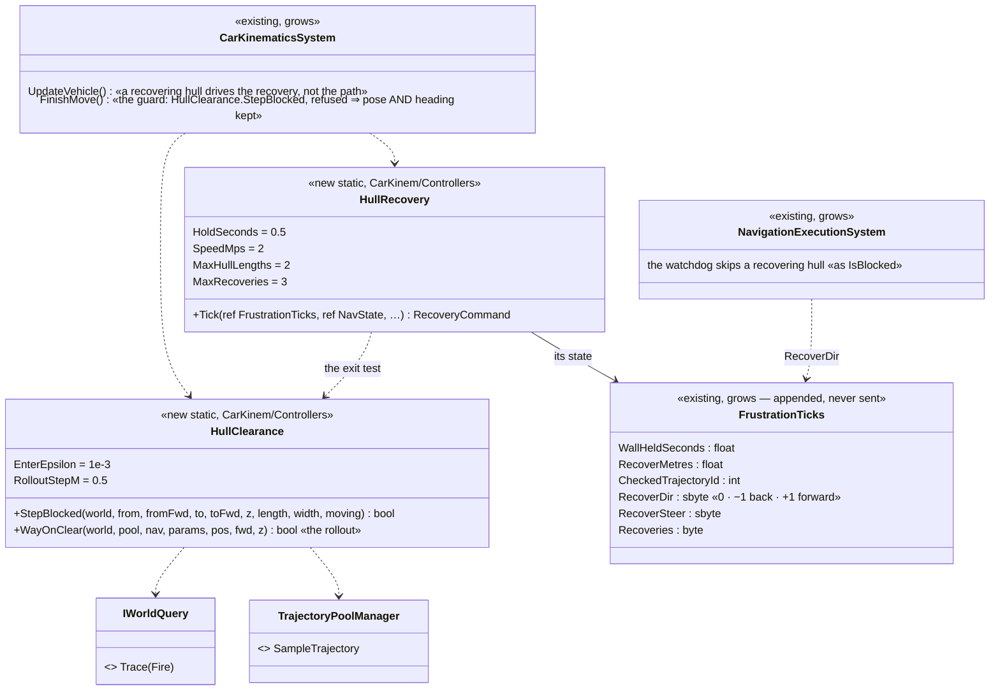

*Caption:* two small static helpers and six appended fields on the watchdog's own component — no new component, id or wire field. The
recovery is the watchdog's remedy for a held hull, so it lives beside the watchdog's counts.

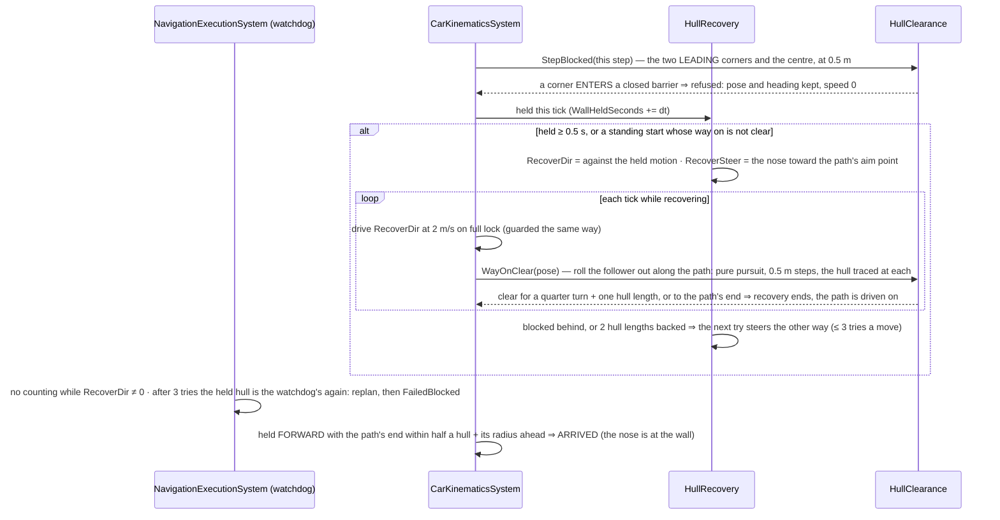

*Caption:* what the picture shows that the prose would hide — "smart" is the EXIT TEST, not the replan: the hull stops backing only when
a rollout of the very follower that will drive it (pure pursuit on the same path, the same hull, the same guard) clears the wall, so it
cannot end "in a similar situation one metre away". The path is kept; it was never wrong — the hull's heading was.

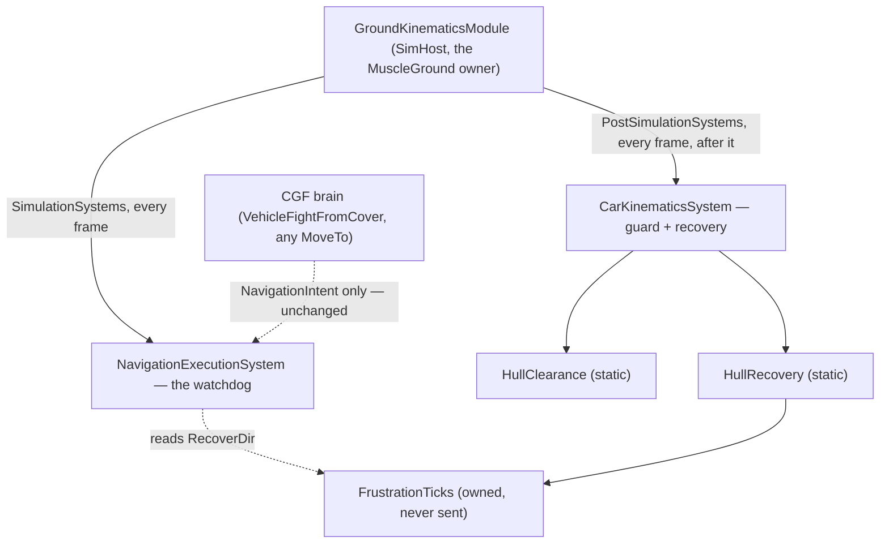

*Caption:* who runs it each frame — only the owner of the hull's position (MuscleGround, R-3005) runs both systems; a brain sends the same
`NavigationIntent` as before and never sees the recovery except as a move that arrives.

| rule | why |
|---|---|
| ⭐ the guard traces the FOUR corners and the centre, each with CE-2198's two tests: the surface under the point RISES like a wall, or its line ENTERS a closed barrier (`T > EnterEpsilon`); a point whose surface had already risen, or that started inside, may move | A: the nose stops at the wall. A hull spawned or left half inside can still leave. ⚠ AS-BUILT `2026-10-20` — deviates from the first draft ("the LEADING corners · a closed barrier", ⛔ SUPERSEDED): all four, because a tight turn swings the TAIL into a wall; and the RISE test, because the stand-in's solid block is NOT a closed barrier (`TerrainWorldQuery.IsClosedBarrier` — a blast meaning, W-7′: "a free-standing wall or a solid block is not one"). 📐 Measured: with the barrier test alone the rails' tank stood 3.5 m inside a block — the live centre was only ever stopped by CE-2198's rise test |
| a refused step keeps the HEADING too | ⛔ the heading creep (~1°/s) swept corners in |
| recovery starts after **0.5 s** held, or AT ONCE on a standing start (a new path) whose way on is not clear | the second is the "smart" half: a hull parked nose to a wall backs out before it touches it |
| recovery drives against the held motion at **2 m/s** (capped by `MaxSpeedRev` when it has one) on FULL LOCK, the nose swinging toward the path's aim point | the reverse leg of a three-point turn |
| it ends when `WayOnClear` holds — a rollout of the path follower (pure pursuit at the path lookahead, 0.5 m steps, horizon a quarter turn at full lock + one hull length, or the path's end) whose every step passes the guard | ⛔ a fixed back-up distance: one metre is the "similar situation one metre away" |
| blocked behind, or **2 hull lengths** backed, ends a try; the next try steers the other way; **3 tries** a move | bounded — a box with no way out fails the move as before (`FailedBlocked`), and the behaviour chooses again |
| the watchdog does not count while `RecoverDir ≠ 0` | a recovery is not being stuck |
| held FORWARD with the path's end ahead within `Length / 2 + ArrivalRadius` ⇒ arrived | a point beside a wall is reached when the nose meets the wall (the hide at 2.25 m off a wall is 1.25 m short of a 7 m hull's centre) |
| persons are untouched | a walker has CE-2304's rule |
| ⚠ the system's shared `_crossings` list was used from `ForEachParallel` | made per-thread with the new traces (a latent race since CE-2198) |

⭐ **Live `2026-10-20` — both shoot-and-scoot demos, before and after** (a 0.5 s trace of each vehicle's pose; the hull's corners against
test-town's footprints; hulls from the live `VehicleParams`: M1 7.93 × 3.66 m, the technical 5.3 × 1.9 m):

| demo · vehicle | before (`18bd6ed48`) | after (`3fc536e33`) |
|---|---|---|
| `ua-tank-corner` · M1 | front 3.98 m inside the L-Block, stuck 13 s and 10.5 s, never reversed, 70 m driven | 0.00 m inside, never stuck, reversed on 5 samples, 67 m driven over 5 moves |
| `ua-technical-scoot` · HMG technical | 2.83 m inside Block C, held to the end of the run, 59 m driven | 0.00 m inside, never stuck, reversed on 5 samples, **158 m** driven over 15 moves — it kept shooting and scooting |
| `ua-technical-scoot` · M1, ATGM technical | — | 0.00 m inside; the ATGM technical killed early in both, as before (the demo's design ending) |

⚠ A first `ua-tank-corner` run after the fix proved nothing: a Javelin hit the tank 7 s in on its first drive (3000 → 1800), a mobility
kill (CE-2197), so it never reached the wall. The runs vary; the table's tank run is the second.

| rejected | the one fact |
|---|---|
| replan from the held pose (the watchdog's remedy) | the path from the same pose starts forward again — measured live (§5e) |
| a fixed back-up distance | the room a hull needs is its turn — a tank needs ~6.3 m of radius, a pickup less |
| a hull-sized navmesh | the navmesh is a disc (1.8 m); a 7 m box's corners are the problem |
| reverse on every behaviour move | a motion fault fixed in every behaviour |

## 5g. A wreck never moves, and a vehicle that is not driving is never pushed — `CE-3287` (`2026-10-20`, backend; R-3026)

🔒 User, `2026-10-20`: *"I have seen destroyed vehicle still moving, maybe being pushed by people coming close"* · *"parked vehicles should not be pushed either"*

📐 Measured (rail `CE3287_*`, red before): one man standing 4 m from a destroyed M1 with no move pushed it **~10 m**. `RVOAvoidance.ApplyAvoidance`
returns the wanted velocity PLUS a push — a separation inside 2 × `AvoidanceRadius` (10 m for the tank) and a repulsion from anyone closing — and
`CarKinematicsSystem` applied it with a wanted velocity of zero; nothing in the ground model read `Health`. The route is not the cause: a running move
is ended at death on the brain (CE-3091, `LocomotionDispatcherSystem` ⇒ `OnExit` ⇒ intent `None`).

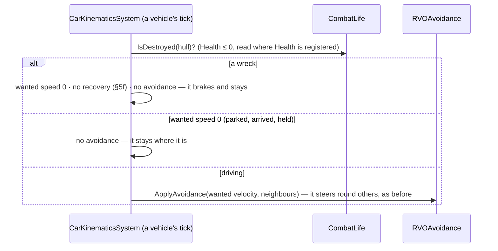

*Caption:* what the picture shows — avoidance is a DRIVER's act: it bends a vehicle's own motion round others. A vehicle with no motion of its own has
nothing to bend, and a person walks round it (a person's avoidance is untouched — it sees the vehicle as a neighbour).

| rule | why |
|---|---|
| a destroyed hull (`CombatLife.IsDestroyed`) is driven at speed 0 and takes no recovery try | a wreck has no driver; belt and braces with CE-3091 (a move the brain has not ended yet) |
| a vehicle whose wanted speed is 0 gets no avoidance push | 🔒 "parked vehicles should not be pushed either" |
| a driving vehicle avoids as before | `System_AvoidanceMovesVehicle`, the RVO rails |
| persons unchanged | crowds still part; a person steps round a vehicle |

| rejected | the one fact |
|---|---|
| strip the push inside `RVOAvoidance` | it is shared by persons, who must keep parting |
| read `CanMove` instead of `Health` | `ActorCapabilityState` is the brain's group (`HrotOwnershipGroups.cs:54`); `Health` is the one the presentation already reads for a wreck (`IsDestroyed`) |
